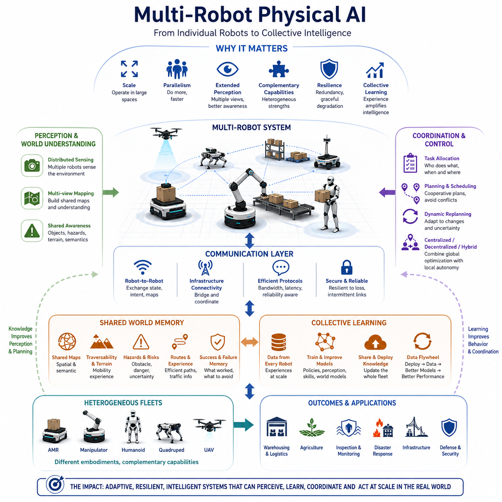
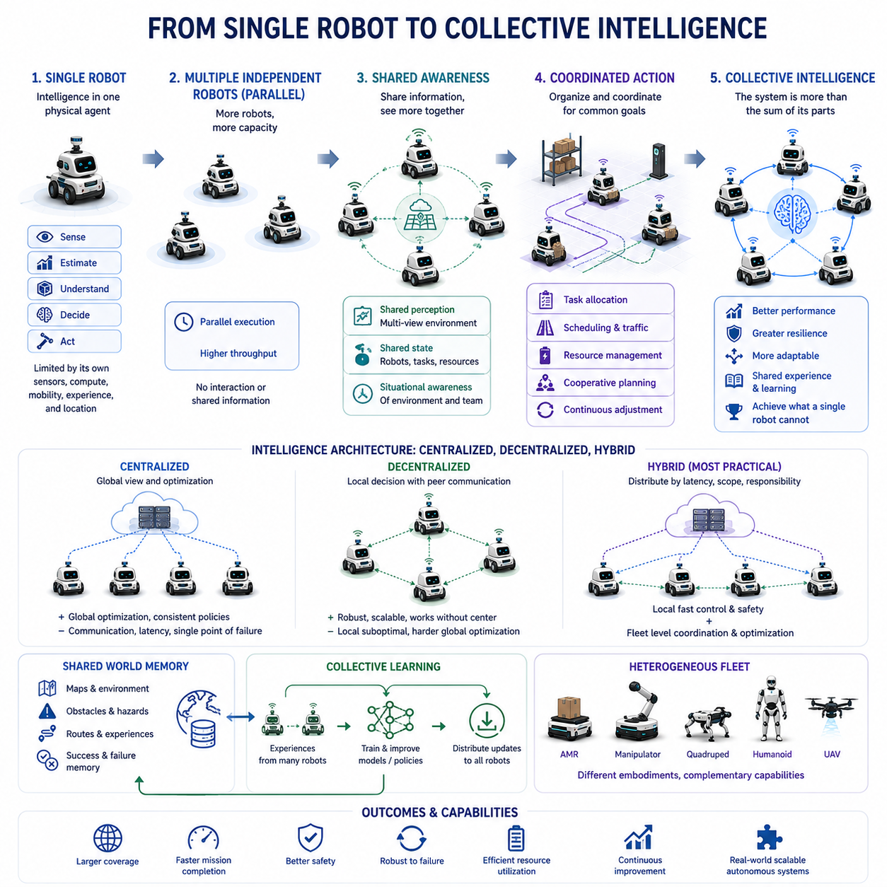
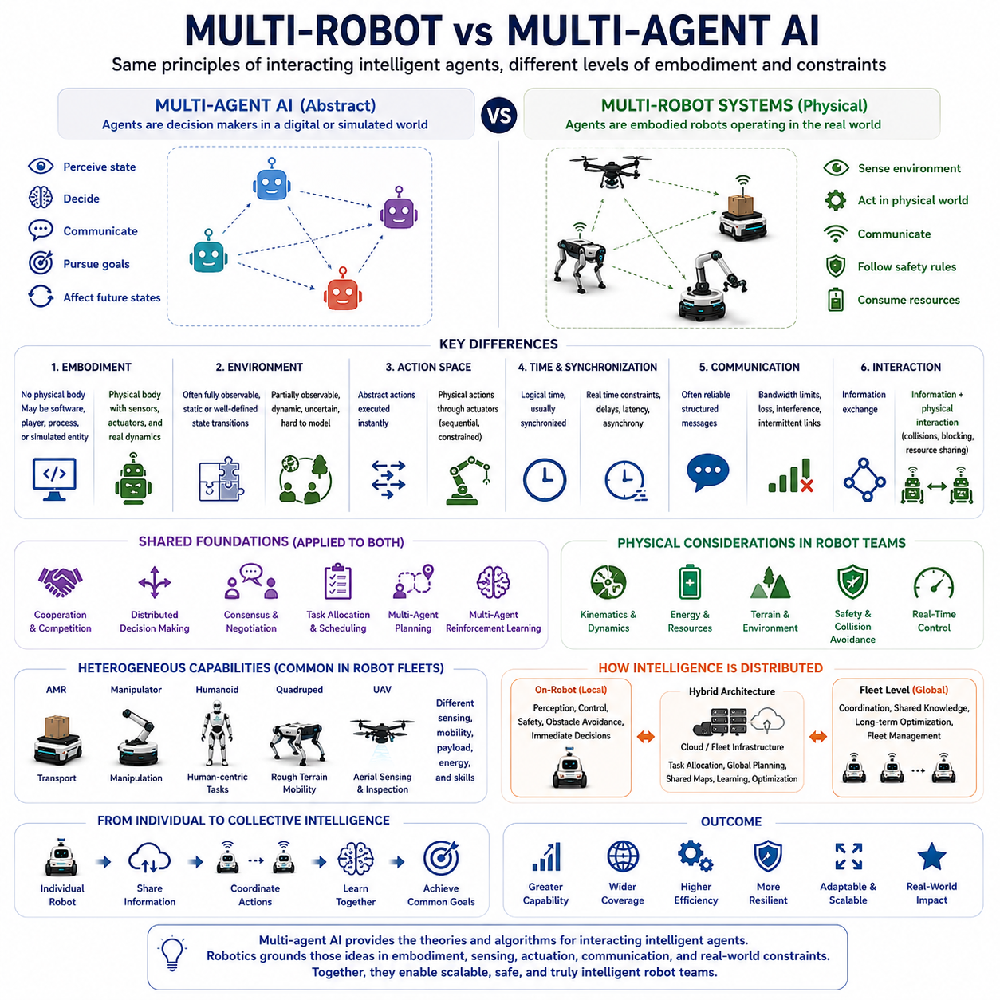
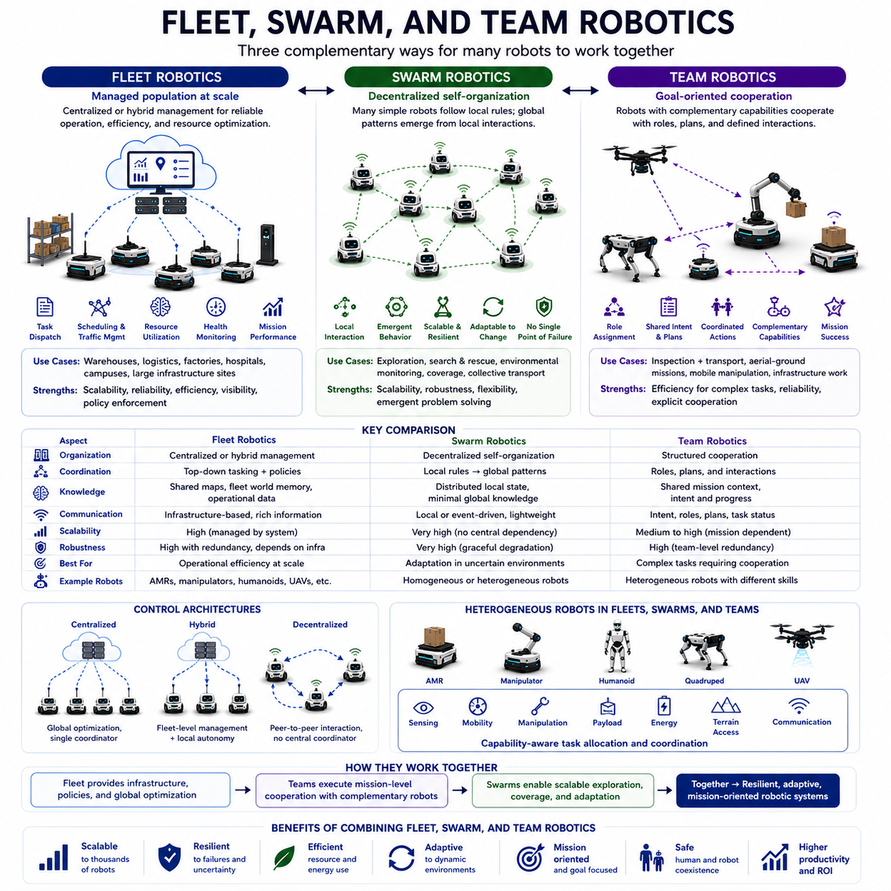
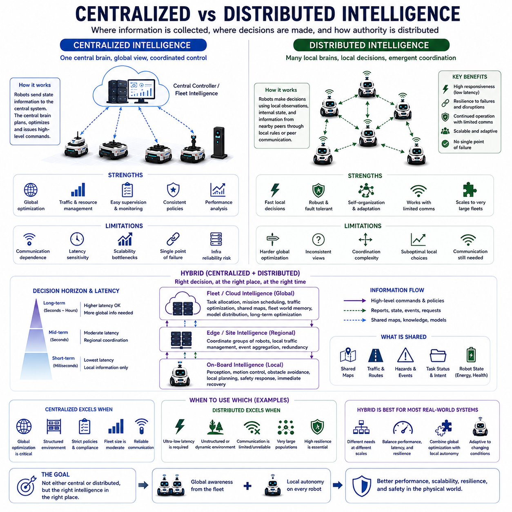
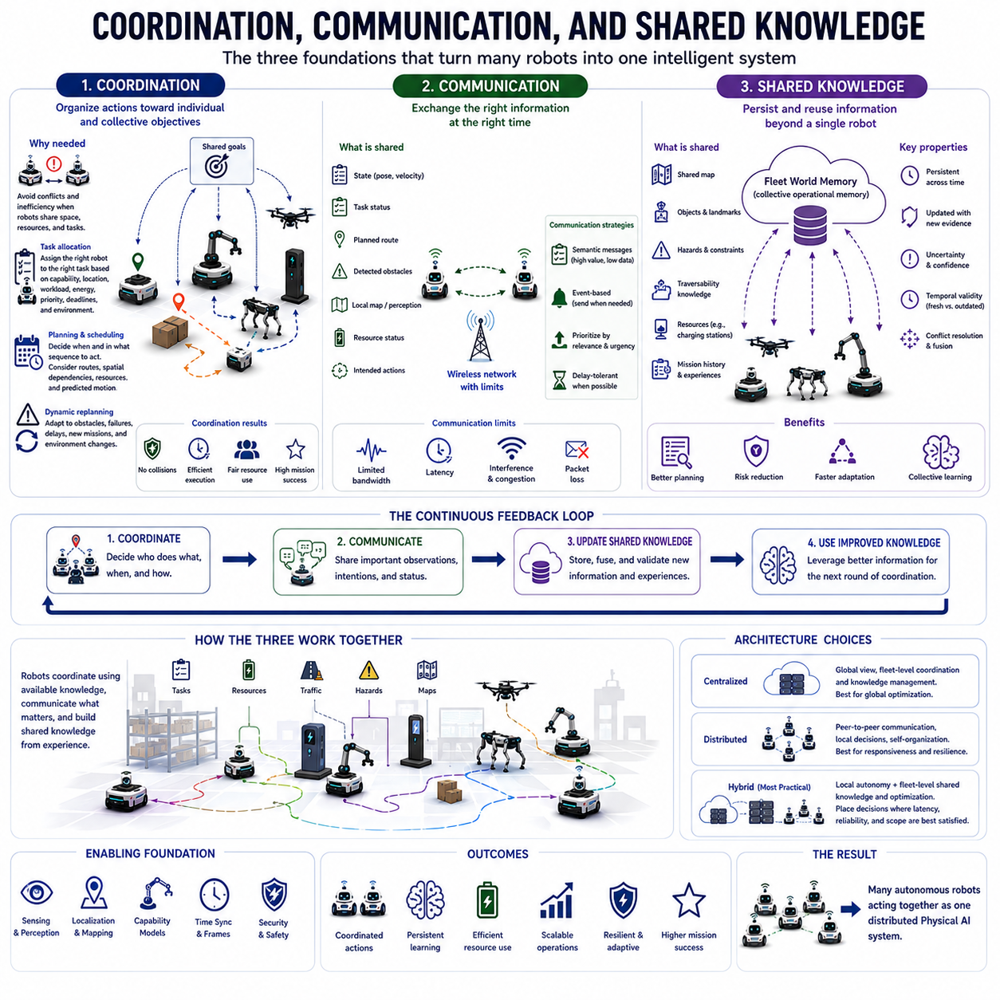
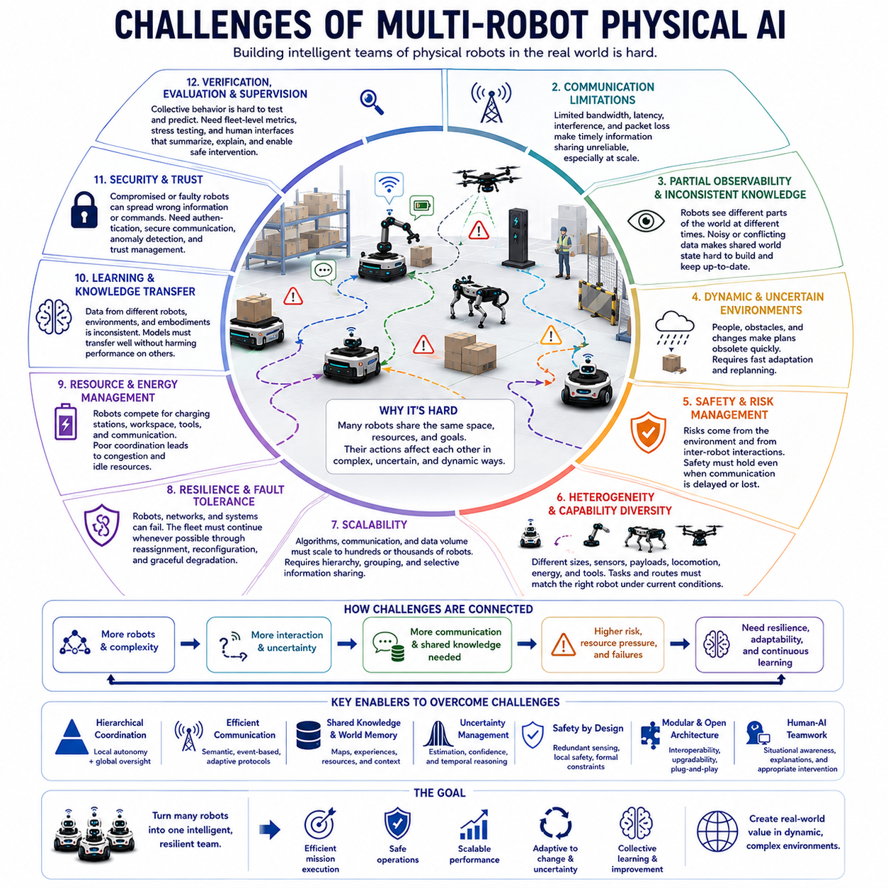
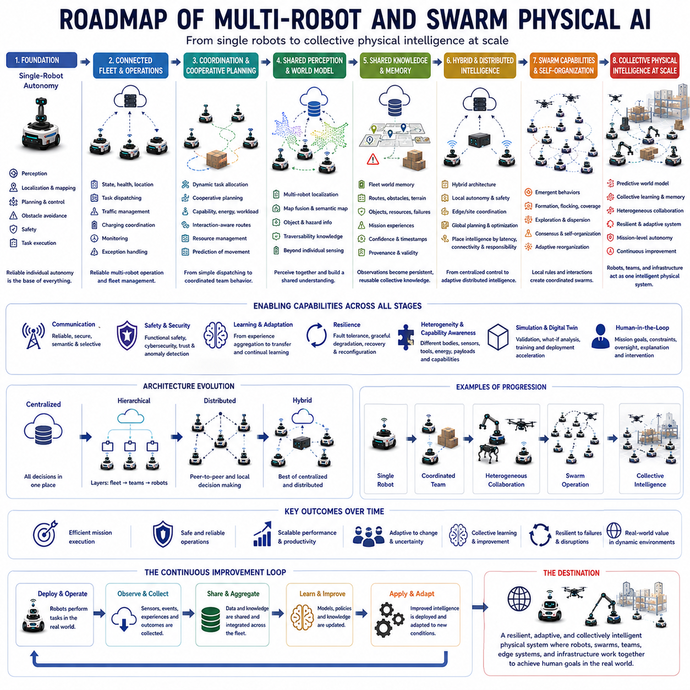

**Volume 09. Multi Robot and Swarm Physical AI**

# Chapter 00. Introduction

## 00.01. Why Multi Robot Physical AI Matters

{width="7.268055555555556in" height="7.268055555555556in"}

Physical AI becomes fundamentally more powerful when intelligence is distributed across multiple robots rather than confined to a single machine. A single robot can perceive, reason, plan, and act within its local environment, but a group of robots can combine observations, divide responsibilities, exchange knowledge, and coordinate actions across a much larger physical space.

The importance of multi-robot Physical AI emerges from the limitations of individual embodiment. Every robot has finite sensing range, computing capacity, battery energy, mobility, payload, and operational time. Multiple robots can compensate for these constraints by distributing perception and action, creating a collective system whose effective capabilities exceed those of any individual platform.

Multi-robot systems also change the meaning of perception. Instead of relying only on what one robot currently sees, robots can exchange observations, maps, detected objects, hazards, terrain conditions, and semantic information. The environment can therefore be understood through multiple viewpoints, allowing the team to construct a broader and more persistent representation of the physical world.

This distributed perception becomes especially valuable in large, dynamic, or partially observable environments. A warehouse fleet may observe congestion across many aisles, outdoor robots may discover changing terrain conditions, and inspection robots may examine different regions simultaneously. Collective sensing transforms isolated local observations into shared situational awareness for coordinated physical action.

Another major advantage is parallelism. Many physical tasks are inherently spatial and can be divided among robots operating simultaneously. Search, inspection, transportation, mapping, surveillance, agriculture, disaster response, and infrastructure monitoring can all benefit from parallel execution. The objective is not merely to add more robots, but to organize their activities so that total mission performance improves.

Coordination therefore becomes a central intelligence problem. Robots must determine who should perform each task, when actions should occur, which routes should be used, and how conflicts should be avoided. Task allocation, scheduling, traffic management, cooperative planning, and dynamic replanning connect individual robot intelligence to collective mission-level behavior.

Communication provides another essential layer of multi-robot Physical AI. Robots may exchange state, position, task progress, observations, maps, intentions, predictions, or learned representations. However, communication cannot always be assumed to be fast or reliable. Practical systems must operate under bandwidth limits, latency, packet loss, intermittent connectivity, and complete communication failures.

For this reason, multi-robot intelligence cannot depend entirely on continuous centralized control. Centralized systems can provide global optimization and fleet-wide coordination, while decentralized systems offer responsiveness, resilience, and local autonomy. Hybrid architectures combine these advantages by placing time-critical perception and control on robots while assigning broader coordination and shared intelligence to fleet infrastructure.

Shared knowledge further distinguishes an intelligent robot fleet from a collection of independent machines. When one robot discovers an obstacle, difficult terrain, efficient route, failed maneuver, or successful recovery strategy, that experience can become useful to other robots. Fleet world memory allows individual physical experiences to accumulate into persistent collective knowledge.

Collective learning extends this principle beyond shared maps and operational state. Experiences gathered by many robots can contribute to improved policies, perception models, navigation strategies, manipulation skills, or world models. A fleet can therefore create a data flywheel in which deployment generates experience, experience improves models, and improved models increase the capability of subsequent fleet operations.

Multi-robot Physical AI is also important because real robotic ecosystems are increasingly heterogeneous. AMRs, mobile manipulators, humanoids, quadrupeds, UAVs, and specialized inspection robots possess different sensors, mobility characteristics, payloads, and manipulation abilities. Collective intelligence allows these differences to become complementary capabilities rather than isolated system boundaries.

Heterogeneity makes capability-aware coordination essential. A UAV may rapidly survey an inaccessible area, a quadruped may traverse difficult terrain, an AMR may transport equipment, and a manipulator may physically interact with objects. The system must represent what each robot can do and assign tasks according to embodiment, location, resources, risk, and mission requirements.

Resilience is another fundamental motivation for multi-robot systems. Failure of a single robot does not necessarily imply failure of the mission when tasks can be redistributed among surviving members. Redundancy, dynamic reallocation, shared knowledge, and graceful degradation allow a fleet or swarm to continue operating despite robot loss, communication degradation, environmental uncertainty, or unexpected physical events.

At larger scales, multi-robot Physical AI becomes a systems problem involving orchestration, shared memory, communication, learning, safety, cybersecurity, deployment, and human supervision. Scaling from several robots to hundreds or thousands requires intelligence that manages interactions among robots while preventing coordination complexity from growing beyond practical limits.

Ultimately, multi-robot Physical AI matters because many real-world missions are larger than any single embodiment. The transition from autonomous robots to coordinated fleets and swarms transforms robotics from isolated machine intelligence into distributed physical intelligence. Robots can perceive together, learn from one another, divide work, share experience, recover collectively, and act as an adaptive system within the physical world.

## 00.02. From Single Robot to Collective Intelligence

{width="7.268055555555556in" height="7.268055555555556in"}

A single autonomous robot represents intelligence embodied in one physical agent. It senses its surroundings, estimates its state, interprets objects and events, selects actions, and controls its body to achieve assigned objectives. This architecture is effective for many tasks, but its intelligence remains bounded by its own sensors, computational resources, mobility, experience, and physical location.

The transition toward collective intelligence begins when multiple robots operate within the same environment while recognizing that their decisions and actions are interconnected. Each robot remains an autonomous physical agent, yet its behavior becomes part of a larger system. The important change is therefore not simply increasing robot quantity, but introducing relationships among perception, decisions, tasks, knowledge, and physical actions.

At the simplest level, multiple independent robots may perform separate tasks without meaningful interaction. Such deployment increases capacity through parallel operation, but it does not necessarily create collective intelligence. Collective intelligence emerges when information or behavior from one robot influences the decisions of others and when those interactions improve the performance, adaptability, or resilience of the overall system.

Shared perception is one of the first steps in this transition. A single robot observes only the environment within its sensing range, while multiple robots can observe different regions simultaneously. By combining local observations, the team can construct a broader representation of objects, obstacles, people, terrain, traffic, hazards, and environmental changes than any individual robot could independently maintain.

The next step is shared state and situational awareness. Robots communicate information about their positions, capabilities, current tasks, progress, planned movements, resource conditions, and observations. This allows each robot or a fleet-level system to reason not only about the environment but also about the state of the team itself, creating a foundation for coordinated decisions and cooperative behavior.

Coordination transforms shared awareness into organized physical action. When several robots require the same route, workspace, charging station, tool, or communication resource, their actions cannot be planned independently without creating conflicts. Collective intelligence therefore requires mechanisms for task allocation, scheduling, traffic coordination, resource management, cooperative planning, and continuous adjustment as conditions change.

This introduces a distinction between individual objectives and collective objectives. A robot may locally prefer the shortest route or immediately available task, but that choice may reduce overall fleet efficiency by producing congestion or blocking another robot. Collective intelligence requires decisions that consider system-level consequences, balancing local autonomy with global mission performance, fairness, safety, and resource utilization.

Centralized intelligence offers one method for achieving this coordination. A fleet manager can maintain global information, allocate tasks, optimize schedules, and coordinate traffic across many robots. This architecture provides a useful system-wide perspective, but excessive dependence on centralized infrastructure can introduce communication requirements, computational bottlenecks, latency, and vulnerability to network or server failures.

Decentralized intelligence provides a complementary approach. Robots make decisions using local observations and information exchanged with nearby peers, enabling the team to continue operating even when centralized communication is unavailable. Consensus, negotiation, local rules, distributed planning, and peer-to-peer coordination can produce organized behavior without requiring every decision to originate from a single global controller.

Practical multi-robot Physical AI therefore often develops toward hybrid intelligence. Fast perception, obstacle avoidance, motion control, and immediate safety responses remain local to each robot, while fleet-level systems manage broader tasks such as mission allocation, global scheduling, shared maps, traffic policies, knowledge distribution, and long-term optimization. Intelligence becomes distributed according to latency, scope, and responsibility.

Collective intelligence becomes substantially more powerful when robots share experience rather than only current state. A robot that discovers an inaccessible passage, hazardous surface, reliable route, successful manipulation strategy, or recovery procedure generates knowledge that may benefit the entire fleet. Shared world memory converts temporary individual experience into persistent information available for future decisions.

Learning extends this process across time. Experiences gathered from many robots can be aggregated to improve perception models, navigation policies, task strategies, world models, and learned skills. Updated knowledge can then be redistributed to robots, creating a continuous cycle in which every deployment contributes data and every improvement can potentially increase the capabilities of many physical agents.

The transition becomes more significant in heterogeneous fleets because collective intelligence can combine fundamentally different embodiments. An AMR may provide efficient transportation, a manipulator may perform physical handling, a quadruped may traverse irregular terrain, a humanoid may operate human-oriented environments, and a UAV may provide aerial observation. Coordination allows these specialized capabilities to contribute to common missions.

Collective intelligence also changes how failure is handled. In a single-robot system, loss of the robot can terminate the mission. In a multi-robot system, other agents may detect the failure, redistribute unfinished tasks, update routes, replace missing capabilities, or reorganize the team. Intelligence is therefore expressed not only through successful operation but also through collective adaptation and graceful degradation.

At larger scales, the robot fleet increasingly behaves as a distributed physical intelligence system rather than a collection of machines. Perception becomes multi-view, memory becomes shared, planning becomes cooperative, learning becomes collective, and actions become coordinated across space and time. Individual robots remain essential autonomous agents, but their intelligence is amplified through interaction with the wider system.

The progression from a single robot to collective intelligence ultimately represents a change in the unit of intelligence itself. Instead of asking only how intelligent one robot can become, multi-robot Physical AI asks how many embodied agents can perceive, reason, learn, communicate, coordinate, and act together. The resulting system can achieve capabilities, coverage, resilience, and adaptability that no isolated robot can provide alone.

## 00.03. Multi Robot vs Multi Agent AI

{width="7.268055555555556in" height="7.268055555555556in"}

Multi-robot systems and multi-agent AI are closely related concepts, but they describe different levels of abstraction. Multi-agent AI studies systems in which multiple autonomous agents perceive information, make decisions, interact, and pursue individual or shared objectives. Multi-robot systems apply related principles to physically embodied machines that must operate under the constraints of the real world.

An agent in multi-agent AI does not necessarily require a physical body. It may represent a software process, game player, economic participant, digital assistant, simulated entity, or decision-making module. What defines the agent is its ability to observe some state, select actions, interact with an environment or other agents, and influence future states through those actions.

A robot, by contrast, is a physically embodied agent whose decisions produce consequences in the physical environment. Its actions are constrained by sensing range, actuator dynamics, kinematics, energy, payload, terrain, communication, safety requirements, and real-time execution. Multi-robot Physical AI therefore connects multi-agent reasoning with embodiment, perception, mobility, manipulation, and physical control.

This distinction becomes important when defining the environment. In a conventional multi-agent AI problem, the environment may be completely digital and represented through well-defined states and actions. In a multi-robot system, the environment is continuously changing, partially observable, uncertain, and difficult to model completely. Robots must transform noisy sensor measurements into representations suitable for collective reasoning and action.

The action space also differs significantly. A software agent may execute an abstract action immediately, while a robot must physically realize its decision through motors, wheels, joints, manipulators, or other actuators. An instruction such as moving to a location becomes a sequence involving localization, path planning, trajectory generation, obstacle avoidance, motion control, and continuous responses to environmental changes.

Time has greater physical significance in multi-robot systems. Communication delays, sensor update rates, actuator response, computation latency, synchronization errors, and differences in robot motion directly influence coordination. Two agents agreeing on a plan is insufficient if their physical actions cannot be synchronized or if one robot receives critical information too late to execute the coordinated behavior safely.

Communication illustrates another difference between abstract multi-agent AI and physical robot teams. Multi-agent algorithms may assume reliable or structured message exchange, but real robots frequently encounter bandwidth limitations, packet loss, interference, network congestion, and intermittent connectivity. Coordination strategies must therefore consider what information should be communicated, when it is needed, and how robots should behave when communication disappears.

Multi-agent AI nevertheless provides an important conceptual and algorithmic foundation for multi-robot intelligence. Problems such as distributed decision making, cooperation, competition, consensus, negotiation, task allocation, multi-agent planning, and multi-agent reinforcement learning can all be applied to robot teams. The challenge is adapting these mechanisms to the physical constraints and uncertainties associated with embodied operation.

Multi-robot systems also introduce spatial interactions that cannot be treated merely as information exchange. Robots can block one another, compete for narrow passages, occupy workspaces, share charging stations, transport objects cooperatively, or create physical hazards through poorly coordinated motion. The physical configuration of the team therefore becomes part of the multi-agent state and directly affects feasible decisions.

Another distinction concerns capability. Abstract agents are often modeled with identical or predefined action sets, whereas robot fleets may contain significantly different embodiments. AMRs, manipulators, humanoids, quadrupeds, and UAVs have different sensing, mobility, manipulation, payload, energy, and environmental capabilities. Multi-robot intelligence must reason explicitly about these differences when allocating tasks and coordinating missions.

Multi-agent objectives can be cooperative, competitive, or mixed, and the same classification applies to physical robots. Most practical robot fleets emphasize cooperation because robots contribute toward common operational goals. However, resource contention, traffic conflicts, local priorities, and limited communication can create interactions in which locally desirable actions are not necessarily optimal for the entire team.

Multi-agent reinforcement learning provides one pathway for learning coordinated behavior. Multiple agents can learn policies that consider interactions with other agents rather than treating them as static parts of the environment. For robots, however, learned policies must additionally satisfy physical feasibility, safety, robustness, sample efficiency, and deployment constraints before they can be trusted in real-world operation.

The relationship between the two fields can therefore be understood as an overlap rather than equivalence. Multi-agent AI provides general theories and algorithms for interacting intelligent agents, while multi-robot systems specialize these ideas for physically embodied agents. Multi-robot Physical AI occupies the intersection where multi-agent intelligence must function through sensors, actuators, communication networks, physical dynamics, and real-world constraints.

This intersection becomes increasingly important as robot fleets develop shared perception, shared world state, distributed planning, collective learning, and fleet world memory. Robots no longer operate merely as independent machines receiving commands from a scheduler. They become participants in a distributed intelligence architecture in which observations, intentions, experiences, and learned knowledge can influence decisions throughout the team.

At fleet scale, the distinction also helps determine where intelligence should reside. Some multi-agent reasoning can operate in centralized fleet infrastructure, while other decisions must remain distributed across robots. Immediate obstacle avoidance and safety responses require local execution, whereas global task allocation, shared knowledge management, and long-term optimization may benefit from fleet-level computation and coordination.

Multi-robot Physical AI can ultimately be viewed as multi-agent intelligence grounded in physical embodiment. The multi-agent perspective explains how autonomous decision makers interact, coordinate, compete, cooperate, and learn, while robotics determines how those decisions can actually be sensed, communicated, planned, and executed in the physical world. Combining both perspectives is essential for building scalable and genuinely intelligent robot teams.

## 00.04. Fleet Swarm and Team Robotics

{width="7.268055555555556in" height="7.268055555555556in"}

Fleet robotics describes systems in which multiple robots are managed as an operational population. The emphasis is typically on reliable deployment, task dispatching, scheduling, traffic management, resource utilization, health monitoring, and mission performance. A fleet may contain tens, hundreds, or thousands of robots whose individual activities are coordinated through shared infrastructure and operational policies.

In a fleet architecture, robots often retain substantial local autonomy while a fleet-level system maintains a broader operational view. Each robot may independently perform localization, obstacle avoidance, motion control, and immediate safety functions, while higher-level infrastructure assigns missions, manages shared resources, resolves traffic conflicts, distributes knowledge, and monitors overall system performance.

Fleet robotics is especially important in structured industrial environments such as warehouses, factories, logistics centers, hospitals, campuses, and large infrastructure sites. In these environments, overall productivity depends not only on how efficiently each robot performs its task, but also on how effectively the entire population shares routes, workspaces, charging stations, equipment, communication resources, and operational priorities.

Swarm robotics represents a different organizational principle. Instead of relying primarily on explicit fleet-level orchestration, swarm systems seek useful global behavior through interactions among many relatively simple robots. Individual robots typically follow local rules based on nearby observations and communication, while coordinated patterns emerge from repeated interactions across the population without requiring complete global knowledge.

The conceptual foundation of swarm robotics is strongly influenced by collective behavior observed in biological systems. Ant colonies, bee colonies, bird flocks, fish schools, and other natural groups demonstrate how decentralized interactions can generate coordinated movement, exploration, resource discovery, adaptation, and collective decisions. Robot swarms translate these principles into computational and physical mechanisms for artificial agents.

Local interaction is therefore central to swarm intelligence. A robot may react only to nearby robots, local environmental conditions, or limited shared signals, yet these interactions can produce global phenomena such as flocking, formation, dispersion, coverage, consensus, collective transport, or coordinated exploration. The desired system behavior is generated through self-organization rather than detailed commands for every individual robot.

This approach can provide scalability and resilience because operation does not necessarily depend on a single central coordinator. Adding or losing individual robots may change performance without destroying the entire system. However, emergent behavior also introduces challenges involving predictability, stability, verification, communication, safety, and the design of local rules that reliably produce desirable global outcomes.

Team robotics provides another perspective on multi-robot organization. A robot team is generally composed of multiple agents that cooperate toward explicitly defined common objectives. Team members may have assigned roles, complementary capabilities, planned interactions, and dependencies between tasks. Coordination is therefore often more structured and mission-oriented than the decentralized behavior associated with large robot swarms.

Team robotics becomes particularly important when tasks require close cooperation between robots. One robot may inspect an area while another transports equipment, or an aerial robot may provide environmental information to a ground robot. A mobile manipulator, quadruped, UAV, and AMR can participate in the same mission while contributing different sensing, mobility, transportation, or manipulation capabilities.

The concepts of fleet, swarm, and team robotics are not mutually exclusive categories. A large operational fleet can contain smaller teams created for specific missions, while some robots may use swarm-like local coordination for movement or exploration. A practical Physical AI architecture can therefore combine centralized fleet management, team-level cooperation, and decentralized local behaviors within the same robotic ecosystem.

The primary distinction lies in how organization and intelligence are structured. Fleet robotics emphasizes operational management at scale, swarm robotics emphasizes decentralized self-organization and emergent collective behavior, and team robotics emphasizes explicit cooperation among robots pursuing shared missions. These perspectives describe different coordination patterns rather than rigid boundaries between completely separate technologies.

Communication requirements also vary across these organizational forms. Fleet systems commonly exchange task, map, traffic, health, and operational information with infrastructure. Robot teams may require richer sharing of intentions, roles, plans, and task progress. Swarms often favor compact local or event-driven communication that can scale across large populations without requiring every robot to maintain complete information about every other member.

Knowledge representation follows a similar pattern. Fleet systems can maintain shared maps, fleet world memory, traversability information, operational history, and robot capabilities. Teams may maintain mission-specific context and shared intent, while swarms may rely more heavily on distributed local state. The appropriate representation depends on system scale, communication availability, environmental uncertainty, and mission requirements.

Heterogeneous robots further blur the boundaries between fleets and teams. A fleet may include AMRs, manipulators, humanoids, quadrupeds, and UAVs with fundamentally different embodiments. These systems require capability-aware task allocation because not every robot can perform every mission. Coordination must consider sensing, mobility, payload, manipulation, energy, terrain accessibility, and other embodiment-specific constraints.

Homogeneous populations are often attractive for swarm robotics because similar robots can follow common behavioral rules and provide natural redundancy. Nevertheless, learning-based methods and richer capability representations can support heterogeneous swarms and teams. The broader objective is to determine how individual capabilities and local decisions can be combined into useful collective behavior without making coordination computationally unmanageable.

Control architecture provides another important dimension. Fleet robotics often uses centralized or hybrid architectures, swarm robotics frequently emphasizes decentralized control, and team robotics can employ centralized, distributed, or hybrid approaches depending on mission structure. Practical systems increasingly distribute intelligence according to latency, communication reliability, safety requirements, computational resources, and the scope of each decision.

From the perspective of Physical AI, fleets, swarms, and teams represent complementary pathways from individual autonomy toward collective physical intelligence. Fleets provide scalable operational coordination, swarms provide distributed adaptation and self-organization, and teams provide structured cooperation among complementary agents. Combining these principles enables robot populations to operate as resilient, adaptive, and mission-oriented intelligent systems in the physical world.

## 00.05. Centralized vs Distributed Intelligence

{width="7.268055555555556in" height="7.268055555555556in"}

Centralized and distributed intelligence represent two fundamental ways of organizing decision making in multi-robot Physical AI. The distinction concerns where information is collected, where decisions are computed, and how authority is distributed among robots and infrastructure. These choices directly influence coordination quality, latency, scalability, resilience, communication demand, and system complexity.

In a centralized architecture, a central controller or fleet-level intelligence maintains a broad view of the robot population and operating environment. Robots transmit relevant state information to this central system, which can assign tasks, optimize schedules, coordinate routes, manage shared resources, and issue higher-level commands. This global perspective makes centralized intelligence attractive for structured fleet operations.

Centralization can improve global optimization because one decision-making system can evaluate interactions among many robots simultaneously. It can identify traffic conflicts, balance workloads, allocate charging resources, prioritize missions, and optimize fleet-wide objectives rather than allowing each robot to optimize only its local behavior. Shared policies and centralized monitoring can also simplify operational supervision and performance analysis.

However, centralized intelligence introduces dependencies on communication and infrastructure. Robots must exchange sufficient information with the central system, and critical decisions may be affected by network latency, congestion, packet loss, or server availability. As fleet size increases, the amount of state information and the complexity of optimization can also grow rapidly, creating communication and computational bottlenecks.

A strongly centralized architecture may additionally create a single point of failure. If the fleet controller, network, or supporting infrastructure becomes unavailable, robots that depend heavily on centralized decisions may lose important capabilities. Safety-critical Physical AI therefore cannot assume that remote coordination will always be available and must preserve sufficient local intelligence for safe operation during infrastructure degradation.

Distributed intelligence addresses these limitations by placing decision-making capability across individual robots or groups of robots. Each robot uses its own observations, internal state, and information received from nearby peers to make decisions. Rather than requiring complete global knowledge, distributed systems coordinate through local interactions, negotiation, consensus, shared rules, or peer-to-peer communication.

Distributed architectures can provide strong responsiveness because time-critical decisions do not need to travel through a remote controller. Obstacle avoidance, collision prevention, local path adaptation, immediate recovery, and other short-timescale behaviors can be executed directly on the robot. This is particularly important when physical actions must respond to environmental changes within strict real-time constraints.

Resilience is another major advantage of distributed intelligence. If communication with infrastructure is interrupted, locally autonomous robots may continue operating with reduced coordination capability. Similarly, the loss of one robot does not necessarily disable the remaining population. Distributed systems can reorganize interactions, redistribute responsibilities, and degrade gradually instead of experiencing complete system failure.

The primary challenge of distributed intelligence is achieving useful global behavior from incomplete local information. A robot may make a locally reasonable decision that conflicts with the objectives of the wider fleet. Multiple robots can compete for routes, resources, or tasks, while inconsistent observations may produce conflicting beliefs about the environment. Distributed coordination must therefore manage consistency without requiring continuous global synchronization.

Communication remains important even in decentralized systems, but its purpose changes. Instead of continuously transmitting complete state to a central controller, robots may exchange compact information about intentions, nearby obstacles, task status, local maps, hazards, priorities, or requested resources. Event-driven and semantic communication can reduce bandwidth requirements by transmitting information when it is operationally meaningful.

Centralized and distributed intelligence should therefore not be viewed as mutually exclusive alternatives. Practical multi-robot systems commonly use hybrid architectures that distribute intelligence according to the spatial scope, temporal urgency, and computational complexity of each decision. Local autonomy handles immediate physical interaction, while fleet-level intelligence manages decisions requiring broader information and longer planning horizons.

In a hybrid architecture, perception, motion control, obstacle avoidance, local planning, and safety responses can remain on the robot. Fleet infrastructure can perform global task allocation, mission scheduling, traffic optimization, shared map management, fleet world memory, model distribution, and long-term performance optimization. Intermediate edge or on-premise systems may coordinate groups of robots within a particular site or operational region.

The appropriate division of intelligence is strongly influenced by latency. Decisions operating at millisecond or short control-cycle timescales should generally remain close to the physical system, while decisions spanning seconds, minutes, or entire missions can tolerate broader coordination. This creates a hierarchy in which control authority moves from fast local reaction toward progressively slower and more global reasoning.

Shared world knowledge provides an important connection between centralized and distributed components. Individual robots generate local observations and experiences, while fleet infrastructure can integrate them into shared maps, traversability representations, hazard memory, route experience, and operational history. Updated knowledge can then be redistributed so that local autonomy benefits from information collected across the wider robot population.

Task allocation also illustrates the value of hybrid intelligence. A fleet manager may globally determine which robot is best suited for a mission based on capability, location, workload, energy, and priority. Once assigned, the robot can independently execute local navigation and react to unexpected obstacles. If conditions change substantially, information can return to the fleet level for reallocation or mission-level replanning.

The balance between centralized and distributed intelligence changes as robot populations scale. Small teams may support rich communication and detailed centralized planning, while very large fleets make complete global synchronization increasingly expensive. Hierarchical structures can address this problem by organizing robots into local groups, regional coordinators, and fleet-level services while preserving autonomy at the individual robot level.

Heterogeneous fleets make this architecture even more important because different embodiments require different levels of autonomy and coordination. An AMR, manipulator, humanoid, quadruped, and UAV may have distinct control rates, communication requirements, mobility constraints, and safety responsibilities. A common fleet layer can coordinate shared objectives while each platform retains embodiment-specific intelligence for physical execution.

The central architectural question is therefore not whether intelligence should be centralized or distributed, but which intelligence should exist at each level. Effective multi-robot Physical AI places computation where the required information, response time, reliability, and physical responsibility can best be satisfied. The resulting architecture combines global awareness with local autonomy rather than sacrificing one for the other.

As multi-robot systems evolve toward collective intelligence, centralized and distributed mechanisms become complementary components of a larger physical intelligence architecture. Centralized reasoning provides coordination, shared knowledge, and global optimization, while distributed intelligence provides responsiveness, resilience, and physical autonomy. Their integration enables robot fleets to remain coordinated at scale while continuing to operate safely when communication, infrastructure, or environmental conditions change.

## 00.06. Coordination Communication and Shared Knowledge

{width="7.268055555555556in" height="7.268055555555556in"}

Coordination, communication, and shared knowledge form three tightly connected foundations of multi-robot Physical AI. Coordination determines how robots organize their actions toward individual and collective objectives, communication provides the mechanism for exchanging relevant information, and shared knowledge allows information and experience to persist beyond the observations of any single robot.

Coordination becomes necessary whenever the actions of one robot can affect the opportunities, safety, or performance of another. Robots may compete for narrow passages, charging stations, manipulators, workspaces, communication channels, or other limited resources. Without coordination, individually reasonable actions can produce congestion, duplicated work, collisions, resource conflicts, or inefficient mission execution.

Task allocation is one of the most visible forms of coordination. A multi-robot system must determine which robot should perform each task according to location, capability, workload, energy, priority, deadlines, and environmental conditions. In heterogeneous fleets, this decision becomes more complex because AMRs, manipulators, humanoids, quadrupeds, and UAVs may possess fundamentally different physical capabilities.

Coordination also extends into planning and scheduling. Robots must determine not only who performs a task, but when and in what sequence activities should occur. Cooperative planning may consider shared routes, spatial dependencies, task precedence, resource availability, and predicted robot motion. Dynamic replanning becomes necessary when obstacles, failures, delays, new missions, or environmental changes invalidate previous assumptions.

Communication enables robots to obtain information that cannot be acquired through their own sensors. A robot can share its position, velocity, task status, planned route, detected obstacle, local map, resource condition, or intended action with other robots or fleet infrastructure. Communication therefore expands each robot\'s effective awareness beyond its immediate physical sensing range.

However, communication should be treated as a limited coordination resource rather than an unlimited service. Wireless networks have finite bandwidth, latency, interference, congestion, packet loss, and coverage limitations. As robot populations increase, continuously broadcasting complete sensor and state information becomes increasingly impractical, making communication efficiency an important part of multi-robot system design.

Communication strategies must therefore determine what information is worth transmitting. Low-level raw sensor streams may contain enormous amounts of data, while semantic information such as "corridor blocked," "charging station occupied," or "terrain unsafe" can communicate operationally useful meaning with far less bandwidth. Semantic and event-based communication can prioritize information according to its relevance to collective decisions.

The timing of communication is equally important. Some information, such as an imminent collision risk, must be transmitted and processed immediately, while other information, such as accumulated route experience, can tolerate delay. Communication-aware coordination considers latency and connectivity when selecting plans so that robots do not depend on information that cannot reliably arrive within the required decision horizon.

Shared knowledge develops when communicated information becomes persistent and reusable across the robot population. A shared map, for example, is more than a temporary message between two robots. It represents accumulated knowledge of spatial structure that multiple robots can consult, update, and use for planning. Similar shared representations can describe objects, hazards, terrain, routes, resources, and mission history.

Fleet world memory extends shared knowledge across both space and time. When one robot encounters difficult terrain, a blocked passage, a localization failure, or a successful recovery maneuver, that experience can be stored for future use. Other robots can then benefit from events they did not personally experience, transforming isolated robot observations into collective operational memory.

Shared traversability knowledge is particularly valuable for mobile robot fleets. Different robots can record whether surfaces, slopes, passages, or routes were successfully traversed and under what conditions. This information can support future route selection, risk estimation, and capability-aware planning, especially when robots with different mobility characteristics must operate in the same environment.

Shared knowledge is not automatically correct simply because several robots contribute to it. Observations can be noisy, outdated, incomplete, or contradictory. Robots may perceive the same location differently because of sensor errors, changing conditions, viewpoint differences, or embodiment-specific capabilities. Knowledge fusion therefore requires confidence estimates, timestamps, provenance, uncertainty, and mechanisms for resolving conflicting observations.

Temporal validity is especially important in dynamic environments. A route that was clear ten minutes ago may now be blocked, while a hazard observed yesterday may no longer exist. Shared memory must therefore distinguish persistent knowledge from temporary state and update information according to new evidence. Temporal decay and freshness management prevent obsolete knowledge from dominating current decisions.

Coordination and shared knowledge reinforce one another. Better shared knowledge improves task allocation, route planning, traffic management, and risk assessment, while coordinated robot deployment determines where new observations and experiences are collected. A fleet can intentionally assign robots to unexplored or uncertain areas, improving shared knowledge while simultaneously advancing operational objectives.

Collective learning extends shared knowledge from explicit maps and records into learned models and policies. Experiences from multiple robots can improve perception models, navigation strategies, task policies, world models, and recovery skills. Updated models can then be redistributed across the fleet, allowing knowledge discovered through many physical experiences to influence the future behavior of individual robots.

The relationship among these three elements forms a continuous feedback loop. Robots coordinate actions using available knowledge, communicate important observations and intentions, update shared knowledge from resulting experiences, and use the improved knowledge for subsequent coordination. Repeating this cycle allows the multi-robot system to adapt as its environment, mission requirements, and collective experience evolve.

Centralized, distributed, and hybrid architectures implement this loop differently. A centralized fleet system may aggregate knowledge and coordinate robots globally, while a distributed system relies more heavily on peer-to-peer exchange and local decisions. Hybrid architectures combine local autonomy with fleet-level shared memory and optimization, placing communication and decision making at the level best suited to latency and scope.

Ultimately, coordination determines how robots act together, communication determines how relevant information moves between them, and shared knowledge determines what the system collectively remembers and understands. Their integration transforms multiple autonomous robots from independent machines into a distributed Physical AI system capable of coordinated action, persistent learning, collective adaptation, and increasingly intelligent fleet-scale behavior.

## 00.07. Challenges of Multi Robot Physical AI

{width="7.268055555555556in" height="7.268055555555556in"}

Multi-robot Physical AI introduces challenges that do not appear, or appear only weakly, in single-robot systems. As the number of robots grows, intelligence must manage interactions among physical agents as well as interactions with the environment. Coordination, communication, uncertainty, safety, scalability, heterogeneous embodiment, and shared knowledge become coupled problems rather than independent engineering concerns.

One fundamental challenge is coordination complexity. Every robot can affect the routes, resources, tasks, and opportunities available to other robots. A decision that is optimal for one robot may create congestion or delay for the fleet. As the population grows, the number of possible interactions increases rapidly, making globally optimal task allocation, scheduling, motion coordination, and resource management computationally difficult.

Communication creates another major limitation. Multi-robot intelligence benefits from sharing positions, maps, intentions, observations, task states, and learned knowledge, but wireless communication has finite bandwidth and reliability. Latency, interference, packet loss, congestion, and disconnected regions can prevent robots from receiving information when it is needed, especially in large facilities or challenging outdoor environments.

The communication problem becomes more difficult as robots generate increasingly rich sensory information. Cameras, LiDAR, radar, depth sensors, and learned representations can produce large data streams that cannot always be exchanged continuously. Multi-robot systems must determine which information should remain local, which information should be summarized, and which events are important enough to transmit immediately to peers or fleet infrastructure.

Partial observability and inconsistent world knowledge create further difficulties. Different robots observe different regions from different viewpoints and at different times. Their measurements may contain noise or contradict one another. Building a shared world state therefore requires data association, spatial alignment, uncertainty estimation, temporal reasoning, provenance tracking, and mechanisms for deciding whether information remains valid as the environment changes.

Localization and mapping become especially challenging when multiple robots contribute to a common spatial representation. Individual localization errors can propagate into shared maps, while incorrect associations between observations may distort the collective world model. Multi-robot SLAM and map fusion must align observations across robots while accounting for sensor differences, uncertain poses, changing environments, and communication constraints.

Dynamic environments make coordination harder because plans can become obsolete immediately after they are generated. People, vehicles, equipment, doors, obstacles, and other robots continuously modify the operational space. A route that was optimal moments earlier may become blocked, requiring local adaptation and fleet-level replanning without producing unstable behavior in which many robots repeatedly change their decisions.

Safety is more complex in multi-robot systems because hazards arise not only from the environment but also from interactions among robots. Robots must avoid collisions, unsafe formations, blocked evacuation paths, manipulation conflicts, and cascading failures. Safety mechanisms must remain effective even when communication is delayed or unavailable, making local safety autonomy essential regardless of the broader coordination architecture.

Heterogeneity introduces another layer of complexity. Different robots may have different sensors, dimensions, payloads, locomotion systems, manipulators, computing resources, energy capacities, and environmental tolerances. A path traversable by an AMR may be unsuitable for a quadruped carrying a particular payload, while a task requiring manipulation may be impossible for a robot designed only for transportation.

Capability-aware reasoning is therefore necessary for heterogeneous fleets. The system must represent not only what tasks exist but also which robots can perform them under current conditions. Capability can change over time because of battery state, sensor degradation, payload configuration, hardware faults, terrain conditions, or attached tools, requiring task allocation and planning to use dynamic rather than static robot descriptions.

Scalability presents both computational and organizational challenges. Algorithms that work well for five robots may become impractical for hundreds or thousands. Maintaining complete information about every robot, calculating globally optimal plans, or broadcasting all state changes can overwhelm computation and communication. Hierarchical coordination, local grouping, distributed optimization, and selective information sharing become increasingly important at fleet scale.

Resilience is closely connected to scalability. Robots, networks, servers, sensors, and actuators can fail during operation, yet the collective system should continue functioning whenever possible. Tasks may need to be reassigned, routes changed, communication structures reorganized, and degraded capabilities recognized. Graceful degradation is preferable to architectures in which one failure causes the entire fleet to stop.

Energy and resource management create additional coupling between individual and collective decisions. Robots compete for charging stations, workspaces, tools, communication capacity, and sometimes payload-handling resources. Sending every robot to recharge when its battery becomes low may create charging congestion. Fleet intelligence must anticipate future demand and coordinate resources before local shortages become system-wide operational problems.

Collective learning introduces challenges of its own. Experience collected by many robots can improve perception, navigation, policies, and world models, but data may originate from different sensors, environments, embodiments, software versions, and operating conditions. Learning systems must determine which experiences are transferable and avoid distributing models that improve one robot type while degrading another.

Sim-to-real and robot-to-robot transfer further complicate learned intelligence. A behavior learned in simulation or on one platform may fail when physical dynamics, sensing characteristics, payload, friction, terrain, or actuator limits change. Multi-robot learning therefore requires representations that distinguish general knowledge from embodiment-specific knowledge and mechanisms for validating learned behavior before fleet-wide deployment.

Cybersecurity and trust become increasingly important as communication and shared knowledge expand. Compromised or malfunctioning robots can distribute incorrect state, maps, commands, or learned information throughout the system. Authentication, authorization, secure communication, anomaly detection, provenance, and trust management are therefore part of collective intelligence rather than merely external information technology concerns.

Verification and evaluation are also difficult because collective behavior can produce outcomes that are not obvious from testing individual robots. A fleet may behave safely under normal conditions but fail under congestion, communication loss, simultaneous faults, or unusual interactions. Evaluation must therefore consider individual performance, team performance, system-level emergent behavior, recovery capability, and mission success under uncertainty.

Human supervision becomes more difficult as robot populations scale. Operators cannot continuously inspect every robot or approve every decision. Interfaces must summarize fleet state, highlight exceptions, explain important decisions, and allow intervention at appropriate levels. Effective supervision shifts from direct control of individual robots toward management of missions, policies, constraints, risks, and abnormal situations.

The central challenge of multi-robot Physical AI is therefore integration. Coordination cannot be designed independently from communication, planning cannot ignore uncertainty, learning cannot ignore embodiment, and global optimization cannot eliminate local autonomy. Successful systems must combine these capabilities into architectures that remain safe, scalable, resilient, and adaptive while many physical agents continuously interact with one another and with the real world.

## 00.08. Roadmap of Multi Robot and Swarm Physical AI

{width="7.268055555555556in" height="7.268055555555556in"}

The roadmap of Multi-Robot and Swarm Physical AI describes a progression from individually autonomous robots toward increasingly coordinated, adaptive, and collectively intelligent physical systems. This evolution is not defined simply by adding more robots. It requires advances in autonomy, communication, coordination, shared knowledge, distributed decision making, learning, resilience, and fleet-scale system architecture.

The foundation begins with reliable single-robot autonomy. Each robot must first possess dependable perception, localization, mapping, planning, motion control, obstacle avoidance, safety, and task execution capabilities. Collective intelligence cannot compensate for unstable individual autonomy. A multi-robot system therefore inherits the strengths and weaknesses of the physical agents from which it is constructed.

The next stage introduces fleet connectivity and operational coordination. Robots communicate their state, location, health, task progress, and resource conditions to a fleet management layer. The primary objective is reliable multi-robot operation rather than sophisticated collective intelligence. Task dispatching, traffic management, charging coordination, monitoring, and exception handling provide the operational foundation for larger fleets.

As coordination matures, fleet systems move from simple dispatching toward dynamic task allocation and cooperative planning. Robots are assigned according to capability, location, workload, energy, mission priority, and environmental conditions. Planning begins to consider interactions among robots, shared routes, spatial dependencies, resource contention, and predicted movement instead of treating each robot as an isolated execution platform.

Shared perception represents another major transition. Multiple robots contribute observations to common maps and environmental representations, allowing the system to perceive beyond the sensing range of any individual robot. Multi-robot localization, map fusion, semantic mapping, object information, hazard detection, and traversability knowledge gradually create a shared representation of the physical environment.

Shared world state then develops into persistent fleet world memory. Temporary observations become reusable knowledge describing routes, obstacles, terrain, objects, resources, failures, and previous mission outcomes. Confidence, timestamps, provenance, and temporal validity become necessary because collective memory must distinguish reliable persistent knowledge from uncertain or outdated information in changing environments.

The architecture simultaneously evolves from strongly centralized coordination toward hybrid distributed intelligence. Immediate perception, control, obstacle avoidance, and safety remain close to each robot, while site-level or fleet-level systems perform global allocation, shared knowledge management, traffic optimization, and mission planning. Intelligence is placed according to latency, communication availability, computational cost, and operational responsibility.

Peer-to-peer coordination becomes increasingly important as systems grow or operate under unreliable connectivity. Robots can exchange intentions, local observations, hazards, task states, and resource information directly with nearby agents. Distributed consensus, negotiation, local coordination, and self-organization allow useful collective behavior to continue when complete global information or continuous infrastructure connectivity is unavailable.

Swarm capabilities emerge when local interactions begin producing coordinated population-level behavior without detailed centralized commands for every robot. Formation, flocking, dispersion, coverage, exploration, consensus, collective transport, and adaptive reorganization can arise from decentralized rules or learned policies. The challenge shifts from controlling individual robots toward designing and verifying desirable emergent behavior.

Heterogeneous collaboration represents a further step beyond homogeneous fleets and swarms. AMRs, mobile manipulators, humanoids, quadrupeds, UAVs, and specialized robots can cooperate according to complementary embodiments. Capability-aware reasoning becomes essential because collective intelligence must understand which platform can sense, reach, transport, manipulate, inspect, or traverse particular environments under specific mission conditions.

Collective learning transforms operational coordination into an improvement process. Experiences from many robots can be aggregated to improve perception, navigation, task policies, recovery strategies, and world models. Updated knowledge can then be redistributed across compatible robots, creating a fleet learning cycle in which physical deployment continuously generates information that improves future behavior.

World models can extend this capability from reactive coordination toward predictive collective intelligence. Instead of reasoning only about current robot and environment states, the system can predict future traffic, resource demand, object motion, terrain risk, task progress, and consequences of coordinated actions. Planning can then evaluate possible collective futures before committing robots to physical actions.

Multi-agent reinforcement learning and related learning methods can further enable robots to discover cooperative strategies through interaction. Learned coordination may complement manually designed rules for task allocation, formation, exploration, or resource sharing. Real-world deployment, however, requires safety constraints, uncertainty management, simulation validation, transfer mechanisms, and protection against unstable or unexpected collective behaviors.

Resilience becomes a central capability as collective intelligence matures. Advanced systems must tolerate robot failures, degraded sensors, communication loss, blocked routes, unavailable resources, and changing mission requirements. Tasks can be reassigned, teams reorganized, communication structures adapted, and plans regenerated so that the overall mission continues with graceful degradation rather than complete failure.

Human supervision must evolve alongside increasing autonomy. Early fleets may require operators to monitor individual robots, while advanced systems require mission-level supervision, policy definition, exception management, and explanation of collective decisions. Humans increasingly specify goals, constraints, priorities, and acceptable risk while the multi-robot system determines how physical agents should organize themselves to accomplish the mission.

At larger scales, hierarchical organization becomes necessary to control complexity. Individual robots can form local teams, teams can operate under regional or site-level coordination, and fleet services can maintain broader mission objectives and shared knowledge. Swarm-like local behaviors, structured team cooperation, and centralized fleet optimization can coexist within different layers of the same Physical AI architecture.

The long-term roadmap therefore moves beyond fleet management toward collective physical intelligence. Robots increasingly share perception, memory, predictions, experience, and learned capabilities while retaining local physical autonomy. Coordination becomes adaptive, communication becomes semantic and selective, knowledge becomes persistent, and planning becomes predictive across multiple embodied agents operating in a common world.

Ultimately, Multi-Robot and Swarm Physical AI evolves from autonomous machines operating side by side into populations that can perceive together, reason collectively, learn from distributed experience, reorganize under failure, and coordinate physical actions at scale. The destination is not a single centralized super-controller, but a resilient intelligence architecture in which robots, teams, swarms, edge systems, and fleet infrastructure function as an integrated adaptive physical system.
