**Volume 09. Multi Robot and Swarm Physical AI**


# Chapter 01. Multi Agent Physical AI Fundamentals

##  

## 01.01. Multi Agent Physical AI Definition

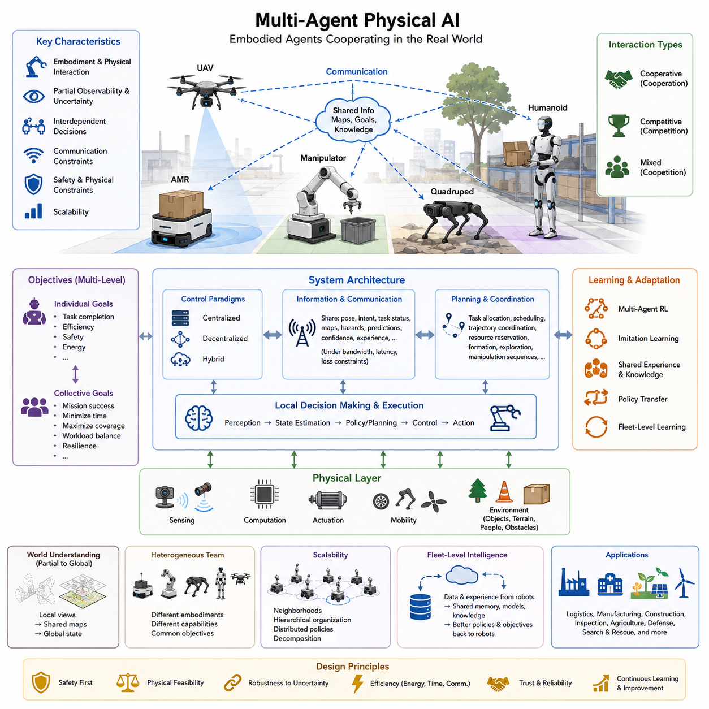{width="7.268055555555556in" height="7.268055555555556in"}

Multi-Agent Physical AI refers to embodied intelligent systems in which multiple autonomous agents perceive, decide, communicate, and act within a shared physical environment. Unlike conventional multi-agent software systems, these agents are constrained by embodiment, motion, sensing, energy, communication, safety, and physical interaction. Intelligence therefore emerges not only from computation but also from coordinated action in the real world.

An agent in Multi-Agent Physical AI is an autonomous decision-making entity connected to a physical embodiment such as an autonomous mobile robot, manipulator, quadruped, humanoid, aerial vehicle, or other robotic platform. Each agent observes part of the environment through its sensors, maintains internal state or knowledge, selects actions, and changes the physical world through locomotion, manipulation, communication, or interaction with other agents.

The defining characteristic of the multi-agent setting is that the behavior of one agent can affect the observations, opportunities, risks, and decisions of other agents. A robot moving through a corridor may block another robot, reveal previously unseen space, transport a resource required by another task, or communicate information that changes the team\'s plan. The environment therefore includes not only physical objects but also other intelligent actors.

Multi-Agent Physical AI differs fundamentally from simply operating several independent robots at the same location. A collection of robots becomes a multi-agent intelligent system when their decisions are coupled through shared tasks, resources, information, constraints, or objectives. Coordination may be explicit through communication and task allocation, or implicit through observation of other robots and adaptation to their behavior within the shared environment.

Each physical agent normally possesses a local view of the world rather than complete global knowledge. Sensor range, occlusion, communication limitations, localization uncertainty, and changing environmental conditions create partial observability. One robot may know something that another does not. Multi-agent intelligence must therefore transform fragmented local observations into decisions that remain effective even when no single robot possesses a perfectly synchronized representation of the entire system.

This distinction creates an important relationship between local state and global state. Local state describes what an individual agent currently knows about itself, nearby objects, assigned tasks, resources, and neighboring agents. Global state represents the broader condition of the team and environment. Multi-Agent Physical AI must determine how much global information is necessary, how it can be constructed, and when local decision making is sufficient without complete global knowledge.

Objectives also exist at multiple levels. An individual robot may seek to reach a destination efficiently, preserve battery capacity, avoid collisions, or complete its assigned operation. At the same time, the collective system may attempt to minimize overall mission time, maximize coverage, balance workload, maintain system resilience, or achieve a shared mission objective. Effective multi-agent behavior requires mechanisms that reconcile these individual and collective goals.

Interactions among agents can be cooperative, competitive, or mixed. Cooperative robots may divide tasks, exchange observations, coordinate trajectories, or assist one another. Competitive agents may contend for space, resources, or strategic advantage, while mixed systems combine cooperation and competition according to context. These interaction structures influence how policies, rewards, communication protocols, planning methods, and learning mechanisms should be designed.

Control can likewise be centralized, decentralized, or hybrid. A centralized system may use a fleet manager or global planner to assign missions and optimize shared resources. A decentralized system allows robots to negotiate, coordinate, and make decisions primarily from local information. Hybrid architectures combine global orchestration with autonomous local execution, allowing system-wide objectives to coexist with fast physical responses close to each robot.

Communication is therefore not merely a networking function but an intelligence resource. Agents can exchange position, intent, task status, map information, detected hazards, predicted trajectories, confidence estimates, or learned experience. Because bandwidth, latency, packet loss, and connectivity are limited in physical environments, intelligent systems must determine what information is valuable enough to communicate and what can safely remain local.

Planning in Multi-Agent Physical AI extends beyond finding an independent path for every robot. Decisions may involve task assignment, scheduling, trajectory coordination, resource reservation, formation, exploration, manipulation sequences, and responses to other agents\' predicted actions. A feasible action for one robot may become infeasible when the actions of teammates are considered, making joint planning substantially more complex than single-agent planning.

Learning further expands this framework by allowing robots to improve from individual and collective experience. Multi-agent reinforcement learning, imitation learning, shared experience, policy transfer, and distributed learning can enable agents to acquire coordinated behaviors that are difficult to specify manually. Training may use centralized information while execution remains distributed, allowing robots to exploit richer team context during learning without requiring it continuously in deployment.

Physical embodiment makes these learning and planning problems especially demanding. Actions consume time and energy, sensing is noisy, communication can fail, actuators have limits, and incorrect coordination can produce collisions or mission failure. Decisions must therefore satisfy physical feasibility and safety constraints while coping with uncertainty. Multi-Agent Physical AI is consequently a cyber-physical intelligence problem rather than only a multi-agent optimization problem.

As the number of robots increases, the possible combinations of observations, assignments, interactions, communication relationships, and joint actions grow rapidly. Practical architectures cannot depend on exhaustive global reasoning for every decision. They require scalable abstractions such as local neighborhoods, hierarchical coordination, distributed policies, capability models, shared representations, and decomposition of large missions into manageable subproblems.

The concept also encompasses heterogeneous teams in which agents have different embodiments and capabilities. An AMR may transport material, a manipulator may perform precise physical operations, a quadruped may traverse difficult terrain, and a UAV may provide aerial perception. Multi-agent intelligence must represent these capability differences while providing common mechanisms for task allocation, communication, knowledge sharing, and coordinated mission execution.

At fleet scale, Multi-Agent Physical AI connects individual autonomy with collective intelligence. Robots contribute observations and experience to shared maps, world memory, traversability knowledge, operational models, and learning processes, while fleet-level intelligence redistributes useful knowledge and objectives back to individual agents. The resulting feedback loop allows the collective system to become more capable than isolated robots operating with independent memories.

Multi-Agent Physical AI can therefore be understood as the study and engineering of embodied autonomous agents whose intelligence is shaped by physical interaction, distributed information, interdependent decisions, and collective objectives. Its central challenge is not simply making every robot individually intelligent, but enabling many physical agents to coordinate, learn, adapt, and act as a reliable collective system while preserving local autonomy and real-world safety.

다중 에이전트 피지컬 AI(Multi-Agent Physical AI)는 여러 자율 에이전트(autonomous agent)가 공유된 물리적 환경(physical environment)에서 인지(perception), 의사결정(decision making), 통신(communication), 행동(action)을 수행하는 체화 지능 시스템(embodied intelligent system)을 의미합니다. 기존의 다중 에이전트 소프트웨어 시스템(multi-agent software system)과 달리 이러한 에이전트는 체화(embodiment), 이동(motion), 센싱(sensing), 에너지(energy), 통신, 안전(safety), 물리적 상호작용(physical interaction)의 제약을 받습니다. 따라서 지능은 계산뿐만 아니라 현실 세계에서의 협력적 행동(coordinated action)을 통해서도 형성됩니다.

다중 에이전트 피지컬 AI에서 에이전트(agent)는 자율이동로봇(Autonomous Mobile Robot, AMR), 매니퓰레이터(manipulator), 4족 보행 로봇(quadruped), 휴머노이드(humanoid), 무인항공기(aerial vehicle) 또는 기타 로봇 플랫폼(robotic platform)과 같은 물리적 체화(physical embodiment)에 연결된 자율 의사결정 주체(autonomous decision-making entity)입니다. 각 에이전트는 센서(sensor)를 통해 환경의 일부를 관찰하고 내부 상태(internal state)나 지식(knowledge)을 유지하며 행동을 선택하고 이동, 조작, 통신 또는 다른 에이전트와의 상호작용을 통해 물리적 세계를 변화시킵니다.

다중 에이전트 환경(multi-agent setting)의 핵심적인 특징은 한 에이전트의 행동이 다른 에이전트의 관찰(observation), 기회(opportunity), 위험(risk), 의사결정에 영향을 줄 수 있다는 것입니다. 복도를 이동하는 로봇은 다른 로봇의 이동을 방해할 수도 있고, 이전에 관찰되지 않았던 공간을 발견하거나 다른 작업에 필요한 자원을 운반할 수도 있으며, 팀의 계획을 변경하는 정보를 전달할 수도 있습니다. 따라서 환경에는 물리적 객체뿐만 아니라 다른 지능형 행위자(intelligent actor)도 포함됩니다.

다중 에이전트 피지컬 AI는 단순히 동일한 장소에서 여러 독립적인 로봇을 운영하는 것과 근본적으로 다릅니다. 여러 로봇의 의사결정이 공유 작업(shared task), 자원(resource), 정보(information), 제약조건(constraint), 목표(objective)를 통해 서로 연결될 때 비로소 다중 에이전트 지능 시스템(multi-agent intelligent system)이 됩니다. 협력(coordination)은 통신이나 작업 할당(task allocation)을 통해 명시적으로 이루어질 수도 있고, 다른 로봇의 행동을 관찰하고 공유 환경에서 그 행동에 적응하는 방식으로 암묵적으로 이루어질 수도 있습니다.

각 물리적 에이전트(physical agent)는 일반적으로 완전한 전역 지식(global knowledge)이 아니라 세계에 대한 국소적 관점(local view)을 갖습니다. 센서 범위(sensor range), 가림(occlusion), 통신 제한(communication limitation), 위치추정 불확실성(localization uncertainty), 변화하는 환경 조건으로 인해 부분 관측성(partial observability)이 발생합니다. 한 로봇이 알고 있는 정보를 다른 로봇은 알지 못할 수 있습니다. 따라서 다중 에이전트 지능은 어느 하나의 로봇도 전체 시스템에 대해 완벽하게 동기화된 표현을 갖지 못하는 상황에서도 분산된 국소 관찰(local observation)을 효과적인 의사결정으로 변환해야 합니다.

이러한 특성은 국소 상태(local state)와 전역 상태(global state) 사이의 중요한 관계를 형성합니다. 국소 상태는 개별 에이전트가 자신과 주변 객체, 할당된 작업, 자원, 인접 에이전트에 대해 현재 알고 있는 정보를 나타냅니다. 전역 상태는 팀과 환경의 보다 광범위한 상태를 나타냅니다. 다중 에이전트 피지컬 AI는 어느 정도의 전역 정보가 필요한지, 이를 어떻게 구성할 것인지, 그리고 완전한 전역 지식 없이 국소 의사결정(local decision making)만으로 충분한 상황이 언제인지를 결정해야 합니다.

목표(objective) 역시 여러 수준에서 존재합니다. 개별 로봇은 목적지에 효율적으로 도달하고, 배터리 용량을 보존하며, 충돌을 회피하고, 할당된 작업을 완료하는 것을 목표로 할 수 있습니다. 동시에 집단 시스템(collective system)은 전체 임무 시간(mission time)을 최소화하고, 커버리지(coverage)를 최대화하며, 작업 부하(workload)를 균형 있게 배분하고, 시스템 회복탄력성(system resilience)을 유지하거나 공유 임무 목표(shared mission objective)를 달성하려 할 수 있습니다. 효과적인 다중 에이전트 행동은 이러한 개별 목표와 집단 목표를 조정하는 메커니즘을 필요로 합니다.

에이전트 간 상호작용(interaction)은 협력적(cooperative), 경쟁적(competitive) 또는 혼합형(mixed)이 될 수 있습니다. 협력 로봇은 작업을 분담하고, 관찰 정보를 교환하며, 궤적(trajectory)을 조정하거나 서로를 지원할 수 있습니다. 경쟁적 에이전트는 공간, 자원 또는 전략적 우위를 놓고 경쟁할 수 있으며, 혼합형 시스템은 상황에 따라 협력과 경쟁을 결합합니다. 이러한 상호작용 구조는 정책(policy), 보상(reward), 통신 프로토콜(communication protocol), 계획 방법(planning method), 학습 메커니즘(learning mechanism)의 설계 방식에 영향을 미칩니다.

제어(control) 역시 중앙집중형(centralized), 분산형(decentralized) 또는 하이브리드형(hybrid)이 될 수 있습니다. 중앙집중형 시스템은 플릿 관리자(fleet manager) 또는 전역 계획기(global planner)를 이용하여 임무를 할당하고 공유 자원을 최적화할 수 있습니다. 분산형 시스템에서는 로봇들이 주로 국소 정보를 기반으로 협상하고, 협력하며, 의사결정을 수행합니다. 하이브리드 아키텍처(hybrid architecture)는 전역 오케스트레이션(global orchestration)과 자율적인 국소 실행(local execution)을 결합하여 시스템 전체의 목표와 각 로봇의 빠른 물리적 대응이 함께 이루어지도록 합니다.

따라서 통신(communication)은 단순한 네트워킹 기능(networking function)이 아니라 지능 자원(intelligence resource)입니다. 에이전트는 위치(position), 의도(intent), 작업 상태(task status), 지도 정보(map information), 감지된 위험(detected hazard), 예측 궤적(predicted trajectory), 신뢰도 추정치(confidence estimate), 학습 경험(learned experience) 등을 교환할 수 있습니다. 물리적 환경에서는 대역폭(bandwidth), 지연시간(latency), 패킷 손실(packet loss), 연결성(connectivity)이 제한되므로 지능형 시스템은 어떤 정보가 통신할 만큼 가치가 있으며 어떤 정보는 안전하게 국소적으로 유지할 수 있는지를 판단해야 합니다.

다중 에이전트 피지컬 AI의 계획(planning)은 각 로봇의 독립적인 경로를 찾는 것 이상으로 확장됩니다. 의사결정에는 작업 할당(task assignment), 스케줄링(scheduling), 궤적 협조(trajectory coordination), 자원 예약(resource reservation), 대형 형성(formation), 탐색(exploration), 조작 순서(manipulation sequence), 다른 에이전트의 예측 행동에 대한 대응 등이 포함될 수 있습니다. 한 로봇에게 가능한 행동도 팀원의 행동을 함께 고려하면 실행 불가능해질 수 있으므로 공동 계획(joint planning)은 단일 에이전트 계획(single-agent planning)보다 훨씬 복잡합니다.

학습(learning)은 로봇이 개별 경험과 집단 경험(collective experience)을 통해 성능을 향상시킬 수 있도록 이 프레임워크를 더욱 확장합니다. 다중 에이전트 강화학습(Multi-Agent Reinforcement Learning, MARL), 모방학습(imitation learning), 공유 경험(shared experience), 정책 전이(policy transfer), 분산 학습(distributed learning)은 수작업으로 정의하기 어려운 협력 행동을 에이전트가 획득하도록 할 수 있습니다. 학습 과정에서는 중앙집중화된 정보를 활용하면서 실제 실행은 분산 방식으로 수행하여, 배치 환경에서 풍부한 팀 정보를 지속적으로 요구하지 않고도 학습 과정에서 이를 활용할 수 있습니다.

물리적 체화(physical embodiment)는 이러한 학습 및 계획 문제를 특히 어렵게 만듭니다. 행동은 시간과 에너지를 소비하고, 센싱에는 잡음(noise)이 존재하며, 통신은 실패할 수 있고, 액추에이터(actuator)에는 물리적 한계가 있으며, 잘못된 협력은 충돌이나 임무 실패를 발생시킬 수 있습니다. 따라서 의사결정은 불확실성(uncertainty)에 대응하면서 물리적 실행 가능성(physical feasibility)과 안전 제약조건(safety constraint)을 충족해야 합니다. 이러한 의미에서 다중 에이전트 피지컬 AI는 단순한 다중 에이전트 최적화 문제가 아니라 사이버-물리 지능 문제(cyber-physical intelligence problem)입니다.

로봇의 수가 증가하면 가능한 관찰, 작업 할당, 상호작용, 통신 관계, 공동 행동(joint action)의 조합이 빠르게 증가합니다. 실용적인 아키텍처는 모든 의사결정에 대해 완전한 전역 추론(global reasoning)을 수행하는 방식에 의존할 수 없습니다. 따라서 국소 이웃(local neighborhood), 계층적 협력(hierarchical coordination), 분산 정책(distributed policy), 역량 모델(capability model), 공유 표현(shared representation), 대규모 임무를 관리 가능한 하위 문제로 분해하는 방식과 같은 확장 가능한 추상화(scalable abstraction)가 필요합니다.

이 개념은 서로 다른 체화와 역량을 가진 에이전트로 구성된 이기종 팀(heterogeneous team)도 포함합니다. 자율이동로봇(AMR)은 물자를 운송하고, 매니퓰레이터는 정밀한 물리 작업을 수행하며, 4족 보행 로봇은 험난한 지형을 이동하고, 무인항공기(UAV)는 공중 인지(aerial perception)를 제공할 수 있습니다. 다중 에이전트 지능은 이러한 역량 차이를 표현하면서도 작업 할당, 통신, 지식 공유(knowledge sharing), 협력 임무 수행(coordinated mission execution)을 위한 공통 메커니즘을 제공해야 합니다.

플릿 규모(fleet scale)에서 다중 에이전트 피지컬 AI는 개별 자율성(individual autonomy)과 집단 지능(collective intelligence)을 연결합니다. 로봇은 관찰과 경험을 공유 지도(shared map), 세계 메모리(world memory), 주행 가능성 지식(traversability knowledge), 운영 모델(operational model), 학습 프로세스에 제공하고, 플릿 수준 지능(fleet-level intelligence)은 유용한 지식과 목표를 다시 개별 에이전트에 배포합니다. 이러한 피드백 루프(feedback loop)를 통해 집단 시스템은 독립적인 메모리만으로 동작하는 고립된 개별 로봇보다 높은 능력을 갖출 수 있습니다.

따라서 다중 에이전트 피지컬 AI(Multi-Agent Physical AI)는 물리적 상호작용(physical interaction), 분산 정보(distributed information), 상호의존적 의사결정(interdependent decision making), 집단 목표(collective objective)에 의해 지능이 형성되는 체화된 자율 에이전트(embodied autonomous agent)를 연구하고 구현하는 분야로 이해할 수 있습니다. 핵심 과제는 단순히 각각의 로봇을 지능적으로 만드는 것이 아니라, 국소 자율성(local autonomy)과 현실 세계의 안전(real-world safety)을 유지하면서 여러 물리적 에이전트가 신뢰할 수 있는 하나의 집단 시스템으로 협력하고, 학습하고, 적응하며, 행동하도록 만드는 것입니다.

##  

## 01.02. Agents Robots Tasks and Environment

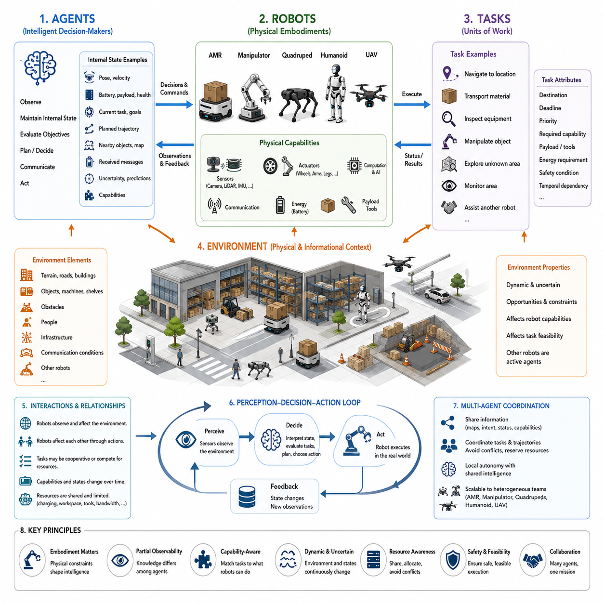{width="7.268055555555556in" height="7.268055555555556in"}

An agent is the fundamental decision-making unit of a Multi-Agent Physical AI system. It receives observations, maintains internal information, evaluates objectives, selects actions, and interacts with its surroundings. In robotics, an agent is usually connected to a physical platform, but the agent concept emphasizes the intelligence that determines behavior rather than the mechanical structure alone.

A robot is the physical embodiment through which an agent senses and acts in the real world. Its body provides sensors, actuators, computation, communication interfaces, mobility, manipulation capabilities, and energy resources. An AMR, manipulator, quadruped, humanoid, or UAV may therefore serve as the embodiment of an intelligent agent while imposing different physical possibilities and constraints on its behavior.

The distinction between an agent and a robot is important because intelligence and embodiment are related but not identical. The agent contains decision logic, policies, goals, knowledge, and reasoning mechanisms, whereas the robot provides physical capabilities for perception and action. This separation makes it possible to reason about common multi-agent principles while supporting robots with very different morphologies and capabilities.

Each agent receives observations from its available sensing system. Cameras, LiDAR, radar, depth sensors, encoders, inertial sensors, force sensors, and other modalities can describe different aspects of the environment and the robot itself. These observations are generally incomplete and uncertain, meaning that an agent must construct an internal estimate of relevant state rather than assume direct access to the complete physical world.

An agent\'s internal state may include its pose, velocity, battery level, payload, health condition, current task, planned trajectory, nearby obstacles, detected objects, and information received from other robots. More advanced systems can maintain semantic maps, uncertainty estimates, predicted motions, task dependencies, or learned representations. This internal information provides the context required for meaningful autonomous decisions.

Tasks define what agents are expected to accomplish. A task may represent navigation to a location, transporting material, inspecting equipment, manipulating an object, exploring an unknown region, monitoring an area, or assisting another robot. Tasks transform broad system objectives into executable units of work and provide an important connection between mission-level reasoning and robot-level physical behavior.

A task is more than a symbolic command because physical execution requires constraints and resources. It may contain a destination, deadline, priority, required payload, sensing capability, manipulation skill, energy requirement, safety condition, or temporal dependency. A robot can execute a task only when its current capabilities and physical state satisfy these requirements, making capability-aware assignment essential in heterogeneous systems.

Tasks can also be interdependent. One robot may need to deliver an object before another can manipulate it, or an aerial robot may first inspect an area before a ground robot enters it. Multiple robots may need simultaneous access to different positions, while some tasks may compete for the same corridor, charging station, tool, or communication resource. Task structure therefore directly influences coordination.

The environment is the physical and informational context in which agents operate. It includes terrain, buildings, roads, shelves, machines, objects, obstacles, people, infrastructure, communication conditions, and other robots. Unlike a static simulation state, a real environment continuously changes because of natural processes, human activity, robot actions, equipment operation, and uncertainty in perception.

For a physical agent, the environment determines both opportunities and constraints. A corridor enables movement but has limited capacity, terrain may be traversable for one robot but inaccessible to another, and an object may require a specific manipulator or payload capacity. Environmental properties therefore cannot be separated from embodiment when determining whether a task or action is physically feasible.

Other robots are themselves part of the environment from the perspective of an individual agent. Their positions, trajectories, intentions, assigned tasks, and actions can change what the agent should do next. However, unlike passive obstacles, other agents make decisions and react. Multi-Agent Physical AI must consequently model interactions between decision-making entities rather than treating every external element as static geometry.

The relationship among agents, robots, tasks, and environment forms a continuous perception-decision-action loop. Sensors observe the environment, the agent interprets observations and task requirements, a policy or planner selects an action, and the robot physically executes that action. Execution changes both the robot and the environment, producing new observations that become the input to the next decision cycle.

In a multi-robot system, this loop occurs simultaneously across many agents. Actions performed by one robot may alter the observations and feasible actions of others. A robot entering an intersection changes traffic conditions, a robot removing an obstacle creates a new route, and a robot discovering a hazard can change the plans of the entire team. Individual perception-action loops therefore become dynamically coupled.

Capability is a key relationship connecting robots to tasks. Different robots may have different mobility, sensing, manipulation, payload, endurance, computation, and communication capabilities. A UAV can rapidly observe a large region but cannot transport a heavy pallet, while an AMR may transport material efficiently but cannot inspect elevated infrastructure. Task allocation must account for what each embodiment can actually accomplish.

The environment also affects capability dynamically. Battery depletion can reduce mission range, damaged sensors can decrease perception quality, difficult terrain can limit mobility, and network degradation can reduce access to shared information. Capability should therefore be understood not only as a fixed robot specification but also as a context-dependent operational state that changes during mission execution.

Resources introduce another layer of interaction. Robots may share charging stations, workspace, tools, network bandwidth, access routes, manipulation zones, or limited mission time. Even when tasks are individually feasible, simultaneous execution can create resource conflicts. Multi-agent coordination must therefore reason about who performs each task, when it should occur, and which physical or informational resources must be reserved.

In homogeneous teams, robots may possess similar embodiments and capabilities, allowing tasks to be exchanged relatively easily. Heterogeneous teams are more complex because AMRs, manipulators, quadrupeds, humanoids, and UAVs may perform complementary roles. A common representation of capabilities, task requirements, environment state, and agent status becomes important for coordinating these different embodiments within one mission.

The system may also distinguish between local and shared information. Each agent maintains information required for immediate autonomous operation, while selected state, task, map, intent, or capability information can be communicated to teammates or fleet-level infrastructure. This arrangement allows robots to continue responding locally while using shared knowledge to improve coordination and collective decision making.

A practical Multi-Agent Physical AI architecture therefore connects four fundamental elements: intelligent agents that make decisions, robots that provide physical embodiment, tasks that define required work, and environments that determine the context of execution. Their relationships are dynamic rather than fixed, because tasks, robot states, environmental conditions, and interactions among agents continuously change throughout operation.

Understanding these elements provides the foundation for the remaining multi-agent concepts. Local and global state describe what information about this system is available, partial observability explains why knowledge differs among agents, objectives determine desired outcomes, and coordination determines how coupled decisions are managed. Multi-Agent Physical AI emerges when these components operate together as an adaptive physical system rather than as isolated autonomous robots.

에이전트(agent)는 다중 에이전트 피지컬 AI(Multi-Agent Physical AI) 시스템을 구성하는 기본적인 의사결정 단위(decision-making unit)입니다. 에이전트는 관찰(observation)을 수신하고, 내부 정보(internal information)를 유지하며, 목표(objective)를 평가하고, 행동(action)을 선택하여 주변 환경과 상호작용합니다. 로보틱스(robotics)에서 에이전트는 일반적으로 물리적 플랫폼과 연결되지만, 에이전트라는 개념은 기계적 구조 자체보다 행동을 결정하는 지능(intelligence)에 초점을 둡니다.

로봇(robot)은 에이전트가 현실 세계를 감지하고 행동할 수 있도록 하는 물리적 체화(physical embodiment)입니다. 로봇의 몸체는 센서(sensor), 액추에이터(actuator), 연산(computation), 통신 인터페이스(communication interface), 이동 능력(mobility), 조작 능력(manipulation capability), 에너지 자원(energy resource)을 제공합니다. 따라서 자율이동로봇(Autonomous Mobile Robot, AMR), 매니퓰레이터(manipulator), 4족 보행 로봇(quadruped), 휴머노이드(humanoid), 무인항공기(Unmanned Aerial Vehicle, UAV)는 서로 다른 물리적 가능성과 제약조건을 가지면서 지능형 에이전트의 체화 역할을 수행할 수 있습니다.

에이전트(agent)와 로봇(robot)을 구분하는 것은 중요합니다. 지능(intelligence)과 체화(embodiment)는 서로 관련되어 있지만 동일한 개념은 아니기 때문입니다. 에이전트에는 의사결정 논리(decision logic), 정책(policy), 목표(goal), 지식(knowledge), 추론 메커니즘(reasoning mechanism)이 포함되는 반면, 로봇은 인지와 행동을 위한 물리적 능력을 제공합니다. 이러한 분리를 통해 매우 다른 형태와 능력을 가진 로봇을 지원하면서도 공통적인 다중 에이전트 원리를 적용할 수 있습니다.

각 에이전트는 사용 가능한 센싱 시스템(sensing system)으로부터 관찰 정보를 받습니다. 카메라(camera), 라이다(LiDAR), 레이더(radar), 깊이 센서(depth sensor), 엔코더(encoder), 관성 센서(inertial sensor), 힘 센서(force sensor) 등의 다양한 센서 모달리티(sensor modality)는 환경과 로봇 자체의 서로 다른 측면을 표현할 수 있습니다. 이러한 관찰은 일반적으로 불완전하고 불확실하므로 에이전트는 완전한 물리 세계에 직접 접근한다고 가정하기보다 관련 상태에 대한 내부 추정치(internal estimate)를 구성해야 합니다.

에이전트의 내부 상태(internal state)에는 자신의 자세(pose), 속도(velocity), 배터리 수준(battery level), 적재 상태(payload), 건전성 상태(health condition), 현재 작업(current task), 계획된 궤적(planned trajectory), 주변 장애물(nearby obstacle), 감지된 객체(detected object), 다른 로봇으로부터 전달받은 정보 등이 포함될 수 있습니다. 더욱 발전된 시스템은 의미론적 지도(semantic map), 불확실성 추정(uncertainty estimate), 예측 움직임(predicted motion), 작업 의존성(task dependency), 학습된 표현(learned representation)을 유지할 수 있습니다. 이러한 내부 정보는 의미 있는 자율 의사결정에 필요한 맥락(context)을 제공합니다.

작업(task)은 에이전트가 무엇을 수행해야 하는지를 정의합니다. 작업에는 특정 위치로의 이동, 물자의 운송, 장비 검사, 객체 조작, 미지 영역 탐색, 특정 지역 모니터링 또는 다른 로봇 지원 등이 포함될 수 있습니다. 작업은 광범위한 시스템 목표(system objective)를 실행 가능한 작업 단위(executable unit of work)로 변환하며, 임무 수준 추론(mission-level reasoning)과 로봇 수준의 물리적 행동(robot-level physical behavior)을 연결하는 중요한 역할을 합니다.

작업은 단순한 기호적 명령(symbolic command) 이상의 의미를 가집니다. 물리적 실행에는 다양한 제약조건과 자원이 필요하기 때문입니다. 작업에는 목적지(destination), 마감시간(deadline), 우선순위(priority), 요구 적재 능력(required payload), 센싱 능력(sensing capability), 조작 기술(manipulation skill), 에너지 요구량(energy requirement), 안전 조건(safety condition), 시간적 의존성(temporal dependency)이 포함될 수 있습니다. 로봇은 현재의 능력과 물리적 상태가 이러한 요구조건을 충족할 때만 작업을 수행할 수 있으므로 이기종 시스템(heterogeneous system)에서는 역량 기반 할당(capability-aware assignment)이 중요합니다.

작업들은 서로 의존적(interdependent)일 수도 있습니다. 한 로봇이 물체를 전달해야 다른 로봇이 이를 조작할 수 있으며, 지상 로봇이 진입하기 전에 공중 로봇이 먼저 특정 지역을 검사해야 할 수도 있습니다. 여러 로봇이 서로 다른 위치에 동시에 접근해야 하는 경우도 있으며, 일부 작업은 동일한 복도, 충전소(charging station), 도구(tool), 통신 자원(communication resource)을 놓고 경쟁할 수 있습니다. 따라서 작업 구조(task structure)는 협력(coordination)에 직접적인 영향을 미칩니다.

환경(environment)은 에이전트가 동작하는 물리적·정보적 맥락(physical and informational context)입니다. 여기에는 지형(terrain), 건물(building), 도로(road), 선반(shelf), 기계(machine), 객체(object), 장애물(obstacle), 사람(people), 인프라(infrastructure), 통신 조건(communication condition), 다른 로봇 등이 포함됩니다. 정적인 시뮬레이션 상태(static simulation state)와 달리 현실 환경은 자연적인 변화, 인간 활동, 로봇 행동, 장비 작동 및 인지 불확실성(perception uncertainty)에 의해 지속적으로 변화합니다.

물리적 에이전트(physical agent)에게 환경은 기회(opportunity)와 제약조건(constraint)을 동시에 결정합니다. 복도는 이동을 가능하게 하지만 수용 가능한 용량이 제한되어 있으며, 특정 지형은 한 로봇에게는 주행 가능하지만 다른 로봇에게는 접근할 수 없는 공간일 수 있습니다. 또한 특정 객체는 특정 매니퓰레이터나 적재 능력을 요구할 수 있습니다. 따라서 작업이나 행동의 물리적 실행 가능성(physical feasibility)을 판단할 때 환경 특성과 체화 특성을 분리하여 고려할 수 없습니다.

개별 에이전트의 관점에서 다른 로봇 역시 환경의 일부입니다. 다른 로봇의 위치(position), 궤적(trajectory), 의도(intent), 할당된 작업(assigned task), 행동(action)은 해당 에이전트가 다음에 무엇을 해야 하는지를 변화시킬 수 있습니다. 그러나 수동적인 장애물과 달리 다른 에이전트는 스스로 의사결정을 수행하고 반응합니다. 따라서 다중 에이전트 피지컬 AI는 모든 외부 요소를 정적인 기하 구조(static geometry)로 처리하는 것이 아니라 의사결정 주체 사이의 상호작용을 모델링해야 합니다.

에이전트, 로봇, 작업, 환경의 관계는 지속적인 인지-의사결정-행동 루프(perception-decision-action loop)를 형성합니다. 센서는 환경을 관찰하고, 에이전트는 관찰 정보와 작업 요구조건을 해석하며, 정책(policy) 또는 계획기(planner)는 행동을 선택하고, 로봇은 해당 행동을 물리적으로 실행합니다. 실행은 로봇과 환경 모두를 변화시키며, 그 결과 새로운 관찰이 생성되어 다음 의사결정 주기(decision cycle)의 입력으로 사용됩니다.

다중 로봇 시스템(multi-robot system)에서는 이러한 루프가 여러 에이전트에서 동시에 수행됩니다. 한 로봇의 행동은 다른 로봇의 관찰과 실행 가능한 행동을 변화시킬 수 있습니다. 한 로봇이 교차로에 진입하면 교통 조건(traffic condition)이 변화하고, 장애물을 제거하면 새로운 경로가 만들어지며, 위험 요소를 발견하면 전체 팀의 계획이 변경될 수 있습니다. 따라서 개별적인 인지-행동 루프(perception-action loop)는 동적으로 서로 연결됩니다.

역량(capability)은 로봇과 작업을 연결하는 핵심 관계입니다. 서로 다른 로봇은 이동 능력, 센싱, 조작, 적재 능력, 운용 지속시간(endurance), 연산 능력, 통신 능력에서 차이를 가질 수 있습니다. 무인항공기(UAV)는 넓은 지역을 빠르게 관찰할 수 있지만 무거운 팔레트를 운반할 수 없으며, 자율이동로봇(AMR)은 물자를 효율적으로 운반할 수 있지만 높은 위치의 시설물을 검사하기 어려울 수 있습니다. 따라서 작업 할당(task allocation)은 각 체화가 실제로 수행할 수 있는 능력을 고려해야 합니다.

환경은 역량(capability)에도 동적으로 영향을 미칩니다. 배터리 소모는 임무 수행 범위(mission range)를 감소시키고, 센서 손상은 인지 품질(perception quality)을 저하시키며, 험난한 지형은 이동성을 제한하고, 네트워크 성능 저하는 공유 정보에 대한 접근성을 감소시킬 수 있습니다. 따라서 역량은 고정된 로봇 사양(robot specification)뿐만 아니라 임무 수행 중 지속적으로 변화하는 상황 의존적 운용 상태(context-dependent operational state)로 이해해야 합니다.

자원(resource)은 또 다른 상호작용 계층을 형성합니다. 로봇은 충전소, 작업 공간(workspace), 도구, 네트워크 대역폭(network bandwidth), 접근 경로(access route), 조작 영역(manipulation zone), 제한된 임무 시간 등을 공유할 수 있습니다. 각각의 작업이 개별적으로 실행 가능하더라도 동시에 수행하면 자원 충돌(resource conflict)이 발생할 수 있습니다. 따라서 다중 에이전트 협력은 누가 각 작업을 수행할 것인지뿐만 아니라 언제 수행하고 어떤 물리적·정보적 자원을 예약해야 하는지도 판단해야 합니다.

동종 팀(homogeneous team)에서는 로봇들이 유사한 체화와 역량을 가지고 있으므로 비교적 쉽게 작업을 서로 교환할 수 있습니다. 이기종 팀(heterogeneous team)은 자율이동로봇, 매니퓰레이터, 4족 보행 로봇, 휴머노이드, 무인항공기가 서로 보완적인 역할을 수행할 수 있기 때문에 더욱 복잡합니다. 하나의 임무에서 서로 다른 체화를 협력시키려면 역량, 작업 요구조건, 환경 상태, 에이전트 상태에 대한 공통 표현(common representation)이 중요합니다.

시스템은 국소 정보(local information)와 공유 정보(shared information)를 구분할 수도 있습니다. 각 에이전트는 즉각적인 자율 동작에 필요한 정보를 자체적으로 유지하는 한편, 선택된 상태(state), 작업(task), 지도(map), 의도(intent), 역량 정보를 팀원 또는 플릿 수준 인프라(fleet-level infrastructure)에 전달할 수 있습니다. 이러한 구조를 통해 로봇은 국소적으로 즉각 대응하면서 공유 지식을 활용하여 협력과 집단 의사결정(collective decision making)의 성능을 향상시킬 수 있습니다.

따라서 실용적인 다중 에이전트 피지컬 AI 아키텍처(Multi-Agent Physical AI architecture)는 네 가지 기본 요소를 연결합니다. 의사결정을 수행하는 지능형 에이전트(intelligent agent), 물리적 체화를 제공하는 로봇(robot), 수행해야 할 작업을 정의하는 작업(task), 실행 맥락을 결정하는 환경(environment)입니다. 이러한 관계는 고정되어 있지 않으며 작업, 로봇 상태, 환경 조건, 에이전트 사이의 상호작용이 운용 과정에서 지속적으로 변화함에 따라 동적으로 변화합니다.

이러한 요소를 이해하는 것은 이후의 다중 에이전트 개념을 이해하기 위한 기반을 제공합니다. 국소 상태와 전역 상태(local and global state)는 시스템에 관한 어떤 정보가 사용 가능한지를 설명하고, 부분 관측성(partial observability)은 에이전트마다 보유한 지식이 서로 다른 이유를 설명합니다. 목표(objective)는 원하는 결과를 결정하며, 협력(coordination)은 서로 연결된 의사결정을 어떻게 관리할 것인지를 결정합니다. 이러한 구성요소들이 고립된 자율 로봇이 아니라 하나의 적응형 물리 시스템(adaptive physical system)으로 함께 동작할 때 다중 에이전트 피지컬 AI가 형성됩니다.

##  

## 01.03. Local vs Global State

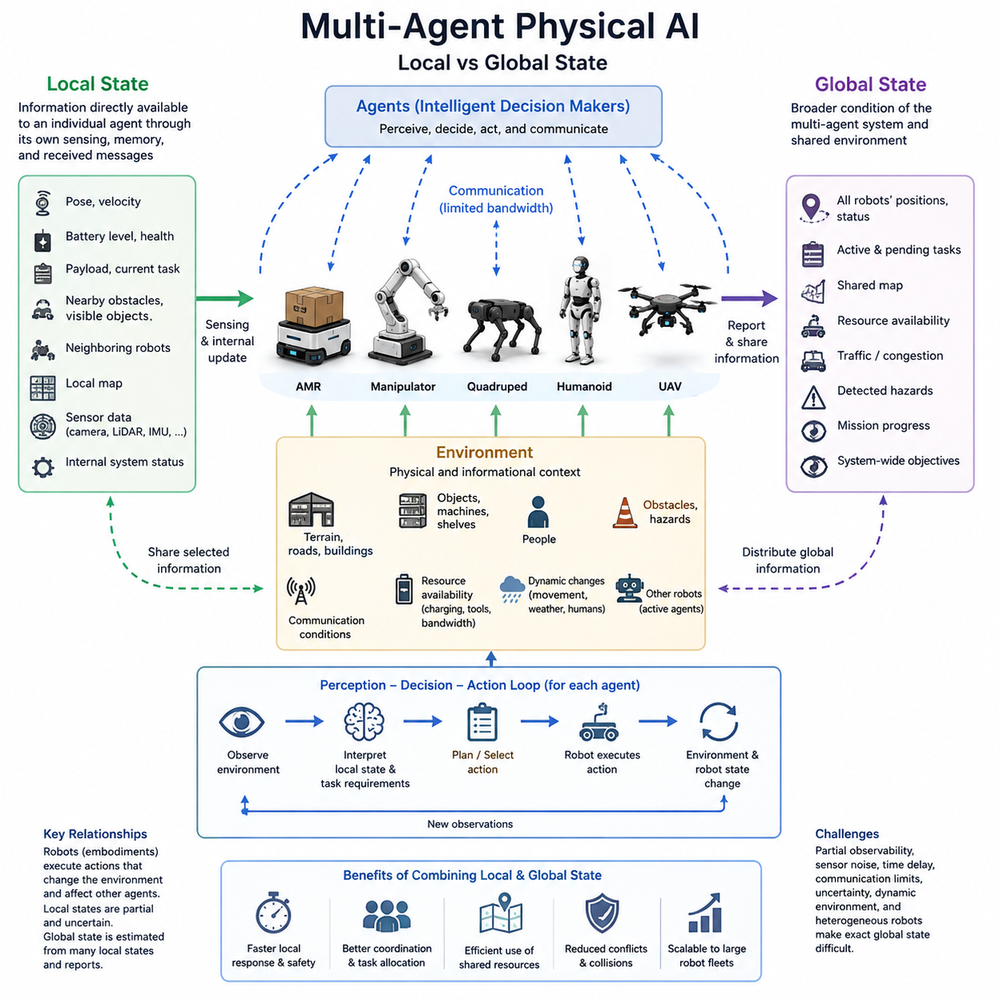{width="7.268055555555556in" height="7.268055555555556in"}

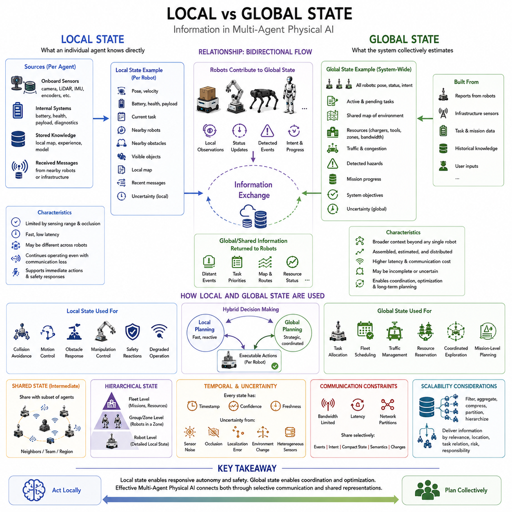{width="7.268055555555556in" height="7.268055555555556in"}

In Multi-Agent Physical AI, state represents the information required to describe the condition of robots, tasks, resources, and the environment at a particular moment. Because multiple embodied agents operate simultaneously, no single description is always available to every participant. The distinction between local state and global state therefore becomes fundamental to perception, coordination, planning, and collective decision making.

Local state is the information directly available to an individual agent through its own sensors, internal systems, stored knowledge, and received messages. It may include the robot\'s pose, velocity, battery level, health, payload, current task, nearby obstacles, visible objects, neighboring robots, and local map. This information provides the immediate operational context required for autonomous behavior.

A robot continuously updates its local state as it moves and interacts with the physical world. Wheel encoders and inertial sensors may estimate motion, cameras and LiDAR may detect environmental structure, and internal diagnostics may report energy or hardware conditions. Communication can supplement these observations with information from nearby robots, but the resulting state still reflects what that particular agent currently knows.

Local state is inherently limited by physical sensing. A robot cannot directly observe objects hidden behind walls, events outside sensor range, or changes occurring in distant parts of a facility. Even nearby observations may contain noise, occlusion, ambiguity, and localization error. Consequently, two robots operating in the same environment can maintain different local representations of what appears to be the same physical world.

Global state describes the broader condition of the multi-agent system and its shared environment. It may include the positions and status of all robots, active and pending tasks, shared maps, resource availability, traffic conditions, detected hazards, mission progress, and system-wide objectives. In principle, global state provides the contextual information required to reason about interactions that extend beyond any individual robot\'s local sensing range.

However, global state should not be interpreted as perfect knowledge of reality. In a physical system, global information is normally assembled from observations and reports generated by multiple agents and infrastructure components. These sources arrive at different times and with different uncertainties. The resulting global representation is therefore an estimated, distributed, and continuously changing description of the collective system.

The relationship between local and global state is bidirectional. Robots contribute local observations and internal status to shared infrastructure or neighboring agents, allowing broader state representations to be constructed. In return, global or shared information can provide robots with knowledge beyond their immediate sensing range, such as distant congestion, task priorities, blocked routes, resource availability, or hazards detected by other agents.

Consider a warehouse AMR that observes its immediate corridor and nearby obstacles. Its local state may indicate that the next intersection is clear, while the fleet-level state may show that several robots are approaching the same intersection from other directions. A decision based only on local perception could create congestion, whereas global information can support coordinated traffic management before the conflict becomes locally visible.

The same principle applies to task execution. An individual robot may know that it has sufficient battery and payload capacity to accept a transport task. Global state may additionally reveal that another robot is closer, a charging station is becoming congested, or a higher-priority mission requires the first robot\'s capability. Collective decisions therefore depend on information that may not be relevant or observable from a purely local perspective.

Local state has important advantages because it can be maintained close to the physical agent with low latency. Immediate collision avoidance, stabilization, obstacle response, manipulation control, and safety reactions should not depend entirely on remote global information. When communication becomes delayed or unavailable, a robot with sufficient local state can continue performing essential autonomous behaviors and transition safely into degraded operating modes.

Global state provides complementary advantages for decisions involving multiple robots and shared resources. Fleet scheduling, task allocation, traffic optimization, coordinated exploration, resource reservation, and mission-level planning benefit from broader knowledge of the system. The value of global information increases when actions are strongly coupled, because decisions made independently from local states may otherwise produce conflicts or inefficient collective behavior.

A practical architecture therefore does not simply choose between local and global state. It determines which information belongs at each level and how information should flow between them. Fast control and immediate safety information generally remain local, while selected task, map, intent, capability, resource, and mission information can be shared. This separation reduces unnecessary communication while preserving useful collective awareness.

Shared state can be viewed as an intermediate concept between purely local and fully global representations. Robots may share information only with neighboring agents, members of the same task group, or robots operating within a geographic region. Such scoped information exchange allows coordination to occur where interactions are strongest without requiring every state update to be distributed across the entire fleet.

Hierarchical systems extend this idea by maintaining state at several spatial and organizational levels. A robot may maintain detailed local geometry, a group coordinator may maintain the state of robots assigned to one zone, and a fleet manager may maintain abstract information about missions and resources across the site. Different levels can therefore represent the same physical system with different resolution, scope, and update frequency.

Temporal consistency is another challenge because state information becomes outdated. A robot position reported several seconds earlier may no longer represent its current location, while a previously clear path may have become blocked. Multi-agent systems must therefore associate shared state with timestamps, update rates, confidence, or freshness information so that agents can distinguish recent knowledge from information that should no longer be trusted directly.

Uncertainty is equally important when combining local states. Two robots may report different locations for the same obstacle or disagree about whether an area is traversable. These differences can result from sensor noise, viewpoint, localization error, environmental change, or heterogeneous sensing capabilities. A global representation must therefore preserve confidence and uncertainty rather than treating every contributed observation as equally reliable.

Communication limitations further determine how closely local and global states can remain synchronized. Bandwidth constraints may prevent continuous sharing of raw sensor data, latency can make remote information stale, and network partitions can temporarily isolate groups of robots. Effective systems prioritize relevant information and often exchange compact state, events, intent, semantic knowledge, or changes instead of transmitting complete world representations continuously.

The local-global distinction also affects planning. Local planning uses immediately available information to generate executable actions and respond quickly to changing surroundings. Global planning considers broader objectives, task dependencies, shared routes, and resource conflicts. In a hybrid architecture, global planning can establish mission-level constraints or goals while local planners continuously adapt execution according to current physical conditions.

Distributed systems may operate without a single authoritative global state. Each agent can maintain its own local knowledge and exchange selected information with peers, gradually producing sufficient shared awareness for coordination. Consensus, distributed estimation, map fusion, and peer-to-peer communication can support this approach. The objective is not necessarily to make every robot know everything, but to provide each agent with the information needed for its decisions.

Scalability makes this principle increasingly important. When a fleet grows from several robots to hundreds or thousands, broadcasting every observation and internal variable to every participant becomes inefficient. State representations must be filtered, aggregated, compressed, partitioned, or organized hierarchically. Robots should receive information according to relevance, location, task relationships, interaction risk, and operational responsibility.

Local and global state therefore represent complementary perspectives on the same multi-agent physical system. Local state supports responsive autonomy, robustness, and direct interaction with the physical world, while global state supports coordination, optimization, and collective awareness. Effective Multi-Agent Physical AI connects these perspectives through selective communication and shared representations, enabling individual robots to act independently while contributing to coherent fleet-level behavior.

다중 에이전트 피지컬 AI(Multi-Agent Physical AI)에서 상태(state)는 특정 시점의 로봇, 작업(task), 자원(resource), 환경(environment)의 조건을 설명하는 데 필요한 정보를 의미합니다. 여러 체화 에이전트(embodied agent)가 동시에 동작하기 때문에 모든 참여자가 항상 동일한 상태 정보를 이용할 수 있는 것은 아닙니다. 따라서 국소 상태(local state)와 전역 상태(global state)의 구분은 인지(perception), 협력(coordination), 계획(planning), 집단 의사결정(collective decision making)의 기본 개념이 됩니다.

국소 상태(local state)는 개별 에이전트가 자신의 센서(sensor), 내부 시스템(internal system), 저장된 지식(stored knowledge), 수신된 메시지(received message)를 통해 직접 이용할 수 있는 정보입니다. 여기에는 로봇의 자세(pose), 속도(velocity), 배터리 수준(battery level), 건전성 상태(health), 적재 상태(payload), 현재 작업(current task), 주변 장애물, 관찰 가능한 객체, 인접 로봇, 국소 지도(local map) 등이 포함될 수 있습니다. 이러한 정보는 자율 행동에 필요한 즉각적인 운용 맥락(operational context)을 제공합니다.

로봇은 이동하고 물리적 세계와 상호작용하면서 자신의 국소 상태를 지속적으로 갱신합니다. 휠 엔코더(wheel encoder)와 관성 센서(inertial sensor)는 움직임을 추정하고, 카메라(camera)와 라이다(LiDAR)는 환경 구조를 감지하며, 내부 진단 시스템(internal diagnostics)은 에너지나 하드웨어 상태를 보고할 수 있습니다. 통신을 통해 주변 로봇의 정보를 추가할 수도 있지만, 이렇게 구성된 상태는 여전히 해당 에이전트가 현재 알고 있는 정보를 반영합니다.

국소 상태는 물리적 센싱(physical sensing)의 한계로 인해 본질적으로 제한됩니다. 로봇은 벽 뒤에 가려진 객체, 센서 범위 밖의 사건, 시설의 먼 지역에서 발생하는 변화를 직접 관찰할 수 없습니다. 가까운 영역에서도 관찰에는 잡음(noise), 가림(occlusion), 모호성(ambiguity), 위치추정 오차(localization error)가 포함될 수 있습니다. 따라서 동일한 환경에서 동작하는 두 로봇도 동일한 물리적 세계에 대해 서로 다른 국소 표현(local representation)을 유지할 수 있습니다.

전역 상태(global state)는 다중 에이전트 시스템과 공유 환경의 보다 광범위한 상태를 설명합니다. 여기에는 모든 로봇의 위치와 상태, 활성 및 대기 작업, 공유 지도(shared map), 자원 가용성(resource availability), 교통 상황(traffic condition), 감지된 위험 요소, 임무 진행 상태(mission progress), 시스템 전체 목표(system-wide objective) 등이 포함될 수 있습니다. 원칙적으로 전역 상태는 개별 로봇의 국소 센싱 범위를 넘어서는 상호작용을 추론하는 데 필요한 맥락 정보를 제공합니다.

그러나 전역 상태를 현실에 대한 완벽한 지식(perfect knowledge)으로 이해해서는 안 됩니다. 물리적 시스템에서 전역 정보는 일반적으로 여러 에이전트와 인프라 구성요소가 생성한 관찰 및 보고를 결합하여 구성됩니다. 이러한 정보는 서로 다른 시점에 도착하며 각기 다른 불확실성(uncertainty)을 포함합니다. 따라서 전역 표현(global representation)은 집단 시스템에 대한 추정되고 분산되며 지속적으로 변화하는 설명입니다.

국소 상태와 전역 상태의 관계는 양방향(bidirectional)입니다. 로봇은 국소 관찰(local observation)과 자신의 내부 상태를 공유 인프라(shared infrastructure) 또는 주변 에이전트에 제공하여 더 넓은 상태 표현을 구성하는 데 기여합니다. 반대로 전역 정보 또는 공유 정보(shared information)는 원거리의 혼잡, 작업 우선순위, 차단된 경로, 자원 가용성, 다른 에이전트가 발견한 위험과 같이 개별 로봇의 직접적인 센싱 범위를 넘어서는 정보를 제공할 수 있습니다.

창고의 자율이동로봇(Autonomous Mobile Robot, AMR)을 예로 들면, 해당 로봇은 자신의 주변 복도와 가까운 장애물을 관찰할 수 있습니다. 국소 상태에서는 다음 교차로가 비어 있는 것으로 나타날 수 있지만, 플릿 수준 상태(fleet-level state)에서는 여러 로봇이 다른 방향에서 동일한 교차로에 접근하고 있음을 파악할 수 있습니다. 국소 인지만으로 판단하면 혼잡이 발생할 수 있지만, 전역 정보는 충돌 상황이 국소적으로 관찰되기 전에 협력적인 교통 관리(coordinated traffic management)를 가능하게 합니다.

동일한 원리는 작업 실행(task execution)에도 적용됩니다. 개별 로봇은 운송 작업을 수락하기에 충분한 배터리와 적재 능력을 가지고 있다는 것을 알고 있을 수 있습니다. 그러나 전역 상태에서는 다른 로봇이 작업 위치에 더 가깝거나, 충전소가 혼잡해지고 있거나, 더 높은 우선순위의 임무에서 해당 로봇의 특정 역량을 필요로 한다는 사실을 추가로 파악할 수 있습니다. 따라서 집단 의사결정은 순수한 국소 관점에서는 관찰할 수 없거나 중요하지 않은 정보에도 의존합니다.

국소 상태는 물리적 에이전트 가까이에서 낮은 지연시간(low latency)으로 유지할 수 있다는 중요한 장점이 있습니다. 즉각적인 충돌 회피(collision avoidance), 안정화(stabilization), 장애물 대응, 조작 제어(manipulation control), 안전 대응(safety response)은 원격 전역 정보에 완전히 의존해서는 안 됩니다. 통신이 지연되거나 사용할 수 없는 상황에서도 충분한 국소 상태를 가진 로봇은 필수적인 자율 행동을 지속하고 안전하게 성능 저하 운용 모드(degraded operating mode)로 전환할 수 있습니다.

전역 상태는 여러 로봇과 공유 자원이 관련된 의사결정에서 상호보완적인 장점을 제공합니다. 플릿 스케줄링(fleet scheduling), 작업 할당(task allocation), 교통 최적화(traffic optimization), 협력 탐색(coordinated exploration), 자원 예약(resource reservation), 임무 수준 계획(mission-level planning)은 시스템 전체에 대한 폭넓은 정보를 활용할수록 효과적입니다. 특히 에이전트들의 행동이 강하게 결합되어 있을수록 전역 정보의 가치가 커집니다. 국소 상태만으로 독립적인 결정을 수행하면 충돌이나 비효율적인 집단 행동이 발생할 수 있기 때문입니다.

따라서 실용적인 아키텍처(practical architecture)는 단순히 국소 상태와 전역 상태 중 하나를 선택하지 않습니다. 어떤 정보가 각 수준에 위치해야 하는지, 그리고 수준 간에 정보가 어떻게 흐를 것인지를 결정합니다. 빠른 제어와 즉각적인 안전 관련 정보는 일반적으로 국소적으로 유지하며, 선택된 작업, 지도, 의도(intent), 역량(capability), 자원, 임무 정보는 공유할 수 있습니다. 이러한 분리는 불필요한 통신을 줄이면서 유용한 집단 인식(collective awareness)을 유지합니다.

공유 상태(shared state)는 순수한 국소 표현과 완전한 전역 표현 사이의 중간 개념으로 볼 수 있습니다. 로봇은 인접 에이전트, 동일한 작업 그룹의 구성원 또는 특정 지리적 영역에서 활동하는 로봇과만 정보를 공유할 수 있습니다. 이러한 범위 제한형 정보 교환(scoped information exchange)은 모든 상태 갱신을 전체 플릿에 배포하지 않고도 상호작용이 강한 영역에서 필요한 협력을 수행할 수 있도록 합니다.

계층형 시스템(hierarchical system)은 이러한 개념을 확장하여 여러 공간적·조직적 수준에서 상태를 유지합니다. 개별 로봇은 상세한 국소 기하 정보(local geometry)를 유지하고, 그룹 조정자(group coordinator)는 특정 구역에 할당된 로봇들의 상태를 관리하며, 플릿 관리자(fleet manager)는 전체 사이트의 임무와 자원에 대한 추상화된 정보를 유지할 수 있습니다. 따라서 서로 다른 계층은 동일한 물리 시스템을 서로 다른 해상도(resolution), 범위(scope), 갱신 주기(update frequency)로 표현할 수 있습니다.

시간적 일관성(temporal consistency)도 중요한 문제입니다. 상태 정보는 시간이 지나면서 오래된 정보가 되기 때문입니다. 몇 초 전에 보고된 로봇의 위치는 현재 위치를 나타내지 않을 수 있으며, 이전에 통과 가능했던 경로가 현재는 차단되어 있을 수도 있습니다. 따라서 다중 에이전트 시스템은 공유 상태에 타임스탬프(timestamp), 갱신 주기, 신뢰도(confidence), 최신성(freshness) 정보를 연결하여 최근의 지식과 더 이상 직접 신뢰해서는 안 되는 정보를 구분할 수 있어야 합니다.

국소 상태를 결합할 때는 불확실성(uncertainty) 역시 중요합니다. 두 로봇이 동일한 장애물의 위치를 서로 다르게 보고하거나 특정 영역의 주행 가능 여부(traversability)에 대해 서로 다른 판단을 내릴 수 있습니다. 이러한 차이는 센서 잡음, 관측 시점(viewpoint), 위치추정 오차, 환경 변화, 이기종 센싱 능력(heterogeneous sensing capability)으로 인해 발생할 수 있습니다. 따라서 전역 표현은 모든 관찰을 동일하게 신뢰하기보다 신뢰도와 불확실성을 함께 유지해야 합니다.

통신 제한(communication limitation)은 국소 상태와 전역 상태를 얼마나 긴밀하게 동기화할 수 있는지도 결정합니다. 대역폭 제약(bandwidth constraint)으로 인해 원시 센서 데이터(raw sensor data)를 지속적으로 공유하기 어려울 수 있고, 지연시간(latency)은 원격 정보를 오래된 상태로 만들 수 있으며, 네트워크 단절(network partition)은 일부 로봇 그룹을 일시적으로 고립시킬 수 있습니다. 효과적인 시스템은 관련성이 높은 정보를 우선시하며 완전한 세계 표현을 지속적으로 전송하기보다 압축된 상태, 이벤트(event), 의도, 의미론적 지식(semantic knowledge), 변화 정보 등을 교환합니다.

국소-전역 구분(local-global distinction)은 계획(planning)에도 영향을 미칩니다. 국소 계획(local planning)은 즉시 사용할 수 있는 정보를 활용하여 실행 가능한 행동을 생성하고 변화하는 주변 환경에 빠르게 대응합니다. 전역 계획(global planning)은 보다 광범위한 목표, 작업 의존성, 공유 경로, 자원 충돌을 고려합니다. 하이브리드 아키텍처(hybrid architecture)에서는 전역 계획이 임무 수준의 제약조건이나 목표를 설정하고, 국소 계획기가 현재의 물리적 조건에 따라 실행 과정을 지속적으로 조정할 수 있습니다.

분산 시스템(distributed system)은 하나의 권위 있는 전역 상태(authoritative global state) 없이도 동작할 수 있습니다. 각 에이전트는 자신의 국소 지식을 유지하면서 선택된 정보를 동료 에이전트(peer agent)와 교환하고, 이를 통해 협력에 충분한 공유 인식을 점진적으로 형성할 수 있습니다. 합의(consensus), 분산 추정(distributed estimation), 지도 융합(map fusion), 피어투피어 통신(peer-to-peer communication)이 이러한 방식을 지원할 수 있습니다. 목표는 모든 로봇이 모든 것을 아는 것이 아니라 각 에이전트가 자신의 의사결정에 필요한 정보를 확보하도록 하는 것입니다.

확장성(scalability)이 증가할수록 이러한 원리는 더욱 중요해집니다. 플릿 규모가 몇 대의 로봇에서 수백 또는 수천 대로 증가하면 모든 관찰 정보와 내부 변수를 모든 참여자에게 전송하는 방식은 비효율적입니다. 상태 표현은 필터링(filtering), 집계(aggregation), 압축(compression), 분할(partitioning) 또는 계층적 구성을 통해 관리되어야 합니다. 로봇은 관련성(relevance), 위치(location), 작업 관계(task relationship), 상호작용 위험(interaction risk), 운용 책임(operational responsibility)에 따라 필요한 정보를 제공받아야 합니다.

따라서 국소 상태(local state)와 전역 상태(global state)는 동일한 다중 에이전트 물리 시스템을 바라보는 상호보완적인 관점입니다. 국소 상태는 신속한 자율성(responsive autonomy), 강건성(robustness), 물리 세계와의 직접적인 상호작용을 지원하며, 전역 상태는 협력, 최적화(optimization), 집단 인식을 지원합니다. 효과적인 다중 에이전트 피지컬 AI는 선택적 통신(selective communication)과 공유 표현(shared representation)을 통해 이러한 두 관점을 연결함으로써 개별 로봇이 독립적으로 행동하면서도 일관된 플릿 수준 행동(fleet-level behavior)에 기여할 수 있도록 합니다.

##  

## 01.04. Local Observation and Partial Observability

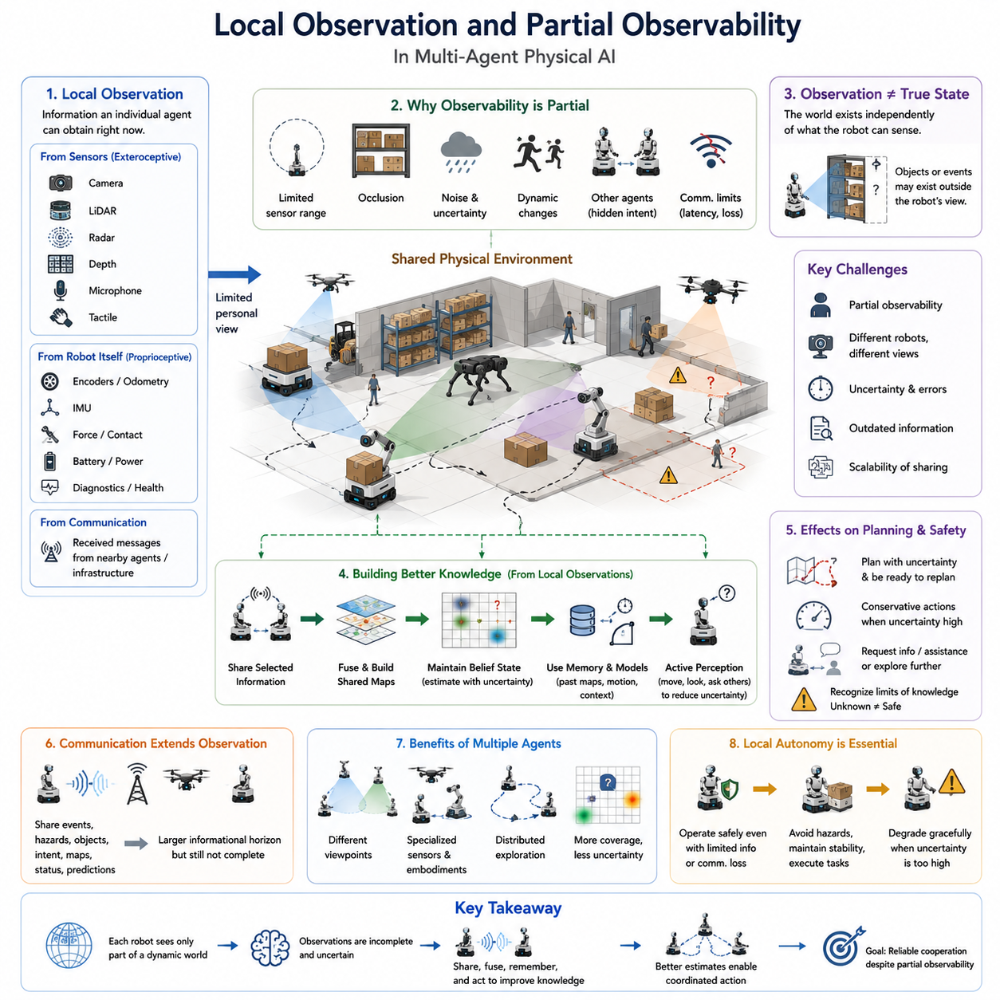{width="7.268055555555556in" height="7.268055555555556in"}

Local observation is the information that an individual physical agent can obtain from its own sensing, internal measurements, and immediately available communication. In a Multi-Agent Physical AI system, each robot experiences the shared environment from a different position, embodiment, and moment in time. Its decisions therefore begin with a limited personal view rather than direct access to the complete state of the world.

A robot\'s local observation may combine exteroceptive and proprioceptive information. Cameras, LiDAR, radar, depth sensors, microphones, and tactile sensors describe external surroundings, while encoders, inertial sensors, force measurements, battery monitors, and diagnostics describe the robot itself. Received messages can extend this observation, but communication does not automatically provide complete or perfectly current knowledge.

The distinction between observation and state is important. The physical state of the environment exists independently of what a robot can sense, while an observation is the evidence available to the agent about that state. A pallet may exist behind a shelf even though a robot cannot see it, and another robot may be approaching an intersection before it enters sensor range. The agent must therefore make decisions from incomplete evidence.

Partial observability occurs when an agent cannot directly determine the complete state relevant to its decision. This is normal rather than exceptional in physical environments. Limited sensor range, occlusion, measurement noise, changing illumination, difficult terrain, communication loss, moving objects, and other agents all prevent perfect observation. Multi-robot intelligence must consequently operate effectively despite incomplete information.

Embodiment strongly determines what can be observed. A UAV can view large regions from above but may have limited ability to inspect details beneath structures. An AMR observes the environment near ground level, while a quadruped can enter terrain inaccessible to wheeled robots. A manipulator may obtain precise close-range information around its workspace. Different embodiments therefore produce complementary but non-identical observations.

Spatial locality is one major source of partial observability. Sensors cover only a finite region around each robot, and physical structures can block visibility. In a warehouse, one AMR may observe an obstacle in an aisle while another robot several aisles away remains unaware of it. In outdoor environments, buildings, vegetation, terrain elevation, weather, and distance can similarly divide the world into locally observable regions.

Temporal effects create another limitation. Even when a robot previously observed an area, that information may no longer describe its current condition. People move, doors open and close, objects are relocated, terrain conditions change, and other robots continuously execute actions. An agent must therefore consider not only what has been observed but also when it was observed and how rapidly the underlying environment may change.

Sensor uncertainty further separates observation from reality. Measurements can contain noise, false detections, missed detections, calibration errors, localization drift, or ambiguous interpretations. A robot may detect an object without knowing its exact position or classify terrain without being certain that it is traversable. Useful observations should therefore include confidence or uncertainty rather than being treated as unquestionable facts.

Other intelligent agents make partial observability especially challenging. A robot may observe another robot\'s current position without knowing its future intention, assigned task, planned trajectory, or internal condition. Because agents actively make decisions, their future behavior cannot always be inferred from geometry alone. Sharing intent, plans, task status, or predicted motion can therefore reduce uncertainty about interactions among robots.

Communication expands local observation by allowing robots to exchange selected information. A robot that detects a blocked passage can inform teammates before they reach it, while a UAV can provide ground robots with observations from outside their sensing range. Communication effectively enlarges the informational horizon of each agent, but bandwidth, latency, packet loss, and connectivity prevent it from eliminating partial observability completely.

Shared maps and world representations provide another mechanism for extending local knowledge. Individual observations can be fused into spatial, semantic, traversability, hazard, or resource maps that multiple robots use. Such representations allow experience gathered by one agent to benefit others. However, shared knowledge remains an estimate because contributed observations may be uncertain, conflicting, delayed, or obsolete as the environment evolves.

An agent can compensate for incomplete observations by maintaining memory or an internal belief about the world. Recent observations, previous maps, received messages, motion models, and task context can be integrated to estimate conditions that are not currently visible. Instead of reacting only to the latest sensor frame, the robot reasons over accumulated evidence and maintains a representation of what is likely to be true.

This estimated representation is often described as a belief state. Rather than asserting that the world has one perfectly known configuration, a belief state represents what the agent currently considers possible or probable. In practical robotics, this idea may appear through probabilistic localization, tracked objects, occupancy probabilities, confidence values, predicted trajectories, or learned latent representations that summarize observation history.

Partial observability directly affects planning. A route that appears clear from current observations may contain an unseen obstacle, while an apparently unavailable resource may already have become free. Planning must therefore account for uncertainty and be prepared to revise decisions as new information arrives. Replanning is not necessarily evidence of failure; it is a normal mechanism for acting intelligently in a partially observed physical world.

Active perception can reduce uncertainty by selecting actions specifically to obtain useful information. A robot may move to a different viewpoint, rotate a camera, approach an uncertain object, inspect an alternative route, or request information from another agent before committing to an action. Perception and action are therefore coupled: robots do not merely receive observations but can deliberately influence what they will be able to observe next.

Multi-agent systems can exploit this principle collectively. Different robots may explore separate regions, observe an object from multiple viewpoints, or assign sensing tasks to agents with the most appropriate sensors and mobility. Distributed observation can increase coverage and reduce uncertainty more efficiently than requiring every robot to inspect everything independently, turning diversity and spatial distribution into collective perceptual advantages.

Nevertheless, sharing every observation is neither necessary nor scalable. Raw camera streams, LiDAR scans, and dense sensor measurements can consume substantial bandwidth and computation. Robots may instead communicate events, detected hazards, semantic objects, map changes, confidence values, task-relevant observations, or compact learned representations. The objective is to share information according to its value for collective decisions.

Local autonomy remains essential when observations are incomplete and communication is unavailable. Each robot should retain sufficient sensing and reasoning to avoid immediate hazards, maintain stability, execute safe motion, and recognize when uncertainty has become too high for normal operation. Depending entirely on remote information would make physical autonomy fragile whenever connectivity degrades or fleet-level state becomes outdated.

Safety is closely connected to observability. When uncertainty increases, a robot may need to reduce speed, increase separation distance, request assistance, gather additional observations, choose a safer route, or stop. Safe behavior therefore depends not only on what the robot believes about the environment but also on recognizing the limits of its knowledge. Unknown conditions must be represented explicitly rather than silently interpreted as safe.

Partial observability also explains why different robots may reach different conclusions about the same environment. Their viewpoints, sensors, histories, communication links, and update times differ. Multi-Agent Physical AI must therefore support information fusion, uncertainty management, conflict resolution, and selective knowledge sharing instead of assuming that all agents possess identical synchronized observations of reality.

Local observation and partial observability ultimately define the informational conditions under which embodied multi-agent intelligence operates. Each robot sees only part of a dynamic world, yet the collective system can combine sensing, memory, communication, active perception, and shared knowledge to construct better estimates. The goal is not perfect observation, but reliable coordinated action despite incomplete, uncertain, and continuously changing information.

국소 관찰(local observation)은 개별 물리적 에이전트(physical agent)가 자신의 센싱(sensing), 내부 측정(internal measurement), 즉시 이용 가능한 통신(communication)을 통해 획득할 수 있는 정보입니다. 다중 에이전트 피지컬 AI(Multi-Agent Physical AI) 시스템에서 각 로봇은 서로 다른 위치, 체화(embodiment), 시간적 시점에서 공유 환경을 경험합니다. 따라서 로봇의 의사결정은 세계의 완전한 상태에 직접 접근하는 것이 아니라 제한된 개별 관점에서 시작됩니다.

로봇의 국소 관찰은 외수용성 정보(exteroceptive information)와 고유수용성 정보(proprioceptive information)를 결합할 수 있습니다. 카메라(camera), 라이다(LiDAR), 레이더(radar), 깊이 센서(depth sensor), 마이크로폰(microphone), 촉각 센서(tactile sensor)는 외부 환경을 설명하고, 엔코더(encoder), 관성 센서(inertial sensor), 힘 측정(force measurement), 배터리 모니터(battery monitor), 진단 시스템(diagnostics)은 로봇 자체의 상태를 설명합니다. 수신 메시지는 이러한 관찰을 확장할 수 있지만, 통신이 자동으로 완전하거나 완벽하게 최신인 지식을 제공하는 것은 아닙니다.

관찰(observation)과 상태(state)의 구분은 중요합니다. 환경의 물리적 상태는 로봇이 이를 감지할 수 있는지와 관계없이 존재하지만, 관찰은 해당 상태에 대해 에이전트가 이용할 수 있는 증거(evidence)입니다. 선반 뒤에 팔레트가 존재하더라도 로봇이 이를 볼 수 없을 수 있으며, 다른 로봇이 센서 범위에 들어오기 전부터 교차로를 향해 접근하고 있을 수 있습니다. 따라서 에이전트는 불완전한 증거를 기반으로 의사결정을 수행해야 합니다.

부분 관측성(partial observability)은 에이전트가 자신의 의사결정과 관련된 완전한 상태를 직접 파악할 수 없을 때 발생합니다. 이는 물리적 환경에서 예외적인 상황이 아니라 일반적인 조건입니다. 제한된 센서 범위, 가림(occlusion), 측정 잡음(measurement noise), 변화하는 조명, 험난한 지형, 통신 손실, 이동 객체, 다른 에이전트 등은 완벽한 관찰을 방해합니다. 따라서 다중 로봇 지능(multi-robot intelligence)은 불완전한 정보에서도 효과적으로 동작할 수 있어야 합니다.

체화(embodiment)는 무엇을 관찰할 수 있는지를 크게 결정합니다. 무인항공기(Unmanned Aerial Vehicle, UAV)는 상공에서 넓은 영역을 관찰할 수 있지만 구조물 아래의 세부 정보를 검사하는 데 한계가 있을 수 있습니다. 자율이동로봇(Autonomous Mobile Robot, AMR)은 지면에 가까운 환경을 관찰하며, 4족 보행 로봇(quadruped)은 바퀴형 로봇이 접근하기 어려운 지형에 진입할 수 있습니다. 매니퓰레이터(manipulator)는 자신의 작업 공간 주변에서 정밀한 근거리 정보를 획득할 수 있습니다. 따라서 서로 다른 체화는 상호보완적이지만 동일하지 않은 관찰을 생성합니다.

공간적 국소성(spatial locality)은 부분 관측성을 발생시키는 주요 원인 중 하나입니다. 센서는 각 로봇 주변의 제한된 영역만을 관찰하며 물리적 구조물이 시야를 차단할 수 있습니다. 창고에서는 한 자율이동로봇이 통로의 장애물을 관찰하는 동안 몇 개의 통로를 사이에 둔 다른 로봇은 이를 알지 못할 수 있습니다. 실외 환경에서도 건물, 식생, 지형의 고도, 날씨, 거리 등이 세계를 국소적으로 관찰 가능한 영역으로 나눌 수 있습니다.

시간적 영향(temporal effect)도 또 다른 제한을 발생시킵니다. 로봇이 이전에 특정 영역을 관찰했더라도 해당 정보가 현재의 상태를 더 이상 정확하게 나타내지 않을 수 있습니다. 사람은 이동하고, 문은 열리고 닫히며, 객체의 위치가 변경되고, 지형 조건이 변화하며, 다른 로봇도 지속적으로 행동합니다. 따라서 에이전트는 무엇을 관찰했는지만이 아니라 언제 관찰했으며 해당 환경이 얼마나 빠르게 변화할 수 있는지도 고려해야 합니다.

센서 불확실성(sensor uncertainty)은 관찰과 현실 사이의 차이를 더욱 증가시킵니다. 측정에는 잡음, 오검출(false detection), 미검출(missed detection), 보정 오류(calibration error), 위치추정 드리프트(localization drift), 모호한 해석이 포함될 수 있습니다. 로봇은 객체를 감지하더라도 정확한 위치를 알지 못할 수 있으며, 지형을 분류하더라도 실제로 주행 가능한지 확신하지 못할 수 있습니다. 따라서 유용한 관찰은 의심할 수 없는 사실로 처리되기보다 신뢰도(confidence) 또는 불확실성을 함께 포함해야 합니다.

다른 지능형 에이전트(intelligent agent)의 존재는 부분 관측성을 더욱 어렵게 만듭니다. 로봇은 다른 로봇의 현재 위치를 관찰하더라도 미래 의도(future intention), 할당된 작업, 계획된 궤적(planned trajectory), 내부 상태를 알지 못할 수 있습니다. 에이전트는 능동적으로 의사결정을 수행하므로 미래 행동을 기하학적 정보만으로 항상 추론할 수 없습니다. 따라서 의도, 계획, 작업 상태 또는 예측 움직임(predicted motion)을 공유하면 로봇 간 상호작용에 대한 불확실성을 줄일 수 있습니다.

통신은 로봇들이 선택된 정보를 교환할 수 있도록 하여 국소 관찰을 확장합니다. 차단된 통로를 발견한 로봇은 다른 로봇들이 그곳에 도착하기 전에 해당 정보를 전달할 수 있으며, 무인항공기는 지상 로봇의 센싱 범위 밖에 있는 영역의 관찰 정보를 제공할 수 있습니다. 통신은 각 에이전트의 정보적 지평(informational horizon)을 실질적으로 확장하지만, 대역폭(bandwidth), 지연시간(latency), 패킷 손실(packet loss), 연결성(connectivity)의 한계 때문에 부분 관측성을 완전히 제거할 수는 없습니다.

공유 지도(shared map)와 세계 표현(world representation)은 국소 지식을 확장하는 또 다른 메커니즘을 제공합니다. 개별 관찰을 융합하여 여러 로봇이 사용하는 공간 지도(spatial map), 의미론적 지도(semantic map), 주행 가능성 지도(traversability map), 위험 지도(hazard map), 자원 지도(resource map)를 구성할 수 있습니다. 이를 통해 한 에이전트가 획득한 경험을 다른 에이전트도 활용할 수 있습니다. 그러나 공유 지식 역시 관찰의 불확실성, 충돌, 지연 또는 환경 변화에 따른 노후화로 인해 추정치로 남습니다.

에이전트는 메모리(memory) 또는 세계에 대한 내부 믿음(internal belief)을 유지함으로써 불완전한 관찰을 보완할 수 있습니다. 최근 관찰, 이전 지도, 수신 메시지, 움직임 모델(motion model), 작업 맥락(task context)을 통합하여 현재 직접 볼 수 없는 상태를 추정할 수 있습니다. 로봇은 최신 센서 프레임에만 반응하는 대신 누적된 증거를 바탕으로 추론하고 현재 무엇이 사실일 가능성이 높은지를 나타내는 표현을 유지합니다.

이러한 추정 표현은 흔히 믿음 상태(belief state)라고 설명됩니다. 믿음 상태는 세계가 완벽하게 알려진 하나의 구성을 가지고 있다고 단정하는 대신 에이전트가 현재 가능하거나 확률이 높다고 판단하는 상태를 표현합니다. 실제 로보틱스에서는 확률적 위치추정(probabilistic localization), 객체 추적(tracked object), 점유 확률(occupancy probability), 신뢰도 값, 예측 궤적 또는 관찰 이력을 요약하는 학습된 잠재 표현(learned latent representation) 등의 형태로 이러한 개념이 나타날 수 있습니다.

부분 관측성은 계획(planning)에 직접적인 영향을 미칩니다. 현재 관찰에서는 경로가 비어 있는 것처럼 보이더라도 보이지 않는 장애물이 존재할 수 있으며, 사용할 수 없다고 판단했던 자원이 이미 사용 가능한 상태로 변경되었을 수도 있습니다. 따라서 계획은 불확실성을 고려하고 새로운 정보가 도착하면 의사결정을 수정할 준비가 되어 있어야 합니다. 재계획(replanning)은 반드시 실패를 의미하는 것이 아니라 부분적으로 관찰되는 물리적 세계에서 지능적으로 행동하기 위한 정상적인 메커니즘입니다.

능동 인지(active perception)는 유용한 정보를 얻기 위한 행동을 의도적으로 선택하여 불확실성을 줄일 수 있습니다. 로봇은 다른 관측 위치(viewpoint)로 이동하거나, 카메라를 회전시키거나, 불확실한 객체에 접근하거나, 대체 경로를 검사하거나, 행동을 결정하기 전에 다른 에이전트에게 정보를 요청할 수 있습니다. 따라서 인지와 행동은 서로 결합되어 있습니다. 로봇은 단순히 관찰을 수동적으로 받는 것이 아니라 다음에 무엇을 관찰할 수 있을지를 능동적으로 변화시킬 수 있습니다.

다중 에이전트 시스템은 이러한 원리를 집단적으로 활용할 수 있습니다. 서로 다른 로봇이 각각 다른 영역을 탐색하거나 하나의 객체를 여러 관측 위치에서 관찰할 수 있으며, 가장 적합한 센서와 이동 능력을 가진 에이전트에게 센싱 작업(sensing task)을 할당할 수도 있습니다. 분산 관찰(distributed observation)은 모든 로봇이 모든 대상을 독립적으로 검사하도록 하는 것보다 효율적으로 관찰 범위를 확대하고 불확실성을 감소시킬 수 있으며, 로봇의 다양성과 공간적 분산을 집단 인지의 장점으로 전환합니다.

그러나 모든 관찰 정보를 공유하는 것은 필요하지도 않고 확장성(scalability) 측면에서도 적절하지 않습니다. 원시 카메라 스트림(raw camera stream), 라이다 스캔(LiDAR scan), 고밀도 센서 측정값은 상당한 통신 대역폭과 연산 자원을 소비할 수 있습니다. 대신 로봇은 이벤트(event), 감지된 위험, 의미론적 객체(semantic object), 지도 변화(map change), 신뢰도 값, 작업 관련 관찰(task-relevant observation), 압축된 학습 표현(compact learned representation)을 전달할 수 있습니다. 핵심은 집단 의사결정에 대한 정보의 가치에 따라 정보를 선택적으로 공유하는 것입니다.

관찰이 불완전하고 통신을 사용할 수 없는 상황에서도 국소 자율성(local autonomy)은 필수적입니다. 각 로봇은 즉각적인 위험을 회피하고, 안정성을 유지하며, 안전한 이동을 수행하고, 불확실성이 정상적인 운용을 지속하기에는 지나치게 높아진 상황을 인식할 수 있을 정도의 센싱과 추론 능력을 유지해야 합니다. 원격 정보에 완전히 의존하면 연결성이 저하되거나 플릿 수준 상태(fleet-level state)가 오래된 정보가 되었을 때 물리적 자율성이 취약해집니다.

안전(safety)은 관측 가능성(observability)과 밀접하게 연결되어 있습니다. 불확실성이 증가하면 로봇은 속도를 낮추거나, 안전거리를 증가시키거나, 지원을 요청하거나, 추가 관찰을 수행하거나, 더 안전한 경로를 선택하거나, 정지해야 할 수 있습니다. 따라서 안전 행동은 로봇이 환경에 대해 무엇을 믿고 있는지뿐만 아니라 자신의 지식이 가진 한계를 인식하는 것에도 의존합니다. 알려지지 않은 조건(unknown condition)을 암묵적으로 안전한 상태로 해석하지 않고 명시적으로 표현해야 합니다.

부분 관측성은 동일한 환경에 대해서도 서로 다른 로봇이 서로 다른 결론에 도달할 수 있는 이유를 설명합니다. 각 로봇의 관측 위치, 센서, 관찰 이력, 통신 연결, 정보 갱신 시점이 서로 다르기 때문입니다. 따라서 다중 에이전트 피지컬 AI는 모든 에이전트가 현실에 대해 동일하고 동기화된 관찰을 가지고 있다고 가정하기보다 정보 융합(information fusion), 불확실성 관리(uncertainty management), 충돌 해결(conflict resolution), 선택적 지식 공유(selective knowledge sharing)를 지원해야 합니다.

결국 국소 관찰(local observation)과 부분 관측성(partial observability)은 체화된 다중 에이전트 지능(embodied multi-agent intelligence)이 동작하는 정보적 조건을 정의합니다. 각 로봇은 동적으로 변화하는 세계의 일부만을 관찰하지만, 집단 시스템은 센싱, 메모리, 통신, 능동 인지, 공유 지식을 결합하여 더 나은 상태 추정치를 구성할 수 있습니다. 목표는 완벽한 관찰(perfect observation)을 달성하는 것이 아니라 불완전하고 불확실하며 지속적으로 변화하는 정보 속에서도 신뢰할 수 있는 협력 행동(coordinated action)을 수행하는 것입니다.

##  

## 01.05. Individual vs Collective Objectives

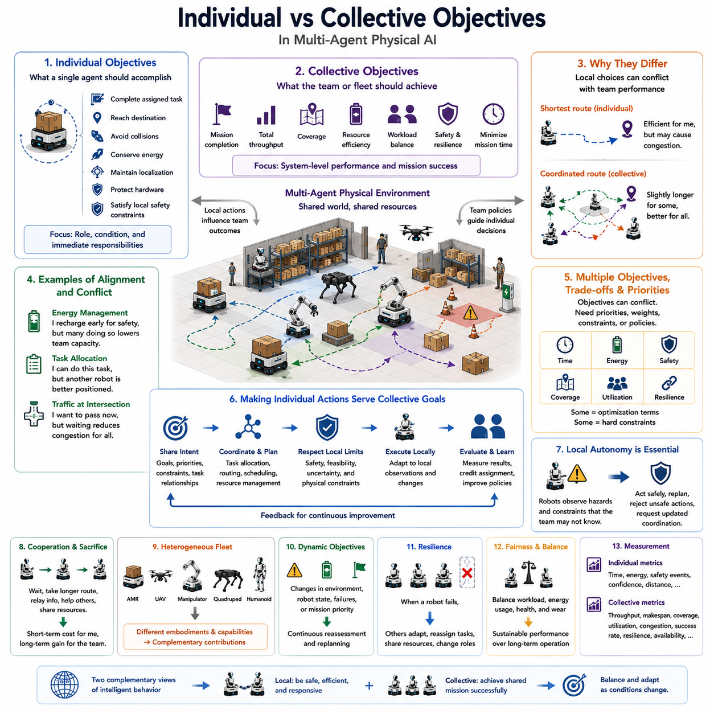{width="7.268055555555556in" height="7.268055555555556in"}

Individual objectives define what a single agent should accomplish according to its own role, condition, and immediate responsibilities. In Multi-Agent Physical AI, these objectives may include completing an assigned task, reaching a destination, avoiding collisions, conserving energy, maintaining localization quality, protecting hardware, or satisfying local safety constraints while operating autonomously in a shared physical environment.

Collective objectives describe outcomes that should be achieved by the robot team or fleet as a whole. Instead of optimizing the performance of one agent, they consider mission completion, total throughput, coverage, fleet utilization, workload balance, resource efficiency, resilience, safety, and overall mission time. Collective intelligence emerges when individual decisions contribute coherently to these broader system-level objectives.

Individual and collective objectives are often related but are not automatically identical. A robot may minimize its own travel distance by selecting the shortest route, while several robots making the same choice can create congestion. From the individual perspective the decision appears efficient, but from the collective perspective a slightly longer route for some robots may reduce traffic and improve total fleet throughput.

Energy management provides another example of this distinction. An individual robot may prefer to recharge whenever its battery reaches a conservative threshold, reducing its own operational risk. If many robots make the same decision simultaneously, charging stations may become congested and mission capacity may fall. Fleet-level coordination can stagger charging according to mission demand, battery state, resource availability, and expected future workload.

Task allocation also illustrates the relationship between objectives. A robot may be capable of accepting a nearby task, but assigning it immediately may not be optimal for the team. Another robot may be better positioned, while the first robot may possess a specialized capability required for a later mission. Collective optimization therefore considers opportunity cost and future system requirements rather than only immediate local efficiency.

Objectives can be expressed at several hierarchical levels. A robot controller may optimize safe and smooth motion, a local coordinator may optimize traffic within one zone, and a fleet manager may optimize mission throughput across an entire facility. Above these levels, an operational system may impose business, safety, or mission priorities. Multi-Agent Physical AI must connect these objectives without losing the responsiveness required for physical execution.

Some individual objectives must remain non-negotiable even when collective performance is important. A fleet optimizer should not improve throughput by commanding a robot to violate collision constraints, actuator limits, stability requirements, or mandatory safety rules. Physical feasibility and safety therefore constrain the optimization space within which collective objectives can be pursued, rather than acting as ordinary performance terms that can always be traded away.

Conflicts can also occur between different collective objectives. Minimizing mission completion time may increase energy consumption, maximizing utilization may reduce opportunities for preventive charging, and maximizing coverage may increase communication or localization risk. A practical system therefore operates with multiple objectives and must determine priorities, constraints, weights, or policies for balancing competing measures of collective performance.

Multi-objective reasoning provides a framework for handling such trade-offs. Instead of optimizing a single quantity, the system can consider combinations of time, energy, safety, workload, communication cost, uncertainty, and mission value. Some criteria can be represented as optimization terms, while others are enforced as hard constraints. The design of these relationships strongly influences the behavior that eventually emerges from the robot team.

Reward design plays a similar role in learning-based multi-agent systems. If every agent receives only an individual reward, learned policies may become locally effective but collectively inefficient. A shared team reward encourages cooperation, yet it can make it difficult to determine which agent\'s action produced an outcome. Multi-agent learning therefore often requires careful combinations of local rewards, shared rewards, constraints, and coordination signals.

This challenge is closely related to credit assignment. When a team succeeds or fails, the learning system must estimate how individual actions contributed to the collective result. A robot that temporarily moves away from a target may appear inefficient locally while actually clearing a route for several teammates. Evaluating actions only from immediate individual outcomes can therefore discourage behaviors that are valuable to the group.

Cooperation frequently requires agents to accept short-term individual costs for larger collective benefits. A robot may wait at an intersection, take a longer route, relay information, assist another robot, or temporarily surrender a shared resource. Such actions may reduce its own immediate efficiency but improve mission-level performance. Coordinated systems need mechanisms that recognize and intentionally support these forms of cooperative sacrifice.

At the same time, collective objectives should not eliminate local autonomy. A robot operates closest to physical reality and can observe hazards or constraints that a fleet-level planner may not know immediately. Global commands should therefore be interpreted within local safety, feasibility, and uncertainty conditions. The robot may need to slow down, replan, reject an unsafe action, or request updated coordination when local conditions contradict global assumptions.

Shared intent helps connect these two levels of decision making. Instead of transmitting only low-level commands, the system can communicate mission goals, priorities, constraints, task relationships, and expected team behavior. Individual agents can then adapt their local actions while preserving the purpose of the collective plan. This approach is especially useful when communication latency or environmental changes make continuous centralized control impractical.

The relationship becomes more complex in heterogeneous fleets because agents possess different embodiments and capabilities. An AMR, UAV, manipulator, quadruped, and humanoid cannot be evaluated using identical local objectives. Their contributions may involve transportation, perception, manipulation, terrain access, or human-oriented interaction. Collective performance depends on combining these complementary capabilities rather than maximizing a single common measure for every robot.

Dynamic environments require objectives to change over time. A robot initially assigned to maximize exploration coverage may later be redirected to support a rescue, inspection, or transport task. A blocked route, robot failure, depleted battery, newly detected hazard, or changing mission priority can alter what is best for both an individual agent and the fleet. Objective management must therefore support continuous reassessment and replanning.

Failures reveal why collective objectives should include resilience rather than only nominal efficiency. If one robot becomes unavailable, other agents may redistribute tasks, modify routes, share resources, or reorganize roles. This can temporarily reduce individual efficiency while preserving mission continuity. A robust multi-agent system evaluates success not only by peak performance under ideal conditions but also by its ability to adapt when members or resources are lost.

Fairness and workload balance can also become relevant collective concerns. Repeatedly assigning difficult tasks to the nearest or fastest robot may maximize short-term throughput while causing uneven battery degradation, maintenance demand, or component wear. Fleet-level reasoning can distribute work according to utilization history, health, energy, capability, and maintenance considerations, improving sustainable performance across long operational periods.

Measurement is essential because objectives must eventually be evaluated through observable outcomes. Individual metrics may include task completion time, energy consumption, localization confidence, safety events, or distance traveled. Collective metrics may include total throughput, makespan, coverage, resource utilization, congestion, mission success rate, resilience, and fleet availability. The chosen metrics determine what the system treats as desirable behavior.

A practical architecture therefore combines objectives rather than replacing individual goals with a single global goal. Local objectives preserve safe, responsive, and physically feasible autonomy, while collective objectives guide coordination toward mission-level efficiency and resilience. Hierarchical planners, task allocators, shared policies, constraints, communication, and learning mechanisms provide different ways of connecting these levels during operation.

Individual and collective objectives ultimately describe two complementary views of intelligent behavior in a multi-robot system. A capable agent must perform its own task safely and efficiently, but an intelligent fleet must also ensure that these actions contribute to shared mission success. Multi-Agent Physical AI becomes truly collective when robots can balance local needs with team priorities and adapt that balance as conditions change.

개별 목표(individual objective)는 단일 에이전트(single agent)가 자신의 역할, 상태, 즉각적인 책임에 따라 무엇을 달성해야 하는지를 정의합니다. 다중 에이전트 피지컬 AI(Multi-Agent Physical AI)에서 이러한 목표에는 할당된 작업 완료, 목적지 도달, 충돌 회피(collision avoidance), 에너지 절약, 위치추정 품질(localization quality) 유지, 하드웨어 보호, 공유된 물리적 환경에서 자율적으로 동작하면서 국소 안전 제약조건(local safety constraint)을 충족하는 것 등이 포함될 수 있습니다.

집단 목표(collective objective)는 로봇 팀(robot team) 또는 플릿(fleet) 전체가 달성해야 하는 결과를 설명합니다. 하나의 에이전트 성능을 최적화하는 대신 임무 완료(mission completion), 전체 처리량(total throughput), 커버리지(coverage), 플릿 활용률(fleet utilization), 작업 부하 균형(workload balance), 자원 효율성(resource efficiency), 회복탄력성(resilience), 안전, 전체 임무 시간 등을 고려합니다. 개별 의사결정이 이러한 광범위한 시스템 수준 목표에 일관되게 기여할 때 집단 지능(collective intelligence)이 형성됩니다.

개별 목표와 집단 목표는 서로 관련되어 있지만 자동으로 일치하는 것은 아닙니다. 한 로봇은 자신의 이동 거리를 최소화하기 위해 최단 경로(shortest route)를 선택할 수 있지만, 여러 로봇이 동일한 선택을 하면 혼잡(congestion)이 발생할 수 있습니다. 개별 관점에서는 효율적인 결정이지만 집단 관점에서는 일부 로봇이 조금 더 긴 경로를 선택하는 것이 교통량을 분산시키고 전체 플릿 처리량을 향상시킬 수 있습니다.

에너지 관리(energy management)는 이러한 차이를 보여주는 또 다른 사례입니다. 개별 로봇은 배터리가 보수적인 임계값에 도달할 때마다 충전하여 자신의 운용 위험을 줄이려고 할 수 있습니다. 그러나 여러 로봇이 동시에 같은 결정을 내리면 충전소(charging station)가 혼잡해지고 임무 수행 능력이 감소할 수 있습니다. 플릿 수준 협력(fleet-level coordination)은 임무 수요, 배터리 상태, 자원 가용성, 예상되는 미래 작업 부하를 고려하여 충전 시점을 분산할 수 있습니다.

작업 할당(task allocation) 역시 목표 간의 관계를 보여줍니다. 어떤 로봇이 가까운 작업을 수행할 수 있다고 해서 즉시 해당 로봇에 작업을 할당하는 것이 팀 전체에 최적이라는 의미는 아닙니다. 다른 로봇이 더 적합한 위치에 있을 수 있으며, 첫 번째 로봇의 특수 역량(specialized capability)이 이후의 임무에 필요할 수도 있습니다. 따라서 집단 최적화(collective optimization)는 즉각적인 국소 효율성뿐만 아니라 기회비용(opportunity cost)과 미래의 시스템 요구조건도 고려합니다.

목표는 여러 계층적 수준(hierarchical level)에서 표현될 수 있습니다. 로봇 제어기(robot controller)는 안전하고 부드러운 움직임을 최적화하고, 국소 조정자(local coordinator)는 특정 구역의 교통 흐름을 최적화하며, 플릿 관리자(fleet manager)는 전체 시설의 임무 처리량을 최적화할 수 있습니다. 그보다 상위 수준의 운용 시스템(operational system)은 비즈니스, 안전 또는 임무 우선순위를 부여할 수 있습니다. 다중 에이전트 피지컬 AI는 물리적 실행에 필요한 즉각적인 대응성을 유지하면서 이러한 목표들을 연결해야 합니다.

일부 개별 목표는 집단 성능이 중요하더라도 타협할 수 없는 조건으로 유지되어야 합니다. 플릿 최적화기(fleet optimizer)가 처리량을 향상시키기 위해 로봇에게 충돌 제약조건, 액추에이터 한계(actuator limit), 안정성 요구조건(stability requirement), 필수 안전 규칙을 위반하도록 명령해서는 안 됩니다. 따라서 물리적 실행 가능성(physical feasibility)과 안전은 언제든 교환할 수 있는 일반적인 성능 항목이 아니라 집단 목표를 추구할 수 있는 최적화 공간(optimization space)을 제한하는 조건입니다.

서로 다른 집단 목표 사이에서도 충돌이 발생할 수 있습니다. 임무 완료 시간을 최소화하면 에너지 소비가 증가할 수 있고, 활용률을 최대화하면 예방적 충전(preventive charging)의 기회가 줄어들 수 있으며, 커버리지를 최대화하면 통신 또는 위치추정 위험이 증가할 수 있습니다. 따라서 실용적인 시스템은 여러 목표를 동시에 다루며 서로 경쟁하는 집단 성능 지표의 균형을 조절하기 위한 우선순위(priority), 제약조건(constraint), 가중치(weight), 정책(policy)을 결정해야 합니다.

다목적 추론(multi-objective reasoning)은 이러한 상충관계(trade-off)를 처리하기 위한 프레임워크를 제공합니다. 하나의 값만 최적화하는 대신 시스템은 시간, 에너지, 안전, 작업 부하, 통신 비용, 불확실성, 임무 가치(mission value)의 조합을 고려할 수 있습니다. 일부 기준은 최적화 항목(optimization term)으로 표현할 수 있고, 다른 기준은 강제적인 제약조건(hard constraint)으로 적용할 수 있습니다. 이러한 관계의 설계는 최종적으로 로봇 팀에서 나타나는 행동에 큰 영향을 미칩니다.

보상 설계(reward design)는 학습 기반 다중 에이전트 시스템(learning-based multi-agent system)에서도 유사한 역할을 합니다. 모든 에이전트가 개별 보상(individual reward)만 받으면 학습된 정책은 국소적으로 효과적이지만 집단적으로 비효율적일 수 있습니다. 공유 팀 보상(shared team reward)은 협력을 장려하지만 어떤 에이전트의 행동이 결과를 만들어냈는지를 판단하기 어렵게 만들 수 있습니다. 따라서 다중 에이전트 학습은 국소 보상, 공유 보상, 제약조건, 협력 신호(coordination signal)를 신중하게 결합해야 하는 경우가 많습니다.

이러한 문제는 신용 할당(credit assignment)과 밀접하게 관련됩니다. 팀이 성공하거나 실패했을 때 학습 시스템은 개별 행동이 집단 결과에 얼마나 기여했는지를 추정해야 합니다. 특정 로봇이 일시적으로 목표에서 멀어지는 행동은 국소적으로 비효율적으로 보일 수 있지만 실제로는 여러 팀원의 이동 경로를 확보하기 위한 행동일 수 있습니다. 따라서 즉각적인 개별 결과만으로 행동을 평가하면 집단에 가치 있는 행동이 오히려 억제될 수 있습니다.

협력(cooperation)은 에이전트가 더 큰 집단 이익을 위해 단기적인 개별 비용을 받아들이도록 요구하는 경우가 많습니다. 로봇은 교차로에서 대기하거나, 더 긴 경로를 선택하거나, 정보를 중계하거나, 다른 로봇을 지원하거나, 공유 자원의 사용권을 일시적으로 양보할 수 있습니다. 이러한 행동은 자신의 즉각적인 효율성을 낮출 수 있지만 임무 수준 성능을 향상시킵니다. 협력 시스템은 이러한 형태의 협력적 희생(cooperative sacrifice)을 인식하고 의도적으로 지원하는 메커니즘을 필요로 합니다.

동시에 집단 목표가 국소 자율성(local autonomy)을 제거해서는 안 됩니다. 로봇은 물리적 현실에 가장 가까운 위치에서 동작하며 플릿 수준 계획기(fleet-level planner)가 즉시 알지 못하는 위험이나 제약조건을 관찰할 수 있습니다. 따라서 전역 명령(global command)은 국소 안전, 실행 가능성, 불확실성 조건 안에서 해석되어야 합니다. 국소 조건이 전역 가정과 충돌하면 로봇은 속도를 낮추거나, 재계획(replanning)을 수행하거나, 안전하지 않은 행동을 거부하거나, 새로운 협력 정보를 요청할 수 있어야 합니다.

공유 의도(shared intent)는 이러한 두 의사결정 수준을 연결하는 데 도움이 됩니다. 시스템은 단순히 저수준 명령(low-level command)만 전달하는 대신 임무 목표, 우선순위, 제약조건, 작업 관계, 예상되는 팀 행동을 전달할 수 있습니다. 그러면 개별 에이전트는 집단 계획의 목적을 유지하면서 자신의 국소 행동을 조정할 수 있습니다. 이러한 방식은 통신 지연이나 환경 변화로 인해 지속적인 중앙집중형 제어(centralized control)가 어려운 상황에서 특히 유용합니다.

이기종 플릿(heterogeneous fleet)에서는 에이전트마다 서로 다른 체화와 역량을 가지므로 이러한 관계가 더욱 복잡해집니다. 자율이동로봇(AMR), 무인항공기(UAV), 매니퓰레이터(manipulator), 4족 보행 로봇(quadruped), 휴머노이드(humanoid)를 동일한 국소 목표로 평가할 수는 없습니다. 각각의 기여는 운송, 인지, 조작, 지형 접근, 인간 중심 상호작용 등으로 구분될 수 있습니다. 집단 성능은 모든 로봇에 대해 하나의 공통 지표를 최대화하는 것이 아니라 이러한 상호보완적 역량을 결합하는 데 달려 있습니다.

동적 환경(dynamic environment)에서는 목표 역시 시간에 따라 변화해야 합니다. 처음에는 탐색 커버리지(exploration coverage)를 최대화하도록 할당된 로봇이 이후 구조, 검사 또는 운송 작업을 지원하도록 재지정될 수 있습니다. 차단된 경로, 로봇 고장, 배터리 소모, 새롭게 감지된 위험, 변화하는 임무 우선순위는 개별 에이전트와 플릿 모두에게 무엇이 최선인지를 변화시킬 수 있습니다. 따라서 목표 관리(objective management)는 지속적인 재평가(reassessment)와 재계획을 지원해야 합니다.

고장(failure)은 집단 목표가 정상적인 효율성뿐만 아니라 회복탄력성(resilience)을 포함해야 하는 이유를 보여줍니다. 하나의 로봇을 사용할 수 없게 되면 다른 에이전트가 작업을 재분배하고, 경로를 변경하고, 자원을 공유하거나, 역할을 재구성할 수 있습니다. 이 과정에서 개별 효율성은 일시적으로 감소할 수 있지만 임무 연속성(mission continuity)은 유지됩니다. 강건한 다중 에이전트 시스템은 이상적인 조건에서의 최대 성능뿐만 아니라 구성원이나 자원이 손실되었을 때 적응하는 능력으로도 성공을 평가합니다.

공정성(fairness)과 작업 부하 균형(workload balance)도 중요한 집단적 고려사항이 될 수 있습니다. 가장 가깝거나 빠른 로봇에 어려운 작업을 반복적으로 할당하면 단기 처리량은 증가할 수 있지만 배터리 열화, 유지보수 요구, 부품 마모(component wear)가 불균형하게 발생할 수 있습니다. 플릿 수준 추론은 활용 이력(utilization history), 건전성, 에너지, 역량, 유지보수 조건에 따라 작업을 분배함으로써 장기간 운용에서 지속 가능한 성능을 향상시킬 수 있습니다.

목표는 결국 관찰 가능한 결과를 통해 평가되어야 하므로 측정(measurement)이 필수적입니다. 개별 지표(individual metric)에는 작업 완료 시간, 에너지 소비, 위치추정 신뢰도(localization confidence), 안전 이벤트(safety event), 이동 거리 등이 포함될 수 있습니다. 집단 지표(collective metric)에는 전체 처리량, 총 완료시간(makespan), 커버리지, 자원 활용률, 혼잡도, 임무 성공률, 회복탄력성, 플릿 가용성(fleet availability) 등이 포함될 수 있습니다. 어떤 지표를 선택하는지가 시스템이 어떤 행동을 바람직하다고 판단하는지를 결정합니다.

따라서 실용적인 아키텍처(practical architecture)는 개별 목표를 하나의 전역 목표(global goal)로 대체하는 것이 아니라 여러 수준의 목표를 결합합니다. 국소 목표(local objective)는 안전하고 신속하며 물리적으로 실행 가능한 자율성을 유지하고, 집단 목표는 임무 수준의 효율성과 회복탄력성을 향해 협력을 유도합니다. 계층적 계획기(hierarchical planner), 작업 할당기(task allocator), 공유 정책(shared policy), 제약조건, 통신, 학습 메커니즘은 운용 과정에서 이러한 수준들을 연결하는 다양한 방법을 제공합니다.

결국 개별 목표(individual objective)와 집단 목표(collective objective)는 다중 로봇 시스템에서 지능적 행동을 바라보는 상호보완적인 두 관점입니다. 유능한 에이전트는 자신의 작업을 안전하고 효율적으로 수행해야 하지만, 지능적인 플릿은 이러한 행동이 공유 임무 성공(shared mission success)에 기여하도록 해야 합니다. 로봇이 국소적 요구와 팀의 우선순위 사이에서 균형을 조정하고 상황 변화에 따라 그 균형을 지속적으로 변화시킬 수 있을 때 다중 에이전트 피지컬 AI는 진정한 집단 지능을 형성하게 됩니다.

##  

## 01.06. Cooperative Competitive and Mixed Systems

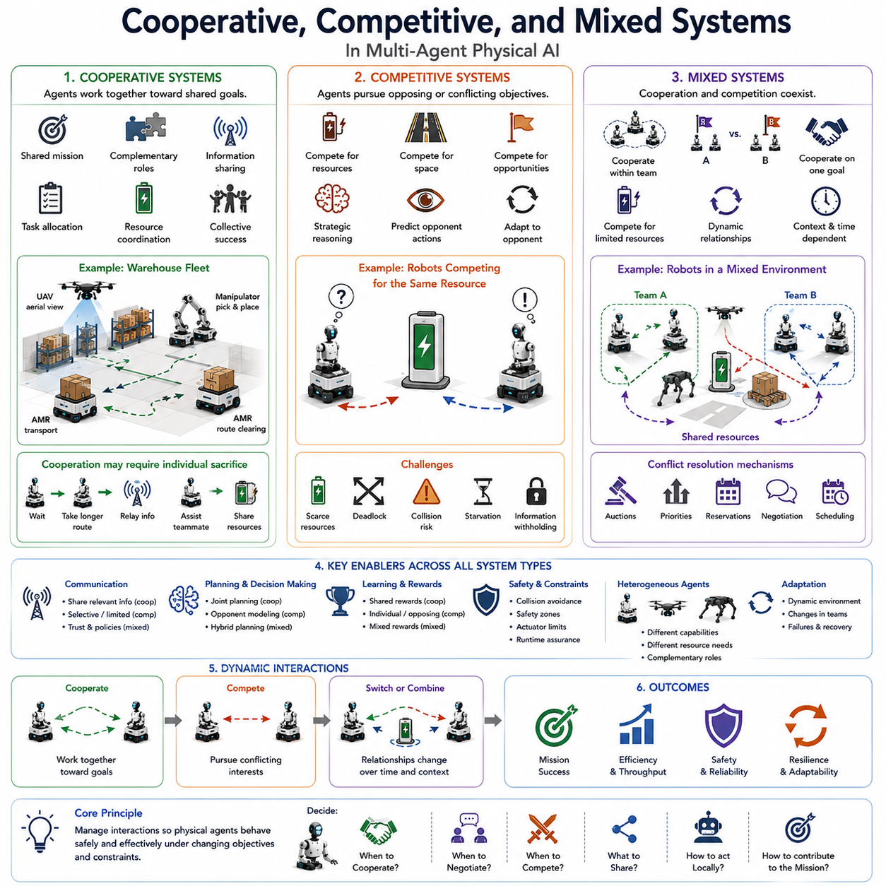{width="7.268055555555556in" height="7.268055555555556in"}

Cooperative, competitive, and mixed systems describe how multiple agents relate their objectives, actions, resources, and outcomes within a shared physical environment. In Multi-Agent Physical AI, this interaction structure determines whether robots primarily help one another, oppose one another, or alternate between cooperation and competition. The distinction strongly influences coordination, communication, planning, learning, and control.

A cooperative system is one in which agents pursue compatible or shared objectives. Their individual actions are intended to contribute to a common mission, even when each robot performs a different role. Warehouse fleets, coordinated inspection teams, search-and-rescue robots, and heterogeneous logistics systems are typical examples in which collective success depends on agents combining their capabilities rather than operating independently.

Cooperation does not require every robot to perform the same action or receive the same task. One AMR may transport material while another clears a route, a UAV may provide aerial observations, and a manipulator may perform the final physical operation. The agents cooperate because their specialized actions contribute to a shared objective, creating complementary roles within a coordinated mission.

Information sharing is a major mechanism for cooperation. Robots can exchange pose, task status, intent, maps, hazards, resource availability, predicted trajectories, and observations. Shared information reduces uncertainty and allows agents to anticipate the needs and actions of teammates. However, cooperation must remain effective under bandwidth limits, latency, packet loss, or temporary network disconnection.

Task allocation provides another important cooperative mechanism. Instead of allowing every robot to select tasks independently, the system can match tasks to agents according to location, capability, energy, workload, priority, and mission dependencies. Cooperative allocation attempts to improve team performance while preventing redundant work, resource conflicts, and situations in which several robots pursue the same opportunity unnecessarily.

Cooperative behavior may also require an agent to accept a temporary individual disadvantage. A robot can wait to let another pass, take a longer route to reduce congestion, relay information, assist a disabled teammate, or surrender access to a shared charger. These actions may reduce immediate individual efficiency but increase collective performance, resilience, safety, or mission completion probability.

Competitive systems have a different interaction structure. Agents pursue objectives that are partially or directly opposed, meaning that one agent\'s success can reduce another agent\'s opportunity or reward. Competition can arise over physical space, limited resources, task opportunities, strategic positions, information, or mission outcomes. The behavior of other agents must therefore be treated as an active strategic factor rather than merely as environmental motion.

Physical competition is especially significant because actions alter the real environment. Two robots may require access to the same narrow passage, workspace, charging station, docking point, or manipulation resource. Even without hostile intentions, competition for scarce resources can emerge naturally. Coordination mechanisms must manage such contention so that competitive pressure does not create deadlock, collision, starvation, or unsafe behavior.

In explicitly adversarial environments, agents may intentionally attempt to predict, avoid, intercept, deceive, block, or outperform opponents. Such settings require reasoning about another agent\'s possible objectives and future actions. Unlike static obstacle avoidance, competitive multi-agent decision making must consider that an opponent may change its strategy in response to observed behavior, creating a continuous cycle of adaptation.

Competitive systems therefore introduce strategic uncertainty. An agent may observe another robot\'s position without knowing its objective, policy, information, or future decision. Prediction becomes more difficult because the other agent is also reasoning and adapting. Policies may need to account for multiple possible opponent behaviors rather than assuming that observed motion will continue according to a fixed physical model.

Mixed systems combine cooperative and competitive relationships within the same environment. Agents may cooperate within teams while competing against other teams, or they may cooperate on one objective while competing for another resource. This structure is common in realistic multi-agent systems because relationships are rarely purely cooperative or purely competitive across every task, resource, and time horizon.

A fleet can exhibit mixed behavior even without external opponents. Robots may share the collective objective of maximizing mission throughput while simultaneously competing for chargers, preferred routes, tools, or high-value tasks. The system must resolve these local conflicts without losing the larger cooperative objective. Auctions, priorities, reservations, negotiation, scheduling, and resource allocation can transform uncontrolled competition into coordinated behavior.

Interaction types can also change over time. Two agents that initially compete for a resource may later cooperate on a task, while robots cooperating during normal operation may compete for limited energy or communication capacity during degraded conditions. Multi-Agent Physical AI must therefore represent relationships dynamically rather than assigning a permanent cooperative or competitive label to each agent.

Reward structures strongly influence these behaviors in learning-based systems. Shared rewards can encourage cooperation, individual rewards can encourage self-interested behavior, and opposing rewards can produce competition. Mixed reward structures can create more complex strategies in which agents must balance personal performance with team outcomes. Poor reward design may unintentionally generate selfish, unstable, or undesirable emergent behaviors.

Communication also changes according to interaction structure. Cooperative agents generally benefit from truthful sharing of relevant information, although bandwidth limitations still require selectivity. Competitive agents may restrict information or strategically reveal selected signals. Mixed systems require trust models and communication policies that determine which information can be shared, with whom, under what conditions, and with what confidence.

Planning methods must similarly reflect the nature of interaction. Cooperative planning searches for compatible joint actions, coordinated trajectories, task assignments, or resource schedules. Competitive planning considers opponent responses and strategic alternatives. Mixed planning may combine team coordination with opponent modeling and resource negotiation, requiring the system to reason simultaneously about collaboration and conflict.

Centralized control is particularly effective when cooperative agents operate under a common authority and reliable communication, because a coordinator can optimize joint decisions. Decentralized approaches become important when communication is limited, fleets are large, or agents belong to different organizations. Competitive and mixed systems often require decentralized decision making because no single controller possesses authority over every participant.

Safety constraints remain essential regardless of interaction type. Competition must not imply that physical safety rules can be ignored, particularly when robots operate around people, infrastructure, or other machines. Collision avoidance, exclusion zones, actuator limits, emergency procedures, and runtime assurance should constrain agent behavior independently of whether the higher-level interaction is cooperative, competitive, or mixed.

Heterogeneous embodiments make these relationships richer because different robots contribute different capabilities and possess different resource needs. An AMR, UAV, quadruped, humanoid, and manipulator may cooperate through complementary roles while simultaneously competing for communication bandwidth, computation, workspace, or mission priority. Interaction models must therefore consider both strategic relationships and physical capability differences.

Robust systems must also handle changes in team composition. Robots can fail, disconnect, join a mission, or become temporarily unavailable. Cooperative teams may redistribute responsibilities, competitive relationships may change as participants disappear, and mixed systems may form new coalitions or coordination groups. Adaptation requires agents to reassess objectives, capabilities, dependencies, and relationships throughout operation.

The cooperative, competitive, and mixed classification therefore provides a fundamental framework for understanding multi-agent interaction. Cooperative systems emphasize shared success, competitive systems emphasize conflicting interests, and mixed systems combine both according to tasks, resources, and context. Multi-Agent Physical AI must recognize these relationships and adapt coordination, communication, planning, and learning accordingly.

The central challenge is not to eliminate competition or force every robot into identical cooperation, but to manage interactions so that physical agents behave safely and effectively under changing objectives and constraints. Intelligent multi-agent systems must determine when to collaborate, when to negotiate, when to compete, what information to share, and how local behavior should contribute to the broader mission in a dynamic physical world.

협력적(cooperative), 경쟁적(competitive), 혼합형(mixed) 시스템은 여러 에이전트가 공유된 물리적 환경에서 자신의 목표(objective), 행동(action), 자원(resource), 결과(outcome)를 서로 어떻게 연계하는지를 설명합니다. 다중 에이전트 피지컬 AI(Multi-Agent Physical AI)에서 이러한 상호작용 구조(interaction structure)는 로봇들이 주로 서로 협력하는지, 서로 경쟁하는지, 또는 협력과 경쟁을 상황에 따라 전환하는지를 결정합니다. 이러한 구분은 협력(coordination), 통신(communication), 계획(planning), 학습(learning), 제어(control)의 방식에 큰 영향을 미칩니다.

협력 시스템(cooperative system)은 에이전트들이 서로 양립할 수 있거나 공유된 목표(shared objective)를 추구하는 시스템입니다. 각 로봇이 서로 다른 역할을 수행하더라도 개별 행동은 공통 임무(common mission)에 기여하도록 구성됩니다. 창고 플릿(warehouse fleet), 협력 검사팀(coordinated inspection team), 수색 및 구조 로봇(search-and-rescue robot), 이기종 물류 시스템(heterogeneous logistics system)은 에이전트들이 독립적으로 동작하기보다 각자의 역량을 결합하여 집단적인 성공을 달성하는 대표적인 사례입니다.

협력(cooperation)이 모든 로봇이 동일한 행동을 수행하거나 동일한 작업을 할당받아야 한다는 것을 의미하지는 않습니다. 하나의 자율이동로봇(Autonomous Mobile Robot, AMR)은 물자를 운송하고, 다른 로봇은 이동 경로를 확보하며, 무인항공기(Unmanned Aerial Vehicle, UAV)는 공중 관찰(aerial observation)을 제공하고, 매니퓰레이터(manipulator)는 최종적인 물리 작업을 수행할 수 있습니다. 이러한 에이전트들은 각자의 전문화된 행동이 공유 목표에 기여하기 때문에 협력하며, 하나의 협력 임무 안에서 상호보완적 역할(complementary role)을 형성합니다.

정보 공유(information sharing)는 협력을 위한 주요 메커니즘입니다. 로봇들은 자세(pose), 작업 상태(task status), 의도(intent), 지도(map), 위험(hazard), 자원 가용성(resource availability), 예측 궤적(predicted trajectory), 관찰 정보 등을 교환할 수 있습니다. 공유 정보는 불확실성(uncertainty)을 줄이고 에이전트가 팀원의 요구와 행동을 미리 예측할 수 있도록 합니다. 그러나 대역폭 제한(bandwidth limitation), 지연시간(latency), 패킷 손실(packet loss), 일시적인 네트워크 단절 상황에서도 협력은 효과적으로 유지될 수 있어야 합니다.

작업 할당(task allocation)은 또 다른 중요한 협력 메커니즘입니다. 모든 로봇이 독립적으로 작업을 선택하도록 하는 대신 시스템은 위치(location), 역량(capability), 에너지(energy), 작업 부하(workload), 우선순위(priority), 임무 의존성(mission dependency)에 따라 작업과 에이전트를 연결할 수 있습니다. 협력적 작업 할당은 팀 전체의 성능을 향상시키면서 중복 작업, 자원 충돌(resource conflict), 여러 로봇이 동일한 작업을 불필요하게 추구하는 상황을 방지하는 것을 목표로 합니다.

협력 행동(cooperative behavior)은 에이전트가 일시적인 개별적 불이익을 받아들이도록 요구할 수도 있습니다. 로봇은 다른 로봇을 먼저 통과시키기 위해 대기하거나, 혼잡을 줄이기 위해 더 긴 경로를 선택하거나, 정보를 중계하거나, 고장 난 팀원을 지원하거나, 공유 충전기(shared charger)의 사용권을 양보할 수 있습니다. 이러한 행동은 즉각적인 개별 효율성을 낮출 수 있지만 집단 성능, 회복탄력성(resilience), 안전 또는 임무 완료 확률을 향상시킬 수 있습니다.

경쟁 시스템(competitive system)은 서로 다른 상호작용 구조를 갖습니다. 에이전트들은 부분적으로 또는 직접적으로 상충하는 목표를 추구하며, 한 에이전트의 성공이 다른 에이전트의 기회나 보상(reward)을 감소시킬 수 있습니다. 경쟁은 물리적 공간, 제한된 자원, 작업 기회, 전략적 위치, 정보 또는 임무 결과를 둘러싸고 발생할 수 있습니다. 따라서 다른 에이전트의 행동은 단순한 환경 움직임이 아니라 능동적인 전략적 요소(strategic factor)로 다루어져야 합니다.

물리적 경쟁(physical competition)은 행동이 실제 환경을 변화시키기 때문에 특히 중요합니다. 두 로봇이 동일한 좁은 통로, 작업 공간(workspace), 충전소, 도킹 지점(docking point), 조작 자원(manipulation resource)을 필요로 할 수 있습니다. 적대적인 의도가 없더라도 희소 자원(scarce resource)을 둘러싼 경쟁은 자연스럽게 발생할 수 있습니다. 협력 메커니즘은 이러한 경쟁이 교착상태(deadlock), 충돌(collision), 기아 상태(starvation), 불안전한 행동으로 이어지지 않도록 자원 경합(contention)을 관리해야 합니다.

명시적인 적대적 환경(adversarial environment)에서는 에이전트가 상대방을 예측하거나, 회피하거나, 가로막거나, 기만하거나, 차단하거나, 더 높은 성과를 달성하려고 의도적으로 행동할 수 있습니다. 이러한 환경에서는 다른 에이전트가 가질 수 있는 목표와 미래 행동에 대한 추론(reasoning)이 필요합니다. 정적인 장애물 회피와 달리 경쟁적 다중 에이전트 의사결정은 상대방이 관찰된 행동에 대응하여 자신의 전략을 변경할 수 있다는 점을 고려해야 하며, 이에 따라 지속적인 적응(adaptation)의 순환이 형성됩니다.

따라서 경쟁 시스템은 전략적 불확실성(strategic uncertainty)을 발생시킵니다. 에이전트는 다른 로봇의 위치를 관찰하더라도 그 로봇의 목표, 정책(policy), 보유 정보 또는 미래 의사결정을 알지 못할 수 있습니다. 상대 에이전트 역시 추론하고 적응하기 때문에 예측은 더욱 어려워집니다. 따라서 정책은 관찰된 움직임이 고정된 물리 모델에 따라 계속될 것이라고 가정하기보다 여러 가능한 상대 행동을 고려해야 할 수 있습니다.

혼합형 시스템(mixed system)은 동일한 환경에서 협력 관계와 경쟁 관계를 결합합니다. 에이전트들은 팀 내부에서는 협력하면서 다른 팀과 경쟁할 수도 있고, 하나의 목표에서는 협력하면서 다른 자원을 놓고 경쟁할 수도 있습니다. 현실적인 다중 에이전트 시스템에서는 모든 작업, 자원, 시간 범위에서 관계가 순수하게 협력적이거나 경쟁적인 경우가 드물기 때문에 이러한 구조가 일반적으로 나타날 수 있습니다.

외부의 경쟁자가 존재하지 않는 플릿에서도 혼합 행동(mixed behavior)이 나타날 수 있습니다. 로봇들은 전체 임무 처리량(mission throughput)을 최대화한다는 집단 목표를 공유하면서도 충전기, 선호 경로(preferred route), 도구, 높은 가치의 작업(high-value task)을 놓고 서로 경쟁할 수 있습니다. 시스템은 더 큰 협력 목표를 유지하면서 이러한 국소 충돌(local conflict)을 해결해야 합니다. 경매(auction), 우선순위, 예약(reservation), 협상(negotiation), 스케줄링(scheduling), 자원 할당(resource allocation)을 통해 통제되지 않은 경쟁을 협력적인 행동으로 전환할 수 있습니다.

상호작용 유형(interaction type)은 시간에 따라 변화할 수도 있습니다. 처음에 하나의 자원을 놓고 경쟁하던 두 에이전트가 이후에는 하나의 작업을 공동으로 수행할 수 있으며, 정상적인 운용 중에 협력하던 로봇들이 성능 저하 상황에서는 제한된 에너지나 통신 용량을 놓고 경쟁할 수도 있습니다. 따라서 다중 에이전트 피지컬 AI는 각 에이전트에 영구적인 협력 또는 경쟁이라는 분류를 부여하기보다 관계를 동적으로 표현해야 합니다.

보상 구조(reward structure)는 학습 기반 시스템에서 이러한 행동에 큰 영향을 미칩니다. 공유 보상(shared reward)은 협력을 촉진하고, 개별 보상(individual reward)은 자기 이익 중심의 행동을 유도할 수 있으며, 서로 반대되는 보상은 경쟁을 만들어낼 수 있습니다. 혼합 보상 구조(mixed reward structure)는 에이전트가 개인적 성과와 팀 전체의 결과 사이에서 균형을 조절해야 하는 더욱 복잡한 전략을 형성할 수 있습니다. 잘못된 보상 설계(reward design)는 의도하지 않은 이기적, 불안정 또는 바람직하지 않은 창발 행동(emergent behavior)을 발생시킬 수 있습니다.

통신 방식도 상호작용 구조에 따라 달라집니다. 협력 에이전트는 일반적으로 관련 정보를 진실하게 공유함으로써 이점을 얻지만 대역폭 제한으로 인해 선택적인 공유가 여전히 필요합니다. 경쟁 에이전트는 정보를 제한하거나 선택된 신호만 전략적으로 공개할 수 있습니다. 혼합형 시스템에서는 어떤 정보를 누구와 어떤 조건에서 어느 정도의 신뢰도(confidence)를 가지고 공유할 것인지를 결정하는 신뢰 모델(trust model)과 통신 정책(communication policy)이 필요합니다.

계획 방법(planning method) 역시 상호작용의 특성을 반영해야 합니다. 협력 계획(cooperative planning)은 서로 양립 가능한 공동 행동(joint action), 협력 궤적(coordinated trajectory), 작업 할당, 자원 스케줄을 탐색합니다. 경쟁 계획(competitive planning)은 상대방의 대응과 전략적 대안을 고려합니다. 혼합형 계획(mixed planning)은 팀 협력과 상대 모델링(opponent modeling), 자원 협상을 결합하여 협력과 충돌을 동시에 추론해야 할 수 있습니다.

중앙집중형 제어(centralized control)는 공통된 관리 권한 아래에서 신뢰할 수 있는 통신을 이용하는 협력 에이전트에 특히 효과적일 수 있습니다. 중앙 조정자(coordinator)가 공동 의사결정을 최적화할 수 있기 때문입니다. 반면 통신이 제한되거나 플릿 규모가 크거나 에이전트들이 서로 다른 조직에 속한 경우에는 분산형 접근(decentralized approach)이 중요해집니다. 경쟁 및 혼합형 시스템에서는 모든 참여자를 통제할 수 있는 하나의 중앙 제어기가 존재하지 않을 수 있으므로 분산 의사결정(distributed decision making)이 더욱 중요해집니다.

상호작용 유형과 관계없이 안전 제약조건(safety constraint)은 반드시 유지되어야 합니다. 특히 로봇이 사람, 인프라 또는 다른 기계와 함께 동작할 때 경쟁이 물리적 안전 규칙을 무시해도 된다는 의미가 되어서는 안 됩니다. 충돌 회피, 출입 제한 구역(exclusion zone), 액추에이터 한계(actuator limit), 비상 절차(emergency procedure), 런타임 보증(runtime assurance)은 상위 수준의 상호작용이 협력적, 경쟁적 또는 혼합형인지와 관계없이 에이전트 행동을 제한해야 합니다.

이기종 체화(heterogeneous embodiment)는 서로 다른 로봇이 서로 다른 역량과 자원 요구조건을 가지기 때문에 이러한 관계를 더욱 복잡하게 만듭니다. 자율이동로봇, 무인항공기, 4족 보행 로봇(quadruped), 휴머노이드(humanoid), 매니퓰레이터는 상호보완적인 역할을 통해 협력하면서도 통신 대역폭, 연산 자원, 작업 공간 또는 임무 우선순위를 놓고 동시에 경쟁할 수 있습니다. 따라서 상호작용 모델은 전략적 관계와 물리적 역량 차이를 모두 고려해야 합니다.

강건한 시스템(robust system)은 팀 구성(team composition)의 변화에도 대응할 수 있어야 합니다. 로봇은 고장 나거나, 연결이 끊어지거나, 임무에 새롭게 참여하거나, 일시적으로 사용할 수 없는 상태가 될 수 있습니다. 협력 팀은 역할과 책임을 재분배할 수 있고, 참여자가 사라지면 경쟁 관계가 변화할 수 있으며, 혼합형 시스템에서는 새로운 연합(coalition)이나 협력 그룹이 형성될 수 있습니다. 이러한 적응을 위해 에이전트는 운용 과정에서 목표, 역량, 의존관계, 상호관계를 지속적으로 재평가해야 합니다.

따라서 협력적(cooperative), 경쟁적(competitive), 혼합형(mixed)이라는 분류는 다중 에이전트 상호작용을 이해하기 위한 기본적인 프레임워크를 제공합니다. 협력 시스템은 공유된 성공(shared success)을 강조하고, 경쟁 시스템은 상충하는 이해관계(conflicting interest)를 강조하며, 혼합형 시스템은 작업, 자원, 상황에 따라 두 가지 특성을 결합합니다. 다중 에이전트 피지컬 AI는 이러한 관계를 인식하고 그에 따라 협력, 통신, 계획, 학습 방식을 적응시켜야 합니다.

핵심 과제는 경쟁을 제거하거나 모든 로봇에 동일한 협력을 강제하는 것이 아니라, 변화하는 목표와 제약조건 아래에서 물리적 에이전트들이 안전하고 효과적으로 행동할 수 있도록 상호작용을 관리하는 것입니다. 지능적인 다중 에이전트 시스템은 언제 협력하고, 언제 협상하며, 언제 경쟁할 것인지, 어떤 정보를 공유할 것인지, 그리고 동적인 물리 세계에서 국소 행동(local behavior)이 더 광범위한 임무에 어떻게 기여해야 하는지를 판단할 수 있어야 합니다.

##  

## 01.07. Centralized Decentralized and Hybrid Control

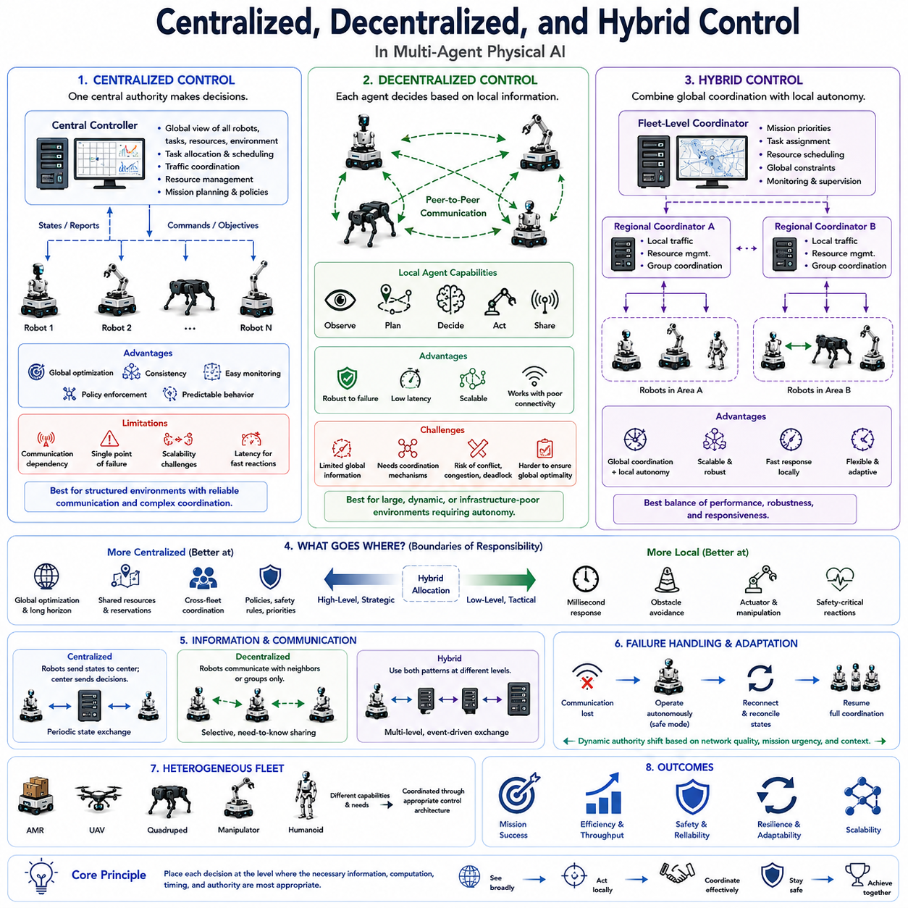{width="7.268055555555556in" height="7.268055555555556in"}

Centralized control organizes multi-agent behavior around a central decision-making authority that maintains a broad representation of the robot fleet, tasks, resources, and environment. Individual robots report relevant state to this controller, which performs functions such as task allocation, scheduling, traffic coordination, resource management, and mission planning before distributing commands or objectives back to the agents.

The main advantage of centralized control is its access to system-wide information. Because one coordinator can observe or estimate the states of many robots simultaneously, it can reason about interactions that individual agents may not recognize locally. This makes centralized architectures effective for optimizing fleet throughput, balancing workloads, resolving resource conflicts, coordinating shared routes, and enforcing common operational policies.

Centralized control can also simplify consistency. Task priorities, map versions, resource reservations, traffic rules, and mission objectives can be maintained through a common authority rather than negotiated independently by every robot. In structured environments such as factories and warehouses, this organization can provide predictable behavior and make system-level monitoring, debugging, auditing, and operational supervision easier.

However, centralized control creates dependencies on communication and central computation. Robots must provide sufficient information to the coordinator and receive decisions within useful time limits. As fleet size increases, communication traffic and optimization complexity can grow substantially. Network delays, stale information, overloaded computation, or failure of the central controller can therefore reduce performance or affect the availability of the entire system.

Physical robots also require responses faster than a remote central controller can always provide. Collision avoidance, stabilization, actuator control, emergency stopping, and immediate obstacle response operate under strict timing constraints and depend on current local sensing. Consequently, even strongly centralized fleet architectures normally preserve some local control functions rather than transmitting every physical decision through a central decision-making process.

Decentralized control distributes decision making across individual agents instead of relying on one authoritative coordinator. Each robot maintains local state, observes nearby conditions, communicates selected information, and determines its actions according to local policies or distributed coordination rules. Global behavior emerges from interactions among agents rather than from a single component explicitly computing every joint decision.

This architecture can provide strong robustness to communication disruption and individual component failure. If one robot becomes unavailable, other agents can continue operating without losing a central controller. Robots can also respond directly to local environmental changes with low latency. These characteristics are valuable in outdoor, remote, large-scale, infrastructure-poor, or dynamically changing environments where reliable continuous connectivity cannot be assumed.

Decentralized systems require mechanisms that allow local decisions to remain mutually compatible. Robots may negotiate task assignments, reserve shared resources, exchange intent, maintain distributed maps, estimate neighboring trajectories, or use consensus protocols. Without appropriate coordination, independent decisions can produce duplicated work, congestion, deadlock, inconsistent knowledge, or competition for the same resource even when all robots nominally pursue a shared objective.

A major challenge is that no individual robot necessarily possesses complete global information. An agent may optimize its local route without knowing that its decision will create congestion elsewhere, or accept a task without recognizing a more important fleet-level requirement. Decentralized control therefore trades some centralized visibility for autonomy, robustness, scalability, and responsiveness, making information selection and distributed coordination particularly important.

Scalability can favor decentralized architectures because decisions can be computed locally and communication can be restricted to relevant neighbors or groups. Instead of sending every state update to every participant, robots can interact according to spatial proximity, task relationships, communication topology, or predicted interaction risk. This reduces the need for a continuously synchronized global representation as the number of agents increases.

Centralized and decentralized control should not be viewed as mutually exclusive alternatives. Most practical Multi-Agent Physical AI systems contain decisions operating at different spatial and temporal scales. Some decisions benefit from broad fleet-level knowledge, while others require immediate local response. Hybrid control combines these properties by assigning different responsibilities to central, regional, group-level, and robot-level intelligence.

In a hybrid architecture, a fleet-level system may determine mission priorities, assign tasks, schedule shared resources, and establish global constraints. Individual robots then perform localization, local planning, obstacle avoidance, trajectory execution, manipulation, and safety responses. The central layer defines what should be accomplished, while local autonomy determines how the physical action can safely and effectively be executed under current conditions.

Hybrid control can also contain intermediate coordination layers. A large facility may be divided into zones, with local coordinators managing traffic or resources within each region while a higher-level fleet manager handles mission allocation across the site. Robots retain their own autonomous execution capabilities beneath these layers. Such hierarchical decomposition reduces computational concentration while preserving structured coordination across large systems.

The boundary between central and local responsibility is a critical architectural decision. Functions requiring global optimization, long planning horizons, shared resource awareness, or cross-fleet coordination are natural candidates for higher layers. Functions requiring millisecond-level response, detailed sensor information, physical feedback, or safety-critical reaction should generally remain close to the robot where latency and communication dependency can be minimized.

Communication design is therefore tightly coupled to control architecture. Centralized systems often require regular robot-to-server state exchange, while decentralized systems rely more heavily on peer-to-peer or neighborhood communication. Hybrid systems may use both patterns. Rather than continuously transmitting all sensor data, practical architectures usually exchange compact state, task information, intent, reservations, map updates, events, and selected semantic knowledge.

Failure handling reveals another advantage of hybrid control. If communication with the fleet manager is lost, robots can continue immediate safety behavior and may complete or safely terminate their current tasks using local autonomy. When connectivity returns, local and global state can be reconciled. This degraded-mode capability prevents temporary network failures from automatically becoming complete physical system failures.

Control authority may also change dynamically. Under normal conditions, a fleet manager can coordinate tasks and resources, while communication degradation can shift greater responsibility to individual robots or local groups. After connectivity is restored, broader coordination can resume. Dynamic authority allocation allows the system to adapt its control structure according to network quality, mission urgency, environmental uncertainty, and available infrastructure.

Heterogeneous fleets make hybrid control particularly useful because different embodiments require different levels of autonomy. An AMR may receive transport missions while independently planning local motion, a UAV may coordinate exploration with teammates while maintaining its own flight control, and a manipulator may receive object-level goals while executing high-frequency force and motion control locally. A common mission layer can coordinate these diverse control loops.

Learning-based policies can operate within any of these architectures. Centralized learning may exploit global fleet information to discover coordinated behavior, while decentralized execution allows individual robots to act from local observations. This principle is commonly expressed as centralized training with decentralized execution, where richer information can be available during training even though deployed agents must operate with limited local knowledge.

The appropriate architecture ultimately depends on mission characteristics rather than a universal preference for centralization or decentralization. Fleet size, communication reliability, interaction density, safety requirements, environmental dynamics, computational resources, task coupling, and robot heterogeneity all influence the design. Systems may intentionally use different control structures for different functions instead of forcing the entire stack into one model.

Centralized control provides broad visibility and coordinated optimization, decentralized control provides local responsiveness and distributed robustness, and hybrid control connects these strengths across multiple levels. Effective Multi-Agent Physical AI places each decision where the necessary information, computation, timing, and authority are most appropriate, enabling fleet-level coordination without sacrificing the local autonomy required for safe physical operation.

중앙집중형 제어(centralized control)는 로봇 플릿(robot fleet), 작업(task), 자원(resource), 환경(environment)에 대한 광범위한 표현을 유지하는 중앙 의사결정 주체(central decision-making authority)를 중심으로 다중 에이전트 행동을 구성합니다. 개별 로봇은 관련 상태 정보를 중앙 제어기에 보고하고, 중앙 제어기는 작업 할당(task allocation), 스케줄링(scheduling), 교통 협력(traffic coordination), 자원 관리(resource management), 임무 계획(mission planning) 등을 수행한 후 명령이나 목표를 다시 에이전트에 전달합니다.

중앙집중형 제어의 주요 장점은 시스템 전체 정보(system-wide information)에 접근할 수 있다는 것입니다. 하나의 조정자(coordinator)가 여러 로봇의 상태를 동시에 관찰하거나 추정할 수 있으므로 개별 에이전트가 국소적으로 인식하지 못하는 상호작용까지 추론할 수 있습니다. 따라서 중앙집중형 아키텍처(centralized architecture)는 플릿 처리량(fleet throughput) 최적화, 작업 부하 균형(workload balancing), 자원 충돌(resource conflict) 해결, 공유 경로 협력, 공통 운용 정책(operational policy) 적용에 효과적입니다.

중앙집중형 제어는 일관성(consistency) 관리도 단순화할 수 있습니다. 작업 우선순위(task priority), 지도 버전(map version), 자원 예약(resource reservation), 교통 규칙(traffic rule), 임무 목표(mission objective)를 모든 로봇이 독립적으로 협상하는 대신 하나의 공통 관리 주체를 통해 유지할 수 있습니다. 공장이나 창고와 같은 구조화된 환경(structured environment)에서는 이러한 구성이 예측 가능한 행동을 제공하고 시스템 수준 모니터링, 디버깅(debugging), 감사(auditing), 운용 감독(operational supervision)을 더욱 쉽게 만들 수 있습니다.

그러나 중앙집중형 제어는 통신(communication)과 중앙 연산(central computation)에 대한 의존성을 발생시킵니다. 로봇은 충분한 정보를 중앙 조정자에게 제공하고 유효한 시간 안에 의사결정을 전달받아야 합니다. 플릿 규모가 증가하면 통신 트래픽과 최적화 복잡도(optimization complexity)가 크게 증가할 수 있습니다. 따라서 네트워크 지연, 오래된 정보(stale information), 연산 과부하 또는 중앙 제어기의 고장은 성능을 저하시키거나 전체 시스템의 가용성(availability)에 영향을 줄 수 있습니다.

물리적 로봇은 원격 중앙 제어기가 항상 제공할 수 있는 것보다 더 빠른 응답을 필요로 하기도 합니다. 충돌 회피(collision avoidance), 안정화(stabilization), 액추에이터 제어(actuator control), 비상 정지(emergency stopping), 즉각적인 장애물 대응은 엄격한 시간 제약조건 아래에서 동작하며 현재의 국소 센싱(local sensing)에 의존합니다. 따라서 강한 중앙집중형 플릿 아키텍처에서도 모든 물리적 의사결정을 중앙으로 전달하기보다 일부 국소 제어 기능(local control function)을 유지하는 것이 일반적입니다.

분산형 제어(decentralized control)는 하나의 권위 있는 중앙 조정자에 의존하는 대신 개별 에이전트에 의사결정을 분산합니다. 각 로봇은 국소 상태(local state)를 유지하고, 주변 조건을 관찰하고, 선택된 정보를 통신하며, 국소 정책(local policy) 또는 분산 협력 규칙(distributed coordination rule)에 따라 자신의 행동을 결정합니다. 전역 행동(global behavior)은 하나의 구성요소가 모든 공동 의사결정을 명시적으로 계산하는 것이 아니라 에이전트 간 상호작용을 통해 형성됩니다.

이러한 아키텍처는 통신 장애와 개별 구성요소의 고장에 대해 높은 강건성(robustness)을 제공할 수 있습니다. 하나의 로봇을 사용할 수 없게 되더라도 중앙 제어기의 상실 없이 다른 에이전트가 계속 동작할 수 있습니다. 또한 로봇은 국소적인 환경 변화에 낮은 지연시간(low latency)으로 직접 대응할 수 있습니다. 이러한 특성은 안정적인 지속 연결을 보장하기 어려운 실외, 원격지, 대규모, 인프라가 부족한 환경 또는 동적으로 변화하는 환경에서 유용합니다.

분산형 시스템은 국소적인 의사결정들이 서로 양립할 수 있도록 하는 메커니즘을 필요로 합니다. 로봇은 작업 할당을 협상하고, 공유 자원을 예약하며, 의도(intent)를 교환하고, 분산 지도(distributed map)를 유지하거나, 주변 로봇의 궤적을 추정하고, 합의 프로토콜(consensus protocol)을 사용할 수 있습니다. 적절한 협력이 없다면 모든 로봇이 동일한 공유 목표를 추구하더라도 독립적인 의사결정으로 인해 중복 작업, 혼잡(congestion), 교착상태(deadlock), 일관되지 않은 지식, 동일 자원에 대한 경쟁이 발생할 수 있습니다.

중요한 과제는 어떤 개별 로봇도 반드시 완전한 전역 정보(global information)를 가지고 있지는 않다는 점입니다. 에이전트는 자신의 국소 경로를 최적화하면서 해당 결정이 다른 영역에 혼잡을 발생시킨다는 사실을 알지 못할 수 있으며, 더 중요한 플릿 수준 요구조건을 인식하지 못한 채 작업을 수락할 수도 있습니다. 따라서 분산형 제어는 중앙집중형 가시성(centralized visibility)의 일부를 포기하는 대신 자율성, 강건성, 확장성(scalability), 대응성을 확보하며, 이에 따라 정보 선택과 분산 협력이 특히 중요해집니다.

확장성 측면에서는 의사결정을 국소적으로 계산하고 통신을 관련된 주변 로봇이나 그룹으로 제한할 수 있기 때문에 분산형 아키텍처가 유리할 수 있습니다. 모든 상태 갱신을 모든 참여자에게 전달하는 대신 로봇은 공간적 근접성(spatial proximity), 작업 관계(task relationship), 통신 토폴로지(communication topology), 예측된 상호작용 위험(predicted interaction risk)에 따라 상호작용할 수 있습니다. 이를 통해 에이전트 수가 증가하더라도 지속적으로 동기화된 완전한 전역 표현에 대한 필요성을 줄일 수 있습니다.

중앙집중형 제어와 분산형 제어를 서로 배타적인 대안으로 이해해서는 안 됩니다. 대부분의 실용적인 다중 에이전트 피지컬 AI(Multi-Agent Physical AI) 시스템에서는 서로 다른 공간적·시간적 규모에서 의사결정이 수행됩니다. 일부 의사결정에는 광범위한 플릿 수준 지식이 유리한 반면, 다른 의사결정에는 즉각적인 국소 대응이 필요합니다. 하이브리드 제어(hybrid control)는 중앙, 지역(regional), 그룹 수준, 로봇 수준 지능에 서로 다른 책임을 할당하여 이러한 특성을 결합합니다.

하이브리드 아키텍처(hybrid architecture)에서는 플릿 수준 시스템(fleet-level system)이 임무 우선순위를 결정하고, 작업을 할당하며, 공유 자원을 스케줄링하고, 전역 제약조건(global constraint)을 설정할 수 있습니다. 이후 개별 로봇은 위치추정(localization), 국소 계획(local planning), 장애물 회피, 궤적 실행(trajectory execution), 조작(manipulation), 안전 대응을 수행합니다. 중앙 계층은 무엇을 달성해야 하는지를 정의하고, 국소 자율성(local autonomy)은 현재 조건에서 물리적 행동을 어떻게 안전하고 효과적으로 실행할지를 결정합니다.

하이브리드 제어에는 중간 협력 계층(intermediate coordination layer)도 포함될 수 있습니다. 대규모 시설을 여러 구역(zone)으로 나누어 지역 조정자(local coordinator)가 각 영역의 교통이나 자원을 관리하고, 상위 플릿 관리자(fleet manager)가 전체 사이트의 임무 할당을 담당할 수 있습니다. 로봇은 이러한 계층 아래에서 자체적인 자율 실행 능력을 유지합니다. 이러한 계층적 분해(hierarchical decomposition)는 연산의 집중을 줄이면서 대규모 시스템에서도 구조화된 협력을 유지할 수 있도록 합니다.

중앙 책임과 국소 책임 사이의 경계는 중요한 아키텍처 설계 결정입니다. 전역 최적화(global optimization), 장기 계획(long planning horizon), 공유 자원 인식(shared resource awareness), 플릿 간 협력이 필요한 기능은 상위 계층에 배치하기 적합합니다. 반면 밀리초 수준의 응답, 상세한 센서 정보, 물리적 피드백, 안전 필수 반응(safety-critical reaction)이 필요한 기능은 지연시간과 통신 의존성을 최소화할 수 있도록 일반적으로 로봇 가까이에 유지해야 합니다.

따라서 통신 설계(communication design)는 제어 아키텍처와 밀접하게 연결됩니다. 중앙집중형 시스템은 일반적으로 로봇과 서버 사이의 정기적인 상태 정보 교환을 필요로 하고, 분산형 시스템은 피어투피어(peer-to-peer) 또는 주변 에이전트 간 통신에 더 많이 의존합니다. 하이브리드 시스템은 두 방식을 모두 사용할 수 있습니다. 실용적인 아키텍처에서는 모든 센서 데이터를 지속적으로 전송하기보다 압축된 상태, 작업 정보, 의도, 예약 정보, 지도 갱신, 이벤트(event), 선택된 의미론적 지식(semantic knowledge)을 주로 교환합니다.

고장 처리(failure handling)는 하이브리드 제어의 또 다른 장점을 보여줍니다. 플릿 관리자와의 통신이 끊어져도 로봇은 즉각적인 안전 행동을 계속 수행하고 국소 자율성을 이용하여 현재 작업을 완료하거나 안전하게 종료할 수 있습니다. 연결이 복구되면 국소 상태와 전역 상태를 다시 조정(reconciliation)할 수 있습니다. 이러한 성능 저하 운용 능력(degraded-mode capability)은 일시적인 네트워크 장애가 전체 물리 시스템의 완전한 고장으로 직접 이어지는 것을 방지합니다.

제어 권한(control authority)은 동적으로 변화할 수도 있습니다. 정상적인 조건에서는 플릿 관리자가 작업과 자원을 협력적으로 관리하지만, 통신 성능이 저하되면 더 많은 책임을 개별 로봇이나 국소 그룹에 이전할 수 있습니다. 연결이 복구되면 더 광범위한 협력을 다시 수행할 수 있습니다. 동적 권한 할당(dynamic authority allocation)은 네트워크 품질, 임무 긴급성(mission urgency), 환경 불확실성, 사용 가능한 인프라에 따라 시스템이 제어 구조를 적응시킬 수 있도록 합니다.

이기종 플릿(heterogeneous fleet)에서는 서로 다른 체화(embodiment)가 서로 다른 수준의 자율성을 필요로 하므로 하이브리드 제어가 특히 유용합니다. 자율이동로봇(Autonomous Mobile Robot, AMR)은 운송 임무를 전달받은 후 국소 이동을 독립적으로 계획할 수 있고, 무인항공기(Unmanned Aerial Vehicle, UAV)는 자체 비행 제어를 유지하면서 팀원과 탐색을 협력할 수 있으며, 매니퓰레이터(manipulator)는 객체 수준 목표를 전달받은 후 고주파 힘 제어(force control)와 움직임 제어(motion control)를 국소적으로 실행할 수 있습니다. 공통 임무 계층(common mission layer)은 이러한 다양한 제어 루프를 협력적으로 관리할 수 있습니다.

학습 기반 정책(learning-based policy)은 이러한 모든 아키텍처에서 동작할 수 있습니다. 중앙집중형 학습(centralized learning)은 전역 플릿 정보를 활용하여 협력 행동을 학습할 수 있으며, 분산 실행(decentralized execution)을 통해 개별 로봇이 국소 관찰(local observation)을 기반으로 행동할 수 있습니다. 이러한 원리는 일반적으로 중앙집중형 학습과 분산 실행(centralized training with decentralized execution)으로 표현되며, 실제 배치된 에이전트가 제한된 국소 지식만으로 동작해야 하더라도 학습 과정에서는 더 풍부한 정보를 활용할 수 있습니다.

적절한 아키텍처는 중앙집중화 또는 분산화에 대한 보편적인 선호가 아니라 임무 특성(mission characteristic)에 따라 결정됩니다. 플릿 규모, 통신 신뢰성(communication reliability), 상호작용 밀도(interaction density), 안전 요구조건, 환경의 동적 특성, 연산 자원, 작업 결합도(task coupling), 로봇 이질성(robot heterogeneity)이 모두 설계에 영향을 미칩니다. 시스템은 전체 스택(stack)을 하나의 제어 모델로 강제하기보다 서로 다른 기능에 의도적으로 서로 다른 제어 구조를 적용할 수 있습니다.

중앙집중형 제어(centralized control)는 광범위한 가시성과 협력적 최적화를 제공하고, 분산형 제어(decentralized control)는 국소 대응성과 분산된 강건성을 제공하며, 하이브리드 제어(hybrid control)는 여러 계층에 걸쳐 이러한 장점을 연결합니다. 효과적인 다중 에이전트 피지컬 AI는 필요한 정보, 연산, 시간 제약, 제어 권한이 가장 적합한 위치에 각각의 의사결정을 배치함으로써 안전한 물리적 운용에 필요한 국소 자율성을 유지하면서 플릿 수준 협력(fleet-level coordination)을 가능하게 합니다.

##  

## 01.08. Distributed Decision Making

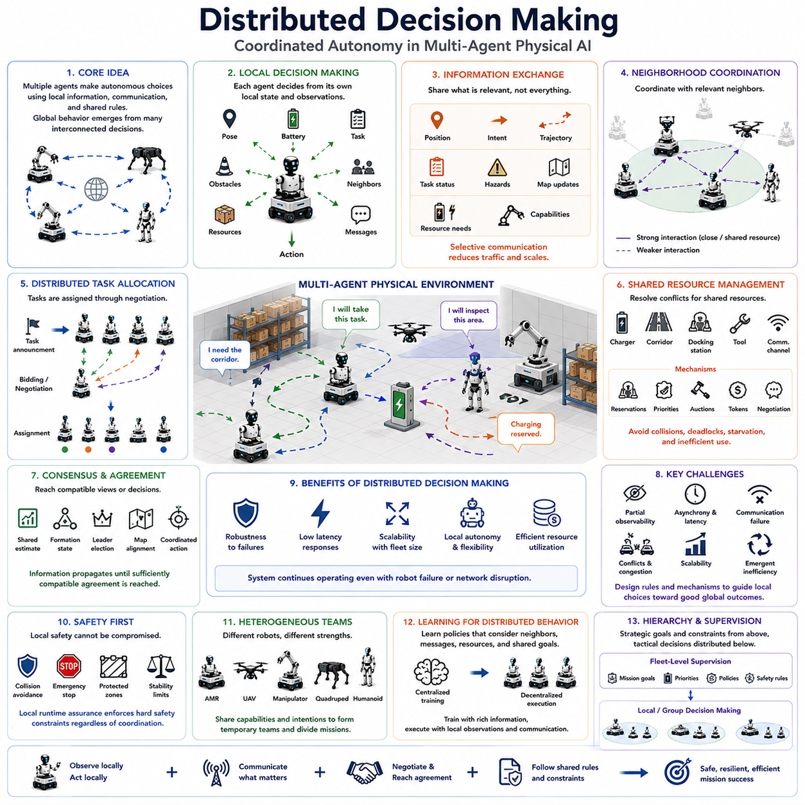{width="7.268055555555556in" height="7.268055555555556in"}

Distributed decision making allows multiple physical agents to make autonomous choices while coordinating their behavior through local information, communication, and shared rules. Instead of requiring a single controller to calculate every action, intelligence is distributed across robots and possibly intermediate computing nodes. The collective behavior of the system emerges from many interconnected decisions executed close to where information and physical actions occur.

Each agent normally makes decisions from its own local state and observations. A robot may consider its pose, battery level, assigned task, nearby obstacles, neighboring agents, available resources, and received messages before selecting an action. Because these inputs differ among robots, agents can reach different conclusions even when they participate in the same mission. Distributed coordination must therefore make these local decisions sufficiently compatible.

The central principle is not that every robot should independently optimize its own behavior without considering others. Purely independent decisions can create duplicated work, congestion, resource conflicts, or unsafe interactions. Distributed decision making instead combines local autonomy with mechanisms that allow agents to recognize dependencies, exchange relevant information, negotiate conflicts, and adapt their actions according to the behavior and needs of other participants.

Local information provides important advantages for physical decision making. Sensor observations are available directly at the robot and can be processed without network round trips to a remote controller. This enables rapid responses to obstacles, terrain changes, people, equipment, and unexpected events. Decisions that depend strongly on immediate physical conditions can therefore remain close to the agent while broader coordination information is exchanged at slower rates.

Communication extends the information available to each decision maker. Robots may share position, intent, planned trajectory, task status, detected hazards, map updates, resource requirements, or capability information. An agent does not necessarily need the complete state of every robot. It often requires only information about agents and events that can influence its current task, allowing selective communication to support coordination without creating excessive network traffic.

Neighborhood-based decision making is one way to achieve this selectivity. A robot can coordinate primarily with agents that are physically nearby, share the same resource, perform related tasks, or have predicted trajectories that may interact. As robots move and tasks change, these neighborhoods can change dynamically. The resulting interaction graph provides a scalable structure for distributing information and decisions across large robot populations.

Task allocation can also be performed in a distributed manner. Agents may announce tasks, submit bids, negotiate assignments, or determine responsibility according to capability, distance, energy, workload, and priority. Instead of one fleet manager selecting every robot-task pair, the assignment emerges through exchanges among participants. Such mechanisms can remain operational even when access to centralized infrastructure is limited or temporarily unavailable.

Shared resources require distributed conflict resolution. Several robots may request the same charger, corridor, docking station, tool, manipulation zone, or communication channel. Reservation protocols, priorities, auctions, token mechanisms, negotiation, and local scheduling can determine access. These mechanisms transform potentially conflicting individual requests into coordinated decisions while avoiding collisions, deadlocks, starvation, and inefficient resource utilization.

Consensus is another important concept in distributed systems. Agents may need to agree on a shared estimate, formation state, mission variable, leader, map relationship, or coordinated action despite having different local observations. Consensus mechanisms allow information to propagate through the network until sufficiently compatible estimates or decisions emerge. Perfect agreement is not always required; the necessary degree of agreement depends on the physical task.

Distributed decision making must explicitly account for partial observability. No agent necessarily knows the complete state of the environment, and communication cannot remove every uncertainty. Robots therefore combine local sensing, memory, received information, predictions, and confidence estimates. Decisions should remain robust to missing or outdated information and be revised as new evidence becomes available, making continuous adaptation and replanning fundamental characteristics.

Asynchrony further distinguishes distributed systems from idealized centralized decision making. Robots do not necessarily observe, communicate, compute, and act at exactly the same time. Messages can arrive late or out of order, and different agents may operate at different control frequencies. Practical algorithms must therefore tolerate inconsistent temporary views of the world rather than assuming that every participant shares a perfectly synchronized global state.

Intent sharing can reduce the uncertainty created by asynchronous operation. A robot that communicates not only its current position but also its planned direction, target, reservation, or expected trajectory allows neighboring agents to anticipate future interactions. This information is often more valuable than continuously sharing raw sensor data because it directly supports decisions about collision avoidance, traffic flow, task coordination, and resource use.

Distributed planning can operate across several horizons. Individual robots may perform detailed local trajectory planning while groups coordinate routes, formations, exploration regions, or task sequences. High-level goals can be decomposed into smaller decisions that are solved by relevant agents. This decomposition reduces the computational burden of solving one enormous joint planning problem while preserving coordination where interactions are strongest.

Robustness is a major motivation for distributing decisions. If one robot fails, the remaining agents can continue operating and redistribute responsibilities. If communication becomes fragmented, connected subgroups may maintain local coordination until connectivity returns. The system therefore avoids depending entirely on a single decision point, although distributed algorithms must themselves be designed to prevent inconsistent actions when information becomes unavailable.

Scalability is another important advantage. A centralized optimizer may face rapidly increasing computational and communication requirements as fleet size grows. Distributed approaches divide computation among agents and restrict many interactions to relevant neighborhoods. When designed appropriately, adding robots increases both the workload and the available computational resources, allowing the architecture to support larger fleets without requiring every decision to consider every agent.

However, distributed decisions do not automatically produce globally optimal behavior. Locally reasonable choices can generate inefficient fleet-level outcomes, oscillations, repeated negotiations, or emergent congestion. System designers must therefore define coordination rules, shared objectives, priorities, communication policies, and constraints that guide local decisions toward desirable collective behavior while preserving the flexibility that motivates decentralization.

Safety requires particular attention because inconsistent decisions can have physical consequences. Each robot should retain non-negotiable local safety constraints such as collision avoidance, stability limits, emergency stopping, and protected zones. Distributed coordination can improve efficiency, but received messages or negotiated plans should not override immediate safety evidence. Local runtime assurance provides a protective boundary around cooperative decision making.

Heterogeneous robot teams make distributed decisions more complex but also more powerful. AMRs, UAVs, manipulators, quadrupeds, and humanoids possess different sensing, mobility, payload, manipulation, and computation capabilities. Agents must communicate what they can do as well as what they intend to do. Capability-aware negotiation allows complementary robots to form temporary teams and divide missions according to their physical strengths.

Learning can further improve distributed behavior. Agents may learn local policies that account for neighboring robots, communication messages, resource states, and shared objectives. Centralized information can be used during training even when execution is distributed, enabling policies to learn coordinated behavior from richer experience. During deployment, each robot can then make decisions from the observations and communication actually available to it.

Distributed decision making can coexist with fleet-level supervision. A higher-level system may define mission objectives, operational constraints, priorities, or safety policies without determining every action. Robots and local groups then decide how to satisfy those requirements according to current conditions. This creates a hierarchical or hybrid architecture in which strategic authority can remain global while tactical decisions are distributed.

The quality of a distributed system ultimately depends on what information is shared, which decisions are local, which interactions require agreement, and how conflicts are resolved. Too little coordination can produce fragmented behavior, while excessive communication and negotiation can remove the scalability and responsiveness benefits of distribution. Effective architectures therefore distribute decision authority according to task coupling, information relevance, timing, and physical risk.

Distributed decision making enables Multi-Agent Physical AI to transform many locally intelligent robots into a coordinated physical system without requiring complete centralized control. Each agent observes and acts locally while communication, negotiation, consensus, shared intent, and common constraints connect its choices to the team. The objective is coordinated autonomy: independent physical agents making timely local decisions that collectively support safe, resilient, and efficient mission execution.

분산 의사결정(distributed decision making)은 여러 물리적 에이전트(physical agent)가 국소 정보(local information), 통신(communication), 공유 규칙(shared rule)을 통해 행동을 조정하면서 자율적인 선택을 수행할 수 있도록 합니다. 하나의 제어기가 모든 행동을 계산하도록 요구하는 대신 지능(intelligence)은 로봇과 필요에 따라 중간 연산 노드(intermediate computing node)에 분산됩니다. 시스템의 집단 행동(collective behavior)은 정보와 물리적 행동이 발생하는 위치 가까이에서 실행되는 수많은 상호 연결된 의사결정으로부터 형성됩니다.

각 에이전트는 일반적으로 자신의 국소 상태(local state)와 관찰(observation)을 기반으로 의사결정을 수행합니다. 로봇은 행동을 선택하기 전에 자신의 자세(pose), 배터리 수준(battery level), 할당된 작업(assigned task), 주변 장애물, 인접 에이전트, 사용 가능한 자원(resource), 수신된 메시지 등을 고려할 수 있습니다. 이러한 입력 정보는 로봇마다 서로 다르므로 동일한 임무에 참여하더라도 에이전트들이 서로 다른 결론에 도달할 수 있습니다. 따라서 분산 협력(distributed coordination)은 이러한 국소 의사결정들이 충분히 양립할 수 있도록 해야 합니다.

핵심 원리는 모든 로봇이 다른 로봇을 고려하지 않고 자신의 행동만 독립적으로 최적화해야 한다는 것이 아닙니다. 순수하게 독립적인 의사결정은 중복 작업, 혼잡(congestion), 자원 충돌(resource conflict), 불안전한 상호작용을 발생시킬 수 있습니다. 분산 의사결정은 국소 자율성(local autonomy)과 에이전트가 상호 의존성을 인식하고, 관련 정보를 교환하고, 충돌을 협상하며, 다른 참여자의 행동과 요구에 따라 자신의 행동을 조정할 수 있도록 하는 메커니즘을 결합합니다.

국소 정보는 물리적 의사결정에 중요한 장점을 제공합니다. 센서 관찰(sensor observation)은 로봇에서 직접 이용할 수 있으며 원격 제어기와의 네트워크 왕복(network round trip) 없이 처리할 수 있습니다. 이를 통해 장애물, 지형 변화, 사람, 장비, 예상하지 못한 사건에 빠르게 대응할 수 있습니다. 따라서 즉각적인 물리적 조건에 크게 의존하는 의사결정은 에이전트 가까이에 유지하고, 보다 광범위한 협력 정보는 상대적으로 느린 주기로 교환할 수 있습니다.

통신은 각 의사결정 주체가 이용할 수 있는 정보를 확장합니다. 로봇은 위치(position), 의도(intent), 계획된 궤적(planned trajectory), 작업 상태(task status), 감지된 위험, 지도 갱신(map update), 자원 요구조건(resource requirement), 역량 정보(capability information)를 공유할 수 있습니다. 에이전트가 반드시 모든 로봇의 완전한 상태를 알아야 하는 것은 아닙니다. 현재 작업에 영향을 미칠 수 있는 에이전트와 사건에 관한 정보만 필요한 경우가 많으므로 선택적 통신(selective communication)을 통해 과도한 네트워크 트래픽 없이 협력을 지원할 수 있습니다.

이웃 기반 의사결정(neighborhood-based decision making)은 이러한 선택성을 구현하는 한 가지 방법입니다. 로봇은 물리적으로 가까이 있거나, 동일한 자원을 공유하거나, 관련된 작업을 수행하거나, 예측된 궤적이 서로 상호작용할 가능성이 있는 에이전트들과 우선적으로 협력할 수 있습니다. 로봇이 이동하고 작업이 변화하면 이러한 이웃 관계도 동적으로 변화할 수 있습니다. 그 결과 형성되는 상호작용 그래프(interaction graph)는 대규모 로봇 집단에서 정보와 의사결정을 분산하기 위한 확장 가능한 구조를 제공합니다.

작업 할당(task allocation)도 분산 방식으로 수행할 수 있습니다. 에이전트들은 작업을 공지하고, 입찰(bid)을 제출하고, 할당을 협상하거나, 역량(capability), 거리(distance), 에너지, 작업 부하(workload), 우선순위(priority)에 따라 책임을 결정할 수 있습니다. 하나의 플릿 관리자(fleet manager)가 모든 로봇-작업 조합을 결정하는 대신 참여자 간 정보 교환을 통해 할당 결과가 형성됩니다. 이러한 메커니즘은 중앙집중형 인프라에 대한 접근이 제한되거나 일시적으로 사용할 수 없는 상황에서도 계속 동작할 수 있습니다.

공유 자원(shared resource)은 분산 충돌 해결(distributed conflict resolution)을 필요로 합니다. 여러 로봇이 동일한 충전기(charger), 복도(corridor), 도킹 스테이션(docking station), 도구(tool), 조작 영역(manipulation zone), 통신 채널을 요청할 수 있습니다. 예약 프로토콜(reservation protocol), 우선순위, 경매(auction), 토큰 메커니즘(token mechanism), 협상(negotiation), 국소 스케줄링(local scheduling)을 통해 접근 권한을 결정할 수 있습니다. 이러한 메커니즘은 잠재적으로 충돌하는 개별 요청을 협력된 의사결정으로 전환하면서 충돌(collision), 교착상태(deadlock), 기아 상태(starvation), 비효율적인 자원 활용을 방지합니다.

합의(consensus)는 분산 시스템의 또 다른 중요한 개념입니다. 에이전트들은 서로 다른 국소 관찰을 가지고 있더라도 공유 추정치(shared estimate), 대형 상태(formation state), 임무 변수(mission variable), 리더(leader), 지도 관계(map relationship), 협력 행동(coordinated action)에 대해 합의해야 할 수 있습니다. 합의 메커니즘(consensus mechanism)은 충분히 양립 가능한 추정치나 의사결정이 형성될 때까지 정보가 네트워크를 통해 전파되도록 합니다. 항상 완벽한 합의가 필요한 것은 아니며 필요한 합의 수준은 수행하는 물리적 작업에 따라 달라집니다.

분산 의사결정은 부분 관측성(partial observability)을 명시적으로 고려해야 합니다. 어떤 에이전트도 반드시 환경의 완전한 상태를 알고 있는 것은 아니며 통신 역시 모든 불확실성을 제거할 수 없습니다. 따라서 로봇은 국소 센싱(local sensing), 메모리(memory), 수신 정보, 예측(prediction), 신뢰도 추정(confidence estimate)을 결합합니다. 의사결정은 누락되거나 오래된 정보에도 강건해야 하며 새로운 증거가 도착하면 수정될 수 있어야 하므로 지속적인 적응(adaptation)과 재계획(replanning)이 기본적인 특성이 됩니다.

비동기성(asynchrony)은 분산 시스템을 이상적인 중앙집중형 의사결정과 구분하는 또 다른 특징입니다. 로봇들이 반드시 정확히 동일한 시간에 관찰하고, 통신하고, 연산하고, 행동하는 것은 아닙니다. 메시지는 늦게 도착하거나 순서가 뒤바뀔 수 있으며 서로 다른 에이전트가 서로 다른 제어 주기(control frequency)로 동작할 수 있습니다. 따라서 실용적인 알고리즘은 모든 참여자가 완벽하게 동기화된 전역 상태(global state)를 공유한다고 가정하기보다 일시적으로 일관되지 않은 세계 관점(world view)을 허용할 수 있어야 합니다.

의도 공유(intent sharing)는 비동기 동작으로 발생하는 불확실성을 줄일 수 있습니다. 로봇이 현재 위치뿐만 아니라 계획된 방향, 목표(target), 예약 정보(reservation), 예상 궤적(expected trajectory)을 전달하면 주변 에이전트는 미래의 상호작용을 예측할 수 있습니다. 이러한 정보는 충돌 회피(collision avoidance), 교통 흐름(traffic flow), 작업 협력, 자원 사용에 관한 의사결정을 직접 지원하므로 원시 센서 데이터(raw sensor data)를 지속적으로 공유하는 것보다 더 가치 있는 경우가 많습니다.

분산 계획(distributed planning)은 여러 계획 범위(planning horizon)에 걸쳐 동작할 수 있습니다. 개별 로봇은 상세한 국소 궤적 계획(local trajectory planning)을 수행하는 동시에 그룹은 경로(route), 대형(formation), 탐색 영역(exploration region), 작업 순서(task sequence)를 협력적으로 조정할 수 있습니다. 상위 수준 목표는 관련 에이전트가 해결할 수 있는 더 작은 의사결정 문제로 분해할 수 있습니다. 이러한 분해(decomposition)는 하나의 거대한 공동 계획 문제(joint planning problem)를 해결하는 연산 부담을 줄이면서 상호작용이 강한 영역에서는 협력을 유지합니다.

강건성(robustness)은 의사결정을 분산하는 주요 이유 중 하나입니다. 하나의 로봇이 고장 나더라도 나머지 에이전트는 계속 동작하면서 책임을 재분배할 수 있습니다. 통신망이 분할되면 연결된 하위 그룹(subgroup)이 연결이 복구될 때까지 국소 협력을 유지할 수도 있습니다. 따라서 시스템은 하나의 의사결정 지점(single decision point)에 완전히 의존하지 않지만, 정보가 사용할 수 없게 되었을 때 서로 모순되는 행동을 방지할 수 있도록 분산 알고리즘 자체도 적절하게 설계되어야 합니다.

확장성(scalability)은 또 다른 중요한 장점입니다. 중앙집중형 최적화기(centralized optimizer)는 플릿 규모가 증가하면서 연산 및 통신 요구량이 빠르게 증가할 수 있습니다. 분산형 접근은 연산을 에이전트들 사이에 분배하고 많은 상호작용을 관련된 이웃으로 제한합니다. 적절하게 설계하면 로봇을 추가할 때 작업 부하뿐만 아니라 이용 가능한 연산 자원도 함께 증가하므로 모든 의사결정에서 모든 에이전트를 고려하지 않고도 더 큰 플릿을 지원할 수 있습니다.

그러나 분산 의사결정이 자동으로 전역 최적 행동(globally optimal behavior)을 만들어내는 것은 아닙니다. 국소적으로 합리적인 선택이 플릿 수준에서는 비효율적인 결과, 진동(oscillation), 반복적인 협상, 창발적 혼잡(emergent congestion)을 발생시킬 수 있습니다. 따라서 시스템 설계자는 분산화를 사용하는 목적에 필요한 유연성을 유지하면서 국소 의사결정을 바람직한 집단 행동으로 유도할 수 있는 협력 규칙, 공유 목표(shared objective), 우선순위, 통신 정책, 제약조건을 정의해야 합니다.

일관되지 않은 의사결정은 물리적인 결과를 초래할 수 있으므로 안전(safety)은 특별한 주의를 필요로 합니다. 각 로봇은 충돌 회피, 안정성 한계(stability limit), 비상 정지(emergency stopping), 보호 구역(protected zone)과 같은 타협할 수 없는 국소 안전 제약조건(local safety constraint)을 유지해야 합니다. 분산 협력은 효율성을 향상시킬 수 있지만 수신 메시지나 협상된 계획이 즉각적인 안전 관련 증거보다 우선해서는 안 됩니다. 국소 런타임 보증(local runtime assurance)은 협력적 의사결정 주변에 보호 경계를 제공합니다.

이기종 로봇 팀(heterogeneous robot team)은 분산 의사결정을 더욱 복잡하게 만들지만 동시에 더 강력하게 만들 수도 있습니다. 자율이동로봇(Autonomous Mobile Robot, AMR), 무인항공기(Unmanned Aerial Vehicle, UAV), 매니퓰레이터(manipulator), 4족 보행 로봇(quadruped), 휴머노이드(humanoid)는 서로 다른 센싱, 이동성(mobility), 적재 능력(payload), 조작 능력, 연산 능력을 가집니다. 따라서 에이전트들은 자신이 무엇을 하려고 하는지뿐만 아니라 무엇을 할 수 있는지도 통신해야 합니다. 역량 인식 협상(capability-aware negotiation)을 통해 상호보완적인 로봇들이 임시 팀을 구성하고 물리적 강점에 따라 임무를 분담할 수 있습니다.

학습(learning)은 분산 행동을 더욱 향상시킬 수 있습니다. 에이전트는 주변 로봇, 통신 메시지, 자원 상태, 공유 목표를 고려하는 국소 정책(local policy)을 학습할 수 있습니다. 실제 실행이 분산되어 있더라도 학습 과정에서는 중앙집중형 정보(centralized information)를 활용하여 더 풍부한 경험으로부터 협력 행동을 학습할 수 있습니다. 실제 배치(deployment)에서는 각 로봇이 실제로 이용할 수 있는 관찰과 통신만을 이용하여 의사결정을 수행할 수 있습니다.

분산 의사결정은 플릿 수준 감독(fleet-level supervision)과 함께 사용될 수도 있습니다. 상위 수준 시스템은 모든 행동을 직접 결정하지 않고 임무 목표, 운용 제약조건(operational constraint), 우선순위, 안전 정책(safety policy)을 정의할 수 있습니다. 이후 로봇과 국소 그룹은 현재 조건에 따라 이러한 요구사항을 어떻게 만족시킬지를 결정합니다. 이를 통해 전략적 권한(strategic authority)은 전역적으로 유지하면서 전술적 의사결정(tactical decision)은 분산하는 계층형 또는 하이브리드 아키텍처(hybrid architecture)를 구성할 수 있습니다.

분산 시스템의 품질은 궁극적으로 어떤 정보를 공유하고, 어떤 의사결정을 국소적으로 수행하며, 어떤 상호작용에서 합의가 필요하고, 충돌을 어떻게 해결하는지에 따라 결정됩니다. 협력이 너무 부족하면 단편적인 행동(fragmented behavior)이 발생할 수 있고, 과도한 통신과 협상은 분산화가 제공하는 확장성과 대응성의 장점을 감소시킬 수 있습니다. 따라서 효과적인 아키텍처는 작업 결합도(task coupling), 정보 관련성(information relevance), 시간 제약(timing), 물리적 위험에 따라 의사결정 권한을 분산해야 합니다.

분산 의사결정(distributed decision making)은 완전한 중앙집중형 제어 없이도 다수의 국소적으로 지능적인 로봇을 하나의 협력된 물리 시스템(coordinated physical system)으로 전환할 수 있도록 합니다. 각 에이전트는 국소적으로 관찰하고 행동하지만 통신, 협상, 합의, 공유 의도, 공통 제약조건이 개별 선택을 팀 전체와 연결합니다. 궁극적인 목표는 협력적 자율성(coordinated autonomy), 즉 독립적인 물리적 에이전트들이 적시에 국소 의사결정을 수행하면서 집단적으로 안전하고 강건하며 효율적인 임무 수행을 지원하도록 만드는 것입니다.

##  

## 01.09. Shared Intent and Team Context

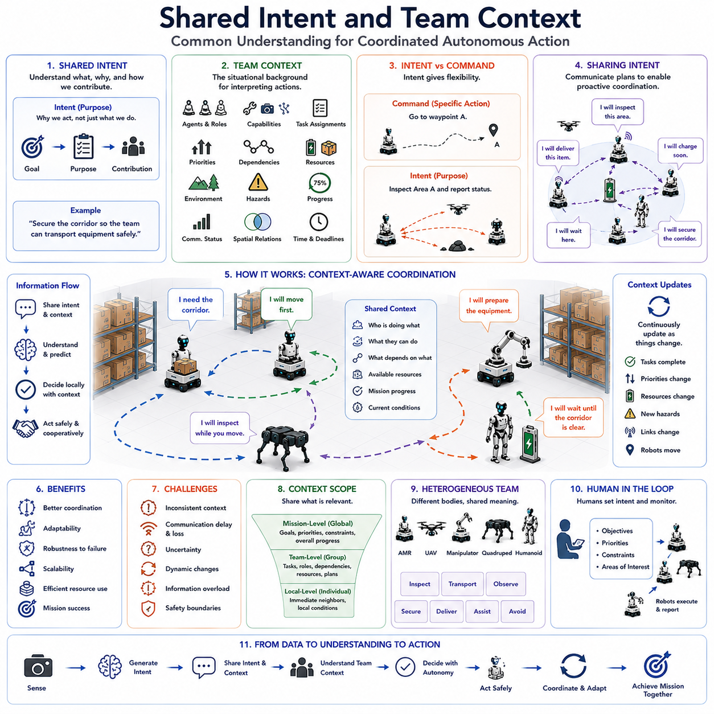{width="7.268055555555556in" height="7.268055555555556in"}

Shared intent represents a common understanding of what a team is trying to accomplish, why the objective matters, and how individual agents are expected to contribute. In Multi-Agent Physical AI, robots cannot coordinate effectively through positions and commands alone. They benefit from knowing mission goals, priorities, constraints, expected outcomes, and the intended relationships among their individual actions.

Intent differs from a simple command because it describes purpose rather than only a specific action. A command may instruct a robot to move to a location, while intent can explain that the movement is intended to secure a corridor, inspect an area, support another robot, or prepare a resource. Understanding purpose gives an autonomous agent greater flexibility to adapt its behavior when physical conditions change.

Shared intent allows multiple agents to interpret local decisions within a broader mission context. A robot that knows only its immediate task may choose an action that appears locally efficient but interferes with another agent. If it understands the team objective and the roles of nearby robots, it can evaluate whether waiting, rerouting, sharing information, or changing its execution strategy would better support collective performance.

Team context extends shared intent by representing the operational situation surrounding the mission. It can include participating agents, roles, capabilities, task assignments, priorities, dependencies, resource states, spatial relationships, communication conditions, hazards, mission progress, and relevant environmental changes. Together, these elements provide the background needed to interpret what each agent is doing and why.

Roles are an important part of team context because different robots may contribute in different ways. An AMR may transport equipment, a UAV may provide reconnaissance, a quadruped may inspect difficult terrain, and a manipulator may perform physical intervention. Shared knowledge of these roles helps agents predict what assistance may be available and which responsibilities should be handled by particular team members.

Capabilities provide additional context beyond assigned roles. Two robots may nominally perform the same task but differ in payload, sensing range, mobility, battery state, manipulation ability, computation, or terrain accessibility. Sharing capability information allows the team to select agents according to actual operational suitability rather than assuming that all robots are interchangeable participants in the mission.

Task dependencies also shape team context. Some activities can occur independently, while others must follow a particular sequence or wait for another agent to complete a prerequisite. A transport robot may need to wait until an inspection robot clears an area, or a manipulator may require an AMR to position an object first. Representing these dependencies prevents locally reasonable actions from violating the structure of the larger mission.

Shared intent is especially useful when detailed centralized control is impractical. A fleet manager can communicate objectives, constraints, priorities, and expected outcomes without specifying every trajectory or actuator command. Individual robots can then determine how to satisfy those requirements using current local observations. This separates mission-level direction from physical execution while preserving a common understanding of the desired result.

This principle supports robust operation in dynamic environments. If a planned route becomes blocked, a robot that understands only the original command may stop and wait for new instructions. A robot that understands the underlying intent can search for an alternative route, coordinate with nearby agents, or request assistance while continuing to preserve the purpose and constraints of the original mission.

Intent sharing among peer agents can improve distributed coordination. Robots may communicate their current goal, target, planned route, expected action, requested resource, or anticipated completion time. Such information helps neighboring agents predict future interactions rather than reacting only to observed motion. Coordination becomes proactive because agents can respond to what teammates intend to do before those actions physically occur.

Team context must be continuously updated because missions evolve over time. Tasks are completed, priorities change, robots move, resources become unavailable, batteries decline, hazards appear, and communication links change. A context representation that was correct several minutes earlier may no longer support good decisions. Agents therefore require mechanisms for updating, validating, and sometimes discarding outdated team information.

Temporal information is consequently important. Shared intent and context should indicate whether information represents a current commitment, a future plan, a tentative proposal, or an outdated state. Timestamps, expected durations, deadlines, validity periods, and confidence values can help agents interpret received information. Without temporal context, even accurate messages can lead to incorrect coordination when they are applied at the wrong time.

Uncertainty should also be represented explicitly. A robot may intend to reach a waypoint but be uncertain whether a route remains traversable, or a team may expect a task to finish within a time window without knowing the exact completion time. Communicating confidence and alternatives allows other agents to plan more robustly than treating every intention as a guaranteed future event.

Shared intent does not require every agent to possess an identical copy of the complete team state. Different robots need different portions of context according to their roles and interactions. An agent operating in one zone may not require detailed information about every robot elsewhere. Context can therefore be filtered according to task relevance, spatial proximity, resource dependencies, predicted interaction, and decision responsibility.

This selective approach improves scalability. As fleet size grows, continuously broadcasting every task, plan, state variable, and sensor observation to every robot becomes inefficient. Team context can instead be organized hierarchically or distributed through relevant groups. Local teams may maintain detailed coordination information, while fleet-level systems maintain more abstract mission status, resource summaries, and strategic priorities.

Consistency remains a challenge because different agents may hold different versions of team context. Communication delay, packet loss, asynchronous updates, and local observations can cause temporary disagreement about task assignments or resource states. Coordination protocols must therefore identify authoritative information where necessary, resolve conflicts, and allow agents to continue safely when complete agreement cannot immediately be achieved.

Shared intent also supports recovery from failure. If a robot becomes unavailable, teammates that understand the broader mission can determine which responsibilities remain incomplete and reorganize accordingly. Tasks may be reassigned, routes changed, resources redistributed, or temporary roles created. The team can preserve mission continuity because knowledge of purpose and dependencies is not confined to the failed agent.

In heterogeneous teams, shared intent provides a common semantic layer across different embodiments and control systems. An AMR, UAV, manipulator, and quadruped may execute actions through completely different controllers, yet they can still coordinate around concepts such as inspect, transport, observe, secure, deliver, assist, or avoid. Mission semantics connect diverse physical capabilities without requiring identical low-level representations.

Human operators can also participate in shared intent. Instead of manually controlling every robot, a human can specify mission objectives, priorities, constraints, or areas of interest. Robots can translate these high-level instructions into coordinated local actions while reporting progress and exceptions. This creates a human-multi-robot relationship based more on mission supervision and intent communication than continuous teleoperation.

Learning-based systems can use team context as part of the information available to policies. A robot policy may condition its decisions on local observations together with teammate roles, communicated intentions, task priorities, or mission phase. This allows learned behavior to adapt not only to physical surroundings but also to the social and organizational structure of the multi-agent system.

Safety remains a boundary on intent execution. Shared mission goals should never require a robot to ignore immediate hazards, physical limits, or mandatory safety constraints. If the requested intent cannot be achieved safely, the robot should modify execution, communicate the conflict, request replanning, or enter a safe state. Intent provides direction, while local safety determines whether and how that direction can be physically realized.

Shared intent and team context therefore form an informational bridge between individual autonomy and collective mission execution. Intent communicates what the team is trying to achieve, while context explains the roles, capabilities, dependencies, resources, conditions, and progress surrounding that objective. Together they allow autonomous robots to interpret local actions as parts of a coordinated mission rather than isolated decisions.

Effective Multi-Agent Physical AI depends not merely on robots exchanging data but on exchanging information with operational meaning. When agents understand shared goals, teammate roles, future intentions, relevant constraints, and changing mission context, they can anticipate one another and adapt without constant centralized instruction. Shared intent transforms communication from simple state exchange into coordinated understanding that supports flexible, resilient, and purposeful collective behavior.

공유 의도(shared intent)는 팀이 무엇을 달성하려고 하는지, 그 목표가 왜 중요한지, 그리고 개별 에이전트(individual agent)가 어떻게 기여해야 하는지에 대한 공통된 이해를 의미합니다. 다중 에이전트 피지컬 AI(Multi-Agent Physical AI)에서 로봇은 위치와 명령만으로 효과적으로 협력할 수 없습니다. 임무 목표(mission goal), 우선순위(priority), 제약조건(constraint), 예상 결과(expected outcome), 개별 행동 간의 의도된 관계를 이해할 때 더욱 효과적인 협력이 가능합니다.

의도(intent)는 특정 행동만을 지시하는 것이 아니라 목적(purpose)을 설명한다는 점에서 단순한 명령(command)과 다릅니다. 명령은 로봇에게 특정 위치로 이동하도록 지시할 수 있지만, 의도는 해당 이동이 통로를 확보하거나, 특정 영역을 검사하거나, 다른 로봇을 지원하거나, 자원을 준비하기 위한 것임을 설명할 수 있습니다. 목적을 이해하면 물리적 조건이 변화할 때 자율 에이전트가 자신의 행동을 더욱 유연하게 조정할 수 있습니다.

공유 의도는 여러 에이전트가 보다 광범위한 임무 맥락(mission context) 안에서 국소 의사결정(local decision)을 해석할 수 있도록 합니다. 자신의 즉각적인 작업만 알고 있는 로봇은 국소적으로 효율적으로 보이지만 다른 에이전트의 행동을 방해하는 선택을 할 수 있습니다. 반면 팀 목표와 주변 로봇의 역할을 이해한다면 대기, 경로 변경(rerouting), 정보 공유, 실행 전략 변경 중 어떤 행동이 집단 성능(collective performance)에 더 유리한지를 판단할 수 있습니다.

팀 맥락(team context)은 임무를 둘러싼 운용 상황(operational situation)을 표현함으로써 공유 의도를 확장합니다. 여기에는 참여 에이전트, 역할(role), 역량(capability), 작업 할당(task assignment), 우선순위, 의존관계(dependency), 자원 상태(resource state), 공간적 관계(spatial relationship), 통신 상태, 위험 요소(hazard), 임무 진행 상황(mission progress), 관련 환경 변화 등이 포함될 수 있습니다. 이러한 요소들은 각 에이전트가 무엇을 하고 있으며 왜 그렇게 행동하는지를 해석하는 데 필요한 배경 정보를 제공합니다.

서로 다른 로봇이 서로 다른 방식으로 기여할 수 있기 때문에 역할은 팀 맥락의 중요한 구성요소입니다. 자율이동로봇(Autonomous Mobile Robot, AMR)은 장비를 운송하고, 무인항공기(Unmanned Aerial Vehicle, UAV)는 정찰(reconnaissance)을 제공하며, 4족 보행 로봇(quadruped)은 접근하기 어려운 지형을 검사하고, 매니퓰레이터(manipulator)는 물리적 개입을 수행할 수 있습니다. 이러한 역할을 공유하면 에이전트는 어떤 지원을 이용할 수 있는지와 특정 책임을 어떤 팀원이 담당해야 하는지를 예측할 수 있습니다.

역량(capability)은 할당된 역할을 넘어서는 추가적인 맥락을 제공합니다. 두 로봇이 명목상 동일한 작업을 수행할 수 있더라도 적재 능력(payload), 센싱 범위(sensing range), 이동성(mobility), 배터리 상태, 조작 능력(manipulation ability), 연산 능력(computation), 지형 접근성(terrain accessibility)이 서로 다를 수 있습니다. 역량 정보를 공유하면 모든 로봇을 동일한 임무 참여자로 가정하는 대신 실제 운용 적합성(operational suitability)에 따라 에이전트를 선택할 수 있습니다.

작업 의존성(task dependency)도 팀 맥락을 형성합니다. 일부 활동은 독립적으로 수행할 수 있지만 다른 활동은 특정 순서를 따라야 하거나 다른 에이전트가 선행 작업(prerequisite)을 완료할 때까지 기다려야 합니다. 운송 로봇은 검사 로봇이 특정 영역을 확인할 때까지 기다려야 할 수 있으며, 매니퓰레이터는 자율이동로봇이 먼저 객체를 적절한 위치에 배치해야 작업을 수행할 수 있습니다. 이러한 의존관계를 표현하면 국소적으로 합리적인 행동이 전체 임무 구조를 위반하는 것을 방지할 수 있습니다.

공유 의도는 상세한 중앙집중형 제어(centralized control)가 실용적이지 않은 상황에서 특히 유용합니다. 플릿 관리자(fleet manager)는 모든 궤적이나 액추에이터 명령(actuator command)을 직접 지정하지 않고 목표, 제약조건, 우선순위, 예상 결과를 전달할 수 있습니다. 이후 개별 로봇은 현재의 국소 관찰(local observation)을 이용하여 이러한 요구사항을 어떻게 충족할 것인지 결정할 수 있습니다. 이를 통해 공통된 목표에 대한 이해를 유지하면서 임무 수준 지시와 물리적 실행을 분리할 수 있습니다.

이러한 원리는 동적 환경(dynamic environment)에서 강건한 운용(robust operation)을 지원합니다. 계획된 경로가 차단되었을 때 원래 명령만 이해하는 로봇은 정지한 후 새로운 지시를 기다릴 수 있습니다. 반면 근본적인 의도를 이해하는 로봇은 원래 임무의 목적과 제약조건을 유지하면서 대체 경로를 탐색하거나, 주변 에이전트와 협력하거나, 필요한 지원을 요청할 수 있습니다.

동료 에이전트(peer agent) 사이의 의도 공유(intent sharing)는 분산 협력(distributed coordination)을 향상시킬 수 있습니다. 로봇은 현재 목표, 목적지(target), 계획된 경로(planned route), 예상 행동(expected action), 요청한 자원, 예상 완료 시간 등을 전달할 수 있습니다. 이러한 정보는 주변 에이전트가 단순히 관찰된 움직임에 반응하는 대신 미래의 상호작용을 예측할 수 있도록 합니다. 에이전트는 팀원의 행동이 실제로 발생하기 전에 의도를 바탕으로 대응할 수 있으므로 협력은 보다 선제적(proactive)이 됩니다.

임무는 시간에 따라 변화하므로 팀 맥락은 지속적으로 갱신되어야 합니다. 작업이 완료되고, 우선순위가 변화하며, 로봇이 이동하고, 자원을 사용할 수 없게 되거나, 배터리가 감소하고, 위험이 새롭게 나타나며, 통신 연결 상태도 변화합니다. 몇 분 전에는 정확했던 맥락 표현(context representation)이 현재의 의사결정에는 더 이상 적절하지 않을 수 있습니다. 따라서 에이전트는 팀 정보를 갱신하고 검증하며 필요하면 오래된 정보를 폐기하는 메커니즘을 필요로 합니다.

따라서 시간 정보(temporal information)가 중요합니다. 공유 의도와 맥락은 해당 정보가 현재의 약속(commitment), 미래 계획(future plan), 잠정적인 제안(tentative proposal), 또는 오래된 상태(outdated state) 중 무엇을 나타내는지 표현해야 합니다. 타임스탬프(timestamp), 예상 지속시간(expected duration), 마감시간(deadline), 유효기간(validity period), 신뢰도(confidence value)는 에이전트가 수신된 정보를 올바르게 해석하도록 지원합니다. 시간적 맥락이 없으면 정확한 메시지조차 잘못된 시점에 적용되어 협력 오류를 발생시킬 수 있습니다.

불확실성(uncertainty) 역시 명시적으로 표현되어야 합니다. 로봇은 특정 웨이포인트(waypoint)에 도달하려는 의도를 가지고 있지만 경로가 여전히 주행 가능한지는 확신하지 못할 수 있으며, 팀은 작업이 특정 시간 범위 안에 완료될 것으로 예상하지만 정확한 완료 시간을 알지 못할 수 있습니다. 신뢰도와 대안(alternative)을 함께 전달하면 다른 에이전트가 모든 의도를 보장된 미래 사건으로 취급하는 것보다 더욱 강건하게 계획할 수 있습니다.

공유 의도가 모든 에이전트가 완전한 팀 상태(team state)의 동일한 복사본을 가지고 있어야 한다는 의미는 아닙니다. 서로 다른 로봇은 자신의 역할과 상호작용에 따라 서로 다른 범위의 맥락을 필요로 합니다. 특정 구역에서 동작하는 에이전트가 다른 모든 구역의 모든 로봇에 대한 상세 정보를 필요로 하지는 않습니다. 따라서 맥락 정보는 작업 관련성(task relevance), 공간적 근접성(spatial proximity), 자원 의존성(resource dependency), 예상 상호작용(predicted interaction), 의사결정 책임에 따라 필터링될 수 있습니다.

이러한 선택적 접근(selective approach)은 확장성(scalability)을 향상시킵니다. 플릿 규모가 증가할수록 모든 작업, 계획, 상태 변수, 센서 관찰을 모든 로봇에게 지속적으로 브로드캐스트(broadcast)하는 것은 비효율적입니다. 대신 팀 맥락은 계층적으로 구성하거나 관련 그룹을 통해 분산할 수 있습니다. 국소 팀(local team)은 상세한 협력 정보를 유지하고, 플릿 수준 시스템(fleet-level system)은 보다 추상화된 임무 상태, 자원 요약(resource summary), 전략적 우선순위(strategic priority)를 유지할 수 있습니다.

서로 다른 에이전트가 서로 다른 버전의 팀 맥락을 가지고 있을 수 있기 때문에 일관성(consistency)은 여전히 중요한 과제입니다. 통신 지연, 패킷 손실(packet loss), 비동기 갱신(asynchronous update), 국소 관찰로 인해 작업 할당이나 자원 상태에 대해 일시적인 불일치가 발생할 수 있습니다. 따라서 협력 프로토콜(coordination protocol)은 필요한 경우 권위 있는 정보(authoritative information)를 식별하고, 충돌을 해결하며, 완전한 합의를 즉시 달성할 수 없는 상황에서도 에이전트가 안전하게 동작할 수 있도록 해야 합니다.

공유 의도는 고장 복구(failure recovery)도 지원합니다. 하나의 로봇을 사용할 수 없게 되었을 때 더 광범위한 임무를 이해하는 팀원들은 어떤 책임이 아직 완료되지 않았는지를 판단하고 그에 따라 재구성할 수 있습니다. 작업을 재할당하고, 경로를 변경하며, 자원을 재분배하거나, 임시 역할(temporary role)을 생성할 수 있습니다. 목적과 의존관계에 대한 지식이 고장 난 에이전트에만 존재하지 않기 때문에 팀은 임무 연속성(mission continuity)을 유지할 수 있습니다.

이기종 팀(heterogeneous team)에서 공유 의도는 서로 다른 체화(embodiment)와 제어 시스템을 연결하는 공통 의미 계층(common semantic layer)을 제공합니다. 자율이동로봇, 무인항공기, 매니퓰레이터, 4족 보행 로봇은 완전히 서로 다른 제어기를 통해 행동을 실행할 수 있지만 검사(inspect), 운송(transport), 관찰(observe), 확보(secure), 전달(deliver), 지원(assist), 회피(avoid)와 같은 개념을 중심으로 협력할 수 있습니다. 임무 의미론(mission semantics)은 동일한 저수준 표현을 요구하지 않고도 다양한 물리적 역량을 연결합니다.

인간 운영자(human operator)도 공유 의도에 참여할 수 있습니다. 모든 로봇을 수동으로 제어하는 대신 인간은 임무 목표, 우선순위, 제약조건 또는 관심 영역(area of interest)을 지정할 수 있습니다. 로봇은 이러한 상위 수준 지시(high-level instruction)를 협력된 국소 행동으로 변환하면서 진행 상황과 예외 상황(exception)을 보고할 수 있습니다. 이를 통해 인간-다중 로봇 관계(human-multi-robot relationship)는 지속적인 원격조작(teleoperation)보다 임무 감독(mission supervision)과 의도 통신(intent communication)을 중심으로 구성될 수 있습니다.

학습 기반 시스템(learning-based system)은 팀 맥락을 정책(policy)이 이용할 수 있는 정보의 일부로 활용할 수 있습니다. 로봇 정책은 국소 관찰과 함께 팀원의 역할, 전달된 의도, 작업 우선순위, 임무 단계(mission phase)를 조건으로 의사결정을 수행할 수 있습니다. 이를 통해 학습된 행동은 물리적 주변 환경뿐만 아니라 다중 에이전트 시스템의 사회적·조직적 구조(social and organizational structure)에도 적응할 수 있습니다.

안전(safety)은 의도 실행(intent execution)의 경계로 유지되어야 합니다. 공유된 임무 목표가 로봇에게 즉각적인 위험, 물리적 한계, 필수 안전 제약조건(mandatory safety constraint)을 무시하도록 요구해서는 안 됩니다. 요청된 의도를 안전하게 달성할 수 없다면 로봇은 실행 방법을 변경하고, 충돌되는 조건을 전달하고, 재계획(replanning)을 요청하거나, 안전 상태(safe state)로 전환해야 합니다. 의도는 방향을 제공하지만 국소 안전은 그 방향을 물리적으로 실현할 수 있는지와 어떻게 실현할지를 결정합니다.

따라서 공유 의도(shared intent)와 팀 맥락(team context)은 개별 자율성(individual autonomy)과 집단 임무 수행(collective mission execution)을 연결하는 정보적 다리(informational bridge)를 형성합니다. 의도는 팀이 무엇을 달성하려는지를 전달하고, 맥락은 해당 목표를 둘러싼 역할, 역량, 의존관계, 자원, 조건, 진행 상황을 설명합니다. 두 요소가 결합되면 자율 로봇은 국소 행동을 고립된 의사결정이 아니라 협력된 임무(coordinated mission)의 일부로 해석할 수 있습니다.

효과적인 다중 에이전트 피지컬 AI는 로봇들이 단순히 데이터를 교환하는 것을 넘어 운용적 의미(operational meaning)를 가진 정보를 교환하는 것에 의존합니다. 에이전트가 공유 목표, 팀원의 역할, 미래 의도, 관련 제약조건, 변화하는 임무 맥락을 이해하면 지속적인 중앙집중형 지시 없이도 서로의 행동을 예측하고 적응할 수 있습니다. 공유 의도는 통신을 단순한 상태 교환(state exchange)에서 협력된 이해(coordinated understanding)로 발전시켜 유연하고, 회복탄력적이며, 목적 지향적인 집단 행동을 가능하게 합니다.

##  

## 01.10. Multi Agent Planning

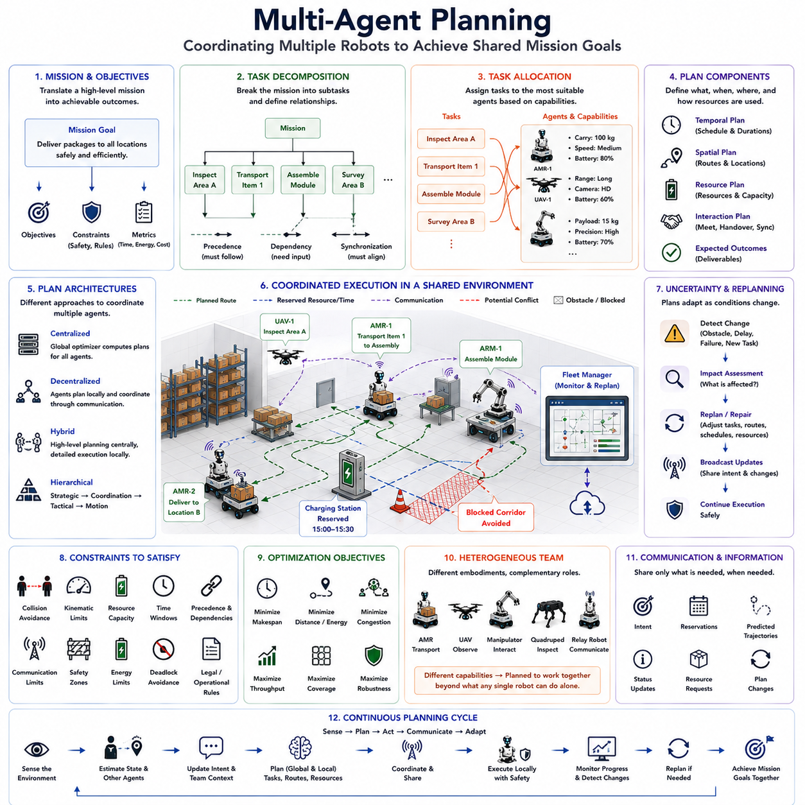{width="7.268055555555556in" height="7.268055555555556in"}

Multi-agent planning is the process of determining how multiple autonomous agents should organize their actions over time to achieve individual and collective objectives in a shared physical environment. Unlike single-agent planning, each robot must consider not only its own state, goals, and constraints but also the possible actions, capabilities, intentions, and resource demands of other agents whose behavior can affect the feasibility of its plan.

A multi-agent plan can describe tasks, temporal relationships, routes, resource usage, interaction points, and expected outcomes across an entire team. The planning problem therefore extends beyond finding a sequence of actions for one robot. It must determine how multiple action sequences can coexist, where they depend on one another, when synchronization is required, and how conflicts can be avoided or resolved during physical execution.

Task decomposition is often the first stage of this process. A complex mission can be separated into smaller activities that different agents can perform independently or collaboratively. Inspection, transportation, observation, manipulation, communication relay, and safety monitoring may become distinct subtasks. Planning then determines how these activities should be distributed and connected so that their combined completion satisfies the original mission objective.

Task allocation links these subtasks to suitable agents. Assignment decisions can consider location, mobility, payload, sensing, manipulation ability, energy, workload, expected completion time, and current availability. In heterogeneous teams, capability-aware allocation is particularly important because different embodiments may contribute complementary functions. Effective planning assigns work according to what each robot can realistically accomplish under current operating conditions.

Temporal planning determines when actions should occur and how their timing relationships should be managed. Some tasks can execute in parallel, while others require strict ordering or synchronization. A manipulator may wait for an AMR to deliver an object, or several robots may need to arrive simultaneously for cooperative transport. Temporal constraints therefore connect individual schedules into a coordinated mission timeline.

Spatial planning introduces another layer of interaction because physical agents occupy space and cannot freely pass through one another. Routes that are individually feasible may conflict when several robots use the same corridor, intersection, doorway, workspace, or docking area. Multi-agent planning must therefore coordinate trajectories, reservations, priorities, or time windows so that spatial conflicts do not become collisions, congestion, or deadlocks.

Resource planning addresses competition for limited shared assets. Charging stations, tools, communication channels, elevators, manipulation zones, loading areas, and computation resources may be required by several agents. A planner must decide who receives access, when the resource becomes available, and how long it will be occupied. These decisions connect scheduling with physical feasibility and can strongly influence total mission performance.

Centralized multi-agent planning uses broad system information to calculate plans for many agents together. A central planner can consider global objectives, task dependencies, fleet states, and shared resources when optimizing assignments and schedules. This approach can provide strong coordination, especially in structured environments, but computational complexity and communication requirements can increase rapidly as the number of agents and possible interactions grows.

Decentralized planning distributes planning responsibility among individual agents or local groups. Each robot generates plans from its own observations and available shared information while communicating with others when dependencies or conflicts arise. Negotiation, auctions, reservations, consensus, and intent exchange can coordinate these local plans. This approach improves autonomy and scalability but may sacrifice some global optimality.

Hybrid planning combines global mission reasoning with local autonomous planning. A fleet-level planner may allocate tasks, define priorities, and establish resource constraints, while individual robots determine detailed routes and physical actions. Local planners continuously respond to obstacles and environmental changes without requiring every adjustment to be approved centrally. This division is particularly suitable for dynamic physical systems with different planning timescales.

Hierarchical planning further separates decisions according to abstraction level. A strategic layer may determine mission goals and task sequences, a coordination layer may assign robots and resources, and a tactical layer may generate routes or interaction schedules. Beneath these levels, motion planners and controllers produce executable trajectories and actuator commands. Higher-level intent is progressively transformed into physically realizable behavior.

Partial observability makes multi-agent planning fundamentally uncertain. Robots cannot always observe distant obstacles, future human motion, hidden environmental changes, or the internal state of teammates. Plans are therefore constructed from estimates rather than perfect knowledge. Belief states, confidence measures, predictions, and communicated observations can help planners reason about uncertainty while maintaining alternatives for situations in which assumptions prove incorrect.

Other agents introduce additional uncertainty because they are active decision makers rather than passive obstacles. Predicting another robot\'s trajectory becomes easier when its task and intent are known, but unexpected replanning can still change future interactions. Sharing goals, planned routes, reservations, and expected completion times enables agents to coordinate around anticipated behavior rather than reacting only after conflicts become physically visible.

Planning under uncertainty naturally requires replanning. A route may become blocked, a robot may fail, a battery may decline faster than expected, or a high-priority task may suddenly appear. Multi-agent systems must detect when existing plans are no longer appropriate and modify assignments, routes, schedules, or resource reservations. Replanning is therefore a continuous component of execution rather than merely a response to exceptional failure.

Plan repair can be more efficient than rebuilding the entire mission plan whenever conditions change. If one robot becomes unavailable, the system may reassign only its unfinished tasks while preserving unaffected assignments. Similarly, a blocked corridor may require changing several routes without altering the overall mission structure. Localized repair reduces computational cost and avoids unnecessary disruption to agents whose plans remain valid.

Coordination constraints prevent individually valid plans from becoming collectively inconsistent. Two robots may each have collision-free routes when considered separately, yet those routes can intersect at the same time. Likewise, several agents may independently reserve the same resource. Joint planning therefore requires explicit reasoning about mutual exclusion, synchronization, precedence, capacity, communication, and safety constraints across multiple agents.

Multi-agent path finding is an important specialized form of planning in which several agents must reach target locations without collision. The challenge is not simply to find a path for each robot but to coordinate paths in both space and time. Waiting, rerouting, priority assignment, and reservation can resolve conflicts. As agent density increases, path interactions can become a dominant factor in fleet efficiency.

Optimization criteria determine what constitutes a good multi-agent plan. Possible objectives include minimizing total completion time, travel distance, energy consumption, congestion, communication cost, or resource idle time while maximizing throughput, coverage, safety, resilience, or task value. Because these criteria can conflict, practical planning often involves multi-objective optimization constrained by mandatory physical and operational requirements.

Safety must remain a hard boundary around planning. A globally efficient plan is unacceptable if it requires unsafe proximity, unstable motion, prohibited zones, excessive actuator demand, or violation of emergency rules. Higher-level plans should therefore generate goals and constraints that local safety systems can execute safely. When real-world observations contradict planning assumptions, immediate physical safety must take precedence over plan completion.

Heterogeneous multi-agent planning must reason about differences in embodiment as well as differences in task state. An AMR may transport equipment, a UAV may inspect from above, a quadruped may traverse difficult terrain, and a manipulator may perform contact-rich operations. Planning determines how these complementary capabilities should be sequenced and coordinated so that the team accomplishes missions no individual robot could complete alone.

Communication and planning are closely coupled because agents require information about decisions that affect one another. Rather than sharing complete internal plans, robots can communicate selected intent, reservations, predicted trajectories, dependencies, and plan changes. Efficient communication provides enough information for coordination while avoiding excessive bandwidth consumption, particularly when large fleets contain many agents whose plans rarely interact.

Learning can complement model-based planning by predicting task duration, congestion, interaction risk, resource demand, or the likely behavior of other agents. Learned policies may also propose assignments or local actions that reduce the search required by conventional planners. However, learned components must operate within physical feasibility and safety constraints when their outputs influence real robots and shared operational environments.

Scalability is a central challenge because the number of possible joint plans can grow rapidly with the number of agents, tasks, resources, and interactions. Practical systems reduce this complexity through decomposition, hierarchy, local coordination, relevance filtering, prioritized planning, and distributed computation. The goal is not to reason about every possible interaction globally, but to coordinate strongly where agent decisions actually influence one another.

Multi-agent planning ultimately transforms shared objectives into coordinated actions distributed across multiple physical agents. It connects task decomposition, allocation, scheduling, spatial coordination, resource management, communication, uncertainty reasoning, and replanning into a unified decision process. Effective Multi-Agent Physical AI plans globally where coordination matters, acts locally where responsiveness matters, and continuously adapts as the physical world changes.

다중 에이전트 계획(multi-agent planning)은 여러 자율 에이전트(autonomous agent)가 공유된 물리적 환경에서 개별 목표(individual objective)와 집단 목표(collective objective)를 달성하기 위해 시간에 따라 자신의 행동을 어떻게 구성해야 하는지를 결정하는 과정입니다. 단일 에이전트 계획(single-agent planning)과 달리 각 로봇은 자신의 상태, 목표, 제약조건뿐만 아니라 자신의 계획 실행 가능성에 영향을 미칠 수 있는 다른 에이전트의 행동, 역량(capability), 의도(intent), 자원 요구까지 고려해야 합니다.

다중 에이전트 계획은 전체 팀에 걸쳐 작업(task), 시간적 관계(temporal relationship), 경로(route), 자원 사용(resource usage), 상호작용 지점(interaction point), 예상 결과(expected outcome)를 표현할 수 있습니다. 따라서 계획 문제는 하나의 로봇을 위한 행동 순서를 찾는 것 이상으로 확장됩니다. 여러 행동 순서가 어떻게 공존할 수 있는지, 어디에서 서로 의존하는지, 언제 동기화(synchronization)가 필요한지, 물리적 실행 과정에서 충돌을 어떻게 회피하거나 해결할지를 결정해야 합니다.

작업 분해(task decomposition)는 일반적으로 이러한 과정의 첫 번째 단계입니다. 복잡한 임무(mission)를 서로 다른 에이전트가 독립적으로 또는 협력하여 수행할 수 있는 작은 활동으로 분리할 수 있습니다. 검사(inspection), 운송(transportation), 관찰(observation), 조작(manipulation), 통신 중계(communication relay), 안전 모니터링(safety monitoring) 등이 각각의 하위 작업(subtask)이 될 수 있습니다. 이후 계획은 이러한 활동을 어떻게 분배하고 연결하여 전체 임무 목표를 달성할지를 결정합니다.

작업 할당(task allocation)은 이러한 하위 작업을 적합한 에이전트와 연결합니다. 할당 과정에서는 위치(location), 이동성(mobility), 적재 능력(payload), 센싱(sensing), 조작 능력, 에너지, 작업 부하(workload), 예상 완료 시간(expected completion time), 현재 가용성(availability)을 고려할 수 있습니다. 이기종 팀(heterogeneous team)에서는 서로 다른 체화(embodiment)가 상호보완적인 기능을 제공할 수 있기 때문에 역량 인식 할당(capability-aware allocation)이 특히 중요합니다. 효과적인 계획은 현재 운용 조건에서 각 로봇이 실제로 수행할 수 있는 능력에 따라 작업을 할당합니다.

시간 계획(temporal planning)은 행동이 언제 발생해야 하며 행동 사이의 시간적 관계를 어떻게 관리해야 하는지를 결정합니다. 일부 작업은 병렬로 실행할 수 있지만 다른 작업은 엄격한 순서 또는 동기화를 필요로 합니다. 매니퓰레이터(manipulator)는 자율이동로봇(Autonomous Mobile Robot, AMR)이 객체를 전달할 때까지 기다려야 할 수 있으며, 여러 로봇이 협력 운송(cooperative transport)을 위해 동시에 도착해야 할 수도 있습니다. 따라서 시간적 제약조건(temporal constraint)은 개별 스케줄을 하나의 협력된 임무 타임라인으로 연결합니다.

공간 계획(spatial planning)은 물리적 에이전트가 공간을 점유하며 서로 자유롭게 통과할 수 없기 때문에 또 다른 상호작용 계층을 추가합니다. 개별적으로는 실행 가능한 경로라도 여러 로봇이 동일한 복도, 교차로, 출입구, 작업 공간(workspace), 도킹 영역(docking area)을 사용할 경우 충돌할 수 있습니다. 따라서 다중 에이전트 계획은 공간적 충돌이 실제 충돌(collision), 혼잡(congestion), 교착상태(deadlock)로 발전하지 않도록 궤적(trajectory), 예약(reservation), 우선순위(priority), 시간 구간(time window)을 협력적으로 조정해야 합니다.

자원 계획(resource planning)은 제한된 공유 자원(shared asset)을 둘러싼 경쟁을 처리합니다. 충전소(charging station), 도구(tool), 통신 채널, 엘리베이터, 조작 영역(manipulation zone), 적재 영역(loading area), 연산 자원(computing resource)을 여러 에이전트가 필요로 할 수 있습니다. 계획기는 누가 자원에 접근하고, 언제 자원을 사용할 수 있으며, 얼마나 오랫동안 점유할지를 결정해야 합니다. 이러한 결정은 스케줄링과 물리적 실행 가능성(physical feasibility)을 연결하며 전체 임무 성능에 큰 영향을 미칠 수 있습니다.

중앙집중형 다중 에이전트 계획(centralized multi-agent planning)은 광범위한 시스템 정보를 이용하여 여러 에이전트의 계획을 함께 계산합니다. 중앙 계획기(central planner)는 할당과 스케줄을 최적화할 때 전역 목표(global objective), 작업 의존성(task dependency), 플릿 상태(fleet state), 공유 자원을 함께 고려할 수 있습니다. 이러한 방식은 특히 구조화된 환경(structured environment)에서 강력한 협력을 제공할 수 있지만, 에이전트와 가능한 상호작용의 수가 증가하면 연산 복잡도와 통신 요구량이 빠르게 증가할 수 있습니다.

분산형 계획(decentralized planning)은 계획 책임을 개별 에이전트 또는 국소 그룹(local group)에 분산합니다. 각 로봇은 자신의 관찰과 이용 가능한 공유 정보를 바탕으로 계획을 생성하고 의존성이나 충돌이 발생할 경우 다른 에이전트와 통신합니다. 협상(negotiation), 경매(auction), 예약, 합의(consensus), 의도 교환(intent exchange)을 통해 이러한 국소 계획을 조정할 수 있습니다. 이 방식은 자율성과 확장성(scalability)을 향상시키지만 일부 전역 최적성(global optimality)을 희생할 수 있습니다.

하이브리드 계획(hybrid planning)은 전역 임무 추론(global mission reasoning)과 국소 자율 계획(local autonomous planning)을 결합합니다. 플릿 수준 계획기(fleet-level planner)는 작업을 할당하고 우선순위를 정의하며 자원 제약조건을 설정하고, 개별 로봇은 상세한 경로와 물리적 행동을 결정할 수 있습니다. 국소 계획기는 모든 조정을 중앙의 승인을 받을 필요 없이 장애물과 환경 변화에 지속적으로 대응합니다. 이러한 역할 분담은 서로 다른 계획 시간 척도(planning timescale)를 가진 동적 물리 시스템에 특히 적합합니다.

계층형 계획(hierarchical planning)은 추상화 수준(abstraction level)에 따라 의사결정을 더욱 세분화합니다. 전략 계층(strategic layer)은 임무 목표와 작업 순서를 결정하고, 협력 계층(coordination layer)은 로봇과 자원을 할당하며, 전술 계층(tactical layer)은 경로나 상호작용 스케줄을 생성할 수 있습니다. 그 아래에서는 모션 계획기(motion planner)와 제어기(controller)가 실행 가능한 궤적과 액추에이터 명령(actuator command)을 생성합니다. 상위 수준의 의도는 이러한 계층을 거치면서 물리적으로 실행 가능한 행동으로 점진적으로 변환됩니다.

부분 관측성(partial observability)은 다중 에이전트 계획을 근본적으로 불확실하게 만듭니다. 로봇은 멀리 있는 장애물, 미래의 인간 움직임, 보이지 않는 환경 변화, 팀원의 내부 상태를 항상 관찰할 수 없습니다. 따라서 계획은 완벽한 지식이 아니라 추정치(estimation)를 기반으로 구성됩니다. 믿음 상태(belief state), 신뢰도 척도(confidence measure), 예측(prediction), 통신을 통해 공유된 관찰은 계획기가 불확실성을 추론하면서 기존 가정이 잘못된 경우에 사용할 대안을 유지하도록 지원합니다.

다른 에이전트는 수동적인 장애물이 아니라 능동적인 의사결정 주체이므로 추가적인 불확실성을 발생시킵니다. 다른 로봇의 작업과 의도를 알고 있다면 궤적을 보다 쉽게 예측할 수 있지만 예상하지 못한 재계획(replanning)은 여전히 미래의 상호작용을 변화시킬 수 있습니다. 목표, 계획된 경로, 예약 정보, 예상 완료 시간을 공유하면 에이전트는 충돌이 물리적으로 나타난 이후에만 대응하는 것이 아니라 예상되는 행동을 중심으로 미리 협력할 수 있습니다.

불확실성 하의 계획(planning under uncertainty)은 자연스럽게 재계획을 필요로 합니다. 경로가 차단되거나, 로봇이 고장 나거나, 배터리가 예상보다 빠르게 감소하거나, 높은 우선순위의 작업이 갑자기 발생할 수 있습니다. 다중 에이전트 시스템은 기존 계획이 더 이상 적절하지 않은 시점을 감지하고 작업 할당, 경로, 스케줄, 자원 예약을 수정할 수 있어야 합니다. 따라서 재계획은 예외적인 고장에 대한 대응이 아니라 실행 과정에서 지속적으로 수행되는 구성요소입니다.

계획 복구(plan repair)는 조건이 변화할 때마다 전체 임무 계획을 처음부터 다시 생성하는 것보다 효율적일 수 있습니다. 하나의 로봇을 사용할 수 없게 되면 시스템은 영향을 받지 않은 작업 할당을 유지하면서 해당 로봇의 미완료 작업만 재할당할 수 있습니다. 마찬가지로 하나의 복도가 차단되면 전체 임무 구조를 변경하지 않고 일부 경로만 수정할 수 있습니다. 국소화된 복구(localized repair)는 연산 비용을 줄이고 여전히 유효한 계획을 수행하는 에이전트에 대한 불필요한 방해를 줄입니다.

협력 제약조건(coordination constraint)은 개별적으로 유효한 계획이 집단적으로 불일치하는 것을 방지합니다. 두 로봇의 경로가 각각 독립적으로는 충돌이 없더라도 동일한 시간에 서로 교차할 수 있습니다. 마찬가지로 여러 에이전트가 독립적으로 동일한 자원을 예약할 수도 있습니다. 따라서 공동 계획(joint planning)은 상호 배제(mutual exclusion), 동기화, 선후 관계(precedence), 용량(capacity), 통신, 안전 제약조건을 여러 에이전트에 걸쳐 명시적으로 고려해야 합니다.

다중 에이전트 경로 탐색(Multi-Agent Path Finding, MAPF)은 여러 에이전트가 충돌 없이 목표 위치에 도달해야 하는 중요한 특수 계획 문제입니다. 핵심은 각 로봇의 경로를 개별적으로 찾는 것뿐만 아니라 공간과 시간 모두에서 경로를 협력적으로 조정하는 것입니다. 대기(waiting), 경로 변경(rerouting), 우선순위 할당(priority assignment), 예약을 통해 충돌을 해결할 수 있습니다. 에이전트 밀도가 증가할수록 경로 간 상호작용은 플릿 효율성을 결정하는 주요 요소가 될 수 있습니다.

최적화 기준(optimization criterion)은 어떤 다중 에이전트 계획을 좋은 계획으로 판단할지를 결정합니다. 전체 완료 시간(total completion time), 이동 거리, 에너지 소비, 혼잡, 통신 비용, 자원 유휴시간(resource idle time)을 최소화하면서 처리량(throughput), 커버리지(coverage), 안전, 회복탄력성(resilience), 작업 가치(task value)를 최대화할 수 있습니다. 이러한 기준은 서로 충돌할 수 있으므로 실용적인 계획은 필수적인 물리적·운용적 요구조건에 의해 제한되는 다목적 최적화(multi-objective optimization)를 사용하는 경우가 많습니다.

안전(safety)은 계획을 둘러싼 강제적인 경계(hard boundary)로 유지되어야 합니다. 전역적으로 효율적인 계획이라도 불안전한 근접 거리, 불안정한 움직임, 금지 구역(prohibited zone), 과도한 액추에이터 요구 또는 비상 규칙 위반을 요구한다면 허용할 수 없습니다. 따라서 상위 수준 계획은 국소 안전 시스템이 안전하게 실행할 수 있는 목표와 제약조건을 생성해야 합니다. 실제 환경 관찰이 계획의 가정과 충돌하면 즉각적인 물리적 안전이 계획 완료보다 우선해야 합니다.

이기종 다중 에이전트 계획(heterogeneous multi-agent planning)은 작업 상태의 차이뿐만 아니라 체화의 차이도 고려해야 합니다. 자율이동로봇은 장비를 운송하고, 무인항공기(Unmanned Aerial Vehicle, UAV)는 상공에서 검사하며, 4족 보행 로봇(quadruped)은 험난한 지형을 이동하고, 매니퓰레이터는 접촉이 많은 작업(contact-rich operation)을 수행할 수 있습니다. 계획은 이러한 상호보완적 역량을 어떻게 순서화하고 협력시켜 개별 로봇만으로는 수행하기 어려운 임무를 팀 전체가 완성할지를 결정합니다.

통신과 계획은 에이전트가 서로의 의사결정에 영향을 미치는 정보를 필요로 하기 때문에 밀접하게 연결됩니다. 로봇은 완전한 내부 계획 전체를 공유하는 대신 선택된 의도, 예약 정보, 예측 궤적(predicted trajectory), 의존관계, 계획 변경 사항을 전달할 수 있습니다. 효율적인 통신은 협력에 충분한 정보를 제공하면서 과도한 대역폭 소비를 방지하며, 특히 대부분의 계획이 서로 직접 상호작용하지 않는 대규모 플릿에서 중요합니다.

학습(learning)은 작업 시간, 혼잡, 상호작용 위험(interaction risk), 자원 수요, 다른 에이전트의 예상 행동 등을 예측하여 모델 기반 계획(model-based planning)을 보완할 수 있습니다. 학습된 정책(learned policy)은 기존 계획기의 탐색량을 줄일 수 있는 작업 할당이나 국소 행동을 제안할 수도 있습니다. 그러나 학습 구성요소의 출력이 실제 로봇과 공유 운용 환경에 영향을 미치는 경우에는 물리적 실행 가능성과 안전 제약조건 안에서 동작해야 합니다.

확장성은 에이전트, 작업, 자원, 상호작용의 수가 증가함에 따라 가능한 공동 계획의 수가 빠르게 증가할 수 있기 때문에 핵심적인 과제입니다. 실용적인 시스템은 분해(decomposition), 계층화(hierarchy), 국소 협력(local coordination), 관련성 필터링(relevance filtering), 우선순위 기반 계획(prioritized planning), 분산 연산(distributed computation)을 통해 이러한 복잡성을 줄입니다. 목표는 가능한 모든 상호작용을 전역적으로 고려하는 것이 아니라 에이전트의 의사결정이 실제로 서로 영향을 미치는 부분에서 강하게 협력하는 것입니다.

결국 다중 에이전트 계획(multi-agent planning)은 공유 목표(shared objective)를 여러 물리적 에이전트에 분산된 협력 행동(coordinated action)으로 변환합니다. 작업 분해, 작업 할당, 스케줄링, 공간적 협력, 자원 관리, 통신, 불확실성 추론, 재계획을 하나의 통합된 의사결정 과정으로 연결합니다. 효과적인 다중 에이전트 피지컬 AI(Multi-Agent Physical AI)는 협력이 중요한 곳에서는 전역적으로 계획하고, 즉각적인 대응이 중요한 곳에서는 국소적으로 행동하며, 물리적 세계가 변화함에 따라 계획을 지속적으로 적응시킵니다.

##  

## 01.11. Multi Agent Reinforcement Learning

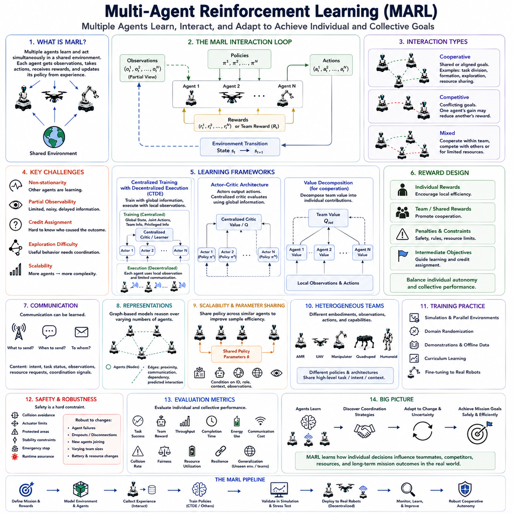{width="7.268055555555556in" height="7.268055555555556in"}

Multi-Agent Reinforcement Learning extends reinforcement learning from a single decision-making agent to environments in which multiple agents learn and act simultaneously. Each agent selects actions according to its observations and policy, receives rewards from interactions with the environment, and updates its behavior through experience. Because other agents are also learning, the effective environment changes continuously as their policies evolve.

The multi-agent setting introduces interactions that do not appear in ordinary single-agent reinforcement learning. An agent's outcome can depend on its own action, the actions of teammates or competitors, shared resources, and the joint state of the physical environment. Learning therefore requires reasoning about coordinated actions, strategic dependencies, communication, competition, and the effects that one agent's policy has on others.

A Multi-Agent Reinforcement Learning problem can be represented through multiple agents, environment states, local observations, actions, transition dynamics, and reward functions. At each time step, agents receive observations, select actions, and jointly influence the next environmental state. Rewards then provide learning signals that indicate whether individual and collective behavior contributed to desirable outcomes.

Partial observability is common because physical agents rarely have direct access to the complete global state. Each robot observes only part of the environment through its own sensors and communication links. A robot may know its position, nearby obstacles, battery condition, and neighboring agents while remaining uncertain about distant events. Policies must therefore make decisions from incomplete and potentially delayed information.

Cooperative Multi-Agent Reinforcement Learning focuses on agents whose behaviors contribute to shared or compatible objectives. Robots may learn to divide tasks, avoid congestion, coordinate transport, explore different regions, maintain formations, or share resources. Cooperation requires agents to discover how locally selected actions combine into useful joint behavior rather than simply maximizing isolated individual performance.

Competitive learning arises when agents pursue conflicting objectives. One agent's successful action may reduce another agent's reward or access to a resource. Agents must learn not only how the physical environment behaves but also how opponents respond to their strategies. This creates adaptive strategic interaction in which policies evolve in response to the changing behavior of other learning agents.

Mixed environments combine cooperation and competition. Robots may cooperate within a team while competing with another team, or agents sharing a mission may still compete for limited resources such as chargers, routes, communication bandwidth, or task opportunities. Reward and policy design must represent these overlapping relationships so that local competition does not unnecessarily damage broader cooperative performance.

One of the fundamental difficulties in Multi-Agent Reinforcement Learning is non-stationarity. From the perspective of one agent, other agents form part of the environment, but their policies change during training. Consequently, the same state and action may produce different outcomes at different stages of learning. This violates assumptions used by many conventional reinforcement learning algorithms and can destabilize training.

Centralized Training with Decentralized Execution provides an important framework for addressing this challenge. During training, a centralized critic or learning mechanism can use global state, joint actions, teammate information, or other privileged information. During deployment, each agent executes its policy using only locally available observations and permitted communication. Training can therefore exploit richer information without requiring centralized control during physical operation.

The actor-critic framework is well suited to this organization. Each agent can maintain an actor that selects actions from local observations while centralized critics evaluate actions using broader multi-agent information. The critic helps distinguish whether outcomes resulted from one agent's behavior or interactions among several agents. After training, the actors can operate independently or with limited communication.

Value decomposition provides another approach for cooperative systems. Instead of learning only one monolithic team value function, the system can represent collective value through contributions associated with individual agents and combine them according to a structured model. This makes decentralized action selection possible while allowing training to consider the value of coordinated team behavior.

Credit assignment is a central challenge when several agents share a reward. If a team succeeds, it may be difficult to determine which robot's actions were responsible for the outcome. Conversely, a locally inefficient action may have enabled another agent to complete an important task. Effective learning mechanisms must estimate individual contributions without destroying incentives for cooperation.

Reward design strongly influences the behaviors that emerge. Individual rewards can encourage efficient local behavior but may create selfish policies, while purely shared rewards can promote cooperation but make credit assignment difficult. Practical systems can combine local rewards, team rewards, penalties, constraints, and intermediate objectives. The reward structure should represent the intended relationship between individual autonomy and collective mission performance.

Communication can itself become part of the learned policy. Agents may learn what information should be transmitted, when communication is valuable, and which teammates require particular messages. Learned communication can encode intent, task status, observations, resource requests, or coordination signals. This is especially useful when communication bandwidth is limited and broadcasting complete state information is impractical.

Graph-based representations are useful when the number and relationships of agents vary. Robots can be represented as nodes, while communication, proximity, task dependency, or predicted interaction forms edges. Graph neural networks can aggregate information from relevant neighbors and produce policies that depend on local interaction structure. This supports scalable reasoning without requiring every agent to process the complete fleet state.

Parameter sharing can improve learning efficiency when several agents have similar embodiments and roles. Instead of training a completely independent policy for every robot, agents can share policy parameters while conditioning decisions on their own observations, identifiers, roles, or context. Experience collected by many robots can then contribute to a common policy, improving data efficiency and supporting deployment across larger homogeneous fleets.

Heterogeneous teams require greater specialization. AMRs, UAVs, manipulators, quadrupeds, and humanoids have different observation spaces, action spaces, dynamics, and capabilities. Their policies may therefore use different architectures while sharing higher-level representations of tasks, intent, resources, and team context. Multi-agent learning must exploit complementary embodiments rather than assuming that every agent is interchangeable.

Exploration becomes more difficult as the number of agents increases because useful outcomes may require coordinated action sequences. Independent random exploration can rarely discover behaviors that depend on several robots acting together at the correct time. Coordinated exploration, curriculum learning, demonstrations, hierarchical policies, and structured task progression can reduce the difficulty of discovering effective cooperative strategies.

Sample efficiency is particularly important for Physical AI because real-world robot interaction is expensive, slow, and potentially unsafe. Large amounts of training can therefore be performed in simulation, where many environments and agent interactions run in parallel. Domain randomization, system identification, demonstrations, offline datasets, and fine-tuning can help transfer learned multi-agent policies from simulation to physical systems.

Sim-to-real transfer remains challenging because learned coordination can depend on inaccurate assumptions about sensing, communication, timing, dynamics, and other agents. Real robots experience latency, packet loss, localization errors, actuator variation, battery effects, and unexpected obstacles. Training environments should expose policies to these variations so that cooperation does not collapse when deployment conditions differ from simulation.

Safety cannot depend only on reward optimization. A learned agent may discover behavior that improves reward while approaching unsafe physical conditions. Collision avoidance, actuator limits, protected areas, stability constraints, emergency stopping, and runtime assurance should therefore constrain learned policies. Safety layers can reject or modify proposed actions before they are executed by physical robots.

Robustness also requires policies to handle changing team composition. Robots may fail, disconnect, join the mission, or become unavailable because of charging or maintenance. Policies trained only for a fixed number of agents may perform poorly when the team changes. Agent masking, permutation-invariant representations, graph models, role-based policies, and training with randomized team sizes can improve adaptability.

Evaluation must examine both individual and collective performance. Metrics can include task success, team reward, throughput, completion time, energy consumption, communication cost, collision rate, fairness, resource utilization, resilience, and generalization to unseen environments or team configurations. High training reward alone does not demonstrate that a multi-agent policy will operate reliably in a physical fleet.

Multi-Agent Reinforcement Learning ultimately provides a mechanism for discovering coordinated behavior through interaction rather than specifying every coordination rule manually. Its power comes from learning how individual decisions influence teammates, competitors, shared resources, and long-term mission outcomes. Its difficulty comes from the same source: every intelligent agent changes the decision environment experienced by the others.

For Multi-Agent Physical AI, the most practical direction combines learning with structured planning, communication, safety constraints, and hierarchical control. Reinforcement learning can discover adaptive coordination strategies, while explicit system mechanisms preserve operational requirements and physical safety. Together, these components enable teams of embodied agents to learn cooperative, competitive, or mixed behaviors that remain effective as tasks, environments, and team configurations change.

다중 에이전트 강화학습(Multi-Agent Reinforcement Learning)은 강화학습(reinforcement learning)을 하나의 의사결정 에이전트(single decision-making agent)에서 여러 에이전트가 동시에 학습하고 행동하는 환경으로 확장합니다. 각 에이전트는 자신의 관찰(observation)과 정책(policy)에 따라 행동을 선택하고, 환경과의 상호작용을 통해 보상(reward)을 받으며, 경험을 이용하여 자신의 행동을 갱신합니다. 다른 에이전트들도 동시에 학습하기 때문에 이들의 정책이 변화하면서 각 에이전트가 경험하는 유효 환경(effective environment)도 지속적으로 변화합니다.

다중 에이전트 환경(multi-agent setting)은 일반적인 단일 에이전트 강화학습(single-agent reinforcement learning)에서는 나타나지 않는 상호작용을 발생시킵니다. 에이전트의 결과는 자신의 행동뿐만 아니라 팀원이나 경쟁자의 행동, 공유 자원(shared resource), 물리적 환경의 공동 상태(joint state)에 의해 결정될 수 있습니다. 따라서 학습 과정에서는 협력 행동(coordinated action), 전략적 의존성(strategic dependency), 통신(communication), 경쟁(competition), 그리고 하나의 에이전트 정책이 다른 에이전트에 미치는 영향을 함께 추론해야 합니다.

다중 에이전트 강화학습 문제는 여러 에이전트, 환경 상태(environment state), 국소 관찰(local observation), 행동(action), 상태 전이 동역학(transition dynamics), 보상 함수(reward function)를 통해 표현할 수 있습니다. 각 시간 단계(time step)에서 에이전트들은 관찰을 받고 행동을 선택하며, 이들의 공동 행동은 다음 환경 상태에 영향을 줍니다. 이후 보상은 개별 행동과 집단 행동이 바람직한 결과에 얼마나 기여했는지를 나타내는 학습 신호(learning signal)를 제공합니다.

물리적 에이전트는 완전한 전역 상태(global state)에 직접 접근하기 어려우므로 부분 관측성(partial observability)이 일반적으로 존재합니다. 각 로봇은 자신의 센서와 통신 연결을 통해 환경의 일부만 관찰합니다. 로봇은 자신의 위치, 주변 장애물, 배터리 상태, 인접 에이전트는 알 수 있지만 멀리 떨어진 사건에 대해서는 불확실할 수 있습니다. 따라서 정책은 불완전하고 지연될 가능성이 있는 정보를 이용하여 의사결정을 수행해야 합니다.

협력적 다중 에이전트 강화학습(cooperative Multi-Agent Reinforcement Learning)은 공유되거나 서로 양립 가능한 목표에 기여하는 에이전트의 행동에 초점을 맞춥니다. 로봇들은 작업을 분담하고, 혼잡(congestion)을 회피하고, 운송을 협력하고, 서로 다른 영역을 탐색하고, 대형(formation)을 유지하거나, 자원을 공유하는 방법을 학습할 수 있습니다. 협력을 위해서는 단순히 개별 성능을 최대화하는 것이 아니라 국소적으로 선택한 행동들이 어떻게 결합되어 유용한 공동 행동(joint behavior)을 형성하는지를 학습해야 합니다.

경쟁적 학습(competitive learning)은 에이전트들이 서로 상충하는 목표를 추구할 때 발생합니다. 하나의 에이전트가 성공적인 행동을 수행하면 다른 에이전트의 보상이나 자원 접근 기회가 감소할 수 있습니다. 에이전트는 물리적 환경의 동작뿐만 아니라 상대방이 자신의 전략에 어떻게 대응하는지도 학습해야 합니다. 이에 따라 다른 학습 에이전트의 변화하는 행동에 대응하여 정책이 진화하는 적응적 전략 상호작용(adaptive strategic interaction)이 형성됩니다.

혼합형 환경(mixed environment)은 협력과 경쟁을 결합합니다. 로봇들은 하나의 팀 내부에서는 협력하면서 다른 팀과 경쟁할 수도 있으며, 동일한 임무를 공유하는 에이전트들이 충전기, 경로, 통신 대역폭, 작업 기회와 같은 제한된 자원을 놓고 경쟁할 수도 있습니다. 보상과 정책 설계는 이러한 중첩된 관계를 표현하여 국소적인 경쟁이 더 광범위한 협력 성능을 불필요하게 저해하지 않도록 해야 합니다.

다중 에이전트 강화학습의 근본적인 어려움 중 하나는 비정상성(non-stationarity)입니다. 하나의 에이전트 관점에서 다른 에이전트들은 환경의 일부를 구성하지만 학습 과정에서 이들의 정책이 계속 변화합니다. 따라서 동일한 상태와 행동도 학습 단계에 따라 서로 다른 결과를 만들어낼 수 있습니다. 이는 많은 기존 강화학습 알고리즘이 사용하는 가정을 위반하며 학습 과정을 불안정하게 만들 수 있습니다.

중앙집중형 학습과 분산 실행(Centralized Training with Decentralized Execution, CTDE)은 이러한 문제를 해결하기 위한 중요한 프레임워크를 제공합니다. 학습 과정에서는 중앙집중형 크리틱(centralized critic) 또는 학습 메커니즘이 전역 상태, 공동 행동(joint action), 팀원 정보 또는 기타 특권 정보(privileged information)를 활용할 수 있습니다. 실제 배치에서는 각 에이전트가 국소적으로 이용 가능한 관찰과 허용된 통신만을 이용하여 자신의 정책을 실행합니다. 따라서 물리적 운용 과정에서 중앙집중형 제어를 요구하지 않으면서도 학습 과정에서는 더욱 풍부한 정보를 활용할 수 있습니다.

액터-크리틱(actor-critic) 프레임워크는 이러한 구조에 적합합니다. 각 에이전트는 국소 관찰을 기반으로 행동을 선택하는 액터(actor)를 유지하고, 중앙집중형 크리틱은 보다 광범위한 다중 에이전트 정보를 이용하여 행동을 평가할 수 있습니다. 크리틱은 결과가 하나의 에이전트 행동에서 발생했는지 또는 여러 에이전트 간 상호작용에서 발생했는지를 구분하는 데 도움을 줍니다. 학습이 완료되면 액터들은 독립적으로 또는 제한된 통신을 이용하여 동작할 수 있습니다.

가치 분해(value decomposition)는 협력 시스템을 위한 또 다른 접근 방법을 제공합니다. 하나의 단일한 팀 가치 함수(team value function)만 학습하는 대신 시스템은 개별 에이전트와 관련된 기여도를 통해 집단 가치(collective value)를 표현하고 이를 구조화된 모델에 따라 결합할 수 있습니다. 이를 통해 학습 과정에서는 협력된 팀 행동의 가치를 고려하면서 실제 실행에서는 분산된 행동 선택(decentralized action selection)을 가능하게 할 수 있습니다.

여러 에이전트가 하나의 보상을 공유할 경우 신용 할당(credit assignment)은 핵심적인 과제가 됩니다. 팀이 성공했을 때 어떤 로봇의 행동이 해당 결과에 얼마나 기여했는지를 판단하기 어려울 수 있습니다. 반대로 국소적으로 비효율적으로 보이는 행동이 다른 에이전트가 중요한 작업을 완료할 수 있도록 만들었을 수도 있습니다. 효과적인 학습 메커니즘은 협력에 대한 동기를 손상시키지 않으면서 개별 기여도를 추정할 수 있어야 합니다.

보상 설계(reward design)는 어떤 행동이 창발(emergence)하는지에 큰 영향을 미칩니다. 개별 보상(individual reward)은 효율적인 국소 행동을 촉진할 수 있지만 이기적인 정책을 생성할 수 있으며, 순수한 공유 보상(shared reward)은 협력을 촉진하지만 신용 할당을 어렵게 만들 수 있습니다. 실용적인 시스템에서는 국소 보상, 팀 보상, 페널티(penalty), 제약조건, 중간 목표(intermediate objective)를 결합할 수 있습니다. 보상 구조는 개별 자율성과 집단 임무 성능 사이의 의도된 관계를 표현해야 합니다.

통신 자체도 학습되는 정책의 일부가 될 수 있습니다. 에이전트는 어떤 정보를 전송해야 하는지, 언제 통신이 가치 있는지, 어떤 팀원이 특정 메시지를 필요로 하는지를 학습할 수 있습니다. 학습된 통신(learned communication)은 의도(intent), 작업 상태(task status), 관찰 정보, 자원 요청(resource request), 협력 신호(coordination signal)를 인코딩할 수 있습니다. 이는 통신 대역폭이 제한되어 완전한 상태 정보를 모든 에이전트에게 브로드캐스트하기 어려운 환경에서 특히 유용합니다.

에이전트의 수와 관계가 변화하는 경우 그래프 기반 표현(graph-based representation)이 유용합니다. 로봇을 노드(node)로 표현하고 통신, 근접성(proximity), 작업 의존성(task dependency), 예상 상호작용을 엣지(edge)로 표현할 수 있습니다. 그래프 신경망(Graph Neural Network, GNN)은 관련된 이웃의 정보를 집계하고 국소 상호작용 구조에 따라 정책을 생성할 수 있습니다. 이를 통해 모든 에이전트가 전체 플릿 상태를 처리하지 않고도 확장 가능한 추론이 가능합니다.

여러 에이전트가 유사한 체화(embodiment)와 역할을 가지는 경우 파라미터 공유(parameter sharing)는 학습 효율성을 향상시킬 수 있습니다. 모든 로봇에 완전히 독립적인 정책을 학습하는 대신 에이전트들은 자신의 관찰, 식별자(identifier), 역할 또는 맥락(context)을 조건으로 의사결정을 수행하면서 정책 파라미터를 공유할 수 있습니다. 여러 로봇이 수집한 경험이 하나의 공통 정책에 기여할 수 있으므로 데이터 효율성(data efficiency)이 향상되고 더 큰 동종 플릿(homogeneous fleet)으로의 배치를 지원할 수 있습니다.

이기종 팀(heterogeneous team)은 더욱 높은 수준의 전문화를 필요로 합니다. 자율이동로봇(Autonomous Mobile Robot, AMR), 무인항공기(Unmanned Aerial Vehicle, UAV), 매니퓰레이터(manipulator), 4족 보행 로봇(quadruped), 휴머노이드(humanoid)는 서로 다른 관찰 공간(observation space), 행동 공간(action space), 동역학(dynamics), 역량을 가집니다. 따라서 각 정책은 서로 다른 아키텍처를 사용할 수 있으며 작업, 의도, 자원, 팀 맥락에 대한 상위 수준 표현(high-level representation)은 공유할 수 있습니다. 다중 에이전트 학습은 모든 에이전트를 동일하게 취급하기보다 상호보완적인 체화를 활용해야 합니다.

에이전트의 수가 증가하면 유용한 결과를 얻기 위해 여러 로봇이 적절한 시간에 함께 행동해야 할 수 있으므로 탐색(exploration)이 더욱 어려워집니다. 독립적인 무작위 탐색(random exploration)만으로는 여러 로봇의 협력된 행동에 의존하는 전략을 발견하기 어렵습니다. 협력 탐색(coordinated exploration), 커리큘럼 학습(curriculum learning), 시연(demonstration), 계층적 정책(hierarchical policy), 구조화된 작업 진행(structured task progression)은 효과적인 협력 전략을 발견하는 어려움을 줄일 수 있습니다.

실제 환경에서 로봇과의 상호작용은 비용이 높고 느리며 잠재적으로 위험하기 때문에 피지컬 AI(Physical AI)에서는 샘플 효율성(sample efficiency)이 특히 중요합니다. 따라서 많은 학습을 시뮬레이션(simulation)에서 수행하여 여러 환경과 에이전트 상호작용을 병렬로 실행할 수 있습니다. 도메인 랜덤화(domain randomization), 시스템 식별(system identification), 시연, 오프라인 데이터셋(offline dataset), 미세조정(fine-tuning)은 학습된 다중 에이전트 정책을 시뮬레이션에서 실제 물리 시스템으로 이전하는 데 도움을 줄 수 있습니다.

시뮬레이션-현실 전이(sim-to-real transfer)는 학습된 협력이 센싱, 통신, 시간 지연, 동역학, 다른 에이전트에 대한 부정확한 가정에 의존할 수 있기 때문에 여전히 어려운 문제입니다. 실제 로봇에서는 지연시간(latency), 패킷 손실(packet loss), 위치추정 오차(localization error), 액추에이터 편차(actuator variation), 배터리 영향, 예상하지 못한 장애물이 발생합니다. 따라서 학습 환경에서는 이러한 변화를 경험하도록 하여 실제 배치 조건이 시뮬레이션과 달라지더라도 협력이 붕괴하지 않도록 해야 합니다.

안전(safety)은 보상 최적화에만 의존해서는 안 됩니다. 학습된 에이전트는 보상을 향상시키면서도 불안전한 물리적 조건에 접근하는 행동을 발견할 수 있습니다. 따라서 충돌 회피(collision avoidance), 액추에이터 한계(actuator limit), 보호 구역(protected area), 안정성 제약조건(stability constraint), 비상 정지(emergency stopping), 런타임 보증(runtime assurance)이 학습 정책을 제한해야 합니다. 안전 계층(safety layer)은 제안된 행동이 실제 로봇에서 실행되기 전에 이를 거부하거나 수정할 수 있습니다.

강건성(robustness)을 확보하려면 정책이 변화하는 팀 구성(team composition)에도 대응할 수 있어야 합니다. 로봇은 고장 나거나 연결이 끊어지고, 임무에 새롭게 참여하거나, 충전 또는 유지보수 때문에 일시적으로 사용할 수 없게 될 수 있습니다. 고정된 에이전트 수에 대해서만 학습된 정책은 팀 구성이 변화하면 성능이 저하될 수 있습니다. 에이전트 마스킹(agent masking), 순열 불변 표현(permutation-invariant representation), 그래프 모델, 역할 기반 정책(role-based policy), 무작위 팀 크기를 이용한 학습은 이러한 적응 능력을 향상시킬 수 있습니다.

평가(evaluation)는 개별 성능과 집단 성능을 모두 검토해야 합니다. 평가 지표에는 작업 성공률(task success), 팀 보상(team reward), 처리량(throughput), 완료 시간(completion time), 에너지 소비, 통신 비용, 충돌률(collision rate), 공정성(fairness), 자원 활용률(resource utilization), 회복탄력성(resilience), 새로운 환경이나 팀 구성에 대한 일반화(generalization)가 포함될 수 있습니다. 높은 학습 보상만으로 다중 에이전트 정책이 실제 물리적 플릿에서 안정적으로 동작한다는 것을 입증할 수는 없습니다.

다중 에이전트 강화학습은 궁극적으로 모든 협력 규칙을 수작업으로 명시하는 대신 상호작용을 통해 협력 행동을 발견하는 메커니즘을 제공합니다. 그 강점은 개별 의사결정이 팀원, 경쟁자, 공유 자원, 장기적인 임무 결과에 어떻게 영향을 미치는지를 학습할 수 있다는 데 있습니다. 동시에 바로 이러한 특성이 어려움의 원인이 되기도 합니다. 각각의 지능형 에이전트가 다른 에이전트가 경험하는 의사결정 환경 자체를 지속적으로 변화시키기 때문입니다.

다중 에이전트 피지컬 AI(Multi-Agent Physical AI)에서 가장 실용적인 방향은 학습을 구조화된 계획(structured planning), 통신, 안전 제약조건, 계층형 제어(hierarchical control)와 결합하는 것입니다. 강화학습은 적응적인 협력 전략을 발견할 수 있으며, 명시적인 시스템 메커니즘은 운용 요구조건과 물리적 안전을 유지합니다. 이러한 구성요소를 결합하면 체화된 에이전트(embodied agent) 팀이 작업, 환경, 팀 구성이 변화하더라도 효과적인 협력적(cooperative), 경쟁적(competitive), 혼합형(mixed) 행동을 학습하고 유지할 수 있습니다.

##  

## 01.12. Scalability and Combinatorial Complexity

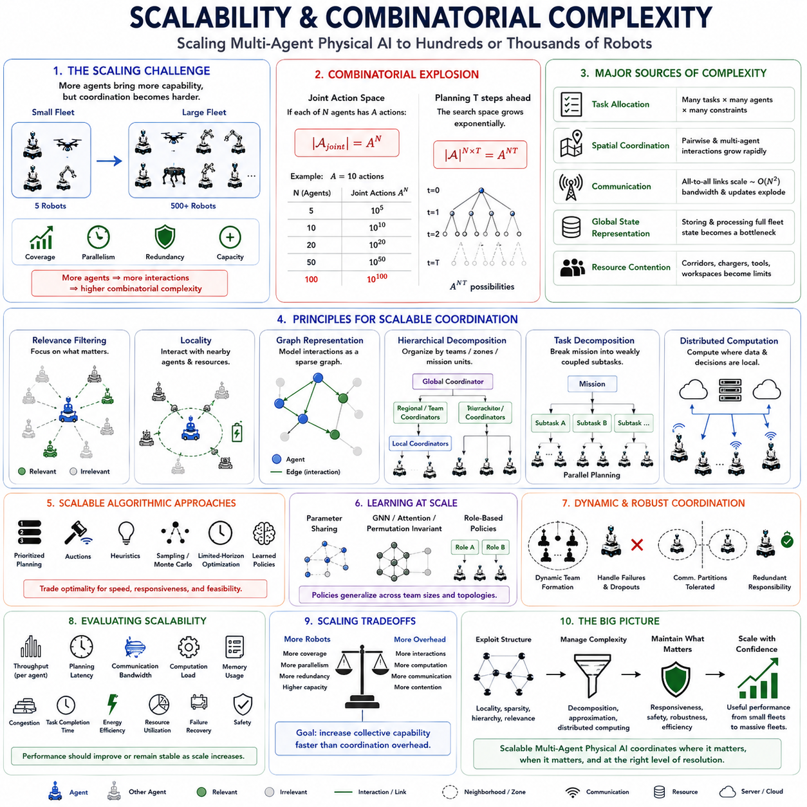{width="7.268055555555556in" height="7.268055555555556in"}

Scalability in Multi-Agent Physical AI describes the ability of a system to maintain useful performance as the number of robots, tasks, resources, interactions, and environmental variables increases. Adding agents can increase sensing coverage, parallelism, redundancy, and operational capacity, but it also enlarges the coordination problem. A system that works effectively with five robots may behave very differently when expanded to fifty, five hundred, or thousands of agents.

The fundamental difficulty comes from combinatorial complexity. If each of N agents can independently choose among A possible actions, the number of possible joint actions can grow approximately as A\^N. Planning across several future steps expands this space even further. Consequently, evaluating every possible combination of agent actions quickly becomes computationally impossible, even when the decision space of each individual robot appears relatively small.

Task allocation creates another combinatorial problem. When many tasks must be assigned among many capable agents, the planner must consider numerous possible mappings between robots and tasks. Additional constraints such as deadlines, capabilities, priorities, dependencies, battery levels, travel distances, and resource availability further enlarge the search space. Optimal assignment can therefore become increasingly expensive as both fleet size and mission complexity grow.

Spatial coordination introduces similar scaling pressure. Every robot occupies physical space, and its planned motion can potentially conflict with the motion of other robots. In dense environments, increasing the number of agents increases the number of possible pairwise and multi-agent interactions. Corridors, intersections, elevators, charging stations, loading areas, and shared workspaces can become coordination bottlenecks even when sufficient computational resources are available.

Communication complexity also grows with fleet size. If every robot continuously exchanges information with every other robot, the number of communication relationships can approach quadratic growth with the number of agents. Broadcasting complete sensor observations, trajectories, maps, and internal states therefore becomes impractical. Scalable architectures must determine which information is relevant, which agents require it, and how frequently updates should be transmitted.

Global state representation can itself become a bottleneck. A centralized system may attempt to maintain the position, task, intent, resource usage, health, and predicted behavior of every robot. As the fleet expands, this representation becomes larger and changes more frequently. Processing every update with equal importance wastes computation because many distant or unrelated agents have little influence on a particular local decision.

Relevance filtering reduces this burden by focusing computation on interactions that can materially affect a decision. Robots can prioritize information according to spatial proximity, task dependency, shared resources, communication topology, predicted trajectory conflict, or operational risk. Instead of reasoning about the complete fleet at all times, each agent or planner considers a dynamically selected subset of relevant participants and variables.

Locality is therefore a major principle for scalable coordination. Many physical interactions are naturally local because robots primarily collide with nearby agents, compete for nearby resources, and respond to conditions within limited sensing and communication ranges. Neighborhood-based coordination exploits this structure by allowing detailed reasoning among strongly interacting agents while representing distant agents through summaries or higher-level information.

Graph representations provide a natural mathematical structure for this approach. Agents can be represented as nodes, while communication links, proximity, task relationships, resource dependencies, or potential conflicts form edges. Sparse interaction graphs allow algorithms to process only meaningful relationships instead of all possible agent pairs. As agents move and missions change, edges can be dynamically added or removed to reflect current coordination requirements.

Hierarchical decomposition provides another mechanism for controlling complexity. A large fleet can be divided into teams, zones, functional groups, or mission units. Local coordinators handle detailed interactions within each group, while higher-level layers reason about aggregated state and inter-group objectives. This prevents a single planning process from continuously solving every low-level decision across the entire physical system.

Task decomposition similarly reduces the size of joint planning problems. Instead of optimizing one enormous mission involving all agents simultaneously, the mission can be separated into weakly coupled subtasks. Independent or loosely related tasks can be planned in parallel, while only strongly interacting tasks require joint reasoning. The effectiveness of decomposition depends on identifying boundaries that minimize dependencies without destroying important coordination relationships.

Distributed computation can turn fleet growth into an additional computational resource rather than only an additional burden. Each robot contributes onboard processing for perception, local planning, prediction, and control. Edge servers or regional coordinators can provide intermediate computation, while central infrastructure handles broader optimization. Computation is therefore placed near the information and decisions for which it is most relevant.

Approximation becomes increasingly important as exact optimization becomes impractical. A globally optimal solution may require excessive computation while a near-optimal solution can often be produced quickly enough for real-world operation. Prioritized planning, greedy allocation, auctions, heuristics, sampling, limited-horizon optimization, and learned policies can trade theoretical optimality for responsiveness, scalability, and operational feasibility.

Time limits fundamentally change the meaning of optimization in physical systems. A mathematically optimal plan that arrives after the decision deadline may be less useful than a good plan produced immediately. Scalable Multi-Agent Physical AI must therefore consider computation time as part of planning quality. Algorithms should provide useful intermediate solutions and improve them when additional computational time is available.

Multi-agent path finding illustrates this tradeoff clearly. Jointly optimizing collision-free paths for many robots can become extremely difficult as robot density increases. Practical systems may assign priorities, reserve spatial-temporal regions, divide maps into zones, or resolve conflicts incrementally. These methods may not always produce the theoretical shortest global solution, but they can maintain reliable traffic flow for much larger fleets.

Resource contention can produce nonlinear performance degradation. Adding robots does not necessarily increase throughput proportionally because agents may compete for the same chargers, corridors, workstations, tools, or communication channels. Beyond a certain density, additional robots can increase waiting and congestion rather than productivity. Scalability therefore requires balancing fleet size with the physical and informational capacity of shared infrastructure.

Learning systems face their own combinatorial challenges. In Multi-Agent Reinforcement Learning, the joint observation and action spaces can expand rapidly as agents are added. Policies trained for a fixed team size may also fail to generalize to larger or smaller teams. Parameter sharing, graph neural networks, attention mechanisms, role-based policies, and permutation-invariant representations can reduce dependence on a fixed number of agents.

Parameter sharing is particularly useful for homogeneous fleets. Robots performing similar functions can use a common policy while conditioning actions on their own observations, roles, identifiers, or local context. Experiences collected across many agents can update the same policy parameters. This avoids maintaining a completely separate model for every robot and allows learning capacity to scale more efficiently with fleet size.

Heterogeneous fleets require structured abstraction because agents cannot always share identical policies or action representations. AMRs, UAVs, manipulators, quadrupeds, and humanoids can instead share higher-level representations of tasks, intent, capabilities, resources, and coordination state. Planning and learning systems can reason at this common semantic level while embodiment-specific controllers handle detailed physical execution.

Dynamic team formation can further limit complexity by creating temporary groups around specific objectives. Only agents involved in cooperative transport, local exploration, traffic negotiation, or shared resource usage need detailed mutual coordination. When the interaction ends, the group can dissolve. This allows coordination structures to follow actual mission dependencies instead of maintaining permanent all-to-all relationships.

Robust scalability also requires handling failures and communication partitions. Large fleets make individual failures more likely, even if each robot is highly reliable. Coordination mechanisms should therefore tolerate missing agents, delayed messages, unavailable resources, and temporary network fragmentation. Local autonomy and redundant responsibility prevent one unavailable component from forcing expensive global replanning or stopping the entire fleet.

Evaluation of scalability should measure more than whether software can technically support a larger number of robots. Important indicators include throughput per agent, planning latency, communication bandwidth, computation load, memory usage, congestion, task completion time, energy efficiency, resource utilization, failure recovery, and safety. These metrics reveal whether performance improves, remains stable, or deteriorates as system scale increases.

Scalability ultimately depends on preventing every agent, task, and decision from interacting with everything else at full resolution. Effective architectures exploit locality, sparsity, hierarchy, decomposition, distributed computation, selective communication, approximation, and reusable policies. These mechanisms transform an otherwise explosive combinatorial problem into a collection of smaller coordination problems connected only where interaction actually matters.

For Multi-Agent Physical AI, successful scaling means increasing collective capability faster than coordination overhead. The objective is not simply to operate more robots, but to preserve responsiveness, safety, robustness, and useful efficiency as the system grows. Scalable intelligence therefore emerges from carefully limiting combinatorial coupling while retaining strong coordination at the places, times, and interactions where collective reasoning is truly necessary.

다중 에이전트 피지컬 AI(Multi-Agent Physical AI)에서 확장성(scalability)은 로봇, 작업(task), 자원(resource), 상호작용(interaction), 환경 변수(environmental variable)의 수가 증가하더라도 시스템이 유용한 성능을 유지할 수 있는 능력을 의미합니다. 에이전트를 추가하면 센싱 범위(sensing coverage), 병렬성(parallelism), 중복성(redundancy), 운용 능력(operational capacity)을 높일 수 있지만 동시에 협력 문제(coordination problem)의 규모도 증가합니다. 5대의 로봇에서 효과적으로 동작하던 시스템이 50대, 500대 또는 수천 대로 확장되면 완전히 다른 특성을 보일 수 있습니다.

근본적인 어려움은 조합적 복잡성(combinatorial complexity)에서 발생합니다. N개의 에이전트 각각이 A개의 가능한 행동 중 하나를 독립적으로 선택할 수 있다면 가능한 공동 행동(joint action)의 수는 대략 A\^N으로 증가할 수 있습니다. 여러 미래 단계까지 계획하면 이러한 공간은 더욱 크게 확장됩니다. 따라서 개별 로봇의 의사결정 공간이 비교적 작아 보이더라도 가능한 모든 에이전트 행동 조합을 평가하는 것은 빠르게 계산 불가능한 수준에 도달합니다.

작업 할당(task allocation)에서도 또 다른 조합적 문제가 발생합니다. 많은 작업을 다수의 수행 가능한 에이전트에게 할당해야 할 때 계획기(planner)는 로봇과 작업 사이의 수많은 가능한 매핑(mapping)을 고려해야 합니다. 마감시간(deadline), 역량(capability), 우선순위(priority), 의존관계(dependency), 배터리 수준, 이동 거리, 자원 가용성(resource availability)과 같은 추가 제약조건은 탐색 공간(search space)을 더욱 확대합니다. 따라서 플릿(fleet) 규모와 임무 복잡성이 증가할수록 최적 작업 할당 비용도 증가할 수 있습니다.

공간적 협력(spatial coordination)도 유사한 확장 압력을 발생시킵니다. 모든 로봇은 물리적 공간을 점유하며 계획된 움직임은 다른 로봇의 움직임과 잠재적으로 충돌할 수 있습니다. 밀집된 환경에서는 에이전트 수가 증가함에 따라 가능한 쌍별(pairwise) 및 다중 에이전트 상호작용의 수도 증가합니다. 충분한 연산 자원을 확보하더라도 복도, 교차로, 엘리베이터, 충전소, 적재 영역, 공유 작업 공간이 협력 병목(coordination bottleneck)이 될 수 있습니다.

통신 복잡성(communication complexity)도 플릿 규모와 함께 증가합니다. 모든 로봇이 다른 모든 로봇과 지속적으로 정보를 교환하면 통신 관계의 수는 에이전트 수에 대해 거의 이차적으로(quadratic) 증가할 수 있습니다. 따라서 완전한 센서 관찰, 궤적(trajectory), 지도, 내부 상태를 지속적으로 브로드캐스트(broadcast)하는 것은 비현실적입니다. 확장 가능한 아키텍처는 어떤 정보가 관련성이 있는지, 어떤 에이전트가 해당 정보를 필요로 하는지, 얼마나 자주 갱신해야 하는지를 결정해야 합니다.

전역 상태 표현(global state representation) 자체도 병목이 될 수 있습니다. 중앙집중형 시스템은 모든 로봇의 위치, 작업, 의도(intent), 자원 사용, 상태 건전성(health), 예상 행동을 유지하려고 할 수 있습니다. 플릿이 확장될수록 이러한 표현은 커지고 더욱 빈번하게 변화합니다. 멀리 떨어져 있거나 관련성이 낮은 에이전트가 특정 국소 의사결정(local decision)에 거의 영향을 주지 않는데도 모든 갱신을 동일한 중요도로 처리하면 연산 자원이 낭비됩니다.

관련성 필터링(relevance filtering)은 의사결정에 실질적인 영향을 미칠 수 있는 상호작용에 연산을 집중하여 이러한 부담을 줄입니다. 로봇은 공간적 근접성(spatial proximity), 작업 의존성(task dependency), 공유 자원(shared resource), 통신 토폴로지(communication topology), 예측된 궤적 충돌(predicted trajectory conflict), 운용 위험(operational risk)에 따라 정보의 우선순위를 결정할 수 있습니다. 모든 시점에 전체 플릿을 추론하는 대신 각 에이전트나 계획기는 동적으로 선택된 관련 참여자와 변수의 일부만 고려합니다.

따라서 국소성(locality)은 확장 가능한 협력을 위한 핵심 원리입니다. 많은 물리적 상호작용은 본질적으로 국소적입니다. 로봇은 주로 주변 에이전트와 충돌하고, 주변 자원을 놓고 경쟁하며, 제한된 센싱 및 통신 범위 안의 조건에 대응하기 때문입니다. 이웃 기반 협력(neighborhood-based coordination)은 강하게 상호작용하는 에이전트 사이에서는 상세한 추론을 수행하고, 멀리 떨어진 에이전트는 요약 정보 또는 상위 수준 정보로 표현함으로써 이러한 구조를 활용합니다.

그래프 표현(graph representation)은 이러한 접근을 위한 자연스러운 수학적 구조를 제공합니다. 에이전트를 노드(node)로 표현하고 통신 연결, 근접성, 작업 관계, 자원 의존성(resource dependency), 잠재적 충돌을 엣지(edge)로 표현할 수 있습니다. 희소 상호작용 그래프(sparse interaction graph)는 가능한 모든 에이전트 쌍을 처리하는 대신 의미 있는 관계만 처리할 수 있도록 합니다. 에이전트가 이동하고 임무가 변화하면 현재의 협력 요구조건을 반영하도록 엣지를 동적으로 추가하거나 제거할 수 있습니다.

계층적 분해(hierarchical decomposition)는 복잡성을 제어하는 또 다른 메커니즘을 제공합니다. 대규모 플릿을 팀(team), 구역(zone), 기능 그룹(functional group), 임무 단위(mission unit)로 나눌 수 있습니다. 국소 조정자(local coordinator)는 각 그룹 내부의 상세한 상호작용을 처리하고, 상위 계층은 집계된 상태(aggregated state)와 그룹 간 목표를 추론합니다. 이를 통해 하나의 계획 과정이 전체 물리 시스템의 모든 저수준 의사결정을 지속적으로 해결해야 하는 상황을 방지합니다.

작업 분해(task decomposition)도 공동 계획 문제(joint planning problem)의 크기를 줄입니다. 모든 에이전트가 참여하는 하나의 거대한 임무를 동시에 최적화하는 대신 임무를 약하게 결합된 하위 작업(weakly coupled subtask)으로 분리할 수 있습니다. 독립적이거나 느슨하게 연관된 작업은 병렬로 계획하고, 강하게 상호작용하는 작업만 공동 추론(joint reasoning)을 수행할 수 있습니다. 효과적인 분해를 위해서는 중요한 협력 관계를 손상시키지 않으면서 의존성을 최소화하는 경계를 식별해야 합니다.

분산 연산(distributed computation)은 플릿의 증가를 단순한 추가 부담이 아니라 추가적인 연산 자원으로 전환할 수 있습니다. 각 로봇은 인지(perception), 국소 계획(local planning), 예측(prediction), 제어(control)를 위한 온보드 연산(onboard processing)을 제공합니다. 엣지 서버(edge server) 또는 지역 조정자(regional coordinator)는 중간 수준의 연산을 담당하고 중앙 인프라는 보다 광범위한 최적화를 처리할 수 있습니다. 따라서 연산은 해당 정보와 의사결정에 가장 관련성이 높은 위치에 배치됩니다.

정확한 최적화(exact optimization)가 비현실적으로 변할수록 근사화(approximation)의 중요성은 증가합니다. 전역 최적해(globally optimal solution)는 과도한 연산을 요구할 수 있지만 준최적해(near-optimal solution)는 실제 운용에 충분히 빠르게 생성될 수 있습니다. 우선순위 기반 계획(prioritized planning), 탐욕적 할당(greedy allocation), 경매(auction), 휴리스틱(heuristic), 샘플링(sampling), 제한된 계획 범위 최적화(limited-horizon optimization), 학습된 정책(learned policy)은 이론적 최적성과 대응성, 확장성, 운용 실행 가능성 사이의 균형을 제공할 수 있습니다.

시간 제한(time limit)은 물리 시스템에서 최적화의 의미를 근본적으로 변화시킵니다. 의사결정 마감시간이 지난 후 도착하는 수학적 최적 계획은 즉시 생성되는 양호한 계획보다 가치가 낮을 수 있습니다. 따라서 확장 가능한 다중 에이전트 피지컬 AI는 연산 시간(computation time)을 계획 품질의 일부로 고려해야 합니다. 알고리즘은 먼저 유용한 중간 해(intermediate solution)를 제공하고 추가적인 연산 시간이 주어질 경우 이를 점진적으로 개선할 수 있어야 합니다.

다중 에이전트 경로 탐색(Multi-Agent Path Finding, MAPF)은 이러한 절충관계(tradeoff)를 명확하게 보여줍니다. 많은 로봇을 위한 충돌 없는 경로를 공동으로 최적화하는 문제는 로봇 밀도가 증가할수록 매우 어려워질 수 있습니다. 실용적인 시스템은 우선순위를 할당하거나, 시공간 영역(spatial-temporal region)을 예약하거나, 지도를 구역으로 분할하거나, 충돌을 점진적으로 해결할 수 있습니다. 이러한 방법이 항상 이론적으로 가장 짧은 전역 해를 제공하지는 않지만 훨씬 큰 플릿에서도 안정적인 교통 흐름을 유지할 수 있습니다.

자원 경합(resource contention)은 비선형적인 성능 저하(nonlinear performance degradation)를 발생시킬 수 있습니다. 에이전트들이 동일한 충전기, 복도, 작업대(workstation), 도구 또는 통신 채널을 놓고 경쟁할 수 있으므로 로봇을 추가한다고 처리량(throughput)이 비례하여 증가하는 것은 아닙니다. 특정 밀도를 넘으면 추가 로봇이 생산성을 높이기보다 대기와 혼잡을 증가시킬 수 있습니다. 따라서 확장성을 확보하려면 플릿 규모와 공유 인프라의 물리적·정보적 용량 사이의 균형이 필요합니다.

학습 시스템(learning system) 역시 자체적인 조합적 문제에 직면합니다. 다중 에이전트 강화학습(Multi-Agent Reinforcement Learning)에서는 에이전트가 추가될수록 공동 관찰 공간(joint observation space)과 공동 행동 공간(joint action space)이 빠르게 확대될 수 있습니다. 고정된 팀 규모에 대해 학습된 정책은 더 크거나 작은 팀으로 일반화하지 못할 수도 있습니다. 파라미터 공유(parameter sharing), 그래프 신경망(Graph Neural Network, GNN), 어텐션 메커니즘(attention mechanism), 역할 기반 정책(role-based policy), 순열 불변 표현(permutation-invariant representation)은 고정된 에이전트 수에 대한 의존성을 줄일 수 있습니다.

파라미터 공유는 동종 플릿(homogeneous fleet)에서 특히 유용합니다. 유사한 기능을 수행하는 로봇들은 자신의 관찰, 역할, 식별자(identifier), 국소 맥락(local context)을 조건으로 행동을 결정하면서 공통 정책(common policy)을 사용할 수 있습니다. 여러 에이전트에서 수집된 경험은 동일한 정책 파라미터를 갱신하는 데 사용될 수 있습니다. 이를 통해 모든 로봇에 완전히 별도의 모델을 유지할 필요가 없으며 플릿 규모가 증가하더라도 학습 능력을 더욱 효율적으로 확장할 수 있습니다.

이기종 플릿(heterogeneous fleet)은 에이전트가 항상 동일한 정책이나 행동 표현을 공유할 수 없으므로 구조화된 추상화(structured abstraction)를 필요로 합니다. 자율이동로봇(Autonomous Mobile Robot, AMR), 무인항공기(Unmanned Aerial Vehicle, UAV), 매니퓰레이터(manipulator), 4족 보행 로봇(quadruped), 휴머노이드(humanoid)는 작업, 의도, 역량, 자원, 협력 상태에 대한 상위 수준 표현(high-level representation)을 공유할 수 있습니다. 계획 및 학습 시스템은 이러한 공통 의미 수준(common semantic level)에서 추론하고 체화별 제어기(embodiment-specific controller)가 상세한 물리적 실행을 담당할 수 있습니다.

동적 팀 구성(dynamic team formation)은 특정 목표를 중심으로 임시 그룹을 형성하여 복잡성을 더욱 제한할 수 있습니다. 협력 운송(cooperative transport), 국소 탐색(local exploration), 교통 협상(traffic negotiation), 공유 자원 사용에 참여하는 에이전트들만 서로 상세한 협력을 수행하면 됩니다. 상호작용이 종료되면 그룹을 해체할 수 있습니다. 이를 통해 영구적인 전대전(all-to-all) 관계를 유지하는 대신 실제 임무 의존성에 따라 협력 구조가 동적으로 변화할 수 있습니다.

강건한 확장성(robust scalability)을 확보하려면 고장과 통신망 분할(communication partition)도 처리해야 합니다. 대규모 플릿에서는 각각의 로봇이 높은 신뢰성을 가지고 있더라도 개별 고장이 발생할 가능성이 증가합니다. 따라서 협력 메커니즘은 누락된 에이전트, 지연된 메시지, 사용할 수 없는 자원, 일시적인 네트워크 단절을 허용할 수 있어야 합니다. 국소 자율성(local autonomy)과 책임의 중복성(redundant responsibility)은 하나의 구성요소가 사용할 수 없게 되었을 때 전체 플릿이 정지하거나 비용이 높은 전역 재계획(global replanning)을 수행해야 하는 상황을 방지합니다.

확장성 평가는 단순히 소프트웨어가 더 많은 로봇을 기술적으로 지원할 수 있는지만 측정해서는 안 됩니다. 중요한 지표에는 에이전트당 처리량(throughput per agent), 계획 지연시간(planning latency), 통신 대역폭(communication bandwidth), 연산 부하(computation load), 메모리 사용량, 혼잡, 작업 완료 시간, 에너지 효율성, 자원 활용률(resource utilization), 고장 복구(failure recovery), 안전이 포함됩니다. 이러한 지표는 시스템 규모가 증가할 때 성능이 향상되는지, 안정적으로 유지되는지, 또는 저하되는지를 보여줍니다.

확장성은 궁극적으로 모든 에이전트, 작업, 의사결정이 다른 모든 요소와 항상 최대 해상도(full resolution)로 상호작용하지 않도록 만드는 데 달려 있습니다. 효과적인 아키텍처는 국소성, 희소성(sparsity), 계층 구조(hierarchy), 분해(decomposition), 분산 연산, 선택적 통신(selective communication), 근사화, 재사용 가능한 정책(reusable policy)을 활용합니다. 이러한 메커니즘은 폭발적으로 증가하는 조합 문제를 실제 상호작용이 필요한 부분에서만 연결되는 여러 개의 작은 협력 문제로 변환합니다.

다중 에이전트 피지컬 AI에서 성공적인 확장(successful scaling)은 협력 오버헤드(coordination overhead)보다 집단 역량(collective capability)을 더 빠르게 증가시키는 것을 의미합니다. 목표는 단순히 더 많은 로봇을 운용하는 것이 아니라 시스템이 성장하더라도 대응성(responsiveness), 안전, 강건성(robustness), 실질적인 효율성을 유지하는 것입니다. 따라서 확장 가능한 지능(scalable intelligence)은 조합적 결합(combinatorial coupling)을 신중하게 제한하면서 집단적 추론이 실제로 필요한 장소, 시간, 상호작용에서는 강력한 협력을 유지함으로써 구현됩니다.

##  

## 01.13. Minimal Multi Robot System [w/Code]

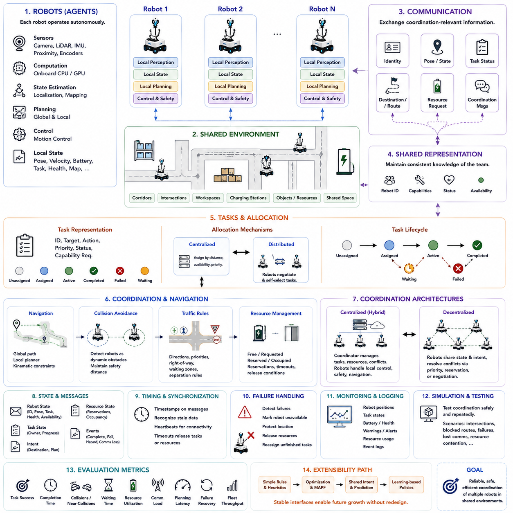{width="7.268055555555556in" height="7.268055555555556in"}

A minimal multi-robot system is the smallest practical configuration in which multiple autonomous robots operate within the same physical environment and their decisions become mutually relevant. The purpose of such a system is not simply to place several robots together, but to establish the essential mechanisms required for perception, communication, task execution, coordination, and safety while keeping the overall architecture understandable and computationally manageable.

At the most basic level, the system contains two or more physical agents, a shared environment, one or more tasks, and a mechanism for coordinating actions. Each robot possesses its own sensors, computation, state estimation, planning capability, and motion controller. The robots may be physically identical or heterogeneous, but each must be capable of observing relevant conditions and executing actions that can influence both the environment and the behavior of other agents.

The environment provides the common physical context in which coordination becomes necessary. Robots may share corridors, intersections, workspaces, charging stations, objects, or task locations. Even when their assigned tasks are independent, their movements can interact because they occupy the same space. A minimal system must therefore represent enough environmental structure to determine when independently generated actions can safely coexist and when coordination is required.

Each robot maintains a local state describing information needed for autonomous operation. This state may include pose, velocity, battery level, current task, navigation status, detected obstacles, health information, and local map data. The robot continuously updates this representation from onboard sensing and uses it to make immediate decisions. Local state allows basic operation to continue without requiring every physical control decision to depend on another agent.

Local observation provides the connection between the robot and its immediate surroundings. Cameras, LiDAR, depth sensors, proximity sensors, IMUs, encoders, or other sensing devices can provide information about obstacles, people, terrain, objects, and nearby robots. Because each agent observes the environment from a different position, the resulting observations are naturally partial and may differ even when robots operate in the same shared space.

Communication allows robots to extend local knowledge beyond direct sensing. A minimal communication interface may exchange robot identity, position, task status, destination, intended route, resource request, or simple coordination messages. The objective is not to transmit every sensor measurement but to communicate information that affects another robot's decisions. Compact semantic messages can often provide sufficient coordination with relatively low bandwidth.

A shared representation of robot identity is essential because received information must be associated with the correct physical agent. Each robot can maintain a persistent identifier together with basic capability and status information. This enables agents or a coordinator to distinguish participants, associate messages with their sources, track task ownership, and determine whether a robot remains active, unavailable, delayed, or disconnected from the system.

Task representation defines what the robots are expected to accomplish. A minimal task can contain an identifier, target location, required action, priority, status, and optional capability requirement. Tasks may be assigned centrally or selected through simple distributed rules. Even a small system benefits from explicit task states such as unassigned, assigned, active, completed, failed, or waiting because these states make coordination and recovery easier to manage.

Task allocation determines which robot should perform each available task. In the simplest implementation, a central coordinator may assign tasks according to distance, availability, or predefined priority. A distributed alternative may allow robots to compare their suitability and select responsibilities through simple negotiation. The allocation mechanism does not need to be globally optimal, but it should prevent unnecessary duplication and maintain clear responsibility for each task.

Navigation provides each robot with a physically executable route from its current position to the task location. A local planner can generate motion according to the map, detected obstacles, kinematic constraints, and target pose. However, a route that is valid for one robot may conflict with another robot's route. Multi-robot operation therefore adds coordination logic above ordinary single-robot navigation to manage shared spatial resources.

Collision avoidance is the most fundamental safety interaction between robots. Each agent should detect nearby robots as dynamic obstacles and maintain local safety constraints independently of higher-level coordination. Communication can improve prediction by sharing intended motion, but physical safety should not rely exclusively on received messages. If communication fails, onboard sensing and local control must still prevent unsafe motion whenever possible.

Simple traffic rules can greatly reduce coordination complexity. Robots may follow predefined travel directions, intersection priorities, right-of-way rules, waiting zones, or minimum separation distances. These rules constrain behavior before conflicts occur and reduce the number of situations requiring explicit negotiation. A minimal system often benefits more from clear deterministic conventions than from unnecessarily sophisticated multi-agent optimization.

Shared resources introduce another basic coordination requirement. Two robots may request the same charging station, docking location, narrow corridor, elevator, or manipulation area. A minimal reservation mechanism can represent whether a resource is free, requested, reserved, or occupied. Timeouts and release conditions prevent abandoned reservations from blocking the system indefinitely and provide a simple foundation for more advanced resource scheduling.

A centralized coordinator can simplify the first implementation of a multi-robot system. It can maintain robot status, assign tasks, manage shared resources, and resolve high-level conflicts while individual robots retain local perception, navigation, and safety control. This division provides global visibility without requiring the central component to generate every motor command, producing a practical hybrid architecture with clearly separated responsibilities.

A decentralized alternative removes the requirement for a continuously available central coordinator. Robots exchange state and intent directly, determine which interactions are relevant, and resolve conflicts through priorities, reservations, or negotiation. For a minimal system, decentralized behavior should remain simple and deterministic. Complex consensus or distributed optimization is unnecessary unless the mission specifically requires operation without centralized infrastructure.

A minimal hybrid architecture often provides the most useful baseline. Fleet-level logic can handle task assignment, mission status, and resource coordination, while each robot performs localization, perception, path planning, obstacle avoidance, trajectory tracking, and emergency response locally. This separation ensures that network latency or temporary server failure does not directly interrupt high-frequency physical control or immediate safety behavior.

System state can be represented using a small collection of structured messages. Robot state describes identity, pose, task, health, and availability. Task state describes ownership and progress. Intent describes destination or planned activity. Resource state describes reservations and occupancy. Event messages report completion, failure, hazards, or communication loss. These structures form a compact information layer from which more advanced coordination mechanisms can later evolve.

Timing is important even in a minimal system because robot information becomes outdated. State messages should contain timestamps, and coordination logic should recognize stale data. Heartbeats can indicate whether an agent remains connected, while timeouts can release tasks or resources associated with unavailable robots. These mechanisms prevent the system from indefinitely trusting information that no longer represents the physical world.

Failure handling should be designed from the beginning rather than added after normal operation works. If one robot stops, disconnects, or reports a critical fault, other robots should not continue assuming that its task or reservation remains valid. The system can mark the robot unavailable, protect its physical location, release appropriate resources, and return unfinished work to the task pool for reassignment when safe.

Monitoring provides operators with visibility into the multi-robot system. A minimal interface can display robot positions, task states, battery levels, connectivity, warnings, and resource occupancy. Logging important state transitions and coordination events makes failures reproducible and allows developers to determine whether problems originated from perception, navigation, communication, task allocation, or multi-agent interaction.

Simulation is valuable before deploying multiple physical robots because coordination failures can be reproduced safely and repeatedly. A minimal simulator should represent robot motion, shared spaces, tasks, communication, and resource conflicts at sufficient fidelity to validate coordination logic. Scenarios such as simultaneous intersection arrival, blocked routes, robot failure, lost communication, and competing resource requests provide useful baseline tests.

Evaluation should focus on whether the system achieves reliable coordinated operation rather than sophisticated algorithmic complexity. Useful measurements include task success rate, completion time, collision and near-collision events, waiting time, resource utilization, communication load, planning latency, recovery from failures, and fleet throughput. These metrics establish a baseline against which more advanced multi-agent methods can later be compared.

The architecture should remain extensible even when the initial implementation is intentionally small. Simple task assignment can later become optimization-based allocation, fixed traffic rules can evolve into multi-agent path finding, basic status exchange can become shared intent, and deterministic coordination can be augmented with learned policies. Stable interfaces allow these components to evolve without redesigning the complete robot system.

A minimal multi-robot system therefore provides a reference architecture for understanding Multi-Agent Physical AI from the bottom up. Robots sense and control themselves locally, exchange only coordination-relevant information, receive or negotiate tasks, manage shared space and resources, and preserve safety under communication or agent failures. These basic mechanisms create the smallest useful foundation from which scalable, adaptive, and intelligent multi-agent systems can be developed.

최소 다중 로봇 시스템(minimal multi-robot system)은 여러 자율 로봇(autonomous robot)이 동일한 물리적 환경에서 동작하면서 서로의 의사결정이 상호 관련성을 갖게 되는 가장 작은 실용적 구성입니다. 이러한 시스템의 목적은 단순히 여러 로봇을 함께 배치하는 것이 아니라 전체 아키텍처를 이해하기 쉽고 연산적으로 관리 가능한 수준으로 유지하면서 인지(perception), 통신(communication), 작업 실행(task execution), 협력(coordination), 안전(safety)에 필요한 핵심 메커니즘을 구축하는 것입니다.

가장 기본적인 수준에서 시스템은 두 대 이상의 물리적 에이전트(physical agent), 공유 환경(shared environment), 하나 이상의 작업(task), 그리고 행동을 협력하기 위한 메커니즘으로 구성됩니다. 각 로봇은 자체 센서, 연산 능력, 상태 추정(state estimation), 계획 능력(planning capability), 모션 제어기(motion controller)를 갖습니다. 로봇들은 물리적으로 동일하거나 이기종(heterogeneous)일 수 있지만, 각 로봇은 관련 조건을 관찰하고 환경과 다른 에이전트의 행동에 영향을 줄 수 있는 행동을 실행할 수 있어야 합니다.

환경(environment)은 협력이 필요해지는 공통의 물리적 맥락(physical context)을 제공합니다. 로봇들은 복도, 교차로, 작업 공간(workspace), 충전소(charging station), 객체 또는 작업 위치를 공유할 수 있습니다. 할당된 작업이 서로 독립적이더라도 동일한 공간을 점유하기 때문에 움직임이 서로 영향을 줄 수 있습니다. 따라서 최소 시스템은 독립적으로 생성된 행동이 언제 안전하게 공존할 수 있고 언제 협력이 필요한지를 판단할 수 있을 정도의 환경 구조를 표현해야 합니다.

각 로봇은 자율 운용에 필요한 정보를 나타내는 국소 상태(local state)를 유지합니다. 여기에는 자세(pose), 속도, 배터리 수준, 현재 작업, 내비게이션 상태(navigation status), 감지된 장애물, 상태 건전성 정보(health information), 국소 지도 데이터(local map data)가 포함될 수 있습니다. 로봇은 온보드 센싱(onboard sensing)을 통해 이러한 표현을 지속적으로 갱신하고 즉각적인 의사결정에 활용합니다. 국소 상태를 통해 모든 물리적 제어 결정을 다른 에이전트에 의존하지 않고 기본적인 운용을 지속할 수 있습니다.

국소 관찰(local observation)은 로봇과 즉각적인 주변 환경을 연결합니다. 카메라, 라이다(LiDAR), 깊이 센서(depth sensor), 근접 센서(proximity sensor), 관성측정장치(Inertial Measurement Unit, IMU), 엔코더(encoder) 또는 기타 센싱 장치는 장애물, 사람, 지형, 객체, 주변 로봇에 대한 정보를 제공할 수 있습니다. 각 에이전트는 서로 다른 위치에서 환경을 관찰하므로 동일한 공유 공간에서 동작하더라도 관찰 결과는 본질적으로 부분적이며 서로 다를 수 있습니다.

통신(communication)은 로봇이 직접적인 센싱 범위를 넘어 국소 지식(local knowledge)을 확장할 수 있도록 합니다. 최소 통신 인터페이스(minimal communication interface)는 로봇 식별자(identity), 위치, 작업 상태, 목적지, 의도된 경로(intended route), 자원 요청(resource request), 간단한 협력 메시지 등을 교환할 수 있습니다. 목적은 모든 센서 측정값을 전송하는 것이 아니라 다른 로봇의 의사결정에 영향을 주는 정보를 전달하는 것입니다. 압축된 의미론적 메시지(compact semantic message)는 비교적 낮은 대역폭으로도 충분한 협력을 제공할 수 있습니다.

수신된 정보를 올바른 물리적 에이전트와 연결해야 하므로 로봇 식별자(robot identity)에 대한 공유 표현은 필수적입니다. 각 로봇은 기본적인 역량(capability) 및 상태 정보와 함께 지속적으로 유지되는 고유 식별자(persistent identifier)를 가질 수 있습니다. 이를 통해 에이전트 또는 조정자(coordinator)는 참여자를 구분하고, 메시지의 출처를 연결하고, 작업 소유권(task ownership)을 추적하며, 로봇이 활성 상태인지, 사용할 수 없는 상태인지, 지연되었는지 또는 시스템과 연결이 끊어졌는지를 판단할 수 있습니다.

작업 표현(task representation)은 로봇이 무엇을 수행해야 하는지를 정의합니다. 최소 작업은 식별자, 목표 위치(target location), 요구 행동(required action), 우선순위(priority), 상태(status), 선택적인 역량 요구조건(capability requirement)을 포함할 수 있습니다. 작업은 중앙에서 할당하거나 간단한 분산 규칙(distributed rule)을 통해 선택할 수 있습니다. 작은 시스템에서도 미할당(unassigned), 할당됨(assigned), 활성(active), 완료(completed), 실패(failed), 대기(waiting)와 같은 명시적인 작업 상태를 사용하면 협력과 복구를 더욱 쉽게 관리할 수 있습니다.

작업 할당(task allocation)은 각각의 사용 가능한 작업을 어떤 로봇이 수행해야 하는지를 결정합니다. 가장 단순한 구현에서는 중앙 조정자(central coordinator)가 거리, 가용성(availability), 사전에 정의된 우선순위에 따라 작업을 할당할 수 있습니다. 분산형 대안에서는 로봇들이 자신의 적합성을 비교하고 간단한 협상(negotiation)을 통해 책임을 선택할 수 있습니다. 할당 메커니즘이 반드시 전역 최적(global optimum)을 달성할 필요는 없지만 불필요한 작업 중복을 방지하고 각 작업에 대한 명확한 책임을 유지해야 합니다.

내비게이션(navigation)은 각 로봇이 현재 위치에서 작업 위치까지 물리적으로 실행 가능한 경로를 제공합니다. 국소 계획기(local planner)는 지도, 감지된 장애물, 운동학적 제약조건(kinematic constraint), 목표 자세(target pose)를 기반으로 움직임을 생성할 수 있습니다. 그러나 하나의 로봇에 유효한 경로가 다른 로봇의 경로와 충돌할 수 있습니다. 따라서 다중 로봇 운용에서는 공유된 공간 자원을 관리하기 위해 일반적인 단일 로봇 내비게이션 위에 추가적인 협력 로직(coordination logic)이 필요합니다.

충돌 회피(collision avoidance)는 로봇 간의 가장 기본적인 안전 상호작용입니다. 각 에이전트는 주변 로봇을 동적 장애물(dynamic obstacle)로 감지하고 상위 수준 협력과 독립적으로 국소 안전 제약조건(local safety constraint)을 유지해야 합니다. 통신을 통해 의도된 움직임을 공유하면 예측 성능을 향상시킬 수 있지만 물리적 안전이 수신된 메시지에만 의존해서는 안 됩니다. 통신이 실패하더라도 온보드 센싱과 국소 제어(local control)를 통해 가능한 한 불안전한 움직임을 방지해야 합니다.

간단한 교통 규칙(traffic rule)은 협력 복잡성을 크게 줄일 수 있습니다. 로봇은 사전에 정의된 이동 방향, 교차로 우선순위(intersection priority), 통행 우선권(right-of-way), 대기 구역(waiting zone), 최소 이격거리(minimum separation distance)를 따를 수 있습니다. 이러한 규칙은 충돌이 발생하기 전에 행동을 제한하여 명시적인 협상이 필요한 상황의 수를 줄입니다. 최소 시스템에서는 불필요하게 복잡한 다중 에이전트 최적화보다 명확하고 결정론적인 규칙(deterministic convention)이 더 효과적일 수 있습니다.

공유 자원(shared resource)은 또 다른 기본적인 협력 요구사항을 발생시킵니다. 두 로봇이 동일한 충전소, 도킹 위치(docking location), 좁은 복도, 엘리베이터 또는 조작 영역(manipulation area)을 요청할 수 있습니다. 최소 예약 메커니즘(reservation mechanism)은 자원이 사용 가능(free), 요청됨(requested), 예약됨(reserved), 점유됨(occupied) 중 어떤 상태인지를 표현할 수 있습니다. 타임아웃(timeout)과 해제 조건(release condition)은 방치된 예약이 시스템을 무기한 차단하는 것을 방지하며 향후 고급 자원 스케줄링(resource scheduling)을 위한 간단한 기반을 제공합니다.

중앙 조정자(centralized coordinator)는 다중 로봇 시스템의 초기 구현을 단순화할 수 있습니다. 중앙 조정자는 로봇 상태를 유지하고, 작업을 할당하고, 공유 자원을 관리하며, 상위 수준의 충돌을 해결할 수 있습니다. 동시에 개별 로봇은 국소 인지, 내비게이션, 안전 제어를 유지합니다. 이러한 역할 분담은 중앙 구성요소가 모든 모터 명령을 생성할 필요 없이 전역 가시성(global visibility)을 제공하므로 책임이 명확하게 분리된 실용적인 하이브리드 아키텍처(hybrid architecture)를 구성할 수 있습니다.

분산형 대안(decentralized alternative)은 지속적으로 사용 가능한 중앙 조정자의 필요성을 제거합니다. 로봇들은 상태와 의도를 직접 교환하고, 어떤 상호작용이 관련성이 있는지를 판단하며, 우선순위, 예약 또는 협상을 통해 충돌을 해결합니다. 최소 시스템에서는 분산 행동을 단순하고 결정론적으로 유지하는 것이 중요합니다. 임무 자체가 중앙집중형 인프라 없이 운용될 것을 특별히 요구하지 않는다면 복잡한 합의(consensus) 또는 분산 최적화(distributed optimization)는 필요하지 않습니다.

최소 하이브리드 아키텍처(minimal hybrid architecture)는 일반적으로 가장 유용한 기준 구조(baseline)를 제공합니다. 플릿 수준 로직(fleet-level logic)은 작업 할당, 임무 상태(mission status), 자원 협력을 처리하고, 각 로봇은 위치추정(localization), 인지, 경로 계획(path planning), 장애물 회피, 궤적 추종(trajectory tracking), 비상 대응(emergency response)을 국소적으로 수행합니다. 이러한 분리는 네트워크 지연이나 일시적인 서버 고장이 고주파 물리 제어(high-frequency physical control) 또는 즉각적인 안전 행동을 직접 중단시키지 않도록 합니다.

시스템 상태(system state)는 소수의 구조화된 메시지(structured message)를 이용하여 표현할 수 있습니다. 로봇 상태(robot state)는 식별자, 자세, 작업, 상태 건전성, 가용성을 나타냅니다. 작업 상태(task state)는 소유권과 진행 상황을 나타냅니다. 의도(intent)는 목적지 또는 계획된 활동을 설명합니다. 자원 상태(resource state)는 예약 및 점유 여부를 나타냅니다. 이벤트 메시지(event message)는 완료, 실패, 위험 또는 통신 손실을 보고합니다. 이러한 구조는 향후 더욱 발전된 협력 메커니즘으로 확장할 수 있는 압축된 정보 계층(compact information layer)을 형성합니다.

로봇 정보는 시간이 지나면서 오래된 정보가 되므로 최소 시스템에서도 타이밍(timing)은 중요합니다. 상태 메시지에는 타임스탬프(timestamp)가 포함되어야 하며 협력 로직은 오래된 데이터(stale data)를 식별할 수 있어야 합니다. 하트비트(heartbeat)는 에이전트가 연결 상태를 유지하고 있는지를 나타내며, 타임아웃은 사용할 수 없게 된 로봇과 연결된 작업이나 자원을 해제할 수 있습니다. 이러한 메커니즘은 더 이상 물리적 세계를 정확하게 나타내지 않는 정보를 시스템이 무기한 신뢰하는 것을 방지합니다.

고장 처리(failure handling)는 정상 운용이 완성된 이후 추가하는 것이 아니라 처음부터 설계되어야 합니다. 하나의 로봇이 정지하거나 연결이 끊어지거나 심각한 고장을 보고하면 다른 로봇은 해당 로봇의 작업이나 예약이 계속 유효하다고 가정해서는 안 됩니다. 시스템은 해당 로봇을 사용 불가(unavailable) 상태로 표시하고, 로봇의 물리적 위치를 보호하며, 적절한 자원을 해제하고, 안전이 확보되면 미완료 작업을 작업 풀(task pool)로 반환하여 다시 할당할 수 있습니다.

모니터링(monitoring)은 운영자(operator)가 다중 로봇 시스템의 상태를 파악할 수 있도록 가시성(visibility)을 제공합니다. 최소 인터페이스는 로봇 위치, 작업 상태, 배터리 수준, 연결 상태(connectivity), 경고(warning), 자원 점유 상태를 표시할 수 있습니다. 중요한 상태 전이(state transition)와 협력 이벤트를 기록하면 고장을 재현할 수 있으며 개발자는 문제가 인지, 내비게이션, 통신, 작업 할당 또는 다중 에이전트 상호작용 중 어디에서 발생했는지를 판단할 수 있습니다.

여러 물리적 로봇을 실제로 배치하기 전에 시뮬레이션(simulation)을 활용하면 협력 실패(coordination failure)를 안전하고 반복적으로 재현할 수 있습니다. 최소 시뮬레이터(minimal simulator)는 협력 로직을 검증하기에 충분한 수준으로 로봇 움직임, 공유 공간, 작업, 통신, 자원 충돌을 표현해야 합니다. 교차로 동시 진입, 차단된 경로, 로봇 고장, 통신 손실, 경쟁적인 자원 요청과 같은 시나리오는 유용한 기준 시험(baseline test)을 제공합니다.

평가(evaluation)는 정교한 알고리즘의 복잡성보다 시스템이 신뢰성 있는 협력 운용(reliable coordinated operation)을 달성하는지에 초점을 맞춰야 합니다. 유용한 측정 지표에는 작업 성공률(task success rate), 완료 시간, 충돌 및 근접 충돌(near-collision) 발생, 대기 시간, 자원 활용률(resource utilization), 통신 부하(communication load), 계획 지연시간(planning latency), 고장 복구(failure recovery), 플릿 처리량(fleet throughput)이 포함됩니다. 이러한 지표는 향후 더욱 발전된 다중 에이전트 방법과 비교할 수 있는 기준선을 제공합니다.

초기 구현을 의도적으로 작게 구성하더라도 아키텍처는 확장 가능(extensible)하게 유지해야 합니다. 단순한 작업 할당은 향후 최적화 기반 할당(optimization-based allocation)으로 발전할 수 있고, 고정된 교통 규칙은 다중 에이전트 경로 탐색(Multi-Agent Path Finding, MAPF)으로 확장할 수 있으며, 기본적인 상태 교환은 공유 의도(shared intent)로 발전할 수 있습니다. 또한 결정론적 협력(deterministic coordination)에 학습된 정책(learned policy)을 추가할 수도 있습니다. 안정적인 인터페이스는 전체 로봇 시스템을 다시 설계하지 않고도 이러한 구성요소를 발전시킬 수 있도록 합니다.

따라서 최소 다중 로봇 시스템(minimal multi-robot system)은 다중 에이전트 피지컬 AI(Multi-Agent Physical AI)를 가장 기본적인 수준부터 이해하기 위한 참조 아키텍처(reference architecture)를 제공합니다. 로봇은 국소적으로 스스로 센싱하고 제어하며, 협력에 필요한 정보만 교환하고, 작업을 할당받거나 협상을 통해 선택하며, 공유 공간과 자원을 관리하고, 통신 장애나 에이전트 고장 상황에서도 안전을 유지합니다. 이러한 기본 메커니즘은 향후 확장 가능하고, 적응적이며, 지능적인 다중 에이전트 시스템으로 발전할 수 있는 가장 작은 실용적 기반을 형성합니다.
