**Volume 09. Multi Robot and Swarm Physical AI**

# Chapter 02. Swarm Intelligence

## 02.01. What is Swarm Intelligence

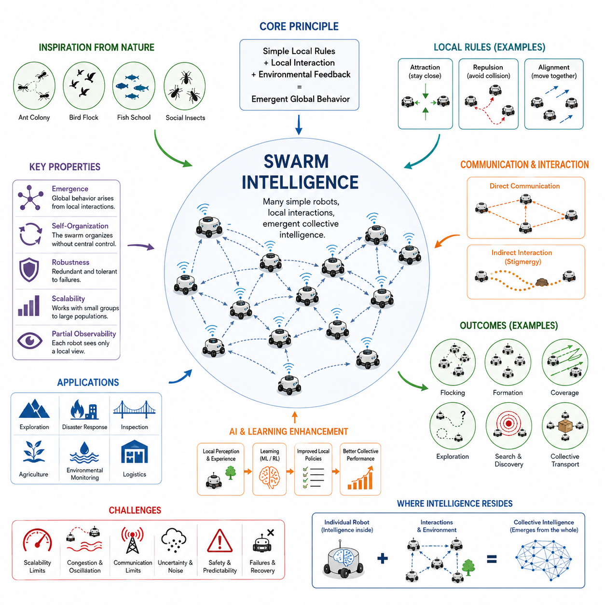{width="7.268055555555556in" height="7.268055555555556in"}

군집 지능(Swarm Intelligence)은 비교적 단순한 다수의 에이전트(agent)가 하나의 중앙 제어기(Central Controller)에 의존하지 않고, 국소적 상호작용(Local Interaction)과 환경 피드백(Environmental Feedback)을 통해 협력하면서 형성하는 집단 지능(Collective Intelligence)을 의미한다. 로보틱스(Robotics)에서는 이동 로봇, 무인항공기, 수중 로봇 등의 물리적 에이전트가 협력하여 단일 로봇의 능력을 넘어서는 집단적 기능을 만들어 낼 수 있다.

군집 지능의 핵심 개념은 단순한 국소 규칙(Local Rules)을 반복적으로 실행함으로써 유용한 전역 행동(Global Behavior)이 출현할 수 있다는 것이다. 각 로봇은 환경의 제한된 영역만 관찰하고 주변 로봇과 상호작용하며, 국소적으로 이용할 수 있는 정보를 바탕으로 행동을 선택한다. 개별 로봇이 전체 임무를 완전히 이해하지 못하더라도 집단은 공간을 조직하고, 목표를 탐색하며, 환경 변화에 공동으로 대응할 수 있다.

따라서 군집 지능은 전통적인 중앙집중형 다중 로봇 제어(Centralized Multi-Robot Control)와 차이가 있다. 중앙집중형 시스템은 일반적으로 여러 로봇으로부터 정보를 수집하고 감독 노드(Supervisory Node)에서 의사결정을 계산한 후 명령을 다시 로봇에 전달한다. 반면 군집 시스템에서는 개별 에이전트와 에이전트 사이의 상호작용에 더 많은 의사결정 권한을 부여하며, 조정(Coordination)은 중앙 계획기의 결과가 아니라 네트워크 전체에서 나타나는 출현적 특성(Emergent Property)이 된다.

이러한 원리는 생물학적 집단 시스템(Biological Collective Systems)에서 강한 영감을 받았다. 개미 군집은 둥지와 먹이 사이에서 효율적인 경로를 발견할 수 있고, 새들은 무리를 이루어 조화롭게 이동하며, 물고기 떼는 위협에 빠르게 집단적으로 대응한다. 사회성 곤충은 복잡한 구조물까지 공동으로 건설한다. 이러한 사례는 제한된 감지와 계산 능력을 가진 개체들이 전체 상황을 이해하지 않고도 적응적인 집단 행동을 만들어 낼 수 있음을 보여준다.

물리 인공지능(Physical AI)의 관점에서 군집 지능은 지능의 범위를 하나의 체화된 에이전트(Embodied Agent)에서 분산된 물리적 집단으로 확장한다. 각각의 로봇은 서로 다른 위치에서 세계를 감지하고, 공유된 환경을 물리적으로 변화시키는 행동에 참여한다. 따라서 지능은 정보 처리뿐만 아니라 집단 이동, 공간적 조직화, 물리적 상호작용, 그리고 넓은 작업 영역에서 변화하는 조건에 대한 공동 대응을 통해서도 표현된다.

유용한 추상화 방법은 각 로봇이 반복적인 인지-상호작용-행동(Perception-Interaction-Action) 순환을 수행한다고 보는 것이다. 로봇은 주변 에이전트와 환경 조건을 관찰하고, 국소 행동 규칙 또는 학습된 정책(Learned Policy)을 적용하여 행동한 다음 그 결과를 다시 관찰한다. 한 로봇의 행동이 다른 로봇이 관찰하는 상태를 변화시키므로 다수의 결합된 국소 피드백 루프(Local Feedback Loops)가 형성되며, 이들의 반복적 상호작용이 군집 수준의 안정적인 집단 패턴을 생성할 수 있다.

여러 기본 메커니즘이 군집 시스템에서 반복적으로 나타난다. 인력(Attraction)은 로봇들이 일정한 거리를 유지하며 집단의 응집성(Cohesion)을 보존하도록 하고, 반발력(Repulsion)은 충돌과 과도한 밀집을 방지한다. 정렬(Alignment)은 인접한 로봇들의 이동 방향을 일치시키며, 환경 반응(Environmental Response)은 장애물을 회피하거나 목표를 향하도록 집단을 유도한다. 여기에 신호 전달, 투표, 모집, 국소 정보 교환 등을 결합하면 완전한 전역 통신 없이도 집단적 의사결정을 수행할 수 있다.

따라서 출현(Emergence)은 군집 지능을 정의하는 핵심 특성 중 하나이다. 설계자는 전체 집단의 최종 형상이나 이동 경로를 직접 프로그래밍하는 대신, 개별 로봇이 주변 로봇, 장애물, 신호 또는 탐지된 목표에 어떻게 반응하는지를 정의할 수 있다. 이러한 상호작용을 통해 군집 이동(Flocking), 군집화(Clustering), 분산(Dispersion), 집단 운송(Collective Transport), 영역 커버리지(Coverage), 협력 탐색(Coordinated Exploration) 등의 행동이 출현할 수 있다.

자기 조직화(Self-Organization)는 출현과 밀접하게 관련되어 있지만, 지속적인 외부 제어 없이 군집이 유용한 조직 구조를 형성하고 유지하는 능력을 강조한다. 환경이 변화하면 로봇들이 스스로 재배치될 수 있고, 일부 구성원이 손실되면 다시 조직될 수 있으며, 새롭게 발견된 작업을 중심으로 임시 집단을 구성할 수도 있다. 따라서 집단의 조직 구조는 고정된 것이 아니라 실제 운용 과정에서 마주치는 물리적 상황에 따라 동적으로 적응한다.

군집 지능은 강건성(Robustness)을 확보하는 자연스러운 방법도 제공한다. 책임이 다수의 에이전트에 분산되어 있다면 하나의 로봇이 고장 나더라도 전체 시스템이 반드시 실패하는 것은 아니다. 남아 있는 로봇들은 임무를 계속 수행하거나, 담당 영역을 재분배하거나, 손실된 구성원의 역할을 보완할 수 있다. 이러한 중복성(Redundancy)은 탐사, 재난 대응, 검사, 농업, 환경 모니터링 등 개별 로봇이 통신 두절이나 손상으로 사용할 수 없게 될 가능성이 있는 분야에서 특히 중요하다.

확장성(Scalability) 역시 군집 지능을 사용하는 중요한 이유이다. 로봇의 수가 증가하면 통신 트래픽, 전역 상태 추정(Global State Estimation), 작업 할당(Task Allocation), 공동 계획(Joint Planning) 등이 중앙집중형 시스템의 계산 병목이 될 수 있다. 국소적 군집 상호작용은 전역적으로 동기화된 정보에 대한 의존성을 줄일 수 있으며, 각 로봇이 주로 주변 정보를 처리하도록 구성하면 로봇 수가 증가하더라도 계산과 통신 부담을 보다 효율적으로 관리할 수 있다.

그러나 분산화(Decentralization)가 자동으로 확장성이나 효과적인 행동을 보장하는 것은 아니다. 국소 규칙은 혼잡(Congestion), 진동(Oscillation), 집단 분리(Fragmentation), 과도한 통신 또는 불안정한 집단 패턴을 만들어 낼 수 있다. 20대의 로봇에서 잘 작동하는 군집이 수백 대에서는 다르게 행동할 수 있다. 로봇 밀도, 감지 범위, 통신 토폴로지(Communication Topology), 환경의 기하학적 구조, 로봇 동역학 등이 집단 행동에 영향을 주기 때문에 군집 수준의 검증이 중요한 공학적 문제가 된다.

군집 지능에서 통신(Communication)은 명시적인 디지털 메시지 교환부터 환경을 이용한 간접적 상호작용까지 다양한 형태를 가질 수 있다. 로봇들은 위치, 속도, 신뢰도, 작업 상태 또는 간결한 행동 신호를 주변 로봇과 교환할 수 있다. 다른 시스템에서는 사회성 곤충의 흔적 기반 상호작용과 유사한 간접 협력 방식인 스티그머지(Stigmergy)를 사용할 수 있다. 따라서 통신은 한 에이전트의 행동이 다른 에이전트가 이용할 수 있는 정보에 영향을 미치는 모든 메커니즘으로 폭넓게 이해할 수 있다.

부분 관측성(Partial Observability)은 많은 군집 시스템에 본질적으로 존재한다. 개별 로봇은 일반적으로 자신의 주변 영역만 관찰하기 때문에 전체 군집의 정확한 전역 구성을 알 수 없다. 따라서 의사결정은 불확실성과 불완전한 정보를 수용해야 한다. 완벽한 공유 세계 상태(Shared World State)를 요구하기보다는 반복적인 국소 관측과 분산 상호작용을 활용하여, 개별적으로는 제한적이지만 집단적으로 충분한 정보로부터 전역적 조직화를 만들어 내는 방식이 중요하다.

군집 지능은 모든 다중 로봇 시스템(Multi-Robot System)을 의미하는 것은 아니다. 중앙 스케줄러(Central Scheduler)가 제어하는 플릿(Fleet)은 수백 대의 로봇을 포함하더라도 군집 지능을 나타내지 않을 수 있다. 반대로 훨씬 적은 수의 로봇으로 구성된 집단이라도 분산된 국소 상호작용을 중심으로 조정 행동이 출현한다면 군집 특성을 나타낼 수 있다. 따라서 중요한 차이는 단순한 로봇의 숫자가 아니라 정보, 의사결정 권한, 조정, 적응 능력이 집단 전체에 어떻게 분산되어 있는가에 있다.

현대의 군집 로보틱스(Swarm Robotics)는 고전적인 행동 규칙과 인공지능(Artificial Intelligence) 및 학습(Learning)을 점차 결합하고 있다. 강화학습(Reinforcement Learning), 모방학습(Imitation Learning), 그래프 기반 모델(Graph-Based Models), 분산 정책 최적화(Distributed Policy Optimization)는 수작업으로 설계하기 어려운 로봇 간 상호작용 전략을 학습하는 데 활용될 수 있다. 군집 수준에서는 커버리지, 효율성, 회복탄력성, 안전성, 임무 성공률 등을 평가하여 개별 로봇의 적응과 집단 성능을 연결할 수 있다.

이러한 결합은 다중 로봇 물리 인공지능(Multi-Robot Physical AI)의 중요한 발전 방향을 형성한다. 미래의 군집 시스템은 단순히 고정된 군집 이동이나 분산 규칙을 실행하는 것을 넘어, 익숙하지 않은 지형, 변화하는 통신 환경, 이질적인 로봇 능력, 불확실한 임무 목표 아래에서 협력하는 방법을 학습할 수 있다. 로봇들은 경험을 통해 상호작용 정책을 적응시키면서도 분산 실행(Decentralized Execution)을 유지함으로써 중앙 지능 서비스에 모든 의사결정을 의존하지 않는 유연한 집단 시스템을 구성할 수 있다.

동시에 지능형 군집(Intelligent Swarm)은 예측 가능성(Predictability)과 안전성(Safety)에 관한 어려운 문제를 발생시킨다. 국소 정책의 작은 변화가 전역 행동에 큰 변화를 일으킬 수 있으며, 개별적으로 안전한 행동이 집단 수준에서는 혼잡이나 협력적 교착 상태(Coordinated Deadlock)와 같은 위험한 결과를 만들 수도 있다. 따라서 군집 설계에서는 에이전트 수준뿐만 아니라 집단 수준의 동역학을 함께 평가해야 하며, 안정성, 충돌 회피, 통신 성능 저하, 장애 복구, 바람직하지 않은 출현(Undesired Emergence) 등을 고려해야 한다.

궁극적으로 군집 지능의 개념은 지능이 어디에 존재하는가에 대한 관점을 변화시킨다. 전통적인 로봇에서는 지능이 주로 하나의 기계 내부에 존재하는 인지(Perception), 추론(Reasoning), 계획(Planning), 제어(Control) 과정과 연결된다. 반면 군집에서는 지능의 일부가 기계와 기계 사이의 관계에 존재한다. 개별 에이전트, 국소 규칙, 통신 연결, 환경과의 상호작용, 집단 피드백이 결합되어 하나의 분산 계산 및 물리 시스템(Distributed Computational and Physical System)을 형성한다.

이러한 차이를 이해하는 것은 다중 로봇 물리 인공지능에서 군집 지능을 체계적으로 학습하기 위한 기반이 된다. 생물학적 영감(Biological Inspiration)은 핵심 원리의 기원을 설명하고, 국소 규칙(Local Rules)은 분산 행동이 어떻게 생성되는지를 보여준다. 자기 조직화와 합의(Consensus)는 집단 조정의 원리를 설명하며, 군집 이동, 대형 제어(Formation Control), 커버리지, 탐색은 대표적인 실용 행동을 보여준다. 강건성, 확장성, 학습, 시뮬레이션(Simulation)은 이러한 원리가 실제 배치 가능한 로봇 시스템으로 발전할 수 있는지를 결정한다.

## 02.02. Biological Inspiration for Robot Swarms

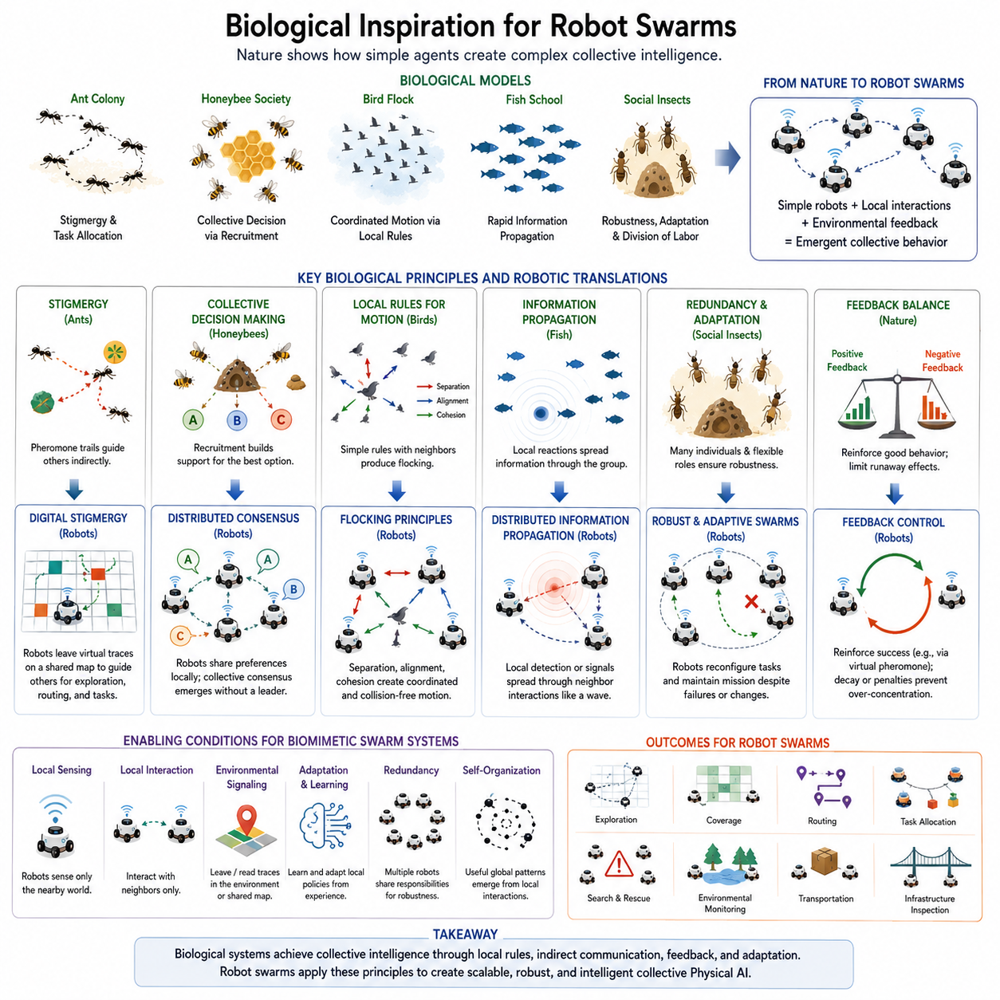{width="7.268055555555556in" height="7.268055555555556in"}

생물학적 시스템(Biological Systems)은 비교적 단순한 다수의 개체가 어떻게 조정되고 적응적인 행동을 만들어 낼 수 있는지를 보여주는 가장 명확한 사례 중 하나이다. 개미 군집(Ant Colony), 벌 사회(Bee Society), 새 떼(Bird Flock), 물고기 떼(Fish School) 등의 집단 생물은 정교한 집단 수준의 능력이 반드시 중앙집중형 제어(Centralized Control)를 필요로 하지 않는다는 것을 보여준다. 로봇 군집(Robot Swarm)은 이러한 원리를 활용하여 분산형 물리 인공지능(Distributed Physical AI) 시스템을 구현한다.

군집 로보틱스(Swarm Robotics)의 생물학적 영감(Biological Inspiration)은 동물의 행동을 그대로 재현하는 것을 의미하지 않는다. 대신 연구자들은 생물학적 집단 행동 속에 존재하는 계산적 원리(Computational Principles)를 찾아내고 이를 로봇에 적합한 알고리즘으로 변환한다. 국소 감지(Local Sensing), 이웃 상호작용(Neighbor Interaction), 환경 신호(Environmental Signaling), 행동 적응(Behavioral Adaptation), 중복성(Redundancy), 자기 조직화(Self-Organization) 등이 다수의 자율 기계를 조정하는 공학적 메커니즘으로 활용된다.

개미 군집(Ant Colony)은 군집 지능(Swarm Intelligence)에 가장 큰 영향을 준 생물학적 모델 중 하나이다. 개별 개미는 제한된 감지 및 의사결정 능력을 가지고 있지만, 군집 전체는 먹이를 발견하고, 둥지를 건설하고, 작업을 할당하고, 영역을 방어하며, 환경 변화에 적응할 수 있다. 이러한 집단 능력은 개체 간 반복적인 상호작용과 주변 환경에 간접적으로 저장되고 전달되는 정보로부터 출현한다.

개미에게서 관찰되는 특히 중요한 메커니즘은 스티그머지(Stigmergy)이다. 이는 개체가 환경을 변화시킴으로써 다른 개체와 간접적으로 협력하는 방식이다. 개미는 이동한 경로에 화학적 페로몬(Pheromone)을 남기고, 이후 해당 신호를 접하는 다른 개미의 이동에 영향을 준다. 자주 성공하는 경로에는 강한 신호가 축적되고 사용되지 않는 경로의 신호는 페로몬 증발을 통해 점차 약해지면서 효율적인 경로를 발견하는 분산 메커니즘이 형성된다.

로봇 시스템은 스티그머지를 디지털 또는 물리적 표현으로 변환할 수 있다. 화학적 페로몬 대신 로봇은 공유 지도(Shared Map)에 가상 표식(Virtual Marker)을 유지하거나, 방문한 영역을 기록하고, 특정 위치에 값을 부여하거나, 국소적으로 지속되는 정보를 전송할 수 있다. 다른 로봇들은 이러한 흔적을 이용하여 경로나 작업을 선택할 수 있으며, 중앙 제어기가 모든 행동을 지정하지 않아도 분산 탐색, 커버리지(Coverage), 경로 선택, 작업 할당(Task Allocation)을 수행할 수 있다.

사회성 곤충(Social Insects)은 분산 작업 할당(Distributed Task Allocation)의 원리도 보여준다. 군집에는 탐색, 자원 운송, 둥지 유지, 위협 대응과 같은 다양한 활동이 존재한다. 개체는 국소적 환경 조건, 관찰된 신호, 작업량 또는 군집의 요구에 따라 행동을 변경할 수 있다. 로봇 군집에서도 이와 유사하게 사전에 결정된 전역 할당(Global Assignment)에 전적으로 의존하지 않고 로봇이 국소적으로 관찰한 수요에 따라 작업을 선택하거나 변경하도록 설계할 수 있다.

꿀벌(Honeybee)은 집단적 의사결정(Collective Decision-Making)의 또 다른 중요한 생물학적 모델을 제공한다. 벌 군집이 새로운 둥지 위치를 탐색할 때 서로 다른 정찰벌(Scout)이 여러 후보지를 발견하고 자신의 선호도를 다른 구성원에게 전달할 수 있다. 반복적인 모집(Recruitment)과 상호작용을 통해 유망한 후보에 대한 지지가 증가하고 결국 군집 전체가 하나의 결정을 형성한다. 이는 하나의 개체가 모든 정보를 소유하지 않아도 분산된 집단이 여러 대안을 평가할 수 있음을 보여준다.

로봇 군집에서는 이와 유사한 메커니즘을 합의(Consensus)와 집단 선택(Collective Choice)에 활용할 수 있다. 개별 로봇은 후보 목표, 경로, 영역 또는 행동을 독립적으로 평가하고 주변 로봇에게 간결한 선호 신호(Preference Signal)를 전달할 수 있다. 반복적인 상호작용을 통해 증거가 집단 전체로 전파되고, 공간적으로 분산된 여러 로봇의 관측 결과를 통합하면서 단일 의사결정 노드에 대한 의존성을 줄일 수 있다.

새 떼의 군집 이동(Bird Flocking)은 조정된 집단 운동(Coordinated Collective Motion)의 생물학적 모델을 제공한다. 새들은 개별적으로 주로 주변의 이웃에게 반응하면서도 충돌을 피하고 빠르게 방향을 변경하며 하나의 응집된 집단으로 이동할 수 있다. 이러한 행동은 중앙에서 지정된 궤적이 아니라 분리(Separation), 정렬(Alignment), 응집(Cohesion)과 같은 단순한 상호작용 원리의 결합으로 전역적 이동 패턴을 만들어 내는 계산적 군집 모델에 영감을 주었다.

분리(Separation)는 에이전트가 주변 이웃과 충분한 거리를 유지하도록 하여 충돌을 방지한다. 정렬(Alignment)은 주변 에이전트와 유사한 방향으로 이동하도록 유도하여 조정된 흐름을 만든다. 응집(Cohesion)은 개체가 국소 집단에서 벗어나지 않고 연결 상태를 유지하도록 한다. 이러한 규칙이 다수의 에이전트에서 동시에 작동하면 각 구성원이 독립적으로 수행하는 분산 의사결정으로부터 일관된 집단 운동이 출현할 수 있다.

로봇 군집은 이러한 군집 이동 원리를 조정된 내비게이션(Coordinated Navigation), 분산 탐색(Distributed Exploration), 호송 형태의 이동(Convoy-Like Movement), 대규모 공간 조직화(Spatial Organization)에 활용할 수 있다. 각 로봇은 주변 로봇의 상대적 위치 또는 속도를 추정하여 자신의 움직임을 조정한다. 협력이 주로 이웃 정보에 의존하므로 구성원이 추가되거나 이탈하거나 고장 나거나 장애물을 만나더라도 전체 집단을 완전히 재계획하지 않고 군집을 재조직할 수 있다.

물고기 떼(Fish Schooling)는 이와 관련된 원리를 보여주면서 특히 외부 교란에 대한 빠른 집단 반응을 강조한다. 포식자나 장애물이 발견되면 물고기의 방향 변화가 집단 전체로 빠르게 전파될 수 있다. 개별 물고기는 소수의 주변 개체에만 반응하지만 위험에 관한 정보는 반복적인 상호작용을 통해 전달된다. 이는 로봇 군집에서도 명시적인 전역 메시지에만 의존하지 않고 국소적인 행동 반응을 통해 환경 정보를 전파할 수 있음을 시사한다.

이러한 전파 방식은 로봇이 위험 요소, 차단된 통로, 불안정한 지형 또는 새롭게 발견된 목표를 만났을 때 유용하다. 중요한 사건을 감지한 로봇이 자신의 움직임을 변경하거나 국소 신호(Local Signal)를 전달하면 주변 로봇이 이에 반응하고 다시 다른 로봇에 영향을 줄 수 있다. 따라서 정보는 분산된 행동 적응의 파동처럼 군집 전체로 이동할 수 있으며, 제한된 통신 조건에서도 집단적 대응을 가능하게 한다.

생물학적 집단은 중복성(Redundancy)을 통한 강건성(Robustness)도 보여준다. 군집이나 무리에는 일반적으로 기능이 중복되는 다수의 개체가 존재하기 때문에 하나의 구성원이 손실되어도 전체 운용에 미치는 영향은 제한적이다. 로봇 군집은 이러한 원리를 적용하여 감지, 탐색, 운송, 모니터링 등의 책임을 여러 기계에 분산함으로써 개별 로봇의 고장이 전체 임무의 즉각적인 실패로 이어지지 않도록 할 수 있다.

그러나 중복성만으로 생물학적 회복탄력성(Resilience)을 모두 설명할 수 있는 것은 아니다. 자원의 위치가 변하거나 위협이 발생하거나 일부 개체가 사라지면 집단의 상호작용 패턴 자체가 변화하면서 새로운 집단 행동이 형성된다. 이러한 적응적 재조직화(Adaptive Reorganization)는 역할, 공간적 분포, 통신 관계, 작업 할당을 임무 시작 시점에 고정하지 않고 실제 운용 과정에서 변화시킬 수 있는 로봇 군집 아키텍처(Swarm Architecture)의 중요한 설계 원리가 된다.

또 다른 생물학적 원리는 양의 피드백(Positive Feedback)과 음의 피드백(Negative Feedback)을 함께 사용하는 것이다. 양의 피드백은 가치 있는 먹이 공급원으로 더 많은 개체를 모집하는 것처럼 성공적인 행동을 강화한다. 반면 음의 피드백은 자원 고갈, 신호 감소, 혼잡 또는 경쟁을 통해 과도한 증폭을 제한한다. 두 피드백 과정의 상호작용은 유용한 패턴을 강화하면서 특정 행동이 무제한으로 지배하는 것을 방지한다.

공학적 군집 시스템에서도 이와 유사한 피드백 구조를 사용할 수 있다. 성공적인 경로에는 더 높은 가상 페로몬(Virtual Pheromone) 값을 부여하고, 생산적인 영역으로 추가 로봇을 유도하며, 반복적으로 성공한 행동의 선택 확률을 높일 수 있다. 동시에 신호 감쇠(Signal Decay), 혼잡 페널티(Congestion Penalty), 거리 비용(Distance Cost), 자원 제한 등을 이용해 과도한 집중을 줄일 수 있다. 균형 잡힌 피드백은 집단 행동의 반응성을 유지하면서 불안정한 강화를 방지한다.

생물학적 시스템은 부분 관측성(Partial Observability)에서도 유용한 집단 지능이 출현할 수 있음을 보여준다. 개미는 군집 주변의 완전한 지도를 유지하지 않으며 새 역시 무리의 모든 구성원을 지속적으로 추적하지 않는다. 개체들은 제한된 국소 관측을 이용하여 행동하며, 집단은 반복적인 상호작용, 분산 감지(Distributed Sensing), 행동 피드백을 통해 이러한 한계를 보완함으로써 다수의 불완전한 관점을 효과적인 집단 반응으로 전환한다.

이 원리는 다중 로봇 물리 인공지능(Multi-Robot Physical AI)에 특히 중요하다. 물리적 로봇은 본질적으로 제한된 센싱 범위, 가림(Occlusion), 통신 손실, 불확실한 측정값에 직면한다. 모든 로봇이 동일한 전역 세계 상태(Global World State)를 유지하도록 요구하기보다는 국소 관측과 이웃 관계를 활용할 수 있다. 이를 통해 불완전하고 공간적으로 분산된 정보 속에서도 효과적으로 작동하는 방법으로 집단 행동을 사용할 수 있다.

그러나 생물학적 영감은 엄격하게 복제해야 하는 설계 청사진(Blueprint)이 아니라 새로운 설계를 위한 원천으로 이해해야 한다. 로봇은 센싱 방식, 통신 대역폭, 계산 능력, 에너지 시스템, 기계적 제약, 임무 목표에서 동물과 근본적으로 다르다. 따라서 곤충 군집에서 효과적인 메커니즘을 단순히 소프트웨어에 복사할 수는 없으며, 그 기반 원리를 추상화하고 수학적으로 표현한 후 로봇 하드웨어와 운용 환경에 맞게 검증하고 조정해야 한다.

현대의 군집 로보틱스는 이러한 생물학적 메커니즘을 기계학습(Machine Learning)과 점차 결합하고 있다. 모든 인력 강도, 통신 반응 또는 작업 선택 규칙을 사람이 직접 정의하는 대신 학습 알고리즘을 이용하여 경험으로부터 국소 정책(Local Policy)을 최적화할 수 있다. 강화학습(Reinforcement Learning)과 다양한 적응형 방법은 상호작용 전략을 학습할 수 있으며, 생물학적 원리는 국소성(Locality), 분산화(Decentralization), 피드백, 집단 조직화에 대한 유용한 구조적 기반을 제공한다.

이러한 관점은 생물학적 집단 지능(Biological Collective Intelligence)과 발전된 물리 인공지능을 연결한다. 자연은 국소 감지, 단순한 상호작용, 분산 피드백, 중복성, 적응을 통해 확장 가능한 조정(Scalable Coordination)이 출현할 수 있음을 보여준다. 인공지능은 데이터와 경험을 통해 이러한 메커니즘을 학습하고 개선하는 능력을 추가하며, 로보틱스는 이를 물리적으로 체화한다. 이들이 결합되면 복잡한 현실 환경에서 작동할 수 있는 자율적 집단 시스템의 기반이 형성된다.

따라서 생물학적 영감은 단순히 로봇이 새나 곤충처럼 움직이는 시각적 유사성을 제공하는 것 이상의 의미를 가진다. 개미는 스티그머지와 분산 작업 할당을 보여주고, 벌은 집단 선택을 보여주며, 새는 일관된 집단 운동을 만드는 국소 규칙을 보여주고, 물고기는 행동 반응의 빠른 전파를 보여준다. 이러한 원리는 로봇 군집에서 국소 규칙, 자기 조직화, 합의, 군집 이동, 대형 제어(Formation Control), 탐색, 강건성, 학습을 연구하기 위한 개념적 기반을 제공한다.

## 02.03. Local Rules and Global Behavior

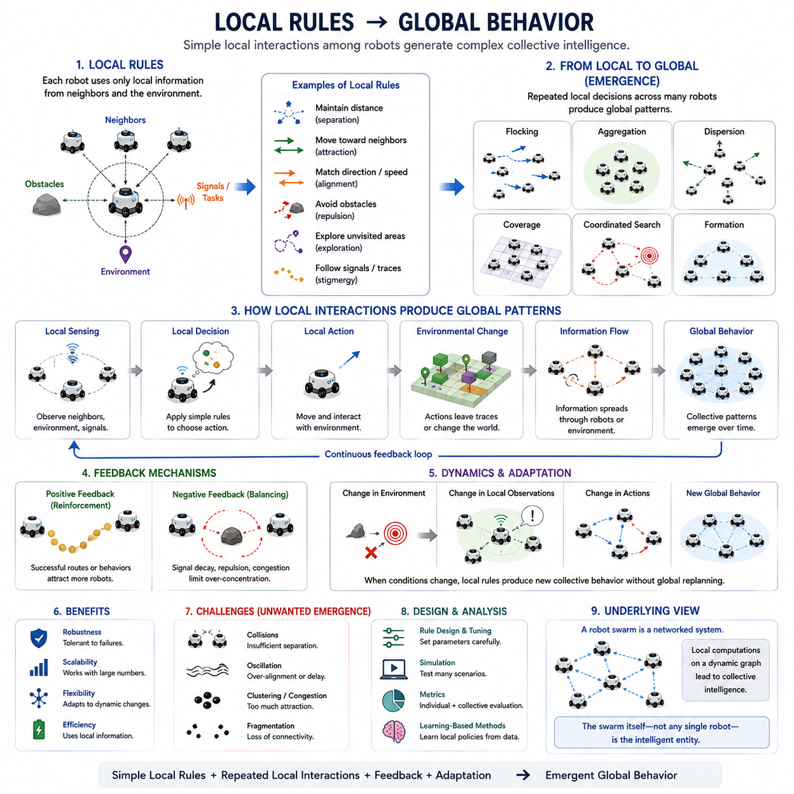{width="7.268055555555556in" height="7.268055555555556in"}

국소 규칙(Local Rules)은 각 로봇이 주변 에이전트, 감지된 장애물, 환경적 특징, 그리고 국소적으로 이용 가능한 정보에 어떻게 반응할지를 결정하는 행동 지침이다. 군집 지능(Swarm Intelligence)에서 이러한 규칙은 의도적으로 제한된 범위에서 작동하도록 설계된다. 로봇은 군집 전체의 완전한 상태를 계산할 필요가 없으며, 다수의 로봇이 반복적으로 수행하는 국소적 의사결정이 결합되어 전역 행동(Global Behavior)을 만들어 낸다.

국소 규칙과 전역 행동의 관계는 군집 로보틱스(Swarm Robotics)의 핵심 원리이다. 원하는 집단 패턴이 일반적으로 중앙에서 직접 명령되지 않기 때문이다. 설계자는 로봇이 일정한 거리를 유지하고, 주변 로봇을 따라가며, 방문하지 않은 영역을 탐색하거나 신호에 반응하는 방법을 정의할 수 있다. 이러한 규칙이 전체 집단에서 동시에 실행되면 군집 이동(Flocking), 분산(Dispersion), 집합(Aggregation), 커버리지(Coverage), 협력 탐색(Coordinated Search)과 같은 패턴이 출현할 수 있다.

이는 상향식 제어(Bottom-Up Control)의 형태를 만든다. 기존의 하향식 제어(Top-Down Control)는 전역 목표에서 시작하여 중앙집중형 계획(Centralized Planning)이나 최적화를 통해 개별 로봇의 행동을 계산한다. 반면 상향식 군집 제어는 개별적인 상호작용 메커니즘에서 시작하여 반복적인 실행을 통해 집단 조직이 출현하도록 한다. 따라서 전역 행동은 다수의 결합된 국소 피드백 과정(Local Feedback Processes)이 만들어 내는 시스템 수준의 결과가 된다.

국소 규칙은 일반적으로 로봇이 완전한 전역 상태(Global State)를 유지하지 않고도 획득할 수 있는 정보에 의존한다. 이러한 정보에는 주변 로봇의 상대 위치, 국소 장애물까지의 거리, 탐지된 목표, 통신 신호, 작업 수요 또는 공유 환경에 저장된 가상 표식(Virtual Markers) 등이 포함될 수 있다. 의사결정을 이러한 정보로 제한하면 중앙 조정기(Centralized Coordinator)와 지속적으로 통신해야 하는 의존성을 줄일 수 있다.

따라서 이웃 관계의 정의(Neighborhood Definition)가 중요하다. 로봇은 센싱 또는 통신 반경 내부의 모든 에이전트, 일정한 수의 가장 가까운 이웃, 또는 통신 그래프(Communication Graph)를 통해 연결된 에이전트와 상호작용할 수 있다. 개별 규칙이 유사하더라도 이웃 구조가 달라지면 상당히 다른 전역 행동이 발생할 수 있다. 따라서 국소 연결성(Local Connectivity) 자체가 집단 지능을 형성하는 메커니즘의 일부가 된다.

인력(Attraction)과 반발력(Repulsion)은 이러한 관계를 설명하는 간단한 사례이다. 인력은 로봇이 주변 구성원이나 관련 목표를 향해 이동하도록 하고, 반발력은 충돌과 과도한 밀집을 방지한다. 인력이 지나치게 강하면 로봇들이 밀집된 군집으로 뭉칠 수 있고, 반발력이 지나치게 강하면 집단이 과도하게 분산될 수 있다. 두 상호작용이 균형을 이루면 집단의 연결성을 유지하면서 유용한 간격을 확보할 수 있다.

정렬(Alignment)은 주변 에이전트에 따라 로봇이 자신의 이동 방향이나 속도를 조정하도록 하는 또 다른 국소 메커니즘이다. 인력 및 반발력과 정렬을 결합하면 일관된 군집 이동 행동을 만들어 낼 수 있다. 어떤 로봇도 전체 집단의 이동 궤적을 알 필요가 없다. 각각의 로봇이 자신의 이웃에게 반복적으로 반응하고, 이러한 상호작용이 누적되면서 집단 수준의 조정된 움직임이 만들어진다.

동일한 원리는 집합(Aggregation) 행동도 만들어 낼 수 있다. 로봇은 주변 로봇을 발견할 때까지 무작위로 이동하고, 다른 로봇이 많은 영역에서는 해당 영역을 떠날 확률을 낮출 수 있다. 이러한 단순한 행동이 군집 전체에서 반복되면 처음에는 흩어져 있던 로봇들이 군집을 형성할 수 있다. 반대로 로봇이 부족한 영역으로 이동하도록 유도하는 규칙은 분산과 커버리지를 만들어 내며, 국소 반응의 작은 변화가 전역 조직을 변화시킬 수 있음을 보여준다.

환경 정보(Environmental Information) 역시 국소 규칙에 포함될 수 있다. 로봇은 아직 탐색되지 않은 영역에 대한 선호도를 높이고, 위험하다고 표시된 위치를 회피하거나, 성공적인 경로와 연결된 가상 페로몬(Virtual Pheromone) 값을 따라갈 수 있다. 이후 다른 로봇이 이러한 환경적 흔적을 발견하고 자신의 행동을 변경한다. 이 경우 환경은 국소 행동이 미래의 집단 의사결정에 영향을 미치는 분산형 조정 매체(Distributed Coordination Medium)로 기능한다.

이러한 메커니즘은 스티그머지(Stigmergy)와 밀접하게 관련되어 있다. 로봇이 모든 관측 정보를 다른 로봇에게 직접 전송하는 대신 공유된 환경 표현(Shared Environmental Representation)에 정보를 남기고, 다른 에이전트가 해당 정보를 발견했을 때 이에 반응한다. 따라서 국소 상호작용은 공간과 시간을 넘어 간접적으로 이루어질 수 있으며, 지속적인 로봇 간 통신 없이도 경로 강화, 분산 탐색, 적응형 작업 할당(Adaptive Task Allocation)과 같은 전역 패턴을 형성할 수 있다.

양의 피드백(Positive Feedback)은 출현하는 전역 패턴을 강화하는 역할을 한다. 로봇이 성공적인 경로, 생산적인 영역 또는 유용한 행동을 반복적으로 강화하면 다른 로봇도 해당 선택을 따를 가능성이 증가한다. 이러한 강화는 집단의 수렴(Collective Convergence)을 가속할 수 있다. 그러나 제한되지 않은 양의 피드백은 과도한 밀집, 성급한 합의(Premature Consensus), 오래된 선택에 대한 지속적인 집착을 유발할 수 있으므로 과도한 증폭을 제한하는 메커니즘이 필요하다.

음의 피드백(Negative Feedback)은 이러한 균형 기능을 제공한다. 신호 감쇠(Signal Decay)는 오래된 정보의 영향력을 감소시키고, 반발력은 과도한 밀도를 방지하며, 혼잡 페널티(Congestion Penalty)는 너무 많은 로봇이 동일한 영역을 선택하는 것을 억제한다. 자원 고갈이나 작업 완료 역시 국소적인 인력을 감소시킬 수 있다. 양의 피드백과 음의 피드백의 상호작용을 통해 군집은 유용한 행동을 강화하면서도 변화에 적응할 수 있는 능력을 유지한다.

따라서 전역 행동은 영구적으로 고정되어 있는 것이 아니라 동적(Dynamic)으로 변화한다. 장애물이 나타나거나 목표가 이동하고, 통신 연결이 사라지거나 일부 로봇이 고장 나면 국소 관측이 변화한다. 동일한 상호작용 규칙도 변화된 상황에서는 다른 행동을 만들어 내며, 이러한 행동은 다시 군집의 구성을 변화시킨다. 따라서 환경 조건이 바뀔 때마다 새로운 전역 계획(Global Plan)을 명시적으로 계산하지 않고도 집단적 적응(Collective Adaptation)이 가능하다.

이러한 특성은 강건성(Robustness)에 기여한다. 전역 행동이 특정 로봇에게 할당된 명령이 아니라 분산된 국소 상호작용에 의존한다면 하나의 구성원이 손실되어도 주로 주변 로봇의 이웃 관계만 변화한다. 해당 로봇들은 새로운 국소 구성에 반응하고 군집은 다시 조직될 수 있다. 따라서 단일 중앙 구성요소의 장애로 전체 기능이 붕괴하기보다 집단 기능이 점진적으로 저하되는 형태의 시스템을 구현할 수 있다.

국소 규칙 기반 시스템은 각 로봇이 주로 제한된 이웃의 정보만 처리하기 때문에 확장성(Scalability)도 지원할 수 있다. 로봇을 추가한다고 해서 모든 로봇이 다른 모든 구성원과 상태를 교환해야 하는 것은 아니다. 이는 완전 연결형 조정(Fully Connected Coordination)에 비해 통신량과 계산량의 증가를 줄일 수 있다. 그러나 실제 확장성은 상호작용 밀도, 통신 토폴로지, 환경 구조, 국소 정책(Local Policy)의 복잡성에 따라 달라진다.

단순한 국소 규칙이 반드시 단순한 전역 행동을 보장하는 것은 아니다. 군집 시스템은 다수의 피드백 루프가 동시에 작동하는 비선형 결합 동역학 시스템(Nonlinear Coupled Dynamical System)이다. 센싱 범위, 로봇 밀도, 이동 속도, 통신 지연 또는 규칙 매개변수의 작은 변화도 집단 패턴을 변화시킬 수 있다. 안정적인 대형이 진동하기 시작하거나 연결된 군집이 분리되고, 효율적인 이동 흐름이 다른 조건에서는 혼잡으로 변할 수도 있다.

이러한 이유로 군집 설계에서는 출현(Emergence)을 반드시 고려해야 한다. 바람직한 출현(Desirable Emergence)은 국소 규칙이 조정된 이동, 적응형 커버리지, 효율적인 탐색 또는 회복탄력적인 작업 분배와 같은 유용한 특성을 만들어 내는 경우이다. 반면 바람직하지 않은 출현(Undesirable Emergence)에는 교착 상태(Deadlock), 충돌, 진동, 과도한 군집화, 집단 분리, 행동 사이의 불안정한 전환 등이 포함된다. 따라서 개별 로봇에 직접 프로그래밍되지 않은 결과까지 평가해야 한다.

시뮬레이션(Simulation)은 국소 규칙과 전역 행동 사이의 관계를 분석하는 데 특히 유용하다. 연구자는 군집 수준의 결과를 관찰하면서 로봇 수, 센싱 반경, 통신 신뢰성, 환경의 기하학적 구조, 행동 매개변수 등을 변화시킬 수 있다. 반복적인 실험을 통해 다양한 운용 조건에서 집단 패턴이 안정적으로 유지되는지, 그리고 초기 개발에 사용한 소규모 집단을 넘어 더 큰 규모에서도 규칙이 효과적으로 작동하는지를 확인할 수 있다.

따라서 평가는 개별 로봇과 집단 수준의 지표를 모두 포함해야 한다. 로봇 수준에서는 충돌률, 에너지 소비, 통신 부하, 국소 의사결정 지연(Local Decision Latency) 등을 평가할 수 있다. 군집 수준에서는 커버리지, 응집도(Cohesion), 수렴 시간(Convergence Time), 공간 분포, 임무 완료율, 로봇 손실에 대한 강건성, 교란 이후의 복구 성능 등이 중요하다. 개별 로봇의 올바른 동작만으로는 성공적인 집단 행동을 입증할 수 없다.

학습 기반 방법(Learning-Based Methods)은 사람이 설계한 일부 규칙을 학습된 국소 정책(Learned Local Policies)으로 대체함으로써 이 개념을 확장한다. 로봇은 주변 에이전트와 환경 관측에 어떻게 반응해야 하는지를 학습하고, 학습 목표는 집단 전체의 성능을 평가할 수 있다. 강화학습(Reinforcement Learning) 등의 방법은 명시적으로 정의하기 어려운 상호작용 전략을 발견할 수 있지만, 학습된 정책 역시 국소 의사결정과 전역적 결과 사이의 기본적인 관계를 통해 작동한다.

그래프 기반 표현(Graph-Based Representation)은 이러한 환경에 특히 적합하다. 로봇 군집을 동적 그래프(Dynamic Graph)로 모델링하면 로봇은 노드(Node)가 되고 센싱 또는 통신 관계는 에지(Edge)가 된다. 정보는 인접한 연결을 통해 전파될 수 있으며 국소 계산을 통해 분산된 행동을 생성할 수 있다. 로봇이 이동하면 그래프 구조도 변화하므로 군집의 물리적 구성과 함께 집단 행동 역시 지속적으로 진화할 수 있다.

따라서 핵심적인 공학적 과제는 역문제(Inverse Problem)라고 볼 수 있다. 설계자는 일반적으로 원하는 전역 행동을 알고 있지만, 이를 안정적으로 만들어 낼 수 있는 국소 규칙이 무엇인지를 결정해야 한다. 국소 상호작용에서 집단 결과로 이어지는 관계는 일대일 대응이 아니며 분석적으로 명확하지 않은 경우가 많다. 따라서 규칙 설계, 최적화, 시뮬레이션, 학습, 검증을 결합하여 불확실성과 변화하는 조건에서도 효과적으로 작동하는 상호작용 메커니즘을 찾아야 한다.

궁극적으로 국소 규칙과 전역 행동의 관계는 하나의 로봇 내부에 완전한 지능을 배치하지 않고도 군집 지능이 존재할 수 있는 이유를 설명한다. 각각의 에이전트는 제한된 인지, 계산, 통신, 행동 능력만을 제공하지만 반복적인 상호작용이 이러한 능력을 더 큰 행동 시스템으로 연결한다. 집단 지능(Collective Intelligence)은 이러한 관계의 네트워크에서 출현하며, 결과적으로 개별 구성원뿐만 아니라 군집(Swarm) 자체가 하나의 실질적인 지능적 개체(Intelligent Entity)로 기능하게 된다.

## 02.04. Self Organization

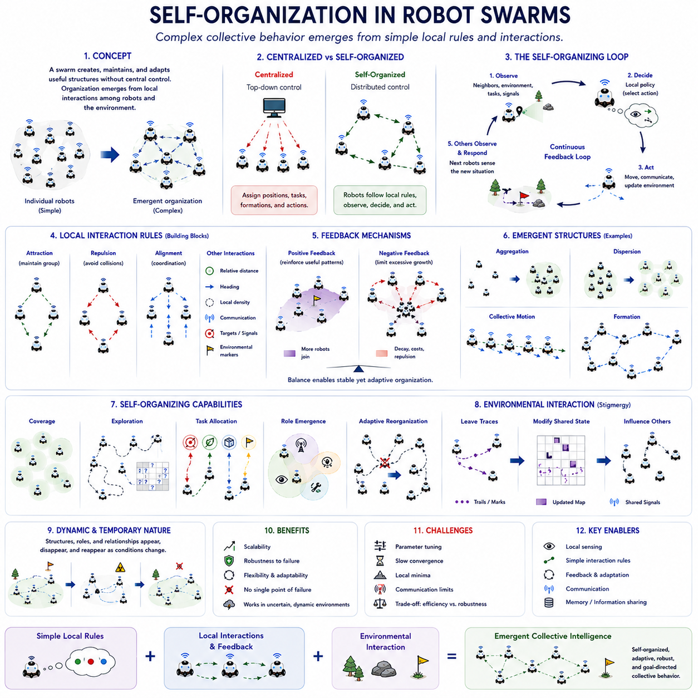{width="7.268055555555556in" height="7.268055555555556in"}

자기 조직화(Self-Organization)는 중앙 제어기(Central Controller)가 모든 로봇의 위치, 역할 또는 행동을 명시적으로 결정하지 않아도 로봇 군집(Robot Swarm)이 유용한 집단 구조를 생성하고 유지하며 변화시킬 수 있는 능력이다. 조직은 에이전트 간 그리고 에이전트와 환경 간의 반복적인 국소 상호작용(Local Interaction)으로부터 출현한다. 따라서 자기 조직화는 다수의 개별 로봇을 하나의 적응형 집단 시스템(Adaptive Collective System)으로 변화시키는 핵심 메커니즘 중 하나이다.

중앙집중형 시스템(Centrally Organized System)에서는 감독 구성요소(Supervisory Component)가 로봇의 위치를 지정하고, 대형(Formation)을 계산하고, 작업을 할당하며, 환경 변화에 대한 대응을 조정할 수 있다. 자기 조직화 시스템에서는 이러한 책임의 상당 부분을 개별 로봇에게 분산한다. 각 로봇은 국소 규칙(Local Rules) 또는 정책(Policy)을 따르고 주변 상황을 관찰하면서 자신의 행동을 수정하며, 이를 통해 분산된 상호작용으로부터 조직이 형성된다.

자기 조직화는 목표나 공학적 설계(Engineering Design)가 존재하지 않는다는 의미가 아니다. 군집은 여전히 영역 탐색, 지역 커버리지(Coverage), 물체 운송, 목표 탐지 등의 임무 목표를 가질 수 있다. 달라지는 것은 이러한 목표를 달성하는 메커니즘이다. 설계자는 전체 집단의 모든 중간 상태를 직접 지정하는 대신 상호작용 원리, 제약 조건, 피드백 메커니즘(Feedback Mechanism), 성능 목표를 정의한다.

이 과정은 연속적인 피드백 루프(Continuous Feedback Loop)로 이해할 수 있다. 각 로봇은 주변 로봇, 장애물, 환경 신호, 작업 관련 정보를 관찰한다. 이후 국소 정책(Local Policy)에 따라 행동을 선택하고, 그 행동은 물리적 또는 정보적 환경을 변화시킨다. 다른 로봇들은 변화된 상황을 다시 관찰하고 이에 반응한다. 이러한 순환이 반복되면서 개별 로봇 수준에서 직접 명령되지 않았던 조직적 구조가 점진적으로 형성된다.

따라서 국소 상호작용은 자기 조직화의 기본 구성요소이다. 로봇은 상대 거리, 이동 방향, 국소 밀도(Local Density), 통신 신호, 탐지된 목표 또는 환경 표식(Environmental Marker)에 반응할 수 있다. 인력(Attraction)은 집단의 연결성을 유지하고, 반발력(Repulsion)은 충돌을 방지하며, 정렬(Alignment)은 이동을 조정한다. 더욱 복잡한 상호작용 규칙은 작업 선택, 정보 전파, 자원 사용 또는 일시적인 역할 형성까지 조절할 수 있다.

피드백(Feedback)은 출현하는 조직이 성장하고 안정화되거나 사라지는지를 결정한다. 양의 피드백(Positive Feedback)은 성공적인 경로, 중요한 목표 또는 우선순위가 높은 작업으로 추가 로봇을 유도하여 유용한 패턴을 강화한다. 음의 피드백(Negative Feedback)은 신호 감쇠(Signal Decay), 혼잡 페널티(Congestion Penalty), 반발력 또는 자원 고갈 등을 통해 과도한 강화를 제한한다. 이들의 균형을 통해 군집은 구조를 형성하면서도 조건이 변화하면 다시 조직될 수 있다.

간단한 사례로 집합(Aggregation)을 들 수 있다. 처음에 흩어져 있는 로봇들은 환경을 이동하면서 주변의 다른 로봇에 반응할 수 있다. 로봇들이 국소적으로 개체 밀도가 높은 영역을 발견하면 해당 영역을 떠날 확률을 낮출 수 있다. 이후 다른 로봇들도 점차 성장하는 집단을 발견하고 같은 방식으로 행동한다. 어떤 로봇도 전역적인 집결 지점을 계산하지 않지만 반복적인 국소 의사결정을 통해 분산된 집단이 하나 또는 여러 개의 조직된 군집으로 변화할 수 있다.

분산(Dispersion)은 이와 반대되는 조직화 과정을 보여준다. 로봇들은 주변 에이전트와 최소 거리를 유지하면서 국소 밀도가 낮은 영역으로 이동할 수 있다. 시간이 지나면서 군집은 사용 가능한 환경 전체에 분산된다. 이러한 행동은 감시(Surveillance), 센싱(Sensing), 환경 모니터링(Environmental Monitoring), 영역 커버리지에 유용하며, 중앙에서 모든 로봇에 정확한 좌표를 지정하지 않아도 집단적인 공간 구조가 형성될 수 있다.

자기 조직화는 집단 이동(Collective Motion)도 지원한다. 분리(Separation), 정렬, 응집(Cohesion) 규칙을 적용하는 로봇들은 자발적으로 조정된 이동을 형성할 수 있다. 그 결과 집단은 연결성을 유지하면서 방향을 변경하고 장애물을 우회하거나 자신의 기하학적 구조를 조정할 수 있다. 조직이 국소 상호작용을 통해 지속적으로 재생성되기 때문에 임무 시작 전에 한 번 정의된 경직된 대형에 의존하지 않고 유연성을 유지할 수 있다.

대형(Formation) 역시 분산된 제약 조건(Distributed Constraints)을 통해 출현할 수 있다. 로봇은 절대적인 전역 대형을 추적하는 대신 선택된 이웃과 원하는 상대 거리 또는 기하학적 관계를 유지할 수 있다. 이러한 국소 관계의 집합은 선, 원, 격자(Lattice) 등의 구조를 형성할 수 있다. 일부 구성원이 이동하거나 사라지면 주변 로봇이 관계를 조정하여 필요한 조직 구조를 다시 구성할 수 있다.

자기 조직화의 중요한 특성 중 하나는 형성된 구조가 일시적(Temporary)일 수 있다는 것이다. 하나의 로봇이 탐색 집단에 참여하고, 탐지된 목표로 이동하거나 다른 로봇을 지원한 뒤 다시 커버리지 행동으로 복귀할 수 있다. 따라서 역할과 공간적 관계는 현재 상황에 따라 출현하고 사라진 후 다시 나타날 수 있다. 이러한 동적 조직화(Dynamic Organization)는 배치 전에 임무 요구사항을 완전히 예측하기 어려운 환경에서 특히 유용하다.

작업 할당(Task Allocation) 역시 자기 조직화될 수 있다. 중앙 스케줄러(Central Scheduler)로부터 고정된 작업을 받는 대신 로봇은 국소적인 작업 수요, 거리, 사용 가능한 에너지, 능력(Capability), 작업 부하 또는 주변 로봇의 신호를 평가할 수 있다. 개별 로봇의 작업 선택은 남아 있는 작업 수요를 변화시키고, 이는 다시 다른 로봇의 선택에 영향을 준다. 반복적인 적응을 통해 완전한 중앙집중형 최적화 없이도 여러 작업에 로봇을 분배할 수 있다.

환경과의 상호작용(Environmental Interaction)은 자기 조직화를 위한 또 다른 메커니즘을 제공한다. 스티그머지(Stigmergy)를 통해 로봇은 가상 흔적(Virtual Trace)을 남기거나 공유 공간 표현(Shared Spatial Representation)을 갱신하고, 국소적으로 관찰 가능한 환경 상태를 변화시킬 수 있다. 이러한 변화는 나중에 해당 정보를 발견한 다른 로봇의 의사결정에 영향을 준다. 결과적으로 환경 자체가 조정 과정의 일부가 되어 동시에 직접 연결되지 않은 로봇 사이에서도 조직화를 유지할 수 있다.

자기 조직화는 부분 관측성(Partial Observability)이 존재하는 상황에서 특히 중요하다. 개별 로봇은 제한된 센싱 범위를 가지며 군집의 전역 상태에 대해 불완전한 정보만 가질 수 있다. 모든 에이전트가 완전한 전역 표현(Global Representation)을 재구성하도록 요구하는 대신 국소 정보만으로도 유용한 집단 패턴을 유지할 수 있다. 분산 센싱(Distributed Sensing)과 반복적인 상호작용을 통해 어떤 개별 로봇도 전체 시스템을 완전히 파악하지 못하는 상황에서 군집이 기능할 수 있다.

이러한 메커니즘은 강건성(Robustness)과 결함 허용성(Fault Tolerance)에도 기여한다. 하나의 로봇이 고장 나더라도 조직은 반드시 사라지지 않는다. 조직에 관한 정보가 중앙 제어기에만 저장된 것이 아니라 분산된 상호작용에 포함되어 있기 때문이다. 주변 로봇들은 국소 밀도, 연결성, 작업 부하 또는 공간적 관계의 변화를 감지하고 행동을 조정한다. 따라서 집단은 손실된 구성원을 중심으로 다시 조직되고 감소된 자원으로도 운용을 계속할 수 있다.

자기 복구(Self-Recovery)는 이러한 능력을 더욱 발전시킨 형태이다. 교란이 발생한 후 군집은 단순히 생존하는 것에 그치지 않고 다시 유용한 운용 상태로 돌아가려고 한다. 예를 들어 로봇들은 대형에 발생한 빈 공간을 채우거나, 여러 구성원이 고장 난 이후 다시 분산되거나, 수행자가 사라진 작업을 재할당할 수 있다. 국소 규칙이 하나의 고정된 구성만 유지하는 것이 아니라 집단을 지속적으로 허용 가능한 관계로 유도하기 때문에 이러한 복구가 가능하다.

확장성(Scalability)은 국소 상호작용이 전역 조정(Global Coordination)의 필요성을 감소시킬 수 있기 때문에 자기 조직화와 밀접하게 연결된다. 로봇들이 주로 주변 이웃과 통신한다면 에이전트를 추가하더라도 전역 상태 교환량이 반드시 같은 비율로 증가하지는 않는다. 따라서 대규모 집단도 반복적인 이웃 상호작용을 통해 조직될 수 있다. 그러나 군집 규모가 증가하면 밀도와 상호작용 빈도도 달라질 수 있어 소규모 실험에서는 나타나지 않았던 행동이 발생할 수 있다.

따라서 자기 조직화 시스템에는 세심한 안정성 분석(Stability Analysis)이 필요하다. 개별적으로 합리적으로 보이는 국소 규칙도 다수의 로봇에서 결합되면 진동(Oscillation), 분열(Fragmentation), 혼잡(Congestion), 교착 상태(Deadlock), 통제되지 않는 군집화를 발생시킬 수 있다. 통신 지연, 센서 잡음, 로봇 동역학(Robot Dynamics), 환경 경계, 변화하는 집단 밀도 역시 이러한 현상을 증폭시킬 수 있다. 성공적인 자기 조직화는 이러한 교란 속에서도 집단 행동을 허용 가능한 운용 범위 내에 유지해야 한다.

예측 가능성(Predictability) 역시 중요한 공학적 과제이다. 중앙집중형 시스템에서는 명령의 원인을 계획기(Planner)나 스케줄러까지 추적하여 설명할 수 있는 경우가 많지만, 자기 조직화 행동은 다수의 상호작용하는 의사결정으로부터 발생한다. 동일한 규칙이라도 초기 조건(Initial Conditions)이 달라지면 서로 다른 구성을 만들 수 있다. 따라서 설계자는 하나의 결정론적 전역 궤적(Global Trajectory)이 항상 발생한다고 가정하기보다 가능한 결과들의 분포를 평가해야 한다.

이러한 이유로 시뮬레이션(Simulation)과 대규모 실험(Large-Scale Experimentation)이 필수적이다. 자기 조직화 정책은 서로 다른 로봇 수, 초기 위치, 통신 조건, 장애물 배치, 장애 시나리오, 환경 변화에서 시험되어야 한다. 이를 통해 유용한 구조가 일관되게 출현하는지, 조직이 얼마나 빠르게 형성되는지, 군집이 안정성을 유지하는지, 교란 이후 얼마나 효과적으로 재조직되는지를 확인할 수 있다.

유용한 평가 지표(Evaluation Metrics)는 원하는 집단 행동에 따라 달라진다. 집합은 군집 크기(Cluster Size)와 수렴 시간(Convergence Time)으로 평가할 수 있고, 커버리지는 탐색 영역과 공간적 균일성(Spatial Uniformity), 대형은 상대 위치 오차(Relative-Position Error)로 측정할 수 있다. 보다 일반적인 지표에는 연결성, 충돌률, 통신 부하, 작업 완료율, 에너지 효율, 로봇 손실에 대한 회복탄력성(Resilience), 적응 시간, 환경 또는 시스템 교란 이후의 복구 품질 등이 포함된다.

학습(Learning)은 사람이 직접 설계한 규칙을 넘어 자기 조직화를 확장할 수 있다. 로봇은 군집 수준의 목표를 최적화하는 집단 효과를 만들어 내는 국소 상호작용 정책을 학습할 수 있다. 강화학습(Reinforcement Learning), 그래프 기반 학습(Graph-Based Learning), 진화 최적화(Evolutionary Optimization) 등의 방법을 이용하여 효과적인 조직을 만들어 내는 행동을 탐색할 수 있다. 핵심 과제는 학습된 국소 정책이 다양한 군집 규모, 환경, 교란, 실제 로봇 동역학에서도 일반화되도록 하는 것이다.

그래프 표현(Graph Representation)은 자기 조직화 군집을 이해하기 위한 자연스러운 수학적 관점을 제공한다. 각 로봇을 노드(Node)로 표현하고 센싱 또는 통신 관계를 에지(Edge)로 표현할 수 있다. 로봇이 이동하면 그래프 토폴로지(Graph Topology)도 지속적으로 변화한다. 국소 의사결정은 물리적 위치와 연결 구조를 모두 변화시키며, 변화된 그래프는 다시 이후의 의사결정에 영향을 준다. 따라서 조직화는 로봇 상태와 상호작용 구조가 결합되어 진화하는 과정으로 이해할 수 있다.

다중 로봇 물리 인공지능(Multi-Robot Physical AI)에서 자기 조직화는 모든 로봇을 직접 제어하는 방식에서 유용한 집단 행동이 스스로 조직될 수 있는 조건을 설계하는 방식으로의 전환을 의미한다. 지능은 로봇 정책, 국소 관측, 통신 관계, 환경 피드백, 집단 동역학(Population Dynamics)에 분산된다. 목표는 제어를 제거하는 것이 아니라 명시적인 전역 명령에 포함되어 있던 제어의 일부를 구조화된 상호작용 메커니즘으로 이동시키는 것이다.

결과적으로 자기 조직화는 국소 규칙(Local Rules)과 합의(Consensus), 군집 이동(Flocking), 대형(Formation), 커버리지(Coverage), 탐색(Exploration), 수색(Search), 복구(Recovery)와 같은 상위 수준의 군집 능력을 연결하는 역할을 한다. 군집의 구성원들이 상호작용을 통해 유용한 집단 구조를 지속적으로 생성하고 다시 구성할 수 있을 때, 군집은 단순한 자율 로봇들의 집합을 넘어선다. 이러한 능력은 확장 가능하고 적응적이며 회복탄력적인 군집 기반 물리 인공지능(Swarm-Based Physical AI)의 핵심 기반이다.

## 02.05. Consensus and Collective Decision Making

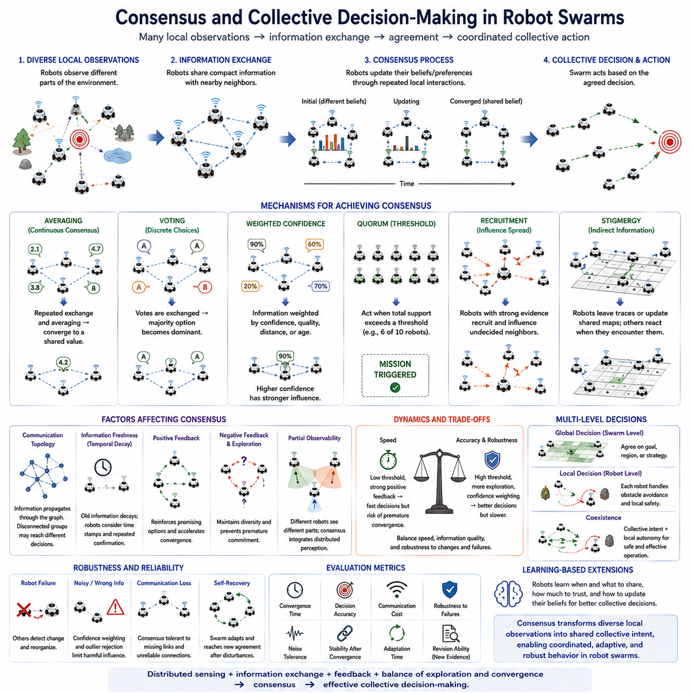{width="7.268055555555556in" height="7.268055555555556in"}

합의(Consensus)는 여러 로봇이 서로 다른 관측과 불완전한 정보에서 출발하더라도 충분히 공유된 추정값, 선호도, 상태 또는 의사결정으로 수렴하는 과정이다. 군집 지능(Swarm Intelligence)에서 합의는 하나의 로봇이나 중앙 제어기(Central Controller)가 최종 선택을 결정하지 않고도 다수의 국소적 관점(Local Viewpoints)을 조정된 집단 행동(Coordinated Collective Action)으로 변환하는 분산 메커니즘을 제공한다.

집단적 의사결정(Collective Decision-Making)은 군집이 여러 대안을 평가하고 집단 수준에서 행동을 선택하는 보다 포괄적인 과정이다. 의사결정의 대상은 검사할 목표, 탐색할 영역, 이동할 경로, 대형(Formation)의 변경 여부 또는 탐지된 위험에 대응하는 방법 등이 될 수 있다. 합의는 이러한 결정을 도출하는 중요한 메커니즘이지만, 모든 로봇이 완전히 동일한 의견에 도달하지 않더라도 집단 행동은 출현할 수 있다.

생물학적 유사성은 꿀벌(Honeybee)과 같은 사회성 곤충(Social Insects)에서 확인할 수 있다. 개별 정찰벌(Scout)은 서로 다른 후보 위치를 조사하고 서로 다른 평가 결과를 가지고 돌아올 수 있다. 반복적인 모집(Recruitment)과 상호작용을 통해 유망한 대안에 대한 지지가 증가하면서 충분히 강한 집단적 선호가 형성된다. 어떤 개체도 모든 증거를 가지고 있지 않지만, 분산된 관측을 통해 전체 군집을 이끄는 집단적 결정을 만들어 낼 수 있다.

로봇 군집(Robot Swarm)은 개별 로봇이 국소 관측(Local Observation)을 이용하여 여러 대안을 평가하도록 함으로써 이와 유사한 과정을 구현할 수 있다. 각 로봇은 후보 목표, 경로, 작업 또는 행동에 대한 선호도나 신뢰도(Confidence)를 유지할 수 있다. 로봇들은 주변 이웃과 간결한 정보를 교환하면서 자신의 추정값을 반복적으로 갱신한다. 시간이 지나면 국소 상호작용을 통해 처음에는 서로 달랐던 판단이 공통되거나 충분히 양립할 수 있는 결정으로 수렴할 수 있다.

간단한 합의 메커니즘은 평균화(Averaging)를 기반으로 할 수 있다. 각 로봇은 하나의 수치적 추정값을 유지하고 이를 주기적으로 주변 로봇과 교환한다. 이후 수신한 값에 따라 자신의 추정값을 조정한다. 적절한 연결성과 갱신 조건이 충족되면 이러한 과정을 반복하면서 집단 전체가 공유된 값으로 수렴할 수 있다. 이 원리는 분산 추정(Distributed Estimation), 동기화(Synchronization), 이동 방향 합의(Heading Agreement) 등의 조정 문제에 활용될 수 있다.

합의가 항상 수치적 평균화를 필요로 하는 것은 아니다. 투표 메커니즘(Voting Mechanism)은 로봇들이 여러 개의 이산적 대안(Discrete Alternatives) 중 하나를 선택하도록 할 수 있으며, 다수결 규칙(Majority Rule)은 현재 가장 많은 국소적 지지를 얻은 대안을 강화할 수 있다. 정족수 메커니즘(Quorum Mechanism)은 지지가 일정 임계값을 넘으면 집단 행동을 시작하며, 모집 메커니즘은 강한 증거를 가진 로봇이 아직 결정하지 않은 이웃에게 영향을 주도록 할 수 있다.

관측 결과가 항상 동일한 신뢰성을 가지는 것은 아니기 때문에 신뢰도(Confidence)가 중요하다. 목표물을 명확하게 관측한 로봇은 잡음이 많거나 일부가 가려진 상태에서 센싱한 로봇보다 강한 증거를 가질 수 있다. 따라서 합의 메커니즘은 신뢰도, 불확실성(Uncertainty), 센서 품질, 거리 또는 관측 정보의 시간적 경과에 따라 정보에 서로 다른 가중치를 부여할 수 있다. 이를 통해 모든 국소 의견이 집단 의사결정에 동일한 영향력을 갖는 문제를 방지할 수 있다.

동적으로 변화하는 물리적 환경에서는 정보 최신성(Information Freshness)도 중요하다. 몇 분 전에 안전하다고 판단된 경로가 현재는 차단되어 있을 수 있으며, 이전에 탐지된 목표가 이동했을 수도 있다. 따라서 로봇은 증거를 교환할 때 타임스탬프(Timestamp), 시간적 감쇠(Temporal Decay), 반복 확인(Repeated Confirmation) 등을 고려해야 한다. 이러한 메커니즘이 없다면 한때는 정확했지만 현재 상황과 맞지 않는 정보를 중심으로 합의가 안정화될 수 있다.

통신 토폴로지(Communication Topology)는 합의 달성 여부에 큰 영향을 미친다. 로봇은 일반적으로 군집의 모든 구성원이 아니라 주변의 가까운 로봇과 통신한다. 이러한 국소 관계는 로봇의 이동에 따라 변화하는 통신 그래프(Communication Graph)를 형성한다. 정보가 그래프 전체를 통해 전파될 수 있다면 반복적인 이웃 정보 교환만으로도 합의가 가능하지만, 서로 단절된 하위 집단은 증거를 교환할 수 없기 때문에 서로 다른 결정으로 수렴할 수 있다.

이러한 특성은 국소 합의(Local Consensus)와 전역 합의(Global Consensus)의 차이를 만든다. 하나의 연결된 이웃 집단 내부에서는 로봇들이 빠르게 합의할 수 있지만 군집의 다른 영역에서는 다른 결론에 도달할 수 있다. 통신 연결이 복구되면 각 집단은 서로의 판단을 다시 조정해야 한다. 일부 응용 분야에서는 전역적 합의가 필요하지만, 다른 경우에는 여러 국소적 결정이 전체 임무 및 안전 제약과 양립할 수 있다면 허용될 수 있다.

합의에는 시간적 측면도 존재한다. 합의에 도달하는 시간이 지나치게 길면 빠르게 변화하는 환경에서 결과가 무의미해질 수 있으며, 반대로 지나치게 빠른 합의를 강제하면 성급한 수렴(Premature Convergence)이 발생할 수 있다. 더 좋은 증거가 집단 전체에 전파되기 전에 일정한 지지를 확보한 첫 번째 대안을 선택할 수도 있다. 따라서 의사결정 시스템은 결정 속도(Decision Speed), 정보 품질, 경쟁 대안을 평가할 기회 사이에서 균형을 유지해야 한다.

양의 피드백(Positive Feedback)은 집단 선택을 가속할 수 있다. 로봇들이 유망한 대안에 대한 지지를 반복적으로 전달하면 주변 로봇들도 동일한 선호를 채택하고 전파할 가능성이 증가한다. 이러한 강화는 약한 초기 증거를 빠르게 강력한 집단 결정으로 변화시킬 수 있다. 그러나 지나친 양의 피드백은 잘못된 정보를 증폭하여 군집이 열등하거나 안전하지 않은 대안에 성급하게 집중하도록 만들 수 있다.

음의 피드백(Negative Feedback)과 탐색(Exploration)은 이러한 문제를 방지하는 데 도움을 준다. 로봇은 오래된 정보에 대한 신뢰도를 낮추고, 다른 대안을 조사할 일정 확률을 유지하거나, 혼잡, 실패 또는 상충되는 관측이 나타나면 기존 대안에 대한 지지를 감소시킬 수 있다. 이러한 메커니즘은 경쟁하는 증거가 군집의 결정에 영향을 줄 수 있도록 충분한 다양성(Diversity)을 유지한다. 따라서 효과적인 집단적 의사결정에는 수렴과 지속적인 반응성 사이의 균형이 필요하다.

정족수 기반 의사결정(Quorum-Based Decision)은 실용적인 절충 방법을 제공한다. 모든 로봇의 동의를 요구하는 대신 특정 대안을 지지하는 로봇의 수 또는 가중된 신뢰도가 사전에 정의된 임계값을 초과하면 군집이 행동을 시작할 수 있다. 낮은 임계값은 빠른 결정을 가능하게 하지만 약한 증거에 따라 행동할 위험이 증가한다. 높은 임계값은 신뢰도를 높이지만 통신이 저하된 상황에서는 행동을 지연시키거나 결정을 내리지 못하게 할 수 있다.

집단적 의사결정은 시간과 범위에 따라 계층적(Hierarchical)으로 구성될 수도 있다. 군집은 전체적인 이동 방향에 대해서는 합의하면서도 개별 로봇이 독립적으로 국소 장애물 회피(Local Obstacle Avoidance)를 수행할 수 있다. 특정 영역에 더 많은 관심이 필요하다는 데에는 동의하면서 동일한 궤적을 사용할 필요는 없다. 이러한 분리는 집단 의도(Collective Intent)와 국소 자율성(Local Autonomy)이 공존하도록 한다.

부분 관측성(Partial Observability)은 분산 의사결정(Distributed Decision-Making)을 특히 중요하게 만든다. 서로 다른 로봇은 환경의 서로 다른 부분을 관찰하기 때문에 의견의 불일치는 오류가 아니라 공간적으로 분산된 인지(Distributed Perception)의 자연스러운 결과일 수 있다. 합의 메커니즘은 이러한 분절된 관측 정보를 통합하는 방법을 제공한다. 따라서 집단적 결정은 하나의 로봇이 단독으로 관측할 수 있는 것보다 훨씬 넓은 물리적 영역에서 수집된 증거를 반영할 수 있다.

그러나 합의가 항상 바람직한 것은 아니다. 모든 로봇이 즉시 동일한 가설을 채택하면 군집은 다양성을 잃고 다른 대안의 탐색을 중단할 수 있다. 수색(Search) 및 탐색 임무에서는 완전한 합의보다 여러 개의 가설을 유지하는 것이 더 유용할 수 있다. 따라서 설계자는 언제 군집이 수렴해야 하는지, 언제 하위 집단이 서로 다른 전략을 유지해야 하는지, 그리고 언제 불일치 자체가 환경의 불확실성에 관한 유용한 정보를 제공하는지를 결정해야 한다.

고장과 신뢰할 수 없는 에이전트(Unreliable Agent)는 추가적인 문제를 발생시킨다. 오작동하는 로봇은 잘못된 관측 정보를 전달할 수 있으며, 통신 오류는 정보를 왜곡하거나 지연시킬 수 있다. 강건한 합의(Robust Consensus) 방법은 비정상적인 데이터의 영향력을 제한하고 일부 구성원이 누락되더라도 작동할 수 있어야 한다. 중복성(Redundancy), 신뢰도 가중치, 이상치 제거(Outlier Rejection), 일관성 검사(Consistency Check), 신뢰 가능한 통신 메커니즘 등을 활용하여 개별 장애가 집단적 의사결정을 지배하는 것을 방지할 수 있다.

합의는 중앙집중형 명령(Centralized Command)과도 구분되어야 한다. 중앙 서버가 모든 관측을 수집하고 하나의 결정을 계산할 수 있지만, 이는 하나의 의사결정 지점에 합의가 의존하기 때문에 분산 합의(Distributed Consensus)라고 할 수 없다. 분산형 군집에서는 에이전트 사이의 반복적인 정보 교환을 통해 결정이 출현한다. 이러한 구조는 중앙 인프라에 대한 의존성을 감소시키지만 수렴, 일관성, 통신 신뢰성, 집단 안정성에 관한 새로운 문제를 발생시킨다.

그래프 이론(Graph Theory)은 이러한 과정을 분석하는 유용한 수학적 프레임워크를 제공한다. 로봇을 노드(Node), 통신 관계를 에지(Edge)로 표현할 수 있으며, 합의 알고리즘은 이러한 에지를 따라 정보를 반복적으로 전파하고 결합한다. 연결성(Connectivity), 이웃 구조(Neighborhood Structure), 링크 신뢰성(Link Reliability), 변화하는 토폴로지 등의 특성이 정보가 전체 집단으로 전달될 수 있는지와 개별 상태가 얼마나 빠르게 수렴하는지를 결정한다.

학습 기반 접근법(Learning-Based Approach)은 기존 합의 메커니즘을 더욱 확장할 수 있다. 로봇은 언제 통신해야 하는지, 어떤 이웃을 신뢰해야 하는지, 관측 정보에 어느 정도의 가중치를 부여해야 하는지, 또는 즉각적인 합의보다 추가 탐색이 언제 더 유리한지를 학습할 수 있다. 다중 에이전트 강화학습(Multi-Agent Reinforcement Learning)과 그래프 기반 신경망 모델(Graph-Based Neural Model)은 집단 목표를 이용하여 국소 의사결정 정책을 최적화함으로써 고정된 합의 규칙만으로 처리하기 어려운 환경에서 조정 성능을 향상시킬 수 있다.

평가에서는 최종적으로 합의에 도달했는지만을 확인해서는 안 된다. 중요한 특성에는 수렴 시간(Convergence Time), 의사결정 정확도(Decision Accuracy), 통신 비용, 로봇 손실에 대한 강건성, 잡음이 포함된 관측에 대한 허용성, 합의 이후의 안정성, 그리고 조건이 변화할 때 기존 결정을 수정하는 능력이 포함된다. 유용한 군집 의사결정 시스템은 새로운 증거에 대한 반응성을 유지하면서 충분히 좋은 결정을 효율적으로 도출해야 한다.

안전성(Safety)은 또 다른 요구사항을 추가한다. 집단적 합의가 로봇 수준의 필수적인 안전 제약(Safety Constraints)을 무시해서는 안 된다. 군집 전체가 특정 목표를 향해 이동하기로 합의하더라도 개별 로봇은 충돌, 위험 지형, 사람 또는 기계적 한계를 회피해야 한다. 따라서 군집 합의는 공유 의도(Shared Intent) 또는 조정된 목표를 결정하고, 안전 필수 국소 제어(Safety-Critical Local Control)는 즉각적인 물리적 행동에 대한 최종 권한을 유지하는 구조가 필요하다.

다중 로봇 물리 인공지능(Multi-Robot Physical AI)에서 합의는 분산 인지(Distributed Perception)와 조정된 행동(Coordinated Action)을 연결한다. 로봇들은 물리적 세계의 서로 다른 부분을 관찰하고, 선택된 정보를 교환하고, 자신의 국소 판단을 갱신하면서 점진적으로 공유 의도(Shared Intent)를 형성한다. 그 결과 발생하는 의사결정은 하나의 기계 내부에서 단순히 계산되는 것이 아니라 다수의 체화된 에이전트(Embodied Agent)를 연결하는 통신 및 상호작용 구조에서 출현한다.

따라서 합의와 집단적 의사결정은 조정된 이동(Coordinated Motion), 대형 제어(Formation Control), 분산 탐색(Distributed Exploration), 수색, 적응형 작업 할당(Adaptive Task Allocation)과 같은 이후의 군집 능력을 위한 기반을 제공한다. 핵심 원리는 모든 로봇이 항상 동일하게 판단해야 한다는 것이 아니라, 분산된 에이전트들이 강건성, 적응성, 국소 자율성을 유지하면서 서로 다른 국소 관측을 충분히 일관된 집단 의도(Collective Intent)로 변환할 수 있다는 것이다.

## 02.06. Flocking and Collective Motion

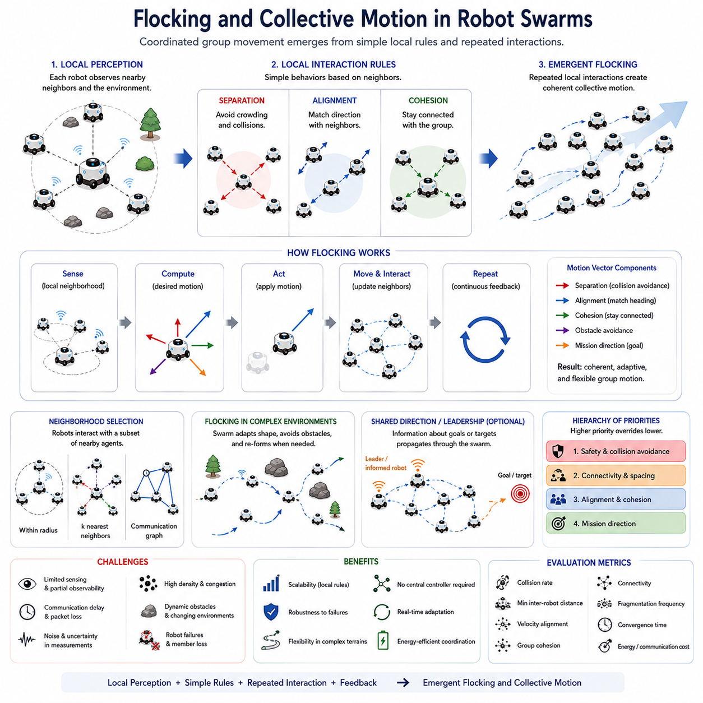{width="7.268055555555556in" height="7.268055555555556in"}

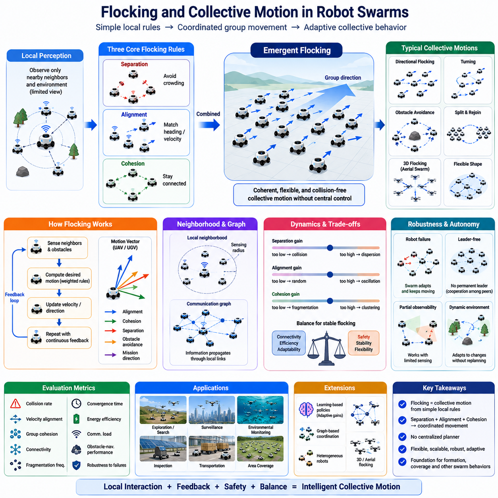{width="7.268055555555556in" height="7.268055555555556in"}

군집 이동(Flocking)은 다수의 로봇이 하나의 일관된 집단처럼 이동하면서도 각 로봇이 주로 주변 이웃에 대한 국소 관측(Local Observation)을 기반으로 의사결정을 수행하는 집단 운동(Collective Motion)의 한 형태이다. 모든 구성원에게 완전한 이동 궤적을 할당하는 대신 반복적인 상호작용을 통해 조정된 움직임을 생성한다. 이는 단순한 분산 규칙(Decentralized Rules)이 어떻게 조직화된 전역 행동(Global Behavior)을 만들어 내는지를 보여주는 대표적인 군집 로보틱스(Swarm Robotics)의 사례이다.

이 개념은 새 떼(Bird Flock)와 물고기 떼(Fish School) 같은 생물학적 집단에서 강한 영감을 받았다. 개별 동물은 일반적으로 전체 집단을 지속적으로 관찰하는 대신 제한된 수의 주변 이웃에게 반응한다. 그럼에도 집단은 응집성(Cohesion)을 유지하고 방향을 변경하며 충돌을 회피하고 외부 교란에 빠르게 대응할 수 있다. 군집 로보틱스는 이러한 원리를 자율 로봇이 실행할 수 있는 계산 규칙(Computational Rules)으로 추상화한다.

일반적인 군집 이동 모델(Flocking Model)은 분리(Separation), 정렬(Alignment), 응집(Cohesion)의 세 가지 기본 행동을 결합한다. 분리는 로봇들이 서로 지나치게 가까워지는 것을 방지하고, 정렬은 주변 로봇들이 유사한 이동 방향이나 속도를 갖도록 하며, 응집은 각 로봇이 주변 집단과 연결된 상태를 유지하도록 한다. 이들이 결합되면 개별적으로 제어되는 로봇들이 하나의 조정된 이동 집단으로 변화할 수 있다.

분리(Separation)는 물리적 안전성(Physical Safety)을 위해 필수적이다. 각 로봇은 주변 에이전트를 관찰하고 다른 로봇이 정의된 안전 영역(Safety Region) 안으로 들어오면 반발 반응(Repulsive Response)을 생성한다. 거리가 감소할수록 반발력이 증가하도록 하여 로봇들이 능동적으로 최소 간격을 유지할 수 있다. 충분한 분리가 없다면 인력과 정렬 메커니즘으로 인해 과도한 밀집, 충돌, 혼잡 또는 기계적으로 위험한 상호작용이 발생할 수 있다.

정렬(Alignment)은 군집 전체에 이동 방향의 일관성(Directional Consistency)을 형성한다. 로봇은 주변 로봇의 이동 방향이나 속도를 추정하고 자신의 움직임을 국소적으로 대표되는 방향에 점진적으로 맞춘다. 각 로봇의 이웃 집합이 서로 중첩되기 때문에 방향 정보가 집단 전체로 전파된다. 따라서 어떤 로봇도 군집 전체의 움직임을 직접 계산하지 않으면서 국소적인 조정만으로 공통된 집단 이동 방향을 형성할 수 있다.

응집(Cohesion)은 군집이 여러 부분으로 분리되는 것을 방지한다. 로봇은 주변 이웃의 상대적인 분포나 국소 중심(Local Center)을 추정하고 집단으로부터 떨어지기 시작하면 다시 집단 방향으로 이동할 수 있다. 응집은 분리와 균형을 이루어야 한다. 지나치게 강한 인력은 과도한 밀집을 유발할 수 있기 때문이다. 일반적으로 원하는 행동은 개별 로봇 사이의 안전거리를 유지하면서 집단 연결성을 확보하는 것이다.

이러한 행동들이 동시에 작동할 때 군집 이동이 출현한다. 로봇의 원하는 움직임은 충돌 회피(Collision Avoidance), 이웃 정렬, 집단 인력, 장애물 회피(Obstacle Avoidance), 임무 방향(Mission Direction)을 나타내는 여러 벡터의 결합으로 이해할 수 있다. 각 요소에 부여하는 가중치에 따라 집단 행동이 달라진다. 따라서 설계 문제는 개별 규칙을 정의하는 것뿐만 아니라 다양한 운용 조건에서 이들의 영향력을 적절히 균형화하는 것이다.

이웃 선택(Neighborhood Selection)은 집단 운동에 큰 영향을 미친다. 로봇은 센싱 반경 내부의 모든 에이전트, 일정한 수의 가장 가까운 이웃 또는 통신 그래프(Communication Graph)를 통해 연결된 로봇과 상호작용할 수 있다. 이웃의 수가 지나치게 적으면 정보 전파가 감소하고 집단이 분리될 수 있으며, 지나치게 많은 연결은 통신량과 계산량을 증가시킬 수 있다. 효과적인 군집 이동을 위해서는 이동 정보가 집단 전체로 전달될 수 있는 충분한 국소 연결성(Local Connectivity)이 필요하다.

집단 운동은 모든 로봇이 정확히 동일한 속도나 위치 관계를 유지할 것을 요구하지 않는다. 많은 응용에서는 대략적인 정렬과 제한된 범위의 간격 유지만으로 충분하다. 이러한 유연성은 로봇들이 보다 구체적인 기하학적 관계를 유지해야 하는 강체형 대형 제어(Rigid Formation Control)와 군집 이동을 구분하는 특징이다. 군집 이동은 집단의 형상이 동적으로 변형되는 것을 허용하면서 일관된 집단 이동을 유지하는 데 중점을 둔다.

이러한 유연성은 복잡한 환경을 이동할 때 특히 중요하다. 장애물에 접근하는 군집은 일시적으로 여러 소집단으로 분리되어 장애물의 서로 다른 방향을 통과한 후 다시 결합할 수 있다. 국소 장애물 회피는 주변 로봇의 움직임을 변화시키고, 정렬과 응집은 이러한 변화를 집단 전체로 전파한다. 따라서 중앙 계획기(Central Planner)가 모든 구성원의 새로운 궤적을 계산하지 않아도 군집은 자신의 기하학적 구조를 적응적으로 변화시킬 수 있다.

집단 운동에는 공유된 임무 방향(Shared Mission Direction)을 포함할 수도 있다. 일부 로봇이 목적지를 알고 있거나 목표를 탐지하거나 상위 수준의 명령을 수신하고, 나머지 로봇은 주로 국소 상호작용 규칙을 따를 수 있다. 방향 정보는 이웃 관계를 통해 전파되어 전체 군집이 목표를 향해 일관되게 이동하도록 만들 수 있다. 이를 통해 국소 자율성(Local Autonomy)을 제거하지 않으면서 전역 의도(Global Intent)가 분산된 이동에 영향을 줄 수 있다.

리더-팔로워 행동(Leader-Follower Behavior)은 하나의 구현 방법이지만 군집 이동에 영구적인 리더가 반드시 필요한 것은 아니다. 리더십(Leadership)은 여러 정보를 가진 로봇에 분산될 수도 있고, 조건이 변화할 때 다른 로봇으로 이전되거나 국소 정보로부터 일시적으로 출현할 수도 있다. 단일 리더에 대한 의존성을 제거하면 일부 로봇이 고장 나거나 연결이 끊기거나 임무 정보에 접근하지 못하더라도 집단 운동을 지속할 수 있어 강건성(Robustness)이 향상된다.

합의(Consensus)와 군집 이동은 밀접하게 연결되어 있다. 정렬은 속도 또는 이동 방향에 대한 분산 합의(Distributed Consensus)의 한 형태로 볼 수 있다. 각 로봇은 주변 로봇의 상태를 이용해 자신의 움직임을 반복적으로 조정하고, 이를 통해 국소적인 차이가 점차 감소한다. 그러나 물리적 이동에는 추상적인 합의 알고리즘에는 포함되지 않을 수 있는 가속도 제한, 회전 반경, 액추에이터 동역학(Actuator Dynamics), 장애물 형상, 충돌 위험 등의 제약이 추가된다.

부분 관측성(Partial Observability)은 실제 군집 이동 시스템에 본질적으로 존재한다. 센서는 제한된 탐지 범위와 시야(Field of View)를 가지며 장애물은 주변 로봇을 가릴 수 있다. 통신 역시 간헐적으로 끊길 수 있다. 따라서 각 로봇은 불완전하고 지속적으로 변화하는 이웃 표현을 이용하여 동작한다. 강건한 집단 운동은 일시적인 센싱이나 통신 장애가 군집 전체를 불안정하게 만들지 않도록 누락된 관측을 허용할 수 있어야 한다.

시간 지연(Time Delay)은 또 다른 중요한 문제를 발생시킨다. 오래된 이웃 위치나 속도 정보를 이용하여 반응하는 로봇은 자신의 움직임을 과도하게 보정할 수 있으며, 그 결과 진동(Oscillation)이나 불안정한 파동이 군집 전체로 전파될 수 있다. 높은 로봇 밀도와 공격적인 정렬 이득(Alignment Gain)은 이러한 현상을 더욱 증폭시킬 수 있다. 따라서 군집 이동 제어기는 갱신 주기, 센싱 지연, 통신 지연, 로봇 동역학, 집단 정보의 전파 속도를 고려해야 한다.

잡음(Noise) 역시 집단 안정성에 영향을 줄 수 있다. 위치, 방향, 속도의 추정값에는 측정 불확실성(Measurement Uncertainty)이 포함되며 서로 다른 로봇이 동일한 상황을 다르게 추정할 수도 있다. 필터링(Filtering)과 신뢰도 기반 상호작용(Confidence-Aware Interaction)을 사용하면 잡음이 포함된 측정값에 대한 불필요한 반응을 줄일 수 있다. 목표는 매 순간 완벽하게 일치하는 것이 아니라 불완전한 센싱과 통신에서도 충분히 안정적인 집단 운동을 유지하는 것이다.

집단 운동은 개별 로봇의 안전성과도 공존해야 한다. 상위 수준의 군집 이동 명령이 로봇을 장애물, 다른 로봇, 사람 또는 위험한 지형과 충돌하도록 강제해서는 안 된다. 따라서 필요한 경우 안전 필수 국소 제어(Safety-Critical Local Control)가 정렬이나 응집 명령보다 우선할 수 있다. 즉각적인 위험이 사라지면 로봇은 동일한 분산 상호작용 메커니즘을 통해 점진적으로 집단 운동에 다시 합류할 수 있다.

결과적으로 이러한 행동은 제약 조건의 계층 구조(Hierarchy of Constraints)로 이해할 수 있다. 충돌 회피와 물리적 안전은 일반적으로 가장 높은 우선순위를 가지며, 그 다음으로 연결성과 유용한 간격 유지가 중요하다. 이후 정렬과 임무 방향이 전체적인 이동을 형성한다. 이러한 우선순위 구조는 군집이 물리적 운용 안전성을 희생하면서까지 시각적으로 일관된 집단 형태를 유지하는 것을 방지한다.

강건성은 분산형 군집 이동의 중요한 장점이다. 하나의 로봇이 고장 나거나 집단에서 이탈하면 주변 로봇들은 단순히 변화된 이웃 관계를 관찰하고 자신의 움직임을 조정한다. 군집 전체의 이동 계획을 완전히 다시 계산할 필요는 없다. 충분한 연결성이 유지되는 경우 국소적 적응(Local Adaptation)을 통해 빈 공간을 채우고 간격을 재분배하면서 감소된 구성원으로도 일관된 집단 운동을 유지할 수 있다.

확장성(Scalability)은 국소 군집 이동 규칙을 사용하는 또 다른 중요한 이유이다. 각 로봇은 전체 집단이 아니라 주로 주변 에이전트의 정보만 처리한다. 따라서 전체 군집 규모가 증가한다고 해서 모든 로봇이 처리해야 하는 정보량이 반드시 같은 비율로 증가하는 것은 아니다. 그러나 집단 밀도가 높아지면 국소 상호작용의 복잡성이 증가할 수 있으므로 실제 확장성은 센싱 범위, 통신 아키텍처, 환경 크기, 이웃 선택 정책에 따라 달라진다.

군집 이동 행동은 탐색(Exploration), 환경 모니터링(Environmental Monitoring), 수색(Search), 감시(Surveillance), 검사(Inspection), 협력 운송(Coordinated Transportation)과 같은 실제 군집 임무를 지원할 수 있다. 지상 로봇은 현장을 유연한 집단으로 이동할 수 있고, 공중 로봇은 3차원 공간에서 분산된 집단 운동을 유지할 수 있으며, 이기종 로봇(Heterogeneous Robots)도 서로 다른 이동 제약을 고려하면서 관련된 상호작용 원리를 사용할 수 있다.

학습 기반 접근법(Learning-Based Approach)은 사람이 직접 설계한 군집 이동 제어기를 확장할 수 있다. 강화학습(Reinforcement Learning)이나 그래프 기반 정책(Graph-Based Policy)을 통해 주변 로봇, 장애물, 통신 상태, 임무 목표에 어느 정도로 반응해야 하는지를 학습할 수 있다. 학습된 정책은 고정된 방정식으로 표현하기 어려운 복잡한 동역학에 적응할 수 있으며, 고전적인 분리, 정렬, 응집 원리는 학습을 위한 유용한 구조적 사전 지식(Structural Prior)을 제공할 수 있다.

그래프 표현(Graph Representation)은 집단 운동을 표현하는 데 특히 자연스럽다. 각 로봇은 노드(Node)가 되고 센싱 또는 통신 관계는 동적으로 변화하는 에지(Edge)를 형성한다. 국소 상태 정보는 이러한 에지를 따라 전달되어 로봇의 행동에 영향을 준다. 로봇의 이동이 상대 위치를 변화시키면 통신 그래프 자체도 지속적으로 변화하므로 물리적 움직임, 네트워크 토폴로지(Network Topology), 집단 조정 사이에 피드백 관계가 형성된다.

평가(Evaluation)에서는 개별 로봇의 안전성과 군집 수준의 성능을 모두 확인해야 한다. 유용한 지표에는 충돌률, 최소 로봇 간 거리, 속도 정렬(Velocity Alignment), 집단 응집도(Group Cohesion), 연결성, 분열 발생 빈도(Fragmentation Frequency), 수렴 시간, 에너지 소비, 통신 부하, 장애물 통과 성능, 로봇 손실 이후의 복구 성능 등이 포함된다. 성공적인 군집 이동은 안전성, 효율성, 적응성, 강건성을 희생하지 않으면서 집단의 일관성을 유지해야 한다.

궁극적으로 군집 이동과 집단 운동은 군집 지능(Swarm Intelligence)의 핵심 원리를 보여준다. 즉, 조정된 물리적 행동을 생성하기 위해 중앙집중형 시스템이 모든 로봇의 궤적을 직접 지정할 필요는 없다. 국소 인지(Local Perception), 분리, 정렬, 응집, 환경 반응, 반복적인 피드백이 독립적으로 구동되는 로봇들을 하나의 일관된 이동 집단으로 변화시킬 수 있다. 이러한 원리는 대형 제어(Formation Control), 커버리지(Coverage), 탐색 및 기타 조정된 군집 행동을 구현하기 위한 중요한 기반을 제공한다.

## 02.07. Formation Control

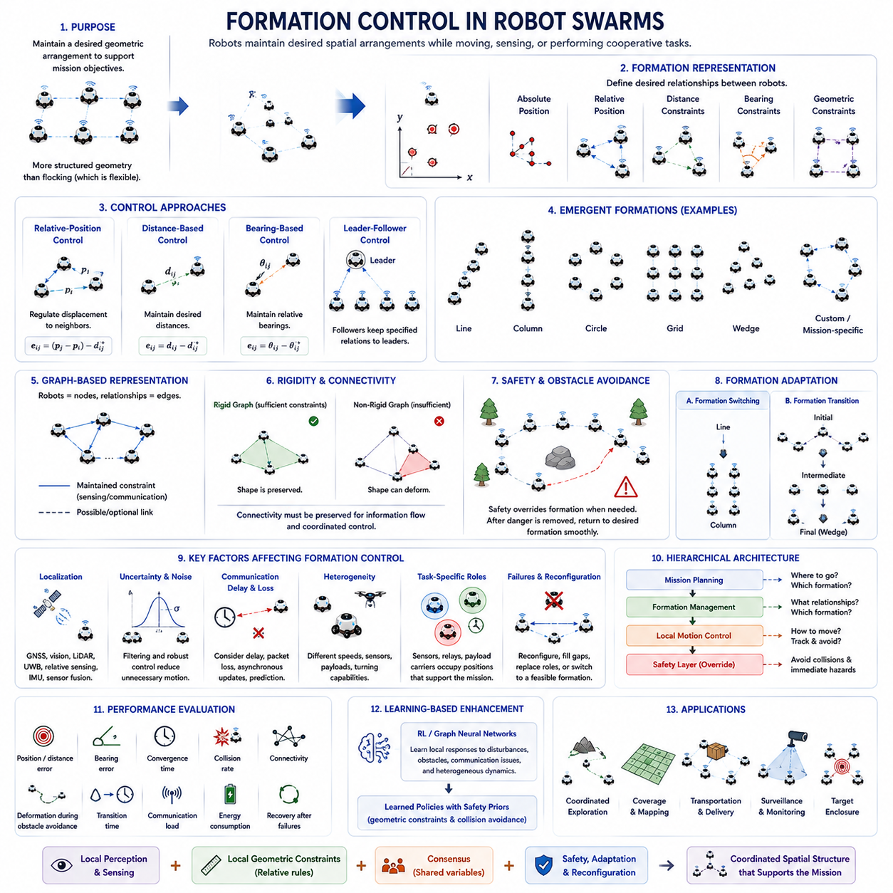{width="7.268055555555556in" height="7.268055555555556in"}

대형 제어(Formation Control)는 여러 로봇이 이동, 센싱 또는 협력 작업을 수행하면서 원하는 공간적 배열(Spatial Arrangement)을 유지하도록 하는 기술이다. 유연한 기하학적 구조를 유지하면서 일관된 집단 이동을 강조하는 군집 이동(Flocking)과 달리, 대형 제어는 로봇 사이에 명시적인 기하학적 관계(Geometric Relationships)를 도입한다. 이를 통해 군집은 선, 종대, 원, 격자, 쐐기 또는 임무에 특화된 다양한 구조로 조직될 수 있다.

원하는 대형은 절대 위치(Absolute Positions), 상대 위치(Relative Positions), 거리(Distances), 방위(Bearings) 또는 기하학적 제약 조건(Geometric Constraints)을 통해 표현할 수 있다. 중앙집중형 접근법에서는 조정기(Coordinator)가 모든 로봇의 기준 위치를 계산할 수 있다. 반면 분산 대형 제어(Distributed Formation Control)에서는 각 로봇이 선택된 이웃의 정보를 이용하여 자신의 위치를 조절하며, 다수의 국소적인 공간 관계가 결합된 결과로 전역 대형(Global Formation)이 형성된다.

상대 위치 제어(Relative-Position Control)는 가장 직관적인 접근법 중 하나이다. 각 로봇은 자신과 주변 로봇 사이의 상대 변위(Relative Displacement)를 측정하거나 추정하고 이를 원하는 변위와 비교한다. 이 차이는 보정 움직임을 발생시키는 대형 오차(Formation Error)가 된다. 주변 로봇들이 이러한 국소 오차를 반복적으로 감소시키면 상대적인 제약 조건들의 집합을 통해 전체 집단에서 원하는 기하학적 구조를 형성할 수 있다.

거리 기반 대형 제어(Distance-Based Formation Control)는 로봇들이 반드시 공통된 전역 좌표계(Global Coordinate Frame)에 동의하지 않더라도 선택된 이웃과 지정된 거리를 유지하도록 한다. 각 로봇은 측정된 로봇 간 거리가 원하는 값과 다를 경우 자신의 움직임을 조정한다. 충분히 구조화된 거리 제약 네트워크는 제어기의 분산 특성을 유지하면서 전체 대형의 기하학적 구조를 정의할 수 있다.

방위 기반 제어(Bearing-Based Control)는 로봇 사이의 거리만을 이용하는 대신 한 로봇에서 다른 로봇을 바라보는 방향에 초점을 맞춘다. 로봇들은 상대 방위(Relative Bearing)를 조절하여 기하학적 형상과 방향 관계를 유지한다. 이러한 방법은 센싱 시스템이 거리보다 방향 관측을 더 정확하게 제공하는 경우에 유용할 수 있다. 센싱 아키텍처가 두 정보를 모두 지원한다면 거리와 방위 정보를 결합할 수도 있다.

리더-팔로워 제어(Leader-Follower Control)는 일반적으로 사용되는 또 다른 대형 전략이다. 하나 이상의 리더(Leader)가 임무 궤적(Mission Trajectory)을 따라 이동하고, 팔로워(Follower)는 리더 또는 주변 팔로워와 지정된 관계를 유지한다. 이 구조는 대형 전체에 전역 이동 방향을 전달하기 쉽지만 영구적인 리더에 대한 의존성은 취약성을 만들 수 있다. 다중 리더(Multi-Leader), 가상 리더(Virtual Leader), 리더 전환(Leader Switching) 전략을 통해 이러한 의존성을 줄이고 강건성(Robustness)을 향상시킬 수 있다.

가상 구조 접근법(Virtual Structure Approach)은 전체 대형을 하나의 기하학적 객체처럼 취급한다. 로봇들은 가상 구조 내부의 위치를 할당받으며, 가상 구조의 움직임에 따라 각 로봇의 기준 궤적이 결정된다. 이러한 방법은 정밀한 대형 형상과 조정된 이동을 제공할 수 있지만, 순수한 국소 분산 방식보다 일반적으로 더 높은 수준의 동기화(Synchronization)와 공유 기준(Shared Reference)에 대한 정보를 필요로 한다.

그래프 이론(Graph Theory)은 분산 대형 제어를 표현하기 위한 자연스러운 방법을 제공한다. 로봇은 노드(Node)로 표현되고 센싱, 통신 또는 기하학적 제약은 에지(Edge)가 된다. 각 에지는 해당 로봇들이 유지해야 하는 정보 또는 관계를 정의한다. 이렇게 형성된 그래프는 대형 정보가 어떻게 전파되는지, 그리고 개별 통신 연결이 변화하거나 사라질 때 원하는 기하학적 구조를 유지할 수 있는지를 결정한다.

대형 강성(Formation Rigidity)은 이러한 표현에서 중요한 개념이다. 거리 제약 조건의 집합은 대형이 자유롭게 변형되는 것을 방지할 수 있을 만큼 충분한 독립적인 기하학적 정보를 포함해야 한다. 유지되는 제약이 지나치게 적으면 로봇들이 각자의 국소 거리를 만족하더라도 전체 형상이 예상하지 못한 방식으로 변화할 수 있다. 따라서 강성 분석(Rigidity Analysis)은 국소적인 관계만으로 원하는 집단 기하학적 구조를 유지할 수 있는지를 판단하는 데 도움을 준다.

대형 제어는 충돌 회피(Collision Avoidance)와 함께 작동해야 한다. 원하는 상대 위치는 일반적으로 안전한 간격을 유지하도록 설정되지만, 외부 교란, 추적 오차, 장애물 또는 갑작스러운 로봇 움직임으로 인해 일시적인 충돌 위험이 발생할 수 있다. 필요한 경우 안전 필수 국소 제어(Safety-Critical Local Control)가 대형 명령보다 우선할 수 있다. 위험이 제거되면 로봇은 원하는 대형 관계로 부드럽게 복귀해야 한다.

장애물 회피(Obstacle Avoidance)는 기하학적 정확도와 환경 적응성(Environmental Adaptability) 사이에 근본적인 절충 관계를 발생시킨다. 좁은 통로나 큰 장애물을 통과할 때는 강체형 대형(Rigid Formation)을 유지하는 것이 불가능할 수 있다. 실제 시스템에서는 대형을 일시적으로 변형하거나 압축하고, 확장하거나 분리하며, 로봇의 순서를 변경할 수 있다. 환경적 제약이 사라지면 분산 제어를 통해 선호하는 기하학적 구조를 다시 구성할 수 있다.

대형 전환(Formation Switching)은 군집이 의도적으로 기하학적 구조를 변경하도록 함으로써 이러한 능력을 확장한다. 개방된 지형에서는 넓은 선형 대형이 효과적인 센싱 커버리지를 제공할 수 있지만 좁은 통로에서는 종대가 더 적합할 수 있다. 원형 배열은 목표를 포위하는 데 사용할 수 있고, 쐐기형 대형은 특정 방향으로 이동하는 데 유용할 수 있다. 따라서 대형 선택(Formation Selection)은 상위 수준의 임무 계획(Mission Planning)의 일부가 될 수 있다.

대형 사이의 전환은 신중하게 조정되어야 한다. 모든 로봇이 새로운 목표 위치를 향해 즉시 이동하면 이동 궤적이 서로 교차하면서 충돌이나 혼잡이 발생할 수 있다. 대형 전환 알고리즘(Formation-Transition Algorithm)은 새로운 위치를 할당하고 이동 순서를 결정하거나 중간 구조(Intermediate Structure)를 생성할 수 있다. 목표는 안전성, 연결성, 적절한 임무 성능을 유지하면서 서로 다른 구성 사이를 이동하는 것이다.

연결성(Connectivity)은 이러한 전환 과정에서 특히 중요하다. 로봇들은 센싱, 통신 또는 제어 정보를 얻기 위해 주변 에이전트에 의존하는 경우가 많다. 로봇들이 지나치게 멀어지면 상호작용 그래프(Interaction Graph)가 단절되어 분산 제어기가 조정을 유지하지 못할 수 있다. 따라서 대형 제어는 충분한 기하학적 유연성을 허용하면서도 주변 로봇들이 지나치게 멀어지지 않도록 제한하는 연결성 제약(Connectivity Constraints)을 포함할 수 있다.

위치 추정 품질(Localization Quality)은 대형의 정확도에 큰 영향을 준다. 로봇은 위성항법시스템(GNSS), 시각 위치 추정(Visual Localization), 라이다(LiDAR), 초광대역 거리 측정(Ultra-Wideband Ranging), 상대 비전(Relative Vision), 관성 센싱(Inertial Sensing) 또는 이러한 기술들의 조합을 사용할 수 있다. 절대 위치 정보는 전역 대형 제어를 단순화할 수 있으며, 상대 센싱은 전역 위치 정보를 사용할 수 없는 환경에서도 운용을 가능하게 한다. 모든 환경에서 동일하게 신뢰할 수 있는 단일 센싱 방식은 없기 때문에 센서 융합(Sensor Fusion)이 필요한 경우가 많다.

측정 불확실성(Measurement Uncertainty)은 지속적인 대형 오차를 발생시킬 수 있다. 상대 위치, 방위, 속도 또는 방향 추정에 포함된 잡음으로 인해 로봇이 실제로는 필요하지 않은 작은 편차까지 계속 보정할 수 있다. 필터링(Filtering)과 불확실성 인식 제어(Uncertainty-Aware Control)는 이러한 불필요한 움직임을 줄일 수 있다. 대형의 정확도를 유지하면서 진동, 과도한 에너지 소비 또는 액추에이터 마모를 방지하려면 반응성과 잡음 민감도 사이의 균형이 필요하다.

통신 지연(Communication Delay)과 패킷 손실(Packet Loss)도 유사한 문제를 발생시킨다. 로봇이 주변 로봇의 오래된 정보를 수신하면 이미 변경된 위치를 기준으로 반응할 수 있다. 빠르게 이동하는 대형에서는 이러한 지연이 국소 피드백 루프(Local Feedback Loop)를 불안정하게 만들 수 있다. 따라서 분산 대형 알고리즘은 통신 주기, 비동기 갱신(Asynchronous Updates), 메시지 손실, 예측(Prediction), 로봇의 물리적 동역학을 고려해야 한다.

로봇의 이질성(Robot Heterogeneity)은 또 다른 복잡성을 추가한다. 이기종 군집(Heterogeneous Swarm)은 서로 다른 속도, 센싱 범위, 탑재 능력, 회전 능력을 가진 지상 로봇이나 공중 로봇으로 구성될 수 있다. 대형의 기하학적 구조와 제어 규칙은 이러한 차이를 고려해야 한다. 빠른 로봇은 더 적극적으로 위치를 변경할 수 있지만, 느리거나 무거운 화물을 운반하는 로봇은 전체 대형의 가능한 속도와 곡률을 결정할 수 있다.

대형 제어에는 임무에 특화된 역할(Task-Specific Roles)을 포함할 수도 있다. 센서가 장착된 로봇은 환경 관측을 극대화할 수 있는 위치에 배치하고, 통신 중계 로봇(Communication Relay)은 네트워크 연결성이 가장 높은 위치를 유지하며, 화물을 운반하는 로봇은 보호된 위치에 배치할 수 있다. 이 경우 대형은 단순한 기하학적 패턴을 넘어 집단 임무의 기능적 요구사항을 지원하는 공간적 조직(Spatial Organization)이 된다.

강건성을 확보하려면 대형이 로봇의 고장을 허용할 수 있어야 한다. 하나의 로봇이 작동을 중단하면 나머지 구성원들은 발생한 빈 공간을 채우거나 위치를 재분배하고, 중요한 역할을 수행할 새로운 로봇을 선택해야 할 수 있다. 분산 재구성(Distributed Reconfiguration)을 이용하면 전체 임무를 중단하지 않고도 대형을 적응시킬 수 있다. 원하는 기하학적 구조를 근사적으로 유지하거나 더 적은 수의 로봇으로 구현 가능한 새로운 구조로 변경할 수도 있다.

확장성(Scalability)은 대형 관계를 어떻게 정의하는가에 따라 달라진다. 모든 로봇을 추적하는 중앙집중형 제어기는 군집 규모가 증가함에 따라 계산량과 통신량이 증가할 수 있다. 국소 그래프 기반 제어(Local Graph-Based Control)는 각 로봇이 제한된 이웃과 상호작용하기 때문에 더욱 효과적으로 확장될 수 있다. 그러나 대규모 대형에서는 정보 전파, 동기화, 강성, 전역 일관성(Global Consistency)과 관련된 추가적인 문제가 발생한다.

대형 제어와 합의(Consensus)는 밀접하게 관련되어 있다. 로봇들은 상대적인 기하학적 구조를 유지하는 동시에 공통 속도, 방향, 대형 크기 또는 기준 방향에 합의해야 할 수 있다. 합의 알고리즘(Consensus Algorithm)은 이러한 공유 변수를 동기화하고, 대형 제약 조건은 공간적 관계를 조절한다. 두 메커니즘을 결합하면 개별 로봇이 서로 상충되는 움직임을 시도하지 않으면서 전체 대형이 일관되게 이동할 수 있다.

대형 제어는 군집 이동(Flocking)과도 밀접한 관련이 있지만 더욱 강한 기하학적 요구조건을 가진다. 군집 이동은 일반적으로 정확한 상대 위치를 요구하지 않고 응집, 정렬, 충돌 회피를 목표로 한다. 반면 대형 제어는 구성원 사이에 보다 구조화된 관계를 정의한다. 실제 군집 시스템에서는 정밀한 기하학적 구조가 중요할 때 대형 제어를 사용하고, 환경에 대한 유연성이 더 중요할 때 군집 이동과 유사한 행동을 사용하는 방식으로 두 접근법을 결합할 수 있다.

학습 기반 방법(Learning-Based Methods)은 고전적인 대형 제어기를 확장할 수 있다. 강화학습(Reinforcement Learning)은 외부 교란, 장애물, 통신 장애, 이기종 동역학에 대한 국소 반응을 최적화할 수 있다. 그래프 신경망(Graph Neural Network)은 주변 로봇 사이의 상호작용을 표현하고 변화하는 그래프 구조에 일반화할 수 있는 분산 정책을 학습할 수 있다. 고전적인 기하학적 제약은 학습 기반 제어에서도 안전 또는 구조적 사전 지식(Structural Prior)으로 유지될 수 있다.

계층적 아키텍처(Hierarchical Architecture)는 임무 계획, 대형 관리, 국소 운동 제어를 결합할 수 있다. 상위 수준 계획기(High-Level Planner)는 집단이 어디로 이동해야 하는지 또는 어떤 대형이 적절한지를 결정한다. 분산 대형 계층(Distributed Formation Layer)은 원하는 로봇 간 관계를 결정하고, 국소 제어기(Local Controller)는 물리적으로 실행 가능한 명령을 생성한다. 즉각적인 위험이 탐지되는 경우 안전 메커니즘은 이러한 명령보다 우선할 수 있다.

물리적 군집에 대형 알고리즘을 배치하기 전에 시뮬레이션(Simulation)을 통한 검증이 필수적이다. 서로 다른 대형 규모, 초기 조건, 장애물 배치, 센싱 오차, 통신 지연, 로봇 고장, 동적 교란을 포함하여 시험해야 한다. 시뮬레이션은 이상적인 수학적 분석에서는 나타나지 않을 수 있는 불안정성, 충돌, 그래프 단절(Graph Disconnection), 부적절한 대형 전환 행동 등을 발견하는 데 도움을 준다.

평가(Evaluation)에서는 기하학적 정확성과 임무 수준의 성능을 모두 측정해야 한다. 관련 지표에는 위치 또는 거리 오차, 방위 오차(Bearing Error), 대형 수렴 시간(Formation Convergence Time), 충돌률, 연결성, 장애물 회피 과정의 변형 정도, 대형 전환 시간, 통신 부하, 에너지 소비, 장애 이후의 복구 성능 등이 포함된다. 대형을 정밀하게 유지하는 과정에서 안전성이나 임무 효율이 크게 저하된다면 가장 기하학적으로 정확한 대형이 반드시 최선의 대형이라고 할 수는 없다.

궁극적으로 대형 제어는 분산된 로봇들을 집단 센싱, 이동, 통신, 작업 수행을 지원할 수 있는 조정된 공간 구조(Coordinated Spatial Structure)로 변화시킨다. 국소 기하학적 제약, 그래프 관계, 합의, 안전 제어, 적응, 재구성을 결합함으로써 로봇 군집은 동적으로 변화하는 물리적 환경에서도 유용한 조직 구조를 유지할 수 있다. 이러한 능력은 협력 탐색(Coordinated Exploration), 커버리지(Coverage), 운송(Transportation), 감시(Surveillance) 및 기타 다중 로봇 물리 인공지능(Multi-Robot Physical AI) 임무를 위한 중요한 기반을 제공한다.

## 02.08. Dispersion Coverage and Exploration

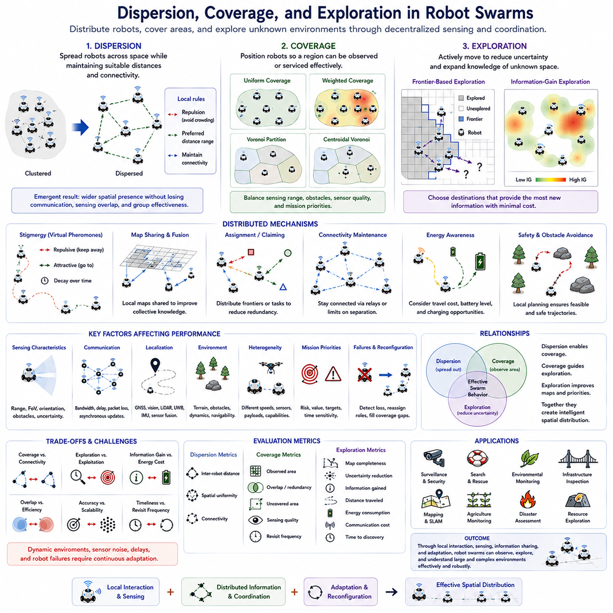{width="7.268055555555556in" height="7.268055555555556in"}

분산(Dispersion)은 로봇들이 작은 영역에 집중되어 머무르지 않고 환경 전체에 걸쳐 자신들을 분포시키는 과정이다. 군집 로보틱스(Swarm Robotics)에서 분산은 주변 에이전트 사이에 적절한 거리를 유지하면서 집단의 공간적 활동 범위를 확대할 수 있게 한다. 목표는 단순히 로봇 사이의 거리를 최대화하는 것이 아니라 센싱, 통신, 안전, 임무 성능을 지원하는 유용한 공간 분포(Spatial Distribution)를 형성하는 것이다.

기본적인 분산 행동은 국소 반발력(Local Repulsion)을 통해 생성할 수 있다. 주변 로봇들이 지나치게 가까워지면 각 로봇은 국소 밀도(Local Density)가 높은 영역에서 벗어나는 방향으로 움직인다. 이러한 상호작용이 군집 전체에서 반복되면서 처음에 밀집되어 있던 로봇들이 사용 가능한 공간으로 점진적으로 퍼진다. 각 로봇의 정확한 목적지를 중앙 제어기(Central Controller)가 계산하지 않아도 분산된 국소 상호작용을 통해 공간적 분포가 출현할 수 있다.

그러나 순수한 반발력만 사용하면 지나친 분리 또는 군집의 분열(Fragmentation)이 발생할 수 있다. 따라서 실제 분산 메커니즘은 통신, 센싱 중첩(Sensing Overlap), 집단 연결성(Group Connectivity)을 유지하는 제약 조건과 반발력을 함께 사용한다. 로봇은 단순히 가능한 한 멀리 떨어지는 대신 선호 거리 범위(Preferred Distance Range)를 유지할 수 있다. 이러한 균형을 통해 조정된 집단 행동에 필요한 관계를 잃지 않으면서 더 넓은 영역을 점유할 수 있다.

커버리지(Coverage)는 분산에 명시적인 목표를 추가한 개념이다. 즉, 군집 구성원들이 특정 영역, 경계, 표면 또는 일련의 지점을 효과적으로 관측하거나 서비스할 수 있도록 배치되어야 한다. 커버리지는 감시(Surveillance), 검사(Inspection), 환경 모니터링(Environmental Monitoring), 매핑(Mapping), 농업, 수색 작업, 인프라 평가 등에 중요하다. 원하는 분포는 센서 범위, 환경 형상, 로봇 능력, 임무 우선순위에 따라 달라진다.

균일 커버리지(Uniform Coverage)는 센싱 자원을 환경 전체에 비교적 균등하게 분배하는 것을 목표로 한다. 모든 로봇이 유사한 센싱 능력을 가지고 모든 위치의 중요도가 동일하다면 군집은 불필요한 센싱 중첩을 줄이면서 미관측 영역이 발생하지 않도록 할 수 있다. 각 로봇이 주변 로봇과 환경 경계에 반응하면서 센싱 책임이 전체 영역에 분산되는 공간적 구성을 형성할 수 있다.

모든 환경에서 균일한 커버리지가 필요한 것은 아니다. 일부 위치는 더 높은 불확실성(Uncertainty), 위험성, 자원 가치 또는 목표물이 존재할 가능성을 가질 수 있다. 가중 커버리지(Weighted Coverage)는 서로 다른 영역에 서로 다른 중요도를 부여한다. 이를 통해 로봇들은 우선순위가 높은 영역에 더 높은 밀도로 집중하고 중요도가 낮은 영역에는 적은 수의 로봇을 배치하여 제한된 로봇 자원을 단순한 기하학적 면적이 아니라 임무 가치에 따라 사용할 수 있다.

보로노이 기반 방법(Voronoi-Based Methods)은 분산 커버리지를 위한 유용한 기하학적 프레임워크를 제공한다. 환경을 보로노이 셀(Voronoi Cell)로 분할하여 선택된 거리 척도에 따라 각 위치를 가장 가까운 로봇에게 할당할 수 있다. 이후 각 로봇은 자신의 셀을 대표하는 지점, 예를 들어 중심점(Centroid)을 향해 이동할 수 있으며, 이를 통해 집단 전체가 국소적인 공간 책임에 따라 분포할 수 있다.

중심 보로노이 구성(Centroidal Voronoi Configuration)은 로봇들이 연속된 영역에서 커버리지를 균형 있게 유지해야 할 때 특히 유용하다. 각 로봇은 자신의 국소 셀을 반복적으로 추정하고 적절한 중심점을 계산한 후 해당 위치를 향해 이동한다. 로봇의 위치가 변화하면 공간 분할도 변경되고 계산이 다시 수행된다. 이러한 피드백 과정을 통해 모든 로봇이 전체 환경을 중앙에서 최적화하지 않아도 효율적인 공간 배열을 점진적으로 형성할 수 있다.

커버리지 품질(Coverage Quality)은 센싱 특성에 크게 좌우된다. 장거리 카메라, 라이다(LiDAR), 레이더(Radar), 음향 센서 또는 환경 센서를 가진 로봇은 다른 로봇보다 더 넓은 영역을 커버할 수 있다. 장애물과 가림(Occlusion)은 실제 센싱 범위를 감소시킬 수 있다. 따라서 기하학적 거리만으로 실제 커버리지를 표현하기 어려우며, 실제 알고리즘에서는 가시성(Visibility), 센서 방향, 시야(Field of View), 지형, 센싱 불확실성을 고려해야 한다.

탐색(Exploration)은 환경이 처음부터 알려져 있지 않거나 부분적으로만 알려져 있다는 점에서 정적인 커버리지와 다르다. 로봇은 새로운 정보를 획득하기 위해 미탐색 공간을 이동하면서 동시에 어떤 위치에서 추가적인 관측이 가장 가치 있는지를 판단해야 한다. 따라서 집단의 목표는 단순히 공간을 점유하는 것이 아니라 조정된 이동과 분산 센싱(Distributed Sensing)을 통해 환경에 대한 불확실성을 감소시키는 것이다.

프런티어 기반 탐색(Frontier-Based Exploration)은 미지 환경에서 일반적으로 사용되는 접근법이다. 프런티어(Frontier)는 탐색된 공간과 아직 탐색되지 않은 공간 사이의 경계를 의미한다. 로봇들은 자신의 국소 지도(Local Map) 또는 공유 지도(Shared Map)에서 후보 프런티어를 탐지하고 서로 다른 프런티어 영역으로 이동할 수 있다. 여러 프런티어에 로봇을 분산하면 알려진 공간을 병렬적으로 확장하여 단일 로봇보다 넓은 환경을 빠르게 매핑할 수 있다.

조정이 없다면 여러 로봇이 동일한 프런티어를 선택하여 중복 탐색(Redundant Exploration)이 발생할 수 있다. 분산 할당 메커니즘(Distributed Assignment Mechanism)은 거리, 예상 정보 이득(Expected Information Gain), 현재 로봇 밀도, 에너지 비용 또는 다른 로봇이 이미 선택한 영역 등을 고려하여 이러한 중복을 줄일 수 있다. 각 에이전트는 주변 로봇과 불필요하게 경쟁하지 않으면서 새로운 정보를 효과적으로 제공하는 목적지를 선택할 수 있다.

정보 이득(Information Gain)은 보다 일반적인 탐색 기준을 제공한다. 로봇은 단순히 지리적으로 탐색되지 않은 위치를 선택하는 대신 미래의 관측이 불확실성을 얼마나 감소시킬 수 있는지를 추정한다. 기하학적 구조가 불확실한 영역, 충분히 관측되지 않은 객체, 모호한 의미 정보(Semantic Information), 불완전한 센서 커버리지를 가진 영역에는 더 높은 가치를 부여할 수 있다. 이를 통해 탐색은 단순한 공간 확장이 아니라 능동적 정보 획득(Active Information Acquisition) 과정이 된다.

탐색에서는 활용(Exploitation)과 탐색(Exploration) 사이의 균형이 필요하다. 활용은 이미 가치가 있다고 판단된 위치로 로봇을 이동시키고, 탐색은 유용한 발견이 존재할 가능성이 있는 불확실한 영역으로 로봇을 이동시킨다. 지나친 활용은 군집을 특정 영역에 성급하게 집중시킬 수 있으며, 지나친 탐색은 가치가 낮은 영역에 자원을 낭비할 수 있다. 적응형 정책(Adaptive Policy)은 임무에 관한 지식이 증가함에 따라 이 균형을 변화시킬 수 있다.

스티그머지(Stigmergy)는 지속적인 전역 통신(Global Communication)을 요구하지 않으면서 분산 탐색을 지원할 수 있다. 로봇은 방문한 위치, 탐색된 경로, 위험 요소 또는 추가적인 관측이 필요한 영역을 나타내는 가상 표식(Virtual Marker)을 남길 수 있다. 다른 로봇은 자신의 이동을 결정할 때 이러한 흔적을 이용한다. 가상 페로몬(Virtual Pheromone)은 시간이 지나면서 감소하도록 하여 환경이 변화할 것으로 예상되는 경우 이전에 탐색했던 영역도 다시 방문할 수 있도록 만들 수 있다.

반발형 가상 페로몬(Repulsive Virtual Pheromone)은 최근 탐색한 영역을 로봇들이 반복적으로 방문하는 것을 방지할 수 있다. 반대로 인력형 표식(Attractive Marker)은 목표, 충전소, 통신 지점 또는 추가적인 센싱이 필요한 위치를 표시할 수 있다. 인력형 및 반발형 환경 신호를 결합하면 비교적 단순한 국소 의사결정 규칙을 유지하면서 간접적인 조정을 통해 군집의 공간적 분포를 제어할 수 있다.

통신이 가능한 경우 지도 공유(Map Sharing)는 집단 탐색의 효율성을 향상시킬 수 있다. 각 로봇은 자신의 이동 경로를 따라 관측 정보를 구축하고 선택된 지도 정보를 다른 에이전트와 교환한다. 분산 지도 융합(Distributed Map Fusion)을 통해 하나의 로봇이 발견한 정보를 다른 로봇의 의사결정에 반영할 수 있다. 그러나 통신 대역폭, 일치하지 않는 좌표계, 위치 추정 누적 오차(Localization Drift), 중복 관측, 지연된 갱신 등은 대규모 다중 로봇 매핑을 복잡하게 만든다.

연결성(Connectivity)은 탐색 과정에서 중요한 절충 관계를 만든다. 로봇들이 서로 멀리 분산되면 더 많은 독립적인 영역을 관측할 수 있지만, 지나친 분리는 통신 연결을 끊을 수 있다. 연결된 통신 그래프(Connected Communication Graph)를 유지하려면 통신 중계 로봇(Relay Robot)이나 로봇 간 거리에 대한 제약이 필요할 수 있다. 다른 임무에서는 로봇이 정보를 국소적으로 저장하고 통신이 다시 가능해졌을 때 동기화할 수 있다면 일시적인 연결 단절을 허용할 수도 있다.

에너지(Energy) 역시 분산과 탐색에 영향을 준다. 먼 프런티어로 이동하는 로봇은 가치 있는 정보를 획득할 수 있지만 상당한 배터리를 소비하고 복귀하거나 충전하지 못할 위험이 있다. 에너지 인식 정책(Energy-Aware Policy)은 이동 비용, 잔여 배터리, 충전 위치, 지형 난이도, 예상 임무 가치를 고려한다. 물리적 자원 제약을 고려하면 가장 많은 정보를 제공하는 목적지가 반드시 가장 좋은 목적지는 아닐 수 있다.

장애물 회피(Obstacle Avoidance)와 이동 가능성(Navigability)은 커버리지 목표와 통합되어야 한다. 수학적으로 이상적인 위치라도 벽, 지형, 동적 장애물 또는 로봇의 운동학적 제약(Kinematic Constraints)으로 인해 접근할 수 없을 수 있다. 따라서 각 로봇은 상위 수준의 커버리지 또는 탐색 정책 아래에 국소 운동 계획(Local Motion Planning)과 안전 제어를 갖추어야 한다. 원하는 공간적 분포는 최종적으로 물리적으로 실행 가능하고 안전한 이동 궤적으로 변환되어야 한다.

동적 환경(Dynamic Environment)은 커버리지를 일회성 최적화가 아니라 지속적인 과정으로 만든다. 사람, 차량, 위험 요소, 객체 또는 환경 조건은 특정 영역을 관측한 이후에도 변화할 수 있다. 로봇은 불확실성 증가, 사건 발생 확률, 경과 시간 또는 임무 우선순위에 따라 특정 영역을 다시 방문해야 할 수 있다. 따라서 지속적 커버리지(Persistent Coverage)는 공간적 분포와 반복적인 관측의 시간적 스케줄링(Temporal Scheduling)을 결합한다.

이기종 군집(Heterogeneous Swarm)은 탐색 과정에서 서로 보완적인 능력을 활용할 수 있다. 공중 로봇은 넓은 영역을 빠르게 조사하고, 지상 로봇은 특정 위치를 더욱 상세하게 검사하며, 특수 플랫폼은 열, 음향, 화학 또는 조작 센서를 탑재할 수 있다. 커버리지 알고리즘은 모든 로봇을 동일한 에이전트로 취급하는 대신 이러한 능력에 따라 공간적 책임을 할당할 수 있다.

로봇 고장이 발생하면 군집은 커버리지 책임을 다시 분배해야 한다. 하나의 로봇이 사용할 수 없게 되면 해당 로봇이 담당하던 영역의 관측이 불충분해질 수 있다. 주변 로봇은 발생한 커버리지 공백(Coverage Gap)을 감지하고 자신의 담당 영역을 확장하며, 다른 로봇이 미관측 영역으로 이동할 수도 있다. 이러한 자기 재구성(Self-Reconfiguration)을 통해 개별 구성원의 고장이 발생하더라도 전체 커버리지 품질이 즉시 붕괴하지 않고 점진적으로 저하되도록 할 수 있다.

확장성(Scalability)은 분산형 분산 및 탐색의 주요 장점이다. 국소 상호작용, 이웃 통신, 지역별 책임을 활용하면 모든 로봇이 군집 전체의 상태를 처리할 필요성을 줄일 수 있다. 로봇 수가 증가하면 더 많은 영역에서 탐색을 병렬적으로 수행할 수 있다. 그러나 집단 규모가 커지면 혼잡, 통신 트래픽, 센싱 중첩, 유용한 목적지를 둘러싼 경쟁 역시 증가할 수 있다.

학습 기반 방법(Learning-Based Methods)은 복잡한 환경에서 탐색 정책을 향상시킬 수 있다. 강화학습(Reinforcement Learning)은 장기적인 임무 성능을 기준으로 목적지 선택, 통신, 조정, 불확실성에 대한 반응을 최적화할 수 있다. 그래프 신경망(Graph Neural Network)은 주변 로봇 간의 상호작용을 표현할 수 있으며, 학습된 표현(Learned Representation)은 센서 관측으로부터 정보 가치를 추정할 수 있다. 고전적인 커버리지 원리는 이러한 학습 정책에 유용한 제약과 구조를 제공할 수 있다.

평가(Evaluation)에서는 분산, 커버리지, 탐색의 성능을 구분하여 측정해야 한다. 분산은 로봇 간 거리, 공간적 균일성(Spatial Uniformity), 연결성으로 평가할 수 있다. 커버리지 지표에는 관측 영역, 중첩 영역, 미관측 영역, 센싱 품질, 재방문 빈도(Revisit Frequency)가 포함된다. 탐색에서는 추가적으로 지도 완성도(Map Completeness), 불확실성 감소, 정보 획득량, 이동 거리, 에너지 소비, 통신 비용, 중요한 영역을 발견하는 데 필요한 시간을 측정할 수 있다.

강건한 평가(Robust Evaluation)는 로봇 고장, 통신 단절, 센서 잡음 또는 예상하지 못한 환경 변화가 발생했을 때 성능이 어떻게 변화하는지도 확인해야 한다. 이상적인 조건에서만 뛰어난 커버리지를 달성하는 군집은 실제 배치 환경에서 낮은 성능을 보일 수 있다. 효과적인 시스템은 불확실성 속에서도 로봇을 다시 분산하고, 탐색 우선순위를 수정하며, 필요한 경우 연결성을 복구하고, 지속적으로 유용한 정보를 획득할 수 있어야 한다.

분산, 커버리지, 탐색은 함께 공간적 분포를 지능적인 집단 능력(Collective Capability)으로 변화시킨다. 분산은 로봇들을 유용한 위치에 퍼뜨리고, 커버리지는 환경 전체의 센싱 책임을 조직하며, 탐색은 미지 또는 불확실한 영역으로 지식을 능동적으로 확장한다. 국소 상호작용(Local Interaction), 분산 센싱, 정보 공유, 적응(Adaptation), 물리적 이동을 통해 로봇 군집은 어떤 개별 로봇도 단독으로 처리할 수 없는 훨씬 넓은 공간을 관측하고 이해할 수 있다.

## 02.09. Swarm Search and Target Discovery

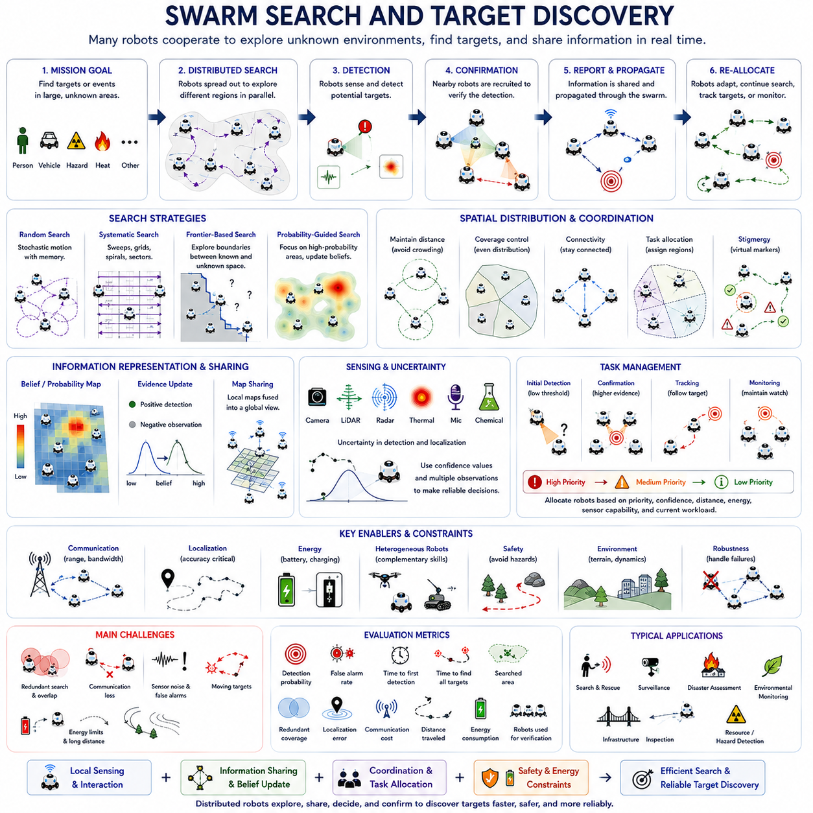{width="7.268055555555556in" height="7.268055555555556in"}

군집 수색(Swarm Search)은 여러 로봇이 협력하여 환경을 탐색하면서 목표물, 사건, 자원 또는 관심 영역을 찾아내는 분산형 과정이다. 전체 수색 문제를 하나의 로봇이나 중앙집중형 계획기(Centralized Planner)에 맡기는 대신 다수의 에이전트가 수색 작업을 분담한다. 이들의 이동성과 센싱 능력을 결합하면 더 넓은 공간을 병렬적으로 조사하고 목표물을 더욱 빠르게 발견할 수 있다.

목표물 발견(Target Discovery)은 군집 탐색에 군집이 탐지해야 할 특정 객체나 조건을 추가한다. 목표물은 사람, 차량, 손상된 구조물, 위험 물질, 열원, 음향 사건, 생물학적 신호 또는 기타 임무 관련 현상일 수 있다. 따라서 로봇은 공간적 수색과 센싱 및 해석을 결합하여 미탐색 공간을 잠재적인 목표 위치에 대한 증거로 변환해야 한다.

군집의 근본적인 장점은 병렬성(Parallelism)에 있다. 하나의 로봇은 특정 시점에 환경의 제한된 부분만 조사할 수 있지만 다수의 로봇은 서로 다른 영역을 동시에 수색할 수 있다. 군집이 효과적으로 분산되면 넓은 환경을 조사하는 데 필요한 시간을 크게 단축할 수 있다. 그러나 로봇 수를 단순히 증가시키는 것만으로 성능이 향상되는 것은 아니며, 중복 수색(Redundant Search)과 혼잡(Congestion)은 집단 자원을 낭비할 수 있다.

따라서 효과적인 수색은 공간적 분산(Spatial Distribution)에서 시작한다. 로봇들은 임무에 필요한 연결성(Connectivity), 센싱 중첩(Sensing Overlap), 안전성을 유지하면서 서로 다른 영역을 조사할 수 있을 정도로 충분히 분리되어야 한다. 반발력(Repulsion), 커버리지 제어(Coverage Control), 프런티어 할당(Frontier Assignment), 가상 페로몬(Virtual Pheromone), 분산 작업 할당(Distributed Task Allocation)을 이용하여 과도한 군집화를 방지할 수 있다. 결과적인 수색 패턴은 단순한 물리적 분리보다 유용한 관측을 극대화해야 한다.

무작위 수색(Random Search)은 사전 정보가 거의 없는 경우 사용할 수 있는 간단한 분산 전략이다. 로봇들은 장애물과 최근 방문한 영역을 회피하면서 확률적 규칙(Stochastic Rules)에 따라 이동한다. 무작위 이동은 상세한 전역 계획 없이도 결국 넓은 공간을 탐색할 수 있지만 이미 조사한 영역을 반복적으로 방문할 수 있다. 메모리, 환경 표식, 적응형 이동 규칙을 추가하면 순수한 무작위 이동보다 수색 효율을 크게 향상시킬 수 있다.

체계적 수색(Systematic Search)은 보다 구조화된 공간 패턴을 사용한다. 로봇들은 평행 경로, 확장 나선(Expanding Spiral), 섹터(Sector), 격자(Grid) 또는 조정된 커버리지 궤적을 이용하여 영역을 탐색할 수 있다. 서로 다른 에이전트에 서로 다른 영역이나 이동 경로를 할당하면 중첩을 제어하면서 환경을 조사할 수 있다. 이러한 방식은 수색 영역이 알려져 있고 비교적 구조화되어 있을 때 특히 유용하지만 동적 장애물이 존재하면 지속적인 국소 적응(Local Adaptation)이 필요하다.

프런티어 기반 수색(Frontier-Based Search)은 환경 자체가 처음에는 알려져 있지 않은 경우에 유용하다. 로봇은 탐색된 공간과 미탐색 공간 사이의 경계를 식별하고 후보 프런티어에 분산된다. 이후 각 로봇은 목표물을 수색하면서 알려진 영역을 확장한다. 따라서 수색과 매핑(Mapping)이 동시에 수행되며, 지속적으로 향상되는 환경 표현을 목표물 발견에 활용할 수 있다.

목표물이 존재할 확률에 대한 사전 지식(Prior Knowledge)이 있다면 수색 효율을 더욱 높일 수 있다. 모든 위치를 동일하게 취급하는 대신 군집은 목표물이 존재할 가능성을 나타내는 확률 분포(Probability Distribution)를 유지할 수 있다. 로봇은 목표 존재 확률이 높은 영역에 더 많은 센싱 자원을 배치하면서 불확실한 영역에 대한 탐색도 일정 수준 유지한다. 새로운 관측은 이러한 믿음(Belief)을 지속적으로 갱신하고 이후의 수색 결정에 영향을 준다.

이 과정은 분산 믿음 갱신(Distributed Belief Updating)으로 이해할 수 있다. 각 로봇은 자신의 센서를 이용하여 증거를 수집하고 목표물 존재에 대한 국소 추정값(Local Estimate)을 수정한다. 긍정적인 탐지는 관련 위치의 믿음을 증가시키고, 반복적인 부정적 관측은 이를 감소시킬 수 있다. 로봇들이 선택된 믿음이나 관측 정보를 교환하면 환경의 서로 다른 영역에서 수집된 증거를 보다 광범위한 집단 추정(Collective Estimate)에 반영할 수 있다.

센서 불확실성(Sensor Uncertainty)은 목표물 발견을 단순한 위치 도달보다 훨씬 복잡한 문제로 만든다. 카메라, 라이다(LiDAR), 레이더(Radar), 열 센서(Thermal Sensor), 마이크, 화학 탐지기 등의 센싱 방식은 오탐(False Positive)과 미탐(False Negative)을 발생시킬 수 있다. 따라서 단일 관측만으로는 충분하지 않을 수 있다. 로봇은 신뢰도(Confidence)를 유지하면서 여러 번의 측정 결과를 결합한 후 목표물이 발견되었다고 판단할 수 있다.

다중 로봇 확인(Multi-Robot Confirmation)은 탐지 신뢰성을 더욱 향상시킬 수 있다. 하나의 로봇이 잠재적인 목표물을 보고하면 주변 로봇을 해당 위치로 유도하여 서로 다른 시점이나 서로 다른 센서를 이용해 관측할 수 있다. 독립적인 관측 결과가 일치하면 신뢰도가 증가하고, 상충되는 증거가 나타나면 추가 조사를 수행할 수 있다. 이를 통해 군집은 중복 센싱을 단순한 낭비가 아니라 의도적인 검증(Verification) 수단으로 활용한다.

목표물 확인(Target Confirmation)은 초기 탐지(Initial Detection)와 구분해야 한다. 초기 탐지는 중요한 사건을 놓치지 않도록 비교적 완화된 임계값을 사용할 수 있지만, 확인 단계에서는 더 강한 증거를 요구할 수 있다. 이러한 2단계 구조(Two-Stage Structure)를 사용하면 광범위한 수색 단계에서는 높은 민감도를 유지하면서 중요한 자원을 투입하거나 임무 핵심 발견을 보고하기 전에 오경보(False Alarm)를 제어할 수 있다.

스티그머지(Stigmergy)는 수색을 조정하기 위한 분산 메커니즘을 제공한다. 로봇은 최근 수색한 영역, 의심되는 목표물, 위험 요소, 차단된 경로 또는 추가적인 확인이 필요한 위치를 나타내는 가상 표식(Virtual Marker)을 남길 수 있다. 다른 로봇들은 지속적인 직접 통신 없이 이러한 표식에 반응할 수 있다. 반발형 표식(Repulsive Marker)은 중복 수색을 억제하고, 인력형 표식(Attractive Marker)은 유망한 관측 위치로 추가 에이전트를 유도한다.

가상 페로몬 감쇠(Virtual Pheromone Decay)는 동적 환경에서 특히 중요하다. 최근에 수색한 영역에는 처음에는 강한 반발형 표식을 부여할 수 있지만 시간이 지나면서 그 값이 감소하도록 할 수 있다. 목표물이 이동하거나 환경 조건이 변화할 수 있으므로 해당 영역은 결국 다시 수색 대상이 된다. 따라서 수색 행동은 공간적 커버리지뿐만 아니라 시간에 따른 재방문 요구사항(Temporal Revisit Requirement)도 포함할 수 있다.

통신(Communication)을 이용하면 발견된 정보를 군집 전체로 전파할 수 있다. 목표물을 탐지한 로봇은 위치, 신뢰도, 센서 증거, 타임스탬프(Timestamp), 목표물 유형을 주변 에이전트에게 전달할 수 있다. 이후 정보는 여러 통신 홉(Communication Hop)을 거쳐 다른 로봇이나 감독 시스템(Supervisory System)으로 전달될 수 있다. 이러한 분산 전파는 모든 로봇이 중앙 통신 노드와 직접 연결되어야 하는 요구를 감소시킨다.

그러나 통신 제약(Communication Constraints)은 수색 전략에 영향을 준다. 로봇이 지나치게 넓게 분산되면 연결성을 잃을 수 있고, 안정적인 통신을 위해 서로 가까이 유지하면 수색 가능한 공간이 감소할 수 있다. 따라서 수색 제어기는 센싱 커버리지와 네트워크 연결성 사이에서 균형을 유지해야 한다. 통신 중계 로봇(Relay Robot), 이동형 통신 노드, 저장 후 전달(Store-and-Forward) 통신 또는 계획된 랑데부(Rendezvous)를 이용하여 지속적인 연결이 불가능한 임무를 지원할 수 있다.

이동 목표물(Moving Target)은 추가적인 문제를 발생시킨다. 움직이는 목표물이 탐지되면 임무는 수색에서 추적(Tracking)으로 전환될 수 있다. 하나의 로봇이 지속적으로 목표물을 관측하는 동안 다른 로봇들은 더 나은 관측 범위를 확보하거나 예상 이동 경로를 확인하거나 기존 관측자를 교체하기 위해 재배치될 수 있다. 이 과정에서 하나의 목표물을 추적한다고 해서 나머지 환경에 대한 탐색이 불필요하게 중단되지 않도록 수색 자원을 다시 분배해야 한다.

다중 목표물(Multiple Targets)이 존재하면 분산 자원 할당(Distributed Resource Allocation)이 필요하다. 군집은 서로 다른 우선순위, 신뢰도, 검증 요구사항을 가진 여러 목표물을 발견할 수 있다. 로봇들은 몇 대가 계속 수색하고, 몇 대가 기존 탐지를 확인하며, 몇 대가 발견된 목표물을 추적하거나 감시해야 하는지를 결정해야 한다. 따라서 목표물 발견은 단순한 탐지 문제가 아니라 동적 작업 할당(Dynamic Task Allocation) 문제로 확장된다.

우선순위(Priority)는 임무 상황에 따라 달라질 수 있다. 구조가 필요한 사람으로 추정되는 목표물은 즉각적인 확인이 필요할 수 있지만 위험성이 낮은 객체는 이후 검사를 위해 표시만 할 수도 있다. 로봇은 대응 여부를 결정할 때 목표물 중요도, 불확실성, 거리, 센싱 능력, 잔여 에너지, 현재 작업 부하를 평가할 수 있다. 따라서 집단 수색은 인지(Perception)를 임무 수준의 의사결정(Mission-Level Decision-Making)과 직접 연결한다.

에너지 제약(Energy Constraints)은 넓은 수색 영역에서 특히 중요하다. 먼 미탐색 영역이나 의심되는 목표물로 이동하면 가치 있는 정보를 얻을 수 있지만 상당한 배터리를 소비하고 충전 위치로 복귀하지 못할 위험이 있다. 에너지 인식 수색 정책(Energy-Aware Search Policy)은 예상 발견 가치와 이동 비용, 잔여 에너지, 지형, 통신 가능성, 필요한 운용 예비량(Operational Reserve)을 함께 고려한다.

이기종 군집(Heterogeneous Swarm)은 서로 보완적인 센서와 이동 능력을 결합하여 목표물 발견 성능을 향상시킬 수 있다. 공중 로봇은 넓은 영역을 빠르게 조사하고, 지상 로봇은 특정 위치를 근거리에서 상세히 검사하며, 특수 로봇은 열, 음향, 화학 또는 방사선 신호를 탐지할 수 있다. 하나의 플랫폼에서 이루어진 발견이 다른 플랫폼의 확인을 유도함으로써 단일 로봇 유형보다 뛰어난 협력 센싱 시스템(Cooperative Sensing System)을 구성할 수 있다.

위치 추정 정확도(Localization Accuracy)는 목표물을 탐지하더라도 정확한 위치를 알 수 없다면 그 가치가 제한되기 때문에 매우 중요하다. 위성항법시스템(GNSS), 시각 위치 추정(Visual Localization), 라이다 위치 추정(LiDAR Localization), 관성 센싱(Inertial Sensing), 상대 거리 측정(Relative Ranging)의 위치 불확실성은 목표물 좌표에도 영향을 준다. 여러 로봇의 관측을 삼각측량(Triangulation), 기하학적 제약 또는 확률적 센서 융합(Probabilistic Sensor Fusion)으로 결합하면 위치 정확도를 향상시킬 수 있다.

안전성(Safety)은 수색 효율보다 높은 우선순위를 유지해야 한다. 로봇은 수색 시간을 줄이기 위해 위험한 지형에 진입하거나 장애물과 충돌하고 제한 구역을 침범하거나 새로운 위험을 발생시켜서는 안 된다. 필요한 경우 국소 안전 제어기(Local Safety Controller)가 수색 명령보다 우선할 수 있다. 이후 수색 전략은 다른 로봇을 할당하거나 새로운 관측 위치를 선택하거나 해당 영역을 접근 불가능(Inaccessible) 상태로 표시해야 한다.

로봇 고장에 대한 강건성(Robustness)도 군집 수색의 중요한 특성이다. 하나의 로봇이 사용할 수 없게 되더라도 해당 로봇에게 할당된 영역이나 목표물이 영구적으로 방치되어서는 안 된다. 주변 에이전트는 통신 손실이나 완료되지 않은 작업을 감지하고 책임을 다시 분배할 수 있다. 따라서 충분한 센싱 및 이동 자원이 남아 있다면 분산 수색은 일부 구성원이 손실되더라도 점진적인 성능 저하(Graceful Degradation)를 통해 임무를 지속할 수 있다.

학습 기반 접근법(Learning-Based Approach)은 목표물 분포와 환경 구조가 복잡한 상황에서 수색 정책을 개선할 수 있다. 강화학습(Reinforcement Learning)은 임무 수준의 보상(Mission-Level Reward)을 이용하여 이동, 목적지 선택, 통신, 검증 행동을 최적화할 수 있다. 학습 모델은 목표물 존재 가능성이나 정보 가치를 추정할 수 있으며, 그래프 기반 정책(Graph-Based Policy)은 주변 로봇 사이의 변화하는 관계를 이용하여 의사결정을 조정할 수 있다.

수색 성능(Search Performance)은 발견 품질과 자원 효율성을 모두 이용하여 평가해야 한다. 중요한 지표에는 탐지 확률(Probability of Detection), 오경보율(False-Alarm Rate), 최초 탐지 시간(Time to First Detection), 모든 목표물 발견 시간, 수색 영역, 중복 커버리지, 위치 추정 오차, 통신 비용, 이동 거리, 에너지 소비, 검증에 필요한 로봇 수 등이 포함된다. 로봇 고장과 센서 불확실성 상황에서의 강건성도 함께 측정해야 한다.

가장 효과적인 전략은 목표물의 행동, 환경 구조, 센싱 능력, 임무 제약에 따라 달라진다. 알려진 환경의 정적 목표물에는 체계적인 커버리지(Systematic Coverage)가 적합할 수 있지만, 미지 환경의 이동 목표물에는 적응형 확률 수색(Adaptive Probabilistic Search)이 필요할 수 있다. 제한된 통신, 이기종 로봇, 불확실한 센서, 시간 제약이 큰 임무는 각각 커버리지, 탐색, 검증, 연결성 사이의 균형을 변화시킨다.

궁극적으로 군집 수색과 목표물 발견은 분산된 이동성과 센싱을 집단적 정보 획득(Collective Information Acquisition) 능력으로 변화시킨다. 로봇들은 환경 전체로 분산되고, 중복 수색을 줄이며, 증거를 교환하고, 목표물에 대한 믿음을 갱신하고, 불확실한 탐지를 검증하며, 새로운 발견에 따라 자신들을 재배치한다. 이러한 상호작용을 통해 군집은 하나의 로봇만으로 효율적으로 수색하기에는 지나치게 넓거나 불확실하고 동적인 공간에서도 임무에 중요한 목표물을 발견하고 확인할 수 있다.

## 02.10. Robustness Redundancy and Self Recovery

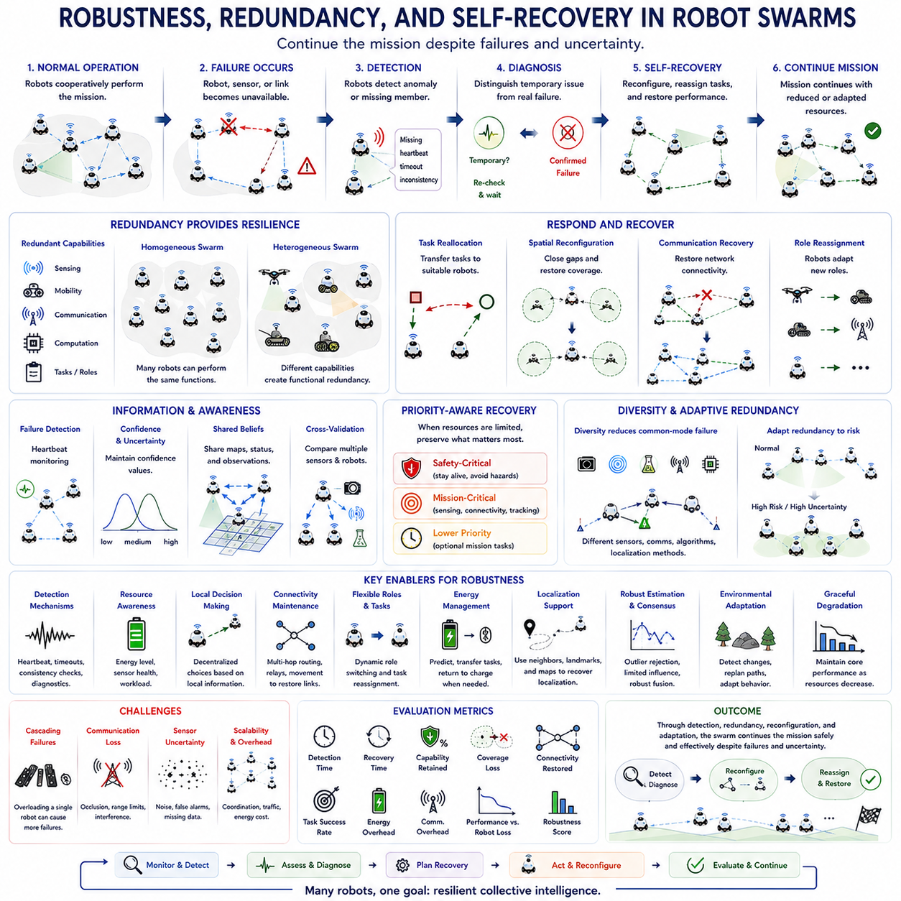{width="7.268055555555556in" height="7.268055555555556in"}

강건성(Robustness)은 개별 로봇, 센서, 통신 링크 또는 환경에 대한 가정이 실패하더라도 로봇 군집(Robot Swarm)이 임무 수행을 지속할 수 있는 능력을 의미한다. 소수의 핵심 구성요소에 의존하는 시스템과 달리 군집 시스템은 기능을 다수의 에이전트에 분산할 수 있다. 목표는 모든 고장을 제거하는 것이 아니라 국소적인 장애가 발생하더라도 유용한 집단 행동(Collective Behavior)을 유지하는 것이다.

중복성(Redundancy)은 군집의 강건성을 가능하게 하는 가장 기본적인 메커니즘 중 하나이다. 여러 로봇이 서로 중첩되는 센싱, 이동, 통신 또는 작업 수행 능력을 보유하면 하나의 구성원이 손실되더라도 필수 기능이 반드시 사라지는 것은 아니다. 중복성은 군집 자체를 대체 가능한 자원들의 예비 집합으로 만들어 운용 조건이 변화할 때 사용할 수 없는 로봇을 다른 구성원이 대신할 수 있도록 한다.

중복성이 모든 로봇이 동일해야 한다는 것을 의미하지는 않는다. 동종 군집(Homogeneous Swarm)은 여러 에이전트가 유사한 기능을 수행함으로써 중복성을 확보하고, 이기종 군집(Heterogeneous Swarm)은 서로 다른 능력의 조합을 통해 기능적 중복성(Functional Redundancy)을 만들 수 있다. 예를 들어 센싱 로봇 하나가 고장 나더라도 상호 보완적인 센서를 가진 여러 로봇이 충분한 정보를 함께 제공하여 임무를 지속할 수 있다.

고장 탐지(Failure Detection)는 자기 복구(Self-Recovery)를 위한 첫 번째 단계이다. 로봇은 주변 로봇, 센서, 통신 링크, 액추에이터 또는 할당된 작업이 정상적으로 동작하는지를 판단해야 한다. 탐지에는 하트비트 메시지(Heartbeat Message), 예상 갱신 주기, 움직임의 일관성, 센서 진단, 작업 진행 상태 또는 예측 행동과 실제 관측 사이의 불일치를 사용할 수 있다. 불필요한 복구 동작 자체가 군집을 방해할 수 있으므로 신뢰할 수 있는 고장 탐지가 중요하다.

고장은 일시적이거나 간헐적이거나 영구적일 수 있다. 통신 손실은 로봇 자체의 고장이 아니라 가림(Occlusion)이나 통신 거리 제한으로 발생할 수 있으며, 센서 역시 환경 조건으로 인해 일시적으로 신뢰할 수 없는 측정값을 생성할 수 있다. 따라서 강건한 군집은 가능한 경우 불확실성(Uncertainty)과 확인된 고장을 구분해야 한다. 신뢰도(Confidence), 타임아웃 정책(Timeout Policy), 반복 검사, 다중 증거원을 이용하여 이러한 판단을 지원할 수 있다.

고장이 확인되면 군집은 책임을 재분배할 수 있다. 사용할 수 없는 로봇에 할당되었던 작업은 거리, 능력, 에너지, 작업 부하 또는 임무 우선순위에 따라 주변 에이전트로 이전될 수 있다. 이러한 분산 작업 재할당(Decentralized Task Reallocation)은 하나의 고장으로 인해 중요한 영역이나 기능이 영구적으로 방치되는 것을 방지하고, 감소된 자원으로도 임무를 지속할 수 있도록 한다.

공간 재구성(Spatial Reconfiguration)은 또 다른 중요한 복구 메커니즘이다. 대형(Formation), 커버리지 패턴(Coverage Pattern), 통신 체인 또는 수색 영역에서 하나의 로봇이 사라지면 주변 로봇들이 위치를 변경하여 발생한 공백을 메울 수 있다. 군집은 기존의 기하학적 구조를 근사적으로 유지하거나 감소된 로봇 수에 더욱 적합한 새로운 구성으로 변경할 수 있다. 따라서 복구는 기능적 적응과 물리적 적응을 모두 포함한다.

커버리지 임무(Coverage Mission)는 이러한 원리를 명확하게 보여준다. 하나의 로봇이 고장 나면 해당 로봇이 담당하던 영역이 관측되지 않을 수 있다. 주변 로봇들이 자신의 커버리지 셀(Coverage Cell)을 확장하고 더 멀리 있는 로봇들도 점진적으로 재분산하여 균형을 복원할 수 있다. 결과적으로 센싱 밀도는 다소 낮아질 수 있지만 특정 영역 전체를 잃는 대신 광범위한 환경 인식(Environmental Awareness)을 유지할 수 있다.

통신 네트워크(Communication Network)도 유사한 방식으로 복구할 수 있다. 중요한 중계 역할을 수행하던 로봇이 손실되면 군집이 서로 단절된 집단으로 나뉠 수 있다. 주변 에이전트가 이동하여 통신 경로를 복구하거나 대체 중계 노드(Relay Node)를 선택하고 다른 이웃을 통한 다중 홉 라우팅(Multi-Hop Routing)을 사용할 수 있다. 따라서 네트워크 토폴로지(Network Topology)는 고정된 인프라가 아니라 집단 행동에 따라 적응하는 구성요소가 된다.

자기 복구에는 집단적 의존성(Collective Dependencies)에 대한 국소적 인식이 필요하다. 로봇이 반드시 완전한 전역 모델(Global Model)을 가질 필요는 없지만 현재 행동에서 어떤 주변 관계가 중요한지는 이해해야 한다. 하나의 이웃 로봇이 사라졌을 때 대형 강성(Formation Rigidity), 센싱 커버리지, 통신 연결성 또는 작업 수행에 서로 다른 영향을 줄 수 있다. 따라서 복구 행동은 단순히 에이전트가 사라졌다는 사실보다 고장이 초래하는 기능적 결과에 대응해야 한다.

점진적 성능 저하(Graceful Degradation)는 강건한 군집 설계의 핵심 목표이다. 자원이 손실될수록 성능이 점진적으로 감소해야 하며 단 하나의 구성요소 고장으로 전체 시스템이 붕괴해서는 안 된다. 로봇 수가 감소한 군집은 수색 속도가 느려지거나 센싱 해상도가 낮아지고 더 단순한 대형을 유지할 수 있지만, 충분한 능력이 남아 있다면 가장 중요한 임무 요구사항을 계속 만족해야 한다.

남아 있는 자원으로 기존의 모든 작업을 수행할 수 없을 때는 우선순위 관리(Priority Management)가 중요해진다. 군집은 안전 필수 기능(Safety-Critical Function)을 가장 먼저 보존하고 이후 임무 필수 센싱, 연결성, 추적 또는 운송 기능을 유지할 수 있다. 우선순위가 낮은 활동은 지연하거나 축소하거나 중단할 수 있다. 따라서 자기 복구에는 완전한 기능 복원이 불가능할 때 어떤 기능을 우선적으로 보존할 것인지 결정하는 과정도 포함된다.

강건성은 다양성(Diversity)에도 의존한다. 모든 로봇이 동일한 하드웨어, 소프트웨어, 센서 및 통신 메커니즘을 사용하면 공통 원인 고장(Common-Mode Failure)이 전체 군집에 동시에 영향을 줄 수 있다. 이기종 센서, 대체 통신 경로, 다양한 위치 추정 방식 또는 서로 다른 계산 전략을 활용하면 이러한 취약성을 줄일 수 있다. 따라서 다양성은 하나의 고장 메커니즘이 모든 에이전트를 무력화하는 것을 방지함으로써 수적인 중복성을 보완할 수 있다.

그러나 중복성에는 비용이 따른다. 추가적인 로봇은 하드웨어 비용, 에너지 소비, 통신 트래픽, 조정 복잡성, 잠재적인 혼잡을 증가시킨다. 지나친 센싱 중첩은 자원을 낭비할 수 있으며 불필요한 통신은 네트워크 효율을 감소시킬 수 있다. 따라서 강건한 군집 설계에서는 단순히 중복 구성요소의 수를 최대화하는 대신 예상되는 고장 조건에 어느 정도의 중복성이 필요한지를 결정해야 한다.

적응형 중복성(Adaptive Redundancy)은 이러한 균형을 향상시킬 수 있다. 정상적인 운용 상황에서는 커버리지나 탐색 효율을 극대화하기 위해 로봇들이 넓게 분산될 수 있다. 불확실성, 환경 위험 또는 고장 가능성이 증가하면 선택된 로봇들이 서로 가까워지거나 센싱 및 통신의 중첩을 증가시킬 수 있다. 따라서 군집은 모든 영역에서 최대 중복성을 유지하는 대신 현재의 임무 위험에 따라 중복 자원을 동적으로 할당할 수 있다.

자기 복구에는 역할 재할당(Role Reassignment)도 포함될 수 있다. 원래 탐색을 수행하던 로봇이 통신 중계기가 될 수 있고, 모니터링 로봇이 고장 난 추적 로봇을 대신할 수 있으며, 유휴 로봇이 중요한 센싱 영역을 담당할 수도 있다. 역할 유연성(Role Flexibility)은 군집이 사용할 수 있는 복구 방법의 수를 증가시키고 특정 전문 로봇에 대한 영구적인 의존성을 감소시킨다.

에너지 고장(Energy Failure)은 배터리가 완전히 소진되기 전에 낮은 에너지 수준을 예측할 수 있다는 점에서 특별한 고려가 필요하다. 로봇은 잔여 에너지를 보고하고 충전을 위해 이탈하기 전에 자신의 책임을 다른 로봇으로 이전할 수 있다. 주변 로봇이 해당 작업을 점진적으로 인수하면 갑작스러운 커버리지 또는 통신 공백을 방지할 수 있다. 따라서 예측적 자원 관리(Predictive Resource Management)는 일부 잠재적인 고장을 긴급 복구가 아니라 계획된 전환(Planned Transition)으로 변화시킨다.

위치 추정 성능 저하(Localization Degradation)도 집단적으로 관리할 수 있다. 위치 추정의 불확실성이 증가한 로봇은 대형이나 매핑 의사결정에 미치는 자신의 영향력을 줄이고 주변 로봇의 관측을 이용하여 위치를 다시 추정할 수 있다. 상대 거리 측정(Relative Ranging), 시각 관측, 공유 랜드마크(Shared Landmark), 지도 정합(Map Alignment)은 대체 기준 정보를 제공할 수 있다. 이를 통해 군집은 집단 센싱(Collective Sensing)을 개별 로봇의 상태 추정을 위한 중복 수단으로 사용할 수 있다.

센서 고장(Sensor Failure)은 교차 검증(Cross-Validation)과 대체(Substitution)를 통해 처리할 수 있다. 하나의 센서가 주변 로봇이나 다른 센싱 방식과 일치하지 않는 측정값을 생성하면 해당 센서의 신뢰도를 낮출 수 있다. 다른 센서의 정보를 이용하여 성능이 저하된 센서를 일시적으로 대체할 수도 있다. 이기종 군집에서는 특수 센서를 가진 다른 로봇이 위치를 변경하여 손실된 센싱 기능을 보완할 수도 있다.

일부 에이전트가 잘못되거나 일관되지 않은 정보를 제공하는 경우에는 강건 합의(Robust Consensus)가 필요하다. 일반적인 평균화(Averaging)는 비정상적인 값이 군집 전체에 영향을 미치도록 할 수 있으므로 강건한 방법은 이상치(Outlier)를 제거하거나 극단적인 관측의 영향력을 제한하고 여러 이웃의 정보를 비교할 수 있다. 목표는 소수의 결함 에이전트가 집단 추정과 의사결정을 불안정하게 만드는 것을 방지하는 것이다.

환경적 교란(Environmental Disturbance) 역시 예상된 운용 조건의 실패로 고려해야 한다. 차단된 경로, 이동 장애물, 낮은 가시성, 통신 간섭, 지형 변화 또는 예상하지 못한 위험 요소는 기존에 효과적이었던 행동을 더 이상 유효하지 않게 만들 수 있다. 강건한 군집은 환경이 일정하게 유지된다고 가정하지 않고 이러한 변화를 탐지하여 이동, 센싱, 통신 또는 작업 할당을 재구성해야 한다.

복구 과정에서는 연쇄 고장(Cascading Failure)을 방지해야 한다. 하나의 로봇이 고장 났을 때 해당 로봇의 모든 책임을 하나의 주변 로봇에 할당하면 그 로봇에 과도한 부하가 발생하고 에너지 소비가 증가하여 또 다른 고장으로 이어질 수 있다. 분산 복구(Distributed Recovery)는 추가적인 작업 부하를 적합한 여러 구성원에게 분산하고 이들의 남은 처리 능력을 지속적으로 확인해야 한다. 목표는 새로운 취약 지점을 만들지 않으면서 기능을 복원하는 것이다.

복구 속도(Recovery Speed)는 의사결정 신뢰성(Decision Reliability)과 균형을 이루어야 한다. 즉각적인 재구성은 임무 중단 시간을 줄일 수 있지만 일시적인 통신 손실에 지나치게 빠르게 반응하면 불필요한 이동과 작업 전환이 발생할 수 있다. 반대로 너무 오래 기다리면 중요한 기능이 장시간 사용할 수 없는 상태가 된다. 타임아웃, 신뢰도 임계값(Confidence Threshold), 고장 심각도, 임무 우선순위 등을 이용하여 군집이 언제 교정 행동을 시작할지를 결정할 수 있다.

학습 기반 접근법(Learning-Based Approach)은 사람이 직접 규칙으로 정의하기 어려운 고장 패턴에 대한 대응을 로봇이 학습하도록 하여 자기 복구 능력을 향상시킬 수 있다. 강화학습(Reinforcement Learning)은 성능이 저하된 상황에서 작업 재분배, 역할 전환, 이동, 통신을 최적화할 수 있다. 그래프 기반 모델(Graph-Based Model)은 생존한 로봇 사이의 변화하는 관계를 표현하고 서로 다른 군집 규모와 네트워크 구조에 적응하는 복구 정책을 생성할 수 있다.

실제 시스템에 배치하기 전에 강건성을 평가하려면 시뮬레이션(Simulation)과 고장 주입(Fault Injection)이 필수적이다. 개발자는 의도적으로 로봇을 제거하거나 센서를 비활성화하고, 통신 링크를 차단하거나 배터리 용량을 감소시키며, 위치 추정 오차를 추가하거나 환경 조건을 변경할 수 있다. 반복적인 실험을 통해 군집이 고장을 탐지하고 자원을 재분배하며 유용한 행동을 복원하고 불안정한 복구 과정에 빠지지 않는지를 확인할 수 있다.

강건성 평가 지표(Robustness Metrics)는 단순히 최종적으로 임무에 성공했는지만 측정해서는 안 된다. 유용한 지표에는 고장 탐지 시간(Failure Detection Time), 복구 시간(Recovery Time), 유지된 임무 능력의 비율, 커버리지 손실, 연결성 복구, 작업 완료율, 에너지 오버헤드(Energy Overhead), 통신 오버헤드, 그리고 사용할 수 없는 로봇 수가 증가할 때의 성능 변화 등이 포함된다. 이러한 지표는 고장 수준이 심각해질수록 군집의 성능이 얼마나 점진적으로 저하되는지를 보여준다.

자기 복구가 모든 고장을 자율적으로 수리할 수 있다는 것을 의미하지는 않는다. 물리적 손상, 에너지 고갈, 심각한 센서 손실 또는 환경적 고립으로 인해 개별 로봇 자체는 복구할 수 없는 상태가 될 수 있다. 집단 수준의 목표는 생존한 자원을 재구성하여 군집 전체가 계속 기능하도록 하는 것이다. 따라서 고장 난 로봇 자체가 다시 동작하지 못하더라도 시스템 수준(System Level)에서는 복구가 이루어질 수 있다.

궁극적으로 강건성(Robustness), 중복성(Redundancy), 자기 복구(Self-Recovery)는 고장을 예외적인 사건이 아니라 군집 지능(Swarm Intelligence)의 예상 가능한 운용 조건으로 변화시킨다. 군집은 장애를 탐지하고, 작업을 재분배하며, 공간 관계를 재구성하고, 통신을 복원하며, 중복된 능력을 활용하고, 우선순위를 적응적으로 변경함으로써 개별 로봇이 손실되더라도 집단 기능을 유지할 수 있다. 이러한 회복탄력성(Resilience)은 불확실하고 동적이며 안전이 중요한 환경에서 다중 로봇 물리 인공지능(Multi-Robot Physical AI)을 실제로 운용하기 위한 핵심 기반이다.

## 02.11. Scalability of Swarm Systems

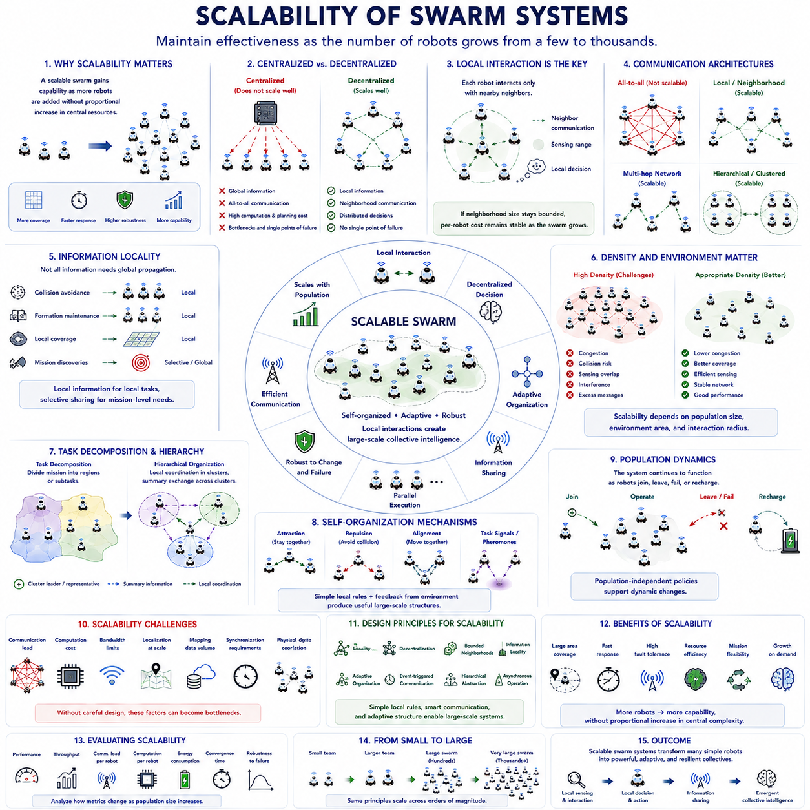{width="7.268055555555556in" height="7.268055555555556in"}

군집 시스템의 확장성(Scalability)은 로봇의 수가 소수의 에이전트에서 수십, 수백 또는 잠재적으로 수천 대까지 증가하더라도 집단 행동(Collective Behavior)이 효과적으로 유지되는 능력을 의미한다. 확장 가능한 군집은 중앙집중형 계산, 통신, 감독 또는 조정 복잡성을 로봇 수에 비례하여 증가시키지 않으면서 추가된 로봇으로부터 유용한 능력을 얻어야 한다. 이러한 특성은 군집 지능(Swarm Intelligence)의 실질적인 가치를 결정하는 핵심 요소이다.

전통적인 중앙집중형 다중 로봇 시스템(Centralized Multi-Robot System)은 모든 로봇에 대한 전역 정보(Global Information)를 유지하고 중앙 구성요소에서 작업 할당, 궤적 또는 조정 명령을 계산하는 경우가 많다. 군집 규모가 증가하면 상태 정보량과 가능한 상호작용의 수가 빠르게 증가할 수 있다. 따라서 계산량, 통신 대역폭, 동기화(Synchronization), 계획 복잡성이 시스템 규모를 제한하는 병목 현상(Bottleneck)이 될 수 있다.

군집 시스템은 국소 상호작용(Local Interaction)을 강조함으로써 이러한 문제를 해결한다. 각 로봇은 전체 집단의 상태를 지속적으로 처리하는 대신 주로 제한된 수의 주변 에이전트를 관측하거나 이들과 통신한다. 군집이 증가하더라도 이웃의 수가 대략 일정하게 유지된다면 전체 로봇 수가 크게 증가하더라도 개별 로봇의 계산 및 통신 요구량은 비교적 안정적으로 유지될 수 있다.

따라서 분산화(Decentralization)는 확장성과 밀접하게 연결되어 있다. 의사결정은 여러 로봇에 분산되며 하나의 제어기가 모든 환경 관측을 처리하거나 모든 행동을 조정할 필요가 없다. 각 로봇은 국소 정보를 기반으로 비교적 단순한 정책을 실행하고 반복적인 상호작용으로부터 유용한 전역 행동(Global Behavior)이 출현한다. 그 결과 새로운 로봇이 추가되면서 군집 전체의 집단 계산 능력도 함께 증가할 수 있다.

통신 아키텍처(Communication Architecture)는 확장성에 큰 영향을 준다. 전대전 통신(All-to-All Communication)은 모든 로봇이 다른 모든 로봇과 정보를 교환하도록 요구하기 때문에 군집 규모가 증가하면서 통신 관계의 수가 급격하게 증가한다. 국소 브로드캐스트(Local Broadcast), 이웃 통신, 다중 홉 네트워킹(Multi-Hop Networking), 계층적 메시징(Hierarchical Messaging), 이벤트 기반 통신(Event-Triggered Communication)은 현재 행동에 필요한 관계로 정보 교환을 제한하여 이러한 부담을 감소시킬 수 있다.

모든 정보가 군집 전체로 전달될 필요는 없다. 충돌 회피(Collision Avoidance)에는 주변 로봇의 위치만 필요할 수 있고, 대형 유지(Formation Maintenance)는 선택된 이웃의 정보에 의존할 수 있으며, 국소 커버리지 결정에는 인접 영역에 대한 정보만 필요할 수 있다. 임무 수준의 중요한 발견은 더 넓게 전달되어야 하지만 이러한 정보도 요약하거나 선택적으로 전파할 수 있다. 따라서 정보의 국소성(Information Locality)은 확장 가능한 조정의 중요한 원리가 된다.

그래프 표현(Graph Representation)은 이러한 구조를 분석하기 위한 자연스러운 방법을 제공한다. 로봇은 노드(Node)로 표현되고 센싱 또는 통신 관계는 에지(Edge)가 된다. 확장 가능한 아키텍처에서는 각 노드가 다른 모든 노드와 연결되는 대신 제한된 수의 관련 에지를 유지하는 것이 이상적이다. 로봇이 이동함에 따라 그래프는 동적으로 변화하며 상호작용 구조도 공간적 분포와 임무 요구사항에 맞추어 적응할 수 있다.

전체 로봇 수만큼이나 개체군 밀도(Population Density)도 중요하다. 고정된 환경에 로봇을 계속 추가하면 통신이 국소적으로 제한되더라도 주변에서 발생하는 상호작용의 수가 증가할 수 있다. 높은 밀도는 혼잡(Congestion), 충돌 위험, 센싱 중첩, 무선 간섭, 과도한 국소 메시지를 발생시킬 수 있다. 따라서 확장성은 단순히 로봇 수만 증가시켜 평가할 수 없으며 개체군 규모, 환경 면적, 상호작용 반경 사이의 관계도 고려해야 한다.

운용 환경이 개체군과 함께 확장되는 경우 공간적 확장성(Spatial Scalability)을 향상시킬 수 있다. 추가된 로봇들은 제한된 공간에서 서로 경쟁하는 대신 새로운 영역을 점유하고 새로운 이웃 관계를 형성하며 작업을 병렬적으로 수행할 수 있다. 수색(Search), 탐색(Exploration), 모니터링(Monitoring), 커버리지(Coverage) 임무는 더 많은 로봇이 더 넓은 물리적 공간에 분산될 수 있기 때문에 이러한 특성으로부터 큰 이점을 얻을 수 있다.

그러나 로봇 수를 증가시킨다고 항상 성능이 비례하여 향상되는 것은 아니다. 10대의 로봇은 1대보다 훨씬 빠르게 환경을 수색할 수 있지만 100대의 로봇이 반드시 10대보다 정확히 10배 빠른 것은 아니다. 중복, 혼잡, 통신, 제한된 목표물 수, 좁은 통로, 작업 간 의존성으로 인해 수확 체감(Diminishing Returns)이 발생한다. 따라서 확장 가능한 설계에서는 개체군 능력의 증가와 선형적인 성능 향상을 구분해야 한다.

작업 분해(Task Decomposition)는 확장성을 위한 또 다른 중요한 메커니즘이다. 대규모 임무를 공간 영역, 목표 그룹, 기능적 역할 또는 임시 하위 작업(Subtask)으로 나눌 수 있다. 모든 에이전트가 모든 의사결정에 참여하는 대신 로봇들이 이러한 국소 책임을 중심으로 조직될 수 있다. 분산 작업 할당(Distributed Task Allocation)을 통해 군집의 서로 다른 부분이 어느 정도 독립적으로 동작하면서도 공통된 임무 목표에 기여할 수 있다.

군집의 규모가 매우 커지면 계층적 조직(Hierarchical Organization)이 순수한 국소 상호작용을 보완할 수 있다. 로봇은 임시 클러스터(Cluster), 이웃 그룹, 팀 또는 통신 그룹을 구성할 수 있다. 각 그룹 내부에서는 국소적인 조정이 수행되고 선택된 대표자가 그룹 사이에서 요약된 정보를 교환한다. 이를 통해 전역 통신량을 줄이면서 임무 수준의 조정이 필요한 경우 먼 영역 사이에서도 정보를 전달할 수 있다.

이러한 계층 구조가 반드시 영구적인 리더(Permanent Leader)를 필요로 하는 것은 아니다. 클러스터 대표자는 위치, 연결성, 에너지, 계산 능력 또는 작업 관련성에 따라 동적으로 선택될 수 있다. 로봇의 위치나 운용 조건이 변화하면 리더십(Leadership) 역시 이동할 수 있다. 동적 계층 구조(Dynamic Hierarchy)는 분산 군집의 유연성을 상당 부분 유지하면서 매우 큰 개체군을 조정하기 위한 구조를 제공한다.

자기 조직화(Self-Organization)는 모든 로봇을 전역적으로 할당하지 않고도 집단 구조를 형성할 수 있기 때문에 확장성에 직접적으로 기여한다. 국소 인력, 반발력, 정렬(Alignment), 작업 신호, 가상 페로몬(Virtual Pheromone), 환경 피드백을 통해 로봇을 유용한 패턴으로 분산시킬 수 있다. 새로운 로봇이 시스템에 추가되면 동일한 국소 메커니즘에 반응하면서 전역 구성을 완전히 재설계하지 않고도 군집에 통합될 수 있다.

확장 가능한 시스템은 운용 중 발생하는 개체군 변화(Population Changes)도 지원해야 한다. 로봇은 군집에 합류하거나 이탈하고, 고장 나거나 충전을 위해 이동하거나 일시적으로 연결이 끊어질 수 있다. 고정된 에이전트 수에 의존하는 알고리즘은 이러한 조건에서 취약해질 수 있다. 반면 개체군 독립적 정책(Population-Independent Policy)은 국소 관측과 관계를 이용하여 사용 가능한 로봇 수가 변하더라도 동일한 행동 원리를 유지할 수 있다.

따라서 강건성(Robustness)과 확장성은 밀접하게 연결되어 있다. 대규모 군집은 자연스럽게 중복성(Redundancy)을 제공하지만 동시에 개별 고장이 발생할 가능성도 증가한다. 확장 가능한 아키텍처에서는 하나의 로봇이 고장 났다고 해서 전역 재계획(Global Replanning)이 필요해서는 안 된다. 주변 로봇들이 국소적인 책임을 재분배하고 커버리지를 복원하며 통신 경로를 수정하거나 대형의 공백을 메우는 동안 나머지 군집은 계속 동작할 수 있어야 한다.

대규모 환경에서는 위치 추정(Localization)이 어려워질 수 있다. 수백 대 로봇의 전역 위치를 지속적으로 높은 정확도로 유지하려면 상당한 인프라와 통신 자원이 필요할 수 있다. 상대 위치 추정(Relative Localization), 국소 지도 정합(Local Map Alignment), 공유 랜드마크(Shared Landmark), 사용 가능한 경우의 위성항법시스템(GNSS), 분산 센서 융합(Distributed Sensor Fusion)을 이용하면 하나의 전역 위치 추정 서비스에 대한 의존성을 줄일 수 있다. 군집의 서로 다른 영역은 국소적으로 일관된 좌표계를 사용하면서 상위 수준의 공간 관계를 교환할 수도 있다.

매핑(Mapping)도 유사한 확장성 문제를 가진다. 모든 로봇의 모든 센서 관측을 중앙 지도 서버로 지속적으로 전송하면 막대한 데이터가 발생할 수 있다. 분산 매핑(Distributed Mapping)을 사용하면 로봇이 관측 정보를 국소적으로 처리하고 압축된 표현을 교환하거나 선택된 랜드마크를 공유하며 중첩되는 지도 영역만 동기화할 수 있다. 목표는 모든 원시 센서 데이터를 네트워크로 이동시키지 않으면서 유용한 집단 지식(Collective Knowledge)을 유지하는 것이다.

대역폭 인식 인지(Bandwidth-Aware Perception)는 현대 로봇이 카메라, 라이다(LiDAR), 레이더(Radar), 오디오 및 기타 센서로부터 대규모 데이터 스트림을 생성하기 때문에 특히 중요하다. 확장 가능한 군집은 필요한 경우가 아니라면 원시 데이터를 전송하지 않아야 한다. 국소 추론(Local Inference)을 통해 고대역폭 센서 스트림을 탐지 결과, 특징(Feature), 이벤트, 지도 또는 의미적 요약(Semantic Summary)으로 변환하면 훨씬 효율적으로 통신할 수 있다.

엣지 컴퓨팅(Edge Computing)은 인지, 계획, 제어를 개별 로봇이나 주변 계산 노드에 배치함으로써 이러한 아키텍처를 지원한다. 로봇은 시간에 민감한 정보를 국소적으로 처리하면서 임무에 필요한 결과만 공유할 수 있다. 보다 강력한 엣지 또는 플릿 수준 시스템(Fleet-Level System)은 광범위한 최적화를 수행할 수 있지만 즉각적인 안전과 자율성을 위해 반드시 필요한 구성요소가 되어서는 안 된다. 이러한 분리는 통신 의존성과 중앙 처리 부하를 모두 감소시킨다.

동기화 요구사항(Synchronization Requirements) 역시 확장성을 제한할 수 있다. 모든 로봇이 동시에 상태를 갱신해야 하는 알고리즘은 네트워크 규모와 통신 지연이 증가할수록 운용하기 어려워진다. 비동기 알고리즘(Asynchronous Algorithm)은 전체 개체군을 기다리는 대신 현재 이용할 수 있는 가장 최근의 국소 정보를 이용하여 각 로봇이 의사결정을 수행하도록 한다. 이를 통해 반응성과 통신 변화에 대한 허용성을 향상시킬 수 있다.

합의 알고리즘(Consensus Algorithm)은 정보 전파의 문제를 잘 보여준다. 국소적인 합의는 이웃 내부에서 빠르게 이루어질 수 있지만 매우 큰 군집에서는 정보가 전체 집단으로 전달되기 위해 여러 단계의 상호작용이 필요할 수 있다. 따라서 개체군의 직경(Population Diameter)이 증가하면 로봇당 계산량이 일정하더라도 수렴 시간(Convergence Time)이 증가할 수 있다. 확장 가능한 합의에서는 통신 부하뿐만 아니라 정보가 상호작용 그래프 전체로 얼마나 빠르게 확산되는지도 고려해야 한다.

물리적 동역학(Physical Dynamics)은 추가적인 제약을 부여한다. 대규모 군집은 단순한 통신 네트워크로만 취급할 수 없는데, 로봇이 실제 공간을 점유하고 안전거리를 필요로 하며 제한된 속도와 가속도를 가지기 때문이다. 밀집된 군집은 좁은 통로 주변에서 교통 체증이나 교착 상태(Deadlock)를 발생시킬 수 있다. 따라서 운동 계획(Motion Planning)과 국소 충돌 회피도 통신 및 의사결정 메커니즘과 함께 확장될 수 있어야 한다.

이기종 군집(Heterogeneous Swarm)은 확장성에 새로운 기회와 과제를 동시에 제공한다. 서로 다른 로봇이 센싱, 운송, 통신, 계산 또는 조작(Manipulation)에 특화될 수 있다. 전문화(Specialization)는 불필요한 중복을 줄이고 자원을 효율적으로 배치할 수 있게 한다. 그러나 희소한 특수 로봇이 중앙집중형 병목이나 단일 장애점(Single Point of Failure)이 되지 않도록 능력 제약을 고려하여 조정해야 한다.

학습 기반 군집 정책(Learning-Based Swarm Policy) 역시 가변적인 개체군 규모를 고려하여 설계해야 한다. 고정된 로봇 수로 학습된 정책은 더 크거나 작은 군집에 배치될 때 제대로 동작하지 않을 수 있다. 그래프 신경망(Graph Neural Network), 어텐션 메커니즘(Attention Mechanism), 순열 불변 표현(Permutation-Invariant Representation), 국소 관측 정책(Local Observation Policy)은 가변 크기의 입력을 지원할 수 있다. 여러 개체군 규모에서 학습하면 초기 개발 과정에서 경험하지 못한 구성으로의 일반화도 향상시킬 수 있다.

물리적인 군집 규모가 증가할수록 시뮬레이션(Simulation)의 중요성도 커진다. 수백 대의 실제 로봇을 이용한 시험은 비용이 높고 운용하기 어렵지만, 시뮬레이션에서는 개체군 규모, 밀도, 통신 범위, 고장률, 환경 복잡성을 체계적으로 변화시킬 수 있다. 대규모 시뮬레이션은 소규모 실험에서는 나타나지 않을 수 있는 상전이(Phase Transition), 혼잡 효과, 불안정한 상호작용 또는 조정 실패를 발견하는 데 도움을 준다.

확장성 평가(Evaluation of Scalability)에서는 개체군 규모에 따라 성능과 자원 소비가 어떻게 변화하는지를 확인해야 한다. 관련 지표에는 작업 완료 시간, 커버리지 비율, 처리량(Throughput), 로봇당 통신 트래픽, 계산 부하, 에너지 소비, 충돌률, 수렴 시간, 네트워크 연결성, 고장에 대한 회복탄력성(Resilience)이 포함된다. 중요한 질문은 단순히 더 큰 군집이 동작하는지가 아니라 추가된 로봇이 얼마나 효율적으로 전체 성능에 기여하는가이다.

유용한 확장성 분석은 포화 지점(Saturation Point)도 식별해야 한다. 특정 개체군 규모를 넘어서면 환경, 통신 채널, 작업 구조 또는 물리적 작업 공간이 제한 요소가 되어 추가적인 로봇이 거의 이점을 제공하지 못할 수 있다. 이 지점을 넘어 로봇을 추가하면 혼잡과 간섭으로 오히려 성능이 저하될 수도 있다. 이러한 운용 영역(Operating Region)을 결정하는 것은 경제적·기술적으로 적절한 군집 규모를 선정하는 데 필수적이다.

궁극적으로 확장성은 국소성(Locality), 분산화(Decentralization), 병렬성(Parallelism), 적응형 조직(Adaptive Organization), 에이전트당 제한된 복잡성(Bounded Per-Agent Complexity)을 중심으로 집단 지능을 설계함으로써 달성된다. 확장 가능한 군집에서는 모든 로봇이 다른 모든 로봇에 대한 모든 정보를 알 필요가 없다. 대신 국소 상호작용이 지역적 조직을 형성하고 선택된 정보가 네트워크를 통해 전파되며 상위 수준의 행동이 전체 개체군에서 출현한다. 이를 통해 다중 로봇 물리 인공지능(Multi-Robot Physical AI)은 소규모 실험용 로봇 팀에서 대규모 실전 운용 로봇 집단으로 확장될 수 있다.

## 02.12. AI and Learning Based Swarms

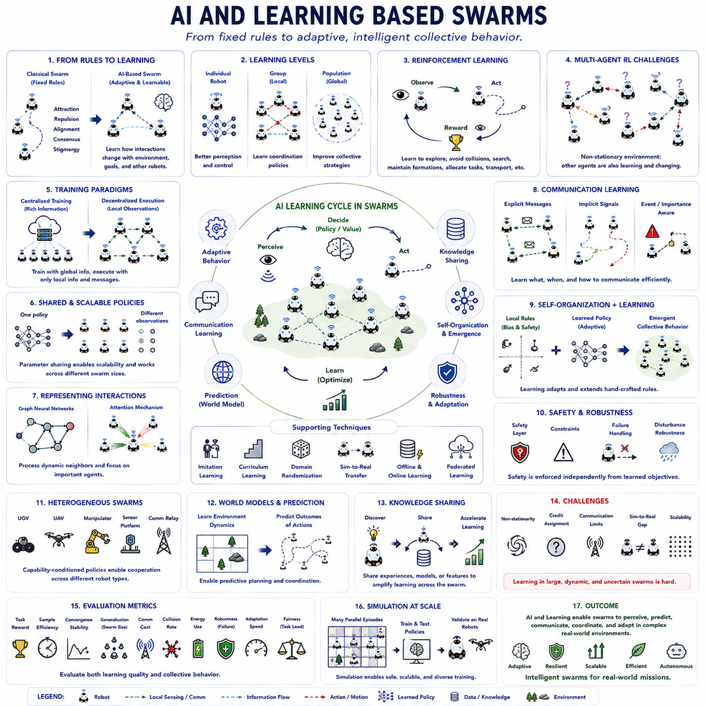{width="7.268055555555556in" height="7.268055555555556in"}

인공지능(Artificial Intelligence)은 고정된 국소 규칙(Local Rules)을 따르는 에이전트들의 집합이었던 로봇 군집(Robot Swarm)을 경험으로부터 학습할 수 있는 적응형 집단 시스템(Adaptive Collective System)으로 변화시킨다. 고전적인 군집 지능(Swarm Intelligence)은 인력(Attraction), 반발력(Repulsion), 정렬(Alignment), 합의(Consensus), 스티그머지(Stigmergy)와 같은 메커니즘에 의존하지만, AI 기반 군집은 환경 조건, 임무 목표, 다른 로봇의 행동에 따라 이러한 상호작용을 어떻게 변화시켜야 하는지를 학습할 수 있다.

학습(Learning)은 군집 내부의 여러 수준에서 이루어질 수 있다. 개별 로봇은 더 나은 인지(Perception)나 제어(Control)를 학습할 수 있고, 로봇 그룹은 조정 정책(Coordination Policy)을 학습할 수 있으며, 전체 개체군은 공유된 경험을 통해 집단 전략(Collective Strategy)을 향상시킬 수 있다. 개별 의사결정의 향상은 전역 행동을 변화시키고, 집단적 결과는 다시 개별 에이전트의 학습과 행동을 변화시키는 피드백을 제공하기 때문에 이러한 수준들은 지속적으로 상호작용한다.

강화학습(Reinforcement Learning)은 적응형 군집 행동을 구현하기 위한 자연스러운 프레임워크를 제공한다. 각 로봇은 자신의 국소 상태(Local State)를 관측하고 행동을 선택하며 환경과 상호작용한 후 보상 신호(Reward Signal)를 통해 피드백을 받는다. 반복적인 경험을 통해 정책(Policy)은 모든 반응을 사람이 직접 프로그래밍하지 않아도 충돌 회피, 탐색, 대형 유지, 목표물 수색, 작업 할당, 협력 운송과 같은 행동을 향상시킬 수 있다.

다중 에이전트 강화학습(Multi-Agent Reinforcement Learning)은 서로의 행동에 영향을 주는 여러 로봇으로 이러한 과정을 확장한다. 각 학습자의 관점에서는 주변 에이전트 역시 자신의 정책을 변화시키고 있기 때문에 환경이 비정상적(Non-Stationary)으로 변한다. 따라서 성공적인 학습을 위해서는 물리적 동역학뿐만 아니라 지속적으로 변화하는 사회적 상호작용(Social Interaction)까지 고려해야 하며, 이는 기존의 단일 에이전트 강화학습보다 조정 문제를 훨씬 어렵게 만든다.

중앙집중형 학습과 분산 실행(Centralized Training with Decentralized Execution)은 이러한 문제를 해결하기 위해 널리 사용되는 접근법이다. 학습 과정에서는 여러 로봇의 정보를 결합하여 가치(Value)를 추정하고 정책을 조정하거나 학습을 안정화할 수 있다. 실제 배치 단계에서는 각 로봇이 국소적으로 이용 가능한 관측과 메시지만으로 자신의 정책을 실행한다. 이를 통해 학습 과정에서는 풍부한 전역 정보를 활용하면서 실제 물리적 군집에서는 분산 운용을 유지할 수 있다.

로봇들이 유사한 능력을 가진 경우 공유 정책(Shared Policy)은 확장성(Scalability)을 향상시킬 수 있다. 각 로봇마다 완전히 독립적인 모델을 학습하는 대신 여러 에이전트가 서로 다른 국소 관측을 입력으로 사용하면서 동일한 신경망 정책(Neural Policy)을 실행할 수 있다. 이렇게 학습된 행동은 어느 정도 개체군 독립적(Population-Independent)이 되어 군집 규모가 변화하더라도 동일한 제어기를 사용할 수 있으며 학습에 필요한 매개변수와 경험의 양도 줄일 수 있다.

매개변수 공유(Parameter Sharing)가 모든 로봇이 동일하게 행동한다는 것을 의미하지는 않는다. 동일한 정책을 실행하는 두 로봇이라도 서로 다른 이웃, 장애물, 목표, 내부 상태를 관측하기 때문에 서로 다른 행동을 선택할 수 있다. 따라서 별도의 제어 프로그램이 아니라 국소적 상황(Local Context)으로부터 행동의 다양성이 출현한다. 역할 식별자(Role Identifier)나 능력 임베딩(Capability Embedding)을 추가하면 서로 다른 기능이나 물리적 특성을 가진 로봇으로 구성된 군집까지 공유 정책을 확장할 수 있다.

그래프 신경망(Graph Neural Network)은 군집 상호작용을 표현하는 데 특히 적합하다. 로봇은 노드(Node)로 모델링하고 통신, 센싱 또는 근접 관계는 동적으로 변화하는 에지(Edge)로 표현할 수 있다. 메시지 패싱(Message Passing)은 주변 로봇의 정보를 집계하여 의사결정을 위한 국소 표현(Local Representation)을 생성한다. 그래프의 크기와 토폴로지(Topology)가 변화할 수 있기 때문에 그래프 기반 정책은 동적이며 가변적인 크기의 로봇 개체군을 자연스럽게 지원할 수 있다.

어텐션 메커니즘(Attention Mechanism)은 변화하는 이웃 관계를 처리하기 위한 또 다른 방법을 제공한다. 하나의 로봇이 많은 주변 에이전트를 관측하더라도 모든 이웃이 동일하게 중요한 것은 아니다. 어텐션을 이용하면 충돌 위험, 작업 조정, 통신 연결성 또는 목표물 정보와 관련성이 높은 로봇에 더 큰 영향력을 부여할 수 있다. 이러한 선택적 처리는 관련성이 낮은 관측의 영향을 줄이면서 계산 및 의사결정 효율을 향상시킬 수 있다.

학습 기반 통신(Learning-Based Communication)은 로봇이 어떻게 행동할 것인지뿐만 아니라 무엇을 통신해야 하는지도 결정할 수 있다. 전체 상태 정보를 지속적으로 전송하는 대신 에이전트는 의도(Intention), 관측, 불확실성 또는 작업 요구사항을 표현하는 압축된 메시지를 학습할 수 있다. 이벤트 기반(Event-Triggered) 또는 중요도 인식 통신(Importance-Aware Communication)을 이용하면 집단 의사결정에 영향을 줄 가능성이 높은 경우에 주로 정보를 전송하여 통신 대역폭을 더욱 줄일 수 있다.

명시적인 메시지가 없어도 암묵적 통신(Implicit Communication)이 출현할 수 있다. 로봇의 움직임, 위치, 작업 선택 또는 환경에 대한 변화는 다른 에이전트에게 정보를 제공할 수 있다. 학습 알고리즘은 이러한 관측 가능한 행동을 조정 신호(Coordination Signal)로 활용할 수 있다. 이는 행동을 통해 주변 구성원이 이용할 수 있는 정보를 변화시키면서 집단 조직을 형성하는 생물학적 군집 통신과 스티그머지와 유사하다.

모방학습(Imitation Learning)은 시연(Demonstration)을 이용할 수 있는 경우 군집 정책의 개발을 가속할 수 있다. 전문가 제어기, 최적화 알고리즘, 인간 운영자 또는 이미 검증된 군집 전략을 이용하여 바람직한 행동의 사례를 생성할 수 있다. 로봇은 강화학습이나 자율 적응을 시작하기 전에 이러한 시연으로부터 학습함으로써 실제 물리적 플랫폼에서 필요한 위험한 탐색의 양을 줄일 수 있다.

커리큘럼 학습(Curriculum Learning)은 작업의 복잡성을 점진적으로 증가시킬 수 있다. 학습 초기에는 단순한 환경에서 소수의 로봇으로 시작하고 이후 더 큰 개체군, 장애물, 센서 잡음, 통신 지연, 로봇 고장, 이기종 능력, 동적 목표물을 순차적으로 추가할 수 있다. 이러한 과정은 학습 시스템이 완전한 다중 에이전트 문제를 해결하기 전에 기본적인 조정 능력을 먼저 획득하도록 한다.

도메인 랜덤화(Domain Randomization)는 시뮬레이션에서 학습한 군집 정책을 실제 로봇으로 전이하는 데 중요하다. 학습 환경에서 로봇 동역학, 센서 잡음, 마찰, 지연 시간, 통신 품질, 장애물 배치, 조명 등의 매개변수를 다양하게 변화시킬 수 있다. 광범위한 변동성을 경험한 정책은 비현실적인 시뮬레이터 특성에 의존할 가능성이 낮아지고 실제 배치 환경에서 발생하는 차이에 더욱 강건하게 대응할 수 있다.

시뮬레이션-현실 전이(Sim-to-Real Transfer)는 군집에서 특히 어렵다. 여러 에이전트 사이에서 오차가 상호작용할 수 있기 때문이다. 하나의 로봇에서는 문제가 되지 않는 작은 제어 편향(Control Bias)도 수백 대의 로봇에서 반복되면 집단 진동, 혼잡 또는 대형 불안정성을 발생시킬 수 있다. 따라서 검증에서는 개별 로봇의 성능뿐만 아니라 모델링 오차가 반복적인 군집 상호작용을 통해 증폭되는지도 확인해야 한다.

오프라인 학습(Offline Learning)은 대규모 다중 로봇 운용 데이터셋을 사용할 수 있을 때 또 다른 방법을 제공한다. 기록된 궤적, 관측, 메시지, 작업 결과, 고장 데이터를 이용하여 지속적인 온라인 실험 없이 정책을 개선할 수 있다. 과거 플릿 데이터(Fleet Data)는 의도적으로 재현하기 어려운 희귀한 조정 문제를 포함할 수 있으므로 대규모 운용 경험은 향후 군집 학습을 위한 중요한 자원이 될 수 있다.

온라인 학습(Online Learning)은 실제 배치 이후에도 로봇이 적응하도록 하지만 안전성과 안정성에 관한 문제를 발생시킨다. 제한되지 않은 정책 변경은 특히 많은 에이전트가 동시에 적응하는 경우 예상하지 못한 집단 행동을 발생시킬 수 있다. 따라서 실제 시스템에서는 검증된 안전 메커니즘을 유지하면서 선택된 매개변수, 신뢰도 기반 갱신(Confidence-Calibrated Update) 또는 감독 제약(Supervisory Constraint)에 온라인 적응을 제한할 수 있다.

연합학습(Federated Learning)은 모든 로봇이 원시 센서 데이터를 업로드하지 않고도 분산된 학습 개선을 지원할 수 있다. 개별 로봇이나 국소 그룹이 자신의 경험을 이용하여 모델을 학습하고 선택된 모델 갱신 정보를 조정 프로세스와 교환할 수 있다. 이를 통해 통신 대역폭을 줄이고 데이터 지역성(Data Locality)을 향상시킬 수 있지만 서로 다른 관측, 불안정한 통신, 비독립 동일분포(Non-IID)의 경험은 모델 집계를 복잡하게 만든다.

집단 학습(Collective Learning)은 로봇 사이의 지식 공유(Knowledge Sharing)를 활용할 수도 있다. 하나의 에이전트가 효과적인 전략, 환경 특징 또는 목표물 패턴을 발견하면 학습된 표현이나 요약된 경험을 다른 로봇과 공유할 수 있다. 지식 전이(Knowledge Transfer)는 중복되는 학습 노력을 감소시키고 한 영역에서 이루어진 발견이 다른 영역의 로봇에게도 영향을 주도록 하여 전체 개체군의 적응을 가속할 수 있다.

월드 모델(World Model)은 군집에 예측 능력(Predictive Capability)을 제공할 수 있다. 학습된 모델은 가능한 행동 이후 환경, 주변 로봇, 통신 그래프 또는 목표물 상태가 어떻게 변화할지를 예측할 수 있다. 로봇은 이러한 예측을 이용하여 실제 행동을 수행하기 전에 후보 행동을 평가할 수 있다. 따라서 공유 또는 분산 월드 모델(Distributed World Model)은 단순히 반응적인 군집 행동을 넘어 예측적 조정(Predictive Coordination)을 지원할 수 있다.

학습과 자기 조직화(Self-Organization)는 서로 경쟁하는 개념이 아니라 상호 보완적인 개념이다. 고전적인 국소 규칙은 유용한 집단 행동에 대한 강력한 귀납적 편향(Inductive Bias)을 제공하고, 학습은 이러한 규칙의 매개변수를 적응시키거나 새로운 상호작용을 발견할 수 있다. 분리(Separation), 응집(Cohesion), 연결성, 안전 제약은 명시적으로 유지하면서 신경망 정책이 목적지 선택, 역할 할당, 통신 또는 대형 전환과 같은 상위 수준의 결정을 최적화할 수 있다.

가능한 경우 안전성(Safety)은 순수하게 학습된 목표와 독립적으로 유지해야 한다. 작업 보상을 최대화하도록 최적화된 강화학습 정책은 물리적 안전 여유를 위반하면서 성능을 높이는 행동을 발견할 수 있다. 충돌 회피, 액추에이터 한계, 제한 구역, 최소 안전거리, 비상 정지 등의 안전 요구사항은 전용 제어 계층(Dedicated Control Layer), 안전 필터(Safety Filter) 또는 제약 최적화(Constrained Optimization)를 통해 강제할 수 있다.

학습된 군집 행동이 복잡해질수록 설명 가능성(Explainability)의 중요성도 증가한다. 수백 대의 로봇이 집단적으로 의사결정을 수행할 때 운영자는 왜 군집이 특정 영역에 집중했는지, 대형을 변경했는지, 작업을 중단했는지 또는 예상하지 못한 통신 패턴을 생성했는지를 이해할 필요가 있다. 해석 가능한 상태 요약, 어텐션 시각화(Attention Visualization), 이벤트 로그(Event Log), 인과 분석(Causal Analysis)은 집단 행동을 진단하는 데 도움을 줄 수 있다.

강건성(Robustness)은 학습 이후에만 평가하는 것이 아니라 학습 과정 자체에 포함해야 한다. 학습 시나리오에서 무작위로 로봇을 제거하고, 관측을 손상시키며, 통신을 지연시키고, 동역학을 변화시키거나 환경적 교란을 추가할 수 있다. 이러한 조건을 경험한 정책은 완벽한 센서, 통신, 로봇 가용성을 가정하는 대신 책임을 재분배하고 유용한 집단 행동을 유지하는 방법을 학습할 수 있다.

이기종 군집 학습(Heterogeneous Swarm Learning)은 로봇의 형태(Morphology)와 능력 차이를 고려해야 한다. 지상 차량, 공중 로봇, 매니퓰레이터(Manipulator), 센서 플랫폼, 통신 중계 로봇은 동일한 행동이나 관측 공간을 공유하지 못할 수 있다. 능력 조건부 정책(Capability-Conditioned Policy)은 이러한 차이를 표현하면서 서로 다른 로봇 유형 사이의 협력 관계를 학습하여 집단 조정을 유지하면서 전문화(Specialization)를 가능하게 한다.

확장 가능한 학습(Scalable Learning)을 위해서는 학습에 사용된 개체군 규모를 넘어 정책이 일반화될 수 있어야 한다. 국소 관측, 그래프 표현, 공유 매개변수, 순열 불변 집계(Permutation-Invariant Aggregation)는 고정된 로봇의 식별자나 순서에 대한 의존성을 줄이는 데 도움을 준다. 여러 군집 규모를 이용하여 학습하면 새로운 로봇이 합류하거나 기존 로봇이 이탈하더라도 유용하게 유지되는 상호작용 원리를 학습하도록 할 수 있다.

평가(Evaluation)에서는 학습 품질과 집단 행동을 모두 확인해야 한다. 관련 지표에는 작업 보상(Task Reward), 샘플 효율성(Sample Efficiency), 수렴 안정성, 서로 다른 군집 규모에 대한 일반화, 통신 비용, 충돌률, 에너지 사용량, 고장에 대한 강건성, 적응 속도, 작업 분배의 공정성(Fairness), 미경험 환경에서의 성능 등이 포함된다. 개별 정책의 성능이 뛰어나더라도 상호작용을 통해 불안정한 전역 행동을 생성한다면 성공적인 군집 정책이라고 할 수 없다.

시뮬레이션(Simulation)은 실제 물리적 배치에 앞서 학습 기반 군집을 훈련하고 평가하는 데 필요한 규모를 제공한다. 수천 개의 에피소드(Episode)를 병렬적으로 실행하면 다양한 환경, 고장, 통신 패턴, 개체군 규모를 정책이 경험하도록 할 수 있다. 이후 실제 하드웨어 실험은 값비싼 로봇에서 모든 학습을 직접 수행하는 대신 물리적 동역학, 센싱 제약, 네트워크 효과, 안전성, 시뮬레이션-현실 전이를 검증하는 데 집중할 수 있다.

궁극적으로 인공지능과 학습은 군집 지능을 고정된 행동 규칙에서 적응형 집단 자율성(Adaptive Collective Autonomy)으로 발전시킨다. 로봇은 분산 실행(Decentralized Execution)과 자기 조직화 원리를 유지하면서 인지, 조정, 통신, 예측, 작업 할당을 학습할 수 있다. 학습 정책, 그래프 상호작용(Graph Interaction), 안전 제약, 시뮬레이션, 지속적인 경험을 결합함으로써 다중 로봇 물리 인공지능(Multi-Robot Physical AI)은 복잡한 실제 환경에서 점점 더 높은 수준의 집단 행동을 개발할 수 있다.

## 02.13. Swarm Behavior Simulation [w/Code]

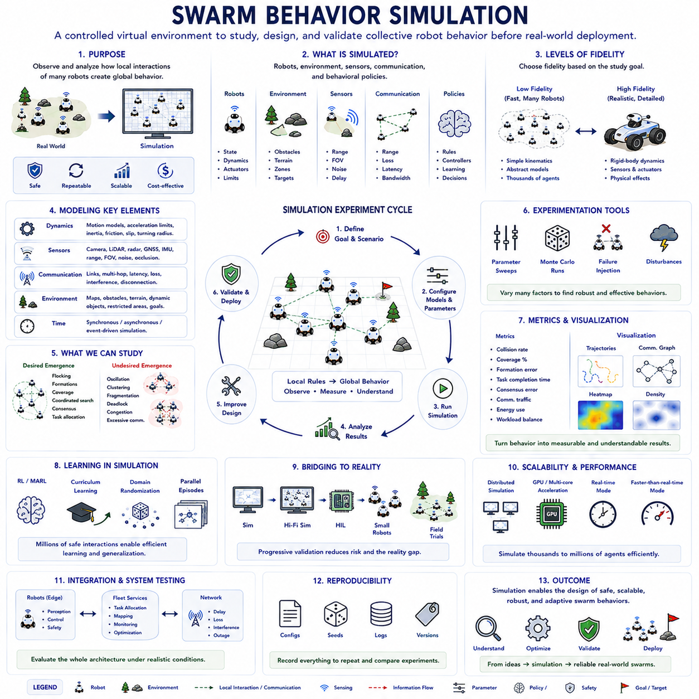{width="7.268055555555556in" height="7.268055555555556in"}

군집 행동 시뮬레이션(Swarm Behavior Simulation)은 알고리즘을 실제 하드웨어에 배치하기 전에 다수의 로봇이 어떻게 상호작용하는지를 연구할 수 있는 통제된 환경을 제공한다. 집단 행동(Collective Behavior)은 반복적인 국소 상호작용(Local Interaction)으로부터 출현하기 때문에 센싱, 통신, 이동 또는 의사결정 규칙의 작은 변화도 예상하지 못한 전역적 효과(Global Effect)를 발생시킬 수 있다. 시뮬레이션을 이용하면 값비싼 로봇 플랫폼을 위험에 노출하지 않고 이러한 효과를 관측하고 반복하며 측정할 수 있다.

군집 시뮬레이터(Swarm Simulator)는 일반적으로 개별 로봇, 물리적 환경, 센서, 통신 링크, 행동 정책(Behavioral Policy)을 표현한다. 각각의 시뮬레이션 로봇은 자신의 상태를 유지하고 모델링된 센싱 제약에 따라 관측 정보를 획득한다. 이후 이동과 상호작용에 영향을 주는 제어 또는 의사결정 규칙을 실행한다. 이러한 과정이 다수의 에이전트에서 반복되면서 연구자가 분석하고자 하는 집단 동역학(Collective Dynamics)이 형성된다.

시뮬레이션은 서로 다른 추상화 수준(Level of Abstraction)에서 수행할 수 있다. 상위 수준 모델은 로봇을 위치, 속도, 통신 반경을 가진 단순한 입자(Particle)로 표현하여 수천 개의 에이전트를 효율적으로 시뮬레이션할 수 있다. 보다 상세한 모델에서는 강체 동역학(Rigid-Body Dynamics), 바퀴 또는 로터 동작, 액추에이터 한계, 충돌 형상, 센서 특성, 제어 루프 등을 포함할 수 있다. 적절한 충실도(Fidelity)는 연구하려는 문제에 따라 결정된다.

저충실도 시뮬레이션(Low-Fidelity Simulation)은 초기 알고리즘 개발 단계에서 특히 유용하다. 연구자는 모든 기계적 세부사항을 모델링하지 않고도 인력(Attraction), 반발력(Repulsion), 정렬(Alignment), 합의(Consensus), 분산(Dispersion), 커버리지(Coverage), 작업 할당(Task Allocation) 규칙을 빠르게 시험할 수 있다. 넓은 매개변수 공간을 신속하게 탐색하여 보다 현실적인 물리 시뮬레이션에 계산 자원을 투입하기 전에 유망한 집단 메커니즘을 식별할 수 있다.

고충실도 시뮬레이션(High-Fidelity Simulation)은 집단 알고리즘이 로봇 동역학과 강하게 상호작용할 때 중요해진다. 가속도 한계, 휠 슬립(Wheel Slip), 회전 반경, 관성, 액추에이터 지연, 지형 또는 공기역학적 효과는 이론적인 군집 규칙이 실제 플랫폼에서 동작하는 방식을 변화시킬 수 있다. 점 로봇(Point Robot)에서는 안정적으로 보였던 대형 제어기가 실제 물리적 운동 제약과 지연이 추가되면 진동하거나 분열될 수 있다.

환경 모델링(Environment Modeling)도 마찬가지로 중요하다. 군집은 개방된 야외 공간, 창고, 숲, 도로, 건물, 재난 현장 또는 실내외가 혼합된 공간에서 운용될 수 있다. 시뮬레이션 환경에는 벽, 좁은 통로, 경사면, 장애물, 제한 구역, 동적 객체, 충전소, 통신 음영 지역(Communication Shadow), 목표 위치 등을 포함할 수 있다. 환경의 복잡성을 증가시키면 이상적인 조건을 벗어난 상황에서도 집단 행동이 효과적으로 유지되는지를 확인할 수 있다.

센서 모델(Sensor Model)은 각 로봇이 주변 환경으로부터 어떤 정보를 획득할 수 있는지를 결정한다. 카메라, 라이다(LiDAR), 레이더(Radar), 위성항법시스템(GNSS), 관성측정장치(IMU), 근접 센서, 음향 센서 또는 상대 거리 측정 시스템(Relative Ranging System)은 제한된 범위, 시야각(Field of View), 잡음, 지연, 가림(Occlusion)을 포함하도록 모델링할 수 있다. 현실적인 센싱 모델은 실제 배치 환경에서 사용할 수 없는 완벽한 정보에 알고리즘이 의존하는 것을 방지한다.

군집 조정이 국소적인 정보 교환에 의존하는 경우가 많기 때문에 통신(Communication) 역시 명시적으로 모델링해야 한다. 단순한 시뮬레이션에서는 고정된 통신 반경을 사용할 수 있지만 보다 현실적인 모델에서는 패킷 손실(Packet Loss), 대역폭 제한, 지연, 간섭, 다중 홉 라우팅(Multi-Hop Routing), 일시적인 연결 단절을 표현할 수 있다. 이러한 요소는 합의, 작업 할당, 지도 공유, 대형 행동에 상당한 영향을 줄 수 있다.

시간 모델링(Time Modeling)은 시뮬레이션 정확도와 계산 비용에 영향을 준다. 동기식 시뮬레이션(Synchronous Simulation)은 공유된 시뮬레이션 스텝에 따라 모든 로봇을 갱신하기 때문에 분석은 단순하지만 실제 분산 시스템에서 나타나는 시간 차이를 숨길 수 있다. 비동기식 또는 이벤트 기반 시뮬레이션(Asynchronous or Event-Driven Simulation)은 에이전트가 서로 다른 시점에 센싱, 통신, 행동을 수행하도록 하여 네트워크 지연과 독립적인 온보드 처리(Onboard Processing)를 보다 현실적으로 표현할 수 있다.

군집 시뮬레이션의 주요 목적 중 하나는 창발 분석(Emergence Analysis)이다. 연구자는 국소 규칙을 정의하고 플로킹(Flocking), 대형(Formation), 균일 커버리지(Uniform Coverage), 협력 수색(Coordinated Search), 합의와 같은 원하는 전역 구조가 출현하는지를 관찰한다. 동시에 진동, 군집화(Clustering), 분열(Fragmentation), 교착 상태(Deadlock), 교통 혼잡, 불안정한 전환, 과도한 통신과 같은 바람직하지 않은 창발 행동을 탐지하는 것도 중요하다.

매개변수 스윕(Parameter Sweep)은 이러한 행동을 체계적으로 이해하기 위한 방법을 제공한다. 상호작용 반경, 목표 분리 거리, 통신 범위, 로봇 속도, 센서 잡음, 개체군 밀도, 제어기 게인(Controller Gain), 페로몬 감쇠(Pheromone Decay) 등을 여러 실험에서 변화시킬 수 있다. 이후 성능 지도(Performance Map)를 이용하여 군집이 안정적이고 효과적으로 동작하는 영역과 집단 행동이 급격하게 변화하는 임계점을 식별할 수 있다.

개체군 규모(Population Size)는 특히 중요한 시뮬레이션 변수이다. 10대의 로봇에서 정상적으로 동작하는 알고리즘이 100대 또는 1,000대에서는 다르게 행동할 수 있다. 시뮬레이션을 이용하면 개체군이 증가함에 따라 통신 부하, 혼잡, 수렴 시간(Convergence Time), 센싱 중첩, 작업 효율이 어떻게 변화하는지를 평가할 수 있다. 따라서 대규모 실제 플릿을 구축하기 전에 군집의 확장성(Scalability)을 평가하는 데 시뮬레이션이 필수적이다.

밀도(Density)는 개체군 규모와 독립적으로 변화시켜야 한다. 고정된 환경에서 로봇 수를 증가시키는 것은 로봇 수와 운용 영역을 함께 증가시키는 것과 서로 다른 효과를 발생시킨다. 고밀도 실험은 충돌 위험, 국소 통신 포화, 혼잡, 간섭을 보여주며, 공간적으로 확장된 시뮬레이션은 국소 조정 메커니즘이 지리적으로 분산된 군집 운용을 지원할 수 있는지를 평가할 수 있게 한다.

고장 주입(Failure Injection)을 이용하면 강건성(Robustness)과 자기 복구(Self-Recovery)를 체계적으로 연구할 수 있다. 운용 중 시뮬레이션 로봇을 제거하거나 센서를 고장 내고, 통신 링크를 차단하거나 위치 추정 오차를 증가시키며, 배터리를 고갈시킬 수 있다. 이후 군집이 장애를 탐지하고 작업을 재분배하며 커버리지를 복원하고 통신 토폴로지(Communication Topology)를 재구성하면서 감소된 자원으로 운용을 지속하는지를 관찰할 수 있다.

환경적 교란(Environmental Disturbance) 역시 의도적으로 추가할 수 있다. 장애물이 예상하지 못하게 나타나거나 경로가 차단되고, 목표물이 이동하거나 통신 상태가 악화되며, 센싱 품질이 변화하도록 만들 수 있다. 이러한 교란에 반복적으로 노출하면 군집 정책이 정상 조건에서만 동작하는지 또는 불확실하고 동적인 실제 상황에 적응할 수 있는지를 확인할 수 있다.

몬테카를로 시뮬레이션(Monte Carlo Simulation)은 군집 행동이 초기 조건과 무작위성(Randomness)에 크게 의존할 수 있기 때문에 중요하다. 하나의 성공적인 실행만으로는 신뢰성을 충분히 입증할 수 없다. 서로 다른 로봇 초기 위치, 목표 위치, 센서 잡음, 통신 고장, 랜덤 시드(Random Seed)를 이용하여 실험을 반복하면 평균값이나 시각적으로 인상적인 결과에만 의존하지 않고 성능 분포(Performance Distribution)를 추정할 수 있다.

시뮬레이션 지표(Simulation Metrics)는 개별 성능과 집단 성능을 모두 반영해야 한다. 유용한 측정값에는 충돌률, 로봇 간 거리, 대형 오차(Formation Error), 커버리지 비율, 탐색 시간, 목표물 탐지 확률, 합의 오차(Consensus Error), 통신 트래픽, 에너지 소비, 작업 완료 시간, 작업 부하 분포 등이 포함된다. 이러한 측정값은 정성적인 군집 행동을 알고리즘 간 비교가 가능한 정량적 증거로 변환한다.

수치적인 지표만으로는 군집이 성공하거나 실패하는 원인을 충분히 설명하지 못할 수 있기 때문에 시각화(Visualization) 역시 중요하다. 이동 궤적, 통신 그래프, 커버리지 지도, 밀도장(Density Field), 작업 할당, 센서 영역(Sensor Footprint), 불확실성 지도, 가상 페로몬 분포 등을 통해 숨겨진 상호작용 패턴을 확인할 수 있다. 시간 기반 시각화는 국소 의사결정이 개체군 전체로 전파되어 전역 행동을 생성하는 과정을 보여줄 수 있다.

시뮬레이션은 AI 기반 군집 학습(AI-Based Swarm Learning)을 위한 핵심 환경이기도 하다. 강화학습(Reinforcement Learning)과 다중 에이전트 강화학습(Multi-Agent Reinforcement Learning)은 실제 로봇으로 수집하기에는 비현실적이거나 위험한 수백만 번의 상호작용을 필요로 할 수 있다. 병렬 시뮬레이션(Parallel Simulation)은 여러 에피소드를 동시에 생성하여 정책이 다양한 환경, 로봇 개체군, 통신 조건, 고장, 임무 구성을 경험하도록 할 수 있다.

커리큘럼 학습(Curriculum Learning)은 시뮬레이션 환경에서 자연스럽게 구현할 수 있다. 학습은 소수의 로봇과 단순한 환경에서 시작하여 개체군 규모, 장애물 복잡성, 센서 불확실성, 통신 제약, 작업 난이도를 점진적으로 증가시킬 수 있다. 이러한 단계적 진행은 학습 시스템이 매우 복잡한 집단 시나리오를 해결하기 전에 기본적인 조정 메커니즘을 먼저 습득하도록 한다.

도메인 랜덤화(Domain Randomization)는 시뮬레이션에서 실제 로봇으로의 전이를 지원한다. 물리적 매개변수, 마찰, 액추에이터 응답, 센서 잡음, 통신 지연, 지형 특성, 조명, 환경 배치 등을 학습 과정에서 무작위로 변화시킬 수 있다. 하나의 이상적인 시뮬레이터 설정에 최적화하는 대신 다양한 조건의 분포에서 동작하도록 정책을 학습시켜 모델링 오차에 대한 민감성을 감소시킬 수 있다.

현실 격차(Reality Gap)는 군집 시뮬레이션의 핵심적인 한계 중 하나이다. 어떤 시뮬레이터도 물리적 동역학, 센서 특유의 오차, 무선 전파, 기계적 편차, 환경 불확실성, 인간과의 상호작용을 완벽하게 재현할 수 없다. 작은 차이도 집단 피드백(Collective Feedback)을 통해 증폭될 수 있다. 따라서 시뮬레이션에서 안정적으로 보이는 정책이라도 대규모 배치 이전에 실제 로봇을 이용하여 단계적으로 검증해야 한다.

실용적인 검증 과정(Validation Process)은 추상적 시뮬레이션에서 시작하여 고충실도 시뮬레이션, 하드웨어 인더루프 시험(Hardware-in-the-Loop Testing), 소규모 실제 로봇 그룹, 그리고 최종적으로 대규모 현장 시험으로 발전할 수 있다. 각 단계에서는 고장을 진단할 수 있는 능력을 유지하면서 현실성을 점진적으로 증가시킨다. 소규모 단계에서 발견된 문제를 수정하면 훨씬 크고 비용이 많이 드는 로봇 집단 전체로 문제가 확산되는 것을 방지할 수 있다.

하드웨어 인더루프 시뮬레이션(Hardware-in-the-Loop Simulation)은 시뮬레이션된 군집 행동과 실제 계산 또는 로봇 구성요소를 연결한다. 실제 제어기, 통신 모듈, 센서 또는 개별 로봇이 시뮬레이션 에이전트와 상호작용할 수 있다. 이를 통해 전체 군집을 물리적으로 배치하는 비용을 피하면서 순수한 가상 실험에서는 나타나지 않을 수 있는 타이밍, 소프트웨어 통합, 네트워킹, 제어 문제를 식별할 수 있다.

매우 큰 개체군에서는 분산 시뮬레이션(Distributed Simulation)이 필요할 수 있다. 모든 로봇과 환경 프로세스를 하나의 컴퓨터에서 실행하는 대신 여러 CPU 코어, GPU, 서버 또는 시뮬레이션 노드로 계산을 분산할 수 있다. 공간 분할(Spatial Partitioning)이나 에이전트 분할(Agent Partitioning)을 통해 작업 부하를 분배할 수 있지만 의미 있는 집단 동역학을 유지하려면 시뮬레이션 프로세스 사이의 동기화와 통신을 신중하게 관리해야 한다.

실시간 시뮬레이션(Real-Time Simulation)과 실시간보다 빠른 시뮬레이션(Faster-Than-Real-Time Simulation)은 서로 다른 목적을 가진다. 실시간 실행은 하드웨어 통합과 운영자 상호작용에 유용하고, 실시간보다 빠른 시뮬레이션은 최적화, 학습, 몬테카를로 분석, 대규모 매개변수 스윕에 유용하다. 포괄적인 개발 워크플로에서는 현재 물리적 현실성과 실험 처리량 중 어느 것이 더 중요한지에 따라 두 방식을 모두 활용할 수 있다.

시스템 통합(System Integration)을 평가할 때에는 시뮬레이션에서 플릿 수준(Fleet-Level)과 엣지 수준(Edge-Level)의 아키텍처도 재현해야 한다. 개별 로봇은 국소적인 인지, 계획, 안전 기능을 실행하고, 시뮬레이션된 플릿 서비스(Fleet Service)는 보다 광범위한 작업 할당, 지도 관리, 모니터링 또는 최적화를 수행할 수 있다. 통신 지연과 서비스 고장을 추가하면 상위 수준 인프라를 사용할 수 없는 상황에서도 로봇의 자율성이 유지되는지를 확인할 수 있다.

재현성(Reproducibility)은 과학적·공학적 평가에서 필수적이다. 시뮬레이션 구성에는 소프트웨어 버전, 환경 정의, 로봇 모델, 제어기 매개변수, 랜덤 시드, 통신 설정, 개체군 규모, 평가 지표 등을 기록해야 한다. 동일한 조건을 반복적으로 실행할 수 있으면 알고리즘 변경 사항을 공정하게 비교할 수 있으며 예상하지 못한 행동 차이의 원인을 더욱 쉽게 분석할 수 있다.

궁극적으로 군집 행동 시뮬레이션(Swarm Behavior Simulation)은 수학적인 군집 원리와 실제 운용 가능한 다중 로봇 물리 인공지능(Multi-Robot Physical AI)을 연결하는 가교 역할을 한다. 이를 통해 집단 규칙, 학습된 정책, 통신 전략, 고장 복구, 확장성, 물리적 제약을 통제된 환경에서 점진적으로 현실성을 높이며 시험할 수 있다. 체계적인 시뮬레이션과 단계적인 하드웨어 검증을 결합하면 유망한 창발 패턴(Emergent Pattern)을 신뢰할 수 있는 실제 환경의 집단 자율성(Collective Autonomy)으로 발전시킬 수 있다.
