**Volume 09. Multi Robot and Swarm Physical AI**

# Chapter 03. Task Allocation and Coordination

## 03.01. Multi Robot Task Allocation Fundamentals

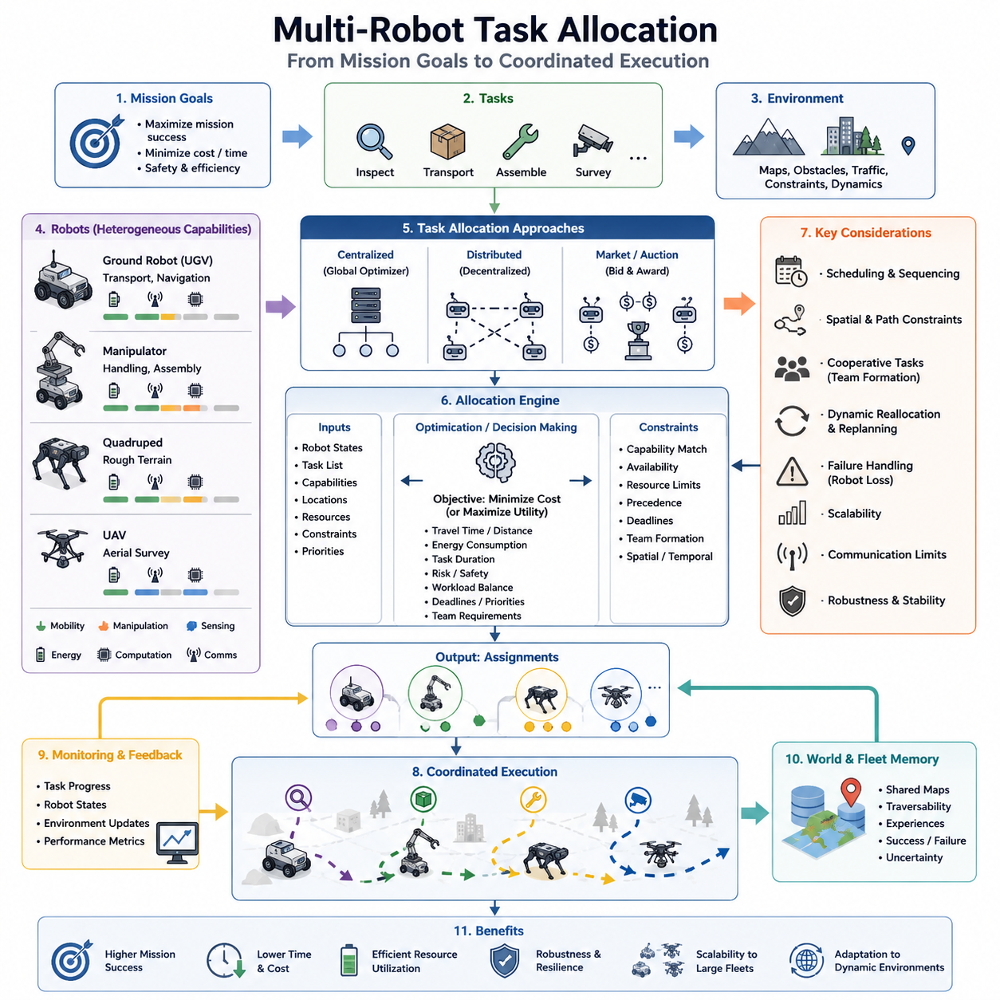{width="7.268055555555556in" height="7.268055555555556in"}

Multi-robot task allocation is the process of deciding which robot, or group of robots, should perform each task within a shared mission. It connects collective objectives with individual robot actions by considering capabilities, location, workload, resources, and operational constraints. Effective allocation transforms a collection of autonomous robots into a coordinated physical system whose overall performance can exceed that of independently operating agents.

A task allocation problem begins with three fundamental elements: a set of robots, a set of tasks, and an environment in which those tasks must be executed. Each robot may differ in mobility, sensing, manipulation, payload, energy, computing resources, or communication capability. Tasks can likewise require different skills, locations, execution durations, priorities, deadlines, or combinations of resources, making assignment fundamentally a compatibility problem.

The simplest allocation assumes that one independent task is assigned to one available robot. Real physical systems are usually more complicated because tasks can compete for robots, require sequential execution, depend on other tasks, or demand simultaneous cooperation among several agents. Consequently, allocation cannot be treated only as matching identifiers. It must represent the physical consequences, costs, dependencies, and feasibility of every possible robot-task relationship.

An allocation system normally evaluates a utility or cost associated with assigning robot (r_i) to task (t_j). A conceptual cost can combine travel distance, expected execution time, energy consumption, resource usage, risk, and opportunity cost. Conversely, utility may represent expected reward, task priority, information gain, or mission value. The allocation mechanism searches for assignments that minimize collective cost or maximize total mission utility under operational constraints.

Capability awareness is essential because robots are not interchangeable in many Physical AI systems. A mobile robot may transport material, a manipulator may perform physical handling, a quadruped may traverse stairs, and a UAV may rapidly observe inaccessible areas. Task allocation therefore requires explicit descriptions of what each robot can do and what each task requires, allowing infeasible assignments to be rejected before optimization or coordination begins.

Task allocation can be centralized, distributed, or hybrid. In centralized allocation, a fleet manager maintains relevant system information and computes assignments for multiple robots. Distributed approaches allow robots to negotiate or select tasks using local information and communication with peers. Hybrid architectures combine global mission-level optimization with local autonomous decisions, providing a practical balance between global efficiency, communication requirements, scalability, and resilience.

Centralized allocation can exploit a broad global view of robot states, task priorities, maps, resources, and mission constraints. This often makes sophisticated optimization and scheduling easier, particularly when infrastructure connectivity is reliable. However, increasing fleet size expands computational and communication requirements, while dependence on a central coordinator can create bottlenecks or failure sensitivity. Large Physical AI deployments therefore require careful separation between fleet-level assignment and robot-level execution.

Distributed allocation shifts part of the decision process toward individual robots. Each robot can estimate its suitability for available tasks using local state, perceived conditions, expected travel cost, remaining energy, and communicated information. Robots may exchange bids, intentions, commitments, or task states until an acceptable assignment emerges. This reduces dependence on a single coordinator and can improve resilience when communication is intermittent or the environment changes faster than centralized updates.

Market and auction mechanisms provide an intuitive framework for distributed coordination. Robots calculate bids reflecting the estimated cost or utility of performing tasks, while an allocation process selects advantageous robot-task combinations. The economic metaphor is useful because heterogeneous capabilities, distance, energy, workload, and urgency can be transformed into comparable values. Repeated auctions also provide a natural mechanism for adapting assignments as robots and tasks change over time.

Optimization-based allocation formulates assignment as a mathematical decision problem. Binary variables can indicate whether particular robots receive particular tasks, while objective functions represent total cost, mission completion time, energy, risk, or another performance measure. Constraints enforce requirements such as robot availability, capability compatibility, resource limits, task precedence, and deadlines. Exact optimization can produce strong solutions, although computational complexity increases rapidly with problem size.

Allocation and scheduling are closely connected but represent different decisions. Allocation determines who should perform a task, whereas scheduling determines when and in what order assigned tasks should be executed. A robot that appears optimal based only on distance may already have several urgent tasks, making another robot globally preferable. Practical multi-robot systems therefore evaluate assignment together with workload, temporal constraints, expected task duration, and future resource availability.

Spatial constraints further couple task allocation with navigation and planning. The geometric distance between a robot and a task is rarely sufficient because actual travel cost depends on traversability, obstacles, traffic, restricted regions, congestion, and interaction with other robots. Allocation should therefore use realistic path or mission costs whenever possible. A seemingly inexpensive assignment can become inefficient if many robots are directed through the same corridor or shared physical resource.

Coordination becomes especially important when a task requires several robots simultaneously. Cooperative transport, distributed inspection, synchronized manipulation, formation movement, and large-area search may require teams rather than individual agents. Allocation must then determine not merely which robot receives a task, but which combination of robots forms a feasible team. Compatibility between capabilities, timing, communication, physical position, and cooperative behavior becomes part of the assignment problem.

Physical environments are dynamic, so an allocation should rarely be considered permanent. New tasks can appear, priorities can change, paths can become blocked, batteries can decline, execution times can differ from predictions, and robots can fail. Dynamic reallocation allows the system to reconsider earlier decisions using updated world state. The objective is not constant reassignment, however, because excessive changes create instability, wasted travel, interrupted work, and unnecessary communication.

Robust allocation therefore balances optimization with commitment. Once a robot begins an expensive or safety-critical task, reallocating it may have a significant switching cost. Allocation policies can incorporate hysteresis, commitment periods, reassignment penalties, or task-locking rules so that small changes do not continuously reorganize the fleet. Replanning should occur when the expected benefit of changing assignments exceeds the operational cost and risk introduced by that change.

Failure handling demonstrates why task allocation is a core component of collective autonomy. When a robot becomes unavailable, its unfinished tasks must be detected, returned to the available task pool, and reassigned to suitable robots. The system may also need to reorganize schedules and cooperative teams. Redundancy becomes useful when several robots possess overlapping capabilities, because mission functionality can continue even when individual physical agents are lost.

Scalability is one of the fundamental difficulties of multi-robot allocation. As the numbers of robots, tasks, constraints, and possible cooperative combinations increase, the assignment space can grow combinatorially. Large fleets therefore rely on approximations, hierarchical decomposition, geographic partitioning, heuristics, auctions, distributed algorithms, or combinations of these methods. The practical objective is often not mathematically perfect allocation, but sufficiently good decisions produced within operational time limits.

In Physical AI, task allocation ultimately forms a bridge between collective intelligence and physical execution. It converts mission goals into distributed responsibilities while continuously accounting for embodiment, resources, space, time, uncertainty, and changing world conditions. Together with scheduling, cooperative mission coordination, dynamic replanning, failure recovery, and learning-based methods, it provides the organizational mechanism through which many autonomous robots can operate as one adaptive system.

다중 로봇 작업 할당(Multi-Robot Task Allocation)은 공유 임무(Shared Mission) 내에서 각 작업(Task)을 어떤 로봇(Robot) 또는 로봇 그룹(Group of Robots)이 수행할 것인지를 결정하는 과정이다. 이는 능력(Capability), 위치(Location), 작업 부하(Workload), 자원(Resource), 운영 제약조건(Operational Constraint)을 고려하여 집단 목표(Collective Objective)를 개별 로봇 행동(Individual Robot Action)과 연결한다. 효과적인 작업 할당은 여러 자율 로봇을 독립적인 개체의 집합이 아니라 하나의 조정된 물리 시스템(Coordinated Physical System)으로 동작하게 한다.

작업 할당 문제(Task Allocation Problem)는 기본적으로 로봇 집합(Set of Robots), 작업 집합(Set of Tasks), 그리고 작업이 수행되는 환경(Environment)의 세 가지 요소에서 시작한다. 각 로봇은 이동성(Mobility), 센싱(Sensing), 조작(Manipulation), 탑재 능력(Payload), 에너지(Energy), 컴퓨팅 자원(Computing Resources), 통신 능력(Communication Capability) 등이 서로 다를 수 있다. 작업 역시 필요한 기술, 위치, 실행 시간, 우선순위, 마감시간, 자원 조합 등이 다르기 때문에 작업 할당은 본질적으로 적합성 문제(Compatibility Problem)가 된다.

가장 단순한 작업 할당에서는 하나의 독립적인 작업(Independent Task)을 하나의 사용 가능한 로봇(Available Robot)에 할당한다. 그러나 실제 물리 시스템(Physical System)은 작업들이 로봇을 놓고 경쟁하거나, 순차적인 실행을 요구하거나, 다른 작업에 의존하거나, 여러 에이전트(Agent)의 동시 협력을 필요로 하기 때문에 훨씬 복잡하다. 따라서 작업 할당은 단순한 식별자 매칭(Identifier Matching)이 아니라 가능한 모든 로봇-작업 관계(Robot-Task Relationship)의 물리적 결과, 비용, 의존성, 실행 가능성을 표현해야 한다.

작업 할당 시스템(Task Allocation System)은 일반적으로 로봇 (r_i)를 작업 (t_j)에 할당할 때 발생하는 효용(Utility) 또는 비용(Cost)을 평가한다. 개념적인 비용에는 이동 거리(Travel Distance), 예상 실행 시간(Expected Execution Time), 에너지 소비(Energy Consumption), 자원 사용(Resource Usage), 위험(Risk), 기회비용(Opportunity Cost) 등이 포함될 수 있다. 반대로 효용은 예상 보상(Expected Reward), 작업 우선순위(Task Priority), 정보 획득량(Information Gain), 임무 가치(Mission Value)를 나타낼 수 있다.

능력 인식(Capability Awareness)은 많은 피지컬 AI(Physical AI) 시스템에서 로봇들이 서로 완전히 대체 가능하지 않기 때문에 필수적이다. 이동 로봇(Mobile Robot)은 물자를 운반하고, 매니퓰레이터(Manipulator)는 물리적인 취급 작업을 수행하며, 사족보행 로봇(Quadruped)은 계단을 이동하고, 무인항공기(UAV)는 접근하기 어려운 지역을 빠르게 관찰할 수 있다. 따라서 작업 할당에는 각 로봇이 수행할 수 있는 능력과 각 작업이 요구하는 능력을 명시적으로 표현하여 최적화 또는 조정 이전에 실행 불가능한 할당을 제거할 수 있어야 한다.

작업 할당(Task Allocation)은 중앙집중형(Centralized), 분산형(Distributed), 또는 하이브리드형(Hybrid)으로 구성할 수 있다. 중앙집중형 할당(Centralized Allocation)에서는 플릿 관리자(Fleet Manager)가 관련 시스템 정보를 유지하면서 여러 로봇의 작업 할당을 계산한다. 분산형 접근법(Distributed Approach)에서는 로봇들이 로컬 정보(Local Information)와 동료 로봇과의 통신을 이용하여 작업을 협상하거나 선택한다. 하이브리드 아키텍처(Hybrid Architecture)는 글로벌 임무 수준 최적화(Global Mission-Level Optimization)와 로컬 자율 의사결정(Local Autonomous Decision-Making)을 결합한다.

중앙집중형 할당(Centralized Allocation)은 로봇 상태(Robot State), 작업 우선순위(Task Priority), 지도(Map), 자원(Resource), 임무 제약조건(Mission Constraint)에 대한 폭넓은 글로벌 관점(Global View)을 활용할 수 있다. 이는 특히 인프라 연결성(Infrastructure Connectivity)이 안정적인 환경에서 정교한 최적화(Optimization)와 스케줄링(Scheduling)을 쉽게 한다. 그러나 플릿(Fleet)의 규모가 증가하면 계산 및 통신 요구량이 증가하고 중앙 조정자(Central Coordinator)에 대한 의존성이 병목현상(Bottleneck)이나 장애 취약성(Failure Sensitivity)을 발생시킬 수 있다.

분산형 할당(Distributed Allocation)은 의사결정 과정의 일부를 개별 로봇(Individual Robot)으로 이동시킨다. 각 로봇은 자신의 상태(Local State), 인식된 환경 조건(Perceived Condition), 예상 이동 비용(Expected Travel Cost), 잔여 에너지(Remaining Energy), 통신으로 전달된 정보를 이용하여 사용 가능한 작업에 대한 적합성을 평가할 수 있다. 로봇들은 입찰(Bid), 의도(Intent), 작업 약속(Commitment), 작업 상태(Task State)를 교환하면서 적절한 할당 결과에 도달할 수 있다.

시장 및 경매 메커니즘(Market and Auction Mechanism)은 분산형 조정(Distributed Coordination)을 위한 직관적인 프레임워크(Framework)를 제공한다. 로봇은 작업을 수행하는 데 필요한 예상 비용 또는 효용을 반영하여 입찰값(Bid)을 계산하고, 할당 과정은 유리한 로봇-작업 조합(Robot-Task Combination)을 선택한다. 이 경제적 모델(Economic Metaphor)은 서로 다른 능력, 거리, 에너지, 작업 부하, 긴급도를 비교 가능한 값으로 변환할 수 있다는 장점이 있으며 반복적인 경매(Repeated Auction)를 통해 변화하는 상황에도 대응할 수 있다.

최적화 기반 할당(Optimization-Based Allocation)은 작업 할당을 수학적인 의사결정 문제(Mathematical Decision Problem)로 표현한다. 이진 변수(Binary Variable)를 사용하여 특정 로봇이 특정 작업에 할당되었는지를 나타낼 수 있으며, 목적함수(Objective Function)는 전체 비용, 임무 완료 시간(Mission Completion Time), 에너지, 위험 또는 기타 성능 지표를 표현한다. 제약조건(Constraint)은 로봇 가용성(Robot Availability), 능력 적합성(Capability Compatibility), 자원 제한(Resource Limit), 작업 선후관계(Task Precedence), 마감시간(Deadline) 등을 반영한다.

작업 할당(Task Allocation)과 스케줄링(Scheduling)은 밀접하게 연결되어 있지만 서로 다른 의사결정을 나타낸다. 작업 할당은 누가(Who) 작업을 수행할 것인지를 결정하는 반면, 스케줄링은 언제(When), 그리고 어떤 순서(Order)로 할당된 작업을 실행할 것인지를 결정한다. 거리만 고려하면 가장 적합해 보이는 로봇도 이미 여러 긴급 작업을 수행하고 있다면 다른 로봇이 전체 시스템 관점에서는 더 적합할 수 있다. 따라서 실제 다중 로봇 시스템(Multi-Robot System)은 작업 부하, 시간 제약, 예상 작업 시간, 미래 자원 가용성을 함께 평가해야 한다.

공간적 제약조건(Spatial Constraint)은 작업 할당을 내비게이션(Navigation) 및 플래닝(Planning)과 더욱 밀접하게 연결한다. 로봇과 작업 사이의 기하학적 거리(Geometric Distance)만으로 실제 이동 비용을 판단하기 어려운 이유는 주행 가능성(Traversability), 장애물(Obstacle), 교통(Traffic), 제한 구역(Restricted Region), 혼잡(Congestion), 다른 로봇과의 상호작용이 이동 비용에 영향을 미치기 때문이다. 따라서 가능한 경우 실제 경로 비용(Path Cost) 또는 임무 비용(Mission Cost)을 작업 할당에 반영해야 한다.

하나의 작업에 여러 로봇이 동시에 필요한 경우에는 조정(Coordination)이 더욱 중요해진다. 협력 운송(Cooperative Transport), 분산 검사(Distributed Inspection), 동기화된 조작(Synchronized Manipulation), 대형 이동(Formation Movement), 광역 탐색(Large-Area Search)은 개별 에이전트가 아니라 로봇 팀(Robot Team)을 필요로 할 수 있다. 따라서 작업 할당은 어떤 로봇이 작업을 받을 것인지뿐만 아니라 어떤 로봇 조합이 실행 가능한 팀(Feasible Team)을 구성할 것인지도 결정해야 한다.

물리적 환경(Physical Environment)은 동적이므로 작업 할당을 영구적인 결정으로 간주해서는 안 된다. 새로운 작업이 발생하고, 우선순위가 변경되며, 이동 경로가 차단되고, 배터리가 감소하거나, 실제 실행 시간이 예측과 달라지고, 로봇이 고장날 수도 있다. 동적 재할당(Dynamic Reallocation)은 업데이트된 월드 상태(World State)를 이용하여 기존 결정을 다시 평가하도록 한다. 그러나 지나친 재할당은 불안정성, 불필요한 이동, 작업 중단, 통신 부하를 발생시킬 수 있다.

강건한 할당(Robust Allocation)은 최적화(Optimization)와 작업 지속성(Commitment) 사이의 균형을 유지해야 한다. 로봇이 비용이 높은 작업이나 안전 중요 작업(Safety-Critical Task)을 이미 시작했다면 다른 작업으로 재할당하는 데 상당한 전환 비용(Switching Cost)이 발생할 수 있다. 작업 할당 정책은 히스테리시스(Hysteresis), 작업 유지 기간(Commitment Period), 재할당 페널티(Reassignment Penalty), 작업 잠금(Task Locking) 등을 적용하여 작은 변화로 인해 전체 플릿이 지속적으로 재구성되는 것을 방지할 수 있다.

장애 처리(Failure Handling)는 작업 할당이 집단 자율성(Collective Autonomy)의 핵심 구성요소인 이유를 보여준다. 로봇을 더 이상 사용할 수 없게 되면 완료되지 않은 작업을 감지하고, 해당 작업을 사용 가능한 작업 풀(Available Task Pool)로 반환한 후 적절한 다른 로봇에 다시 할당해야 한다. 또한 스케줄과 협력 팀(Cooperative Team)을 재구성해야 할 수도 있다. 여러 로봇이 중복된 능력(Overlapping Capability)을 가지고 있다면 개별 로봇의 손실에도 전체 임무 기능을 유지할 수 있다.

확장성(Scalability)은 다중 로봇 작업 할당(Multi-Robot Task Allocation)의 근본적인 어려움 가운데 하나이다. 로봇, 작업, 제약조건, 협력 조합의 수가 증가하면 가능한 할당 공간(Assignment Space)이 조합적으로 증가할 수 있다. 따라서 대규모 플릿(Large-Scale Fleet)은 근사화(Approximation), 계층적 분해(Hierarchical Decomposition), 지리적 분할(Geographic Partitioning), 휴리스틱(Heuristic), 경매(Auction), 분산 알고리즘(Distributed Algorithm) 또는 이들의 조합을 사용한다. 실제 목표는 항상 수학적으로 완벽한 할당이 아니라 운영 시간 내에 충분히 좋은 결정을 생성하는 것이다.

피지컬 AI(Physical AI)에서 작업 할당(Task Allocation)은 궁극적으로 집단 지능(Collective Intelligence)과 물리적 실행(Physical Execution)을 연결하는 다리 역할을 한다. 작업 할당은 임무 목표(Mission Goal)를 분산된 책임(Distributed Responsibility)으로 변환하면서 로봇의 체화(Embodiment), 자원, 공간, 시간, 불확실성(Uncertainty), 변화하는 환경 조건을 지속적으로 고려한다. 스케줄링, 협력 임무 조정(Cooperative Mission Coordination), 동적 재계획(Dynamic Replanning), 장애 복구(Failure Recovery), 학습 기반 방법(Learning-Based Method)과 결합될 때 다수의 자율 로봇이 하나의 적응형 시스템(Adaptive System)처럼 동작할 수 있게 한다.

## 03.02. Task Robot and Resource Representation

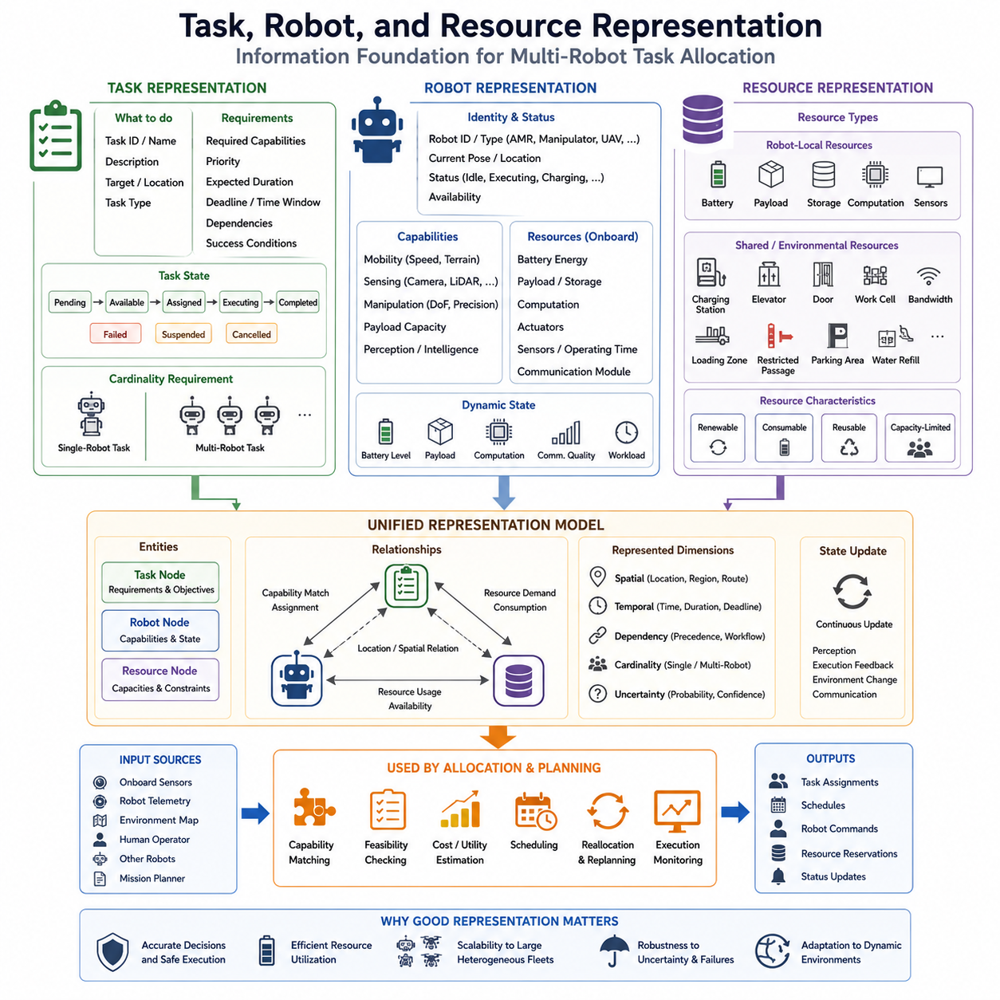{width="7.268055555555556in" height="7.268055555555556in"}

A task representation defines what must be accomplished by the multi-robot system in a form that can be interpreted by allocation, scheduling, planning, and execution mechanisms. A task should contain more than a symbolic name or identifier. It may describe the required operation, target location, priority, expected duration, deadline, dependencies, required capabilities, resource demands, and conditions that determine successful completion.

Robot representation describes the operational state and abilities of each physical agent participating in the fleet. A useful representation includes robot identity, embodiment type, current pose, mobility characteristics, sensing and manipulation capabilities, payload capacity, remaining energy, computational resources, communication status, availability, and current workload. Together, these attributes allow the allocation system to determine whether a robot can realistically execute a particular task.

Capability representation provides the semantic connection between robots and tasks. A task may require navigation, manipulation, inspection, lifting, visual perception, thermal sensing, or aerial observation, while each robot advertises the capabilities it can provide. Allocation can then be formulated as capability matching rather than simple robot selection, allowing heterogeneous fleets to determine which embodiments are physically and functionally suitable for each mission requirement.

Capabilities can be represented as binary properties, categorical labels, numerical values, or structured descriptions. A robot may simply indicate whether it possesses a manipulator, but more detailed models can describe payload limits, sensor range, positioning accuracy, maximum velocity, terrain compatibility, or manipulation precision. Rich representations make allocation more realistic because possessing a capability does not necessarily mean that the robot can provide it at the performance level required by a task.

Resource representation captures quantities that are consumed, occupied, shared, or constrained during execution. Robot-local resources include battery energy, payload capacity, onboard storage, computation, actuator availability, and sensor operating time. Shared resources may include charging stations, elevators, doors, loading zones, work cells, communication bandwidth, or restricted passages. Representing these resources prevents assignments that appear feasible individually but become impossible when physical infrastructure is considered.

Resources can be renewable, consumable, reusable, or capacity-limited. Battery energy is consumed during operation and restored through charging, while a charging station can serve multiple robots over time but only a limited number simultaneously. Payload capacity becomes available again after delivery, whereas mission time cannot be recovered. Distinguishing these resource characteristics allows scheduling and allocation algorithms to reason about availability across the entire execution horizon.

Spatial representation is particularly important because multi-robot tasks occur in the physical world. Tasks may be associated with coordinates, regions, routes, objects, machines, or semantic locations such as inspection zones and loading stations. Robots likewise maintain their current or predicted positions. These spatial descriptions allow allocation algorithms to estimate travel cost, accessibility, path feasibility, congestion exposure, and whether a robot can physically reach the required workspace.

Temporal representation describes when tasks can or should occur. A task may contain an earliest start time, deadline, expected duration, time window, recurrence condition, or synchronization requirement. Some tasks can be performed independently, whereas others must begin only after prerequisite tasks have finished. Representing temporal constraints enables the system to move beyond static assignment and construct executable schedules that respect both mission priorities and physical operating conditions.

Task dependencies describe relationships among activities. A delivery task, for example, may require pickup before transportation and transportation before unloading. Inspection may need to precede repair, while several observations may need to be completed before a collective decision is made. Such relationships can be represented using precedence constraints, task graphs, workflows, or hierarchical mission structures, enabling allocation mechanisms to reason about complete missions rather than isolated actions.

Tasks may also differ in their robot cardinality requirements. A single-robot task requires one suitable agent, while a multi-robot task may require several robots simultaneously or a specific combination of capabilities. Cooperative transport could require two mobile robots, while inspection and manipulation might require coordinated sensing and handling agents. The representation must therefore specify not only required capabilities but also the number and composition of robots necessary for execution.

Heterogeneous fleets make representation more challenging because different embodiments expose fundamentally different physical abilities. An AMR may provide efficient ground transportation, a mobile manipulator can transport and manipulate objects, a quadruped can access irregular terrain, and a UAV can provide rapid aerial sensing. A common representation layer should describe these differences consistently without eliminating embodiment-specific properties that determine whether a mission is physically feasible.

Robot state is dynamic rather than fixed. Remaining battery decreases, payload changes, sensors can become unavailable, communication quality fluctuates, and robots transition between idle, assigned, executing, charging, recovering, and failed states. Consequently, robot representation must be continuously updated. Task allocation based on stale state can assign work to a robot that no longer has sufficient energy, is already committed elsewhere, or cannot communicate reliably enough for the requested operation.

Task state is similarly dynamic. Tasks can move through states such as pending, available, assigned, executing, completed, failed, suspended, or cancelled. Their priorities may change as environmental conditions evolve, and new tasks may be generated by perception, human operators, other robots, or mission-level reasoning. Explicit task-state representation enables the coordination system to distinguish between work that requires allocation and work that is already committed or completed.

Uncertainty should be represented whenever task or robot information is incomplete. Travel duration, battery consumption, execution time, perception confidence, terrain difficulty, and communication quality may only be estimates. Instead of treating these quantities as perfectly known values, a system can associate confidence, probability, intervals, or uncertainty measures with them. This allows allocation mechanisms to consider not only expected efficiency but also the reliability and risk of candidate assignments.

A unified representation can organize tasks, robots, and resources as interconnected entities within a shared operational model. Robot nodes describe capabilities and current state, task nodes describe requirements and objectives, and resource entities describe available capacities and constraints. Relationships express compatibility, location, dependency, ownership, availability, and competition. Such structure provides a common information foundation for allocation, scheduling, coordination, monitoring, and replanning.

Representation quality directly determines the quality of subsequent decisions. An optimization algorithm cannot compensate for missing capability requirements, incorrect energy estimates, outdated robot states, or unmodeled shared resources. Conversely, excessively detailed representations can increase computation, communication, and maintenance costs. Practical multi-robot Physical AI therefore requires representations that preserve decision-relevant physical information while remaining compact enough for timely fleet-scale reasoning.

Task, robot, and resource representation ultimately provides the interface between the physical fleet and its coordination intelligence. It converts real robots, mission requirements, infrastructure, and environmental constraints into structured information that algorithms can reason about. Once this common representation is established, centralized, distributed, auction-based, optimization-based, and learning-based allocation methods can evaluate feasible assignments and coordinate execution using a consistent description of the shared physical system.

작업 표현(Task Representation)은 다중 로봇 시스템(Multi-Robot System)이 수행해야 할 내용을 작업 할당(Task Allocation), 스케줄링(Scheduling), 플래닝(Planning), 실행(Execution) 메커니즘이 해석할 수 있는 형태로 정의한다. 작업은 단순한 기호적 이름이나 식별자(Identifier) 이상의 정보를 포함해야 한다. 필요한 동작, 목표 위치, 우선순위, 예상 소요시간, 마감시간, 의존관계, 요구 능력, 자원 요구량, 성공적인 완료를 판단하는 조건 등을 포함할 수 있다.

로봇 표현(Robot Representation)은 플릿(Fleet)에 참여하는 각 물리적 에이전트(Physical Agent)의 운영 상태와 능력을 기술한다. 유용한 표현에는 로봇 식별정보, 체화 유형(Embodiment Type), 현재 자세(Pose), 이동 특성, 센싱 및 조작 능력, 탑재 용량(Payload Capacity), 잔여 에너지, 컴퓨팅 자원, 통신 상태, 가용성(Availability), 현재 작업 부하 등이 포함된다. 이러한 속성을 통해 할당 시스템은 특정 로봇이 실제로 특정 작업을 수행할 수 있는지를 판단할 수 있다.

능력 표현(Capability Representation)은 로봇과 작업을 연결하는 의미론적 연결(Semantic Connection)을 제공한다. 작업에는 내비게이션(Navigation), 조작(Manipulation), 검사(Inspection), 리프팅(Lifting), 시각 인식(Visual Perception), 열 감지(Thermal Sensing), 공중 관측(Aerial Observation) 등이 요구될 수 있으며, 각 로봇은 자신이 제공할 수 있는 능력을 표현한다. 이에 따라 작업 할당은 단순한 로봇 선택이 아니라 능력 매칭(Capability Matching) 문제로 구성될 수 있다.

능력(Capability)은 이진 속성(Binary Property), 범주형 레이블(Categorical Label), 수치값(Numerical Value), 구조화된 설명(Structured Description) 등으로 표현할 수 있다. 로봇이 매니퓰레이터(Manipulator)의 보유 여부만 나타낼 수도 있지만, 보다 상세한 모델에서는 탑재 한계, 센서 범위, 위치 정확도, 최대 속도, 지형 적합성(Terrain Compatibility), 조작 정밀도 등을 기술할 수 있다. 풍부한 표현은 단순히 능력을 보유하는 것과 작업에서 요구되는 성능 수준으로 해당 능력을 제공하는 것을 구분할 수 있게 한다.

자원 표현(Resource Representation)은 실행 과정에서 소비되거나, 점유되거나, 공유되거나, 제약되는 수량을 나타낸다. 로봇 로컬 자원(Robot-Local Resource)에는 배터리 에너지, 탑재 용량, 온보드 저장공간, 컴퓨팅 자원, 액추에이터 가용성, 센서 작동시간 등이 포함된다. 공유 자원(Shared Resource)에는 충전소, 엘리베이터, 출입문, 적재 구역, 작업 셀, 통신 대역폭, 제한 통로 등이 포함될 수 있다. 이러한 자원을 표현하면 개별적으로는 가능하지만 실제 인프라를 고려했을 때 실행할 수 없는 할당을 방지할 수 있다.

자원(Resource)은 재생 가능(Renewable), 소비형(Consumable), 재사용 가능(Reusable), 용량 제한형(Capacity-Limited) 등으로 구분할 수 있다. 배터리 에너지는 운행 중 소비되고 충전을 통해 회복되며, 충전소는 시간에 따라 여러 로봇이 사용할 수 있지만 동시에 사용할 수 있는 로봇 수에는 제한이 있다. 배송 후에는 탑재 용량을 다시 사용할 수 있지만 임무 시간은 회복할 수 없다. 이러한 자원의 특성을 구분하면 전체 실행 구간에서 자원의 가용성을 고려할 수 있다.

공간 표현(Spatial Representation)은 다중 로봇 작업이 물리적 세계(Physical World)에서 수행되기 때문에 특히 중요하다. 작업은 좌표(Coordinate), 영역(Region), 경로(Route), 객체(Object), 기계 또는 검사 구역이나 적재 스테이션과 같은 의미론적 위치(Semantic Location)와 연결될 수 있다. 로봇 역시 현재 위치 또는 예측 위치를 유지한다. 이러한 공간 정보는 이동 비용, 접근 가능성, 경로 실행 가능성(Path Feasibility), 혼잡 노출 정도, 그리고 로봇이 실제 작업 공간에 도달할 수 있는지를 평가하는 데 사용된다.

시간 표현(Temporal Representation)은 작업을 언제 수행할 수 있으며 언제 수행해야 하는지를 기술한다. 작업에는 가장 빠른 시작 시간(Earliest Start Time), 마감시간(Deadline), 예상 소요시간, 시간 윈도(Time Window), 반복 조건(Recurrence Condition), 동기화 요구조건(Synchronization Requirement) 등이 포함될 수 있다. 일부 작업은 독립적으로 수행할 수 있지만 다른 작업은 선행 작업이 완료된 이후에만 시작할 수 있다. 시간적 제약조건을 표현하면 정적 할당을 넘어 실제 실행 가능한 스케줄을 구성할 수 있다.

작업 의존관계(Task Dependency)는 여러 활동 사이의 관계를 나타낸다. 예를 들어 배송 작업에서는 운송 전에 픽업(Pickup)이 필요하고, 하역 전에 운송이 완료되어야 한다. 검사는 수리보다 먼저 수행되어야 할 수 있으며, 여러 관측 작업이 완료된 이후에 집단 의사결정(Collective Decision)이 이루어질 수도 있다. 이러한 관계는 선행 제약조건(Precedence Constraint), 작업 그래프(Task Graph), 워크플로(Workflow), 계층적 임무 구조(Hierarchical Mission Structure) 등을 통해 표현할 수 있다.

작업은 필요한 로봇 수(Robot Cardinality Requirement)에서도 차이가 있을 수 있다. 단일 로봇 작업(Single-Robot Task)은 하나의 적합한 에이전트를 필요로 하지만, 다중 로봇 작업(Multi-Robot Task)은 여러 로봇의 동시 참여 또는 특정 능력 조합을 요구할 수 있다. 협력 운송(Cooperative Transport)에는 두 대의 이동 로봇이 필요할 수 있으며, 검사와 조작에는 센싱 에이전트와 조작 에이전트의 협력이 필요할 수 있다. 따라서 표현에는 요구 능력뿐만 아니라 실행에 필요한 로봇의 수와 구성도 포함되어야 한다.

이기종 플릿(Heterogeneous Fleet)은 서로 다른 체화(Embodiment)가 근본적으로 다른 물리적 능력을 제공하기 때문에 표현을 더욱 어렵게 만든다. 자율이동로봇(AMR)은 효율적인 지상 운송을 제공하고, 모바일 매니퓰레이터(Mobile Manipulator)는 이동과 물체 조작을 수행하며, 사족보행 로봇(Quadruped)은 불규칙한 지형에 접근하고, 무인항공기(UAV)는 빠른 공중 센싱을 제공할 수 있다. 공통 표현 계층(Common Representation Layer)은 이러한 차이를 일관되게 표현하면서 체화별 고유 특성을 유지해야 한다.

로봇 상태(Robot State)는 고정되어 있지 않고 동적으로 변화한다. 잔여 배터리는 감소하고, 탑재 상태는 변하며, 센서를 사용할 수 없게 될 수 있고, 통신 품질이 변동하며, 로봇은 유휴(Idle), 할당(Assigned), 실행(Executing), 충전(Charging), 복구(Recovering), 장애(Failed) 등의 상태 사이를 전환한다. 따라서 로봇 표현은 지속적으로 업데이트되어야 한다. 오래된 상태 정보에 기반한 작업 할당은 에너지가 부족하거나 이미 다른 작업을 수행 중인 로봇에 새로운 작업을 할당하는 문제를 발생시킬 수 있다.

작업 상태(Task State) 역시 동적으로 변화한다. 작업은 대기(Pending), 가용(Available), 할당(Assigned), 실행(Executing), 완료(Completed), 실패(Failed), 일시중단(Suspended), 취소(Cancelled) 등의 상태를 가질 수 있다. 환경 조건이 변화하면 우선순위가 달라질 수 있으며, 새로운 작업은 인식 시스템, 인간 운영자, 다른 로봇 또는 임무 수준 추론(Mission-Level Reasoning)에 의해 생성될 수 있다. 명시적인 작업 상태 표현을 통해 새롭게 할당해야 할 작업과 이미 진행되거나 완료된 작업을 구분할 수 있다.

작업이나 로봇 정보가 불완전한 경우에는 불확실성(Uncertainty)도 표현해야 한다. 이동시간, 배터리 소비량, 작업 실행시간, 인식 신뢰도(Perception Confidence), 지형 난이도, 통신 품질 등은 정확한 값이 아니라 추정값일 수 있다. 이러한 값을 완전히 확정된 정보로 처리하는 대신 신뢰도(Confidence), 확률(Probability), 구간(Interval), 불확실성 척도(Uncertainty Measure)를 함께 표현하면 할당 과정에서 예상 효율뿐만 아니라 후보 할당의 신뢰성과 위험도 함께 고려할 수 있다.

통합 표현(Unified Representation)은 작업, 로봇, 자원을 공유 운영 모델(Shared Operational Model) 내부에서 서로 연결된 엔티티(Entity)로 구성할 수 있다. 로봇 노드(Robot Node)는 능력과 현재 상태를, 작업 노드(Task Node)는 요구조건과 목표를, 자원 엔티티(Resource Entity)는 사용 가능한 용량과 제약조건을 나타낸다. 이들 사이의 관계는 적합성, 위치, 의존성, 소유권, 가용성, 자원 경쟁 등을 표현하며 작업 할당, 스케줄링, 조정, 모니터링, 재계획을 위한 공통 정보 기반을 제공한다.

표현 품질(Representation Quality)은 이후에 이루어지는 의사결정의 품질을 직접적으로 결정한다. 최적화 알고리즘(Optimization Algorithm)이 뛰어나더라도 필요한 능력 정보가 누락되거나, 에너지 추정값이 잘못되거나, 로봇 상태가 오래되었거나, 공유 자원이 모델링되지 않았다면 올바른 결정을 보장할 수 없다. 반대로 지나치게 상세한 표현은 계산량, 통신량, 정보 유지 비용을 증가시킬 수 있다. 따라서 실용적인 다중 로봇 피지컬 AI(Multi-Robot Physical AI)는 의사결정에 필요한 물리적 정보를 보존하면서도 플릿 규모 추론(Fleet-Scale Reasoning)이 가능하도록 간결한 표현을 요구한다.

작업, 로봇, 자원 표현(Task, Robot, and Resource Representation)은 궁극적으로 물리적 플릿(Physical Fleet)과 조정 지능(Coordination Intelligence)을 연결하는 인터페이스 역할을 한다. 실제 로봇, 임무 요구사항, 인프라, 환경 제약조건을 알고리즘이 추론할 수 있는 구조화된 정보(Structured Information)로 변환한다. 이러한 공통 표현이 구축되면 중앙집중형, 분산형, 경매 기반, 최적화 기반, 학습 기반 작업 할당 방법들이 동일한 물리 시스템 표현을 이용하여 실행 가능한 할당을 평가하고 전체 플릿의 실행을 조정할 수 있다.

## 03.03. Centralized Task Allocation

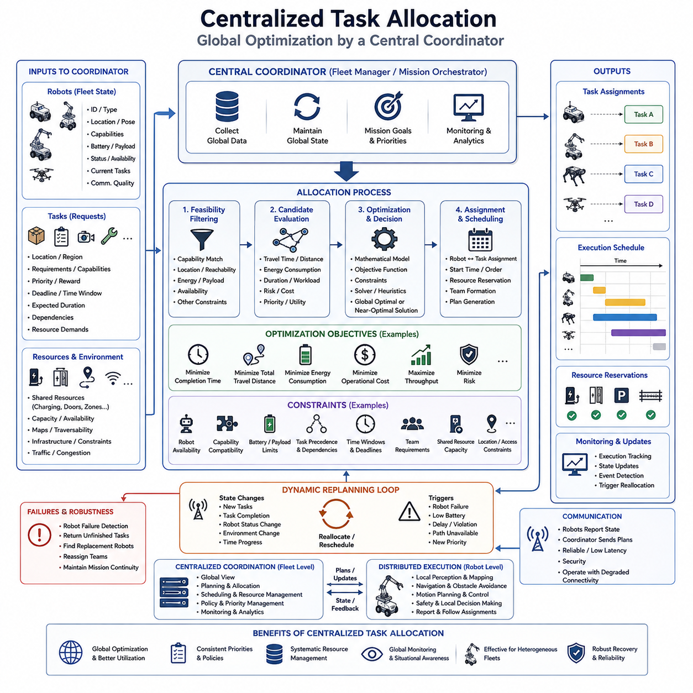{width="7.268055555555556in" height="7.268055555555556in"}

Centralized task allocation uses a central coordinator to determine how tasks should be distributed among multiple robots. Instead of allowing each robot to negotiate assignments independently, the coordinator collects relevant information about robots, tasks, resources, and the environment, then computes assignments from a fleet-wide perspective. This architecture provides a clear mechanism for connecting mission-level objectives with coordinated robot execution.

The central coordinator may be implemented as a fleet manager, mission planner, orchestration server, on-premise computing system, or cloud service. Its essential characteristic is logical centralization of allocation decisions rather than a particular physical computing platform. Robots report their operational states to this coordinating entity, while new tasks and mission requirements are collected into a common representation used for allocation.

Centralized allocation depends strongly on global state information. The coordinator may maintain robot identity, location, availability, battery level, payload state, capabilities, current assignments, expected completion times, and communication status. It also maintains task requirements such as location, priority, deadline, duration, dependencies, required capabilities, and resource demands. Combining these data creates a fleet-level view from which candidate assignments can be evaluated.

A major advantage of centralization is that assignments can be evaluated according to collective rather than purely local objectives. The nearest robot is not necessarily the best robot for a task if it has insufficient energy, lacks a required capability, or is already committed to higher-priority work. A global allocator can compare multiple alternatives simultaneously and select assignments that improve total mission performance across the fleet.

The allocation process normally begins with feasibility filtering. Robot-task combinations that violate capability, location, payload, energy, availability, or other operational requirements are removed from consideration. This step reduces the search space and prevents obviously invalid assignments. The remaining feasible combinations can then be scored according to travel time, energy consumption, task duration, workload, risk, priority, or expected mission utility.

Centralized task allocation can be formulated mathematically as an optimization problem. Decision variables represent whether a robot is assigned to a task, while an objective function expresses the desired system behavior. Depending on the mission, the objective may minimize total travel distance, completion time, energy consumption, lateness, operational cost, or risk, or maximize throughput, utilization, task priority, mission reward, or combinations of several criteria.

Constraints make the optimization reflect the physical system. A robot cannot normally execute incompatible tasks simultaneously, and a task cannot be assigned to a robot that lacks the required capability. Battery, payload, computation, time windows, task precedence, workspace access, charging availability, and shared infrastructure can introduce additional constraints. Cooperative tasks may further require several robots with complementary capabilities to be assigned together.

Centralized allocation is closely connected to multi-robot scheduling. Assignment determines which robot should execute each task, while scheduling determines when and in what sequence execution should occur. Solving these decisions together can prevent locally attractive but globally inefficient assignments. For example, assigning a nearby robot may be undesirable when doing so delays several subsequent tasks or creates competition for a shared charging station.

Spatial information also affects centralized decisions. A fleet-level coordinator can use maps, robot positions, task locations, predicted paths, and traversability information to estimate realistic transportation costs. More advanced systems may additionally consider congestion, shared corridors, elevators, loading zones, restricted areas, and other spatial resources. Allocation can therefore account for interactions that would be difficult to recognize from isolated robot observations.

The availability of global information makes centralized architectures particularly useful for heterogeneous fleets. A coordinator can maintain capability models for AMRs, manipulators, mobile manipulators, quadrupeds, UAVs, and other embodiments. When a task arrives, its requirements can be compared against these models so that allocation considers not only which robot is available, but which physical embodiment provides the appropriate capabilities for execution.

Centralized allocation also simplifies explicit priority management. Emergency tasks, safety events, production-critical operations, or time-sensitive deliveries can be assigned higher mission value than routine activities. The coordinator can evaluate whether lower-priority tasks should be delayed, reordered, or reassigned to release appropriate robots. This enables fleet behavior to follow organization-level policies instead of independent local preferences.

Dynamic environments require the centralized allocator to operate repeatedly rather than produce only one static assignment. Robot states change, tasks are completed, new requests arrive, batteries decline, paths become unavailable, and execution may take longer than predicted. Updated fleet information can trigger reallocation or replanning, allowing the central system to revise assignments when the expected benefit exceeds the cost of disrupting existing commitments.

Robot failures are handled naturally within this global framework. When a robot reports a fault or becomes unreachable, the coordinator can identify its assigned and unfinished tasks, return eligible work to the task pool, and search for replacement robots. If the failed robot participated in a cooperative task, the allocator may reconstruct the entire team. Fleet-level knowledge helps recovery consider the consequences for other tasks and resources.

Despite these strengths, centralized allocation introduces dependence on communication. The coordinator needs sufficiently current robot and task information, while robots must receive assignments and updates. Network delay, packet loss, disconnected robots, or stale telemetry can cause the central representation to diverge from physical reality. Practical systems therefore require timestamps, state validation, communication monitoring, local safety behaviors, and policies for operating during temporary loss of coordination.

Centralization can also create computational scalability challenges. If every robot can perform many tasks, the number of possible assignments grows rapidly as the fleet and workload increase. Scheduling, temporal constraints, cooperative teams, and shared resources further enlarge the search space. Large deployments may therefore use hierarchical allocation, geographic partitioning, rolling-horizon optimization, heuristics, decomposition, or staged assignment rather than solving one enormous global optimization problem.

A practical centralized architecture does not require the central coordinator to control every low-level robot action. The fleet layer can assign missions, priorities, schedules, and shared resources, while individual robots retain responsibility for local perception, navigation, obstacle avoidance, motion planning, and safety-critical control. This separation reduces communication dependence and allows global coordination to coexist with fast autonomous responses at the robot level.

Centralized task allocation is therefore most effective when global coordination provides significant value and reliable infrastructure is available. Warehouses, factories, logistics centers, hospitals, campuses, and structured outdoor fleets can benefit from a coordinator that maintains a shared operational view. The architecture provides consistent mission priorities, systematic resource management, global optimization opportunities, and centralized monitoring while leaving physical execution to autonomous robots.

Within multi-robot Physical AI, centralized task allocation acts as a fleet-level decision layer between mission requests and distributed physical execution. It converts shared knowledge about tasks, robots, resources, and environmental conditions into coordinated assignments and schedules. Its effectiveness ultimately depends on balancing global optimization with computational scalability, communication reliability, dynamic replanning, and sufficient local autonomy to maintain safe operation when central coordination is delayed or unavailable.

중앙집중형 작업 할당(Centralized Task Allocation)은 중앙 조정자(Central Coordinator)를 이용하여 여러 로봇에 작업을 어떻게 분배할 것인지를 결정한다. 각 로봇이 독립적으로 작업 할당을 협상하도록 하는 대신, 중앙 조정자가 로봇, 작업, 자원, 환경에 관한 관련 정보를 수집한 후 플릿 전체 관점(Fleet-Wide Perspective)에서 작업 할당을 계산한다. 이러한 아키텍처는 임무 수준 목표(Mission-Level Objective)를 조정된 로봇 실행(Coordinated Robot Execution)과 연결하는 명확한 메커니즘을 제공한다.

중앙 조정자(Central Coordinator)는 플릿 관리자(Fleet Manager), 임무 플래너(Mission Planner), 오케스트레이션 서버(Orchestration Server), 온프레미스 컴퓨팅 시스템(On-Premise Computing System), 또는 클라우드 서비스(Cloud Service)로 구현할 수 있다. 핵심적인 특징은 특정 물리적 컴퓨팅 플랫폼이 아니라 작업 할당 의사결정의 논리적 중앙집중화(Logical Centralization)이다. 로봇들은 자신의 운영 상태를 중앙 조정자에 보고하며, 새로운 작업과 임무 요구사항은 작업 할당에 사용되는 공통 표현(Common Representation)에 통합된다.

중앙집중형 할당(Centralized Allocation)은 글로벌 상태 정보(Global State Information)에 크게 의존한다. 중앙 조정자는 로봇 식별정보, 위치, 가용성, 배터리 수준, 탑재 상태, 능력, 현재 할당 작업, 예상 완료시간, 통신 상태 등을 유지할 수 있다. 또한 작업 위치, 우선순위, 마감시간, 소요시간, 의존관계, 요구 능력, 자원 요구량과 같은 작업 요구사항도 관리한다. 이러한 데이터를 결합하여 후보 작업 할당을 평가할 수 있는 플릿 수준 관점(Fleet-Level View)을 구성한다.

중앙집중화(Centralization)의 주요 장점은 개별적인 로컬 목표(Local Objective)가 아니라 집단 목표(Collective Objective)를 기준으로 작업 할당을 평가할 수 있다는 것이다. 가장 가까운 로봇이라도 에너지가 부족하거나, 필요한 능력을 갖추지 못했거나, 이미 더 높은 우선순위의 작업에 투입되어 있다면 최적의 로봇이 아닐 수 있다. 글로벌 할당기(Global Allocator)는 여러 대안을 동시에 비교하여 플릿 전체의 임무 성능을 향상시키는 작업 할당을 선택할 수 있다.

작업 할당 과정은 일반적으로 실행 가능성 필터링(Feasibility Filtering)에서 시작한다. 능력, 위치, 탑재 용량, 에너지, 가용성 또는 기타 운영 요구사항을 위반하는 로봇-작업 조합(Robot-Task Combination)은 후보에서 제거된다. 이를 통해 탐색 공간(Search Space)을 줄이고 명백하게 실행 불가능한 작업 할당을 방지한다. 남아 있는 실행 가능한 조합은 이동시간, 에너지 소비, 작업시간, 작업 부하, 위험, 우선순위 또는 예상 임무 효용(Expected Mission Utility)에 따라 평가할 수 있다.

중앙집중형 작업 할당(Centralized Task Allocation)은 수학적으로 최적화 문제(Optimization Problem)로 표현할 수 있다. 의사결정 변수(Decision Variable)는 특정 로봇이 특정 작업에 할당되었는지를 나타내며, 목적함수(Objective Function)는 원하는 시스템 동작을 표현한다. 임무에 따라 전체 이동거리, 완료시간, 에너지 소비, 지연시간, 운영비용 또는 위험을 최소화하거나, 처리량(Throughput), 활용률(Utilization), 작업 우선순위, 임무 보상(Mission Reward) 또는 여러 기준의 조합을 최대화할 수 있다.

제약조건(Constraint)은 최적화 문제가 실제 물리 시스템(Physical System)을 반영하도록 한다. 일반적으로 하나의 로봇은 서로 양립할 수 없는 여러 작업을 동시에 수행할 수 없으며, 필요한 능력이 없는 로봇에는 해당 작업을 할당할 수 없다. 배터리, 탑재 용량, 컴퓨팅 자원, 시간 윈도(Time Window), 작업 선후관계(Task Precedence), 작업 공간 접근성, 충전 시설 가용성, 공유 인프라 등이 추가적인 제약조건을 형성할 수 있다. 협력 작업(Cooperative Task)은 상호 보완적인 능력을 가진 여러 로봇이 동시에 할당될 것을 요구할 수도 있다.

중앙집중형 작업 할당은 다중 로봇 스케줄링(Multi-Robot Scheduling)과 밀접하게 연결된다. 작업 할당은 어떤 로봇이 각 작업을 수행할지를 결정하고, 스케줄링은 언제 어떤 순서로 작업을 실행할지를 결정한다. 이 두 의사결정을 함께 해결하면 로컬 관점에서는 매력적이지만 글로벌 관점에서는 비효율적인 작업 할당을 방지할 수 있다. 예를 들어 가까운 로봇에 작업을 할당하는 것이 이후 여러 작업을 지연시키거나 공유 충전소(Shared Charging Station)에 대한 경쟁을 발생시킨다면 바람직하지 않을 수 있다.

공간 정보(Spatial Information) 역시 중앙집중형 의사결정에 영향을 준다. 플릿 수준 조정자는 지도, 로봇 위치, 작업 위치, 예측 경로(Predicted Path), 주행 가능성 정보(Traversability Information)를 이용하여 현실적인 이동 비용을 추정할 수 있다. 보다 발전된 시스템에서는 혼잡(Congestion), 공유 통로, 엘리베이터, 적재 구역, 제한 구역 및 기타 공간 자원(Spatial Resource)도 고려할 수 있다. 따라서 개별 로봇의 독립적인 관측만으로 파악하기 어려운 상호작용까지 작업 할당에 반영할 수 있다.

글로벌 정보(Global Information)를 사용할 수 있다는 특성은 중앙집중형 아키텍처를 이기종 플릿(Heterogeneous Fleet)에 특히 유용하게 만든다. 중앙 조정자는 자율이동로봇(AMR), 매니퓰레이터(Manipulator), 모바일 매니퓰레이터(Mobile Manipulator), 사족보행 로봇(Quadruped), 무인항공기(UAV) 및 기타 체화 형태(Embodiment)에 대한 능력 모델(Capability Model)을 유지할 수 있다. 새로운 작업이 발생하면 작업 요구사항을 이러한 모델과 비교하여 단순히 어떤 로봇이 사용 가능한지가 아니라 어떤 물리적 체화가 작업에 적합한 능력을 제공하는지를 고려할 수 있다.

중앙집중형 할당은 명시적인 우선순위 관리(Priority Management)도 단순화한다. 긴급 작업(Emergency Task), 안전 이벤트(Safety Event), 생산 중요 작업(Production-Critical Operation), 시간 민감형 배송(Time-Sensitive Delivery)은 일상적인 작업보다 높은 임무 가치(Mission Value)를 부여받을 수 있다. 중앙 조정자는 적합한 로봇을 확보하기 위해 낮은 우선순위의 작업을 지연, 재정렬 또는 재할당해야 하는지를 평가할 수 있다. 이를 통해 플릿 동작이 개별 로봇의 로컬 선호가 아니라 조직 수준 정책(Organization-Level Policy)을 따르도록 할 수 있다.

동적 환경(Dynamic Environment)에서는 중앙집중형 할당기가 하나의 정적인 작업 할당만 생성하는 것이 아니라 반복적으로 동작해야 한다. 로봇 상태가 변화하고, 작업이 완료되며, 새로운 요청이 발생하고, 배터리가 감소하며, 이동 경로가 사용할 수 없게 되거나 실제 실행시간이 예측보다 길어질 수 있다. 업데이트된 플릿 정보를 기반으로 재할당(Reallocation) 또는 재계획(Replanning)을 수행하여 기존 작업의 지속성을 방해하는 비용보다 변경에 따른 예상 이익이 클 경우 작업 할당을 수정할 수 있다.

로봇 장애(Robot Failure)는 이러한 글로벌 프레임워크(Global Framework)에서 자연스럽게 처리할 수 있다. 로봇이 고장을 보고하거나 통신할 수 없는 상태가 되면 중앙 조정자는 해당 로봇에 할당된 작업과 완료되지 않은 작업을 식별하고, 재할당 가능한 작업을 작업 풀(Task Pool)로 반환하여 대체 로봇을 탐색할 수 있다. 장애 로봇이 협력 작업에 참여하고 있었다면 전체 팀을 다시 구성할 수도 있다. 플릿 수준 지식(Fleet-Level Knowledge)을 이용하면 복구 과정이 다른 작업과 자원에 미치는 영향까지 고려할 수 있다.

이러한 장점에도 불구하고 중앙집중형 할당은 통신(Communication)에 대한 의존성을 증가시킨다. 중앙 조정자는 충분히 최신 상태의 로봇 및 작업 정보를 필요로 하며, 로봇 역시 새로운 작업 할당과 업데이트를 수신해야 한다. 네트워크 지연(Network Delay), 패킷 손실(Packet Loss), 연결이 끊어진 로봇, 오래된 텔레메트리(Stale Telemetry)는 중앙 표현과 실제 물리적 상황 사이에 차이를 발생시킬 수 있다. 따라서 실제 시스템에는 타임스탬프(Timestamp), 상태 검증(State Validation), 통신 모니터링, 로컬 안전 동작(Local Safety Behavior), 일시적인 조정 손실에 대응하는 운영 정책이 필요하다.

중앙집중화는 계산 확장성(Computational Scalability) 문제도 발생시킬 수 있다. 각 로봇이 많은 작업을 수행할 수 있다면 플릿과 작업량이 증가함에 따라 가능한 작업 할당 조합의 수가 빠르게 증가한다. 스케줄링, 시간적 제약조건, 협력 팀(Cooperative Team), 공유 자원까지 고려하면 탐색 공간은 더욱 커진다. 따라서 대규모 시스템은 하나의 거대한 글로벌 최적화 문제를 해결하기보다 계층적 할당(Hierarchical Allocation), 지리적 분할(Geographic Partitioning), 롤링 호라이즌 최적화(Rolling-Horizon Optimization), 휴리스틱(Heuristic), 문제 분해(Decomposition), 단계적 할당(Staged Assignment) 등을 사용할 수 있다.

실용적인 중앙집중형 아키텍처(Practical Centralized Architecture)는 중앙 조정자가 로봇의 모든 저수준 행동(Low-Level Action)을 직접 제어할 필요가 없다. 플릿 계층(Fleet Layer)은 임무, 우선순위, 스케줄, 공유 자원을 할당하고, 개별 로봇은 로컬 인식(Local Perception), 내비게이션(Navigation), 장애물 회피(Obstacle Avoidance), 모션 플래닝(Motion Planning), 안전 중요 제어(Safety-Critical Control)를 담당할 수 있다. 이러한 역할 분리는 통신 의존성을 줄이면서 글로벌 조정과 빠른 로봇 수준 자율 대응을 함께 가능하게 한다.

따라서 중앙집중형 작업 할당은 글로벌 조정(Global Coordination)이 상당한 가치를 제공하고 신뢰할 수 있는 인프라가 구축된 환경에서 가장 효과적이다. 창고, 공장, 물류센터, 병원, 캠퍼스 및 구조화된 실외 플릿(Structured Outdoor Fleet)은 공유 운영 관점(Shared Operational View)을 유지하는 중앙 조정자의 이점을 활용할 수 있다. 이러한 아키텍처는 일관된 임무 우선순위, 체계적인 자원 관리, 글로벌 최적화 기회, 중앙 모니터링을 제공하면서 물리적인 실행은 자율 로봇에 맡길 수 있다.

다중 로봇 피지컬 AI(Multi-Robot Physical AI)에서 중앙집중형 작업 할당(Centralized Task Allocation)은 임무 요청(Mission Request)과 분산된 물리적 실행(Distributed Physical Execution) 사이에 위치하는 플릿 수준 의사결정 계층(Fleet-Level Decision Layer)의 역할을 한다. 작업, 로봇, 자원, 환경 조건에 대한 공유 지식을 조정된 작업 할당과 스케줄로 변환한다. 궁극적으로 그 효과는 글로벌 최적화(Global Optimization), 계산 확장성, 통신 신뢰성, 동적 재계획(Dynamic Replanning), 그리고 중앙 조정이 지연되거나 사용할 수 없는 상황에서도 안전한 운영을 유지할 수 있는 충분한 로컬 자율성(Local Autonomy) 사이의 균형에 달려 있다.

## 03.04. Distributed Task Allocation

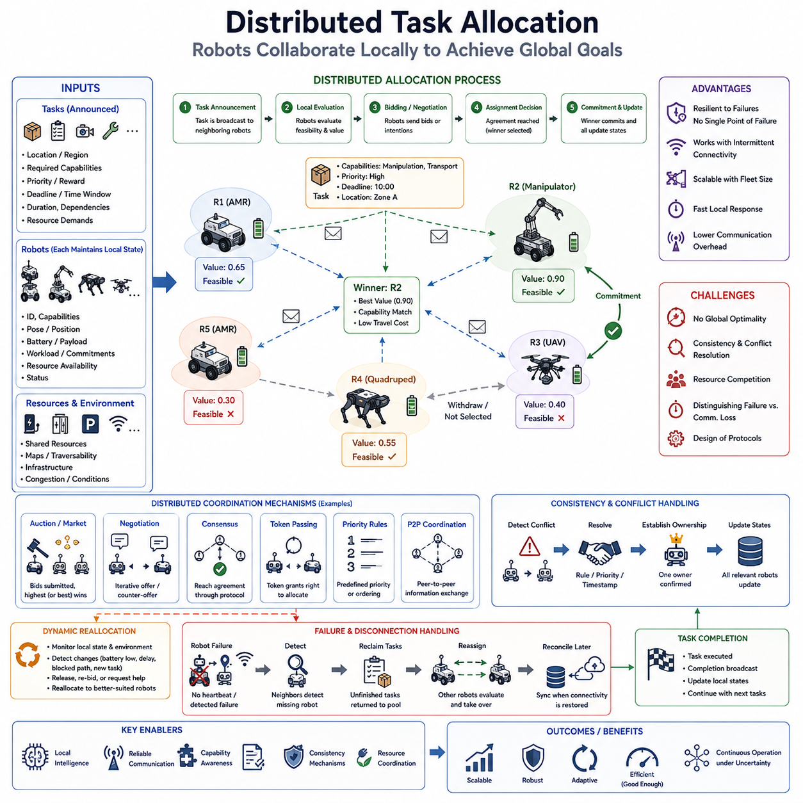{width="7.268055555555556in" height="7.268055555555556in"}

Distributed task allocation allows multiple robots to determine task assignments through local decision making and communication rather than relying entirely on a single central coordinator. Each robot evaluates available tasks from its own operational perspective and exchanges selected information with neighboring or participating agents. Collective assignments emerge from these interactions, creating a coordination architecture that can remain functional even when global connectivity is limited.

The fundamental difference from centralized allocation lies in where allocation authority and information reside. A centralized system attempts to maintain a global fleet state and computes assignments at one logical decision point. In a distributed system, robot states, task knowledge, and allocation decisions are spread across multiple agents. No individual robot necessarily possesses a complete representation of the entire fleet, so coordination must operate under partial and potentially inconsistent information.

Each robot typically maintains a local task-allocation state containing its identity, capabilities, pose, battery level, workload, resource availability, and current commitments. It may also maintain information about known tasks, nearby robots, shared resources, and environmental conditions. This local representation provides the basis for estimating whether the robot can perform a task and how desirable that assignment would be relative to other opportunities.

When a task becomes known, participating robots can independently estimate their suitability for performing it. Evaluation may include capability compatibility, distance, expected travel time, energy consumption, task duration, remaining battery, current workload, risk, deadline, and expected reward. A robot can transform these factors into a local cost, utility, priority, or bid value that represents the expected consequence of accepting the task.

Communication is therefore a fundamental coordination resource in distributed allocation. Robots may exchange task announcements, bids, availability, intentions, commitments, completion states, or selected environmental information. Unlike centralized systems, however, distributed allocation does not necessarily require every robot to continuously transmit its complete internal state. Communication can be restricted to information relevant to current coordination decisions, reducing dependence on global data collection.

A basic distributed allocation process can begin when a robot, operator, or infrastructure component announces an unassigned task. Robots that receive the announcement evaluate feasibility and calculate their local assignment values. Suitable robots then communicate their interest or bids, after which a protocol selects or converges toward an assignment. Once commitment is established, participating robots update their local states so that the same resource is not unintentionally allocated elsewhere.

Consensus is important when several robots maintain replicated information about task ownership. Communication delay or packet loss may cause two agents to temporarily believe that they have been assigned the same task, or different robots may hold conflicting versions of task status. Distributed protocols therefore require mechanisms for resolving conflicts, ordering updates, establishing ownership, and determining when an allocation decision is sufficiently consistent for physical execution.

Market and auction mechanisms are especially compatible with distributed task allocation. A task can be advertised while candidate robots calculate bids based on their individual costs and capabilities. The task is then awarded according to an agreed rule, after which robots continue negotiating subsequent tasks. Repeated auctions provide a practical way to transform local estimates into collective assignments without requiring one optimizer to explicitly search the entire fleet-wide assignment space.

Distributed allocation can also rely on negotiation, consensus, token passing, priority rules, local heuristics, or peer-to-peer coordination. Different mechanisms provide different balances among solution quality, communication overhead, convergence time, computational complexity, and robustness. The appropriate approach depends on whether robots operate in a structured facility, an outdoor environment, an exploration mission, or another setting where communication and physical conditions may vary significantly.

An important advantage of distribution is resilience to the loss of a single coordinating component. If one robot fails, other agents may continue exchanging information and allocating remaining tasks. When a communication link disappears, disconnected subgroups may temporarily coordinate within their reachable neighborhoods. This does not guarantee globally optimal behavior, but it can preserve useful mission capability under conditions where centralized coordination would be degraded or unavailable.

Distributed allocation is particularly valuable in environments with intermittent connectivity. Outdoor robots, UAV teams, underground systems, disaster-response robots, and large exploration fleets may not maintain reliable connections to centralized infrastructure. Local allocation allows robots to continue making operational decisions using currently available observations and peer communication. When connectivity returns, task states and commitments can be reconciled with other robots or higher-level systems.

Scalability provides another motivation for distributed architectures. As the fleet grows, continuously collecting every state variable and solving a global assignment problem can create communication and computation bottlenecks. Distributed approaches divide this burden among agents. Robots can primarily reason about relevant tasks and nearby interactions, allowing computational demand to grow more gradually when locality or mission structure limits the number of meaningful coordination relationships.

However, local decision making can sacrifice global efficiency. A robot may accept a nearby task because it appears inexpensive locally even though another assignment would produce a better fleet-wide schedule. Multiple locally rational decisions can generate congestion, uneven workload, resource competition, or poor future task coverage. Distributed allocation must therefore balance individual utility with collective objectives through carefully designed cost functions, coordination rules, and shared mission priorities.

Shared physical resources make this challenge especially important. Charging stations, elevators, narrow corridors, loading areas, work cells, and communication channels may be required by several robots. Independent decisions can create conflicting reservations or excessive competition. Distributed resource coordination therefore needs mechanisms such as reservations, distributed locks, tokens, priorities, or time-based agreements so that local autonomy does not produce physically incompatible plans.

Dynamic reallocation is naturally supported because robots continuously observe their own state and nearby conditions. If a robot detects low battery, excessive delay, an inaccessible path, or inability to complete a task, it can release the commitment or request assistance. Other robots can reevaluate the task and negotiate a replacement. Such local responses may occur without waiting for a complete global replanning cycle, improving responsiveness to rapidly changing physical conditions.

Robot failure introduces both an opportunity and a difficulty for distributed systems. Neighboring agents may detect missing communication or abandoned work and initiate reallocation, eliminating dependence on a central failure manager. However, distinguishing actual failure from temporary communication loss can be difficult. Robust protocols need timeouts, leases, heartbeats, confidence estimates, or ownership rules that prevent tasks from being duplicated or permanently abandoned during uncertain connectivity.

Heterogeneous fleets require distributed robots to communicate meaningful descriptions of capabilities rather than assuming that every agent is interchangeable. An AMR, mobile manipulator, quadruped, and UAV may receive the same task announcement but evaluate feasibility differently. Capability-aware protocols allow unsuitable robots to reject tasks immediately while suitable robots compare their expected contribution, enabling cross-embodiment coordination without requiring identical control architectures.

Distributed task allocation does not imply that all higher-level coordination must disappear. Practical Physical AI fleets can combine distributed robot-level negotiation with fleet-level policies, mission priorities, shared maps, or periodic optimization. A higher layer may define objectives and constraints while robots determine local assignments when rapid decisions or degraded connectivity require autonomy. This produces a hybrid architecture between strict centralization and fully decentralized operation.

The effectiveness of distributed allocation therefore depends on the relationship among local intelligence, communication, consistency, and physical execution. Robots must make useful decisions with incomplete information while avoiding incompatible commitments and preserving collective mission objectives. When properly designed, distributed task allocation provides scalable, resilient, and adaptive coordination, forming an important foundation for multi-robot systems that must continue operating even when centralized knowledge or infrastructure cannot always be guaranteed.

분산형 작업 할당(Distributed Task Allocation)은 하나의 중앙 조정자(Central Coordinator)에 전적으로 의존하지 않고, 여러 로봇이 로컬 의사결정(Local Decision Making)과 통신(Communication)을 통해 작업 할당을 결정하도록 한다. 각 로봇은 자신의 운영 관점에서 사용 가능한 작업을 평가하고 이웃 또는 참여 에이전트(Agent)와 선택된 정보를 교환한다. 이러한 상호작용으로부터 집단적인 작업 할당이 형성되며, 글로벌 연결성(Global Connectivity)이 제한된 상황에서도 동작할 수 있는 조정 아키텍처(Coordination Architecture)를 구성한다.

중앙집중형 할당(Centralized Allocation)과의 근본적인 차이는 작업 할당 권한과 정보가 어디에 존재하는가에 있다. 중앙집중형 시스템은 글로벌 플릿 상태(Global Fleet State)를 유지하고 하나의 논리적 의사결정 지점에서 작업 할당을 계산한다. 반면 분산형 시스템에서는 로봇 상태, 작업 정보, 할당 의사결정이 여러 에이전트에 분산된다. 개별 로봇이 전체 플릿에 대한 완전한 표현을 반드시 가지고 있는 것은 아니므로 부분적이고 잠재적으로 불일치하는 정보 아래에서 조정이 이루어져야 한다.

각 로봇은 일반적으로 자신의 식별정보, 능력, 자세(Pose), 배터리 수준, 작업 부하, 자원 가용성(Resource Availability), 현재 작업 약속(Commitment)을 포함하는 로컬 작업 할당 상태(Local Task-Allocation State)를 유지한다. 또한 알려진 작업, 주변 로봇, 공유 자원, 환경 조건에 대한 정보를 유지할 수 있다. 이러한 로컬 표현(Local Representation)은 특정 작업을 수행할 수 있는지와 다른 작업 기회에 비해 해당 할당이 얼마나 적합한지를 평가하는 기반을 제공한다.

새로운 작업이 알려지면 참여 로봇은 해당 작업을 수행하기 위한 자신의 적합성을 독립적으로 평가할 수 있다. 평가에는 능력 적합성(Capability Compatibility), 거리, 예상 이동시간, 에너지 소비, 작업시간, 잔여 배터리, 현재 작업 부하, 위험, 마감시간, 예상 보상 등이 포함될 수 있다. 로봇은 이러한 요소를 로컬 비용(Local Cost), 효용(Utility), 우선순위(Priority), 입찰값(Bid Value) 등으로 변환하여 작업을 수락했을 때 예상되는 결과를 표현할 수 있다.

따라서 통신(Communication)은 분산형 작업 할당에서 핵심적인 조정 자원(Coordination Resource)이 된다. 로봇들은 작업 공지(Task Announcement), 입찰(Bid), 가용성, 의도(Intent), 작업 약속, 완료 상태 또는 선택된 환경 정보를 교환할 수 있다. 그러나 중앙집중형 시스템과 달리 분산형 할당에서는 모든 로봇이 자신의 전체 내부 상태를 지속적으로 전송할 필요가 없다. 현재 조정 의사결정에 필요한 정보만 교환함으로써 글로벌 데이터 수집에 대한 의존성을 줄일 수 있다.

기본적인 분산형 작업 할당 과정은 로봇, 운영자 또는 인프라 구성요소가 할당되지 않은 작업을 공지하면서 시작할 수 있다. 공지를 수신한 로봇은 실행 가능성을 평가하고 자신의 로컬 할당값(Local Assignment Value)을 계산한다. 적합한 로봇들은 작업 수행 의사 또는 입찰값을 전달하며, 이후 프로토콜(Protocol)을 통해 작업 할당을 선택하거나 합의에 수렴한다. 작업 약속이 확립되면 참여 로봇은 동일한 자원이 의도치 않게 다른 작업에 중복 할당되지 않도록 자신의 로컬 상태를 업데이트한다.

여러 로봇이 작업 소유권(Task Ownership)에 관한 복제된 정보를 유지하는 경우 합의(Consensus)가 중요하다. 통신 지연이나 패킷 손실(Packet Loss)로 인해 두 에이전트가 일시적으로 동일한 작업이 자신에게 할당되었다고 판단하거나, 서로 다른 로봇이 작업 상태에 대해 상충하는 정보를 가질 수 있다. 따라서 분산형 프로토콜은 충돌 해결(Conflict Resolution), 업데이트 순서 결정, 소유권 확립, 물리적 실행을 시작할 수 있을 정도로 작업 할당이 충분히 일관되었는지를 판단하는 메커니즘을 필요로 한다.

시장 및 경매 메커니즘(Market and Auction Mechanism)은 분산형 작업 할당과 특히 잘 결합된다. 작업이 공지되면 후보 로봇은 자신의 비용과 능력을 기반으로 입찰값을 계산할 수 있다. 이후 합의된 규칙에 따라 작업이 낙찰되고 로봇들은 다음 작업에 대한 협상을 계속한다. 반복 경매(Repeated Auction)는 하나의 최적화기가 플릿 전체 작업 할당 공간을 명시적으로 탐색하지 않고도 로컬 추정값을 집단 작업 할당으로 변환할 수 있는 실용적인 방법을 제공한다.

분산형 할당은 협상(Negotiation), 합의(Consensus), 토큰 전달(Token Passing), 우선순위 규칙(Priority Rule), 로컬 휴리스틱(Local Heuristic), 피어투피어 조정(Peer-to-Peer Coordination) 등을 사용할 수도 있다. 각 메커니즘은 해의 품질(Solution Quality), 통신 오버헤드(Communication Overhead), 수렴시간(Convergence Time), 계산 복잡도, 강건성(Robustness) 사이에서 서로 다른 균형을 제공한다. 적절한 방법은 구조화된 시설, 실외 환경, 탐사 임무 등 통신과 물리적 조건이 크게 달라질 수 있는 운영 환경에 따라 결정된다.

분산화(Distribution)의 중요한 장점은 하나의 조정 구성요소가 손실되더라도 시스템의 복원력(Resilience)을 유지할 수 있다는 것이다. 하나의 로봇이 고장나더라도 다른 에이전트는 계속 정보를 교환하고 남은 작업을 할당할 수 있다. 통신 링크가 사라지는 경우 연결된 로봇 그룹들이 자신의 통신 가능 영역 내에서 일시적으로 조정할 수도 있다. 이러한 방식이 글로벌 최적(Global Optimum)을 보장하지는 않지만 중앙 조정이 저하되거나 사용할 수 없는 상황에서도 유용한 임무 수행 능력을 유지할 수 있다.

분산형 할당은 간헐적 연결성(Intermittent Connectivity)을 가진 환경에서 특히 유용하다. 실외 로봇, 무인항공기 팀(UAV Team), 지하 시스템, 재난 대응 로봇, 대규모 탐사 플릿은 중앙 인프라와 안정적인 연결을 지속적으로 유지하기 어려울 수 있다. 로컬 작업 할당은 현재 이용 가능한 관측 정보와 동료 로봇과의 통신을 사용하여 계속 운영 결정을 내릴 수 있도록 한다. 연결이 복구되면 작업 상태와 작업 약속을 다른 로봇 또는 상위 시스템과 다시 조정할 수 있다.

확장성(Scalability)은 분산형 아키텍처를 사용하는 또 다른 중요한 이유이다. 플릿 규모가 증가함에 따라 모든 상태 변수를 지속적으로 수집하고 하나의 글로벌 작업 할당 문제(Global Assignment Problem)를 해결하는 방식은 통신 및 계산 병목현상을 발생시킬 수 있다. 분산형 접근법은 이러한 부담을 여러 에이전트에 나누어 배치한다. 로봇은 주로 자신과 관련된 작업과 주변 상호작용을 추론함으로써 의미 있는 조정 관계의 수가 제한된 환경에서 계산 부담의 증가를 완화할 수 있다.

그러나 로컬 의사결정(Local Decision Making)은 글로벌 효율성(Global Efficiency)을 희생할 수 있다. 로봇은 가까운 작업이 로컬 관점에서 비용이 낮다는 이유로 이를 수락할 수 있지만, 플릿 전체의 스케줄에서는 다른 작업 할당이 더 좋은 결과를 제공할 수 있다. 여러 개의 로컬 최적 의사결정이 혼잡, 불균형한 작업 부하, 자원 경쟁, 미래 작업 대응 능력 저하를 발생시킬 수 있다. 따라서 분산형 할당은 적절한 비용함수, 조정 규칙, 공유 임무 우선순위를 통해 개별 효용(Individual Utility)과 집단 목표(Collective Objective)의 균형을 유지해야 한다.

공유 물리 자원(Shared Physical Resource)은 이러한 문제를 더욱 중요하게 만든다. 충전소, 엘리베이터, 좁은 통로, 적재 구역, 작업 셀, 통신 채널 등을 여러 로봇이 동시에 필요로 할 수 있다. 독립적인 의사결정은 상충하는 예약이나 과도한 자원 경쟁을 발생시킬 수 있다. 따라서 분산형 자원 조정(Distributed Resource Coordination)은 예약(Reservation), 분산 잠금(Distributed Lock), 토큰(Token), 우선순위 또는 시간 기반 합의(Time-Based Agreement)와 같은 메커니즘을 사용하여 로컬 자율성이 물리적으로 양립할 수 없는 계획을 생성하지 않도록 해야 한다.

동적 재할당(Dynamic Reallocation)은 로봇들이 자신의 상태와 주변 환경을 지속적으로 관측하기 때문에 자연스럽게 지원될 수 있다. 로봇이 배터리 부족, 과도한 지연, 접근 불가능한 경로 또는 작업 수행 불가능 상태를 감지하면 작업 약속을 해제하거나 다른 로봇에 지원을 요청할 수 있다. 다른 로봇들은 해당 작업을 다시 평가하고 대체 로봇을 협상할 수 있다. 이러한 로컬 대응은 완전한 글로벌 재계획 주기를 기다리지 않고 이루어질 수 있으므로 빠르게 변화하는 물리적 조건에 대한 대응성을 높인다.

로봇 장애(Robot Failure)는 분산형 시스템에 기회와 어려움을 동시에 제공한다. 주변 에이전트가 통신 두절이나 중단된 작업을 감지하고 재할당을 시작할 수 있으므로 중앙 장애 관리자(Central Failure Manager)에 대한 의존성을 제거할 수 있다. 그러나 실제 장애와 일시적인 통신 손실을 구분하는 것은 어려울 수 있다. 강건한 프로토콜은 타임아웃(Timeout), 리스(Lease), 하트비트(Heartbeat), 신뢰도 추정(Confidence Estimate), 소유권 규칙(Ownership Rule) 등을 사용하여 불확실한 연결 상황에서 작업이 중복되거나 영구적으로 방치되는 것을 방지해야 한다.

이기종 플릿(Heterogeneous Fleet)에서는 모든 에이전트가 상호 교환 가능하다고 가정할 수 없으므로 로봇들이 의미 있는 능력 설명(Capability Description)을 서로 전달해야 한다. 자율이동로봇(AMR), 모바일 매니퓰레이터(Mobile Manipulator), 사족보행 로봇(Quadruped), 무인항공기(UAV)가 동일한 작업 공지를 수신하더라도 실행 가능성은 서로 다르게 평가될 수 있다. 능력 인식 프로토콜(Capability-Aware Protocol)을 통해 부적합한 로봇은 작업을 즉시 거부하고 적합한 로봇들은 자신의 예상 기여도를 비교함으로써 서로 동일한 제어 아키텍처를 사용하지 않더라도 체화 간 조정(Cross-Embodiment Coordination)을 수행할 수 있다.

분산형 작업 할당(Distributed Task Allocation)이 모든 상위 수준 조정(Higher-Level Coordination)의 제거를 의미하는 것은 아니다. 실제 피지컬 AI(Physical AI) 플릿에서는 분산형 로봇 수준 협상과 플릿 수준 정책(Fleet-Level Policy), 임무 우선순위, 공유 지도, 주기적인 최적화를 결합할 수 있다. 상위 계층이 목표와 제약조건을 정의하고, 빠른 의사결정이나 연결성이 저하된 상황에서는 로봇들이 로컬 작업 할당을 결정할 수 있다. 이를 통해 엄격한 중앙집중화와 완전한 분산 운영 사이의 하이브리드 아키텍처(Hybrid Architecture)를 구성할 수 있다.

따라서 분산형 작업 할당의 효과는 로컬 지능(Local Intelligence), 통신, 일관성(Consistency), 물리적 실행 사이의 관계에 달려 있다. 로봇들은 불완전한 정보를 이용하면서도 유용한 의사결정을 내려야 하며, 서로 양립할 수 없는 작업 약속을 방지하고 집단 임무 목표를 유지해야 한다. 적절하게 설계된 분산형 작업 할당은 확장 가능하고, 강건하며, 적응적인 조정(Adaptive Coordination)을 제공하며, 중앙집중형 지식이나 인프라를 항상 보장할 수 없는 상황에서도 계속 운영되어야 하는 다중 로봇 시스템(Multi-Robot System)의 중요한 기반을 형성한다.

## 03.05. Market and Auction Based Allocation

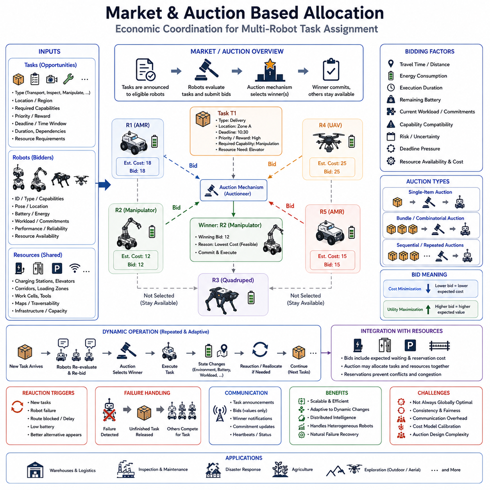{width="7.268055555555556in" height="7.268055555555556in"}

Market- and auction-based allocation treats multi-robot task assignment as an economic coordination process in which tasks, robots, capabilities, and resources are associated with values or costs. Instead of directly computing one global assignment, robots compete or negotiate for tasks by submitting bids that reflect their suitability. The resulting market mechanism transforms local estimates into coordinated assignments while preserving substantial robot-level autonomy.

The central abstraction is a market containing tasks that require execution and robots that can provide physical services. A task may represent transportation, inspection, manipulation, exploration, delivery, or another mission activity. Robots act as bidders whose bids describe the expected value of accepting that work. An auction mechanism compares these bids and determines which robot, or combination of robots, receives the task.

A bid should represent more than physical distance. A robot can estimate travel time, energy consumption, execution duration, remaining battery, workload, capability compatibility, risk, deadline pressure, and resource requirements. These factors can be combined into a cost or utility function. Consequently, two robots located at similar distances may submit very different bids because their capabilities, commitments, energy states, or expected execution performance differ.

Capability-aware bidding is particularly important for heterogeneous fleets. An AMR may bid effectively for transportation, a mobile manipulator for handling and delivery, a quadruped for inspection across difficult terrain, and a UAV for aerial observation. Robots that cannot satisfy mandatory requirements should normally be excluded before bidding. The market therefore compares economically meaningful alternatives only among physically feasible candidates.

A basic auction begins when a new task is announced to eligible robots. Each candidate evaluates the task using its local state and available mission information, calculates a bid, and communicates that bid to the auction mechanism. The bids are compared according to an allocation rule, a winner is selected, and the task is awarded. The winning robot then commits to execution while unsuccessful robots remain available for other opportunities.

The meaning of the bid depends on the auction design. In a cost-minimization formulation, a lower bid can indicate that a robot expects to complete the task with less travel, energy, time, or operational cost. In a utility-maximization formulation, a higher bid may indicate greater expected mission value. The bidding rule must therefore be consistent across participating robots so that values represent comparable estimates rather than unrelated local preferences.

Auctions can be implemented centrally or in a distributed manner. A centralized auctioneer may collect bids and select winners while still allowing each robot to calculate its own private cost. Alternatively, robots can exchange bids through peer-to-peer communication and determine the winner using a distributed protocol. Market-based allocation therefore describes the decision mechanism rather than requiring a strictly centralized or decentralized communication architecture.

Single-item auctions allocate one task at a time and are relatively simple to implement. However, independently auctioning tasks can produce inefficient schedules because the value of one task may depend on other assignments. A robot already traveling toward one location may execute several nearby tasks efficiently. This motivates sequential auctions, combinatorial auctions, or bundle-based bidding in which related tasks are evaluated together rather than as completely independent items.

Bundle bidding allows a robot to estimate the marginal cost of adding tasks to an existing route or schedule. The cost of performing tasks A and B together may be substantially lower than performing each task independently because travel can be shared. This makes auction-based allocation closely related to scheduling and routing. More expressive bids can improve fleet efficiency, although they also increase computation, communication, and winner-selection complexity.

Task priority and deadlines can be incorporated directly into market values. An urgent task may offer higher utility or impose a larger lateness penalty, encouraging suitable robots to prioritize it over routine work. Similarly, switching away from an already committed task can be assigned a reassignment cost. Well-designed bidding functions therefore encode mission policy into local economic decisions rather than treating every task as equally important.

Shared resources must also influence bids. A robot may appear to be the lowest-cost candidate but require a charging station, elevator, narrow corridor, loading zone, or work cell that is unavailable at the necessary time. Resource-aware bidding can include expected waiting time and reservation costs. The auction mechanism may also allocate resources together with tasks so that winning assignments correspond to physically executable plans rather than abstract task ownership.

Repeated auctions provide an effective mechanism for dynamic environments. As new tasks arrive, robots complete work, battery levels change, or environmental conditions evolve, additional auctions can be initiated. Robots recompute their bids using updated states, allowing the allocation to adapt without solving the entire mission from the beginning. This rolling process makes market mechanisms suitable for continuously operating fleets with unpredictable workloads.

Reauctioning is useful when execution conditions change significantly. If a robot encounters a blocked route, unexpected delay, low battery, or hardware problem, the remaining task can be returned to the market. Other robots then calculate new bids based on their current conditions. A reassignment penalty can prevent unnecessary switching, ensuring that tasks are transferred only when another candidate provides enough benefit to justify disrupting the existing commitment.

Robot failure can be treated as removal of a bidder and release of its unfinished tasks. Those tasks are announced again, and surviving robots compete to take responsibility for them. This provides a natural failure-recovery mechanism without requiring every contingency to be predetermined. In distributed implementations, however, the system must reliably determine when a robot has actually failed rather than merely experiencing temporary communication loss.

Communication efficiency is one reason auction methods are attractive for large fleets. Robots do not necessarily need to transmit complete internal models to every participant. They can communicate task announcements, compact bid values, winner notifications, and commitment updates. Nevertheless, frequent auctions or complex bundle bids can generate substantial traffic, so practical systems must balance allocation quality against communication bandwidth, latency, and auction frequency.

Market mechanisms also face strategic and consistency issues. In engineered robot fleets, robots usually follow designed bidding policies rather than pursuing selfish economic interests, but inconsistent cost models can still distort assignments. If robots estimate energy, risk, or task duration differently, bids may not be directly comparable. Shared definitions, calibrated cost models, synchronized task identifiers, and clear ownership rules are therefore important for reliable coordination.

Auction-based allocation does not guarantee globally optimal solutions in every configuration. Greedy task-by-task awards may create future inefficiencies, and locally calculated bids may omit important fleet-wide consequences. Performance can be improved through bundle auctions, look-ahead costs, reserve prices, hierarchical markets, periodic global optimization, or hybrid architectures. The practical objective is often to obtain high-quality assignments quickly rather than solve a combinatorial global problem exactly.

In multi-robot Physical AI, market- and auction-based allocation provides a flexible bridge between individual robot intelligence and collective mission coordination. Tasks become opportunities, robot capabilities and operational states become bids, and allocation rules convert competing local evaluations into explicit commitments. Combined with scheduling, resource reservation, dynamic reallocation, and failure recovery, this approach enables scalable coordination while retaining the adaptability required by heterogeneous physical robot fleets.

시장 및 경매 기반 할당(Market- and Auction-Based Allocation)은 다중 로봇 작업 할당(Multi-Robot Task Allocation)을 작업, 로봇, 능력, 자원에 가치 또는 비용을 부여하는 경제적 조정 과정(Economic Coordination Process)으로 다룬다. 하나의 글로벌 작업 할당(Global Assignment)을 직접 계산하는 대신, 로봇은 자신의 적합성을 반영한 입찰(Bid)을 제출하여 작업을 놓고 경쟁하거나 협상한다. 이러한 시장 메커니즘(Market Mechanism)은 상당한 수준의 로봇 자율성을 유지하면서 로컬 추정값(Local Estimate)을 조정된 작업 할당으로 변환한다.

핵심적인 추상화는 실행이 필요한 작업(Task)과 물리적 서비스를 제공할 수 있는 로봇(Robot)으로 구성된 시장(Market)이다. 작업은 운송, 검사, 조작, 탐색, 배송 또는 기타 임무 활동을 나타낼 수 있다. 로봇은 해당 작업을 수락했을 때 예상되는 가치를 입찰값으로 표현하는 입찰자(Bidder)의 역할을 한다. 경매 메커니즘(Auction Mechanism)은 이러한 입찰을 비교하여 어떤 로봇 또는 로봇 조합이 작업을 할당받을 것인지 결정한다.

입찰값(Bid)은 단순한 물리적 거리 이상의 정보를 반영해야 한다. 로봇은 이동시간, 에너지 소비, 실행시간, 잔여 배터리, 작업 부하, 능력 적합성(Capability Compatibility), 위험, 마감시간 압박, 자원 요구사항 등을 추정할 수 있다. 이러한 요소를 비용함수(Cost Function) 또는 효용함수(Utility Function)로 결합할 수 있다. 따라서 비슷한 거리에 있는 두 로봇도 능력, 현재 작업 약속, 에너지 상태, 예상 실행 성능이 다르기 때문에 매우 다른 입찰값을 제출할 수 있다.

능력 인식 입찰(Capability-Aware Bidding)은 이기종 플릿(Heterogeneous Fleet)에서 특히 중요하다. 자율이동로봇(AMR)은 운송 작업에, 모바일 매니퓰레이터(Mobile Manipulator)는 물체 취급과 배송에, 사족보행 로봇(Quadruped)은 험지 검사에, 무인항공기(UAV)는 공중 관측에 효과적으로 입찰할 수 있다. 필수 요구조건을 충족하지 못하는 로봇은 일반적으로 입찰 이전에 제외되어야 한다. 따라서 시장은 물리적으로 실행 가능한 후보들 사이에서 경제적으로 의미 있는 대안을 비교한다.

기본적인 경매(Auction)는 새로운 작업이 적합한 로봇들에게 공지되면서 시작된다. 각 후보 로봇은 자신의 로컬 상태와 사용 가능한 임무 정보를 이용하여 작업을 평가하고, 입찰값을 계산하여 경매 메커니즘에 전달한다. 이후 작업 할당 규칙(Allocation Rule)에 따라 입찰값을 비교하고 낙찰자(Winner)를 선정하여 작업을 할당한다. 낙찰된 로봇은 작업 실행을 약속하고, 선택되지 않은 로봇은 다른 작업을 수행할 수 있는 상태로 남는다.

입찰값의 의미는 경매 설계(Auction Design)에 따라 달라진다. 비용 최소화(Cost Minimization) 방식에서는 낮은 입찰값이 더 적은 이동, 에너지, 시간 또는 운영비용으로 작업을 완료할 수 있음을 의미할 수 있다. 효용 최대화(Utility Maximization) 방식에서는 높은 입찰값이 더 큰 예상 임무 가치(Expected Mission Value)를 의미할 수 있다. 따라서 입찰 규칙은 참여 로봇 전체에 일관되게 적용되어야 하며, 서로 비교할 수 없는 로컬 선호가 아니라 비교 가능한 값을 표현해야 한다.

경매는 중앙집중형(Centralized) 또는 분산형(Distributed)으로 구현할 수 있다. 중앙집중형 경매자(Centralized Auctioneer)가 입찰값을 수집하고 낙찰자를 결정하면서도 각 로봇이 자신의 비용을 독립적으로 계산하도록 할 수 있다. 반대로 로봇들이 피어투피어 통신(Peer-to-Peer Communication)을 통해 입찰을 교환하고 분산 프로토콜(Distributed Protocol)을 이용하여 낙찰자를 결정할 수도 있다. 따라서 시장 기반 할당은 반드시 특정한 중앙집중형 또는 분산형 통신 아키텍처를 요구하는 것이 아니라 의사결정 메커니즘 자체를 의미한다.

단일 항목 경매(Single-Item Auction)는 한 번에 하나의 작업을 할당하기 때문에 비교적 구현하기 쉽다. 그러나 작업을 서로 독립적으로 경매하면 한 작업의 가치가 다른 작업 할당에 따라 달라지는 상황에서 비효율적인 스케줄이 생성될 수 있다. 특정 위치로 이미 이동 중인 로봇은 주변의 여러 작업을 함께 수행하는 것이 효율적일 수 있다. 이러한 문제는 순차 경매(Sequential Auction), 조합 경매(Combinatorial Auction), 번들 기반 입찰(Bundle-Based Bidding)을 통해 관련 작업을 함께 평가하도록 발전시킬 수 있다.

번들 입찰(Bundle Bidding)을 사용하면 로봇이 기존 경로나 스케줄에 새로운 작업을 추가할 때 발생하는 한계비용(Marginal Cost)을 추정할 수 있다. 이동 경로를 공유할 수 있기 때문에 작업 A와 B를 함께 수행하는 비용은 두 작업을 각각 독립적으로 수행하는 비용보다 상당히 낮을 수 있다. 따라서 경매 기반 할당은 스케줄링(Scheduling) 및 라우팅(Routing)과 밀접하게 연결된다. 보다 표현력이 높은 입찰은 플릿 효율성을 향상시킬 수 있지만 계산, 통신, 낙찰자 선정의 복잡성도 증가시킨다.

작업 우선순위(Task Priority)와 마감시간(Deadline)은 시장 가치에 직접 반영할 수 있다. 긴급 작업에는 높은 효용을 부여하거나 큰 지연 페널티(Lateness Penalty)를 적용하여 적합한 로봇이 일상적인 작업보다 우선적으로 처리하도록 유도할 수 있다. 이미 약속된 작업에서 다른 작업으로 전환하는 경우에도 재할당 비용(Reassignment Cost)을 적용할 수 있다. 잘 설계된 입찰함수(Bidding Function)는 모든 작업을 동일하게 처리하지 않고 임무 정책(Mission Policy)을 로컬 경제적 의사결정에 반영한다.

공유 자원(Shared Resource)도 입찰값에 영향을 주어야 한다. 특정 로봇이 가장 낮은 비용을 제시하더라도 필요한 시간에 충전소, 엘리베이터, 좁은 통로, 적재 구역, 작업 셀 등을 사용할 수 없다면 실제로는 적합하지 않을 수 있다. 자원 인식 입찰(Resource-Aware Bidding)은 예상 대기시간과 자원 예약 비용을 포함할 수 있다. 경매 메커니즘은 작업과 자원을 함께 할당하여 낙찰 결과가 단순한 작업 소유권이 아니라 실제 실행 가능한 계획이 되도록 할 수도 있다.

반복 경매(Repeated Auction)는 동적 환경(Dynamic Environment)에 효과적으로 대응할 수 있는 메커니즘을 제공한다. 새로운 작업이 발생하고, 기존 작업이 완료되며, 배터리 수준이나 환경 조건이 변화할 때 추가적인 경매를 실행할 수 있다. 로봇은 업데이트된 상태를 이용하여 입찰값을 다시 계산하므로 전체 임무를 처음부터 다시 해결하지 않고도 작업 할당을 변화에 맞게 조정할 수 있다. 이러한 롤링 방식(Rolling Process)은 예측하기 어려운 작업 부하를 가진 지속 운영 플릿에 적합하다.

실행 조건이 크게 변화한 경우에는 재경매(Reauctioning)를 활용할 수 있다. 로봇이 차단된 경로, 예상하지 못한 지연, 낮은 배터리, 하드웨어 문제를 경험하면 남아 있는 작업을 다시 시장에 반환할 수 있다. 다른 로봇들은 현재 상태를 기반으로 새로운 입찰값을 계산한다. 재할당 페널티(Reassignment Penalty)를 적용하면 불필요한 작업 전환을 방지하고, 기존 작업 약속을 중단하는 비용보다 다른 후보가 제공하는 이익이 충분히 클 때만 작업을 이전하도록 할 수 있다.

로봇 장애(Robot Failure)는 입찰자의 제거와 완료되지 않은 작업의 반환으로 처리할 수 있다. 해당 작업을 다시 공지하면 정상적으로 동작하는 로봇들이 이를 인수하기 위해 경쟁한다. 이를 통해 모든 장애 상황을 사전에 정의하지 않고도 자연스러운 장애 복구(Failure Recovery) 메커니즘을 구성할 수 있다. 그러나 분산형 구현에서는 실제 로봇 장애와 일시적인 통신 손실(Temporary Communication Loss)을 신뢰성 있게 구분해야 한다.

통신 효율성(Communication Efficiency)은 경매 방식이 대규모 플릿에서 매력적인 이유 중 하나이다. 로봇은 자신의 전체 내부 모델을 모든 참여자에게 전송할 필요 없이 작업 공지, 간결한 입찰값, 낙찰 통보, 작업 약속 업데이트 등을 전달할 수 있다. 그러나 경매가 지나치게 자주 발생하거나 복잡한 번들 입찰을 사용하면 상당한 통신 트래픽이 발생할 수 있으므로 실제 시스템에서는 작업 할당 품질과 통신 대역폭, 지연시간, 경매 빈도 사이의 균형이 필요하다.

시장 메커니즘은 전략 및 일관성 문제(Consistency Issue)도 고려해야 한다. 공학적으로 설계된 로봇 플릿에서는 일반적으로 로봇들이 이기적인 경제적 이익을 추구하기보다 설계된 입찰 정책(Bidding Policy)을 따르지만, 서로 다른 비용 모델은 여전히 작업 할당을 왜곡할 수 있다. 로봇마다 에너지, 위험 또는 작업시간을 다르게 추정하면 입찰값을 직접 비교하기 어렵다. 따라서 공유된 정의, 보정된 비용 모델(Calibrated Cost Model), 동기화된 작업 식별자, 명확한 소유권 규칙(Ownership Rule)이 신뢰성 있는 조정을 위해 중요하다.

경매 기반 할당(Auction-Based Allocation)이 모든 구성에서 글로벌 최적해(Global Optimum)를 보장하는 것은 아니다. 탐욕적인 작업별 낙찰(Greedy Task-by-Task Award)은 미래의 비효율성을 발생시킬 수 있으며, 로컬에서 계산된 입찰값에는 중요한 플릿 전체의 영향이 누락될 수 있다. 번들 경매(Bundle Auction), 선행 예측 비용(Look-Ahead Cost), 유보가격(Reserve Price), 계층적 시장(Hierarchical Market), 주기적 글로벌 최적화(Periodic Global Optimization), 하이브리드 아키텍처(Hybrid Architecture) 등을 통해 성능을 개선할 수 있다. 실제 목표는 조합적으로 복잡한 글로벌 문제를 항상 정확하게 해결하는 것보다 높은 품질의 작업 할당을 신속하게 생성하는 데 있다.

다중 로봇 피지컬 AI(Multi-Robot Physical AI)에서 시장 및 경매 기반 할당(Market- and Auction-Based Allocation)은 개별 로봇 지능(Individual Robot Intelligence)과 집단 임무 조정(Collective Mission Coordination)을 연결하는 유연한 방법을 제공한다. 작업은 시장의 기회(Opportunity)가 되고, 로봇의 능력과 운영 상태는 입찰값으로 변환되며, 작업 할당 규칙은 경쟁적인 로컬 평가를 명확한 작업 약속으로 변환한다. 스케줄링, 자원 예약(Resource Reservation), 동적 재할당(Dynamic Reallocation), 장애 복구와 결합하면 이기종 물리 로봇 플릿에 필요한 적응성을 유지하면서 확장 가능한 조정(Scalable Coordination)을 구현할 수 있다.

## 03.06. Optimization Based Task Assignment

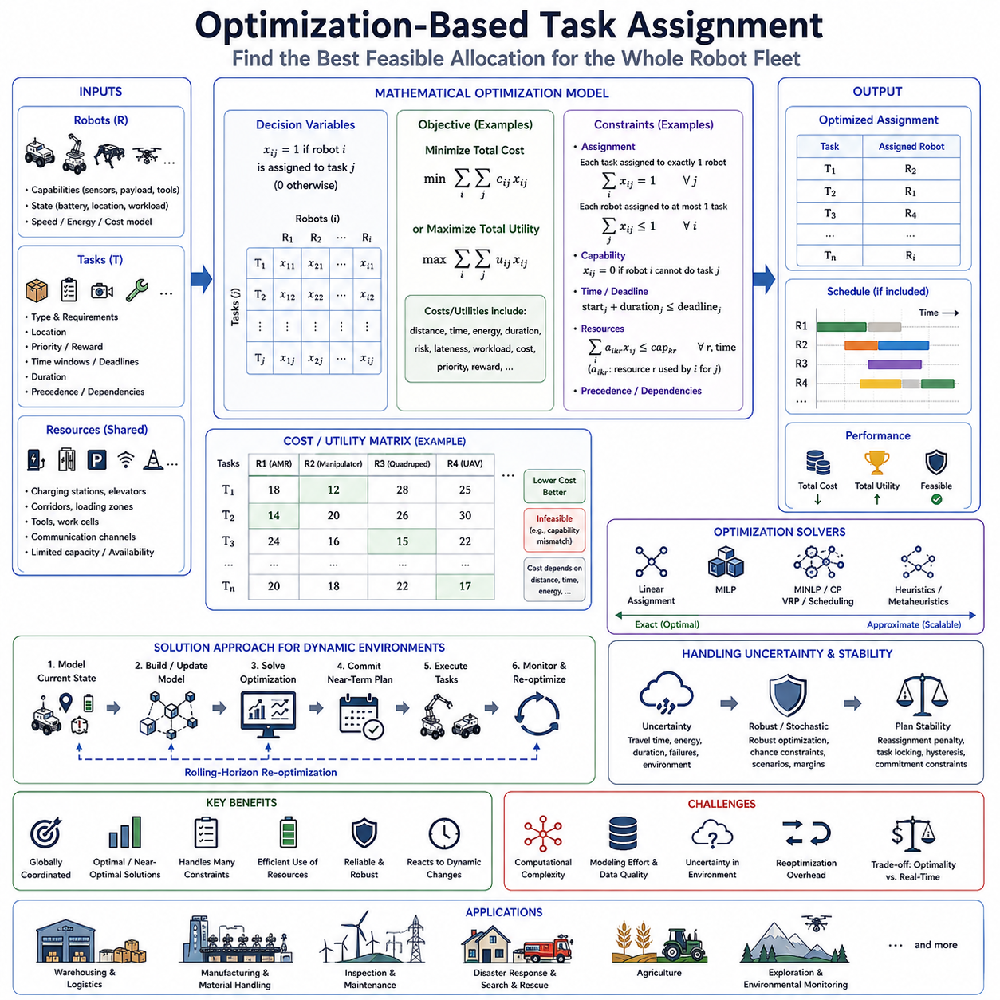{width="7.268055555555556in" height="7.268055555555556in"}

Optimization-based task assignment formulates multi-robot allocation as a mathematical decision problem in which robots, tasks, resources, and operational constraints are represented explicitly. Rather than assigning work through local negotiation alone, an optimization model evaluates candidate assignments according to a defined objective. The goal is to identify a feasible allocation that minimizes cost or maximizes mission value across the robot fleet.

The basic formulation begins with a set of robots and a set of tasks. A decision variable can represent whether robot (r_i) is assigned to task (t_j). For a simple one-to-one assignment, a binary variable (x_{ij}) takes the value one when the assignment is selected and zero otherwise. This representation converts physical allocation choices into mathematical variables that can be processed systematically by an optimization solver.

An objective function defines what the allocation system considers desirable. A common formulation minimizes the total assignment cost, expressed conceptually as (\\min \\sum_i \\sum_j c_{ij}x_{ij}), where (c_{ij}) represents the estimated cost of assigning robot (i) to task (j). The cost can incorporate distance, travel time, execution duration, energy consumption, workload, risk, lateness, or monetary operating cost.

Alternatively, the objective can maximize utility or mission reward. A high-priority inspection, emergency response, or time-critical delivery may contribute greater value than routine work. Multi-objective formulations can combine several criteria using weighted terms, penalties, or hierarchical priorities. The resulting objective represents fleet-level policy mathematically, allowing assignment decisions to reflect operational goals rather than a single geometric measure such as nearest distance.

Constraints define which solutions are physically and operationally valid. A task may require exactly one robot, while a robot may be restricted to one active task at a particular time. Additional constraints can represent capability compatibility, payload limits, battery requirements, deadlines, task precedence, workspace accessibility, communication requirements, and resource availability. Optimization therefore searches only among assignments that satisfy the modeled requirements of the physical system.

Capability constraints are essential in heterogeneous robot fleets. A transportation task may require sufficient payload capacity, an inspection task may require a particular sensor, and a manipulation task may require an appropriate end effector. Incompatible robot-task pairs can be eliminated before optimization or constrained so that their decision variables cannot become active. This reduces unnecessary search while ensuring that mathematically valid solutions remain physically executable.

Resource constraints extend the formulation beyond direct robot-task matching. Charging stations, elevators, loading zones, narrow passages, work cells, communication channels, and specialized tools may be shared among multiple robots. If several assignments require the same limited resource simultaneously, the optimizer must prevent conflicting usage. Task assignment can therefore become tightly coupled with resource allocation and scheduling as operational complexity increases.

Temporal constraints introduce another important dimension. Tasks can have earliest start times, deadlines, expected durations, synchronization requirements, and precedence relationships. Some tasks must occur sequentially, while cooperative activities may require multiple robots to arrive simultaneously. When assignment and time are optimized together, the problem evolves from static matching toward multi-robot scheduling, where the system determines both who performs each task and when execution occurs.

Spatial information influences optimization through realistic movement costs and accessibility constraints. Euclidean distance alone may poorly represent actual robot travel because obstacles, one-way routes, restricted zones, terrain conditions, congestion, and shared corridors affect movement. Path planners or map-based estimators can provide more realistic cost matrices. The assignment optimizer can then use these values to choose robots based on executable travel rather than simplified geometric proximity.

Classical assignment problems can often be solved efficiently when tasks and constraints are simple. Linear assignment methods, bipartite matching, and algorithms such as the Hungarian method can produce optimal one-to-one assignments under appropriate assumptions. These approaches are valuable when costs are known and interactions are limited. However, realistic multi-robot missions frequently introduce additional constraints that transform the problem into more complex combinatorial optimization.

Mixed-integer linear programming(MILP) provides a flexible framework for representing many practical task allocation problems. Binary and continuous variables can describe assignments, timing, resource usage, and operational quantities, while linear objectives and constraints express mission requirements. MILP solvers can produce optimal solutions or quantified optimality gaps, making the approach attractive when rigorous constraint handling and interpretable decision logic are important.

More complex formulations may involve mixed-integer nonlinear programming(MINLP), constraint programming(CP), vehicle routing formulations(VRP), or scheduling models. The appropriate mathematical representation depends on the mission structure. Transportation fleets may resemble routing problems, manufacturing robots may resemble job-shop scheduling, and cooperative robot teams may require coalition formation. Optimization-based allocation is therefore a family of formulations rather than one universal algorithm.

Computational complexity becomes a major concern as the number of robots, tasks, time variables, dependencies, and shared resources increases. The number of possible assignments can grow combinatorially, and exact optimization may become too slow for rapidly changing environments. A mathematically optimal solution that arrives after the operational situation has changed may be less useful than a near-optimal solution generated quickly enough for real-time execution.

Heuristics and metaheuristics provide alternatives when exact optimization becomes impractical. Greedy assignment, local search, genetic algorithms, simulated annealing, particle swarm optimization, and other search strategies can explore large solution spaces without evaluating every combination. These methods generally sacrifice guarantees of global optimality in exchange for computational flexibility and can be useful when objective functions or constraints are difficult to express in conventional exact formulations.

Problem decomposition provides another path toward scalability. A large fleet can be divided geographically, functionally, or hierarchically so that smaller optimization problems are solved independently or sequentially. Tasks may first be assigned to regions or robot classes and then to individual robots. Such decomposition reduces computational burden while preserving some global structure, making optimization practical for larger fleets and heterogeneous Physical AI systems.

Rolling-horizon optimization is particularly useful in dynamic environments. Instead of optimizing the entire future mission once, the system repeatedly solves a limited planning horizon using the latest robot and task states. Only near-term decisions are committed, while later assignments remain adjustable. As new tasks appear, batteries decline, routes change, or execution delays occur, the optimization is solved again with updated information.

Reoptimization must account for the cost of changing previous decisions. Continuously replacing assignments whenever a slightly better mathematical solution appears can cause excessive rerouting, interrupted work, and unstable fleet behavior. Reassignment penalties, commitment constraints, task locking, or hysteresis can preserve execution stability. The optimizer should therefore evaluate not only the quality of a new solution but also the physical cost of transitioning from the current plan.

Uncertainty complicates optimization because travel time, energy consumption, task duration, robot reliability, and environmental conditions are not perfectly predictable. Robust optimization can seek solutions that remain feasible across bounded variations, while stochastic optimization can represent uncertain quantities probabilistically. Chance constraints, scenarios, safety margins, or risk penalties can prevent an apparently efficient assignment from becoming fragile when real-world conditions differ from nominal estimates.

Optimization-based task assignment is especially powerful when combined with other coordination approaches. A fleet-level optimizer can periodically produce globally coordinated assignments, while distributed negotiation or auction mechanisms handle urgent local changes between optimization cycles. Individual robots can retain responsibility for navigation and safety. Such hybrid architectures separate strategic fleet optimization from rapid local adaptation and physical execution.

Within multi-robot Physical AI, optimization-based task assignment provides a rigorous bridge between mission objectives and coordinated physical action. Robots, tasks, capabilities, time, energy, space, and shared resources become elements of a common mathematical model. Exact, approximate, hierarchical, and rolling-horizon methods can then be selected according to fleet scale and operational dynamics, enabling systematic decisions that balance solution quality, computational cost, robustness, and real-time responsiveness.

최적화 기반 작업 할당(Optimization-Based Task Assignment)은 다중 로봇 할당(Multi-Robot Allocation)을 로봇, 작업, 자원, 운영 제약조건(Operational Constraint)을 명시적으로 표현하는 수학적 의사결정 문제(Mathematical Decision Problem)로 정식화한다. 로컬 협상(Local Negotiation)만을 통해 작업을 할당하는 대신, 최적화 모델(Optimization Model)이 정의된 목적에 따라 후보 할당을 평가한다. 목표는 로봇 플릿(Robot Fleet) 전체에서 비용을 최소화하거나 임무 가치(Mission Value)를 최대화하는 실행 가능한 할당을 찾는 것이다.

기본적인 정식화(Formulation)는 로봇 집합(Set of Robots)과 작업 집합(Set of Tasks)에서 시작한다. 의사결정 변수(Decision Variable)는 로봇 (r_i)가 작업 (t_j)에 할당되는지를 나타낼 수 있다. 단순한 일대일 할당(One-to-One Assignment)에서는 이진 변수(Binary Variable) (x_{ij})가 해당 할당이 선택되면 1, 그렇지 않으면 0의 값을 가진다. 이러한 표현은 물리적인 작업 할당 선택을 최적화 솔버(Optimization Solver)가 체계적으로 처리할 수 있는 수학적 변수로 변환한다.

목적함수(Objective Function)는 작업 할당 시스템이 무엇을 바람직한 결과로 판단하는지를 정의한다. 일반적인 정식화는 전체 할당 비용을 최소화하며, 개념적으로 (\\min \\sum_i \\sum_j c_{ij}x_{ij})로 표현할 수 있다. 여기서 (c_{ij})는 로봇 (i)를 작업 (j)에 할당할 때의 예상 비용을 나타낸다. 이 비용에는 거리, 이동시간, 실행시간, 에너지 소비, 작업 부하, 위험, 지연 또는 금전적인 운영비용 등을 포함할 수 있다.

반대로 목적함수는 효용(Utility) 또는 임무 보상(Mission Reward)을 최대화하도록 구성할 수도 있다. 높은 우선순위의 검사, 긴급 대응, 시간 중요 배송(Time-Critical Delivery)은 일상적인 작업보다 더 높은 가치를 가질 수 있다. 다목적 정식화(Multi-Objective Formulation)는 가중 항(Weighted Term), 페널티(Penalty), 계층적 우선순위(Hierarchical Priority)를 이용하여 여러 기준을 결합할 수 있다. 이를 통해 작업 할당은 단순한 최단거리 기준이 아니라 플릿 수준 정책(Fleet-Level Policy)을 수학적으로 반영할 수 있다.

제약조건(Constraint)은 어떤 해가 물리적으로 그리고 운영적으로 유효한지를 정의한다. 하나의 작업에 정확히 하나의 로봇이 필요할 수 있으며, 하나의 로봇은 특정 시간에 하나의 활성 작업(Active Task)만 수행하도록 제한될 수 있다. 추가적으로 능력 적합성(Capability Compatibility), 탑재 한계, 배터리 요구조건, 마감시간, 작업 선후관계(Task Precedence), 작업 공간 접근성, 통신 요구조건, 자원 가용성(Resource Availability) 등을 제약조건으로 표현할 수 있다. 따라서 최적화는 모델링된 물리 시스템의 요구조건을 만족하는 할당만 탐색한다.

능력 제약조건(Capability Constraint)은 이기종 로봇 플릿(Heterogeneous Robot Fleet)에서 필수적이다. 운송 작업에는 충분한 탑재 용량이 필요할 수 있고, 검사 작업에는 특정 센서가 필요하며, 조작 작업에는 적절한 엔드 이펙터(End Effector)가 요구될 수 있다. 호환되지 않는 로봇-작업 조합(Robot-Task Pair)은 최적화 이전에 제거하거나 해당 의사결정 변수가 활성화되지 못하도록 제한할 수 있다. 이를 통해 불필요한 탐색을 줄이면서 수학적으로 유효한 해가 실제 물리적으로도 실행 가능하도록 한다.

자원 제약조건(Resource Constraint)은 정식화를 단순한 로봇-작업 매칭 이상으로 확장한다. 충전소, 엘리베이터, 적재 구역, 좁은 통로, 작업 셀, 통신 채널, 특수 도구 등은 여러 로봇이 공유할 수 있다. 여러 작업 할당이 동일한 제한 자원을 동시에 요구하는 경우 최적화기는 충돌하는 자원 사용을 방지해야 한다. 따라서 운영 복잡성이 증가할수록 작업 할당은 자원 할당(Resource Allocation) 및 스케줄링(Scheduling)과 긴밀하게 결합된다.

시간적 제약조건(Temporal Constraint)은 또 다른 중요한 차원을 추가한다. 작업에는 가장 빠른 시작시간(Earliest Start Time), 마감시간(Deadline), 예상 소요시간, 동기화 요구조건(Synchronization Requirement), 선후관계 등이 존재할 수 있다. 일부 작업은 순차적으로 실행되어야 하며, 협력 활동에서는 여러 로봇이 동시에 도착해야 할 수도 있다. 작업 할당과 시간을 함께 최적화하면 문제는 정적인 매칭에서 누가 어떤 작업을 수행하고 언제 실행할 것인지를 함께 결정하는 다중 로봇 스케줄링(Multi-Robot Scheduling)으로 발전한다.

공간 정보(Spatial Information)는 현실적인 이동 비용과 접근성 제약조건을 통해 최적화에 영향을 준다. 장애물, 일방통행 경로, 제한 구역, 지형 조건, 혼잡, 공유 통로 등이 실제 이동에 영향을 미치기 때문에 유클리드 거리(Euclidean Distance)만으로 로봇의 이동 비용을 정확하게 표현하기 어렵다. 경로 플래너(Path Planner) 또는 지도 기반 추정기(Map-Based Estimator)를 통해 현실적인 비용 행렬(Cost Matrix)을 생성하면 최적화기는 단순한 기하학적 근접성이 아니라 실제 실행 가능한 이동을 기준으로 로봇을 선택할 수 있다.

고전적인 할당 문제(Classical Assignment Problem)는 작업과 제약조건이 단순한 경우 효율적으로 해결할 수 있다. 선형 할당(Linear Assignment), 이분 매칭(Bipartite Matching), 헝가리안 알고리즘(Hungarian Method) 등은 적절한 가정 아래에서 최적의 일대일 할당을 생성할 수 있다. 이러한 접근법은 비용이 알려져 있고 상호작용이 제한된 경우 유용하다. 그러나 현실적인 다중 로봇 임무에서는 추가적인 제약조건이 도입되면서 문제가 더욱 복잡한 조합 최적화(Combinatorial Optimization) 문제로 변화한다.

혼합정수 선형계획법(Mixed-Integer Linear Programming, MILP)은 다양한 실제 작업 할당 문제를 표현할 수 있는 유연한 프레임워크(Framework)를 제공한다. 이진 변수와 연속 변수(Continuous Variable)를 이용하여 작업 할당, 시간, 자원 사용, 운영 수량을 표현하고, 선형 목적함수와 제약조건을 통해 임무 요구사항을 정의할 수 있다. MILP 솔버는 최적해 또는 정량화된 최적성 격차(Optimality Gap)를 제공할 수 있으므로 엄격한 제약조건 처리와 해석 가능한 의사결정 논리(Interpretable Decision Logic)가 중요한 경우 유용하다.

더 복잡한 정식화에서는 혼합정수 비선형계획법(Mixed-Integer Nonlinear Programming, MINLP), 제약 프로그래밍(Constraint Programming, CP), 차량 경로 문제(Vehicle Routing Problem, VRP), 스케줄링 모델(Scheduling Model) 등을 사용할 수 있다. 적절한 수학적 표현은 임무 구조에 따라 달라진다. 운송 플릿은 경로 문제와 유사할 수 있고, 제조 로봇은 잡숍 스케줄링(Job-Shop Scheduling)과 유사할 수 있으며, 협력 로봇 팀은 연합 형성(Coalition Formation)을 요구할 수 있다. 따라서 최적화 기반 할당은 하나의 범용 알고리즘이 아니라 다양한 정식화의 집합이다.

로봇, 작업, 시간 변수, 의존관계, 공유 자원의 수가 증가하면 계산 복잡도(Computational Complexity)가 주요 문제가 된다. 가능한 작업 할당의 수는 조합적으로 증가할 수 있으며, 정확 최적화(Exact Optimization)는 빠르게 변화하는 환경에서 지나치게 느려질 수 있다. 운영 상황이 이미 변화한 이후에 도출되는 수학적 최적해보다 실시간 실행이 가능할 정도로 빠르게 생성되는 근사 최적해(Near-Optimal Solution)가 실제 시스템에서는 더 유용할 수 있다.

정확한 최적화가 실용적이지 않은 경우 휴리스틱(Heuristic)과 메타휴리스틱(Metaheuristic)을 사용할 수 있다. 탐욕적 할당(Greedy Assignment), 로컬 탐색(Local Search), 유전 알고리즘(Genetic Algorithm), 모의 담금질(Simulated Annealing), 입자 군집 최적화(Particle Swarm Optimization) 등의 탐색 전략은 모든 조합을 평가하지 않고도 큰 해 공간(Solution Space)을 탐색할 수 있다. 이러한 방법은 일반적으로 글로벌 최적성 보장을 포기하는 대신 계산 유연성을 확보하며, 기존의 정확한 정식화로 표현하기 어려운 목적함수나 제약조건에도 활용할 수 있다.

문제 분해(Problem Decomposition)는 확장성(Scalability)을 확보하기 위한 또 다른 방법이다. 대규모 플릿을 지리적, 기능적 또는 계층적으로 분할하여 더 작은 최적화 문제를 독립적으로 또는 순차적으로 해결할 수 있다. 작업을 먼저 지역이나 로봇 클래스(Robot Class)에 할당한 후 개별 로봇에 다시 할당할 수도 있다. 이러한 분해는 일정 수준의 글로벌 구조를 유지하면서 계산 부담을 감소시켜 대규모 플릿과 이기종 피지컬 AI(Physical AI) 시스템에서도 최적화를 실용적으로 적용할 수 있도록 한다.

롤링 호라이즌 최적화(Rolling-Horizon Optimization)는 동적 환경에서 특히 유용하다. 전체 미래 임무를 한 번에 최적화하는 대신 최신 로봇 및 작업 상태를 사용하여 제한된 계획 구간(Planning Horizon)을 반복적으로 최적화한다. 가까운 미래의 결정만 확정하고 이후 작업 할당은 조정 가능한 상태로 유지한다. 새로운 작업이 발생하거나 배터리가 감소하고, 경로가 변화하거나 실행 지연이 발생하면 업데이트된 정보를 이용하여 최적화 문제를 다시 해결한다.

재최적화(Reoptimization)는 기존 의사결정을 변경하는 비용도 고려해야 한다. 조금 더 좋은 수학적 해가 발견될 때마다 작업 할당을 계속 변경하면 과도한 경로 변경, 작업 중단, 불안정한 플릿 동작을 발생시킬 수 있다. 재할당 페널티(Reassignment Penalty), 작업 지속 제약조건(Commitment Constraint), 작업 잠금(Task Locking), 히스테리시스(Hysteresis) 등을 통해 실행 안정성을 유지할 수 있다. 따라서 최적화기는 새로운 해의 품질뿐만 아니라 현재 계획에서 새로운 계획으로 전환하는 물리적 비용까지 평가해야 한다.

이동시간, 에너지 소비, 작업시간, 로봇 신뢰성, 환경 조건을 완벽하게 예측할 수 없기 때문에 불확실성(Uncertainty)은 최적화를 더욱 복잡하게 만든다. 강건 최적화(Robust Optimization)는 제한된 변동 범위에서도 실행 가능한 해를 찾을 수 있으며, 확률적 최적화(Stochastic Optimization)는 불확실한 값을 확률적으로 표현할 수 있다. 확률 제약조건(Chance Constraint), 시나리오(Scenario), 안전 여유(Safety Margin), 위험 페널티(Risk Penalty)를 이용하면 명목상 효율적인 할당이 실제 환경 변화에서 취약해지는 것을 방지할 수 있다.

최적화 기반 작업 할당은 다른 조정 접근법(Coordination Approach)과 결합할 때 특히 강력하다. 플릿 수준 최적화기(Fleet-Level Optimizer)가 주기적으로 글로벌하게 조정된 작업 할당을 생성하고, 최적화 주기 사이에서 발생하는 긴급한 로컬 변화는 분산형 협상(Distributed Negotiation)이나 경매 메커니즘(Auction Mechanism)이 처리할 수 있다. 개별 로봇은 내비게이션과 안전을 계속 담당할 수 있다. 이러한 하이브리드 아키텍처(Hybrid Architecture)는 전략적인 플릿 최적화와 빠른 로컬 적응 및 물리적 실행을 분리한다.

다중 로봇 피지컬 AI(Multi-Robot Physical AI)에서 최적화 기반 작업 할당(Optimization-Based Task Assignment)은 임무 목표와 조정된 물리적 행동(Coordinated Physical Action)을 연결하는 엄밀한 수학적 기반을 제공한다. 로봇, 작업, 능력, 시간, 에너지, 공간, 공유 자원이 하나의 공통 수학 모델(Common Mathematical Model)의 구성요소가 된다. 플릿 규모와 운영 동역학에 따라 정확, 근사, 계층적, 롤링 호라이즌 방법을 선택함으로써 해의 품질(Solution Quality), 계산 비용, 강건성(Robustness), 실시간 대응성(Real-Time Responsiveness)의 균형을 갖춘 체계적인 작업 할당 의사결정을 구현할 수 있다.

## 03.07. Capability Aware Task Matching

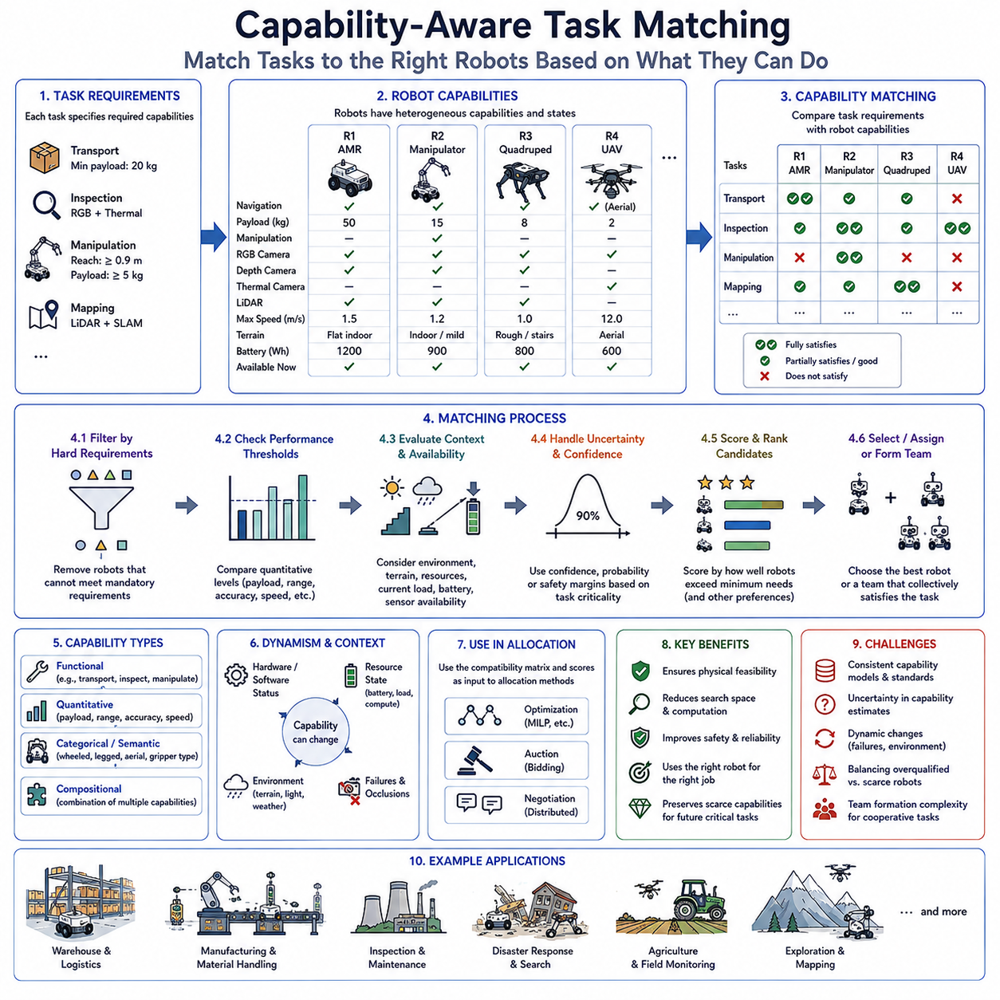{width="7.268055555555556in" height="7.268055555555556in"}

Capability-aware task matching determines whether a robot is physically and functionally suitable for a task before considering secondary factors such as distance, workload, or scheduling efficiency. In heterogeneous multi-robot systems, robots cannot be treated as interchangeable resources because their embodiments, sensors, actuators, mobility, payload capacity, computation, and operating environments may differ substantially. Matching therefore begins with explicit compatibility between task requirements and robot capabilities.

A capability represents an ability that a robot can provide during mission execution. Examples include autonomous navigation, object transportation, manipulation, inspection, mapping, visual perception, thermal sensing, lifting, precise positioning, communication relay, or aerial observation. Capabilities may originate from hardware, software, sensing, mobility, or combinations of these elements, making them a practical abstraction between physical robot design and mission-level task allocation.

Task requirements describe the capabilities and performance levels necessary for successful execution. A transportation task may require a minimum payload capacity, while an inspection task may require RGB, depth, thermal, or high-resolution sensing. Manipulation may require a particular reach, payload, end effector, or positioning accuracy. Capability-aware matching compares these requirements against robot descriptions so that infeasible candidates can be removed before allocation or optimization.

The simplest representation uses binary capability matching. A robot either possesses a required capability or does not, allowing compatibility to be expressed as a Boolean relationship. If a task requires manipulation and a robot has no manipulator, the assignment is rejected immediately. Binary matching is computationally efficient and useful for mandatory capabilities, but it cannot distinguish robots that possess the same capability at substantially different performance levels.

Quantitative capability representation provides a richer alternative. Payload may be represented in kilograms, positioning accuracy in centimeters, sensor range in meters, speed in meters per second, battery capacity in energy units, and computational performance through available processing resources. A task can then specify minimum or acceptable thresholds. Matching becomes a comparison between required performance and available performance rather than a simple yes-or-no capability test.

Categorical and semantic capabilities are also useful when numerical thresholds alone are insufficient. Mobility may be classified as wheeled, tracked, legged, or aerial, while terrain compatibility may distinguish flat indoor floors, stairs, rough outdoor surfaces, or confined spaces. Manipulation tools may be represented by gripper or end-effector type. Semantic descriptions allow the allocation system to reason about functional differences that cannot be represented effectively by a single scalar value.

Capability matching commonly separates hard requirements from soft preferences. Hard requirements define conditions that must be satisfied for an assignment to be feasible, such as sufficient payload, required sensing modality, or access to a particular terrain. Soft preferences indicate desirable characteristics such as higher battery reserve, better perception quality, greater speed, or lower operating cost. This separation prevents optimization from trading away safety-critical or physically mandatory requirements.

A capability matrix provides a compact representation of compatibility between robots and tasks. Rows can represent tasks, columns can represent robots, and each entry can indicate infeasibility, binary compatibility, or a capability score. This matrix can serve as an input to centralized optimization, distributed negotiation, or auction-based allocation. Filtering incompatible entries before assignment reduces the search space and prevents algorithms from considering physically meaningless alternatives.

Heterogeneous fleets demonstrate the importance of this representation. An AMR may provide efficient transportation on structured floors, while a mobile manipulator combines mobility with object handling. A quadruped may traverse stairs or irregular terrain, and a UAV may rapidly inspect elevated or inaccessible regions. Capability-aware matching allows these different embodiments to participate in one mission framework without incorrectly assuming that every robot can perform every available task.

Capabilities can also be compositional. A complex task may require navigation, perception, manipulation, and communication simultaneously. One robot may possess all required abilities, while another task may permit several robots to combine complementary capabilities. For example, one robot can provide manipulation while another provides observation or communication support. Matching must therefore consider both individual robot capability sets and potential multi-robot capability combinations.

This leads naturally to coalition or team formation for multi-robot tasks. Instead of asking whether robot (r_i) can perform task (t_j), the system asks whether a subset of robots collectively satisfies the task requirements. The challenge is to construct a team with sufficient capabilities while avoiding unnecessary members, excessive communication, or high coordination cost. Team-level capability matching therefore connects task allocation with cooperative execution.

Capability availability is dynamic even when the robot\'s hardware remains unchanged. A robot may possess a camera but lose access to it because of failure, contamination, occlusion, or software malfunction. A manipulator may become unavailable while the mobile base remains operational. Battery depletion may also prevent a robot from using an energy-intensive capability. Matching should therefore rely on currently available capabilities rather than only static platform specifications.

Environmental context can change the effective capability of a robot. A wheeled robot may technically possess navigation capability but become unsuitable when the task requires climbing stairs or traversing deep mud. A camera may provide adequate perception in daylight but perform poorly in darkness, while communication capability may degrade in underground or obstructed environments. Capability matching should therefore evaluate capability in context rather than treating it as an unconditional property.

Resource state further modifies suitability. A robot with sufficient payload capacity may already be carrying material, reducing its remaining capacity below the task requirement. A computationally demanding perception task may exceed currently available onboard processing because other applications are active. Capability-aware matching can incorporate available capacity, not merely installed capacity, so that assignments reflect the robot\'s real operational state at the time of decision.

Uncertainty can be associated with capability estimates. Perception accuracy, localization reliability, communication quality, terrain traversability, and manipulation success may vary with operating conditions. Instead of representing capability as perfectly known, the system can maintain confidence values, probability estimates, or safety margins. A task with high safety or mission criticality may then require a higher confidence level than a routine task with inexpensive failure recovery.

Capability scores can support ranking after feasibility filtering. Once all mandatory requirements are satisfied, compatible robots can be compared according to how well they exceed minimum requirements. A robot with greater payload margin, better sensor quality, higher localization accuracy, or stronger battery reserve may receive a higher suitability score. This score can then be combined with travel cost, workload, deadline, energy, and other factors during final assignment.

Overqualified robots should not automatically receive every task. Assigning the most capable platform to simple work may reduce its availability for future tasks that only it can perform. Capability-aware allocation can therefore include scarcity or opportunity cost. A specialized robot may be preserved when a common robot can execute the current task adequately, improving long-term fleet flexibility and reducing the risk of capability bottlenecks.

Capability descriptions must remain consistent across the fleet. If different robots use incompatible units, naming conventions, or interpretations of capabilities, matching can produce incorrect results. A common capability ontology, schema, or interface can define standardized concepts, units, thresholds, and relationships. This becomes particularly important when robots from different vendors or embodiments participate in the same Physical AI coordination architecture.

Capability-aware task matching ultimately acts as the feasibility layer between task representation and task allocation. It determines which robot-task or team-task combinations are physically meaningful before optimization, auctions, scheduling, or distributed negotiation decide among them. By explicitly connecting mission requirements with embodiment, sensing, manipulation, mobility, resources, context, and uncertainty, it enables heterogeneous robot fleets to allocate work according to what each physical agent can actually accomplish.

능력 인식 작업 매칭(Capability-Aware Task Matching)은 거리, 작업 부하, 스케줄링 효율성과 같은 부차적인 요소를 고려하기 전에 특정 로봇이 작업을 물리적·기능적으로 수행하기에 적합한지를 판단한다. 이기종 다중 로봇 시스템(Heterogeneous Multi-Robot System)에서는 로봇의 체화(Embodiment), 센서, 액추에이터, 이동성, 탑재 용량, 컴퓨팅 자원, 운영 환경이 크게 다를 수 있으므로 로봇을 서로 교환 가능한 동일한 자원으로 취급할 수 없다. 따라서 매칭은 작업 요구사항(Task Requirement)과 로봇 능력(Robot Capability) 사이의 명시적인 적합성에서 시작한다.

능력(Capability)은 로봇이 임무 수행 과정에서 제공할 수 있는 기능을 의미한다. 대표적으로 자율 내비게이션(Autonomous Navigation), 객체 운송(Object Transportation), 조작(Manipulation), 검사(Inspection), 매핑(Mapping), 시각 인식(Visual Perception), 열 감지(Thermal Sensing), 리프팅(Lifting), 정밀 위치결정(Precise Positioning), 통신 중계(Communication Relay), 공중 관측(Aerial Observation) 등이 있다. 능력은 하드웨어, 소프트웨어, 센싱, 이동성 또는 이들의 조합으로부터 형성될 수 있으며, 물리적 로봇 설계와 임무 수준 작업 할당을 연결하는 실용적인 추상화(Abstraction)가 된다.

작업 요구사항(Task Requirement)은 성공적인 작업 수행에 필요한 능력과 성능 수준을 기술한다. 운송 작업에는 최소 탑재 용량이 요구될 수 있으며, 검사 작업에는 RGB, 깊이(Depth), 열화상(Thermal), 고해상도 센싱이 필요할 수 있다. 조작 작업에는 특정 작업 반경(Reach), 탑재 능력, 엔드 이펙터(End Effector), 위치 정확도가 요구될 수 있다. 능력 인식 매칭은 이러한 요구사항을 로봇의 능력 설명과 비교하여 작업 할당이나 최적화를 수행하기 전에 실행 불가능한 후보를 제거한다.

가장 단순한 표현 방법은 이진 능력 매칭(Binary Capability Matching)을 사용하는 것이다. 로봇이 필요한 능력을 보유하거나 보유하지 않는 것으로 표현하여 적합성을 불리언 관계(Boolean Relationship)로 나타낼 수 있다. 작업에 조작 능력이 필요한데 로봇에 매니퓰레이터(Manipulator)가 없다면 해당 할당은 즉시 제외된다. 이진 매칭은 계산 효율성이 높고 필수 능력을 표현하는 데 유용하지만 동일한 능력을 서로 다른 성능 수준으로 제공하는 로봇들을 구분하기 어렵다.

정량적 능력 표현(Quantitative Capability Representation)은 보다 풍부한 대안을 제공한다. 탑재 능력은 킬로그램, 위치 정확도는 센티미터, 센서 범위는 미터, 속도는 초당 미터, 배터리 용량은 에너지 단위, 컴퓨팅 성능은 사용 가능한 처리 자원으로 표현할 수 있다. 작업은 최소 또는 허용 가능한 임계값(Threshold)을 지정할 수 있다. 이에 따라 매칭은 단순한 능력 보유 여부가 아니라 요구 성능(Required Performance)과 가용 성능(Available Performance)의 비교로 확장된다.

수치적인 임계값만으로 충분하지 않은 경우 범주형 및 의미론적 능력(Categorical and Semantic Capability)도 유용하다. 이동성은 바퀴형(Wheeled), 궤도형(Tracked), 다족형(Legged), 공중형(Aerial)으로 분류할 수 있으며, 지형 적합성(Terrain Compatibility)은 평탄한 실내 바닥, 계단, 거친 실외 지면, 협소 공간 등으로 구분할 수 있다. 조작 도구 역시 그리퍼(Gripper)나 엔드 이펙터 유형으로 표현할 수 있다. 의미론적 설명은 하나의 수치값으로 효과적으로 표현하기 어려운 기능적 차이를 작업 할당 시스템이 추론할 수 있도록 한다.

능력 매칭에서는 일반적으로 필수 요구조건(Hard Requirement)과 선호 요구조건(Soft Preference)을 구분한다. 필수 요구조건은 충분한 탑재 능력, 필수 센싱 방식, 특정 지형에 대한 접근 능력처럼 작업 할당이 실행 가능하기 위해 반드시 충족되어야 하는 조건이다. 선호 요구조건은 더 높은 배터리 여유, 우수한 인식 품질, 높은 속도, 낮은 운영비용 등 바람직하지만 필수적이지 않은 특성을 의미한다. 이러한 구분은 최적화 과정에서 안전 중요 요구조건(Safety-Critical Requirement)이나 물리적으로 필수적인 조건이 다른 성능 요소와 교환되는 것을 방지한다.

능력 행렬(Capability Matrix)은 로봇과 작업 사이의 적합성을 간결하게 표현할 수 있다. 행(Row)은 작업을, 열(Column)은 로봇을 나타내고 각 항목은 실행 불가능, 이진 적합성(Binary Compatibility), 또는 능력 점수(Capability Score)를 나타낼 수 있다. 이러한 행렬은 중앙집중형 최적화(Centralized Optimization), 분산형 협상(Distributed Negotiation), 경매 기반 할당(Auction-Based Allocation)의 입력으로 활용할 수 있다. 작업 할당 전에 부적합한 항목을 제거하면 탐색 공간을 줄이고 알고리즘이 물리적으로 의미 없는 대안을 평가하는 것을 방지할 수 있다.

이기종 플릿(Heterogeneous Fleet)은 이러한 표현의 중요성을 잘 보여준다. 자율이동로봇(AMR)은 구조화된 바닥 환경에서 효율적인 운송 능력을 제공하고, 모바일 매니퓰레이터(Mobile Manipulator)는 이동성과 객체 조작 능력을 결합한다. 사족보행 로봇(Quadruped)은 계단이나 불규칙한 지형을 이동할 수 있으며, 무인항공기(UAV)는 높은 위치나 접근하기 어려운 영역을 신속하게 검사할 수 있다. 능력 인식 매칭은 모든 로봇이 모든 작업을 수행할 수 있다고 잘못 가정하지 않으면서 서로 다른 체화를 하나의 임무 프레임워크(Mission Framework)에 참여시킨다.

능력은 조합적(Compositional)일 수도 있다. 복잡한 작업에는 내비게이션, 인식, 조작, 통신 능력이 동시에 필요할 수 있다. 하나의 로봇이 모든 필수 능력을 보유할 수도 있지만, 다른 작업에서는 여러 로봇이 상호 보완적인 능력을 결합하도록 허용할 수 있다. 예를 들어 한 로봇이 조작을 담당하고 다른 로봇이 관측이나 통신 지원을 제공할 수 있다. 따라서 매칭에서는 개별 로봇의 능력 집합뿐만 아니라 잠재적인 다중 로봇 능력 조합(Multi-Robot Capability Combination)도 고려해야 한다.

이는 자연스럽게 다중 로봇 작업을 위한 연합 또는 팀 구성(Coalition or Team Formation)으로 이어진다. 시스템은 로봇 (r_i)가 작업 (t_j)를 수행할 수 있는지를 묻는 대신, 특정 로봇 부분집합(Subset of Robots)이 집단적으로 작업 요구사항을 충족할 수 있는지를 판단한다. 핵심 과제는 불필요한 팀 구성원, 과도한 통신, 높은 조정 비용을 피하면서 충분한 능력을 가진 팀을 구성하는 것이다. 따라서 팀 수준 능력 매칭(Team-Level Capability Matching)은 작업 할당과 협력 실행(Cooperative Execution)을 연결한다.

로봇의 하드웨어가 변하지 않더라도 능력 가용성(Capability Availability)은 동적으로 변화할 수 있다. 로봇이 카메라를 보유하고 있더라도 고장, 오염, 가림(Occlusion), 소프트웨어 오류로 인해 사용할 수 없게 될 수 있다. 매니퓰레이터를 사용할 수 없게 되더라도 모바일 베이스(Mobile Base)는 정상적으로 동작할 수 있다. 또한 배터리 부족으로 에너지 소비가 큰 능력을 사용할 수 없는 경우도 있다. 따라서 매칭은 정적인 플랫폼 사양만이 아니라 현재 실제로 사용할 수 있는 능력을 기반으로 수행되어야 한다.

환경적 맥락(Environmental Context)은 로봇의 실질적인 능력을 변화시킬 수 있다. 바퀴형 로봇이 기술적으로 내비게이션 능력을 가지고 있더라도 계단이나 깊은 진흙을 통과해야 하는 작업에는 적합하지 않을 수 있다. 카메라는 주간 환경에서는 충분한 인식 능력을 제공하지만 어두운 환경에서는 성능이 저하될 수 있으며, 통신 능력도 지하나 장애물이 많은 환경에서 감소할 수 있다. 따라서 능력 매칭은 능력을 무조건적인 속성으로 취급하지 않고 실제 운영 맥락(Context)에서 평가해야 한다.

자원 상태(Resource State)는 로봇의 적합성을 추가적으로 변화시킨다. 충분한 최대 탑재 용량을 가진 로봇이라도 이미 물체를 운반하고 있다면 남아 있는 탑재 여유가 작업 요구량보다 작을 수 있다. 계산량이 큰 인식 작업 역시 다른 애플리케이션이 실행 중이라면 현재 사용 가능한 온보드 처리 능력을 초과할 수 있다. 따라서 능력 인식 매칭에서는 단순한 설치 용량(Installed Capacity)이 아니라 현재 사용 가능한 용량(Available Capacity)을 반영하여 의사결정 시점의 실제 운영 상태에 맞는 작업을 할당할 수 있다.

능력 추정값(Capability Estimate)에는 불확실성(Uncertainty)을 포함할 수도 있다. 인식 정확도, 위치추정 신뢰성(Localization Reliability), 통신 품질, 지형 주행 가능성(Terrain Traversability), 조작 성공률 등은 운영 조건에 따라 변화할 수 있다. 능력을 완전히 확정된 값으로 표현하는 대신 신뢰도(Confidence), 확률 추정(Probability Estimate), 안전 여유(Safety Margin)를 유지할 수 있다. 안전성이나 임무 중요도가 높은 작업에는 실패 복구 비용이 낮은 일상적인 작업보다 높은 신뢰 수준을 요구하도록 구성할 수 있다.

능력 점수(Capability Score)는 실행 가능성 필터링(Feasibility Filtering) 이후 후보 로봇의 순위를 결정하는 데 사용할 수 있다. 모든 필수 요구조건을 충족한 후에는 최소 요구조건을 얼마나 충분히 초과하는지에 따라 적합한 로봇들을 비교할 수 있다. 더 큰 탑재 여유, 우수한 센서 품질, 높은 위치추정 정확도, 충분한 배터리 여유를 가진 로봇은 더 높은 적합성 점수(Suitability Score)를 받을 수 있다. 이 점수는 최종 작업 할당에서 이동 비용, 작업 부하, 마감시간, 에너지 등의 요소와 결합할 수 있다.

과도한 능력을 가진 로봇(Overqualified Robot)이 모든 작업을 자동으로 할당받아서는 안 된다. 가장 뛰어난 플랫폼을 단순한 작업에 계속 할당하면 해당 로봇만 수행할 수 있는 미래 작업에 사용할 수 없게 될 수 있다. 따라서 능력 인식 할당에서는 희소성(Scarcity) 또는 기회비용(Opportunity Cost)을 포함할 수 있다. 일반적인 로봇이 현재 작업을 충분히 수행할 수 있다면 특수 로봇을 보존하여 장기적인 플릿 유연성(Fleet Flexibility)을 높이고 능력 병목현상(Capability Bottleneck)의 위험을 줄일 수 있다.

능력 설명(Capability Description)은 플릿 전체에서 일관성을 유지해야 한다. 서로 다른 로봇이 호환되지 않는 단위, 명명 규칙 또는 능력에 대한 서로 다른 해석을 사용한다면 잘못된 매칭 결과가 발생할 수 있다. 공통 능력 온톨로지(Common Capability Ontology), 스키마(Schema), 인터페이스(Interface)를 통해 표준화된 개념, 단위, 임계값, 관계를 정의할 수 있다. 이는 서로 다른 제조업체 또는 체화를 가진 로봇이 동일한 피지컬 AI 조정 아키텍처(Physical AI Coordination Architecture)에 참여하는 경우 특히 중요하다.

능력 인식 작업 매칭(Capability-Aware Task Matching)은 궁극적으로 작업 표현(Task Representation)과 작업 할당(Task Allocation) 사이에 위치하는 실행 가능성 계층(Feasibility Layer)의 역할을 한다. 최적화, 경매, 스케줄링 또는 분산형 협상이 후보들 가운데 최종 결정을 내리기 전에 어떤 로봇-작업 또는 팀-작업 조합이 물리적으로 의미가 있는지를 판단한다. 임무 요구사항을 체화, 센싱, 조작, 이동성, 자원, 환경 맥락, 불확실성과 명시적으로 연결함으로써 이기종 로봇 플릿이 각 물리적 에이전트가 실제로 수행할 수 있는 능력에 따라 작업을 할당할 수 있도록 한다.

## 03.08. Spatial and Temporal Task Constraints

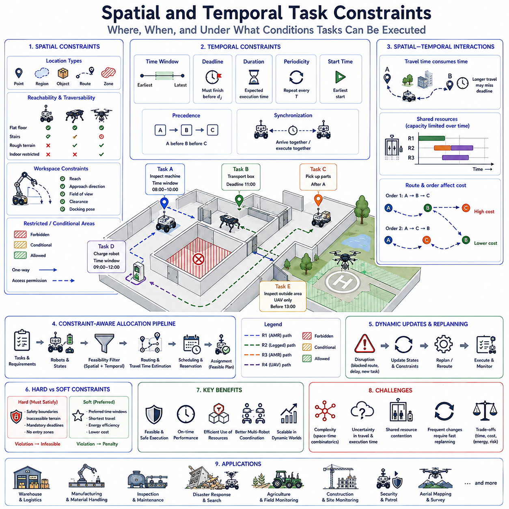{width="7.268055555555556in" height="7.268055555555556in"}

Spatial and temporal task constraints define where, when, and under what movement or timing conditions multi-robot tasks can be executed. Task allocation cannot rely only on robot capabilities because a capable robot may be too far away, unable to access the required region, or unavailable within the required time window. These constraints connect task assignment with navigation, scheduling, resource management, and physical execution.

A spatial constraint describes the relationship between a task and the physical environment in which it must occur. A task may be associated with a specific coordinate, semantic location, geographic region, object, workstation, route segment, or inspection zone. The allocation system must determine whether candidate robots can reach that location and whether their embodiment is compatible with the physical characteristics of the required workspace.

Distance provides the simplest spatial cost, but geometric proximity alone is rarely sufficient for physical robots. Two locations may appear close in Euclidean space while being separated by walls, restricted areas, stairs, traffic lanes, or inaccessible terrain. Realistic task allocation therefore uses navigable distance, estimated path length, travel time, terrain difficulty, or another route-dependent measure derived from the robot\'s actual operating environment.

Robot embodiment directly affects spatial feasibility. A wheeled AMR may operate efficiently on flat indoor floors but be unable to reach a task located above stairs. A quadruped may access irregular terrain that conventional wheeled robots cannot traverse, while a UAV can reach elevated or disconnected areas through aerial motion. Spatial constraints must therefore be evaluated together with mobility capabilities rather than represented as location alone.

Workspace constraints become important when tasks involve manipulation or close-range sensing. Reaching the general task location does not guarantee that a robot can reach the required object or observation pose. Manipulator reach, approach direction, sensor field of view, minimum clearance, docking geometry, and positioning accuracy may determine whether execution is feasible. Task matching can therefore require both navigation-level accessibility and task-level workspace accessibility.

Restricted and conditional regions introduce additional spatial rules. Some robots may be prohibited from entering human-only zones, hazardous areas, clean rooms, narrow passages, or regions with payload or weight restrictions. Other areas may become accessible only under specific operating conditions. Spatial task representation can encode allowed regions, forbidden regions, access permissions, directionality, and robot-specific traversability constraints.

Shared spaces create interactions among otherwise independent assignments. Corridors, intersections, elevators, doors, loading zones, docking stations, and work cells may have limited capacity. Assigning several robots to tasks that require the same physical resource at similar times can create congestion or deadlock. Spatially aware allocation should therefore consider not only whether a route exists but also competition for shared infrastructure along that route.

Temporal constraints describe when a task can begin, how long it is expected to take, and when it must be completed. A task may specify an earliest start time, latest completion time, execution duration, time window, periodic requirement, or maximum allowable delay. These properties transform allocation from a static matching problem into a scheduling problem because robot suitability depends on both physical capability and availability over time.

A time window defines an interval during which execution is permitted or desirable. A delivery may need to arrive between two specified times, while an inspection may only occur when equipment is inactive. A robot that can physically perform the task may still be unsuitable if its travel and execution times cannot satisfy the window. Allocation must therefore estimate arrival and completion times before confirming the assignment.

Deadlines introduce explicit urgency into the allocation process. If task (j) must finish before deadline (d_j), the expected start time, travel time, and execution duration must collectively satisfy that requirement. When no feasible robot can meet the deadline, the system may need to increase task priority, reorganize existing schedules, assign additional robots, relax lower-priority commitments, or report that the original requirement cannot be satisfied.

Task precedence defines temporal relationships between activities. A pickup must occur before delivery, inspection may precede maintenance, and mapping may be required before autonomous navigation through an unknown region. These relationships can be represented as precedence graphs or task dependency networks. Allocation must respect these dependencies so that a robot is not assigned to execute a downstream activity before the physical prerequisites have been completed.

Synchronization constraints arise when several robots must coordinate their actions in time. Cooperative transport may require two robots to arrive before lifting begins, while multi-view inspection may require synchronized observations from different positions. In such cases, independently feasible robot assignments may collectively be infeasible if arrival times differ excessively. Team allocation must therefore consider common execution intervals and coordination delays.

Spatial and temporal constraints are strongly coupled because movement consumes time. Selecting a robot farther from a task increases travel duration and may cause deadline violations, while selecting a nearby robot may create congestion on a shared route. A realistic allocator therefore reasons about space-time rather than treating spatial and temporal constraints independently. Route selection, task sequence, and assignment can all influence one another.

The ordering of tasks also changes spatial cost. If a robot must perform tasks A, B, and C, the total travel cost depends on their sequence rather than only on the robot\'s initial distance to each task. A new task located near the robot\'s planned route may have a small marginal cost even if it is far from the robot\'s current position. This creates a direct connection among task allocation, routing, and scheduling.

Reservations provide a practical mechanism for coordinating space and time. A robot can reserve an elevator, charging station, narrow corridor, docking position, or work cell for a specific interval. The allocation system can then determine whether a proposed task schedule conflicts with existing reservations. Space-time reservations reduce physical conflicts and allow shared infrastructure to be treated as constrained resources within the broader coordination problem.

Dynamic environments require constraints to be updated continuously. A blocked corridor can invalidate a previously feasible route, a delayed elevator can shift arrival time, and a temporary safety zone can make a task location inaccessible. Similarly, execution delays can cause subsequent tasks to violate their time windows. Monitoring actual progress allows the system to detect these changes and trigger rescheduling, rerouting, or task reallocation.

Uncertainty makes spatial-temporal reasoning more difficult because travel and execution times are estimates rather than exact values. Congestion, localization error, obstacle interactions, terrain conditions, and human activity can introduce delays. Practical systems can use safety margins, probabilistic travel times, robust scheduling, or confidence intervals so that assignments remain feasible even when real execution differs moderately from nominal predictions.

Constraint violations should be handled according to mission importance rather than through uncontrolled replanning. Hard constraints such as inaccessible terrain, safety boundaries, or mandatory deadlines may make an assignment infeasible and require immediate reassignment. Soft constraints such as preferred completion times or desired travel efficiency may instead generate penalties. Distinguishing hard and soft constraints helps preserve safety while allowing operational flexibility.

Large fleets make joint spatial-temporal reasoning computationally demanding because every assignment can influence routes, schedules, and shared resources. Hierarchical methods can first divide tasks geographically and then optimize schedules within regions. Rolling-horizon approaches can focus computation on near-term tasks, while heuristics and distributed reservations can handle local conflicts. These techniques trade perfect global optimization for timely and scalable coordination.

Spatial and temporal task constraints ultimately connect abstract task allocation with the realities of embodied execution. They ensure that a selected robot is not only capable of performing a task, but can physically reach the required place, obtain necessary shared resources, arrive at an appropriate time, respect dependencies, and complete the work within mission limits. Their integration with routing, scheduling, replanning, and resource coordination is therefore fundamental to reliable multi-robot Physical AI.

공간 및 시간 작업 제약조건(Spatial and Temporal Task Constraints)은 다중 로봇 작업을 어디에서, 언제, 그리고 어떤 이동 또는 시간 조건에서 실행할 수 있는지를 정의한다. 작업 할당(Task Allocation)은 로봇의 능력만을 기준으로 결정할 수 없다. 작업을 수행할 능력이 있는 로봇이라도 지나치게 멀리 있거나, 필요한 영역에 접근할 수 없거나, 요구된 시간 윈도(Time Window) 내에 사용할 수 없을 수 있다. 이러한 제약조건은 작업 할당을 내비게이션(Navigation), 스케줄링(Scheduling), 자원 관리(Resource Management), 물리적 실행(Physical Execution)과 연결한다.

공간 제약조건(Spatial Constraint)은 작업과 해당 작업이 수행되어야 하는 물리적 환경(Physical Environment) 사이의 관계를 기술한다. 작업은 특정 좌표(Coordinate), 의미론적 위치(Semantic Location), 지리적 영역(Geographic Region), 객체(Object), 작업 스테이션(Workstation), 경로 구간(Route Segment), 검사 구역(Inspection Zone) 등과 연결될 수 있다. 작업 할당 시스템은 후보 로봇이 해당 위치에 도달할 수 있는지, 그리고 로봇의 체화(Embodiment)가 필요한 작업 공간의 물리적 특성과 적합한지를 판단해야 한다.

거리(Distance)는 가장 단순한 공간 비용(Spatial Cost)을 제공하지만 물리적 로봇에서는 기하학적 근접성(Geometric Proximity)만으로 충분한 경우가 드물다. 두 위치가 유클리드 공간(Euclidean Space)에서는 가까워 보이더라도 벽, 제한 구역, 계단, 교통 차선 또는 접근 불가능한 지형으로 분리되어 있을 수 있다. 따라서 현실적인 작업 할당에서는 로봇의 실제 운영 환경을 기반으로 주행 가능 거리(Navigable Distance), 예상 경로 길이, 이동시간, 지형 난이도 또는 기타 경로 의존적 척도(Route-Dependent Measure)를 사용한다.

로봇의 체화(Embodiment)는 공간적 실행 가능성(Spatial Feasibility)에 직접적인 영향을 준다. 바퀴형 자율이동로봇(AMR)은 평탄한 실내 바닥에서는 효율적으로 이동할 수 있지만 계단 위에 위치한 작업에는 접근하지 못할 수 있다. 사족보행 로봇(Quadruped)은 일반적인 바퀴형 로봇이 통과할 수 없는 불규칙한 지형에 접근할 수 있으며, 무인항공기(UAV)는 공중 이동을 통해 높은 위치나 물리적으로 분리된 영역에 도달할 수 있다. 따라서 공간 제약조건은 단순한 위치 정보가 아니라 이동 능력(Mobility Capability)과 함께 평가되어야 한다.

작업 공간 제약조건(Workspace Constraint)은 작업에 조작(Manipulation)이나 근거리 센싱(Close-Range Sensing)이 포함될 때 중요해진다. 일반적인 작업 위치에 도달했다고 해서 로봇이 필요한 객체나 관측 자세(Observation Pose)에 접근할 수 있다는 의미는 아니다. 매니퓰레이터 작업 반경(Manipulator Reach), 접근 방향, 센서 시야(Field of View), 최소 여유 공간, 도킹 형상(Docking Geometry), 위치 정확도 등이 실행 가능성을 결정할 수 있다. 따라서 작업 매칭은 내비게이션 수준 접근성뿐만 아니라 작업 수준 작업 공간 접근성(Task-Level Workspace Accessibility)도 요구할 수 있다.

제한 및 조건부 영역(Restricted and Conditional Region)은 추가적인 공간 규칙을 도입한다. 일부 로봇은 사람 전용 구역, 위험 지역, 클린룸(Clean Room), 좁은 통로 또는 탑재 중량 제한이 있는 영역에 진입할 수 없을 수 있다. 다른 영역은 특정 운영 조건에서만 접근 가능할 수 있다. 공간 작업 표현(Spatial Task Representation)은 허용 영역, 금지 영역, 접근 권한(Access Permission), 이동 방향성(Directionality), 로봇별 주행 가능성 제약조건(Robot-Specific Traversability Constraint)을 표현할 수 있다.

공유 공간(Shared Space)은 원래 독립적인 작업 할당 사이에도 상호작용을 발생시킨다. 통로, 교차로, 엘리베이터, 출입문, 적재 구역, 도킹 스테이션(Docking Station), 작업 셀(Work Cell)은 제한된 수용 능력을 가질 수 있다. 여러 로봇을 비슷한 시간에 동일한 물리적 자원을 필요로 하는 작업에 할당하면 혼잡(Congestion)이나 교착상태(Deadlock)가 발생할 수 있다. 따라서 공간 인식 할당(Spatially Aware Allocation)은 경로의 존재 여부뿐만 아니라 해당 경로에서 공유 인프라를 둘러싼 경쟁도 고려해야 한다.

시간 제약조건(Temporal Constraint)은 작업을 언제 시작할 수 있는지, 얼마나 오래 수행할 것으로 예상되는지, 언제까지 완료해야 하는지를 정의한다. 작업에는 가장 빠른 시작시간(Earliest Start Time), 최종 완료시간(Latest Completion Time), 실행시간(Execution Duration), 시간 윈도(Time Window), 주기적 요구사항(Periodic Requirement), 최대 허용 지연(Maximum Allowable Delay) 등이 지정될 수 있다. 이러한 속성으로 인해 로봇의 적합성이 물리적 능력뿐만 아니라 시간에 따른 가용성에 의해서도 결정되므로 작업 할당은 정적인 매칭 문제에서 스케줄링 문제로 확장된다.

시간 윈도(Time Window)는 작업 실행이 허용되거나 바람직한 시간 구간을 정의한다. 배송 작업은 지정된 두 시간 사이에 도착해야 할 수 있으며, 검사 작업은 장비가 작동하지 않는 동안에만 수행할 수 있다. 로봇이 물리적으로 해당 작업을 수행할 수 있더라도 이동시간과 실행시간을 고려했을 때 시간 윈도를 만족하지 못한다면 적합하지 않을 수 있다. 따라서 작업 할당을 확정하기 전에 예상 도착시간과 완료시간을 추정해야 한다.

마감시간(Deadline)은 작업 할당 과정에 명시적인 긴급성(Urgency)을 부여한다. 작업 (j)가 마감시간 (d_j) 이전에 완료되어야 한다면 예상 시작시간, 이동시간, 실행시간을 모두 합친 결과가 해당 요구조건을 만족해야 한다. 어떤 로봇도 마감시간을 만족할 수 없다면 시스템은 작업 우선순위를 높이거나, 기존 스케줄을 재구성하거나, 추가 로봇을 할당하거나, 낮은 우선순위의 작업 약속을 완화하거나, 원래 요구조건을 만족할 수 없음을 보고해야 할 수 있다.

작업 선후관계(Task Precedence)는 활동 사이의 시간적 관계를 정의한다. 픽업(Pickup)은 배송 전에 수행되어야 하며, 검사는 유지보수(Maintenance)에 앞서 수행될 수 있고, 미지의 영역에서 자율 내비게이션을 수행하기 전에 매핑(Mapping)이 필요할 수 있다. 이러한 관계는 선행관계 그래프(Precedence Graph) 또는 작업 의존성 네트워크(Task Dependency Network)로 표현할 수 있다. 작업 할당은 물리적인 선행조건이 완료되기 전에 후속 작업이 실행되도록 할당해서는 안 된다.

동기화 제약조건(Synchronization Constraint)은 여러 로봇이 시간적으로 행동을 조정해야 할 때 발생한다. 협력 운송(Cooperative Transport)은 리프팅을 시작하기 전에 두 로봇이 모두 도착해야 할 수 있으며, 다중 시점 검사(Multi-View Inspection)는 서로 다른 위치에서 여러 로봇의 동기화된 관측을 요구할 수 있다. 이러한 경우 개별적으로는 실행 가능한 로봇 할당도 도착시간 차이가 지나치게 크다면 전체적으로 실행 불가능할 수 있다. 따라서 팀 할당(Team Allocation)은 공통 실행 구간과 조정 지연(Coordination Delay)을 고려해야 한다.

공간 및 시간 제약조건은 이동 자체가 시간을 소비하기 때문에 강하게 결합되어 있다. 작업에서 더 멀리 떨어진 로봇을 선택하면 이동시간이 증가하여 마감시간을 위반할 수 있으며, 가까운 로봇을 선택하더라도 공유 경로에서 혼잡을 발생시킬 수 있다. 따라서 현실적인 작업 할당기(Allocator)는 공간 제약과 시간 제약을 독립적으로 처리하기보다 시공간(Space-Time)을 함께 추론해야 한다. 경로 선택(Route Selection), 작업 순서(Task Sequence), 작업 할당은 모두 서로 영향을 줄 수 있다.

작업의 실행 순서도 공간 비용을 변화시킨다. 로봇이 작업 A, B, C를 수행해야 한다면 전체 이동 비용은 각 작업까지의 초기 거리뿐만 아니라 작업을 수행하는 순서에 따라 달라진다. 새롭게 추가된 작업이 현재 로봇 위치에서는 멀리 떨어져 있더라도 이미 계획된 이동 경로 주변에 있다면 한계비용(Marginal Cost)은 작을 수 있다. 이는 작업 할당, 라우팅(Routing), 스케줄링 사이에 직접적인 연결 관계를 형성한다.

예약(Reservation)은 공간과 시간을 함께 조정하기 위한 실용적인 메커니즘을 제공한다. 로봇은 특정 시간 구간 동안 엘리베이터, 충전소, 좁은 통로, 도킹 위치 또는 작업 셀을 예약할 수 있다. 작업 할당 시스템은 제안된 작업 스케줄이 기존 예약과 충돌하는지를 판단할 수 있다. 시공간 예약(Space-Time Reservation)은 물리적 충돌을 줄이고 공유 인프라를 전체 조정 문제 내에서 제약된 자원(Constrained Resource)으로 다룰 수 있도록 한다.

동적 환경(Dynamic Environment)에서는 제약조건을 지속적으로 업데이트해야 한다. 통로가 차단되면 이전에 실행 가능했던 경로가 무효화될 수 있고, 엘리베이터 지연은 도착시간을 변화시키며, 일시적인 안전 구역(Temporary Safety Zone)은 작업 위치에 대한 접근을 차단할 수 있다. 마찬가지로 작업 실행 지연은 이후 작업의 시간 윈도를 위반하게 만들 수 있다. 실제 진행 상황을 모니터링하면 이러한 변화를 감지하여 재스케줄링(Rescheduling), 재라우팅(Rerouting), 작업 재할당(Task Reallocation)을 실행할 수 있다.

이동시간과 실행시간은 정확한 값이 아니라 추정값이므로 불확실성(Uncertainty)은 시공간 추론(Spatial-Temporal Reasoning)을 더욱 어렵게 만든다. 혼잡, 위치추정 오차(Localization Error), 장애물과의 상호작용, 지형 조건, 사람의 활동 등이 지연을 발생시킬 수 있다. 실제 시스템에서는 안전 여유(Safety Margin), 확률적 이동시간(Probabilistic Travel Time), 강건 스케줄링(Robust Scheduling), 신뢰 구간(Confidence Interval)을 사용하여 실제 실행이 명목상 예측과 어느 정도 달라지더라도 작업 할당이 실행 가능하도록 할 수 있다.

제약조건 위반(Constraint Violation)은 무분별한 재계획이 아니라 임무 중요도(Mission Importance)에 따라 처리해야 한다. 접근 불가능한 지형, 안전 경계(Safety Boundary), 반드시 준수해야 하는 마감시간과 같은 필수 제약조건(Hard Constraint)은 작업 할당을 실행 불가능하게 만들고 즉각적인 재할당을 요구할 수 있다. 반면 선호 완료시간이나 이동 효율성과 같은 완화 가능한 제약조건(Soft Constraint)은 페널티(Penalty)로 처리할 수 있다. 필수 제약과 완화 가능한 제약을 구분하면 안전성을 유지하면서 운영 유연성을 확보할 수 있다.

대규모 플릿(Large Fleet)에서는 모든 작업 할당이 경로, 스케줄, 공유 자원에 영향을 줄 수 있기 때문에 공간 및 시간을 통합한 추론의 계산 부담이 커진다. 계층적 방법(Hierarchical Method)은 먼저 작업을 지리적으로 분할한 다음 각 영역 내에서 스케줄을 최적화할 수 있다. 롤링 호라이즌 접근법(Rolling-Horizon Approach)은 가까운 미래의 작업에 계산을 집중할 수 있으며, 휴리스틱(Heuristic)과 분산형 예약(Distributed Reservation)은 로컬 충돌을 처리할 수 있다. 이러한 방법은 완벽한 글로벌 최적화 대신 적시에 확장 가능한 조정을 제공한다.

공간 및 시간 작업 제약조건(Spatial and Temporal Task Constraints)은 궁극적으로 추상적인 작업 할당(Abstract Task Allocation)을 체화된 실제 실행(Embodied Execution)의 현실과 연결한다. 선택된 로봇이 단순히 작업 수행 능력을 갖추는 것뿐만 아니라 필요한 장소에 물리적으로 도달하고, 필요한 공유 자원을 확보하며, 적절한 시간에 도착하고, 작업 의존관계를 준수하며, 임무 제한 내에서 작업을 완료할 수 있도록 한다. 따라서 라우팅, 스케줄링, 재계획(Replanning), 자원 조정(Resource Coordination)과의 통합은 신뢰성 높은 다중 로봇 피지컬 AI(Multi-Robot Physical AI)를 구현하기 위한 핵심 요소이다.

## 03.09. Multi Robot Scheduling

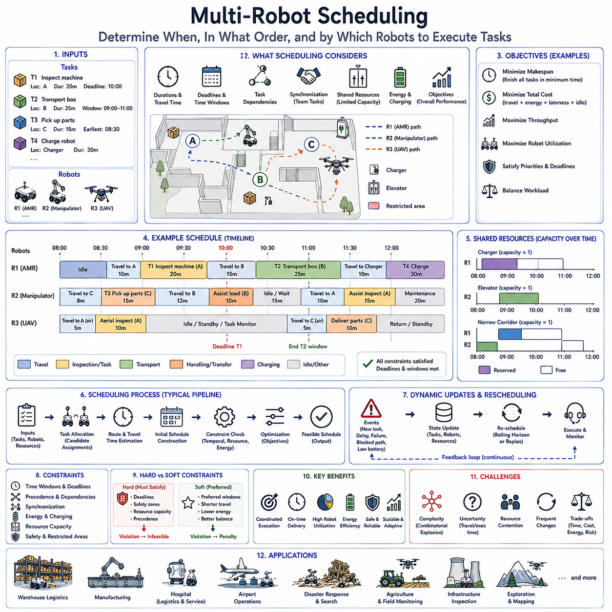{width="7.268055555555556in" height="7.268055555555556in"}

Multi-robot scheduling determines when assigned tasks should be executed, in what order, and by which robots over a mission timeline. While task allocation primarily decides who should perform each task, scheduling adds the temporal structure required for coordinated execution. A valid schedule must consider robot availability, task duration, travel time, deadlines, dependencies, shared resources, and interactions among multiple robots operating simultaneously.

Scheduling is closely coupled with task allocation because assignment decisions directly influence execution time. A robot may be highly capable of performing a task but unavailable until its current work is completed. Another robot may have lower execution efficiency but be able to start immediately. Multi-robot scheduling therefore evaluates assignments within a temporal context so that locally attractive robot-task matches do not create delays or inefficient fleet-wide execution.

A schedule can represent each robot as a timeline containing assigned tasks, travel periods, waiting intervals, charging operations, maintenance, and other activities. Every task has a planned start and completion time, while transitions between tasks include the movement required to reach the next location. This representation allows the coordination system to identify idle periods, conflicting assignments, deadline violations, and opportunities to improve robot utilization.

Task duration is a fundamental scheduling parameter. Execution time may depend on task type, robot capability, environmental conditions, payload, and operating speed. The same task can therefore require different durations when performed by different robots. Accurate duration estimates improve schedule quality, while uncertain estimates require margins or adaptive updates to prevent small prediction errors from propagating through subsequent tasks.

Travel time must also be incorporated explicitly because robots perform tasks at physical locations. Scheduling only the task execution interval can create unrealistic plans when movement between tasks is significant. Travel estimates can be obtained from maps, navigation planners, historical data, or predicted congestion. Consequently, a robot schedule commonly alternates between movement and task execution rather than representing tasks as independent temporal events.

Temporal constraints define when tasks may be executed. A task may have an earliest start time, deadline, preferred time window, maximum delay, or periodic execution requirement. Hard temporal constraints must be satisfied for the schedule to remain feasible, while soft constraints can be violated at a defined penalty. This distinction allows scheduling algorithms to preserve mandatory mission conditions while making trade-offs among less critical timing preferences.

Task dependencies impose ordering relationships on the schedule. A pickup must precede delivery, inspection may need to occur before maintenance, and mapping may be required before navigation through an unknown environment. These relationships can be represented as precedence constraints or directed task graphs. Scheduling must ensure that successor tasks begin only after the necessary predecessor activities and associated physical conditions have been completed.

Multi-robot tasks introduce synchronization requirements that are absent from many single-robot schedules. Cooperative transport may require several robots to arrive at a location before execution begins, while coordinated sensing may require observations within the same time interval. Scheduling must align the participating robots\' timelines, accounting for different travel times and prior commitments so that the team becomes available at the required moment.

Shared resources create additional scheduling constraints. Multiple robots may require the same charging station, elevator, docking point, loading area, narrow corridor, work cell, or specialized tool. Even when their assigned tasks do not directly conflict, simultaneous resource requests can make the schedule physically impossible. Resource-aware scheduling therefore reserves limited infrastructure across time and prevents incompatible overlaps.

Robot energy introduces a recurring relationship between productive tasks and support activities. A robot cannot simply execute tasks continuously if its battery falls below an operational threshold. Charging periods must be inserted into the schedule according to expected energy consumption, charger availability, charging duration, and future workload. Energy-aware scheduling can reduce unexpected mission interruption and prevent too many robots from seeking charging simultaneously.

Scheduling objectives vary according to mission priorities. A system may minimize makespan, defined as the time required to complete the entire set of scheduled work, or minimize total completion time, travel, energy consumption, lateness, and idle time. Other objectives may maximize throughput, robot utilization, task priority satisfaction, or service quality. Practical systems often combine several criteria to represent the desired fleet-level operating policy.

Workload balancing can be included to prevent schedules that repeatedly overload a small subset of robots while others remain underutilized. Purely minimizing immediate travel distance may repeatedly select centrally located or highly capable robots. Balanced scheduling can distribute tasks according to utilization, energy, wear, or future capability requirements. This can improve long-term fleet availability even when it slightly increases short-term execution cost.

Scheduling problems can be formulated using optimization techniques such as mixed-integer linear programming(MILP), constraint programming(CP), vehicle routing with time windows(VRPTW), or job-shop scheduling models. Decision variables can represent assignment, task start time, execution order, and resource reservation. Constraints encode precedence, capacity, synchronization, and timing requirements, while the objective function expresses the desired operational performance.

Exact scheduling methods become computationally difficult as fleet size and task complexity increase. Each robot may have many possible task sequences, and interactions through shared resources create additional combinations. Large systems therefore frequently use heuristics, metaheuristics, decomposition, hierarchical scheduling, or limited-horizon optimization. These methods trade guaranteed global optimality for faster decisions that remain useful in operational time scales.

Rolling-horizon scheduling is particularly suitable for continuously operating robot fleets. Instead of fixing a complete long-term schedule, the system optimizes a near-term horizon using current information. Immediate tasks are committed while later activities remain flexible. After a defined interval or significant event, the horizon advances and the schedule is recomputed using updated task requests, robot states, resource conditions, and execution progress.

Dynamic events make rescheduling an essential capability. New high-priority tasks may arrive, robots can fail, paths may become blocked, task execution may take longer than expected, and charging stations can become unavailable. The scheduler must determine whether to preserve existing commitments or modify them. Effective rescheduling changes only the necessary parts of the plan while restoring feasibility and maintaining mission performance.

Schedule stability is important because excessive replanning can itself reduce efficiency. Repeatedly changing assignments may cause robots to reverse direction, abandon useful progress, or create confusion in shared resource reservations. Reassignment penalties, frozen time windows, task locking, or hysteresis can protect near-term commitments. The scheduler can then optimize flexible future work while preserving actions that are already physically underway.

Uncertainty requires schedules to tolerate differences between predicted and actual execution. Travel time may increase because of congestion, humans, or obstacles, while manipulation and inspection durations may vary with task difficulty. Robust scheduling can introduce buffers, conservative estimates, probabilistic durations, or scenario-based reasoning. The objective is not simply to create the shortest nominal schedule, but one that remains useful under realistic variation.

Distributed scheduling becomes valuable when robots cannot continuously depend on a fleet-level coordinator. Individual robots can maintain local schedules and exchange commitments, arrival estimates, priorities, or resource reservations with peers. Local negotiation can resolve some conflicts without rebuilding the entire fleet schedule. Centralized and distributed scheduling can also be combined, with global planning defining strategic structure and robots adapting execution locally.

Multi-robot scheduling ultimately transforms a set of task assignments into an executable coordination plan across time. It integrates robot availability, task order, travel, deadlines, synchronization, energy, and shared resources so that individually feasible assignments become collectively feasible operations. Within multi-robot Physical AI, scheduling therefore forms the temporal coordination layer that connects task allocation with navigation, resource management, execution monitoring, and dynamic replanning.

다중 로봇 스케줄링(Multi-Robot Scheduling)은 할당된 작업을 언제 실행해야 하는지, 어떤 순서로 수행해야 하는지, 그리고 임무 시간축(Mission Timeline)에서 어떤 로봇이 수행해야 하는지를 결정한다. 작업 할당(Task Allocation)이 주로 각 작업을 누가 수행할지를 결정한다면, 스케줄링(Scheduling)은 조정된 실행(Coordinated Execution)에 필요한 시간적 구조(Temporal Structure)를 추가한다. 유효한 스케줄은 로봇 가용성, 작업시간, 이동시간, 마감시간, 의존관계, 공유 자원, 동시에 운영되는 여러 로봇 사이의 상호작용을 고려해야 한다.

스케줄링은 작업 할당과 밀접하게 결합되어 있는데, 작업 할당 결정이 실행시간에 직접적인 영향을 미치기 때문이다. 어떤 로봇이 특정 작업을 수행하는 데 매우 적합하더라도 현재 작업이 완료될 때까지 사용할 수 없을 수 있다. 반면 다른 로봇은 실행 효율성이 낮더라도 즉시 작업을 시작할 수 있다. 따라서 다중 로봇 스케줄링은 로컬 관점에서 매력적인 로봇-작업 매칭(Robot-Task Matching)이 지연이나 플릿 전체의 비효율적인 실행을 발생시키지 않도록 시간적 맥락(Temporal Context)에서 작업 할당을 평가한다.

스케줄(Schedule)은 각 로봇을 할당된 작업, 이동 구간, 대기 구간, 충전 작업, 유지보수 및 기타 활동을 포함하는 시간축(Timeline)으로 표현할 수 있다. 모든 작업에는 계획된 시작시간과 완료시간이 있으며, 작업 사이의 전환에는 다음 위치까지 이동하는 데 필요한 시간이 포함된다. 이러한 표현을 통해 조정 시스템은 유휴시간(Idle Period), 충돌하는 작업 할당, 마감시간 위반, 로봇 활용률을 개선할 수 있는 기회를 식별할 수 있다.

작업시간(Task Duration)은 스케줄링의 기본적인 매개변수이다. 실행시간은 작업 유형, 로봇 능력, 환경 조건, 탑재 상태, 운영 속도에 따라 달라질 수 있다. 따라서 동일한 작업이라도 서로 다른 로봇이 수행하면 필요한 시간이 달라질 수 있다. 정확한 작업시간 추정(Duration Estimate)은 스케줄 품질을 향상시키며, 추정값에 불확실성이 존재하는 경우 작은 예측 오차가 이후 작업 전체로 전파되는 것을 방지하기 위해 시간 여유나 적응형 업데이트(Adaptive Update)가 필요하다.

로봇은 물리적 위치에서 작업을 수행하기 때문에 이동시간(Travel Time) 역시 명시적으로 포함해야 한다. 작업 실행 구간만 스케줄링하면 작업 사이의 이동이 상당한 경우 현실적으로 실행할 수 없는 계획이 만들어질 수 있다. 이동시간은 지도, 내비게이션 플래너(Navigation Planner), 과거 데이터, 예상 혼잡 등을 이용하여 추정할 수 있다. 따라서 로봇 스케줄은 일반적으로 작업을 독립적인 시간 이벤트로 표현하기보다 이동과 작업 실행이 교대로 나타나는 형태로 구성된다.

시간적 제약조건(Temporal Constraint)은 작업을 언제 수행할 수 있는지를 정의한다. 작업에는 가장 빠른 시작시간(Earliest Start Time), 마감시간(Deadline), 선호 시간 윈도(Preferred Time Window), 최대 지연시간, 주기적 실행 요구사항 등이 존재할 수 있다. 필수 시간 제약조건(Hard Temporal Constraint)은 스케줄이 실행 가능하기 위해 반드시 만족해야 하지만, 완화 가능한 제약조건(Soft Constraint)은 정의된 페널티(Penalty)를 통해 위반을 허용할 수 있다. 이러한 구분을 통해 필수 임무 조건을 유지하면서 중요도가 낮은 시간 선호조건 사이에서 절충할 수 있다.

작업 의존관계(Task Dependency)는 스케줄에 실행 순서 관계를 부여한다. 픽업(Pickup)은 배송 전에 수행되어야 하고, 검사는 유지보수(Maintenance)에 앞서 수행되어야 할 수 있으며, 미지의 환경에서 내비게이션을 수행하기 전에 매핑(Mapping)이 필요할 수 있다. 이러한 관계는 선행 제약조건(Precedence Constraint)이나 방향성 작업 그래프(Directed Task Graph)로 표현할 수 있다. 스케줄링은 필요한 선행 작업과 관련 물리적 조건이 완료된 이후에만 후속 작업이 시작되도록 보장해야 한다.

다중 로봇 작업(Multi-Robot Task)은 일반적인 단일 로봇 스케줄에는 없는 동기화 요구조건(Synchronization Requirement)을 발생시킨다. 협력 운송(Cooperative Transport)은 작업을 시작하기 전에 여러 로봇이 특정 위치에 도착해야 할 수 있으며, 협력 센싱(Coordinated Sensing)은 동일한 시간 구간에서 관측을 수행해야 할 수 있다. 스케줄링은 서로 다른 이동시간과 기존 작업 약속을 고려하여 참여 로봇들의 시간축을 정렬하고 필요한 시점에 팀 전체가 동시에 사용할 수 있도록 해야 한다.

공유 자원(Shared Resource)은 추가적인 스케줄링 제약조건을 발생시킨다. 여러 로봇이 동일한 충전소, 엘리베이터, 도킹 지점(Docking Point), 적재 구역, 좁은 통로, 작업 셀(Work Cell), 특수 도구 등을 필요로 할 수 있다. 할당된 작업 자체가 직접 충돌하지 않더라도 동시에 같은 자원을 요청하면 스케줄을 물리적으로 실행할 수 없게 된다. 따라서 자원 인식 스케줄링(Resource-Aware Scheduling)은 시간에 따라 제한된 인프라를 예약하고 서로 양립할 수 없는 중복 사용을 방지한다.

로봇 에너지(Robot Energy)는 생산적인 작업과 지원 활동(Support Activity) 사이에 반복적인 관계를 형성한다. 배터리가 운영 임계값(Operational Threshold) 이하로 떨어지면 로봇은 작업을 계속 수행할 수 없으므로 단순히 작업만 연속적으로 배치할 수 없다. 예상 에너지 소비, 충전기 가용성, 충전시간, 향후 작업 부하를 고려하여 충전 구간을 스케줄에 삽입해야 한다. 에너지 인식 스케줄링(Energy-Aware Scheduling)은 예상하지 못한 임무 중단을 줄이고 여러 로봇이 동시에 충전을 요구하는 상황을 방지할 수 있다.

스케줄링의 목적(Objective)은 임무 우선순위에 따라 달라진다. 시스템은 전체 작업 집합을 완료하는 데 필요한 시간을 의미하는 총 완료시간(Makespan)을 최소화하거나, 전체 완료시간, 이동거리, 에너지 소비, 지연시간(Lateness), 유휴시간 등을 최소화할 수 있다. 반대로 처리량(Throughput), 로봇 활용률(Robot Utilization), 작업 우선순위 충족도, 서비스 품질(Service Quality)을 최대화할 수도 있다. 실제 시스템에서는 플릿 수준 운영 정책을 표현하기 위해 여러 기준을 결합하는 경우가 많다.

작업 부하 균형(Workload Balancing)은 일부 로봇에 작업이 반복적으로 집중되고 다른 로봇은 활용되지 않는 스케줄을 방지하기 위해 포함할 수 있다. 즉각적인 이동거리만 최소화하면 중앙에 위치하거나 높은 능력을 가진 로봇이 계속 선택될 수 있다. 균형 잡힌 스케줄링은 활용률, 에너지, 장비 마모(Wear), 미래 능력 요구사항 등을 기준으로 작업을 분산할 수 있다. 단기적인 실행 비용이 조금 증가하더라도 장기적인 플릿 가용성(Fleet Availability)을 향상시킬 수 있다.

스케줄링 문제는 혼합정수 선형계획법(Mixed-Integer Linear Programming, MILP), 제약 프로그래밍(Constraint Programming, CP), 시간 윈도가 있는 차량 경로 문제(Vehicle Routing Problem with Time Windows, VRPTW), 잡숍 스케줄링(Job-Shop Scheduling) 모델과 같은 최적화 기법으로 정식화할 수 있다. 의사결정 변수(Decision Variable)는 작업 할당, 작업 시작시간, 실행 순서, 자원 예약을 나타낼 수 있다. 제약조건은 선후관계, 용량, 동기화, 시간 요구사항을 표현하고 목적함수(Objective Function)는 원하는 운영 성능을 정의한다.

플릿 규모와 작업 복잡도가 증가하면 정확한 스케줄링 방법(Exact Scheduling Method)의 계산 난이도가 크게 증가한다. 각 로봇은 다양한 작업 순서를 가질 수 있으며, 공유 자원을 통한 상호작용은 추가적인 조합을 발생시킨다. 따라서 대규모 시스템에서는 휴리스틱(Heuristic), 메타휴리스틱(Metaheuristic), 문제 분해(Decomposition), 계층적 스케줄링(Hierarchical Scheduling), 제한된 호라이즌 최적화(Limited-Horizon Optimization)를 자주 사용한다. 이러한 방법은 글로벌 최적성 보장과 교환하여 실제 운영 시간 내에 사용할 수 있는 빠른 의사결정을 제공한다.

롤링 호라이즌 스케줄링(Rolling-Horizon Scheduling)은 지속적으로 운영되는 로봇 플릿에 특히 적합하다. 전체 장기 스케줄을 고정하는 대신 현재 정보를 기반으로 가까운 미래의 계획 구간을 최적화한다. 즉각적인 작업은 확정하지만 이후의 활동은 유연하게 유지한다. 일정 시간이 지나거나 중요한 이벤트가 발생하면 계획 구간을 앞으로 이동시키고 업데이트된 작업 요청, 로봇 상태, 자원 조건, 실행 진행 상황을 이용하여 스케줄을 다시 계산한다.

동적 이벤트(Dynamic Event)는 재스케줄링(Rescheduling)을 필수적인 기능으로 만든다. 새로운 고우선순위 작업이 발생하거나, 로봇이 고장나거나, 경로가 차단되거나, 작업 실행이 예상보다 오래 걸리거나, 충전소를 사용할 수 없게 될 수 있다. 스케줄러는 기존 작업 약속을 유지할 것인지 수정할 것인지를 결정해야 한다. 효과적인 재스케줄링은 계획 전체를 불필요하게 변경하지 않고 필요한 부분만 수정하면서 실행 가능성을 복원하고 임무 성능을 유지한다.

스케줄 안정성(Schedule Stability)은 지나친 재계획 자체가 효율성을 감소시킬 수 있기 때문에 중요하다. 작업 할당을 반복적으로 변경하면 로봇이 이동 방향을 되돌리거나, 이미 진행한 유용한 작업을 포기하거나, 공유 자원 예약에 혼란을 발생시킬 수 있다. 재할당 페널티(Reassignment Penalty), 고정 시간 윈도(Frozen Time Window), 작업 잠금(Task Locking), 히스테리시스(Hysteresis)를 이용하여 가까운 미래의 작업 약속을 보호할 수 있다. 이후 스케줄러는 이미 물리적으로 실행 중인 작업을 유지하면서 변경 가능한 미래 작업을 최적화한다.

불확실성(Uncertainty)이 존재하는 환경에서는 예측된 실행과 실제 실행 사이의 차이를 스케줄이 수용할 수 있어야 한다. 혼잡, 사람, 장애물로 인해 이동시간이 증가할 수 있으며, 조작과 검사 시간 역시 작업 난이도에 따라 달라질 수 있다. 강건 스케줄링(Robust Scheduling)은 버퍼(Buffer), 보수적인 추정값, 확률적 작업시간(Probabilistic Duration), 시나리오 기반 추론(Scenario-Based Reasoning)을 도입할 수 있다. 목표는 단순히 명목상 가장 짧은 스케줄을 만드는 것이 아니라 실제 변동에서도 유용한 스케줄을 생성하는 것이다.

분산형 스케줄링(Distributed Scheduling)은 로봇이 플릿 수준 조정자(Fleet-Level Coordinator)에 지속적으로 의존할 수 없는 경우 중요해진다. 개별 로봇은 자신의 로컬 스케줄(Local Schedule)을 유지하면서 작업 약속, 예상 도착시간, 우선순위, 자원 예약 등을 다른 로봇과 교환할 수 있다. 로컬 협상(Local Negotiation)을 통해 전체 플릿 스케줄을 다시 생성하지 않고 일부 충돌을 해결할 수 있다. 중앙집중형과 분산형 스케줄링을 결합하여 글로벌 계획이 전략적 구조를 정의하고 로봇이 로컬에서 실행을 적응시키는 방식도 가능하다.

다중 로봇 스케줄링(Multi-Robot Scheduling)은 궁극적으로 작업 할당 집합을 시간에 따라 실행 가능한 조정 계획(Executable Coordination Plan)으로 변환한다. 로봇 가용성, 작업 순서, 이동, 마감시간, 동기화, 에너지, 공유 자원을 통합하여 개별적으로 실행 가능한 작업 할당이 플릿 전체에서도 집단적으로 실행 가능하도록 만든다. 따라서 다중 로봇 피지컬 AI(Multi-Robot Physical AI)에서 스케줄링은 작업 할당을 내비게이션, 자원 관리, 실행 모니터링(Execution Monitoring), 동적 재계획(Dynamic Replanning)과 연결하는 시간적 조정 계층(Temporal Coordination Layer)을 형성한다.

## 03.10. Cooperative Path and Mission Coordination

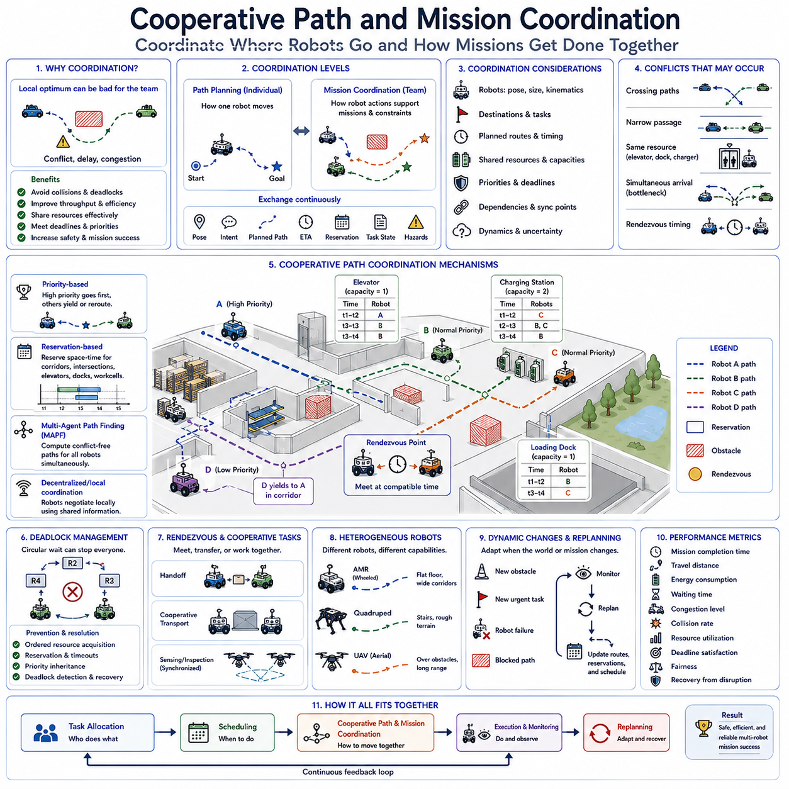{width="7.268055555555556in" height="7.268055555555556in"}

Cooperative path and mission coordination connects individual robot navigation with collective mission objectives. A path that is locally optimal for one robot may be undesirable for the team if it blocks another robot, competes for a shared resource, delays a synchronized task, or creates congestion. Coordination therefore considers how multiple robot trajectories and mission activities interact across shared space, time, resources, and task dependencies.

The distinction between path planning and mission coordination is important. Path planning determines how an individual robot moves from its current state toward a destination while satisfying mobility and safety constraints. Mission coordination operates at a broader level, determining how the movements of several robots should support assignments, schedules, priorities, cooperative tasks, and shared objectives. The two layers must exchange information continuously for effective fleet behavior.

A cooperative path is not necessarily the shortest path available to a robot. One robot may deliberately take a slightly longer route to prevent interference with a higher-priority robot or to keep a narrow corridor available for another mission. Such behavior reflects collective optimization, where individual travel cost can be traded against overall completion time, throughput, safety, resource utilization, or mission success.

Path coordination begins with information about robot poses, destinations, planned routes, timing, physical dimensions, mobility constraints, and expected motion. Robots or a coordinating system can use these data to predict where interactions may occur. Potential conflicts include intersecting trajectories, opposing movement through narrow passages, simultaneous arrival at bottlenecks, competition for docking locations, and occupancy of areas required by other tasks.

Spatial conflicts become temporal conflicts because robots occupy locations over intervals of time. Two robots may safely use the same corridor if their occupancy periods do not overlap, while physically separate paths can still interfere when they converge on the same elevator or loading station. Cooperative coordination therefore reasons about space-time trajectories rather than treating geometric paths as independent static lines on a map.

Priority mechanisms provide one method for resolving path conflicts. Robots may receive priorities according to mission urgency, deadlines, payload importance, safety conditions, or current commitments. A lower-priority robot can wait, slow down, yield, or select another route while the higher-priority robot passes. Priority rules are relatively simple, but poorly designed policies can create excessive waiting, unfairness, or starvation for repeatedly disadvantaged robots.

Reservation-based coordination provides a more explicit mechanism. Robots can reserve corridors, intersections, elevators, docking positions, work cells, or other spatial resources for particular time intervals. Before committing to a path, the coordination system checks whether the required resources are available. Reservations convert shared physical space into scheduled resources and can significantly reduce collision risk, congestion, and conflicting mission execution.

Multi-agent path finding(MAPF) provides a formal framework for computing conflict-free paths for several robots simultaneously. Each robot has a start state and goal, while the planner seeks trajectories that avoid collisions and satisfy movement constraints. Objectives may minimize total path cost, travel time, or makespan. MAPF captures the interaction among routes directly, although computational complexity can grow rapidly as robot density and environment size increase.

Practical fleets often separate global cooperative routing from local collision avoidance. A fleet or site-level planner can assign corridors, route segments, priorities, or reservations, while each robot performs local navigation and obstacle avoidance using onboard perception. This division allows strategic coordination to reduce predictable robot-robot conflicts without requiring the central system to command every motion. Local autonomy remains responsible for immediate safety and unexpected obstacles.

Mission coordination extends beyond movement because robot paths are generated to accomplish tasks rather than merely reach destinations. A delivery mission may contain pickup, transport, handoff, charging, and unloading stages. An inspection mission may require several sensing locations in a particular order. Cooperative coordination links these mission stages to robot routes so that movement decisions remain consistent with task dependencies, deadlines, and operational objectives.

Some missions require explicit rendezvous between robots. A mobile manipulator may meet an AMR to transfer an object, a UAV may guide a ground robot toward a detected target, or several robots may assemble for cooperative transport. Coordination must determine not only a meeting location but also compatible arrival times. If one robot arrives significantly earlier, waiting time and resource occupancy can reduce overall mission efficiency.

Heterogeneous robots make cooperative path planning more complex because different embodiments experience the same environment differently. An AMR may require smooth accessible corridors, a quadruped may traverse stairs or rough terrain, and a UAV may bypass ground obstacles entirely. Cooperative coordination can exploit these differences by assigning embodiment-appropriate routes while identifying locations where robots must interact, transfer tasks, or exchange physical resources.

Shared infrastructure creates important coupling between path and mission decisions. Elevators, automatic doors, charging stations, loading zones, transfer stations, and narrow passages have limited capacity and may require explicit scheduling. Selecting a route without considering these resources can produce a nominally short path with long waiting time. Mission coordination should therefore evaluate effective travel cost, including expected contention and resource availability.

Congestion management becomes increasingly important as robot density grows. If many robots independently choose the same shortest corridor, the resulting traffic can reduce throughput and increase delay. Cooperative routing can distribute traffic across alternative paths, impose directional flow, meter entry into crowded areas, or temporarily modify route costs. The objective shifts from minimizing each robot\'s distance toward maintaining efficient movement of the entire fleet.

Deadlock represents a more severe coordination problem. Several robots may each wait for a resource occupied or requested by another robot, producing a circular dependency from which none can progress. Preventive strategies include ordered resource acquisition, reservation protocols, priority inheritance, restricted entry rules, and deadlock-aware routing. Detection mechanisms can also identify stalled dependency cycles and trigger controlled rerouting or reservation release.

Communication supports coordination by sharing pose, intent, planned path, task state, estimated arrival time, reservations, and detected hazards. However, cooperative execution should not assume perfect communication. Messages can be delayed or lost, and robots can become temporarily disconnected. Coordination protocols therefore need timestamps, reservation expiration, uncertainty margins, conservative fallback behavior, and local safety mechanisms that remain effective when shared information becomes stale.

Dynamic changes require cooperative paths and missions to be revised during execution. A newly detected obstacle may block a planned corridor, an urgent task may change robot priorities, or a failed robot may leave work unfinished. The coordination system can update routes, schedules, reservations, and assignments together rather than treating each change independently. This creates a feedback loop between mission planning, path planning, execution monitoring, and replanning.

Replanning should consider disruption cost. Changing one robot\'s path may force several other robots to modify reservations or arrival times, producing cascading effects across the fleet. A coordination system can therefore preserve stable portions of the current plan while modifying only the affected region, robots, or future time horizon. This principle supports responsive adaptation without continuously destabilizing already feasible cooperative behavior.

Centralized, distributed, and hybrid coordination architectures can all support cooperative missions. Centralized systems can exploit a global view to optimize traffic and mission interactions, while distributed systems allow robots to negotiate conflicts using local information. Hybrid architectures can use fleet-level planning for assignments, priorities, and shared resources while robots coordinate immediate interactions locally, combining global consistency with responsiveness and resilience.

Cooperative coordination can also exploit shared perception and fleet knowledge. Robots may exchange obstacle observations, traversability information, congestion estimates, hazards, and successful route experience. A route blocked for one robot can therefore be avoided by others before they encounter the same condition. Shared world information gradually transforms path coordination from reactive conflict resolution toward predictive planning based on collective experience.

The quality of cooperative path and mission coordination should be evaluated at both individual and collective levels. Useful measures include mission completion time, travel distance, energy consumption, waiting time, congestion, collision rate, resource utilization, deadline satisfaction, fairness, and recovery from disruption. Optimizing only individual path length can produce poor fleet performance, so evaluation must reflect whether coordinated behavior improves the overall physical mission.

Cooperative path and mission coordination ultimately forms the bridge between task-level decisions and synchronized physical movement. Task allocation determines responsibilities, scheduling establishes temporal commitments, and cooperative path coordination ensures that robots can physically execute those commitments without incompatible interactions. Within multi-robot Physical AI, these mechanisms allow heterogeneous robots, shared infrastructure, and local autonomy to operate as one coordinated physical system rather than as isolated autonomous machines.

협력 경로 및 임무 조정(Cooperative Path and Mission Coordination)은 개별 로봇의 내비게이션(Individual Robot Navigation)을 집단 임무 목표(Collective Mission Objective)와 연결한다. 하나의 로봇에게 로컬 최적(Local Optimal)인 경로라도 다른 로봇의 이동을 차단하거나, 공유 자원(Shared Resource)을 경쟁적으로 사용하거나, 동기화 작업(Synchronized Task)을 지연시키거나, 혼잡(Congestion)을 발생시킨다면 팀 전체에는 바람직하지 않을 수 있다. 따라서 조정은 여러 로봇의 궤적과 임무 활동이 공유 공간, 시간, 자원, 작업 의존관계에서 어떻게 상호작용하는지를 고려한다.

경로 계획(Path Planning)과 임무 조정(Mission Coordination)의 차이를 구분하는 것은 중요하다. 경로 계획은 개별 로봇이 이동성 및 안전 제약조건을 만족하면서 현재 상태에서 목적지까지 어떻게 이동할지를 결정한다. 임무 조정은 보다 상위 수준에서 여러 로봇의 이동이 작업 할당, 스케줄, 우선순위, 협력 작업, 공유 목표를 어떻게 지원해야 하는지를 결정한다. 효과적인 플릿 동작(Fleet Behavior)을 위해서는 두 계층이 지속적으로 정보를 교환해야 한다.

협력 경로(Cooperative Path)가 반드시 개별 로봇이 선택할 수 있는 최단 경로(Shortest Path)일 필요는 없다. 하나의 로봇이 우선순위가 높은 다른 로봇과의 간섭을 방지하거나 좁은 통로를 다른 임무에 사용할 수 있도록 의도적으로 조금 더 긴 경로를 선택할 수 있다. 이러한 동작은 개별 이동 비용과 전체 완료시간, 처리량(Throughput), 안전성, 자원 활용률(Resource Utilization), 임무 성공 사이에서 절충하는 집단 최적화(Collective Optimization)를 반영한다.

경로 조정(Path Coordination)은 로봇의 자세(Pose), 목적지, 계획 경로, 시간 정보, 물리적 크기, 이동성 제약조건, 예상 움직임에 대한 정보에서 시작한다. 로봇 또는 조정 시스템은 이러한 데이터를 이용하여 상호작용이 발생할 수 있는 위치를 예측한다. 잠재적인 충돌에는 교차하는 궤적, 좁은 통로에서의 반대 방향 이동, 병목구간(Bottleneck)에 대한 동시 도착, 도킹 위치(Docking Location) 경쟁, 다른 작업에 필요한 영역의 점유 등이 포함된다.

로봇은 일정 시간 동안 특정 위치를 점유하기 때문에 공간 충돌(Spatial Conflict)은 시간 충돌(Temporal Conflict)로 연결된다. 두 로봇의 점유시간이 겹치지 않는다면 동일한 통로를 안전하게 사용할 수 있지만, 물리적으로 분리된 경로라도 동일한 엘리베이터나 적재 스테이션(Loading Station)으로 수렴하면 서로 간섭할 수 있다. 따라서 협력 조정은 기하학적 경로를 독립적인 정적 선으로 취급하기보다 시공간 궤적(Space-Time Trajectory)을 함께 추론한다.

우선순위 메커니즘(Priority Mechanism)은 경로 충돌을 해결하는 하나의 방법을 제공한다. 로봇은 임무 긴급성, 마감시간, 탑재물 중요도, 안전 조건, 현재 작업 약속 등에 따라 우선순위를 부여받을 수 있다. 낮은 우선순위의 로봇은 높은 우선순위 로봇이 통과하는 동안 대기하거나, 속도를 낮추거나, 양보하거나, 다른 경로를 선택할 수 있다. 우선순위 규칙은 비교적 단순하지만 잘못 설계하면 과도한 대기, 불공정성(Unfairness), 특정 로봇의 기아상태(Starvation)를 발생시킬 수 있다.

예약 기반 조정(Reservation-Based Coordination)은 보다 명시적인 메커니즘을 제공한다. 로봇은 특정 시간 구간 동안 통로, 교차로, 엘리베이터, 도킹 위치, 작업 셀(Work Cell) 또는 기타 공간 자원을 예약할 수 있다. 경로를 확정하기 전에 조정 시스템은 필요한 자원을 사용할 수 있는지 확인한다. 예약은 공유 물리 공간을 스케줄링된 자원(Scheduled Resource)으로 변환하여 충돌 위험, 혼잡, 상충하는 임무 실행을 크게 줄일 수 있다.

다중 에이전트 경로 탐색(Multi-Agent Path Finding, MAPF)은 여러 로봇의 충돌 없는 경로를 동시에 계산하기 위한 공식적인 프레임워크를 제공한다. 각 로봇에는 시작 상태와 목표가 주어지며, 플래너는 충돌을 방지하고 이동 제약조건을 만족하는 궤적을 탐색한다. 목적함수는 전체 경로 비용, 이동시간 또는 총 완료시간(Makespan)을 최소화하도록 구성할 수 있다. MAPF는 경로 사이의 상호작용을 직접적으로 다룰 수 있지만 로봇 밀도와 환경 규모가 증가하면 계산 복잡도가 빠르게 증가할 수 있다.

실제 플릿에서는 글로벌 협력 라우팅(Global Cooperative Routing)과 로컬 충돌 회피(Local Collision Avoidance)를 분리하는 경우가 많다. 플릿 또는 사이트 수준 플래너(Fleet or Site-Level Planner)가 통로, 경로 구간, 우선순위, 예약 등을 할당하고, 각 로봇은 온보드 인식(Onboard Perception)을 이용하여 로컬 내비게이션과 장애물 회피를 수행할 수 있다. 이러한 역할 분리는 중앙 시스템이 모든 움직임을 직접 명령하지 않으면서도 전략적 조정을 통해 예측 가능한 로봇 간 충돌을 줄일 수 있도록 한다. 로컬 자율성(Local Autonomy)은 즉각적인 안전과 예상하지 못한 장애물에 대응한다.

임무 조정(Mission Coordination)은 로봇 경로가 단순히 목적지에 도달하기 위한 것이 아니라 작업을 수행하기 위해 생성되므로 이동 이상의 영역으로 확장된다. 배송 임무에는 픽업, 운송, 인계(Handoff), 충전, 하역 단계가 포함될 수 있다. 검사 임무에서는 여러 센싱 위치를 특정 순서로 방문해야 할 수 있다. 협력 조정은 이러한 임무 단계를 로봇 경로와 연결하여 이동 결정이 작업 의존관계, 마감시간, 운영 목표와 일관성을 유지하도록 한다.

일부 임무에서는 로봇 사이의 명시적인 랑데부(Rendezvous)가 필요하다. 모바일 매니퓰레이터(Mobile Manipulator)가 물체를 전달받기 위해 자율이동로봇(AMR)과 만날 수 있고, 무인항공기(UAV)가 감지된 목표물까지 지상 로봇을 유도할 수 있으며, 여러 로봇이 협력 운송을 위해 한 위치에 집결할 수도 있다. 조정 시스템은 만남의 위치뿐만 아니라 서로 호환되는 도착시간도 결정해야 한다. 한 로봇이 지나치게 일찍 도착하면 대기시간과 자원 점유가 증가하여 전체 임무 효율성이 감소할 수 있다.

이기종 로봇(Heterogeneous Robot)은 서로 다른 체화(Embodiment)가 동일한 환경을 다르게 경험하기 때문에 협력 경로 계획을 더욱 복잡하게 만든다. 자율이동로봇은 평탄하고 접근 가능한 통로를 필요로 할 수 있고, 사족보행 로봇(Quadruped)은 계단이나 거친 지형을 통과할 수 있으며, 무인항공기는 지상 장애물을 완전히 우회할 수 있다. 협력 조정은 이러한 차이를 활용하여 체화에 적합한 경로를 할당하는 동시에 로봇이 상호작용하거나 작업 또는 물리적 자원을 전달해야 하는 위치를 식별할 수 있다.

공유 인프라(Shared Infrastructure)는 경로와 임무 의사결정 사이에 중요한 결합 관계를 형성한다. 엘리베이터, 자동문, 충전소, 적재 구역, 환승 스테이션(Transfer Station), 좁은 통로는 제한된 용량을 가지며 명시적인 스케줄링이 필요할 수 있다. 이러한 자원을 고려하지 않고 경로를 선택하면 명목상으로는 짧지만 실제로는 긴 대기시간을 발생시키는 경로가 생성될 수 있다. 따라서 임무 조정은 예상 자원 경쟁(Resource Contention)과 가용성을 포함한 실질적인 이동 비용을 평가해야 한다.

로봇 밀도가 증가할수록 혼잡 관리(Congestion Management)의 중요성도 증가한다. 많은 로봇이 독립적으로 동일한 최단 통로를 선택하면 발생하는 교통량 때문에 처리량이 감소하고 지연이 증가할 수 있다. 협력 라우팅(Cooperative Routing)은 트래픽을 대체 경로로 분산하고, 방향성 이동 흐름을 적용하며, 혼잡 영역으로의 진입을 제한하거나 일시적으로 경로 비용을 변경할 수 있다. 목표는 개별 로봇의 이동거리를 최소화하는 것에서 전체 플릿의 효율적인 이동을 유지하는 것으로 확장된다.

교착상태(Deadlock)는 더욱 심각한 조정 문제를 나타낸다. 여러 로봇이 각각 다른 로봇이 점유하거나 요청한 자원을 기다리면서 순환 의존관계(Circular Dependency)가 형성되면 어느 로봇도 진행할 수 없는 상태가 발생할 수 있다. 예방 전략에는 순서화된 자원 획득(Ordered Resource Acquisition), 예약 프로토콜, 우선순위 상속(Priority Inheritance), 제한 진입 규칙, 교착상태 인식 라우팅(Deadlock-Aware Routing) 등이 있다. 감지 메커니즘은 정체된 의존관계 순환을 식별하고 통제된 재라우팅이나 예약 해제를 실행할 수도 있다.

통신(Communication)은 자세, 의도(Intent), 계획 경로, 작업 상태, 예상 도착시간, 예약, 감지된 위험 정보를 공유함으로써 조정을 지원한다. 그러나 협력 실행은 완벽한 통신을 가정해서는 안 된다. 메시지가 지연되거나 손실될 수 있으며 로봇의 연결이 일시적으로 끊어질 수도 있다. 따라서 조정 프로토콜에는 타임스탬프(Timestamp), 예약 만료(Reservation Expiration), 불확실성 여유(Uncertainty Margin), 보수적인 폴백 동작(Conservative Fallback Behavior), 공유 정보가 오래되더라도 동작할 수 있는 로컬 안전 메커니즘이 필요하다.

동적 변화(Dynamic Change)가 발생하면 실행 과정에서 협력 경로와 임무를 수정해야 한다. 새롭게 감지된 장애물이 계획된 통로를 차단하거나, 긴급 작업이 로봇의 우선순위를 변경하거나, 고장난 로봇이 미완료 작업을 남길 수 있다. 조정 시스템은 각각의 변화를 독립적으로 처리하는 대신 경로, 스케줄, 예약, 작업 할당을 함께 업데이트할 수 있다. 이를 통해 임무 계획(Mission Planning), 경로 계획, 실행 모니터링(Execution Monitoring), 재계획(Replanning)을 연결하는 피드백 루프(Feedback Loop)를 구성한다.

재계획은 계획 변경으로 인한 중단 비용(Disruption Cost)을 고려해야 한다. 하나의 로봇 경로를 변경하면 다른 여러 로봇의 예약이나 도착시간까지 수정해야 하여 플릿 전체에 연쇄적인 영향(Cascading Effect)을 발생시킬 수 있다. 따라서 조정 시스템은 현재 계획에서 안정적인 부분을 유지하면서 영향을 받은 영역, 로봇 또는 미래 시간 구간만 수정할 수 있다. 이러한 원칙은 이미 실행 가능한 협력 동작을 지속적으로 불안정하게 만들지 않으면서 변화에 신속하게 적응하도록 한다.

중앙집중형(Centralized), 분산형(Distributed), 하이브리드 조정 아키텍처(Hybrid Coordination Architecture)는 모두 협력 임무를 지원할 수 있다. 중앙집중형 시스템은 글로벌 관점(Global View)을 이용하여 교통과 임무 상호작용을 최적화할 수 있고, 분산형 시스템에서는 로봇이 로컬 정보를 이용하여 충돌을 협상할 수 있다. 하이브리드 아키텍처는 플릿 수준 계획에서 작업 할당, 우선순위, 공유 자원을 관리하면서 로봇들이 즉각적인 상호작용을 로컬에서 조정하도록 하여 글로벌 일관성과 대응성 및 복원력(Resilience)을 결합할 수 있다.

협력 조정은 공유 인식(Shared Perception)과 플릿 지식(Fleet Knowledge)을 활용할 수도 있다. 로봇은 장애물 관측, 주행 가능성 정보(Traversability Information), 혼잡 추정값, 위험 요소, 성공적인 경로 경험 등을 교환할 수 있다. 하나의 로봇이 발견한 차단 경로를 다른 로봇들이 직접 도달하기 전에 회피할 수 있다. 이러한 공유 세계 정보(Shared World Information)는 경로 조정을 단순한 반응형 충돌 해결(Reactive Conflict Resolution)에서 집단 경험을 활용하는 예측형 계획(Predictive Planning)으로 발전시킨다.

협력 경로 및 임무 조정의 품질은 개별 수준과 집단 수준 모두에서 평가해야 한다. 유용한 지표에는 임무 완료시간, 이동거리, 에너지 소비, 대기시간, 혼잡, 충돌률(Collision Rate), 자원 활용률, 마감시간 충족도, 공정성(Fairness), 장애 상황에서의 복구 성능 등이 포함된다. 개별 경로 길이만 최적화하면 플릿 전체의 성능이 저하될 수 있으므로 조정된 동작이 전체 물리적 임무를 얼마나 향상시키는지를 반영하여 평가해야 한다.

협력 경로 및 임무 조정(Cooperative Path and Mission Coordination)은 궁극적으로 작업 수준 의사결정(Task-Level Decision)과 동기화된 물리적 이동(Synchronized Physical Movement)을 연결하는 역할을 한다. 작업 할당은 각 로봇의 책임을 결정하고, 스케줄링은 시간적 작업 약속을 설정하며, 협력 경로 조정은 로봇들이 서로 양립할 수 없는 상호작용 없이 이러한 작업 약속을 물리적으로 실행할 수 있도록 한다. 다중 로봇 피지컬 AI(Multi-Robot Physical AI)에서 이러한 메커니즘은 이기종 로봇, 공유 인프라, 로컬 자율성을 서로 독립적인 자율 기계가 아니라 하나의 조정된 물리 시스템(Coordinated Physical System)으로 동작하도록 만든다.

## 03.11. Dynamic Reallocation and Replanning

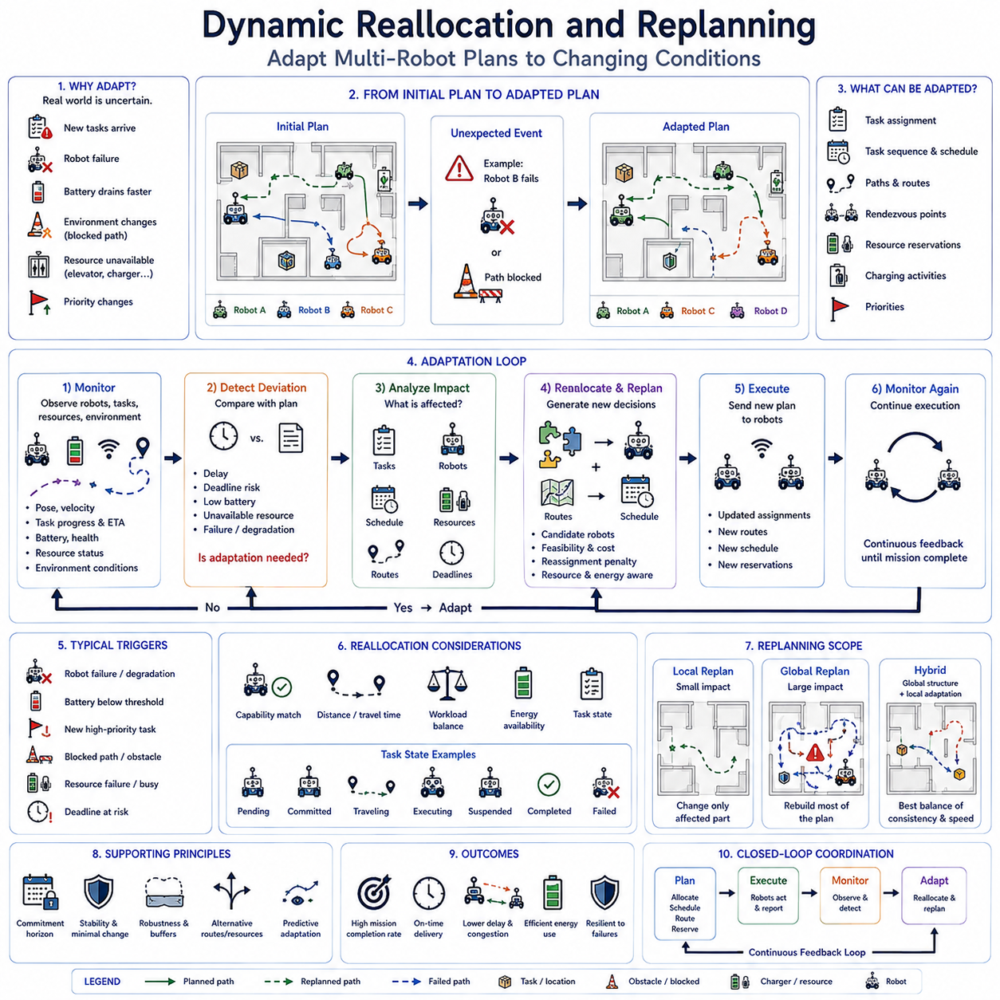{width="7.268055555555556in" height="7.268055555555556in"}

Dynamic reallocation and replanning enable a multi-robot system to modify previously established task assignments, schedules, routes, and resource commitments when operating conditions change. A plan that was feasible and efficient when initially generated may become unsuitable during execution. Rather than treating the original plan as fixed, the coordination system continuously compares planned behavior with actual mission progress and adapts decisions when meaningful deviations occur.

The need for reallocation arises because physical robot missions operate under uncertainty. New tasks may arrive unexpectedly, existing tasks may change priority, robots may fail, batteries may deplete faster than predicted, and execution may require more time than estimated. Environmental changes such as blocked corridors, congestion, hazardous areas, or unavailable infrastructure can also invalidate previous assumptions and require coordinated modifications across the fleet.

Dynamic reallocation focuses primarily on changing responsibility for tasks. If a robot becomes unavailable or can no longer satisfy a deadline, one or more of its pending tasks can be transferred to other robots. Replanning is broader and may modify task sequences, schedules, routes, rendezvous points, charging activities, and shared-resource reservations. In practice, reallocation and replanning are tightly coupled because changing task ownership usually changes several downstream execution decisions.

Execution monitoring provides the information required to detect when adaptation is necessary. The system can observe robot pose, velocity, battery state, task progress, estimated completion time, health status, communication quality, resource occupancy, and environmental conditions. These observations are compared with expected states and schedules. Significant differences become events that can trigger local correction, partial replanning, or fleet-level reoptimization.

Not every deviation should trigger replanning. Small variations in travel or execution time are normal in physical environments, and continuously rebuilding plans can create unstable behavior. Trigger conditions can therefore use thresholds based on delay, battery reserve, task priority, route feasibility, resource conflict, or predicted deadline violation. Adaptation is initiated when the expected benefit of changing the plan exceeds the operational cost of disturbing existing commitments.

Robot failure is one of the clearest triggers for dynamic reallocation. When a robot becomes unable to continue, its unfinished and future tasks must be identified and returned to the available task pool. Candidate robots are then evaluated according to capability, location, workload, energy, and temporal feasibility. Tasks already physically completed should remain unchanged, while partially executed tasks require explicit state information so another robot can safely continue or restart them.

Partial degradation requires more nuanced reasoning than complete failure. A mobile manipulator may lose manipulation capability while retaining navigation, or a robot may lose a sensor while remaining suitable for transportation. Instead of removing the entire platform from the mission, capability-aware reallocation can update its available functions. Tasks requiring the failed capability are reassigned, while compatible tasks remain with the degraded robot, preserving useful fleet capacity.

Battery state can similarly trigger adaptation. A robot assigned several future tasks may consume more energy than predicted because of congestion, terrain, payload, or repeated obstacle avoidance. The planner can insert charging, transfer selected tasks to other robots, or redirect the robot toward a nearer charger. Energy-aware replanning must consider charger availability and future demand so that solving one robot\'s energy problem does not create a fleet-wide charging bottleneck.

New task arrival is another common cause of dynamic replanning in continuously operating fleets. An urgent delivery, inspection request, safety event, or recovery task may need to be inserted into an existing schedule. The system evaluates whether an available robot can accept the task directly or whether existing assignments should be rearranged. High-priority tasks can displace lower-priority work when mission policy permits, while reassignment penalties limit unnecessary disruption.

Changes in the environment can invalidate routes without invalidating task assignments. A blocked corridor, closed door, temporary safety zone, congestion event, or unavailable elevator may prevent a robot from following its planned path. Local navigation may first attempt an alternative route. If the resulting delay affects deadlines, shared-resource reservations, or downstream tasks, the event can propagate upward and trigger schedule or task-level replanning.

Shared-resource failures can create broader consequences. If an elevator, charger, docking station, loading zone, or transfer station becomes unavailable, several robots may simultaneously lose access to planned mission resources. Replanning must identify all affected commitments rather than modifying only the first robot that encounters the problem. Alternative resources, revised reservation times, rerouting, or task reassignment can then be coordinated to avoid cascading conflicts.

Reallocation should account for the current execution state of every task. Tasks that have not started are relatively easy to transfer, whereas tasks in progress may involve payload possession, physical setup, partially completed inspection, or reserved infrastructure. The system therefore benefits from explicit task states such as pending, committed, traveling, executing, suspended, completed, or failed. State-aware replanning prevents duplicated work and unsafe ownership transitions.

Reassignment cost is important because changing responsibility is not free. A robot may already be traveling toward a task, carrying required material, or holding a resource reservation. Transferring the task can waste previous motion and create additional communication, scheduling, and coordination overhead. Reallocation objectives can include switching penalties so that a new assignment is accepted only when its expected improvement justifies abandoning the current commitment.

Plan stability can be protected through commitment horizons or frozen zones. Decisions scheduled for the immediate future can be locked unless a critical event makes them infeasible, while tasks farther into the future remain flexible. This prevents frequent optimization cycles from repeatedly changing actions that robots are already preparing to execute. Rolling-horizon replanning then concentrates computational effort on decisions where adaptation remains operationally practical.

Local replanning is appropriate when a disturbance affects only a small portion of the mission. A robot can avoid an obstacle, modify its task sequence, or negotiate a new reservation without recomputing the complete fleet plan. Global replanning becomes appropriate when disturbances create widespread interactions, such as multiple robot failures, major infrastructure loss, severe congestion, or the arrival of several high-priority tasks. Selecting the appropriate replanning scope is essential for scalability.

Centralized replanning can use a global view of robots, tasks, schedules, and resources to identify coordinated solutions. However, dependence on a central planner can introduce communication and computation bottlenecks. Distributed replanning allows robots to negotiate task transfers, exchange estimated arrival times, and resolve local resource conflicts using nearby information. Hybrid systems combine fleet-level optimization with robot-level adaptation to balance global consistency and rapid response.

Uncertainty should be incorporated before disruption occurs rather than addressed only after failure. Robust plans can include temporal buffers, alternative routes, reserve energy, redundant capabilities, and backup resource options. Such flexibility may slightly reduce nominal efficiency but can significantly improve recovery performance. Dynamic replanning then exploits these prepared alternatives instead of constructing every response from scratch after an unexpected event.

Predictive replanning goes beyond reacting to confirmed failures. Trends in battery consumption, increasing travel delay, declining communication quality, or repeated localization uncertainty can indicate that a future commitment is becoming risky. The system can estimate the probability of deadline violation or resource conflict and adapt before the problem becomes critical. This converts replanning from purely reactive recovery into anticipatory mission management.

The effectiveness of dynamic reallocation can be measured through recovery time, mission completion rate, deadline satisfaction, reassignment frequency, additional travel, energy overhead, task interruption, and computational latency. Stability metrics are also important because a system that constantly changes plans may appear adaptive while performing inefficiently. Evaluation should therefore consider both the ability to recover from disruption and the cost introduced by the recovery process itself.

Dynamic reallocation and replanning ultimately create a closed-loop coordination process for multi-robot Physical AI. Task allocation, scheduling, path planning, and resource reservation generate an executable plan; robots execute and report their actual states; monitoring detects deviations and predicts risks; and adaptation modifies only the necessary decisions before execution continues. This continuous feedback structure allows a robot fleet to remain coordinated despite uncertainty, failures, changing missions, and dynamic physical environments.

동적 재할당 및 재계획(Dynamic Reallocation and Replanning)은 운영 조건이 변화할 때 다중 로봇 시스템(Multi-Robot System)이 이전에 수립된 작업 할당, 스케줄, 경로, 자원 사용 약속(Resource Commitment)을 수정할 수 있도록 한다. 처음 계획을 생성했을 당시에는 실행 가능하고 효율적이었던 계획도 실제 실행 과정에서는 적합하지 않게 될 수 있다. 따라서 조정 시스템(Coordination System)은 초기 계획을 고정된 것으로 취급하지 않고 계획된 동작과 실제 임무 진행 상황을 지속적으로 비교하며 의미 있는 편차가 발생하면 의사결정을 적응적으로 수정한다.

물리적 로봇 임무는 불확실성(Uncertainty) 속에서 운영되기 때문에 재할당(Reallocation)이 필요하다. 새로운 작업이 예상하지 못하게 발생하거나 기존 작업의 우선순위가 변경될 수 있으며, 로봇이 고장나거나 배터리가 예상보다 빠르게 소모되고 작업 실행시간이 추정값보다 길어질 수도 있다. 또한 통로 차단, 혼잡, 위험 구역, 인프라 사용 불가와 같은 환경 변화도 기존 계획의 가정을 무효화하여 플릿(Fleet) 전체에 걸친 조정된 수정을 요구할 수 있다.

동적 재할당(Dynamic Reallocation)은 주로 작업에 대한 책임을 변경하는 데 초점을 둔다. 로봇을 더 이상 사용할 수 없거나 마감시간(Deadline)을 충족할 수 없게 되면 해당 로봇의 대기 중인 작업 일부 또는 전체를 다른 로봇으로 이전할 수 있다. 재계획(Replanning)은 보다 광범위한 개념으로 작업 순서, 스케줄, 경로, 랑데부 지점(Rendezvous Point), 충전 활동, 공유 자원 예약(Shared-Resource Reservation)까지 수정할 수 있다. 실제로 작업 소유권의 변경은 여러 후속 실행 결정에 영향을 주기 때문에 재할당과 재계획은 긴밀하게 결합된다.

실행 모니터링(Execution Monitoring)은 적응이 필요한 시점을 감지하기 위한 정보를 제공한다. 시스템은 로봇의 자세(Pose), 속도, 배터리 상태, 작업 진행률, 예상 완료시간, 상태 건전성(Health Status), 통신 품질, 자원 점유 상태, 환경 조건 등을 관찰할 수 있다. 이러한 관측값을 예상 상태 및 스케줄과 비교하며, 중요한 차이가 발견되면 로컬 수정(Local Correction), 부분 재계획(Partial Replanning), 또는 플릿 수준 재최적화(Fleet-Level Reoptimization)를 실행하는 이벤트가 될 수 있다.

모든 편차가 재계획을 발생시켜야 하는 것은 아니다. 물리적 환경에서는 이동시간이나 작업 실행시간의 작은 변화가 정상적으로 발생하며, 이러한 변화마다 계획을 다시 생성하면 불안정한 동작이 발생할 수 있다. 따라서 트리거 조건(Trigger Condition)은 지연시간, 배터리 여유, 작업 우선순위, 경로 실행 가능성, 자원 충돌, 예상 마감시간 위반 등의 임계값(Threshold)을 사용할 수 있다. 계획 변경으로 얻을 수 있는 예상 이익이 기존 작업 약속을 변경하는 운영 비용보다 클 때 적응을 시작할 수 있다.

로봇 장애(Robot Failure)는 동적 재할당을 발생시키는 가장 명확한 트리거 중 하나이다. 로봇이 작업을 계속 수행할 수 없게 되면 미완료 작업과 미래 작업을 식별하여 사용 가능한 작업 풀(Task Pool)로 반환해야 한다. 이후 능력, 위치, 작업 부하, 에너지, 시간적 실행 가능성(Temporal Feasibility)에 따라 후보 로봇을 평가한다. 이미 물리적으로 완료된 작업은 변경하지 않아야 하며, 부분적으로 실행된 작업은 다른 로봇이 안전하게 이어서 수행하거나 다시 시작할 수 있도록 명시적인 상태 정보가 필요하다.

부분적 성능 저하(Partial Degradation)는 완전한 장애보다 더욱 세밀한 판단을 요구한다. 모바일 매니퓰레이터(Mobile Manipulator)가 조작 능력을 상실하더라도 내비게이션 기능은 유지할 수 있으며, 특정 센서를 사용할 수 없게 된 로봇도 운송 작업에는 여전히 적합할 수 있다. 전체 플랫폼을 임무에서 제거하는 대신 능력 인식 재할당(Capability-Aware Reallocation)을 통해 현재 사용 가능한 기능을 업데이트할 수 있다. 손상된 능력이 필요한 작업만 재할당하고 호환 가능한 작업은 해당 로봇에 유지함으로써 유용한 플릿 능력을 보존할 수 있다.

배터리 상태(Battery State)도 적응을 발생시킬 수 있다. 여러 미래 작업이 할당된 로봇이 혼잡, 지형, 탑재물, 반복적인 장애물 회피 등으로 예상보다 많은 에너지를 소비할 수 있다. 플래너(Planner)는 충전 작업을 추가하거나 일부 작업을 다른 로봇으로 이전하고, 해당 로봇을 가까운 충전기로 이동시킬 수 있다. 에너지 인식 재계획(Energy-Aware Replanning)은 하나의 로봇에서 발생한 에너지 문제를 해결하는 과정에서 플릿 전체의 충전 병목현상(Charging Bottleneck)이 발생하지 않도록 충전기 가용성과 미래 수요를 함께 고려해야 한다.

새로운 작업의 발생(New Task Arrival)은 지속적으로 운영되는 플릿에서 동적 재계획이 필요한 또 다른 일반적인 원인이다. 긴급 배송, 검사 요청, 안전 이벤트, 복구 작업 등이 기존 스케줄에 삽입되어야 할 수 있다. 시스템은 가용 로봇이 새로운 작업을 직접 수락할 수 있는지 또는 기존 작업 할당을 재구성해야 하는지를 평가한다. 임무 정책(Mission Policy)이 허용한다면 높은 우선순위 작업이 낮은 우선순위 작업을 대체할 수 있으며, 재할당 페널티(Reassignment Penalty)를 통해 불필요한 변경을 제한할 수 있다.

환경 변화(Environmental Change)는 작업 할당 자체를 무효화하지 않으면서 경로를 사용할 수 없게 만들 수 있다. 차단된 통로, 폐쇄된 출입문, 임시 안전 구역, 혼잡 이벤트, 사용할 수 없는 엘리베이터 등이 로봇의 계획된 경로를 방해할 수 있다. 먼저 로컬 내비게이션(Local Navigation)이 대체 경로를 탐색할 수 있다. 그러나 새로운 경로로 인한 지연이 마감시간, 공유 자원 예약, 후속 작업에 영향을 준다면 해당 이벤트가 상위 계층으로 전달되어 스케줄 또는 작업 수준의 재계획을 발생시킬 수 있다.

공유 자원 장애(Shared-Resource Failure)는 보다 광범위한 영향을 발생시킬 수 있다. 엘리베이터, 충전기, 도킹 스테이션(Docking Station), 적재 구역, 환승 스테이션(Transfer Station)을 사용할 수 없게 되면 여러 로봇이 동시에 계획된 임무 자원에 접근하지 못할 수 있다. 재계획 시스템은 문제를 처음 발견한 로봇만 수정하는 것이 아니라 영향을 받는 모든 작업 약속을 식별해야 한다. 이후 대체 자원, 수정된 예약시간, 재라우팅(Rerouting), 작업 재할당을 조정하여 연쇄적인 충돌(Cascading Conflict)을 방지할 수 있다.

재할당은 각 작업의 현재 실행 상태(Current Execution State)를 고려해야 한다. 아직 시작하지 않은 작업은 비교적 쉽게 이전할 수 있지만 실행 중인 작업에는 탑재물 소유, 물리적 설정, 부분적으로 완료된 검사, 예약된 인프라 등이 포함될 수 있다. 따라서 시스템은 대기(Pending), 확정(Committed), 이동 중(Traveling), 실행 중(Executing), 중단(Suspended), 완료(Completed), 실패(Failed)와 같은 명시적인 작업 상태를 사용하는 것이 유용하다. 상태 인식 재계획(State-Aware Replanning)은 작업 중복과 안전하지 않은 소유권 이전을 방지한다.

책임 변경 자체에도 비용이 발생하기 때문에 재할당 비용(Reassignment Cost)을 고려하는 것이 중요하다. 로봇이 이미 작업 위치로 이동하고 있거나 필요한 물체를 운반하고 있으며 특정 자원을 예약한 상태일 수 있다. 작업을 다른 로봇으로 이전하면 기존 이동이 낭비되고 추가적인 통신, 스케줄링, 조정 비용이 발생할 수 있다. 따라서 재할당 목적함수에는 전환 페널티(Switching Penalty)를 포함하여 예상되는 개선 효과가 현재 작업 약속을 포기하는 비용보다 충분히 큰 경우에만 새로운 할당을 선택하도록 할 수 있다.

계획 안정성(Plan Stability)은 작업 약속 호라이즌(Commitment Horizon) 또는 고정 구간(Frozen Zone)을 통해 보호할 수 있다. 가까운 미래에 실행될 결정은 중요한 이벤트로 인해 실행 불가능해지지 않는 한 잠그고, 더 먼 미래의 작업은 유연하게 유지할 수 있다. 이를 통해 반복적인 최적화 과정에서 로봇이 이미 실행을 준비하고 있는 작업이 계속 변경되는 것을 방지한다. 롤링 호라이즌 재계획(Rolling-Horizon Replanning)은 실제로 변경 가능한 의사결정에 계산 자원을 집중할 수 있다.

로컬 재계획(Local Replanning)은 장애가 전체 임무의 작은 부분에만 영향을 줄 때 적합하다. 로봇은 전체 플릿 계획을 다시 계산하지 않고 장애물을 회피하거나 작업 순서를 수정하거나 새로운 자원 예약을 협상할 수 있다. 반면 여러 로봇의 장애, 주요 인프라 손실, 심각한 혼잡, 다수의 고우선순위 작업 발생과 같이 광범위한 상호작용이 발생하면 글로벌 재계획(Global Replanning)이 적합하다. 적절한 재계획 범위를 선택하는 것은 시스템 확장성(Scalability)을 위해 중요하다.

중앙집중형 재계획(Centralized Replanning)은 로봇, 작업, 스케줄, 자원에 대한 글로벌 관점(Global View)을 활용하여 조정된 해결책을 탐색할 수 있다. 그러나 중앙 플래너에 대한 의존성은 통신 및 계산 병목현상을 발생시킬 수 있다. 분산형 재계획(Distributed Replanning)은 로봇들이 작업 이전을 협상하고, 예상 도착시간을 교환하며, 주변 정보를 이용하여 로컬 자원 충돌을 해결하도록 한다. 하이브리드 시스템(Hybrid System)은 플릿 수준 최적화와 로봇 수준 적응을 결합하여 글로벌 일관성과 빠른 대응 사이의 균형을 제공한다.

불확실성은 장애가 발생한 이후에만 대응하기보다 장애가 발생하기 전부터 계획에 반영해야 한다. 강건 계획(Robust Plan)은 시간 버퍼(Temporal Buffer), 대체 경로, 예비 에너지(Reserve Energy), 중복 능력(Redundant Capability), 백업 자원 옵션(Backup Resource Option)을 포함할 수 있다. 이러한 유연성은 명목상의 효율성을 약간 감소시킬 수 있지만 복구 성능을 크게 향상시킬 수 있다. 동적 재계획은 예상하지 못한 사건이 발생한 이후 모든 대응책을 처음부터 생성하는 대신 미리 준비된 대안을 활용할 수 있다.

예측형 재계획(Predictive Replanning)은 이미 발생한 장애에 반응하는 것보다 한 단계 더 발전된 접근법이다. 배터리 소비 추세, 증가하는 이동 지연, 통신 품질 저하, 반복되는 위치추정 불확실성(Localization Uncertainty)은 미래의 작업 약속이 위험해지고 있음을 나타낼 수 있다. 시스템은 마감시간 위반이나 자원 충돌 가능성을 예측하여 문제가 심각해지기 전에 계획을 수정할 수 있다. 이를 통해 재계획은 단순한 반응형 복구(Reactive Recovery)에서 선제적 임무 관리(Anticipatory Mission Management)로 발전한다.

동적 재할당의 효과는 복구시간(Recovery Time), 임무 완료율, 마감시간 충족률, 재할당 빈도, 추가 이동거리, 에너지 오버헤드(Energy Overhead), 작업 중단, 계산 지연시간(Computational Latency) 등을 통해 측정할 수 있다. 계획을 지속적으로 변경하는 시스템은 표면적으로는 높은 적응성을 가진 것처럼 보이지만 실제로는 비효율적일 수 있으므로 안정성 지표(Stability Metric) 역시 중요하다. 따라서 평가는 장애에서 복구할 수 있는 능력뿐만 아니라 복구 과정 자체에서 발생하는 비용까지 함께 고려해야 한다.

동적 재할당 및 재계획(Dynamic Reallocation and Replanning)은 궁극적으로 다중 로봇 피지컬 AI(Multi-Robot Physical AI)를 위한 폐루프 조정 과정(Closed-Loop Coordination Process)을 구성한다. 작업 할당, 스케줄링, 경로 계획, 자원 예약을 통해 실행 가능한 계획을 생성하고, 로봇은 실제 작업을 수행하면서 자신의 상태를 보고하며, 모니터링 시스템은 계획과 실제 실행의 편차 및 미래 위험을 감지한다. 이후 적응 메커니즘(Adaptation Mechanism)이 필요한 의사결정만 수정한 뒤 실행을 계속한다. 이러한 지속적인 피드백 구조(Continuous Feedback Structure)를 통해 로봇 플릿은 불확실성, 장애, 변화하는 임무, 동적인 물리 환경에서도 조정된 상태를 유지할 수 있다.

## 03.12. Failure and Robot Loss Reallocation

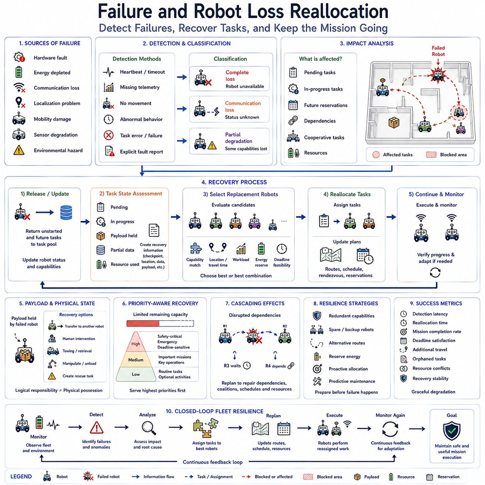{width="7.268055555555556in" height="7.268055555555556in"}

Failure and robot loss reallocation addresses how a multi-robot system preserves mission continuity when one or more robots can no longer perform their assigned responsibilities. Robot loss may result from hardware faults, depleted energy, communication failure, localization problems, mobility damage, sensor degradation, or environmental hazards. The coordination system must detect the loss, identify affected work, and redistribute responsibilities without unnecessarily disrupting unaffected robots.

Failure handling begins with reliable detection and classification. A robot may explicitly report an internal fault, while the fleet coordinator may infer failure from missing heartbeats, abnormal telemetry, lack of movement, repeated task errors, or communication timeout. Detection should distinguish complete robot loss from temporary disconnection or partial degradation because these conditions require different responses. Prematurely declaring a healthy robot lost can create duplicate execution and conflicting task ownership.

A complete robot loss means that the platform should no longer receive executable tasks until its operational state is restored. Its pending assignments, future reservations, scheduled activities, and mission responsibilities must be examined. Tasks that have not started can normally return directly to the allocation pool, while work already in progress requires additional reasoning about physical state, partial completion, payload possession, and whether another robot can safely continue from the interruption point.

Partial failure is different because the robot may retain useful capabilities. A mobile manipulator with a failed arm may still perform navigation or transportation, while a robot with a damaged camera may remain suitable for tasks that do not require visual perception. Capability-aware failure handling updates the robot\'s available capability profile and reallocates only incompatible tasks. This preserves remaining fleet capacity rather than unnecessarily removing a partially functional platform.

Communication loss requires special treatment because the physical robot may still be operational even when the coordinator cannot observe it. Immediately reallocating its task could cause two robots to perform the same work or enter the same workspace. Systems can use communication timeouts, lease-based task ownership, heartbeat monitoring, and conservative safety states. Task ownership is released only when predefined conditions indicate that reassignment is safer than continuing to wait.

The state of the interrupted task determines how easily responsibility can be transferred. A pending task has little recovery complexity, whereas a robot traveling toward a task may already have consumed time and energy. An executing robot may have moved an object, opened equipment, reserved infrastructure, or partially collected data. Reallocation therefore requires task state checkpoints that describe what has been completed and what remains before another robot assumes responsibility.

Physical payload ownership is especially important for transportation missions. If a failed robot is carrying an item, assigning the delivery task to another robot does not automatically restore execution because the payload may remain physically attached to the failed platform. Recovery may require a transfer operation, human intervention, towing, manipulation, or creation of a separate rescue task. The task model must therefore distinguish logical responsibility from the physical location and custody of mission objects.

After failure detection, affected tasks can be returned to an available task pool or explicitly marked for recovery. Candidate replacement robots are evaluated using capability compatibility, current location, workload, battery reserve, travel time, deadlines, and access to required resources. The closest robot is not necessarily the best replacement. A more distant robot may provide the necessary sensor, payload capacity, manipulation capability, or energy reserve required to complete the interrupted mission safely.

Task priority becomes important when the remaining fleet has insufficient capacity to absorb all work from the lost robot. Safety-critical, emergency, or deadline-sensitive tasks may be reassigned first, while routine activities are postponed, cancelled, or degraded. Priority-aware recovery ensures that limited surviving capacity is directed toward the most important mission objectives instead of attempting to preserve every original assignment regardless of operational consequences.

Failure can also invalidate schedules beyond the tasks directly assigned to the lost robot. Other robots may have been waiting for a handoff, synchronized observation, cooperative transport, or shared operation involving that platform. Removing one participant can therefore break task dependencies and team commitments. The recovery process must trace these relationships and determine whether another robot can substitute, a new coalition should be formed, or the dependent task must be postponed.

Cooperative tasks are particularly sensitive to robot loss because feasibility depends on the combined capabilities of several participants. If one robot in a transport team fails, the remaining robots may no longer provide sufficient lifting capacity or geometric support. Coalition reformation searches for a replacement robot whose capabilities complement the surviving team. The resulting team may require new rendezvous times, formations, paths, and synchronization constraints before execution can resume.

Resource reservations associated with the failed robot should also be reconsidered. Charger slots, elevators, corridors, docking stations, loading zones, or work cells reserved for the unavailable robot may need to be released so that other robots can use them. Conversely, replacement robots may require new reservations at different times. Failure recovery therefore modifies resource schedules together with task assignments rather than treating resource commitments as independent from robot availability.

Path planning may change significantly after robot loss. A failed platform can become a stationary obstacle, particularly in narrow corridors, intersections, elevators, or docking areas. Other robots may need to reroute around it even after its tasks have been successfully reassigned. The fleet map can temporarily represent the disabled robot and any associated payload as obstacles until recovery personnel or another robot removes them from the operational environment.

Robot loss can produce cascading effects when replacement decisions consume capacity needed elsewhere. Reassigning a highly capable robot to an urgent recovery task may delay its original work, which can then violate another deadline or resource reservation. Recovery planning should therefore evaluate downstream consequences rather than solving each abandoned task independently. Fleet-level reoptimization can be necessary when the failure substantially changes available capacity or mission structure.

Local recovery is preferable when the failure has limited impact. If another nearby robot can accept one abandoned task without disturbing its existing commitments, a complete fleet schedule does not need to be rebuilt. Global reallocation becomes appropriate when a critical robot fails, several tasks become orphaned, cooperative teams are disrupted, or available fleet capacity becomes constrained. Matching replanning scope to failure impact reduces unnecessary computation and operational instability.

Plan stability remains important during failure recovery. A disruptive event already introduces uncertainty, and changing unrelated assignments can amplify the disturbance. Frozen commitments, reassignment penalties, and limited recovery horizons can preserve work that remains feasible while modifying only affected tasks and dependent activities. The objective is not necessarily to reproduce the original optimal performance but to restore a stable and executable mission as quickly as possible.

Redundancy improves resilience before failure occurs. Critical capabilities can be distributed across several robots so that the loss of one platform does not eliminate a unique mission function. Spare capacity, backup robots, alternative routes, duplicated sensing capabilities, and reserve energy can all support recovery. Such redundancy may reduce nominal utilization efficiency, but it increases the probability that important tasks remain executable after unexpected robot loss.

Failure-aware allocation can proactively reduce vulnerability by considering capability scarcity. Assigning every specialized task to one unique robot may create a single point of failure. The allocator can preserve backup capability or avoid overloading critical platforms when mission reliability is important. Reliability estimates, historical failure rates, health indicators, and remaining useful life predictions can also influence which robots receive tasks before any actual failure occurs.

Predictive maintenance and health monitoring extend this principle by identifying degradation before complete loss. Rising motor temperature, abnormal vibration, battery deterioration, communication instability, or repeated perception faults can indicate increasing failure risk. The fleet can gradually transfer future tasks away from the affected robot and route it toward maintenance. Planned withdrawal is generally less disruptive than emergency reallocation after an unexpected breakdown.

Recovery performance should be evaluated using metrics such as failure detection latency, reallocation time, mission completion rate, number of orphaned tasks, additional travel, deadline violations, resource conflicts, and recovery stability. Another important measure is graceful degradation, which describes how effectively the fleet maintains essential mission functions as robot capacity decreases. A resilient system should lose performance progressively rather than experience complete mission collapse after a single failure.

Failure and robot loss reallocation ultimately transforms robot faults from isolated platform problems into coordinated fleet-level recovery decisions. Detection identifies unavailable capabilities, task-state tracking determines what remains unfinished, reallocation transfers responsibilities, and replanning repairs schedules, paths, teams, and resource reservations. Through redundancy, capability awareness, stable recovery, and continuous monitoring, multi-robot Physical AI can preserve safe and useful mission execution even when individual robots are lost.

고장 및 로봇 손실 재할당(Failure and Robot Loss Reallocation)은 하나 이상의 로봇이 더 이상 할당된 책임을 수행할 수 없을 때 다중 로봇 시스템(Multi-Robot System)이 임무 연속성(Mission Continuity)을 유지하는 방법을 다룬다. 로봇 손실은 하드웨어 고장, 에너지 고갈, 통신 장애, 위치추정 문제, 이동 시스템 손상, 센서 성능 저하 또는 환경적 위험으로 인해 발생할 수 있다. 조정 시스템(Coordination System)은 손실을 감지하고 영향을 받는 작업을 식별한 후, 영향을 받지 않은 로봇의 작업을 불필요하게 방해하지 않으면서 책임을 재분배해야 한다.

고장 처리는 신뢰성 높은 감지 및 분류(Failure Detection and Classification)에서 시작한다. 로봇이 내부 고장을 명시적으로 보고할 수도 있고, 플릿 조정기(Fleet Coordinator)가 하트비트(Heartbeat) 누락, 비정상 텔레메트리(Abnormal Telemetry), 이동 정지, 반복적인 작업 오류 또는 통신 타임아웃(Communication Timeout)을 통해 고장을 추론할 수도 있다. 감지 시스템은 완전한 로봇 손실과 일시적인 연결 단절 또는 부분적 성능 저하를 구분해야 하는데, 각각 서로 다른 대응이 필요하기 때문이다. 정상적인 로봇을 성급하게 손실된 것으로 판단하면 작업 중복 실행과 작업 소유권(Task Ownership) 충돌이 발생할 수 있다.

완전한 로봇 손실(Complete Robot Loss)은 해당 플랫폼의 운영 상태가 복구될 때까지 더 이상 실행 가능한 작업을 할당해서는 안 된다는 것을 의미한다. 해당 로봇의 대기 중인 작업, 미래 자원 예약, 예정된 활동, 임무 책임을 검토해야 한다. 아직 시작되지 않은 작업은 일반적으로 작업 할당 풀(Allocation Pool)로 직접 반환할 수 있지만, 이미 진행 중인 작업은 물리적 상태, 부분 완료 여부, 탑재물 소유 상태, 그리고 다른 로봇이 중단 지점부터 안전하게 이어서 수행할 수 있는지를 추가적으로 판단해야 한다.

부분 고장(Partial Failure)은 로봇이 여전히 유용한 능력을 유지할 수 있다는 점에서 완전한 고장과 다르다. 팔이 고장난 모바일 매니퓰레이터(Mobile Manipulator)라도 내비게이션이나 운송 작업은 수행할 수 있으며, 카메라가 손상된 로봇도 시각 인식이 필요하지 않은 작업에는 여전히 적합할 수 있다. 능력 인식 고장 처리(Capability-Aware Failure Handling)는 로봇의 사용 가능한 능력 프로파일(Capability Profile)을 업데이트하고 호환되지 않는 작업만 재할당한다. 이를 통해 부분적으로 기능하는 플랫폼을 불필요하게 제거하지 않고 남아 있는 플릿 능력을 보존할 수 있다.

통신 손실(Communication Loss)은 플릿 조정기가 로봇을 관찰할 수 없더라도 실제 물리적 로봇은 계속 정상적으로 동작하고 있을 수 있기 때문에 특별한 처리가 필요하다. 작업을 즉시 재할당하면 두 로봇이 동일한 작업을 수행하거나 같은 작업 공간으로 진입하는 상황이 발생할 수 있다. 시스템은 통신 타임아웃, 임대 기반 작업 소유권(Lease-Based Task Ownership), 하트비트 모니터링(Heartbeat Monitoring), 보수적인 안전 상태(Conservative Safety State)를 사용할 수 있다. 작업 소유권은 미리 정의된 조건을 통해 계속 기다리는 것보다 재할당하는 것이 안전하다고 판단될 때만 해제되어야 한다.

중단된 작업의 상태(Interrupted Task State)는 책임을 얼마나 쉽게 이전할 수 있는지를 결정한다. 대기 중인 작업(Pending Task)은 복구 복잡도가 낮지만, 작업 위치로 이동 중인 로봇은 이미 시간과 에너지를 소비했을 수 있다. 작업을 실행 중인 로봇은 객체를 이동시키거나 장비를 개방하거나 인프라를 예약하거나 데이터 일부를 이미 수집했을 수 있다. 따라서 재할당에는 완료된 부분과 남아 있는 부분을 설명하는 작업 상태 체크포인트(Task State Checkpoint)가 필요하며, 이를 통해 다른 로봇이 책임을 안전하게 인수할 수 있다.

물리적 탑재물 소유권(Physical Payload Ownership)은 특히 운송 임무에서 중요하다. 고장난 로봇이 물체를 운반하고 있다면 배송 작업을 다른 로봇에 할당하는 것만으로는 실행을 복구할 수 없다. 탑재물이 고장난 플랫폼에 물리적으로 남아 있을 수 있기 때문이다. 복구에는 물체 전달(Transfer Operation), 사람의 개입(Human Intervention), 견인(Towing), 조작(Manipulation), 또는 별도의 구조 작업(Rescue Task) 생성이 필요할 수 있다. 따라서 작업 모델은 논리적인 작업 책임과 임무 객체의 물리적 위치 및 보관 상태(Custody)를 구분해야 한다.

고장을 감지한 이후 영향을 받는 작업은 사용 가능한 작업 풀로 반환하거나 명시적으로 복구 대상(Recovery Task)으로 표시할 수 있다. 대체 후보 로봇은 능력 적합성(Capability Compatibility), 현재 위치, 작업 부하, 배터리 여유, 이동시간, 마감시간, 필요한 자원에 대한 접근성을 기준으로 평가한다. 가장 가까운 로봇이 반드시 최적의 대체 로봇인 것은 아니다. 더 멀리 있는 로봇이라도 중단된 임무를 안전하게 완료하는 데 필요한 센서, 탑재 용량, 조작 능력 또는 에너지 여유를 제공할 수 있다.

남아 있는 플릿의 용량이 손실된 로봇의 모든 작업을 수용하기에 충분하지 않을 경우 작업 우선순위(Task Priority)가 중요해진다. 안전 중요 작업(Safety-Critical Task), 긴급 작업 또는 마감시간에 민감한 작업을 먼저 재할당하고 일상적인 작업은 연기, 취소 또는 축소할 수 있다. 우선순위 인식 복구(Priority-Aware Recovery)는 원래의 모든 작업 할당을 무조건 유지하려고 하기보다 제한된 잔여 플릿 능력을 가장 중요한 임무 목표에 집중하도록 한다.

로봇 고장은 손실된 로봇에 직접 할당된 작업뿐만 아니라 다른 스케줄까지 무효화할 수 있다. 다른 로봇이 해당 플랫폼과의 인계(Handoff), 동기화된 관측(Synchronized Observation), 협력 운송(Cooperative Transport), 공유 작업을 기다리고 있을 수 있기 때문이다. 한 참여 로봇의 제거는 작업 의존관계(Task Dependency)와 팀 작업 약속(Team Commitment)을 깨뜨릴 수 있다. 따라서 복구 과정에서는 이러한 관계를 추적하여 다른 로봇이 대체할 수 있는지, 새로운 연합(Coalition)을 구성해야 하는지, 또는 의존 작업을 연기해야 하는지를 결정해야 한다.

협력 작업(Cooperative Task)은 실행 가능성이 여러 참여 로봇의 결합된 능력에 의존하기 때문에 로봇 손실에 특히 민감하다. 협력 운송 팀의 로봇 하나가 고장나면 남아 있는 로봇만으로 충분한 리프팅 능력이나 기하학적 지지(Geometric Support)를 제공하지 못할 수 있다. 연합 재구성(Coalition Reformation)은 기존 팀의 능력을 보완할 수 있는 대체 로봇을 탐색한다. 새롭게 구성된 팀은 작업을 다시 시작하기 전에 새로운 랑데부 시간, 대형(Formation), 경로, 동기화 제약조건을 설정해야 할 수 있다.

고장난 로봇과 관련된 자원 예약(Resource Reservation)도 다시 검토해야 한다. 사용할 수 없는 로봇이 예약했던 충전기 슬롯, 엘리베이터, 통로, 도킹 스테이션(Docking Station), 적재 구역, 작업 셀(Work Cell)은 다른 로봇이 사용할 수 있도록 해제해야 할 수 있다. 반대로 대체 로봇에는 다른 시간대의 새로운 예약이 필요할 수 있다. 따라서 고장 복구는 자원 사용 약속을 로봇 가용성과 독립적으로 취급하지 않고 작업 할당과 함께 자원 스케줄을 수정한다.

로봇 손실 이후에는 경로 계획(Path Planning)도 크게 변경될 수 있다. 특히 좁은 통로, 교차로, 엘리베이터 또는 도킹 영역에서 고장난 플랫폼 자체가 정지 장애물(Stationary Obstacle)이 될 수 있다. 작업이 성공적으로 재할당된 이후에도 다른 로봇들은 해당 로봇을 우회하도록 경로를 변경해야 할 수 있다. 복구 인력이나 다른 로봇이 고장난 플랫폼을 제거할 때까지 플릿 지도(Fleet Map)는 고장난 로봇과 관련 탑재물을 임시 장애물로 표현할 수 있다.

대체 작업 할당이 다른 곳에서 필요한 플릿 능력을 소비하면 로봇 손실은 연쇄 효과(Cascading Effect)를 발생시킬 수 있다. 높은 능력을 가진 로봇을 긴급 복구 작업에 재할당하면 해당 로봇의 원래 작업이 지연되고, 그 결과 또 다른 마감시간이나 자원 예약을 위반할 수 있다. 따라서 복구 계획은 각각의 미할당 작업을 독립적으로 해결하기보다 후속 영향(Downstream Consequence)을 평가해야 한다. 고장으로 인해 가용 플릿 능력이나 임무 구조가 크게 변화한 경우에는 플릿 수준 재최적화(Fleet-Level Reoptimization)가 필요할 수 있다.

고장의 영향이 제한적인 경우에는 로컬 복구(Local Recovery)가 바람직하다. 인근의 다른 로봇이 기존 작업 약속을 방해하지 않고 하나의 미할당 작업을 수락할 수 있다면 전체 플릿 스케줄을 다시 생성할 필요가 없다. 반면 핵심 로봇이 고장나거나 여러 작업이 소유자를 잃거나 협력 팀이 붕괴되거나 가용 플릿 용량이 부족해지는 경우에는 글로벌 재할당(Global Reallocation)이 적합하다. 고장의 영향 범위에 맞추어 재계획 범위를 선택하면 불필요한 계산과 운영 불안정성을 줄일 수 있다.

고장 복구 과정에서도 계획 안정성(Plan Stability)은 중요하다. 장애 이벤트 자체가 이미 불확실성을 발생시키므로 관련 없는 작업 할당까지 변경하면 혼란이 더욱 커질 수 있다. 고정된 작업 약속(Frozen Commitment), 재할당 페널티(Reassignment Penalty), 제한된 복구 호라이즌(Limited Recovery Horizon)을 사용하여 여전히 실행 가능한 작업은 유지하고 영향을 받은 작업과 의존 활동만 수정할 수 있다. 목표는 반드시 원래의 최적 성능을 복원하는 것이 아니라 안정적이고 실행 가능한 임무를 가능한 한 빠르게 회복하는 것이다.

중복성(Redundancy)은 실제 고장이 발생하기 전에 복원력(Resilience)을 향상시킨다. 핵심 능력을 여러 로봇에 분산하면 하나의 플랫폼을 잃더라도 고유한 임무 기능 전체가 사라지는 것을 방지할 수 있다. 예비 용량(Spare Capacity), 백업 로봇(Backup Robot), 대체 경로, 중복 센싱 능력(Redundant Sensing Capability), 예비 에너지(Reserve Energy) 등을 복구에 활용할 수 있다. 이러한 중복성은 명목상 자원 활용 효율을 낮출 수 있지만 예상하지 못한 로봇 손실 이후에도 중요한 작업을 실행할 수 있는 가능성을 높인다.

고장 인식 작업 할당(Failure-Aware Allocation)은 능력 희소성(Capability Scarcity)을 고려하여 고장에 대한 취약성을 사전에 줄일 수 있다. 모든 특수 작업을 하나의 고유한 로봇에 집중시키면 단일 장애점(Single Point of Failure)이 형성될 수 있다. 임무 신뢰성(Mission Reliability)이 중요한 경우 작업 할당기는 백업 능력을 보존하거나 핵심 플랫폼에 과도하게 작업을 집중시키지 않을 수 있다. 실제 고장이 발생하기 전부터 신뢰성 추정값, 과거 고장률, 상태 건전성 지표(Health Indicator), 잔여 수명 예측(Remaining Useful Life Prediction)을 작업 할당에 반영할 수도 있다.

예지 정비(Predictive Maintenance)와 상태 모니터링(Health Monitoring)은 완전한 로봇 손실이 발생하기 전에 성능 저하를 식별함으로써 이러한 원리를 확장한다. 모터 온도 상승, 비정상 진동, 배터리 열화, 통신 불안정, 반복적인 인식 오류는 고장 위험이 증가하고 있음을 나타낼 수 있다. 플릿은 해당 로봇의 미래 작업을 점진적으로 다른 로봇으로 이전하고 유지보수 위치로 이동시킬 수 있다. 계획된 철수(Planned Withdrawal)는 일반적으로 예상하지 못한 고장 이후의 긴급 재할당보다 운영 중단을 줄일 수 있다.

복구 성능(Recovery Performance)은 고장 감지 지연시간(Failure Detection Latency), 재할당 시간, 임무 완료율, 소유자를 잃은 작업(Orphaned Task)의 수, 추가 이동거리, 마감시간 위반, 자원 충돌, 복구 안정성(Recovery Stability) 등의 지표를 이용하여 평가할 수 있다. 또 다른 중요한 지표는 점진적 성능 저하(Graceful Degradation)로, 로봇 가용 능력이 감소할 때 플릿이 핵심 임무 기능을 얼마나 효과적으로 유지하는지를 나타낸다. 복원력이 높은 시스템은 하나의 로봇 고장으로 전체 임무가 붕괴하기보다 가용 능력 감소에 따라 성능이 점진적으로 저하되어야 한다.

고장 및 로봇 손실 재할당(Failure and Robot Loss Reallocation)은 궁극적으로 개별 플랫폼의 고장을 조정된 플릿 수준 복구 의사결정(Coordinated Fleet-Level Recovery Decision)으로 변환한다. 고장 감지는 사용할 수 없게 된 능력을 식별하고, 작업 상태 추적(Task-State Tracking)은 완료되지 않은 작업을 판단하며, 재할당은 책임을 다른 로봇으로 이전하고, 재계획은 스케줄, 경로, 팀 구성, 자원 예약을 복구한다. 중복성, 능력 인식(Capability Awareness), 안정적인 복구, 지속적인 모니터링을 결합함으로써 다중 로봇 피지컬 AI(Multi-Robot Physical AI)는 개별 로봇이 손실되는 상황에서도 안전하고 유용한 임무 실행을 지속할 수 있다.

## 03.13. Learning Based Task Allocation

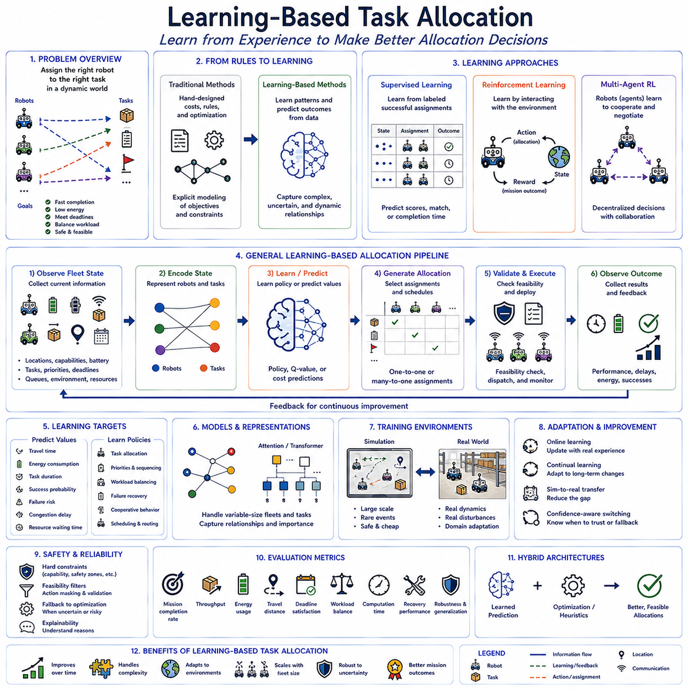{width="7.268055555555556in" height="7.268055555555556in"}

Learning-based task allocation applies data-driven decision making to determine which robots should perform which tasks in a multi-robot system. Instead of relying only on manually designed cost functions, fixed rules, or exact optimization models, the allocator learns useful assignment patterns from experience. This allows allocation policies to capture complex relationships among robot capability, workload, location, task priority, energy, environment, and expected mission outcome.

Traditional allocation methods normally require designers to explicitly define objectives and constraints. Distance, execution time, energy, deadline penalties, or capability compatibility can be mathematically encoded and optimized. Learning-based approaches complement this process by estimating quantities that are difficult to model accurately or by learning allocation decisions directly. They are especially useful when robot-task interactions are nonlinear, uncertain, dynamic, or difficult to represent analytically.

Supervised learning can support allocation when historical examples of successful assignments are available. Training data may contain robot states, task requirements, environmental context, selected assignments, and resulting performance. A model learns the relationship between these inputs and desirable allocation decisions. During deployment, it can predict suitable robot-task matches, assignment scores, expected completion times, or other values that guide the allocation process.

The quality of supervised allocation depends strongly on the demonstrations or labels used for training. Labels may originate from human operators, expert policies, optimization algorithms, simulation, or previously executed fleet missions. If training examples represent only a narrow operating condition, the learned model may reproduce those limitations. Dataset diversity should therefore include different fleet compositions, workloads, task distributions, environments, failures, and resource conditions.

Reinforcement learning(RL) provides another approach in which allocation is learned through interaction rather than direct assignment labels. The system observes a fleet state, selects allocation actions, and receives rewards according to mission outcomes. Rewards can represent completion time, throughput, energy consumption, deadline satisfaction, travel cost, workload balance, or failure recovery. Repeated interaction allows the policy to improve assignment behavior according to long-term cumulative performance.

The state representation used by an RL allocator can include robot positions, capabilities, battery levels, current tasks, queues, task locations, priorities, deadlines, and shared-resource availability. Actions may assign one task to one robot, allocate groups of tasks, modify schedules, or select among candidate assignments. The reward function then determines which behaviors are encouraged, making reward design a central part of learning useful and operationally safe allocation policies.

Multi-agent reinforcement learning(MARL) extends this idea by allowing individual robots or local coordinators to learn allocation and negotiation behavior. Each agent may observe only part of the fleet state while interacting with other agents whose decisions also affect the outcome. MARL is therefore relevant to distributed task allocation, where robots must learn cooperation, competition avoidance, workload sharing, and decentralized decision making without requiring complete global information at every instant.

Centralized training with decentralized execution(CTDE) is useful for learning cooperative policies. During training, the learning system can access global fleet information to estimate values or coordinate policy improvement. During deployment, each robot makes decisions using its local observations and limited communication. This approach can exploit rich information during learning while producing policies suitable for distributed execution when centralized connectivity cannot be guaranteed.

Graph-based learning provides a natural representation for multi-robot allocation. Robots and tasks can be represented as nodes, while edges encode spatial proximity, communication links, compatibility, precedence, or assignment costs. Graph neural networks(GNNs) can process fleets and task sets whose sizes vary over time. Their relational structure allows the allocator to reason about interactions rather than treating every robot-task pair as an isolated decision.

Attention mechanisms can further help identify which robots, tasks, and constraints are most relevant to an allocation decision. A robot considering a new task may need to focus on nearby tasks, competing robots, critical deadlines, or scarce capabilities rather than processing every fleet element equally. Transformer-style architectures can model these relationships and support variable-sized sets, making them attractive for complex fleet-level decision problems.

Learning can also estimate cost rather than replace the allocator itself. A model may predict travel time, energy consumption, probability of successful manipulation, congestion delay, task duration, or failure risk. These learned estimates can then be supplied to an auction, scheduler, mixed-integer optimizer, or heuristic allocator. This hybrid structure preserves explicit constraints while improving the realism of quantities that are difficult to calculate from fixed analytical models.

Learning-to-optimize approaches can accelerate computationally expensive allocation algorithms. A learned model may generate an initial assignment, rank promising candidates, predict useful search regions, or approximate solutions to repeated optimization problems. An exact or heuristic optimizer can subsequently refine and validate the proposal. The learning component therefore reduces search effort without necessarily taking complete control of mission-critical allocation decisions.

Simulation provides an important training environment because real robot allocation data can be expensive and risky to collect. Large numbers of fleet configurations, task arrivals, failures, congestion patterns, and resource conflicts can be generated synthetically. Policies can experience rare events that would be difficult to observe frequently in real operations. However, simulation must represent the important dynamics of the deployment environment well enough for learned behavior to transfer effectively.

Sim-to-real transfer becomes important when policies trained in simulation are deployed on physical fleets. Differences in travel time, sensing reliability, communication, battery behavior, human traffic, and robot dynamics can degrade performance. Domain randomization, system identification, real-world fine-tuning, conservative policies, and hybrid optimization can reduce this gap. Allocation decisions should be validated against physical feasibility even when they originate from a learned policy.

Online learning allows an allocation system to improve as the fleet accumulates operational experience. Actual task duration, energy consumption, route delay, robot reliability, and resource waiting time can update predictive models. This enables the allocator to adapt to a specific site and fleet rather than permanently relying on initial assumptions. Updates should be controlled carefully so that temporary anomalies do not destabilize a previously reliable policy.

Continual learning addresses longer-term changes such as new robot types, new tasks, altered layouts, seasonal traffic patterns, or changing production processes. The allocator must acquire new knowledge without catastrophically forgetting useful previous behavior. Replay data, regularization, modular models, or periodic retraining can preserve important capabilities. A continuously evolving fleet therefore requires learning mechanisms that adapt while maintaining operational consistency.

Generalization is a central challenge because deployment conditions rarely match the training distribution exactly. A policy trained with ten similar robots may encounter a larger heterogeneous fleet, unfamiliar tasks, or different spatial layouts. Models should therefore represent relationships and capabilities in ways that transfer across fleet sizes and configurations. Evaluation must include unseen scenarios rather than measuring performance only on environments encountered during training.

Safety and feasibility remain mandatory even when allocation is learned. A neural policy should not assign a heavy transport task to a robot with insufficient payload capacity or send a robot into an inaccessible region simply because such an action receives a high learned score. Hard constraints can be enforced through action masking, feasibility filters, safety layers, optimization-based validation, or rule-based supervisors before learned decisions are executed.

Uncertainty estimation can help determine when a learned allocator should be trusted. If the system encounters a fleet configuration or task combination far outside its training experience, prediction confidence may decrease. The allocator can then fall back to a conventional optimization method, request additional planning, or choose a conservative action. Confidence-aware switching is particularly valuable for safety-critical missions where incorrect allocation can have physical consequences.

Explainability also matters because fleet operators may need to understand why a robot received a particular task. Useful explanations can identify influential factors such as proximity, capability match, battery reserve, deadline urgency, or expected congestion. Even when the underlying policy is complex, exposing these operational reasons helps engineers diagnose unexpected behavior, validate allocation decisions, and compare learned policies with established mission rules.

Learning-based allocation should be evaluated against strong conventional baselines. Metrics can include mission completion time, throughput, energy, travel distance, deadline satisfaction, workload balance, computational latency, failure recovery, and scalability. Evaluation should also examine robustness to unseen tasks, robot loss, communication degradation, and environmental changes. Superior average performance alone is insufficient if the learned allocator becomes unreliable under disturbances.

Learning-based task allocation ultimately adds adaptation and experience to multi-robot coordination. Supervised learning can imitate successful assignments, reinforcement learning can optimize long-term mission outcomes, graph and attention models can represent robot-task relationships, and learned prediction can improve conventional optimization. Combined with explicit feasibility constraints, monitoring, and fallback mechanisms, learning enables multi-robot Physical AI to improve allocation decisions as fleets and operating environments become increasingly complex.

학습 기반 작업 할당(Learning-Based Task Allocation)은 데이터 기반 의사결정(Data-Driven Decision Making)을 적용하여 다중 로봇 시스템(Multi-Robot System)에서 어떤 로봇이 어떤 작업을 수행해야 하는지를 결정한다. 수작업으로 설계된 비용함수, 고정 규칙 또는 정확한 최적화 모델에만 의존하는 대신, 작업 할당기(Allocator)가 경험으로부터 유용한 할당 패턴을 학습한다. 이를 통해 로봇 능력, 작업 부하, 위치, 작업 우선순위, 에너지, 환경, 예상 임무 결과 사이의 복잡한 관계를 작업 할당 정책(Allocation Policy)에 반영할 수 있다.

전통적인 작업 할당 방법(Traditional Allocation Method)은 일반적으로 설계자가 목적과 제약조건을 명시적으로 정의해야 한다. 거리, 실행시간, 에너지, 마감시간 페널티, 능력 적합성(Capability Compatibility) 등을 수학적으로 표현하고 최적화할 수 있다. 학습 기반 접근법(Learning-Based Approach)은 정확하게 모델링하기 어려운 값을 추정하거나 작업 할당 결정을 직접 학습함으로써 이러한 과정을 보완한다. 특히 로봇과 작업 사이의 상호작용이 비선형적이고, 불확실하며, 동적이거나 분석적으로 표현하기 어려운 경우 유용하다.

지도학습(Supervised Learning)은 성공적인 작업 할당에 대한 과거 사례를 사용할 수 있을 때 작업 할당을 지원할 수 있다. 학습 데이터에는 로봇 상태, 작업 요구사항, 환경적 맥락, 선택된 작업 할당, 그 결과로 나타난 성능 등이 포함될 수 있다. 모델은 이러한 입력과 바람직한 할당 결정 사이의 관계를 학습한다. 실제 배치 과정에서는 적합한 로봇-작업 매칭(Robot-Task Matching), 할당 점수, 예상 완료시간 또는 작업 할당을 안내하는 다른 값을 예측할 수 있다.

지도학습 기반 작업 할당의 품질은 학습에 사용되는 시연(Demonstration)이나 레이블(Label)에 크게 의존한다. 레이블은 인간 운영자, 전문가 정책(Expert Policy), 최적화 알고리즘, 시뮬레이션 또는 이전에 수행된 플릿 임무에서 얻을 수 있다. 학습 사례가 제한된 운영 조건만 나타낸다면 학습 모델 역시 그러한 한계를 재현할 수 있다. 따라서 데이터셋 다양성(Dataset Diversity)은 서로 다른 플릿 구성, 작업 부하, 작업 분포, 환경, 고장, 자원 조건을 포함해야 한다.

강화학습(Reinforcement Learning, RL)은 직접적인 작업 할당 레이블 대신 환경과의 상호작용을 통해 작업 할당을 학습하는 또 다른 접근법이다. 시스템은 플릿 상태(Fleet State)를 관찰하고 작업 할당 행동을 선택한 다음 임무 결과에 따라 보상(Reward)을 받는다. 보상은 완료시간, 처리량(Throughput), 에너지 소비, 마감시간 충족도, 이동 비용, 작업 부하 균형, 고장 복구 등을 반영할 수 있다. 반복적인 상호작용을 통해 정책은 장기적인 누적 성능(Long-Term Cumulative Performance)을 기준으로 작업 할당 동작을 개선한다.

강화학습 작업 할당기가 사용하는 상태 표현(State Representation)에는 로봇 위치, 능력, 배터리 수준, 현재 작업, 작업 대기열, 작업 위치, 우선순위, 마감시간, 공유 자원 가용성 등이 포함될 수 있다. 행동(Action)은 하나의 작업을 하나의 로봇에 할당하거나, 여러 작업을 묶어서 할당하거나, 스케줄을 변경하거나, 후보 할당 중 하나를 선택하는 형태가 될 수 있다. 보상함수(Reward Function)는 어떤 행동을 장려할지를 결정하므로 유용하고 운영상 안전한 작업 할당 정책을 학습하는 핵심 요소가 된다.

다중 에이전트 강화학습(Multi-Agent Reinforcement Learning, MARL)은 개별 로봇 또는 로컬 조정기(Local Coordinator)가 작업 할당과 협상 동작을 학습할 수 있도록 이러한 개념을 확장한다. 각 에이전트는 플릿 상태의 일부만 관찰하면서 다른 에이전트의 의사결정에도 영향을 받는다. 따라서 MARL은 로봇이 매 순간 완전한 글로벌 정보를 요구하지 않으면서 협력, 경쟁 회피, 작업 부하 공유, 분산형 의사결정(Decentralized Decision Making)을 학습해야 하는 분산형 작업 할당(Distributed Task Allocation)에 적합하다.

중앙집중형 학습과 분산형 실행(Centralized Training with Decentralized Execution, CTDE)은 협력 정책(Cooperative Policy)을 학습하는 데 유용하다. 학습 과정에서는 글로벌 플릿 정보에 접근하여 가치(Value)를 추정하거나 정책 개선을 조정할 수 있다. 실제 배치에서는 각 로봇이 로컬 관측(Local Observation)과 제한된 통신을 이용하여 의사결정을 수행한다. 이러한 접근법은 학습 과정에서 풍부한 정보를 활용하면서 중앙 연결성이 항상 보장되지 않는 환경에서도 분산 실행에 적합한 정책을 생성할 수 있다.

그래프 기반 학습(Graph-Based Learning)은 다중 로봇 작업 할당을 표현하기 위한 자연스러운 방법을 제공한다. 로봇과 작업을 노드(Node)로 표현하고, 엣지(Edge)를 통해 공간적 근접성, 통신 연결, 적합성, 선후관계, 작업 할당 비용 등을 나타낼 수 있다. 그래프 신경망(Graph Neural Network, GNN)은 시간에 따라 크기가 달라지는 플릿과 작업 집합을 처리할 수 있다. 이러한 관계형 구조(Relational Structure)는 각각의 로봇-작업 쌍을 독립적인 결정으로 취급하지 않고 상호작용을 고려하여 추론하도록 한다.

어텐션 메커니즘(Attention Mechanism)은 작업 할당 결정에서 어떤 로봇, 작업, 제약조건이 가장 중요한지를 식별하는 데 도움을 줄 수 있다. 새로운 작업을 고려하는 로봇은 플릿의 모든 요소를 동일하게 처리하기보다 인접 작업, 경쟁 로봇, 중요한 마감시간, 희소한 능력 등에 집중해야 할 수 있다. 트랜스포머 형태의 아키텍처(Transformer-Style Architecture)는 이러한 관계와 크기가 가변적인 집합(Variable-Sized Set)을 모델링할 수 있어 복잡한 플릿 수준 의사결정 문제에 적합하다.

학습은 작업 할당기 자체를 완전히 대체하는 대신 비용(Cost)을 추정하는 데 사용할 수도 있다. 모델은 이동시간, 에너지 소비, 조작 성공 확률, 혼잡 지연, 작업시간, 고장 위험 등을 예측할 수 있다. 이렇게 학습된 추정값을 경매(Auction), 스케줄러(Scheduler), 혼합정수 최적화기(Mixed-Integer Optimizer), 휴리스틱 작업 할당기에 입력할 수 있다. 이러한 하이브리드 구조(Hybrid Structure)는 명시적인 제약조건을 유지하면서 고정된 분석 모델만으로 계산하기 어려운 값의 현실성을 향상시킨다.

학습 기반 최적화(Learning-to-Optimize) 접근법은 계산 비용이 높은 작업 할당 알고리즘을 가속할 수 있다. 학습 모델은 초기 작업 할당을 생성하거나, 가능성이 높은 후보의 순위를 결정하거나, 유용한 탐색 영역을 예측하거나, 반복적으로 발생하는 최적화 문제의 근사해를 생성할 수 있다. 이후 정확한 최적화기 또는 휴리스틱 최적화기가 제안을 개선하고 검증할 수 있다. 따라서 학습 구성요소는 임무 중요 작업의 할당을 완전히 통제하지 않으면서 탐색 비용을 줄일 수 있다.

시뮬레이션(Simulation)은 실제 로봇의 작업 할당 데이터를 수집하는 것이 비용이 많이 들고 위험할 수 있기 때문에 중요한 학습 환경을 제공한다. 다양한 플릿 구성, 작업 발생, 고장, 혼잡 패턴, 자원 충돌을 대규모로 인공 생성할 수 있다. 정책은 실제 운영에서 빈번하게 관측하기 어려운 희귀 이벤트(Rare Event)를 경험할 수 있다. 그러나 학습된 동작이 실제 환경으로 효과적으로 전이되려면 시뮬레이션이 실제 배치 환경의 중요한 동역학을 충분히 표현해야 한다.

시뮬레이션-현실 전이(Sim-to-Real Transfer)는 시뮬레이션에서 학습된 정책을 실제 물리적 플릿에 적용할 때 중요해진다. 이동시간, 센싱 신뢰성, 통신, 배터리 동작, 사람의 이동, 로봇 동역학의 차이로 인해 성능이 저하될 수 있다. 도메인 랜덤화(Domain Randomization), 시스템 식별(System Identification), 실제 환경 미세조정(Real-World Fine-Tuning), 보수적 정책, 하이브리드 최적화 등을 통해 이러한 차이를 줄일 수 있다. 학습 정책에서 생성된 작업 할당이라도 실제 실행 전에 물리적 실행 가능성(Physical Feasibility)을 검증해야 한다.

온라인 학습(Online Learning)은 플릿이 실제 운영 경험을 축적하면서 작업 할당 시스템을 지속적으로 개선할 수 있도록 한다. 실제 작업시간, 에너지 소비, 경로 지연, 로봇 신뢰성, 자원 대기시간 등을 이용하여 예측 모델을 업데이트할 수 있다. 이를 통해 작업 할당기는 초기 가정에 영구적으로 의존하지 않고 특정 사이트와 플릿 환경에 적응할 수 있다. 그러나 일시적인 이상 현상(Temporary Anomaly)이 기존의 신뢰성 높은 정책을 불안정하게 만들지 않도록 업데이트 과정을 신중하게 제어해야 한다.

지속학습(Continual Learning)은 새로운 로봇 유형, 새로운 작업, 변경된 레이아웃, 계절에 따른 이동 패턴, 변화하는 생산 프로세스와 같은 장기적인 변화에 대응한다. 작업 할당기는 기존의 유용한 동작을 치명적으로 망각(Catastrophic Forgetting)하지 않으면서 새로운 지식을 습득해야 한다. 리플레이 데이터(Replay Data), 정규화(Regularization), 모듈형 모델(Modular Model), 주기적인 재학습 등을 통해 중요한 능력을 보존할 수 있다. 지속적으로 변화하는 플릿에는 운영 일관성을 유지하면서 적응할 수 있는 학습 메커니즘이 필요하다.

일반화(Generalization)는 실제 배치 조건이 학습 데이터 분포와 정확하게 일치하는 경우가 드물기 때문에 핵심적인 과제이다. 유사한 로봇 10대로 학습된 정책이 더 큰 규모의 이기종 플릿(Heterogeneous Fleet), 학습하지 않은 작업 또는 다른 공간 레이아웃을 만나게 될 수 있다. 따라서 모델은 다양한 플릿 크기와 구성으로 전이할 수 있는 방식으로 관계와 능력을 표현해야 한다. 평가는 학습 과정에서 경험했던 환경만을 대상으로 하지 않고 새로운 시나리오(Unseen Scenario)를 포함해야 한다.

작업 할당이 학습을 통해 결정되더라도 안전성과 실행 가능성(Safety and Feasibility)은 반드시 보장되어야 한다. 신경망 정책(Neural Policy)이 높은 학습 점수를 출력했다는 이유만으로 탑재 능력이 부족한 로봇에 중량 운송 작업을 할당하거나 접근할 수 없는 영역으로 로봇을 보내서는 안 된다. 실행 전에 행동 마스킹(Action Masking), 실행 가능성 필터(Feasibility Filter), 안전 계층(Safety Layer), 최적화 기반 검증(Optimization-Based Validation), 규칙 기반 감독기(Rule-Based Supervisor)를 통해 필수 제약조건을 강제할 수 있다.

불확실성 추정(Uncertainty Estimation)은 학습 기반 작업 할당기를 언제 신뢰해야 하는지를 판단하는 데 도움을 줄 수 있다. 시스템이 학습 경험에서 크게 벗어난 플릿 구성이나 작업 조합을 만나면 예측 신뢰도가 감소할 수 있다. 이 경우 기존의 최적화 방법으로 전환하거나, 추가 계획을 요청하거나, 보수적인 행동을 선택할 수 있다. 신뢰도 인식 전환(Confidence-Aware Switching)은 잘못된 작업 할당이 물리적인 결과를 초래할 수 있는 안전 중요 임무(Safety-Critical Mission)에서 특히 중요하다.

설명 가능성(Explainability) 역시 중요하다. 플릿 운영자는 특정 로봇에 특정 작업이 할당된 이유를 이해해야 할 수 있다. 유용한 설명은 근접성, 능력 적합성, 배터리 여유, 마감시간 긴급성, 예상 혼잡과 같이 결정에 큰 영향을 준 요소를 제시할 수 있다. 내부 정책이 복잡하더라도 이러한 운영상의 이유를 제공하면 엔지니어가 예상하지 못한 동작을 진단하고 작업 할당 결정을 검증하며 학습 정책과 기존 임무 규칙을 비교하는 데 도움이 된다.

학습 기반 작업 할당은 강력한 기존 방법(Conventional Baseline)과 비교하여 평가해야 한다. 평가 지표에는 임무 완료시간, 처리량, 에너지, 이동거리, 마감시간 충족도, 작업 부하 균형, 계산 지연시간, 고장 복구 성능, 확장성(Scalability) 등이 포함될 수 있다. 또한 학습하지 않은 작업, 로봇 손실, 통신 성능 저하, 환경 변화에 대한 강건성(Robustness)을 평가해야 한다. 평균 성능이 우수하더라도 장애 상황에서 작업 할당기가 신뢰성을 잃는다면 그것만으로 충분하지 않다.

학습 기반 작업 할당(Learning-Based Task Allocation)은 궁극적으로 다중 로봇 조정(Multi-Robot Coordination)에 적응성과 경험을 추가한다. 지도학습은 성공적인 작업 할당을 모방하고, 강화학습은 장기적인 임무 결과를 최적화하며, 그래프 및 어텐션 모델은 로봇과 작업 사이의 관계를 표현하고, 학습 기반 예측은 기존 최적화 방법을 개선할 수 있다. 이러한 방법을 명시적인 실행 가능성 제약조건, 모니터링, 폴백 메커니즘(Fallback Mechanism)과 결합하면 다중 로봇 피지컬 AI(Multi-Robot Physical AI)는 플릿과 운영 환경이 복잡해질수록 경험을 활용하여 작업 할당 의사결정을 지속적으로 개선할 수 있다.

## 03.14. Task Allocation and Scheduling [w/Code]

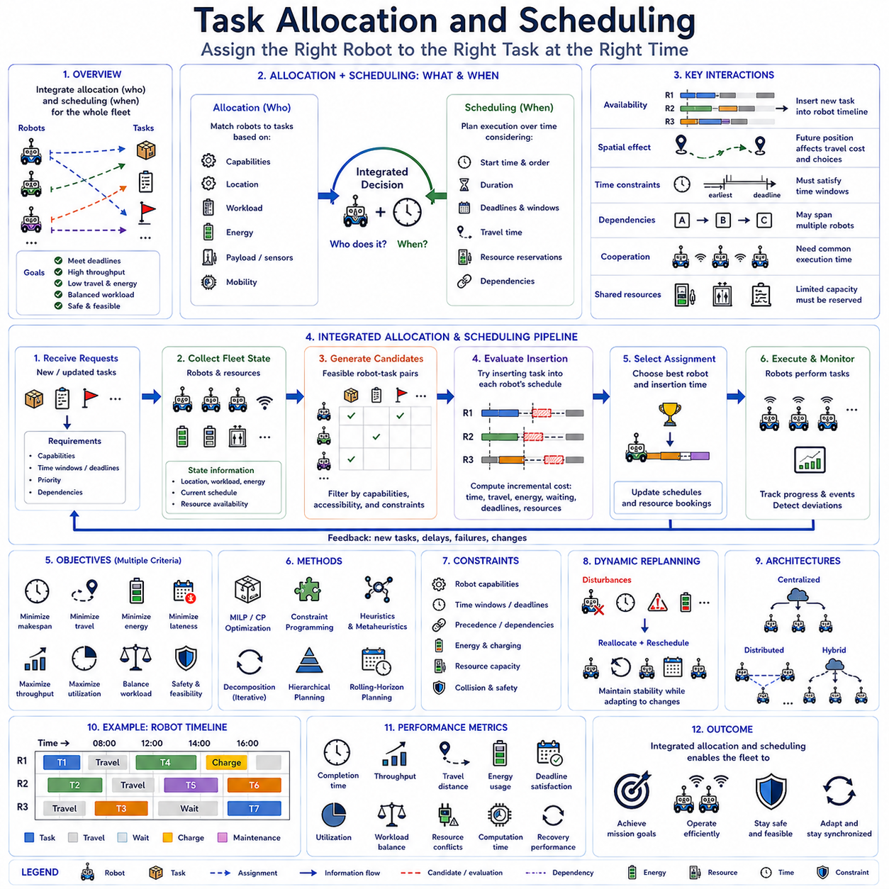{width="7.268055555555556in" height="7.268055555555556in"}

Task allocation and scheduling jointly determine which robot should perform each task and when that work should occur. Treating these decisions independently can produce assignments that appear efficient but cannot be executed within deadlines, resource limits, or travel constraints. An integrated approach evaluates robot-task compatibility together with temporal feasibility, transforming a set of mission requests into coordinated work plans for the entire multi-robot system.

Task allocation primarily addresses responsibility. It evaluates available robots according to capabilities, location, workload, energy, payload capacity, sensing, mobility, and other mission requirements. Scheduling adds execution order, start time, duration, deadlines, and resource reservations. Together they answer three connected questions: which robot performs a task, when it performs that task, and how the task fits among its other commitments.

The coupling between allocation and scheduling becomes clear when robot availability is considered. The most capable or nearest robot may already have several urgent tasks scheduled, while a slightly more distant robot may be available immediately. Selecting only by assignment cost can therefore increase mission completion time. Integrated reasoning evaluates the incremental effect of inserting a new task into each candidate robot\'s existing schedule before selecting the assignment.

Each robot can be represented by a timeline containing travel, task execution, waiting, charging, maintenance, and resource-use intervals. A newly allocated task must be inserted into this timeline without violating existing commitments. Its feasible insertion position depends on travel from the preceding task, execution duration, movement toward the following task, and any associated time windows. Allocation consequently becomes a schedule-aware insertion problem rather than simple robot selection.

Task requirements first define the feasible candidate set. A robot lacking mandatory payload capacity, manipulation ability, sensing modality, terrain access, or other required capability should be removed before scheduling alternatives are evaluated. This feasibility filtering prevents the scheduler from spending computation on physically impossible assignments and creates a clear interface between capability-aware matching and temporal optimization.

Spatial information strongly influences the combined problem because task sequences determine travel cost. Assigning tasks independently according to current robot position ignores where each robot will be after completing previously scheduled work. A task far from a robot now may lie directly beside its future route. Schedule-aware allocation therefore evaluates predicted robot states and marginal travel cost rather than relying only on instantaneous distance.

Temporal constraints further restrict feasible assignments. Tasks may have earliest start times, deadlines, time windows, periodic requirements, or precedence relationships. The allocator must determine whether a candidate robot can reach and execute the task within these limits after considering its existing schedule. An assignment is infeasible when no valid insertion preserves mandatory timing conditions, even if the robot has all required physical capabilities.

Task dependencies connect the schedules of individual activities. Pickup must precede delivery, preparation may precede manipulation, and inspection may be required before maintenance. These dependencies can span different robots, creating temporal relationships across multiple schedules. Integrated allocation and scheduling must therefore ensure that selecting different robots for dependent tasks still produces compatible completion and start times across the fleet.

Cooperative tasks introduce stronger coupling because multiple robots must become available simultaneously. A heavy transport operation may require several robots to rendezvous before execution, while coordinated sensing may require synchronized observations. The system must allocate a compatible team and identify a common feasible execution interval. Team selection cannot be separated from scheduling because a capable coalition is useless if its members cannot synchronize.

Shared resources create additional interactions among assignments and schedules. Robots may require elevators, charging stations, loading zones, docking points, work cells, or specialized tools. A robot-task assignment that is feasible in isolation can become infeasible when the required resource is already reserved. Resource-aware scheduling treats these facilities as limited-capacity assets whose availability must be coordinated with robot timelines.

Energy constraints also connect allocation with future scheduling. Assigning a distant or energy-intensive task may require charging before or after execution, changing the robot\'s availability for subsequent work. The planner can estimate energy consumption across the planned sequence and insert charging operations when necessary. This avoids assignments that appear feasible initially but leave insufficient energy to complete later commitments or safely reach a charger.

The objective of integrated allocation and scheduling is generally fleet-level performance rather than the quality of one assignment. Optimization may minimize makespan, total travel, energy, lateness, waiting, or operating cost while maximizing throughput, utilization, priority satisfaction, and workload balance. Multiple criteria are often combined because the shortest schedule may consume excessive energy, while the lowest-energy plan may fail important deadlines.

Mathematical formulations can represent assignment and scheduling decisions simultaneously. Mixed-integer linear programming(MILP), constraint programming(CP), vehicle-routing formulations, and job-shop scheduling models can encode robot selection, task ordering, start times, capacities, and resource conflicts. Such models provide a systematic way to express mission requirements, although exact optimization becomes increasingly expensive as robots, tasks, and interactions grow.

Decomposition provides a practical alternative for large systems. One stage may generate candidate assignments while another constructs feasible schedules, with information exchanged iteratively between them. A scheduler can reject an assignment or return its estimated insertion cost, allowing the allocator to reconsider alternatives. This coordinated decomposition preserves much of the benefit of integrated reasoning without solving one extremely large optimization problem.

Hierarchical architectures can separate strategic and operational time scales. A fleet-level planner may allocate major missions and establish approximate time windows, while local schedulers organize detailed robot activities. Robots can then adapt short-term execution according to delays, obstacles, or resource availability. This hierarchy reduces computational complexity while maintaining consistency between global mission objectives and local physical execution.

Rolling-horizon planning is particularly suitable when tasks arrive continuously. Instead of optimizing every future activity permanently, the system schedules work over a limited horizon using current information. Near-term assignments are committed, while later tasks remain flexible. As robots progress and new requests arrive, the horizon advances and allocation and scheduling are updated together, allowing the fleet to adapt without rebuilding its entire long-term plan continuously.

Dynamic disturbances make integrated replanning necessary. Robot failures, delayed tasks, blocked routes, urgent requests, resource outages, and unexpected energy consumption can invalidate both assignments and schedules. Correcting only the schedule may be insufficient if another robot is now a better candidate. Likewise, changing ownership without updating timing can create conflicts. Reallocation and rescheduling should therefore be coordinated as parts of the same recovery process.

Plan stability must be balanced against optimization quality during replanning. Frequent reassignment can waste travel already completed, invalidate reservations, and destabilize robot behavior. Commitment horizons, task locking, reassignment penalties, and frozen near-term schedules can preserve decisions already close to execution. Optimization can then focus on flexible future work while changing committed activities only when they become infeasible or substantially inefficient.

Uncertainty in travel and task duration further complicates the combined problem. Congestion, human activity, manipulation difficulty, localization uncertainty, and environmental conditions can cause actual execution to differ from predictions. Robust schedules can include temporal buffers, probabilistic estimates, or alternative assignments. The goal is not merely to optimize nominal performance, but to maintain feasible fleet operation when moderate disturbances occur.

Learning can support integrated allocation and scheduling without replacing explicit constraints. Predictive models can estimate travel time, task duration, energy, congestion, or probability of successful execution. Learned policies can also propose promising assignments or task sequences that optimization methods subsequently validate. Hybrid approaches combine experience-driven prediction with constraint-based planning to improve both computational efficiency and physical feasibility.

Centralized coordination can optimize assignments and schedules using a global view of robots, tasks, and resources. Distributed approaches allow robots to maintain local schedules and negotiate task transfers, timing, or resource access. Hybrid architectures can use fleet-level planning for strategic allocation while robots adapt short-term execution locally. The appropriate architecture depends on fleet scale, communication reliability, mission dynamics, and required responsiveness.

Performance evaluation should consider the combined outcome rather than allocation or scheduling quality separately. Useful metrics include mission completion time, throughput, travel distance, energy consumption, deadline satisfaction, waiting time, workload balance, robot utilization, resource conflicts, computational latency, and recovery performance. A good system produces assignments that remain efficient when converted into physically executable schedules.

Task allocation and scheduling ultimately form a unified coordination layer between mission objectives and robot execution. Capability matching determines feasible performers, allocation assigns responsibility, scheduling organizes those responsibilities across time, and routing and resource coordination make the resulting plans physically executable. Their integration enables multi-robot Physical AI to transform changing task demands into coherent fleet behavior that is feasible, efficient, adaptive, and synchronized.

작업 할당 및 스케줄링(Task Allocation and Scheduling)은 어떤 로봇이 각 작업을 수행해야 하는지와 해당 작업을 언제 수행해야 하는지를 통합적으로 결정한다. 이러한 의사결정을 서로 독립적으로 처리하면 겉보기에는 효율적이지만 마감시간, 자원 제한 또는 이동 제약조건으로 인해 실제로 실행할 수 없는 작업 할당이 생성될 수 있다. 통합 접근법(Integrated Approach)은 로봇-작업 적합성과 시간적 실행 가능성(Temporal Feasibility)을 함께 평가하여 임무 요청 집합을 전체 다중 로봇 시스템(Multi-Robot System)을 위한 조정된 작업 계획으로 변환한다.

작업 할당(Task Allocation)은 주로 작업 책임을 결정한다. 로봇의 능력, 위치, 작업 부하, 에너지, 탑재 용량, 센싱, 이동성 및 기타 임무 요구사항을 기준으로 가용 로봇을 평가한다. 스케줄링(Scheduling)은 실행 순서, 시작시간, 작업시간, 마감시간, 자원 예약을 추가한다. 두 기능을 결합하면 어떤 로봇이 작업을 수행하는지, 언제 수행하는지, 그리고 해당 작업이 로봇의 다른 작업 약속과 어떻게 조화를 이루는지라는 세 가지 연결된 질문에 답할 수 있다.

작업 할당과 스케줄링 사이의 결합 관계는 로봇 가용성(Robot Availability)을 고려하면 명확해진다. 가장 능력이 뛰어나거나 가장 가까운 로봇이 이미 여러 긴급 작업을 수행하도록 스케줄되어 있을 수 있는 반면, 조금 더 멀리 있는 로봇은 즉시 작업을 시작할 수 있다. 따라서 작업 할당 비용만을 기준으로 로봇을 선택하면 전체 임무 완료시간이 증가할 수 있다. 통합 추론(Integrated Reasoning)은 각 후보 로봇의 기존 스케줄에 새로운 작업을 삽입했을 때 발생하는 증분 영향(Incremental Effect)을 평가한 후 작업을 할당한다.

각 로봇은 이동, 작업 실행, 대기, 충전, 유지보수, 자원 사용 구간을 포함하는 시간축(Timeline)으로 표현할 수 있다. 새롭게 할당된 작업은 기존 작업 약속을 위반하지 않으면서 이 시간축에 삽입되어야 한다. 실행 가능한 삽입 위치는 이전 작업에서부터의 이동시간, 작업 실행시간, 다음 작업으로 이동하는 시간, 관련 시간 윈도(Time Window)에 따라 달라진다. 따라서 작업 할당은 단순한 로봇 선택이 아니라 스케줄 인식 삽입 문제(Schedule-Aware Insertion Problem)로 확장된다.

작업 요구사항(Task Requirement)은 먼저 실행 가능한 후보 집합을 정의한다. 필수 탑재 용량, 조작 능력, 센싱 방식, 지형 접근성 또는 기타 필요한 능력이 부족한 로봇은 스케줄 대안을 평가하기 전에 제외해야 한다. 이러한 실행 가능성 필터링(Feasibility Filtering)은 스케줄러가 물리적으로 불가능한 작업 할당을 평가하는 데 계산 자원을 소비하는 것을 방지하며, 능력 인식 매칭(Capability-Aware Matching)과 시간적 최적화(Temporal Optimization) 사이에 명확한 인터페이스를 형성한다.

작업 순서가 이동 비용을 결정하기 때문에 공간 정보(Spatial Information)는 통합 문제에 강한 영향을 미친다. 현재 로봇 위치만을 기준으로 작업을 독립적으로 할당하면 기존에 스케줄된 작업을 완료한 이후 로봇이 어디에 위치할지를 고려하지 못한다. 현재는 로봇에서 멀리 떨어진 작업이라도 미래의 계획 경로 바로 옆에 위치할 수 있다. 따라서 스케줄 인식 작업 할당(Schedule-Aware Allocation)은 현재 거리만 사용하는 대신 예측된 로봇 상태와 한계 이동 비용(Marginal Travel Cost)을 평가한다.

시간적 제약조건(Temporal Constraint)은 실행 가능한 작업 할당을 더욱 제한한다. 작업에는 가장 빠른 시작시간(Earliest Start Time), 마감시간(Deadline), 시간 윈도, 주기적 요구사항 또는 선후관계(Precedence Relationship)가 존재할 수 있다. 작업 할당기는 후보 로봇의 기존 스케줄을 고려한 후 해당 로봇이 정해진 시간 내에 작업 위치에 도달하여 작업을 수행할 수 있는지를 판단해야 한다. 로봇이 모든 필수 물리적 능력을 갖추고 있더라도 필수 시간 조건을 유지할 수 있는 유효한 삽입 위치가 없다면 해당 작업 할당은 실행 불가능하다.

작업 의존관계(Task Dependency)는 개별 활동의 스케줄을 서로 연결한다. 픽업(Pickup)은 배송보다 먼저 수행되어야 하고, 준비 작업은 조작에 앞서 수행되어야 할 수 있으며, 유지보수 전에 검사가 필요할 수 있다. 이러한 의존관계는 서로 다른 로봇의 작업에 걸쳐 존재하여 여러 스케줄 사이에 시간적 관계를 형성할 수 있다. 따라서 통합 작업 할당 및 스케줄링은 의존 작업을 서로 다른 로봇에 할당하더라도 플릿(Fleet) 전체에서 호환되는 완료시간과 시작시간이 형성되도록 보장해야 한다.

협력 작업(Cooperative Task)은 여러 로봇이 동시에 사용 가능한 상태가 되어야 하기 때문에 더욱 강한 결합 관계를 발생시킨다. 중량물 운송 작업에는 여러 로봇이 실행 전에 랑데부(Rendezvous)해야 할 수 있으며, 협력 센싱(Coordinated Sensing)은 동기화된 관측을 요구할 수 있다. 시스템은 호환 가능한 팀을 할당하는 동시에 공통으로 실행 가능한 시간 구간을 찾아야 한다. 능력 있는 연합(Coalition)이라도 구성원들이 동기화될 수 없다면 사용할 수 없기 때문에 팀 선택과 스케줄링을 분리해서는 안 된다.

공유 자원(Shared Resource)은 작업 할당과 스케줄 사이에 추가적인 상호작용을 발생시킨다. 로봇은 엘리베이터, 충전소, 적재 구역, 도킹 지점(Docking Point), 작업 셀(Work Cell), 특수 도구 등을 필요로 할 수 있다. 개별적으로 실행 가능한 로봇-작업 할당도 필요한 자원이 이미 예약되어 있다면 실행 불가능해질 수 있다. 자원 인식 스케줄링(Resource-Aware Scheduling)은 이러한 시설을 제한된 용량을 가진 자산으로 취급하고 로봇의 시간축과 함께 가용성을 조정한다.

에너지 제약조건(Energy Constraint) 역시 작업 할당을 미래 스케줄링과 연결한다. 멀리 떨어져 있거나 에너지 소비가 큰 작업을 할당하면 실행 전후에 충전이 필요해질 수 있으며, 이는 후속 작업에 대한 로봇 가용성을 변화시킨다. 플래너(Planner)는 계획된 작업 순서 전체의 에너지 소비량을 추정하고 필요한 경우 충전 작업을 삽입할 수 있다. 이를 통해 처음에는 실행 가능한 것처럼 보이지만 이후 작업을 완료하거나 안전하게 충전기에 도달하기 위한 에너지가 부족해지는 작업 할당을 방지한다.

통합 작업 할당 및 스케줄링의 목적(Objective)은 일반적으로 하나의 작업 할당 품질보다 플릿 수준 성능(Fleet-Level Performance)을 향상시키는 것이다. 최적화는 총 완료시간(Makespan), 전체 이동거리, 에너지, 지연시간, 대기시간, 운영비용을 최소화하면서 처리량(Throughput), 활용률, 우선순위 충족도, 작업 부하 균형을 최대화할 수 있다. 가장 짧은 스케줄이 지나치게 많은 에너지를 소비하거나 가장 낮은 에너지 계획이 중요한 마감시간을 충족하지 못할 수 있으므로 실제 시스템에서는 여러 기준을 결합하는 경우가 많다.

수학적 정식화(Mathematical Formulation)를 통해 작업 할당과 스케줄링 의사결정을 동시에 표현할 수 있다. 혼합정수 선형계획법(Mixed-Integer Linear Programming, MILP), 제약 프로그래밍(Constraint Programming, CP), 차량 경로 문제(Vehicle Routing) 기반 정식화, 잡숍 스케줄링(Job-Shop Scheduling) 모델 등을 통해 로봇 선택, 작업 순서, 시작시간, 용량, 자원 충돌을 표현할 수 있다. 이러한 모델은 임무 요구사항을 체계적으로 정의할 수 있지만 로봇, 작업, 상호작용의 수가 증가하면 정확한 최적화(Exact Optimization)의 계산 비용이 빠르게 증가한다.

문제 분해(Decomposition)는 대규모 시스템을 위한 실용적인 대안을 제공한다. 한 단계에서 후보 작업 할당을 생성하고 다른 단계에서 실행 가능한 스케줄을 구성하며, 두 단계 사이에서 정보를 반복적으로 교환할 수 있다. 스케줄러는 실행 불가능한 작업 할당을 거부하거나 예상 삽입 비용(Estimated Insertion Cost)을 작업 할당기에 반환하여 다른 대안을 검토하도록 할 수 있다. 이러한 조정된 문제 분해(Coordinated Decomposition)는 하나의 매우 큰 최적화 문제를 직접 해결하지 않으면서도 통합 추론의 상당한 장점을 유지한다.

계층적 아키텍처(Hierarchical Architecture)는 전략적 시간 규모와 운영적 시간 규모를 분리할 수 있다. 플릿 수준 플래너(Fleet-Level Planner)는 주요 임무를 할당하고 대략적인 시간 윈도를 설정하며, 로컬 스케줄러(Local Scheduler)는 세부적인 로봇 활동을 구성할 수 있다. 이후 로봇은 지연, 장애물, 자원 가용성에 따라 단기적인 실행을 적응적으로 변경한다. 이러한 계층 구조는 글로벌 임무 목표와 로컬 물리적 실행 사이의 일관성을 유지하면서 계산 복잡도를 감소시킨다.

롤링 호라이즌 계획(Rolling-Horizon Planning)은 작업이 지속적으로 발생하는 환경에 특히 적합하다. 모든 미래 활동을 영구적으로 최적화하는 대신 현재 정보를 이용하여 제한된 계획 구간 내의 작업을 스케줄링한다. 가까운 미래의 작업 할당은 확정하고 이후의 작업은 유연하게 유지한다. 로봇의 작업이 진행되고 새로운 요청이 발생하면 호라이즌(Horizon)을 앞으로 이동시키면서 작업 할당과 스케줄링을 함께 업데이트하여 전체 장기 계획을 지속적으로 처음부터 다시 생성하지 않고도 플릿을 변화에 적응시킬 수 있다.

동적 장애(Dynamic Disturbance)가 발생하면 통합 재계획(Integrated Replanning)이 필요하다. 로봇 고장, 작업 지연, 경로 차단, 긴급 요청, 자원 장애, 예상하지 못한 에너지 소비는 작업 할당과 스케줄을 모두 무효화할 수 있다. 다른 로봇이 더 적합한 후보가 된 상황에서는 스케줄만 수정하는 것으로 충분하지 않을 수 있다. 반대로 작업 소유권만 변경하고 시간을 업데이트하지 않으면 새로운 충돌이 발생할 수 있다. 따라서 재할당(Reallocation)과 재스케줄링(Rescheduling)은 동일한 복구 과정의 일부로 조정되어야 한다.

재계획 과정에서는 계획 안정성(Plan Stability)과 최적화 품질 사이의 균형을 유지해야 한다. 빈번한 재할당은 이미 수행한 이동을 낭비하고, 자원 예약을 무효화하며, 로봇 동작을 불안정하게 만들 수 있다. 작업 약속 호라이즌(Commitment Horizon), 작업 잠금(Task Locking), 재할당 페널티(Reassignment Penalty), 가까운 미래 스케줄의 고정(Frozen Near-Term Schedule)을 통해 실행이 임박한 결정을 보호할 수 있다. 이후 최적화는 유연한 미래 작업에 집중하고, 이미 확정된 활동은 실행 불가능하거나 상당히 비효율적으로 변한 경우에만 수정한다.

이동시간과 작업시간의 불확실성(Uncertainty)은 통합 문제를 더욱 복잡하게 만든다. 혼잡, 사람의 활동, 조작 난이도, 위치추정 불확실성(Localization Uncertainty), 환경 조건으로 인해 실제 실행은 예측과 달라질 수 있다. 강건 스케줄(Robust Schedule)은 시간 버퍼(Temporal Buffer), 확률적 추정(Probabilistic Estimate), 대체 작업 할당 등을 포함할 수 있다. 목표는 단순히 명목상의 성능을 최적화하는 것이 아니라 중간 수준의 장애와 변동이 발생하더라도 실행 가능한 플릿 운영을 유지하는 것이다.

학습(Learning)은 명시적인 제약조건을 대체하지 않으면서 통합 작업 할당 및 스케줄링을 지원할 수 있다. 예측 모델(Predictive Model)은 이동시간, 작업시간, 에너지, 혼잡, 작업 성공 확률을 추정할 수 있다. 학습된 정책(Learned Policy)은 최적화 방법이 이후 검증할 가능성이 높은 작업 할당이나 작업 순서를 제안할 수도 있다. 하이브리드 접근법(Hybrid Approach)은 경험 기반 예측(Experience-Driven Prediction)과 제약조건 기반 계획(Constraint-Based Planning)을 결합하여 계산 효율성과 물리적 실행 가능성을 모두 향상시킨다.

중앙집중형 조정(Centralized Coordination)은 로봇, 작업, 자원에 대한 글로벌 관점(Global View)을 이용하여 작업 할당과 스케줄을 최적화할 수 있다. 분산형 접근법(Distributed Approach)에서는 로봇이 자신의 로컬 스케줄을 유지하면서 작업 이전, 실행시간 또는 자원 접근을 협상할 수 있다. 하이브리드 아키텍처(Hybrid Architecture)는 전략적인 작업 할당을 플릿 수준에서 수행하고 로봇이 단기 실행을 로컬에서 적응하도록 할 수 있다. 적절한 아키텍처는 플릿 규모, 통신 신뢰성, 임무의 동적 특성, 요구되는 대응 속도에 따라 결정된다.

성능 평가(Performance Evaluation)는 작업 할당이나 스케줄링을 개별적으로 평가하기보다 통합된 결과를 고려해야 한다. 유용한 지표에는 임무 완료시간, 처리량, 이동거리, 에너지 소비, 마감시간 충족도, 대기시간, 작업 부하 균형, 로봇 활용률, 자원 충돌, 계산 지연시간(Computational Latency), 복구 성능 등이 포함된다. 우수한 시스템은 단순히 좋은 작업 할당을 생성하는 것이 아니라 실제 물리적으로 실행 가능한 스케줄로 변환되었을 때도 효율적인 작업 할당을 생성해야 한다.

작업 할당 및 스케줄링(Task Allocation and Scheduling)은 궁극적으로 임무 목표(Mission Objective)와 로봇 실행(Robot Execution) 사이에 통합된 조정 계층(Unified Coordination Layer)을 형성한다. 능력 매칭(Capability Matching)은 실행 가능한 로봇을 결정하고, 작업 할당은 책임을 배정하며, 스케줄링은 이러한 책임을 시간축에 배치하고, 라우팅(Routing)과 자원 조정(Resource Coordination)은 생성된 계획을 물리적으로 실행 가능하게 만든다. 이러한 기능의 통합을 통해 다중 로봇 피지컬 AI(Multi-Robot Physical AI)는 변화하는 작업 요구를 실행 가능하고 효율적이며 적응적이고 동기화된 플릿 동작으로 변환할 수 있다.
