**Volume 09. Multi Robot and Swarm Physical AI**

# Chapter 04. Multi Robot Communication

## 04.01. Communication as a Coordination Resource

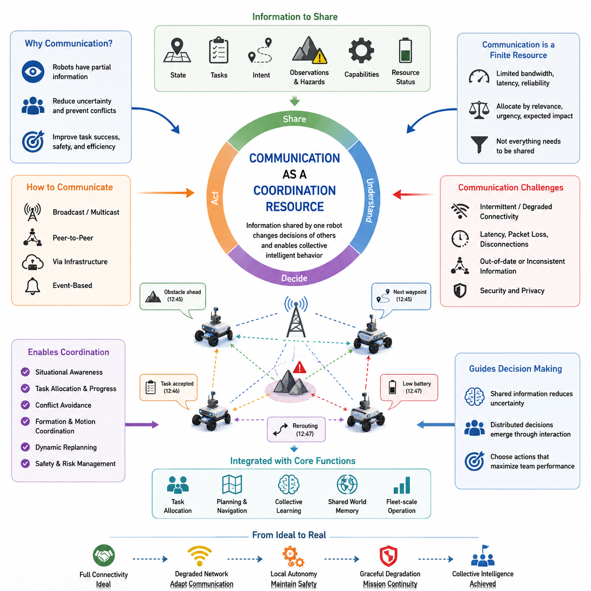{width="7.268055555555556in" height="7.268055555555556in"}

Communication in multi-robot Physical AI should be understood as a coordination resource rather than a background networking service. A robot communicates because information held by one agent can change the decisions of another. Messages about state, tasks, observations, intentions, risks, or capabilities therefore become resources that directly influence collective behavior.

A single robot can often act from its own sensors and internal state, but a multi-robot system must coordinate decisions that are distributed across space and time. Each robot observes only part of the environment and usually possesses incomplete knowledge about other robots. Communication reduces this information gap by allowing locally acquired knowledge to contribute to a broader team context.

The coordination value of communication depends less on the amount of transmitted data than on whether the information changes useful decisions. A short message indicating that a corridor is blocked may be more valuable than a continuous high-bandwidth sensor stream. Effective systems therefore treat communication capacity, latency, reliability, and message relevance as resources that must be allocated according to mission needs.

Communication connects perception with collective action. A robot detecting an obstacle, target, human, hazardous region, or environmental change can transform a private observation into shared operational knowledge. Other robots can then modify routes, task priorities, formations, exploration strategies, or safety behavior without independently rediscovering the same condition.

Task coordination similarly depends on exchanging information about assignments and progress. Robots may communicate which tasks are available, which robot has accepted a task, how much progress has been made, and whether completion remains feasible. This information helps prevent duplicated work and enables dynamic reallocation when workloads, priorities, robot capabilities, or environmental conditions change.

Intent is particularly important because current state alone does not describe what another robot is about to do. Two robots approaching the same narrow passage may both appear safe at the present moment while planning conflicting motions. Sharing intended routes, goals, reservations, or near-term actions allows coordination mechanisms to anticipate conflicts before physical interference occurs.

Communication also supports distributed decision making when no single coordinator possesses complete information. Robots can exchange local estimates and iteratively develop agreement about targets, formations, priorities, maps, or team actions. In this role, communication becomes part of the computational process itself: collective decisions emerge through interactions among agents rather than being calculated entirely by one central controller.

The communication architecture influences how coordination authority is organized. Centralized systems can route information through a fleet manager or infrastructure service, while decentralized systems allow robots to exchange information directly. Hybrid architectures combine both approaches, preserving fleet-level supervision while enabling local peer coordination when rapid responses or infrastructure-independent operation are required.

Not every piece of information should be communicated continuously. As fleet size increases, unrestricted sharing can create network congestion, redundant messages, processing overhead, and synchronization problems. Scalable coordination therefore requires selective communication in which robots transmit information according to relevance, novelty, urgency, spatial proximity, uncertainty, or expected effect on another agent\'s decisions.

Event-based communication provides one mechanism for this selectivity. Instead of repeatedly transmitting unchanged state, a robot can generate messages when meaningful changes occur, such as detecting a new obstacle, completing a task, losing localization confidence, entering a critical battery state, or encountering communication degradation. This reduces traffic while preserving information that is operationally significant.

Communication is also constrained by the physical environment. Wireless links may experience interference, occlusion, limited range, variable bandwidth, packet loss, or temporary disconnection. A robust multi-robot system therefore cannot assume perfect connectivity. Coordination policies must remain safe under delayed or missing messages and should degrade gracefully from shared operation toward increasingly local autonomous behavior.

This requirement makes communication uncertainty part of decision making. Information received from another robot may be delayed, incomplete, or inconsistent with newer local observations. Robots must consequently consider timestamps, confidence, source identity, validity periods, and synchronization when incorporating communicated information into their internal state. Shared information is useful only when its temporal and semantic meaning is understood.

The value of a message can be viewed in terms of its expected contribution to team performance. Information is valuable when it reduces uncertainty, prevents conflict, improves task allocation, shortens travel, increases safety, or enables another robot to make a better decision. Communication-aware coordination can therefore prioritize messages according to expected operational utility rather than treating every data packet equally.

This perspective becomes increasingly important as multi-robot systems scale from small teams to large fleets and swarms. Network resources do not necessarily increase at the same rate as the number of potential interactions. A system with hundreds or thousands of robots must avoid architectures in which every robot continuously exchanges complete state with every other robot, because communication complexity can become a scalability bottleneck.

Physical AI adds another dimension because communicated information may include learned representations rather than only conventional coordinates or status variables. Robots may share semantic observations, compact scene descriptions, traversability estimates, learned features, task context, or confidence-aware predictions. Such representations can convey decision-relevant meaning while avoiding transmission of complete raw sensor data.

Communication therefore forms a bridge among task allocation, planning, collective learning, shared world memory, and fleet-scale operation. The chapter structure places this topic before detailed robot-to-robot, infrastructure, semantic, bandwidth, degraded-connectivity, synchronization, and security mechanisms, reflecting its foundational role in multi-robot communication.

Ultimately, communication should be designed together with coordination rather than added after robot behaviors have already been defined. The central question is not simply how robots can exchange data, but what information must reach which agents, at what time, with what reliability, and for what decision. Treating communication as a finite coordination resource provides the foundation for scalable, robust, and intelligent multi-robot Physical AI.

## 04.02. Robot to Robot Communication

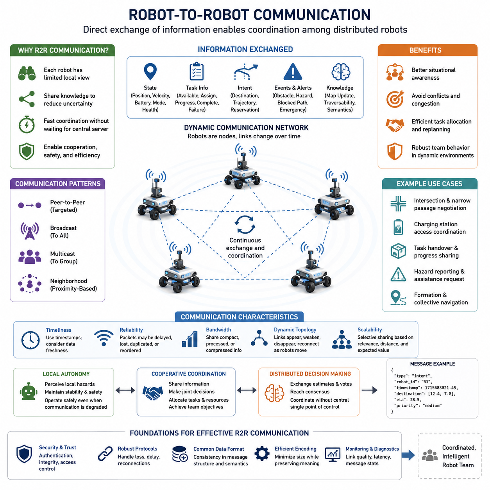{width="7.268055555555556in" height="7.268055555555556in"}

Robot-to-robot communication enables individual robots to exchange information directly so that physically distributed agents can coordinate their behavior without depending entirely on a centralized controller. Within the multi-robot communication structure, it provides the fundamental interaction channel through which robots share local observations, operational states, intentions, task information, and coordination signals with other members of the team.

Each robot normally perceives only a limited portion of the environment through its own sensors. Direct communication allows one robot's local knowledge to become available to nearby or logically related teammates. A robot that detects an obstacle, hazardous surface, blocked corridor, moving person, target, or environmental change can immediately distribute that information, reducing the need for every robot to independently observe the same event.

Robot-to-robot communication is especially valuable when coordination decisions must occur faster than information can travel through a remote fleet server or cloud infrastructure. Nearby robots can exchange short messages about position, velocity, planned motion, priority, or emergency conditions and respond locally. This creates a fast coordination loop between physical agents while higher-level fleet systems continue to manage broader mission objectives.

State sharing provides one of the most basic forms of direct communication. Robots may exchange pose, velocity, battery level, localization confidence, operational mode, payload status, sensor condition, or current task state. These messages allow teammates to estimate which robots are available, where they are operating, and whether their current condition affects collective planning or execution.

Task-related communication extends state sharing into cooperative work. Robots can announce available tasks, bids, assignments, task acceptance, progress, completion, or failure. When conditions change, robots may negotiate reassignment or request assistance from teammates. Direct exchange therefore connects robot-to-robot communication with distributed task allocation, scheduling, and dynamic replanning.

Intent sharing communicates what a robot expects to do rather than only describing its current condition. A robot may transmit its destination, planned trajectory, next waypoint, intended maneuver, reserved region, or expected arrival time. Other robots can use this information to predict future interactions and modify their own plans before congestion, deadlock, or collision occurs.

This capability is particularly important in shared physical spaces. Multiple mobile robots may approach intersections, narrow passages, charging stations, loading areas, elevators, doors, or other constrained resources simultaneously. Direct communication can support negotiation of priority and temporary reservations, allowing robots to coordinate access before their local collision-avoidance systems are forced to react at short range.

Robot-to-robot communication can follow peer-to-peer, broadcast, multicast, or neighborhood-based interaction patterns. Peer-to-peer exchange targets a particular robot, while broadcast distributes information to all reachable agents. Multicast can address a selected group, and neighborhood communication limits interactions to robots that are spatially or operationally relevant. The appropriate pattern depends on the coordination problem and network conditions.

Communication topology does not have to remain fixed. As robots move, communication links can appear, weaken, disappear, and reconnect. A multi-robot system therefore forms a dynamic communication graph in which robots represent nodes and available communication relationships represent edges. Coordination algorithms must operate over this changing graph rather than assuming that every robot can communicate directly with every other robot.

The information exchanged between robots can range from compact symbolic messages to richer representations. Simple messages may contain identifiers, coordinates, task states, timestamps, or alerts. More advanced Physical AI systems may exchange semantic object information, local map updates, traversability estimates, detected hazards, learned features, uncertainty estimates, or compact descriptions of situations that are relevant to collective decisions.

Raw sensor sharing is possible but often inefficient. Cameras, LiDARs, depth sensors, and other perception devices can generate data volumes far beyond what should be continuously exchanged among many robots. Practical systems therefore benefit from transmitting processed or compressed information when possible, allowing robots to communicate the meaning of an observation rather than repeatedly transferring complete sensor streams.

The usefulness of received information depends on timing. A robot position or planned trajectory may become inaccurate within seconds, while a static map feature may remain useful for much longer. Messages therefore require timestamps and appropriate validity assumptions. Robots should distinguish recent operational state from older information and avoid treating delayed messages as if they represented the current physical world.

Reliability is equally important because wireless communication is inherently imperfect. Packets can be delayed, reordered, duplicated, or lost, and communication links can disappear because of range, interference, obstacles, or infrastructure conditions. Robot behaviors should therefore avoid depending on uninterrupted message delivery for basic physical safety and should maintain sufficient local autonomy when communication becomes degraded.

This creates an important relationship between communication and autonomy. Communication should improve coordination when available, but each robot must retain the ability to perceive immediate hazards, maintain stability, execute essential safety functions, and enter a safe operating mode independently. A robust team consequently combines cooperative information sharing with autonomous fallback behavior rather than making every action dependent on remote messages.

Scalability changes the communication problem as the number of robots increases. If every robot continuously sends complete state to every other robot, message traffic and processing requirements can grow rapidly. Larger fleets therefore require selective interaction based on distance, task relationships, shared resources, information novelty, urgency, or expected decision value so that communication remains useful without overwhelming the network.

Direct communication can also support distributed consensus and collective decision making. Robots may exchange estimates, votes, confidence values, or local measurements and iteratively converge toward a shared decision. Such mechanisms allow a team to select targets, establish priorities, estimate environmental conditions, coordinate formations, or agree on collective actions without requiring every decision to originate from a central authority.

Security and trust become increasingly important because received messages can directly influence physical actions. Robots need mechanisms for identifying communication partners and determining whether information is authentic, authorized, and sufficiently trustworthy for the intended decision. Communication design must therefore consider identity, integrity, access control, and abnormal-message handling alongside bandwidth, latency, and reliability.

Robot-to-robot communication should ultimately be designed around the decisions that robots need to coordinate. The objective is not maximum data exchange, but timely delivery of useful information to relevant teammates. When combined with local perception, planning, task allocation, shared knowledge, and autonomous safety behavior, direct communication allows physically separated robots to operate as a coordinated and increasingly intelligent collective system.

## 04.03. Robot to Infrastructure Communication

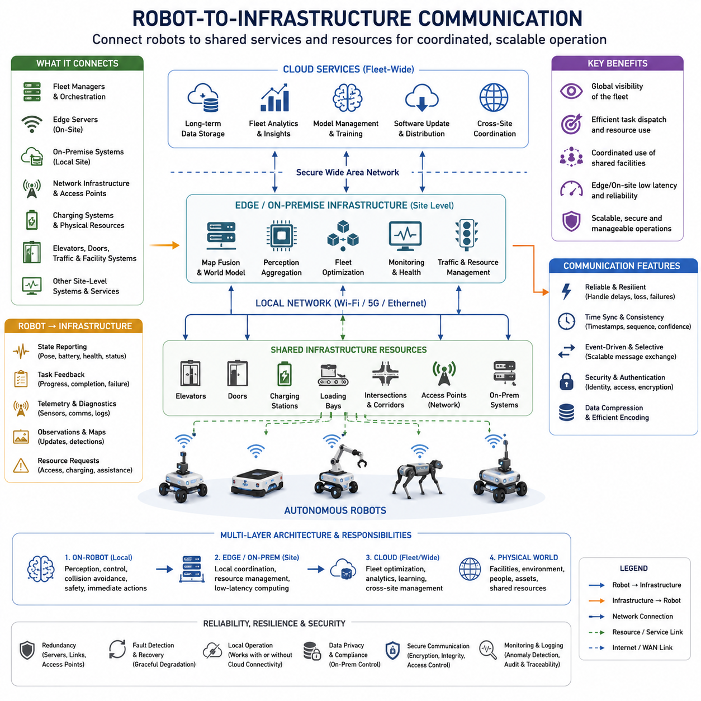{width="7.268055555555556in" height="7.268055555555556in"}

Robot-to-infrastructure communication connects individual robots with shared computational, networking, and physical resources that exist beyond the robot itself. Within a multi-robot system, infrastructure may include fleet managers, edge servers, on-premise computers, cloud services, wireless access points, charging systems, elevators, doors, traffic controllers, and other site-level systems that support coordinated operation.

Unlike direct robot-to-robot communication, where information flows between peer agents, robot-to-infrastructure communication introduces shared services that can aggregate information from many robots. A robot can report its state to infrastructure, while the infrastructure combines reports from multiple agents to construct a broader operational view. This provides information that may be impossible for any single robot to obtain from local sensing alone.

State reporting is one of the fundamental communication functions. Robots can transmit pose, velocity, task status, battery level, localization confidence, health information, payload state, communication quality, and operating mode to a fleet-level service. Infrastructure can use these reports to monitor the overall system and determine which robots are available, occupied, degraded, disconnected, or in need of assistance.

Infrastructure also provides a natural location for task dispatching and coordination. A fleet manager can receive mission requests, decompose them into robot-level tasks, evaluate available resources, and assign work to appropriate robots. Robots then communicate acceptance, progress, completion, delay, or failure, creating a feedback loop between fleet-level orchestration and autonomous execution in the physical environment.

Shared infrastructure can maintain information that has value across many robots and over longer periods of time. Maps, semantic annotations, restricted zones, traffic rules, traversability information, task queues, charging availability, and environmental updates can be stored centrally or at the edge. Robots retrieve relevant information when needed and contribute new observations that improve the shared operational representation.

Robot-to-infrastructure communication is particularly useful for coordinating shared physical resources. Elevators, automatic doors, charging stations, loading bays, transfer stations, and controlled intersections may need to serve multiple robots. Infrastructure can manage reservations, access permissions, priorities, and schedules so that robots do not compete for the same constrained resource without coordination.

Edge computing provides an important intermediate layer between robots and remote cloud systems. Computationally demanding functions can be executed on an edge server located near the operating environment, reducing the need to transmit all data over wide-area networks. Edge infrastructure may perform map fusion, fleet optimization, perception aggregation, model inference, monitoring, or coordination while maintaining relatively low communication latency.

On-premise infrastructure can provide additional control when operations require predictable latency, data privacy, security, or independence from external networks. Warehouses, factories, hospitals, campuses, and industrial facilities may operate fleet services within the local site. Robots can continue communicating with local orchestration and shared services even when connectivity to a remote cloud platform becomes unavailable.

Cloud infrastructure extends the architecture beyond an individual site. It can support long-term data storage, fleet-wide analytics, model management, software distribution, large-scale learning, and coordination across geographically separated deployments. However, physical control functions that require immediate responses should not depend entirely on cloud communication because network latency and connectivity cannot always be guaranteed.

The resulting architecture is often hierarchical rather than purely centralized. Immediate perception, collision avoidance, and safety-critical control remain on the robot, while local coordination may be supported by edge or on-premise infrastructure. Fleet optimization, historical analysis, learning, and cross-site management can operate at higher infrastructure layers. Communication therefore connects different decision horizons rather than simply transferring data to a central server.

Infrastructure communication can also support traffic management. A fleet-level service may collect robot positions, planned routes, destination requests, and congestion information to coordinate movement through shared spaces. It can reserve intersections, corridors, elevators, or loading areas and provide route constraints to individual robots, while each robot retains responsibility for local obstacle avoidance and immediate physical safety.

Communication with infrastructure should distinguish commands from information. A robot may receive a task assignment, route constraint, access authorization, software configuration, or emergency instruction, while other messages may simply provide map updates, traffic conditions, or recommendations. Clearly defined semantics allow the robot to understand which messages require execution and which should be incorporated as contextual knowledge.

Time and consistency become important when many robots communicate through shared services. Infrastructure may receive conflicting observations or state updates generated at different times. Timestamps, robot identifiers, sequence information, confidence values, and synchronization mechanisms help determine which information remains valid. Without these mechanisms, delayed infrastructure messages could cause robots to act on outdated representations of the physical world.

Reliability must be considered across the entire communication path. Wireless access can degrade, infrastructure services can become overloaded, edge servers can fail, and cloud connections can disappear. Robots should detect communication degradation and adjust their operating behavior accordingly. Essential safety functions must remain locally available, while infrastructure-dependent functions may temporarily operate with reduced capability or be suspended.

Redundancy can reduce dependence on individual infrastructure components. Multiple wireless access points, replicated edge services, backup fleet managers, or alternative communication paths can prevent a single failure from disabling an entire robot fleet. The appropriate level of redundancy depends on operational risk, mission criticality, fleet size, and the consequences of losing a particular coordination service.

Scalability is another central concern because infrastructure may communicate simultaneously with tens, hundreds, or thousands of robots. Continuously transmitting complete sensor streams and full robot states can overwhelm network and computational resources. Practical architectures therefore use selective updates, event-driven messages, compressed representations, subscriptions, regional grouping, and different update rates for information with different operational importance.

Security is especially important because infrastructure can influence many robots at once. Authentication is needed to establish the identities of robots and services, while authorization determines which entities can issue commands or access information. Message integrity, encryption, access control, credential management, logging, and anomaly detection help prevent compromised infrastructure or unauthorized devices from affecting physical fleet behavior.

Robot-to-infrastructure communication also provides the foundation for fleet monitoring and lifecycle management. Infrastructure can collect diagnostics, performance metrics, communication statistics, software versions, model versions, failure reports, and operational histories. These records support maintenance, performance analysis, software deployment, model updates, incident investigation, and continuous improvement across the robot fleet.

The relationship between robot autonomy and infrastructure should therefore be carefully balanced. Infrastructure provides global information, shared resources, computational capacity, and fleet-level optimization, while robots provide local perception, immediate decision making, and physical execution. Neither layer should unnecessarily duplicate the other; instead, responsibilities should be assigned according to latency, scope, computational demand, reliability, and safety requirements.

Ultimately, robot-to-infrastructure communication transforms isolated autonomous robots into participants within a larger operational ecosystem. By connecting local robot intelligence with fleet management, edge computing, shared world information, physical facility systems, and cloud-level services, infrastructure communication enables coordinated operation at scales that direct local interaction alone cannot efficiently support.

## 04.04. Centralized vs Peer to Peer Networks

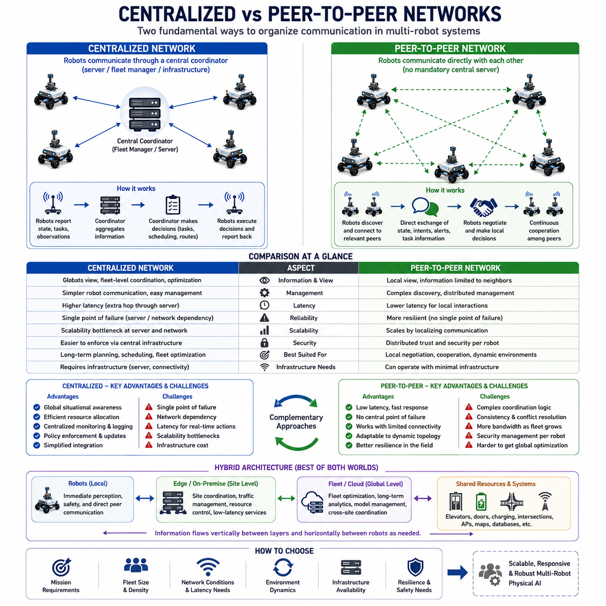{width="7.268055555555556in" height="7.268055555555556in"}

Centralized and peer-to-peer networks represent two fundamental ways of organizing communication among robots in a multi-robot system. A centralized network routes coordination information through a shared server, fleet manager, or infrastructure service, while a peer-to-peer network allows robots to exchange information directly. The choice determines how information, authority, latency, and failures are distributed across the system.

In a centralized architecture, individual robots establish communication with a central coordination component rather than maintaining extensive direct relationships with every teammate. Robots report state, task progress, observations, resource requirements, and operational conditions to this component. The coordinator aggregates these inputs and can construct a fleet-level representation that provides broader situational awareness than any individual robot possesses.

Centralization is particularly effective when decisions require a global view of the fleet. Task allocation, scheduling, traffic management, charging coordination, shared-resource reservation, and fleet-wide optimization can benefit from information collected from many robots. A central service can compare competing requirements and make decisions according to system-level objectives instead of relying only on the limited local perspective of each robot.

Another advantage is simplified management. Communication policies, robot registration, access control, monitoring, logging, software interfaces, and operational rules can be managed through common infrastructure. Robots can interact with a consistent service rather than discovering and maintaining communication relationships with many peers. This structure is attractive for managed fleets operating within warehouses, factories, hospitals, campuses, and similar environments.

However, centralization creates dependencies on communication infrastructure and central services. If robots cannot reach the coordinator because of wireless degradation, network partition, server failure, or excessive latency, centralized coordination functions may become unavailable. A poorly designed architecture can therefore create a single point of failure in which one infrastructure problem affects many otherwise functional robots.

Centralized systems can also encounter scalability bottlenecks. As fleet size increases, the central service must process messages, maintain states, resolve requests, and distribute decisions for an increasing number of robots. Network traffic may concentrate around the infrastructure, and computational demand can increase rapidly. Hierarchical fleet managers, regional services, edge computing, and selective updates can reduce these limitations.

Peer-to-peer networks distribute communication relationships across the robots themselves. A robot can directly communicate with another robot or with a selected group of nearby or operationally relevant peers. State, intentions, warnings, task information, and coordination requests can therefore move between agents without necessarily passing through a central fleet service, enabling local cooperation close to where physical interactions occur.

This architecture is useful for coordination that depends primarily on local interactions. Robots approaching the same intersection, narrow corridor, formation, exploration frontier, or shared object can exchange information directly and make rapid decisions. Removing an additional infrastructure communication path can reduce response latency and allow coordination to continue in environments where centralized connectivity is unavailable or unreliable.

Peer-to-peer communication can improve resilience because there is no mandatory single coordinator whose loss immediately disables all communication. If one robot fails, other robots may continue interacting through remaining network connections. Dynamic communication graphs can reorganize as robots move, join, leave, or lose connectivity, allowing collective behavior to continue as long as sufficient communication relationships remain available.

The distributed nature of peer-to-peer networking also introduces challenges. Each robot may need mechanisms for discovering peers, identifying relevant communication partners, maintaining distributed state, resolving inconsistent information, and handling changing network topology. Decisions that require a global fleet view can be difficult because no individual robot necessarily possesses complete information about all agents and resources.

Consistency becomes particularly important in distributed systems. Two robots may hold different versions of task assignments, maps, reservations, or environmental states because messages arrive at different times or follow different paths. Timestamps, sequence identifiers, distributed consensus, conflict-resolution rules, and confidence estimates can help robots determine how information should be combined and which representation should influence current decisions.

Communication overhead can also become significant if peer-to-peer interaction is implemented as unrestricted all-to-all communication. With increasing fleet size, the number of possible robot relationships grows rapidly. Practical systems therefore organize communication according to neighborhoods, teams, tasks, spatial regions, or shared resources so that robots exchange information primarily with peers whose knowledge or intentions are relevant to their current decisions.

Centralized and peer-to-peer networks therefore distribute complexity differently. Centralization concentrates global knowledge and coordination logic within infrastructure, making individual robot communication simpler but increasing dependence on central services. Peer-to-peer networking distributes coordination and communication responsibilities across robots, improving local independence while increasing the complexity of maintaining distributed knowledge and agreement.

Latency requirements provide an important criterion for choosing between the two approaches. Fleet-wide scheduling may tolerate communication through an infrastructure service, while immediate negotiation between two nearby robots may benefit from direct exchange. Similarly, long-term map management can be centralized, whereas rapidly changing local intentions may be communicated directly to neighboring robots that need the information immediately.

Reliability requirements lead to a similar distinction. Safety-critical local behavior should not depend exclusively on either architecture because communication can fail in both cases. Each robot should retain sufficient local perception and control to avoid immediate hazards. Centralized or peer communication should enhance coordination, while autonomous fallback behavior preserves essential safety when messages are delayed, lost, or unavailable.

Security models also differ. Centralized systems can enforce authentication, authorization, and access policies through common infrastructure, but compromise of a central service can potentially affect a large portion of the fleet. Peer-to-peer systems distribute trust relationships among robots and therefore require secure robot identities, message authentication, authorization, and mechanisms for preventing compromised peers from influencing collective behavior.

In practice, multi-robot Physical AI systems often benefit from hybrid communication architectures rather than choosing one model exclusively. Fleet-level infrastructure can maintain global state, dispatch tasks, optimize resources, and provide shared world information, while robots communicate directly for local negotiation, collision-related coordination, formation behavior, cooperative manipulation, or operation during temporary infrastructure loss.

A hybrid architecture can therefore assign communication according to spatial and temporal scope. Robot-level communication handles immediate local interactions, edge or on-premise infrastructure manages site-level coordination, and higher-level services support fleet-wide or cross-site operations. Information can move vertically between architectural layers and horizontally between robots according to the decision that must be made.

The most appropriate network architecture ultimately depends on fleet size, mission structure, communication conditions, latency requirements, environmental dynamics, infrastructure availability, and required resilience. Centralized and peer-to-peer networks should not be treated simply as competing technologies, but as complementary coordination mechanisms whose strengths can be combined to support scalable, responsive, and robust multi-robot Physical AI.

## 04.05. Broadcast Multicast and Event Based Communication

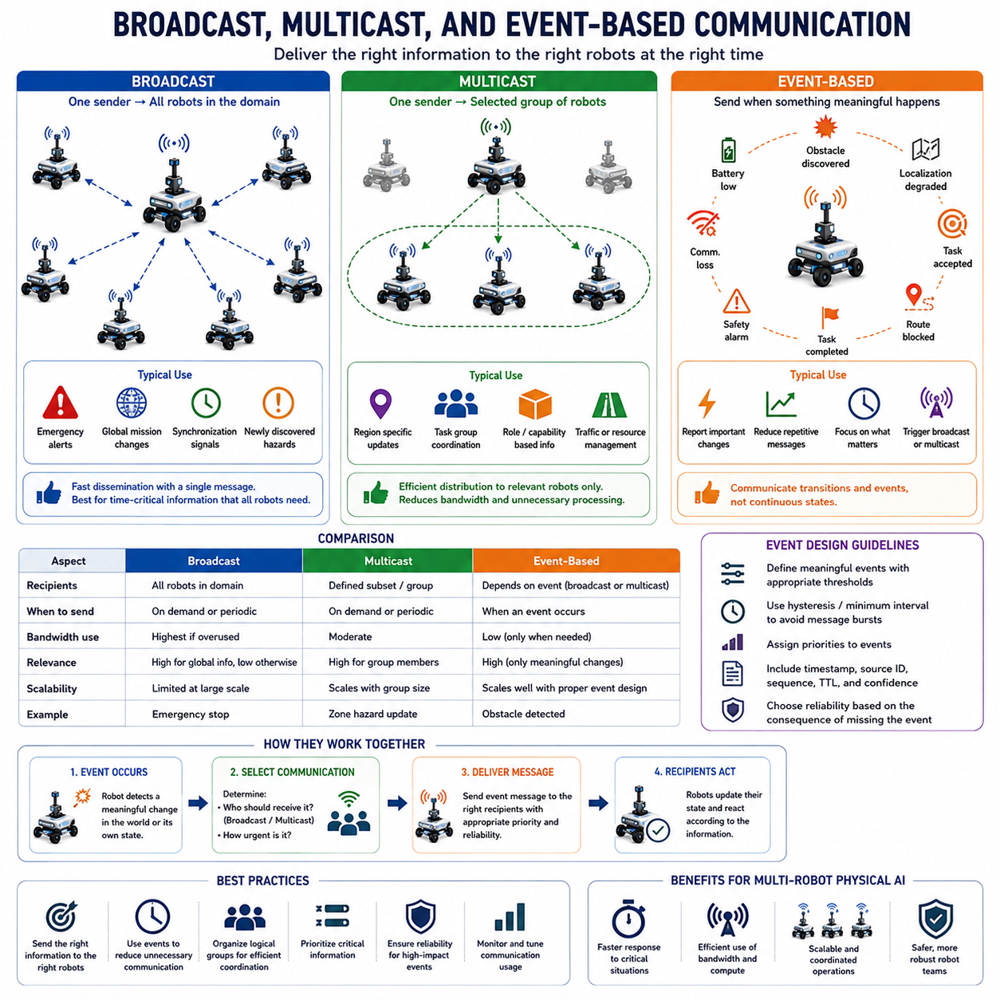{width="7.268055555555556in" height="7.268055555555556in"}

Broadcast communication allows one robot or infrastructure node to distribute the same message to every reachable participant within a communication domain. In multi-robot Physical AI, this pattern is useful when information has broad relevance and identifying individual recipients would add unnecessary complexity. Emergency alerts, global mission changes, synchronization signals, and newly discovered hazards are typical examples of information suitable for broadcast transmission.

The principal advantage of broadcast is rapid dissemination. A robot that detects a critical condition can transmit one message rather than establishing separate exchanges with every teammate. This reduces coordination delay and simplifies message generation when all nearby robots need the same information. Broadcast is therefore particularly effective for urgent events whose value depends on reaching many agents with minimal communication steps.

Broadcast communication must nevertheless be used selectively because not every robot needs every message. Frequent global transmission of position, sensor data, task progress, or routine status can consume bandwidth and increase processing overhead across the fleet. Robots may spend computational resources receiving, decoding, filtering, and discarding information that has little relevance to their current tasks or physical locations.

Multicast communication addresses this limitation by distributing information to a defined subset of robots rather than the entire communication domain. Groups can be organized according to task, location, robot type, capability, mission role, or operational responsibility. A message can therefore reach the robots that are likely to benefit from it while avoiding unnecessary transmission and processing by unrelated members of the fleet.

Spatial grouping provides a practical example of multicast communication. Robots operating in one warehouse zone, floor, outdoor sector, exploration region, or traffic area may subscribe to information associated with that region. An obstacle update or temporary access restriction can then be distributed only to robots that may encounter it, while robots operating elsewhere remain unaffected by information with little immediate relevance.

Task-oriented multicast can similarly connect robots participating in the same cooperative activity. A group transporting an object, exploring an area, inspecting equipment, or maintaining a formation may require frequent updates that are irrelevant to the rest of the fleet. Group communication creates a logical coordination channel in which task-specific state, progress, observations, and intentions can be exchanged efficiently.

Membership in multicast groups does not need to remain static. Robots can join or leave groups as tasks, locations, capabilities, or operational roles change. A mobile robot entering a traffic region may subscribe to local coordination messages and later unsubscribe after leaving the region. Dynamic group membership allows communication structure to follow the changing physical and organizational structure of the robot fleet.

Event-based communication introduces a different principle by determining when information should be transmitted rather than primarily determining who should receive it. Instead of continuously publishing state at a fixed frequency, a robot generates a message when a meaningful event occurs. Communication is therefore triggered by changes that are expected to influence another robot, coordinator, or infrastructure service.

Typical events include obstacle discovery, task acceptance, task completion, localization degradation, battery thresholds, communication loss, resource availability, route blockage, safety alarms, or significant changes in robot state. By communicating these transitions when they occur, robots can reduce repetitive transmission of unchanged information while preserving updates that have direct operational significance.

Event-based communication is particularly valuable in large fleets because continuous periodic reporting can generate substantial traffic even when the physical environment is stable. If hundreds of robots repeatedly transmit unchanged states, network resources are consumed without producing equivalent coordination value. Event-triggered updates shift communication toward novelty and decision relevance rather than constant data repetition.

However, purely event-based communication can create its own difficulties. If events are defined too sensitively, small fluctuations can produce excessive messages and create communication bursts. If thresholds are too conservative, important changes may not be communicated early enough. Event definitions therefore require appropriate thresholds, hysteresis, minimum intervals, priorities, and confidence conditions to balance responsiveness against communication cost.

Periodic communication and event-based communication are not mutually exclusive. A robot can transmit important changes immediately while also sending lower-frequency heartbeat or state messages. The periodic channel confirms connectivity and refreshes shared state, while event messages provide rapid notification of significant changes. This hybrid strategy helps prevent silent failures while avoiding unnecessary high-frequency communication.

Broadcast, multicast, and event-based mechanisms can also be combined. An event determines that communication is necessary, while broadcast or multicast determines the intended audience. A critical safety event may trigger a broadcast to every nearby robot, whereas a blocked corridor may generate a multicast message only to robots operating in the affected region. The communication pattern can therefore reflect both urgency and relevance.

Message priority becomes important when several events occur simultaneously. Safety alerts, imminent collision warnings, emergency stops, or severe localization failures should normally receive higher communication priority than routine status updates. Priority-aware communication allows limited bandwidth to be allocated according to operational consequence, helping critical coordination information reach recipients even when network load is high.

Temporal validity must also be represented because event messages often describe rapidly changing physical conditions. Messages should include timestamps, source identities, sequence information, and where appropriate expiration times or confidence values. A robot receiving an old hazard report or obsolete resource notification must be able to determine whether that information should still influence its current planning and behavior.

Reliability requirements vary according to message type. Some broadcast information may tolerate occasional loss because it will be repeated or refreshed, while a critical task cancellation or safety event may require acknowledgment, retransmission, or another reliability mechanism. Communication design should therefore match delivery guarantees to the consequence of missing the information rather than applying identical reliability policies to every message.

These communication patterns also interact with network topology. Broadcast may naturally operate within a local wireless domain, while multicast groups can span selected robots or infrastructure services. Event messages can travel through peer-to-peer links, edge infrastructure, or fleet servers depending on their intended scope. Logical communication semantics should therefore be separated from the physical network path used to transport the information.

Scalability depends on controlling both the number of recipients and the frequency of transmission. Broadcast controls neither dimension particularly well when used excessively, multicast reduces unnecessary recipients, and event-based communication reduces unnecessary transmission times. Combining recipient selection with event selection provides a powerful mechanism for keeping communication demand manageable as robot populations and operational complexity increase.

For Physical AI systems, the communicated content can extend beyond conventional status variables. Events may describe semantic changes such as a newly recognized hazard, altered traversability, unexpected human activity, task-relevant object detection, or a significant increase in uncertainty. Robots can communicate compact semantic meaning rather than raw sensor streams, enabling other agents to respond without reproducing the complete perception process.

Ultimately, broadcast, multicast, and event-based communication provide complementary mechanisms for deciding who should receive information and when that information should be transmitted. Effective multi-robot communication uses these mechanisms according to relevance, urgency, spatial scope, task relationships, and expected decision value, enabling timely coordination while conserving the limited communication resources of large-scale robot teams.

## 04.06. State Task Map and Intent Sharing

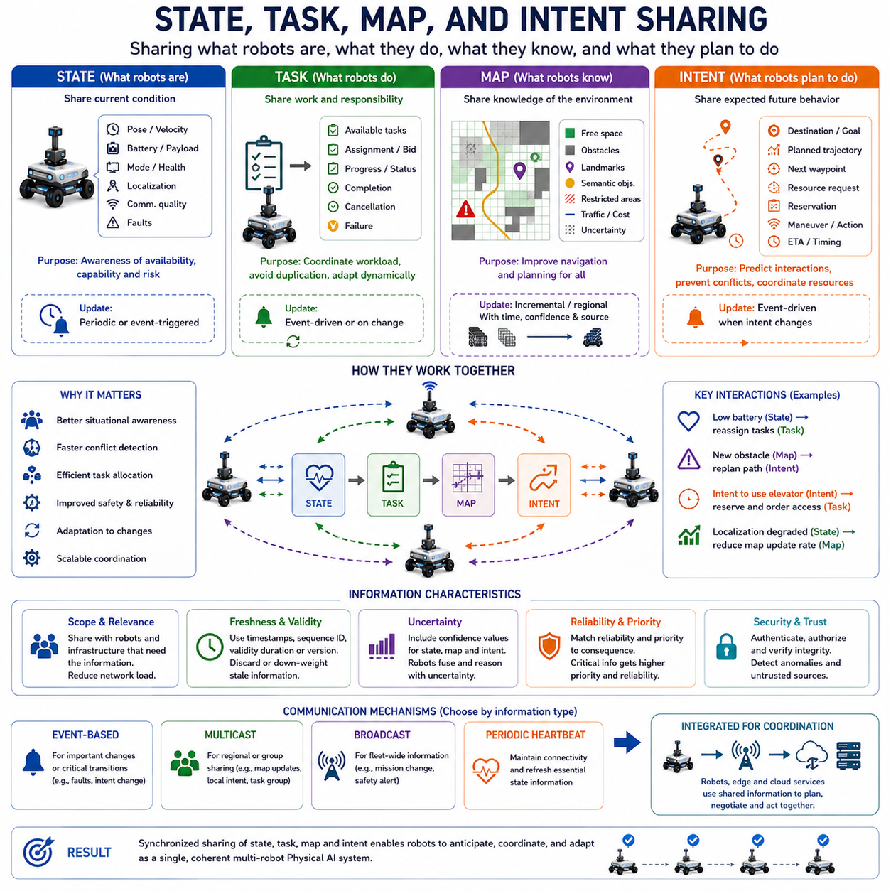{width="7.268055555555556in" height="7.268055555555556in"}

State, task, map, and intent sharing forms the informational foundation of coordinated multi-robot operation. Each category describes a different aspect of what robots know and what they are doing: state represents current condition, task represents operational responsibility, map represents shared knowledge of the environment, and intent represents expected future behavior. Together, they transform isolated local knowledge into information that supports collective decisions.

State sharing communicates the present operational condition of each robot. Typical state information includes pose, velocity, heading, battery level, localization confidence, payload status, operating mode, sensor health, communication quality, and fault conditions. By receiving this information, other robots or fleet infrastructure can determine where an agent is, whether it is available, and whether its condition permits continued participation in a coordinated activity.

The required frequency of state sharing depends on how quickly the information changes and how strongly it influences other agents. Position and velocity may require relatively frequent updates during close interaction, while battery condition or payload state may change more slowly. Communication policies should therefore use different update rates, thresholds, or event triggers instead of transmitting every state variable at the same fixed frequency.

Task sharing describes what work exists and how responsibility for that work is distributed across the robot team. Messages may represent available tasks, assignments, bids, acceptance, priority, dependencies, progress, completion, cancellation, or failure. Sharing these states allows robots and fleet managers to maintain awareness of collective workload and reduces the possibility that several robots unknowingly perform the same task.

Task information becomes particularly important when operations change dynamically. A robot may become unavailable because of low battery, localization degradation, mechanical failure, or an unexpected obstacle. Its assigned task can then be released, transferred, or divided among other agents. Shared task status therefore enables coordination mechanisms to adapt workload distribution without reconstructing the entire mission from the beginning.

Map sharing extends communication from robot condition and work status to knowledge about the physical environment. Robots can contribute local observations to a shared representation containing free space, obstacles, landmarks, semantic objects, restricted regions, traversability, traffic conditions, or other mission-relevant features. This allows information discovered by one robot to improve navigation and planning for other robots.

Complete map transmission is often unnecessary and inefficient, especially when maps are large or continuously changing. Robots can instead communicate local map fragments, changed regions, newly detected objects, semantic updates, or compressed representations. Incremental map sharing reduces bandwidth consumption and enables recipients to update only the portions of their environmental knowledge that have meaningfully changed.

Shared maps must also represent uncertainty and temporal validity. A wall or permanent landmark may remain stable, whereas a pallet, vehicle, person, temporary barrier, or blocked corridor may move or disappear. Map updates should therefore distinguish relatively persistent structure from dynamic information and, when appropriate, include timestamps, confidence estimates, source identity, or expiration conditions.

Map consistency becomes more difficult when multiple robots observe the same environment from different positions and at different times. Their observations may contain localization error, sensing uncertainty, or contradictory interpretations. Shared mapping therefore requires mechanisms for spatial alignment, duplicate detection, conflict handling, confidence management, and version control so that local observations can contribute to a coherent collective representation.

Intent sharing adds a predictive dimension that cannot be obtained from current state alone. State tells other agents what a robot is doing now, while intent communicates what it expects to do next. Intent information may include destination, planned trajectory, next waypoint, desired formation position, target object, reserved corridor, resource request, maneuver, or expected arrival time.

This distinction is essential in dynamic environments. Two robots may currently occupy safe positions while planning trajectories that intersect several seconds later. If only present state is shared, the conflict may remain invisible until local collision avoidance becomes necessary. Sharing intended motion enables robots or infrastructure to predict interactions earlier and resolve potential conflicts through replanning, priority assignment, reservation, or negotiation.

Intent sharing also supports coordination of constrained resources. Robots approaching an elevator, charging station, narrow passage, loading bay, docking station, or intersection can communicate their expected use and timing. A peer negotiation mechanism or infrastructure service can then determine access order and reservations, reducing congestion and preventing multiple robots from independently planning incompatible use of the same resource.

State, task, map, and intent information operate on different temporal horizons. State primarily represents the present, task information represents ongoing operational responsibility, map information captures accumulated knowledge of the environment, and intent describes anticipated future actions. Combining these perspectives gives a robot team a richer shared context than any one information category can provide independently.

These information types are also strongly interconnected. A localization-confidence change in robot state may affect the reliability of its map contribution. A newly discovered obstacle in the shared map may invalidate a planned trajectory. The resulting replanning may change the robot\'s intent, which can alter task completion time and influence fleet scheduling. Communication therefore creates dependencies among perception, planning, task allocation, and execution.

Not all shared information should be distributed to every robot. State and intent may be most relevant to nearby robots that could physically interact, while task information may be relevant to members of the same mission group. Map updates can be distributed according to spatial region or expected route. Relevance-aware sharing reduces network load while preserving the information required for effective coordination.

The appropriate communication mechanism can vary with information type. Rapid intent changes or critical state transitions may use event-based messages, regional map updates may use multicast communication, and fleet-wide mission changes may require broader dissemination. Periodic heartbeat messages can complement these mechanisms by confirming connectivity and refreshing essential state even when no significant event has occurred.

Freshness is critical because shared information can become obsolete. Messages should therefore carry sufficient temporal context through timestamps, sequence identifiers, validity periods, or version information. A receiving robot must determine whether a reported pose, task assignment, map update, or trajectory remains applicable before incorporating it into planning. Newer local evidence may sometimes need to override delayed shared information.

Communication reliability should reflect the consequences of losing each type of information. A missed routine battery update may be corrected by the next report, whereas losing an emergency state transition, task cancellation, or immediate trajectory change could create operational risk. Acknowledgment, retransmission, redundancy, and priority mechanisms can therefore be selectively applied to information with greater coordination importance.

Security and trust are equally important because shared information can alter physical behavior. False state reports can distort fleet decisions, corrupted maps can influence navigation, unauthorized task messages can redirect robots, and manipulated intent can create unsafe interactions. Authentication, authorization, message integrity, source identification, and anomaly detection should therefore protect the shared information environment.

In Physical AI, sharing can evolve beyond conventional structured variables toward semantic and learned representations. Robots may communicate object-level scene descriptions, traversability estimates, uncertainty-aware predictions, learned environmental features, or compact world-model information. The objective remains the same: transmit decision-relevant knowledge without unnecessarily transferring the complete raw sensory experience of each robot.

Ultimately, state, task, map, and intent sharing creates a distributed operational picture of what the robot team is, what it is doing, what it knows about the world, and what it expects to do next. When these information categories are synchronized according to relevance, freshness, reliability, and uncertainty, individual robots can coordinate as members of a coherent multi-agent Physical AI system rather than acting as isolated autonomous machines.

## 04.07. Semantic Communication between Robots

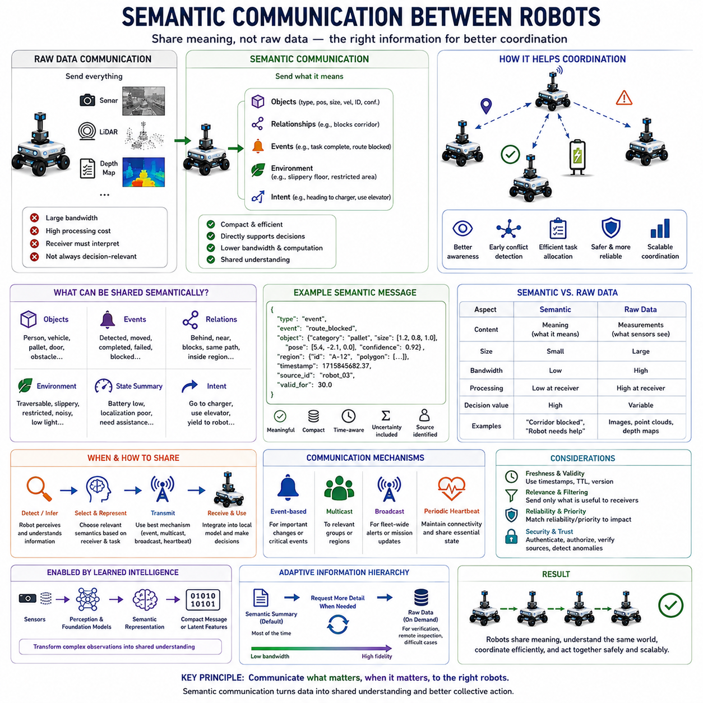{width="7.268055555555556in" height="7.268055555555556in"}

Semantic communication between robots focuses on exchanging meaning that is directly relevant to coordination rather than transmitting all available raw data. Instead of sending complete camera images, LiDAR scans, depth maps, or sensor streams, a robot communicates compact descriptions of what it has perceived, inferred, or decided. This allows other robots to receive operationally useful knowledge with substantially lower communication and processing requirements.

Traditional communication often treats successful data delivery as the primary objective, but semantic communication emphasizes whether the receiver obtains enough information to make an appropriate decision. A message describing "blocked corridor ahead" may be more useful for navigation than transmitting a large point cloud from which another robot must independently discover the blockage. Meaning therefore becomes the principal unit of communication.

Semantic messages can describe objects, events, relationships, environmental conditions, risks, and intentions. A robot might communicate that a person is crossing a planned route, a pallet blocks an aisle, a surface is not traversable, a charging station is occupied, or another robot requires assistance. These representations connect perception directly with coordination by expressing what an observation means for collective operation.

Object-level communication provides a basic form of semantic exchange. Rather than transmitting an entire image, a robot can share an object category, position, dimensions, velocity, confidence, and tracking identifier. Another robot can incorporate this compact representation into its local world model without repeating the complete perception pipeline, reducing redundant computation while extending awareness beyond its own sensing range.

Semantic communication can also represent spatial relationships and environmental structure. Messages may indicate that an obstacle blocks a corridor, a target is behind a landmark, a region is temporarily restricted, or a route has become congested. Such relational information often has greater coordination value than isolated measurements because it describes how environmental elements affect navigation, planning, task execution, or safety.

Event semantics provide another important layer. Instead of reporting continuous sensor values, robots can communicate meaningful transitions such as task completed, human detected, route blocked, localization degraded, battery critical, object moved, or hazard cleared. These events summarize changes in operational context and can trigger replanning, task reassignment, resource negotiation, or safety responses in other agents.

Intent can also be represented semantically. A robot may communicate that it plans to enter an intersection, use an elevator, approach a charging station, inspect a target, or yield to another robot. This is richer than transmitting only a trajectory because the receiver understands the operational purpose associated with the motion and can reason about coordination alternatives at a more abstract level.

Semantic communication is particularly valuable when network bandwidth is limited. Raw visual and range data can require substantial transmission capacity, especially when many robots operate simultaneously. Compact semantic representations reduce message size by communicating selected information that is expected to influence decisions. The network carries less data while potentially preserving or increasing the coordination value of the transmitted information.

This compression differs from conventional data compression. Traditional compression attempts to reproduce the original data using fewer bits, whereas semantic communication may intentionally discard information that is irrelevant to the receiver\'s task. A navigation robot may not need the detailed appearance of an obstacle if its location, dimensions, motion, and traversability effect are already known with sufficient confidence.

The appropriate semantic representation therefore depends on the receiving robot and its current objective. Information useful to a navigation robot may differ from information required by an inspection robot, manipulation robot, or fleet manager. Communication can become task-aware by selecting message content according to the receiver\'s role, capabilities, location, mission, and expected use of the information.

Shared vocabularies and ontologies are important because robots must interpret semantic messages consistently. Terms such as obstacle, pedestrian, restricted area, task complete, safe passage, or charging required must have sufficiently compatible meanings across agents. Standardized object classes, event definitions, coordinate conventions, units, confidence representations, and message schemas reduce ambiguity in heterogeneous robot teams.

Heterogeneous robots make semantic communication especially useful because different platforms may possess different sensors and perception systems. A ground robot, aerial robot, quadruped, and manipulator do not need identical sensing hardware if they can exchange information through a common semantic representation. Sensor-specific observations can be transformed into concepts that other agents can understand and use within their own decision processes.

Uncertainty must remain attached to semantic information because perception and inference are not always correct. A robot should distinguish between a confirmed obstacle and a low-confidence detection, or between a known blocked route and a predicted congestion condition. Confidence values, uncertainty estimates, source identity, timestamps, and validity periods allow receiving robots to reason about how strongly communicated information should influence their decisions.

Semantic information also changes over time. A static structural feature may remain valid for long periods, while a moving person, temporary obstacle, task status, or intended trajectory can become obsolete quickly. Semantic messages therefore require temporal context so that receivers can determine whether a communicated fact still describes the physical world. Freshness becomes part of the meaning rather than merely a networking property.

Communication policies can prioritize semantic information according to expected decision value. A newly detected safety hazard may require immediate broadcast, while a minor map refinement can be delayed or shared only with robots operating in the affected region. Semantic relevance can therefore guide event triggering, multicast membership, transmission frequency, message priority, and reliability requirements.

Semantic communication can interact closely with learned perception and foundation models. Vision-language models, multimodal encoders, world models, and learned scene representations can transform complex sensory observations into object descriptions, relationships, predictions, or compact latent features. These representations may allow robots to communicate richer contextual knowledge without transferring the complete sensory inputs that produced it.

Learned latent representations introduce additional challenges because their meaning may depend on model architecture, training data, and version. Two robots using incompatible encoders may interpret the same latent message differently. Semantic interoperability therefore requires shared models, aligned representation spaces, explicit version information, translation mechanisms, or higher-level structured messages when compatibility cannot otherwise be guaranteed.

Security and trust are critical because semantic messages can strongly influence physical decisions while appearing compact and authoritative. A false message claiming that a route is blocked could redirect an entire fleet, while a fabricated safety event could stop operations. Authentication, message integrity, source validation, authorization, anomaly detection, and cross-checking with local observations help protect robots from incorrect or malicious semantic information.

Semantic communication does not eliminate raw-data exchange. Detailed sensor information may still be required for remote inspection, collaborative mapping, difficult perception cases, model improvement, or verification of uncertain observations. A practical architecture can communicate semantic summaries by default and request richer data only when additional evidence is needed, creating an adaptive hierarchy between meaning and raw sensory detail.

Ultimately, semantic communication allows robots to exchange what information means for perception, planning, tasks, safety, and future action rather than merely exchanging what their sensors measured. By combining compact representations, shared semantics, uncertainty, temporal validity, task relevance, and learned intelligence, multi-robot Physical AI can achieve more scalable communication while enabling distributed agents to build and act upon a shared understanding of their world.

## 04.08. Bandwidth Latency and Reliability Constraints

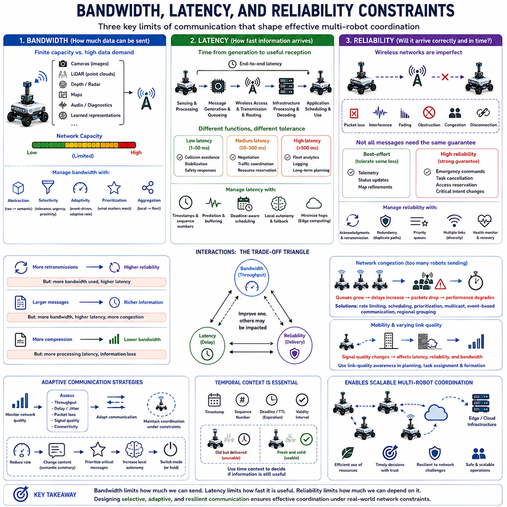{width="7.268055555555556in" height="7.268055555555556in"}

Bandwidth, latency, and reliability are fundamental communication constraints in multi-robot systems because coordination depends not only on what information is exchanged but also on whether the network can deliver it at the required rate, time, and confidence. Communication resources are finite, while robot fleets continuously generate state, perception, task, map, and intent information that may compete for network capacity.

Bandwidth represents the amount of information that a communication channel can carry within a given period. A single robot may generate high-volume data from cameras, LiDAR, depth sensors, radar, audio, maps, diagnostics, and learned representations. When many robots operate simultaneously, transmitting all available data can exceed practical wireless capacity and create congestion that reduces the usefulness of the communication system.

Bandwidth demand depends strongly on the abstraction level of transmitted information. Raw images and point clouds generally require much greater capacity than object lists, semantic events, poses, task states, or compact intent messages. Multi-robot systems can therefore reduce network load by processing information locally and communicating representations that preserve decision-relevant meaning without transferring every underlying sensor measurement.

Selective communication becomes essential as fleet size increases. Robots can prioritize information according to relevance, urgency, novelty, spatial proximity, task relationship, and expected decision impact. A newly detected hazard may deserve immediate transmission, while an unchanged battery state or map region can wait. Such policies allocate bandwidth according to coordination value rather than treating every message as equally important.

Update frequency also affects bandwidth consumption. Position and velocity may require frequent updates when robots operate close together, whereas battery status, long-term map structure, or software diagnostics can often be transmitted less frequently. Adaptive update rates allow the communication system to increase information flow during dynamic interactions and reduce it when operating conditions are stable.

Latency describes the time between information generation and its useful reception by another robot or infrastructure service. In physical systems, even correctly delivered information can become ineffective when it arrives too late. A trajectory update received after two robots have entered a narrow passage has much less coordination value than the same message delivered before either robot commits to the maneuver.

Different functions tolerate different levels of latency. Immediate collision avoidance and stabilization should remain primarily local because they require rapid and predictable responses. Robot-to-robot negotiation, traffic coordination, and resource reservation may tolerate somewhat greater delay, while fleet analytics, historical logging, model management, and long-term optimization can operate over substantially longer communication timescales.

Latency is composed of several elements rather than a single network delay. Sensor processing, message generation, queueing, wireless access, transmission, routing, infrastructure processing, decoding, and application scheduling can all contribute to end-to-end delay. Communication-aware system design therefore considers the complete information path from physical observation to the decision that ultimately uses the message.

Variable latency, or jitter, can be as important as average latency. A coordination algorithm may operate reliably when messages consistently arrive within a known interval but become unstable when delivery times fluctuate unpredictably. Timestamps, prediction, buffering, deadline-aware scheduling, and local fallback behavior can help robots operate when communication delay varies during movement or network congestion.

Reliability describes whether information reaches its intended recipient correctly and within the period in which it remains useful. Wireless robot networks can experience packet loss, interference, fading, obstruction, congestion, handover failures, or temporary disconnection. Reliability must therefore be evaluated in operational terms rather than assuming that an established communication link guarantees successful coordination.

Not every message requires the same delivery guarantee. Periodic telemetry may tolerate occasional loss because a newer update will soon replace it, whereas emergency commands, task cancellations, access reservations, or critical intent changes may require stronger delivery mechanisms. Acknowledgments, retransmissions, redundancy, priority queues, or multiple communication paths can be applied selectively according to message importance.

Bandwidth, latency, and reliability interact with one another. Increasing retransmissions may improve delivery probability but consume additional bandwidth and increase delay. Sending larger messages may provide richer information but require longer transmission time and increase congestion risk. Aggressive compression can reduce bandwidth while introducing processing latency or information loss. Communication design therefore requires balancing competing objectives rather than optimizing each constraint independently.

Network congestion illustrates these interactions clearly. When too many robots transmit simultaneously, queues grow, packet collisions or contention increase, and messages arrive later or may be dropped. Adding more communication can consequently reduce coordination performance. Rate limiting, scheduling, message prioritization, multicast, event-based communication, and regional grouping help prevent the network from becoming overloaded.

Mobility further complicates communication because robots continuously change their spatial relationships with access points, obstacles, and other robots. Signal quality can deteriorate as robots move behind structures, enter distant regions, or transition between wireless coverage areas. Communication quality should therefore be treated as a dynamic state that can influence planning, task assignment, formation, and autonomous fallback strategies.

A robot may incorporate predicted communication quality into its decisions. For example, a mission requiring continuous high-bandwidth supervision may avoid regions with poor connectivity, while an autonomous exploration robot may intentionally enter such regions if it can operate independently and synchronize later. Communication constraints can therefore become part of motion planning and mission planning rather than remaining purely networking concerns.

Degraded connectivity requires graceful degradation of coordinated behavior. When bandwidth decreases, robots can reduce update frequency, suppress low-priority information, switch from raw data to semantic summaries, or communicate only critical events. When latency increases, they can rely more heavily on local prediction and autonomy. When connectivity is lost, robots should enter operating modes that preserve safety until communication is restored.

Edge and on-premise infrastructure can reduce some communication constraints by moving computation closer to the robots. Instead of transmitting large data streams to distant cloud services, robots can communicate with nearby edge systems for map fusion, perception aggregation, fleet coordination, or model inference. This can reduce wide-area bandwidth demand and latency while maintaining site-level control when external connectivity is limited.

Time-sensitive information should carry explicit temporal context. Timestamps, sequence numbers, deadlines, expiration times, and validity intervals allow receiving systems to determine whether a message remains useful. A reliably delivered but obsolete trajectory or obstacle report can be more harmful than a dropped message if the receiver incorrectly assumes that it still describes the current physical environment.

Monitoring communication quality is therefore part of operational awareness. Robots and infrastructure can measure throughput, delay, jitter, packet loss, signal quality, queue utilization, and connectivity state. These measurements can support adaptive communication policies and provide coordination algorithms with information about how much confidence they should place in remote state, maps, intentions, and commands.

Scalability makes these constraints increasingly important because communication demand does not automatically scale with available network capacity. Large robot populations require hierarchical, regional, task-oriented, and relevance-aware information exchange. Local interactions can remain local, fleet-level information can be aggregated, and semantic summaries can replace unnecessary raw-data transfer, preventing communication from becoming the dominant system bottleneck.

Ultimately, bandwidth determines how much information can be exchanged, latency determines how quickly that information becomes available, and reliability determines whether it can be depended upon. Robust multi-robot Physical AI must design coordination around all three constraints, combining selective communication, local autonomy, adaptive representations, prioritization, and graceful degradation so that collective behavior remains effective under realistic network conditions.

## 04.09. Communication Aware Planning

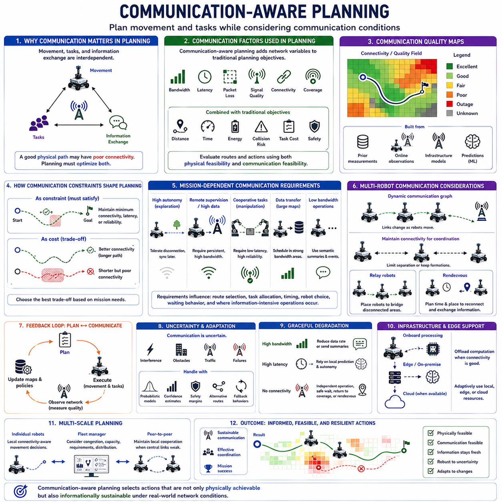{width="7.268055555555556in" height="7.268055555555556in"}

Communication-aware planning treats network conditions as part of the planning problem rather than assuming that communication will always be available when robots need it. In a multi-robot system, motion, task execution, and information exchange are interdependent. A robot's route can affect connectivity, while communication quality can determine which cooperative actions, shared decisions, or remote services remain feasible.

Conventional planning often optimizes geometric distance, travel time, energy consumption, collision risk, or task completion cost. Communication-aware planning adds variables such as bandwidth, latency, packet loss, signal quality, connectivity, and network coverage. The resulting planner evaluates not only whether a robot can physically reach a destination, but whether the communication conditions along the route are compatible with mission requirements.

This distinction becomes important when robots depend on shared information. A robot may require frequent map updates, fleet instructions, cooperative perception, remote supervision, or coordination with teammates. A geometrically shortest route through a communication shadow may therefore be less useful than a slightly longer route that maintains reliable connectivity. Planning must evaluate communication value together with conventional navigation costs.

Communication quality can be represented spatially through connectivity maps or predicted network fields. These representations estimate signal strength, achievable throughput, expected latency, packet-loss probability, or access-point availability across the environment. A planner can combine such information with occupancy, traversability, semantic, and risk maps so that communication conditions become another property of the operational world.

Connectivity maps may be constructed from prior measurements, infrastructure models, online observations, or predictions. Robots can record communication performance while moving and contribute these measurements to a shared map. Over time, the fleet can identify reliable coverage areas, weak-signal regions, transition zones, and recurrent communication shadows, allowing future plans to account for observed network behavior.

Communication-aware path planning can formulate connectivity as either a cost or a constraint. A planner may penalize routes expected to produce poor communication while still allowing them when necessary, or it may impose a minimum connectivity requirement that cannot normally be violated. The appropriate formulation depends on whether communication is merely beneficial or essential for the mission being performed.

Different missions require different communication constraints. A highly autonomous robot performing independent mapping may tolerate temporary disconnection and synchronize information later. A robot receiving continuous remote perception or supervision may require persistent connectivity. Cooperative manipulation or tightly coordinated formation control may impose stricter latency and reliability requirements than loosely coupled exploration.

Planning should therefore consider the communication dependency of each task. Tasks requiring large data transfers may be scheduled in regions with strong bandwidth, while low-bandwidth autonomous activities can be assigned to poorly connected areas. Communication requirements can influence not only route selection but also task allocation, execution order, robot selection, waiting behavior, and the location where information-intensive operations occur.

Multi-robot planning introduces additional complexity because communication depends on relationships among moving agents. Robots may communicate directly, through infrastructure, or through other robots acting as relays. As agents move, the communication graph changes. Planning can therefore consider whether future robot configurations preserve the links required for coordination, consensus, information sharing, or command delivery.

Connectivity maintenance is particularly important for distributed teams. A group exploring a large environment may spread apart to increase coverage, but excessive separation can fragment the communication network. Communication-aware planning balances exploration or task efficiency against the need to preserve sufficient links between robots, potentially constraining distance, formation geometry, or movement direction.

Relay robots provide another planning mechanism. Instead of requiring every robot to remain within direct infrastructure coverage, selected robots can occupy positions that maintain communication between disconnected regions. Relay placement becomes part of the planning problem, balancing the value of using a robot as a communication bridge against the productive task capacity that is temporarily sacrificed.

Communication-aware planning can also use rendezvous strategies. Robots operating independently in disconnected areas may plan specific locations and times at which they reconnect and exchange maps, task status, observations, or learned information. This enables missions to tolerate intermittent connectivity without requiring permanent network coverage, provided that robots retain sufficient autonomy between synchronization opportunities.

The planner must also consider the freshness of information. A robot disconnected for an extended period may continue operating with increasingly outdated fleet state, map information, task assignments, or teammate intentions. Communication-aware planning can estimate how long information remains useful and schedule reconnection before uncertainty or information age exceeds acceptable operational limits.

Network congestion can influence planning even when physical connectivity is strong. Many robots entering the same area may compete for wireless resources, reducing effective bandwidth and increasing latency. A communication-aware fleet planner can distribute robots spatially, stagger data-intensive activities, modify update rates, or select different access points to prevent communication demand from concentrating excessively in one region.

Planning and communication can therefore form a feedback loop. Network measurements influence route and task decisions, while robot movements change network topology and traffic demand. The resulting communication conditions are measured again and used to update future plans. This continuous interaction allows planning policies to adapt to dynamic environments rather than relying exclusively on static assumptions about network coverage.

Uncertainty is unavoidable because communication quality can change because of interference, moving obstacles, environmental structure, competing traffic, or infrastructure failure. A planner should therefore avoid treating predicted connectivity as perfectly deterministic. Confidence estimates, probabilistic connectivity models, safety margins, alternative routes, and fallback behaviors can improve robustness when actual communication differs from prediction.

Graceful degradation is a central principle of communication-aware planning. If bandwidth falls, robots may reduce data transmission or switch to semantic summaries. If latency increases, they may rely more heavily on local prediction and autonomous decisions. If communication disappears, plans can transition toward independent operation, safe waiting, return-to-coverage behavior, or scheduled reconnection depending on mission requirements.

Communication recovery can itself become a planning objective. A robot that loses contact may navigate toward a previously known coverage region, elevated location, relay robot, or infrastructure access point. The recovery behavior should consider physical safety and mission priority rather than blindly seeking the strongest signal. Reconnection is therefore integrated with navigation and task reasoning.

Edge and on-premise infrastructure can also influence planning decisions. Robots may choose when and where to offload computationally demanding functions based on available connectivity and nearby computational resources. A robot can perform local inference when disconnected and use edge processing when high-bandwidth, low-latency communication becomes available, creating adaptive cooperation between onboard and infrastructure intelligence.

In large fleets, communication-aware planning should operate at multiple scales. Individual robots can make local connectivity-sensitive motion decisions, while fleet managers consider network congestion, infrastructure capacity, task communication requirements, and regional robot distribution. Peer-to-peer coordination can preserve local cooperation when centralized connectivity becomes weak, producing a hybrid planning architecture.

Ultimately, communication-aware planning recognizes that movement determines information access and information access influences feasible movement and cooperation. By incorporating bandwidth, latency, reliability, connectivity, information freshness, and communication dependency into planning decisions, multi-robot Physical AI can select actions that are not only physically achievable but also informationally sustainable under realistic network conditions.

## 04.10. Intermittent and Degraded Connectivity

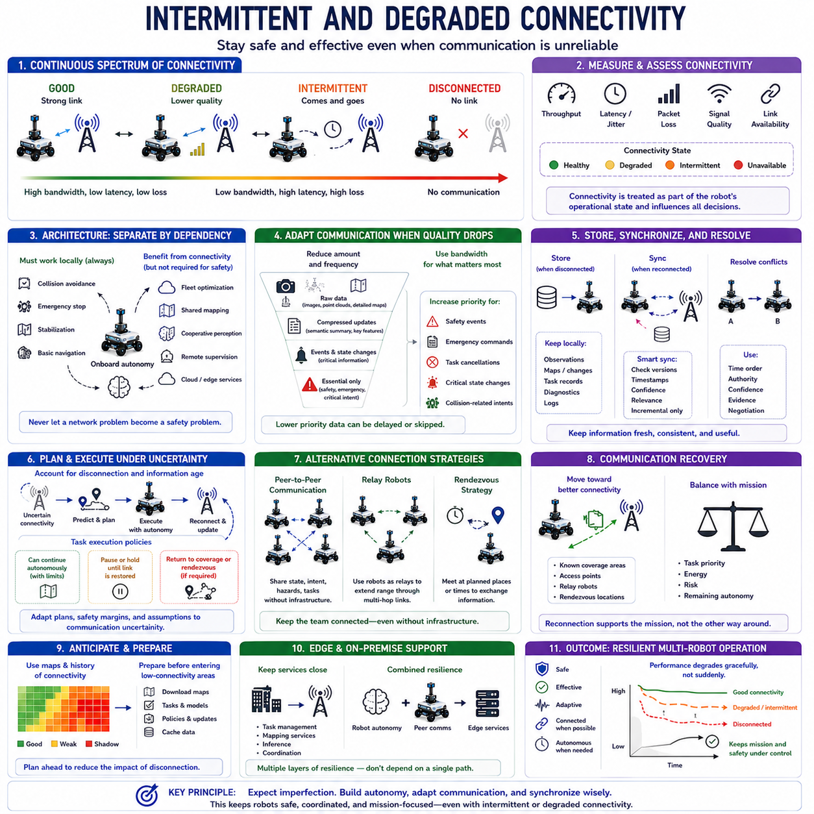{width="7.268055555555556in" height="7.268055555555556in"}

Intermittent and degraded connectivity is a normal operating condition for many multi-robot systems rather than an exceptional network failure. Mobile robots move through environments where wireless coverage, interference, obstacles, distance, network congestion, and infrastructure availability continuously change. Coordination must therefore remain functional when communication quality fluctuates, temporarily disappears, or provides only limited capacity.

Intermittent connectivity occurs when communication links repeatedly become available and unavailable over time. A robot may leave infrastructure coverage, move behind a structure, enter an underground area, or become separated from peer robots. The system cannot assume continuous access to fleet state, maps, commands, or shared services, so robots must preserve sufficient local autonomy to continue operating safely between communication opportunities.

Degraded connectivity differs from complete disconnection because communication remains possible but with reduced quality. Available bandwidth may fall, latency and jitter may increase, or packet loss may become significant. Under these conditions, attempting to maintain normal communication behavior can worsen congestion. Robots should instead adapt the amount, frequency, priority, and representation of transmitted information to current network capacity.

Connectivity should therefore be represented as part of the robot\'s operational state. Measurements such as throughput, signal quality, latency, packet loss, queue delay, and link availability can indicate whether communication is healthy, degraded, intermittent, or unavailable. These conditions can influence planning and coordination just as battery level, localization confidence, sensor health, or environmental risk affects autonomous behavior.

A useful architecture separates functions according to their dependence on communication. Immediate collision avoidance, stabilization, emergency stopping, and basic navigation should remain executable locally. Fleet optimization, shared mapping, cooperative perception, and remote supervision may benefit strongly from connectivity but should not become hidden dependencies for basic safety. This separation prevents a temporary network problem from becoming a physical control failure.

When connectivity deteriorates, graceful degradation allows the robot to reduce communication demand systematically. Raw images, point clouds, and detailed maps can be replaced by object lists, semantic summaries, compressed updates, or critical events. Update frequencies can be lowered, redundant telemetry suppressed, and nonessential transfers postponed. Available bandwidth is then reserved for information with the greatest immediate coordination value.

Message priority becomes increasingly important under degraded conditions. Safety events, emergency commands, task cancellations, critical state transitions, and collision-related intentions should normally be transmitted before routine telemetry or historical data. Priority queues and deadline-aware policies allow limited network resources to support the information whose loss or delay would have the greatest operational consequence.

Robots must also distinguish between information that can be delayed and information that becomes useless when delayed. A diagnostic log can often be stored locally and uploaded later, whereas a trajectory intention or temporary obstacle report may lose value within seconds. Timestamps, validity intervals, expiration rules, and sequence identifiers allow receivers to reject obsolete information when delayed messages finally arrive.

Store-and-forward communication provides an important mechanism for intermittent networks. A disconnected robot can retain observations, task records, map changes, diagnostics, and other noncritical information in local storage. When communication becomes available again, selected information can be synchronized with peers or infrastructure. This approach separates the time at which information is generated from the time at which network delivery becomes possible.

Synchronization after reconnection requires more than simply transmitting everything that accumulated during disconnection. Some information may already be obsolete, duplicated, or superseded by newer observations. Robots should compare versions, timestamps, identifiers, confidence, and relevance to determine what must be exchanged. Incremental synchronization reduces bandwidth demand and prevents stale information from overwriting newer shared knowledge.

Conflicts can arise when several disconnected robots independently modify shared state. Two robots may accept overlapping tasks, update the same map region differently, or form inconsistent beliefs about resource availability. Reconnection therefore requires conflict-resolution mechanisms that consider temporal order, authority, confidence, local evidence, task ownership, or explicit negotiation rather than assuming that all disconnected updates are mutually compatible.

Intermittent connectivity also affects shared maps and world models. A disconnected robot may continue building a local representation while the fleet-level representation evolves independently. When the link returns, map fragments and semantic changes must be aligned and fused. Uncertainty should reflect both sensing error and the age of information accumulated during the disconnected period.

Intent sharing becomes especially challenging because future plans can change while robots cannot communicate. A robot should avoid assuming that the last received intention of a disconnected teammate remains valid indefinitely. As information age increases, uncertainty about remote behavior should also increase. Planning can compensate through larger safety margins, conservative assumptions, prediction, or avoidance of coordination that requires unavailable information.

Task execution policies should explicitly define what a robot may do while disconnected. Some tasks can continue autonomously, some may continue only within predefined limits, and others may require the robot to pause or return to coverage. The decision depends on safety, mission criticality, required shared information, available onboard intelligence, and the consequences of acting without fleet-level coordination.

Reconnection can itself become a behavioral objective. A robot may navigate toward a known coverage region, infrastructure access point, relay robot, or rendezvous location when communication becomes necessary. However, communication recovery should be balanced against task priority, energy consumption, physical risk, and remaining autonomy. Seeking connectivity should support the mission rather than automatically overriding all other objectives.

Peer-to-peer communication can provide an alternative path when infrastructure connectivity is degraded. Nearby robots may continue exchanging state, intent, hazards, or task information even when a central fleet server is unreachable. Selected robots can also function as communication relays, allowing information to propagate through a dynamic multi-hop network and extending coordination beyond direct infrastructure coverage.

Rendezvous strategies offer another solution when continuous connectivity is impractical. Robots can operate independently for predefined periods and meet at planned locations or communication windows to exchange information. This model is useful in large outdoor environments, tunnels, remote facilities, or exploration missions where permanent wireless infrastructure may be unavailable or economically impractical.

Planning should account for expected periods of disconnection before they occur. Connectivity maps and historical network measurements can identify communication shadows and weak-coverage regions. A robot can download required maps, tasks, models, or policies before entering such an area and schedule synchronization after leaving it. Anticipatory preparation reduces dependence on reactive recovery after communication has already failed.

Edge and on-premise systems can improve resilience by keeping important services physically closer to robot operations. Site-level task management, map services, inference, and coordination can remain available even when external cloud connectivity fails. Combined with onboard autonomy and peer communication, this creates multiple operational layers rather than making the fleet dependent on a single remote communication path.

Ultimately, intermittent and degraded connectivity should be treated as an expected dimension of the physical operating environment. Robust multi-robot Physical AI combines local autonomy, adaptive communication, semantic compression, prioritized messaging, store-and-forward operation, synchronization, peer cooperation, and communication-aware planning so that temporary network limitations reduce performance gracefully without immediately destroying coordination or safety.

## 04.11. Time Synchronization and Distributed Consistency

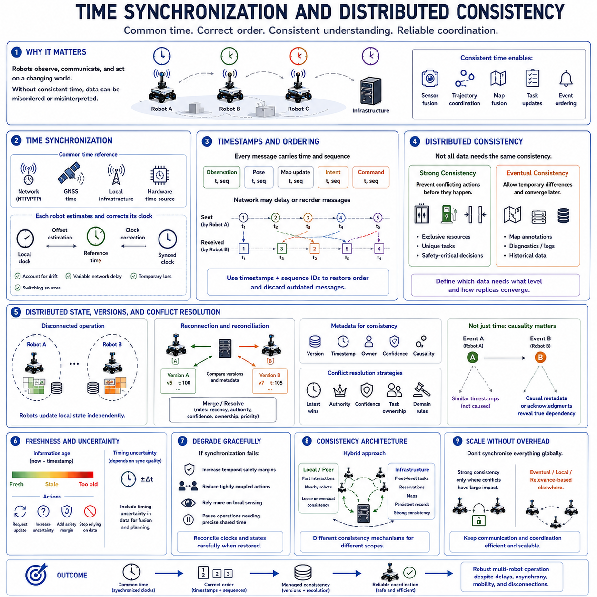{width="7.268055555555556in" height="7.268055555555556in"}

Time synchronization and distributed consistency are fundamental to multi-robot coordination because robots observe, communicate, and act on a world that changes continuously. Information produced by different agents becomes useful only when its temporal relationships can be understood. Without a sufficiently consistent notion of time, sensor observations, robot states, trajectories, maps, events, and task updates may be combined in incorrect temporal order.

Each robot normally maintains its own local clock, but independent clocks are never perfectly identical. Hardware oscillators drift, software introduces scheduling delays, and communication paths create variable transmission times. Even small clock differences can become significant when multiple robots exchange rapidly changing state or fuse sensor measurements. Time synchronization therefore establishes a common temporal reference across robots and infrastructure.

Synchronization does not necessarily require every clock to be mathematically identical. The required accuracy depends on the coordinated function. Historical logging may tolerate relatively large timing errors, while cooperative localization, sensor fusion, trajectory coordination, or rapidly moving multi-robot interaction may require much tighter synchronization. Temporal precision should therefore be designed according to the physical consequences of timing uncertainty.

Common time references can be provided through network-based synchronization, GNSS timing, local infrastructure, or dedicated hardware mechanisms. Robots periodically estimate and correct clock offsets relative to an agreed reference. The architecture should also consider clock drift between synchronization events, variable network delays, temporary loss of the reference source, and the transition between different synchronization mechanisms as connectivity changes.

Timestamps connect synchronized time to operational information. Sensor observations, poses, velocity estimates, map updates, task transitions, intentions, and commands should indicate when they were generated or became valid. A receiving robot can then reason about the age of information instead of assuming that arrival time represents observation time. This distinction is essential whenever network delay is variable.

Temporal ordering is especially important because communication networks can deliver messages later than expected or in a different order from their generation. A newer pose update may arrive before an older one, or a task cancellation may cross the network while an earlier task-progress message remains delayed. Sequence identifiers and timestamps allow receivers to reconstruct ordering and prevent obsolete messages from replacing newer state.

Distributed consistency concerns whether multiple robots maintain sufficiently compatible views of shared information. Perfectly identical state at every instant is usually unrealistic because observations, computation, and communication occur asynchronously. The practical objective is therefore to define which information must be strongly consistent, which can temporarily diverge, and how inconsistent replicas eventually converge toward an acceptable shared state.

Strong consistency is valuable when conflicting decisions could create immediate operational problems. Exclusive access to an elevator, charging station, docking location, narrow corridor, or unique task may require agreement about ownership before action proceeds. A coordination service or distributed protocol can ensure that two robots do not simultaneously believe they possess the same exclusive resource.

Other information can tolerate eventual consistency. Map annotations, diagnostic records, historical observations, or noncritical semantic updates may temporarily differ among robots and be reconciled later. Eventual consistency reduces communication and synchronization requirements because every update does not need immediate global agreement. The acceptable convergence time depends on how quickly inconsistency could influence physical behavior.

Consistency becomes challenging during intermittent connectivity. A disconnected robot may continue updating its local map, task progress, world model, or resource assumptions while other robots independently change the shared state. When communication returns, the system must determine how these parallel histories should be merged rather than simply assuming that one complete copy should replace another.

Version information supports this reconciliation process. Shared objects can include revision numbers, update identifiers, timestamps, ownership information, or causal relationships that indicate how state evolved. When conflicting versions appear, the system can compare their histories and apply rules based on recency, authority, confidence, task ownership, or domain-specific priorities.

Clock time alone cannot always establish causality. Two events occurring on different robots may have similar timestamps even though one event was logically caused by information from the other. Distributed systems can therefore supplement physical timestamps with logical ordering, sequence relationships, acknowledgments, or causal metadata. These mechanisms help distinguish temporal proximity from actual dependency between events.

Map consistency illustrates the interaction between time, uncertainty, and distributed state. Two robots may observe the same region at different times and report different obstacles or semantic conditions. The correct interpretation may be that the environment changed rather than that one observation is wrong. Map fusion should therefore consider observation time, persistence, confidence, source, and expected environmental dynamics.

Intent consistency is similarly time-sensitive. A robot may announce a planned trajectory and then replan because of a newly detected obstacle. Other robots must distinguish the new intention from the superseded one. Intent messages should therefore carry generation time, planning horizon, version, and validity information so that outdated trajectories do not continue influencing coordination after the originating robot has changed its plan.

Task consistency requires clear transitions between states such as available, assigned, accepted, executing, completed, failed, and cancelled. Distributed copies of task status can temporarily disagree when messages are delayed or robots disconnect. Explicit state-transition rules and ownership semantics help prevent invalid transitions, duplicated execution, or the reassignment of work that is already being completed elsewhere.

Information freshness provides a useful bridge between synchronization and decision making. A message may be internally correct but too old to support the current decision. Robots can track information age and reduce trust as data becomes stale. Planning algorithms can request an update, increase uncertainty, apply conservative safety margins, or stop depending on remote information after a defined validity threshold.

Uncertainty in synchronization itself should also be represented. A timestamp from a well-synchronized robot can be interpreted more precisely than one generated after prolonged disconnection from the timing reference. Systems can associate timing uncertainty with observations so that sensor fusion, prediction, and coordination algorithms understand not only when an event supposedly occurred but also how accurately that time is known.

Failure of synchronization should lead to graceful degradation rather than uncontrolled behavior. Robots can increase temporal safety margins, reduce tightly coupled cooperation, rely more heavily on local sensing, or suspend operations requiring precise shared timing. When synchronization is restored, clocks and distributed states should be reconciled carefully to avoid sudden discontinuities or incorrect ordering.

Infrastructure can simplify consistency by maintaining authoritative versions of selected shared resources, but central authority should not become an unnecessary dependency for every type of information. Local peer coordination may remain sufficient for rapidly changing nearby interactions, while infrastructure manages fleet-level tasks, reservations, maps, and persistent records. Hybrid architectures can therefore apply different consistency mechanisms at different scopes.

Scalability requires avoiding global synchronization for information that does not require it. Forcing every robot to agree immediately on every state change creates excessive communication and coordination overhead. Practical systems synchronize strongly only where conflicts have significant consequences and use local, eventual, or relevance-based consistency elsewhere, allowing large fleets to operate without turning synchronization into a system-wide bottleneck.

Ultimately, time synchronization establishes when distributed information belongs in the evolving physical world, while distributed consistency determines how multiple versions of that information become a coherent operational understanding. By combining timestamps, ordering, freshness, uncertainty, versioning, conflict resolution, and appropriate consistency levels, multi-robot Physical AI can coordinate reliably despite asynchronous computation, communication delays, mobility, and temporary disconnection.

## 04.12. Secure Multi Robot Communication

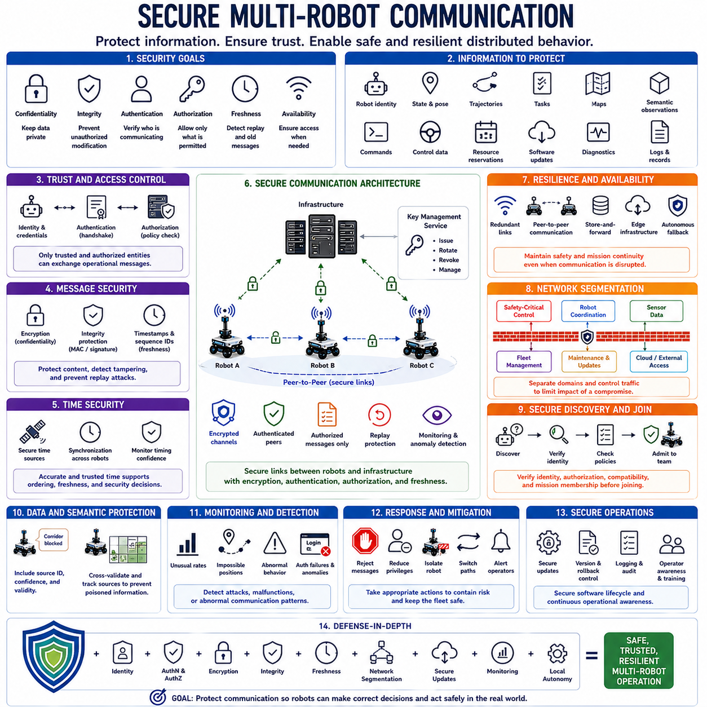{width="7.268055555555556in" height="7.268055555555556in"}

Secure multi-robot communication protects the information exchanges that allow distributed robots to coordinate perception, planning, tasks, motion, and shared resources. Because communication can directly influence physical behavior, a compromised message is not merely a data-security problem. False commands, manipulated maps, forged robot states, or corrupted intentions can produce unsafe actions in the physical environment.

Security begins by identifying what must be protected. Multi-robot networks exchange robot identity, state, pose, trajectories, task assignments, maps, semantic observations, control messages, software updates, diagnostics, and operational records. These information types have different consequences if exposed, modified, delayed, replayed, or blocked, so communication security should reflect their operational importance.

Confidentiality prevents unauthorized parties from reading protected communication. Encryption can protect sensitive task information, operational maps, robot telemetry, credentials, or sensor-derived information while data moves between robots and infrastructure. However, confidentiality alone is insufficient because an encrypted message can still be dangerous if its sender is unauthorized or its contents have been maliciously modified.

Integrity ensures that received information has not been altered during transmission. This is especially important for commands, task assignments, trajectories, map updates, safety states, and resource reservations. Cryptographic integrity mechanisms allow receiving robots to detect unauthorized modification and reject corrupted messages before the information influences planning, control, or shared world models.

Authentication establishes that a communicating entity is actually the robot, infrastructure service, operator, or application it claims to be. Without authentication, an attacker or malfunctioning device could impersonate a trusted robot and inject false information into the fleet. Secure identities, certificates, cryptographic credentials, and authenticated sessions can establish trust before operational messages are accepted.

Authorization determines what an authenticated entity is permitted to do. A robot may be authorized to publish its own state but not modify another robot\'s task, while a fleet manager may assign missions but not directly override safety-critical local control. Role-based or policy-based permissions limit the consequences of compromised components by restricting their authority within the multi-robot system.

Message freshness is essential because a valid message can become dangerous when replayed later. An attacker might retransmit an old command, reservation, trajectory, or task assignment that was previously legitimate. Timestamps, sequence numbers, nonces, expiration periods, and replay detection mechanisms help robots determine whether authenticated messages are new and relevant to the current operational context.

Secure time synchronization supports many of these mechanisms. If robots rely on timestamps to detect replay, evaluate information freshness, order events, or validate credentials, manipulation of the timing system can undermine broader security. Time sources and synchronization protocols should therefore be protected, and robots should recognize when timing confidence becomes insufficient for security-sensitive decisions.

Availability is another central security objective because robots must receive important information when it is needed. Communication can be disrupted by interference, congestion, infrastructure failure, denial-of-service behavior, or deliberate jamming. Multi-robot systems should avoid depending on a single communication channel when loss of that channel could immediately compromise physical safety or mission continuity.

Resilience to communication loss combines security with autonomous behavior. Robots should preserve local collision avoidance, emergency stopping, essential navigation, and predefined safe behaviors when external communication becomes unavailable. Peer-to-peer communication, redundant links, store-and-forward operation, edge infrastructure, and autonomous fallback modes can reduce the operational impact of communication disruption.

Network segmentation limits how far a compromise can propagate. Safety-critical control, robot coordination, sensor data, fleet management, maintenance, external cloud access, and guest or enterprise networks do not necessarily require unrestricted communication with one another. Separating communication domains and controlling traffic between them can reduce attack surfaces and prevent one compromised subsystem from gaining fleet-wide access.

Secure discovery is important in dynamic robot teams because agents may join, leave, reconnect, or move between network regions. A robot should not automatically trust every device that announces itself as a teammate. Discovery procedures should combine identity verification, authorization, compatibility checking, and current mission membership before a newly observed participant is admitted to trusted coordination.

Heterogeneous fleets create additional security challenges because robots may use different processors, operating systems, middleware, communication protocols, and software versions. Security policies must remain consistent across these differences. Common identity models, message security rules, certificate management, interface definitions, and minimum security requirements help establish a shared trust framework across heterogeneous platforms.

Key and credential management becomes increasingly important as fleet size grows. Cryptographic keys must be provisioned securely, stored safely, renewed when necessary, and revoked when a robot or component is no longer trusted. A scalable architecture should avoid relying on manually configured shared secrets that become difficult to rotate and can expose many robots if a single credential is compromised.

Software and firmware updates must also be protected because communication security depends on the integrity of the software implementing it. Robots should verify the authenticity and integrity of update packages before installation. Secure boot, signed software, controlled deployment, rollback policies, and version tracking can help prevent unauthorized code from entering the fleet through maintenance or update mechanisms.

Semantic communication introduces a distinctive security problem because compact messages can have large behavioral consequences. A short message such as "corridor blocked," "human detected," or "charging station unavailable" may cause many robots to replan. Semantic information should therefore include trusted source identity, confidence, temporal validity, and where appropriate corroboration from other robots or local sensing.

Shared maps and world models also require protection against poisoned information. A compromised robot could repeatedly publish false obstacles, incorrect traversability estimates, or manipulated semantic labels. Source tracking, confidence management, anomaly detection, cross-validation, and reputation or trust mechanisms can help prevent one unreliable source from silently corrupting the collective environmental representation.

Intrusion and anomaly detection extend security beyond cryptographic verification. A message can be correctly authenticated yet still represent abnormal behavior because a legitimate robot has malfunctioned or been compromised. Systems can monitor unusual message rates, impossible positions, inconsistent trajectories, unexpected task requests, repeated authentication failures, or abnormal communication patterns to identify suspicious behavior.

Security monitoring should be connected to operational response. Detecting abnormal communication is useful only if the system can react appropriately. Responses may include rejecting messages, reducing an entity\'s privileges, isolating a robot, switching communication paths, requesting additional verification, alerting operators, or transitioning affected robots into safer autonomous modes while preserving unaffected fleet operation.

Security mechanisms themselves consume computation, bandwidth, storage, and time. Encryption, authentication, verification, logging, and security handshakes can introduce processing and communication overhead. Multi-robot Physical AI must therefore integrate security with real-time requirements, ensuring that protective mechanisms are sufficiently strong without making safety-critical coordination unable to meet its timing constraints.

A defense-in-depth architecture avoids relying on a single protective mechanism. Secure identity, authentication, authorization, encryption, integrity protection, network segmentation, secure updates, anomaly detection, redundancy, local autonomy, and operational monitoring protect different layers of the system. If one layer fails, additional layers can restrict the attack and reduce its effect on physical operation.

Ultimately, secure multi-robot communication establishes trusted information exchange among autonomous physical agents. The objective is not only to protect data but to preserve safe and dependable collective behavior. By combining confidentiality, integrity, authentication, authorization, freshness, availability, resilient autonomy, monitoring, and layered defenses, multi-robot Physical AI can coordinate while limiting the ability of compromised communication to become compromised physical action.

## 04.13. Communication Optimization Example [w/Code]

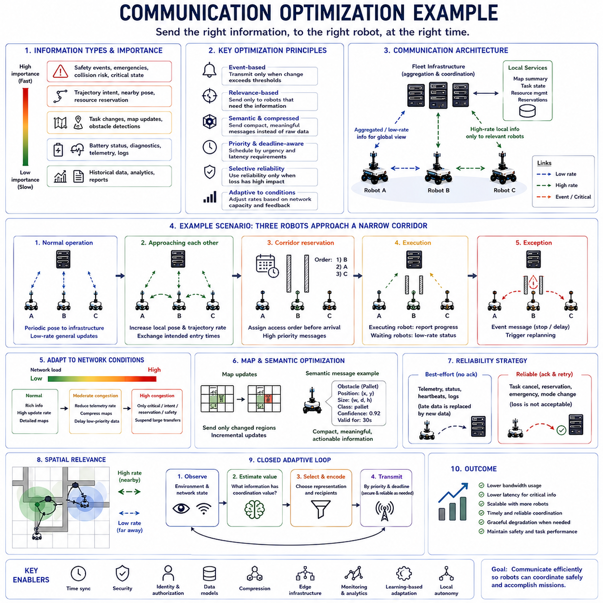{width="7.268055555555556in" height="7.268055555555556in"}

Communication optimization in a multi-robot system aims to preserve the information required for coordination while reducing unnecessary network traffic. Consider a warehouse fleet in which many autonomous mobile robots continuously exchange pose, velocity, task status, local map changes, detected obstacles, and intended trajectories. If every robot broadcasts every variable at a fixed high rate, network load can increase rapidly as the fleet grows.

A simple optimization example begins by separating communication according to information type and operational importance. Safety-critical state and nearby trajectory intentions require fast delivery, while battery reports, diagnostic records, and stable map information can tolerate slower updates. Instead of assigning one communication policy to all data, the system establishes different transmission rules according to urgency, freshness requirements, and expected coordination value.

Assume each robot initially transmits its complete state at a fixed frequency regardless of whether anything has changed. During normal straight-line motion, consecutive messages may contain nearly identical position, velocity, battery, and task information. An event-aware policy can suppress redundant updates and transmit when a variable exceeds a change threshold, while periodic heartbeat messages maintain basic connectivity awareness.

Spatial relevance provides another optimization opportunity. A robot\'s precise trajectory is usually most important to robots operating nearby or approaching the same intersection, corridor, docking station, or work area. Instead of fleet-wide broadcasting, the communication system can distribute high-frequency motion information only to relevant neighboring agents. Fleet-level infrastructure receives aggregated or lower-frequency state when detailed local information is unnecessary.

The same principle can be applied to map communication. Transmitting an entire occupancy or semantic map whenever a local observation changes is inefficient. Robots can send only changed map regions, newly detected obstacles, updated traversability conditions, or semantic events. Incremental updates reduce message size while allowing other robots and infrastructure to maintain sufficiently current environmental representations.

Semantic communication further reduces bandwidth requirements. Suppose a robot detects a pallet blocking an aisle using camera and LiDAR data. Instead of transmitting the complete image and point cloud, it can send a compact message describing the obstacle class, position, dimensions, confidence, affected corridor, and estimated validity. Other robots receive the information required for planning without processing the original sensor streams.

Communication priority can be dynamically adjusted when network conditions deteriorate. Under normal conditions, robots may exchange detailed state and map information. If congestion increases, low-priority diagnostics and historical data can be delayed, map updates can be compressed, and telemetry rates can be reduced. Safety events, emergency states, collision-related intentions, and critical task changes retain higher transmission priority.

A practical optimization policy can therefore combine periodic, event-based, and relevance-based communication. Periodic messages provide baseline state and health information, event-based messages report important changes immediately, and relevance-based distribution determines which receivers actually need each message. These mechanisms complement one another rather than requiring the system to choose a single communication method.

Latency requirements should also influence optimization. A large map update may be important but not immediately urgent, while a small trajectory-change message may require delivery within a short deadline. Scheduling messages only according to size or arrival order can therefore be inefficient. Deadline-aware scheduling prioritizes information according to how quickly its coordination value decreases with time.

Reliability can be optimized in a similar way. Requiring acknowledgments and retransmission for every telemetry message consumes bandwidth unnecessarily because newer telemetry soon replaces older data. In contrast, task cancellation, exclusive resource reservation, emergency commands, or critical mode transitions may require confirmed delivery. Selective reliability applies stronger communication guarantees only where message loss has significant consequences.

The optimization process can use network measurements as feedback. Robots and infrastructure monitor throughput, packet loss, latency, jitter, queue occupancy, and signal quality. When network capacity decreases, communication policies become more selective. When capacity improves, richer information or higher update rates can be restored. Communication behavior therefore adapts continuously instead of relying on permanently fixed parameters.

Consider three robots approaching the same narrow corridor. Under ordinary operation, each robot reports its pose periodically to fleet infrastructure. As they approach one another, spatial relevance increases, so their pose and trajectory update rates rise locally. Each robot communicates its intended corridor entry time, and the coordination mechanism assigns an access order before the robots physically reach the constrained region.

After the corridor reservation is established, unnecessary high-rate communication can again decrease. The robot currently using the corridor reports its progress and significant deviations, while waiting robots maintain lower-rate status updates. If the executing robot stops unexpectedly, an event message immediately reports the abnormal condition and triggers replanning. Communication intensity therefore follows the coordination need rather than remaining constant.

The same example illustrates graceful degradation. If bandwidth suddenly falls while the robots negotiate corridor access, detailed map transfers can be suspended and communication can switch to compact state, intent, reservation, and safety messages. Local collision avoidance remains onboard. The robots preserve the information necessary for safe coordination even though the network can no longer support the richer information exchange used under normal conditions.

Information freshness prevents optimization from producing unsafe decisions. A highly compressed or infrequently transmitted message is useful only while its represented state remains valid. Messages therefore carry timestamps, sequence identifiers, validity periods, or versions. A receiving robot can reject an outdated corridor reservation or trajectory rather than assuming that successful delivery means the information still represents current conditions.

Optimization can also consider predicted communication quality during planning. If one region of the facility has weak wireless coverage, robots can download required task and map information before entering it. They may temporarily rely on local autonomy, store noncritical updates, and synchronize after reconnecting. For communication-dependent tasks, the planner may instead select a route or execution location with stronger connectivity.

Edge or on-premise infrastructure can aggregate information to improve scalability. Rather than every robot exchanging detailed information with every other robot, local coordination services can maintain fleet-level task state, shared map summaries, and resource reservations. Robots still communicate directly when low-latency local interaction is valuable, producing a hybrid architecture that combines centralized aggregation with peer-to-peer coordination.

Optimization should not reduce communication blindly. Excessive suppression can remove information needed to predict conflicts, while excessive compression can hide uncertainty or semantic detail. The objective is to minimize communication cost subject to constraints on safety, coordination quality, information freshness, and task performance. Communication efficiency is therefore evaluated by the usefulness of delivered information rather than by bandwidth reduction alone.

As fleet size grows, this principle becomes increasingly important. A fixed all-to-all communication strategy can generate rapidly increasing traffic, while regional grouping, multicast, event triggering, semantic compression, aggregation, and adaptive update rates keep communication focused on relevant interactions. The network becomes a managed coordination resource whose capacity is allocated according to operational demand.

Ultimately, the communication optimization example demonstrates a closed adaptive loop: robots observe both the physical environment and network condition, estimate which information has coordination value, select an appropriate representation and recipient, transmit according to priority and deadline, and then adjust the policy using communication feedback. This allows multi-robot Physical AI to maintain scalable, timely, and reliable coordination without transmitting every available piece of information.
