**Volume 09. Multi Robot and Swarm Physical AI**

# Chapter 05. Collective Learning

## 05.01. From Individual to Collective Learning

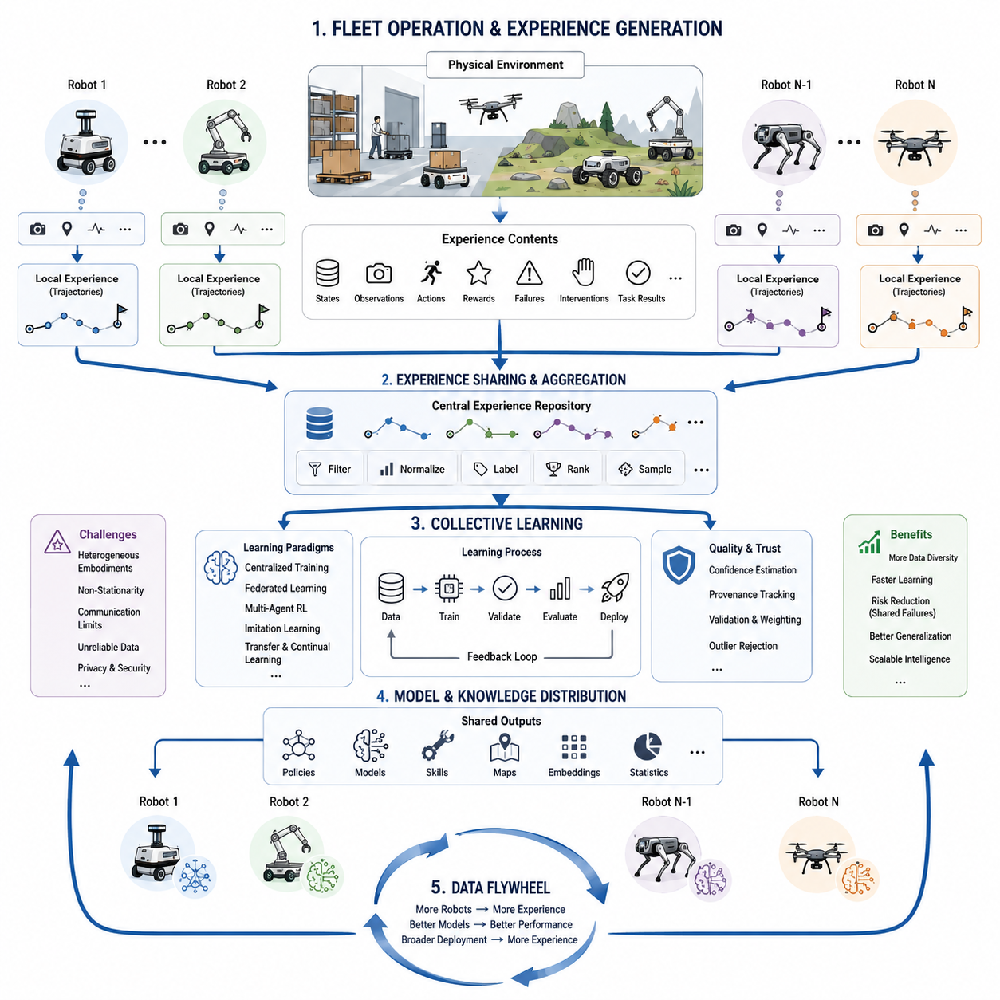{width="7.268055555555556in" height="7.268055555555556in"}

Individual robot learning focuses on improving the behavior of a single embodied agent from its own observations, actions, rewards, demonstrations, and interaction history. Collective learning extends this principle across multiple robots so that experience acquired by one member can contribute to the competence of others. In a multi-robot Physical AI system, the learning unit therefore evolves from an isolated robot into a connected population of agents that accumulate knowledge together.

This transition changes the fundamental economics of robot learning. A single robot can experience only a limited number of environments, failures, objects, terrain conditions, and task variations during a given period. A fleet can collect many experiences simultaneously. When those experiences are aggregated appropriately, hundreds of robot-hours can be transformed into shared training data during one hour of fleet operation, dramatically increasing the diversity and rate of learning.

Collective learning does not require every robot to execute exactly the same policy or maintain an identical internal model. Each robot may preserve local knowledge associated with its embodiment, sensors, operational environment, or assigned role while contributing transferable information to a shared learning process. The objective is to separate knowledge that is generally useful across the fleet from knowledge that should remain specific to particular robots, tasks, or environments.

A useful abstraction is to consider each robot as both an actor and a data-generating learning node. During operation, robots perceive the physical environment, select actions, observe outcomes, and generate trajectories containing states, observations, actions, rewards, failures, interventions, and task results. These local experiences become potential learning resources rather than disappearing after execution, allowing operational activity to continuously enlarge the collective experience of the fleet.

The simplest transition from individual to collective learning occurs through centralized experience aggregation. Robots upload selected trajectories to a common repository where data can be filtered, normalized, labeled, ranked, or converted into training samples. A shared model is then trained using experience gathered across the population and redistributed to individual robots. Although conceptually straightforward, this approach establishes the essential feedback loop between fleet operation, data collection, learning, and deployment.

The value of collective experience is not determined only by its volume. Different robots frequently encounter different portions of the operational distribution. One warehouse robot may discover congestion patterns, another may experience unusual payload dynamics, and another may encounter difficult perception conditions. Combining these experiences broadens the learning distribution and allows the resulting system to acquire capabilities that would be difficult for any individual robot to obtain through isolated operation.

Failure experience is particularly important because successful operation often produces repetitive and predictable data. Rare collisions, localization degradation, manipulation failures, communication losses, difficult terrain, unusual objects, and human interventions can contain disproportionately valuable information. Collective learning enables these uncommon events to be captured across many robots and converted into shared knowledge, allowing one robot\'s difficult encounter to reduce the probability that other robots repeat the same failure.

Collective learning also introduces the distinction between experience sharing and knowledge sharing. Raw sensor streams and trajectories can be exchanged as experience, but communication and storage constraints may make continuous transmission impractical. Robots can instead share compressed representations, learned parameters, gradients, embeddings, policies, skills, maps, statistics, or selected episodes. The appropriate representation depends on whether the fleet is optimizing bandwidth, privacy, training efficiency, adaptation speed, or cross-robot compatibility.

Physical embodiment makes this process more difficult than collective learning among purely digital agents. Robots may have different cameras, LiDAR configurations, manipulators, mobility systems, payload limits, control frequencies, and action spaces. Even nominally identical robots gradually develop different calibration states and mechanical characteristics. Consequently, collective learning requires representations that distinguish transferable task knowledge from embodiment-specific information that cannot safely be copied directly between platforms.

A major architectural choice concerns where learning occurs. Training may be centralized on an on-premise or cloud computing system, distributed across robots, or divided between fleet infrastructure and onboard processors. Centralized training provides access to large aggregated datasets and substantial compute resources, while distributed approaches preserve locality and reduce raw-data transfer. Hybrid architectures can combine fleet-scale model improvement with rapid local adaptation during physical operation.

Collective learning must also address non-stationarity. As robots learn and updated policies are deployed, the behavior of the fleet changes, which in turn changes the data generated by future interactions. Experience collected under an older navigation or coordination policy may not represent the distribution produced by a newer one. Dataset versioning, policy identification, temporal metadata, evaluation, and controlled deployment therefore become important components of the collective learning lifecycle.

Trust is equally important because not every observation or update should influence the fleet equally. Sensor faults, corrupted localization, unusual operating conditions, poorly calibrated robots, or unsuccessful experiments can introduce misleading knowledge. Collective systems therefore benefit from confidence estimates, provenance information, validation procedures, and quality weighting. Shared learning should aggregate useful evidence while preventing unreliable local experience from degrading the behavior of the wider population.

The relationship between individual and collective learning is therefore bidirectional rather than hierarchical. Individual robots provide the physical experiences from which collective knowledge emerges, while the collective system returns improved models, policies, representations, or skills to individual robots. Those robots then generate new experiences under improved behavior, producing another learning cycle. This repeated exchange creates a continuously evolving connection between local interaction and fleet-level intelligence.

Such a cycle provides the foundation for more advanced mechanisms developed throughout collective learning, including shared robot knowledge, centralized training with distributed execution, multi-agent reinforcement learning, cooperative imitation learning, federated learning, distributed model updates, skill sharing, cross-robot experience replay, transfer learning, and continual learning. These mechanisms represent different solutions to the same fundamental problem: converting distributed physical experience into reusable collective intelligence.

At fleet scale, the long-term result is a data flywheel in which deployment itself becomes part of the learning infrastructure. More robots create more diverse physical experience; better experience supports stronger models; stronger models improve robot performance; improved performance enables broader deployment; and broader deployment generates still more experience. Collective learning therefore transforms a robot fleet from a collection of independently improving machines into a distributed Physical AI system whose operational history becomes a continuously expanding source of intelligence.

## 05.02. Shared Experience and Robot Knowledge

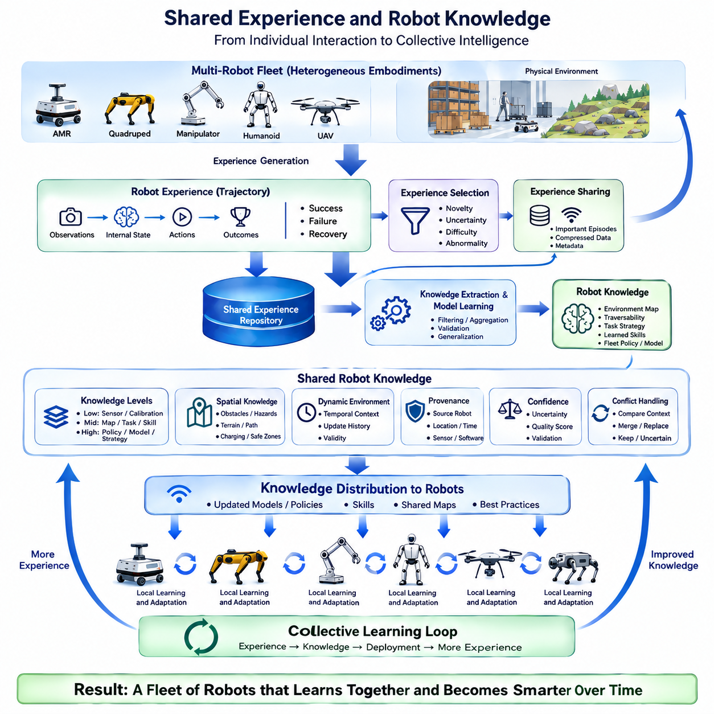{width="7.268055555555556in" height="7.268055555555556in"}

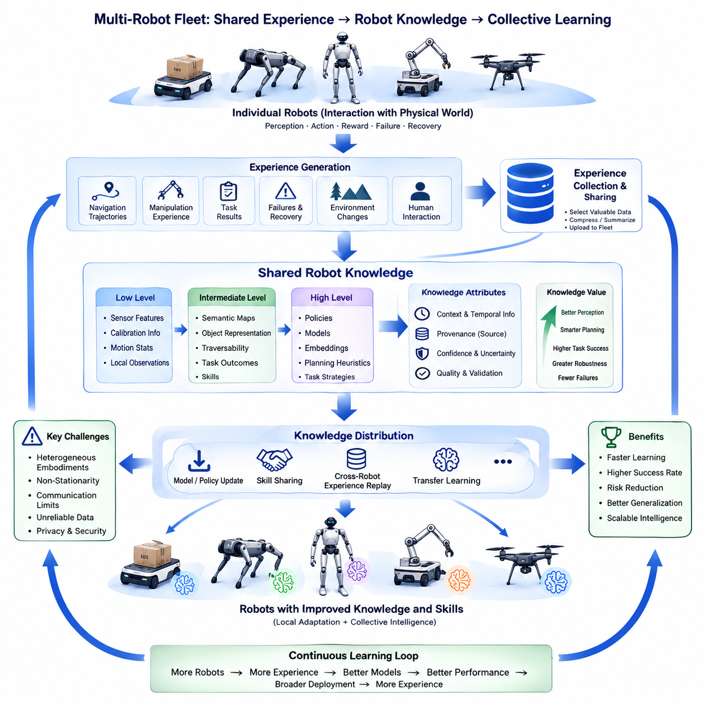{width="7.268055555555556in" height="7.268055555555556in"}

Shared experience allows a multi-robot system to transform isolated physical interactions into reusable knowledge for the entire fleet. Each robot continuously encounters objects, terrain, people, tasks, failures, and environmental changes that other robots may not yet have experienced. When these observations and outcomes are captured and shared, local experience becomes a collective resource rather than knowledge that remains confined to the robot that originally acquired it.

Robot experience can be represented as trajectories that connect observations, internal states, actions, and resulting outcomes over time. A navigation trajectory may contain sensor observations, estimated poses, selected paths, control commands, obstacle encounters, and mission results. Manipulation experience may additionally include object states, grasp attempts, forces, contact events, and success or failure information. These structured histories provide the raw material from which reusable robot knowledge can be extracted.

Not every piece of experience has equal value for collective learning. Repeated successful operations in familiar environments may provide limited new information, whereas rare failures, unexpected obstacles, unusual terrain, localization errors, human interventions, or recovery behaviors can be highly informative. A shared experience system therefore benefits from mechanisms that identify novelty, uncertainty, difficulty, failure, and unusual outcomes so that valuable episodes receive greater attention during storage and learning.

Raw experience and robot knowledge should be distinguished conceptually. Experience describes what a robot observed and what happened during interaction, while knowledge represents information extracted or generalized from those experiences. Thousands of navigation trajectories, for example, may eventually produce knowledge about traversable regions, congestion patterns, obstacle risks, localization reliability, or effective recovery strategies. Collective learning converts distributed experience into representations that can guide future decisions.

Shared robot knowledge can exist at several levels of abstraction. At a low level, robots may exchange sensor features, calibration information, motion statistics, or local environmental observations. At intermediate levels, they may share semantic maps, object representations, traversability estimates, task outcomes, or learned skills. At higher levels, the fleet may distribute policies, models, embeddings, planning heuristics, task strategies, or generalized representations that summarize experience collected across many robots.

Spatial knowledge is especially valuable because physical robots operate in environments whose geometry and semantics strongly influence behavior. One robot may discover a blocked corridor, slippery surface, narrow passage, charging location, temporary construction area, or frequently occupied region. Sharing such information allows other robots to incorporate previously acquired environmental knowledge into planning before directly encountering the same condition, improving efficiency and reducing unnecessary exploration.

Experience sharing also supports knowledge about dynamic environments. A physical workspace is rarely static: people move, inventory changes, doors open and close, equipment is relocated, and traffic conditions vary with time. Shared knowledge must therefore include temporal context rather than treating every observation as permanently valid. Time stamps, observation frequency, confidence, and update history help determine whether previously acquired information should remain active, be revised, or gradually lose importance.

A practical fleet cannot transmit every sensor frame generated by every robot. Cameras, LiDARs, tactile sensors, and other modalities can produce enormous data volumes, while wireless networks have finite bandwidth and intermittent connectivity. Shared experience architectures consequently require selection and compression. Robots may upload important episodes, event-triggered records, compact features, semantic summaries, learned parameters, or metadata instead of continuously transferring complete raw sensor streams.

Knowledge provenance becomes important once information from many robots is combined. The system should ideally know which robot generated an observation, when and where it was acquired, which sensors and software versions were involved, and under what operating conditions it occurred. Provenance enables later validation and debugging and prevents shared knowledge from becoming an anonymous collection of information whose reliability, origin, and relevance cannot be determined.

Confidence must accompany shared knowledge because different observations may have different reliability. A robot with degraded localization or contaminated sensors should not influence fleet knowledge as strongly as a robot operating with high-confidence perception. Shared representations can therefore associate observations with uncertainty, confidence scores, quality indicators, or validation status. Knowledge fusion then becomes a process of combining evidence according to both information content and estimated reliability.

Conflicting knowledge is inevitable in distributed physical systems. Two robots may classify the same terrain differently, report different object positions, or observe an environment at different times. Such disagreement does not necessarily indicate that one robot is wrong because the physical world may have changed between observations. Collective systems must compare timestamps, confidence, context, sensor capabilities, and environmental dynamics before deciding whether information should be merged, replaced, retained separately, or marked as uncertain.

Shared experience becomes particularly powerful when it includes success, failure, and recovery together. A fleet that records only successful trajectories learns what normally works but receives limited information about operational boundaries. Failure episodes reveal conditions under which policies break down, while recovery episodes demonstrate how robots can return to safe or productive states. Together these experiences support more robust navigation, manipulation, coordination, and autonomous decision making.

Heterogeneous fleets make knowledge sharing more challenging because robots may possess different embodiments and capabilities. Experience from an AMR, quadruped, manipulator, humanoid, or UAV cannot always be transferred directly because their sensing and action spaces differ. Nevertheless, higher-level knowledge about objects, hazards, task structure, spatial relationships, semantic environments, and mission outcomes may remain transferable when represented independently from platform-specific control commands.

Shared knowledge can therefore be organized into common and robot-specific components. Common knowledge describes information that is broadly useful across the fleet, while robot-specific knowledge captures embodiment, sensor configuration, payload, mobility, calibration, or operational constraints. This separation allows collective intelligence to benefit from diverse experience without assuming that every robot can perform every action or interpret every observation in exactly the same way.

The overall process forms a continuous knowledge lifecycle. Robots generate experience during physical operation, select valuable observations, attach contextual and confidence information, and contribute them to shared storage or distributed learning mechanisms. The fleet then filters, aggregates, validates, and transforms this experience into reusable knowledge, which is distributed back to robots and applied to future perception, planning, task execution, and learning.

Shared experience and robot knowledge therefore provide the informational foundation for collective learning. They connect individual physical interaction with fleet-scale intelligence and prepare the architecture for centralized training and distributed execution, multi-agent reinforcement learning, federated robot learning, distributed model updates, policy and skill sharing, cross-robot experience replay, and transfer learning. As deployment grows, every robot can become both a consumer and a producer of knowledge for the wider Physical AI fleet.

## 05.03. Centralized Training and Distributed Execution

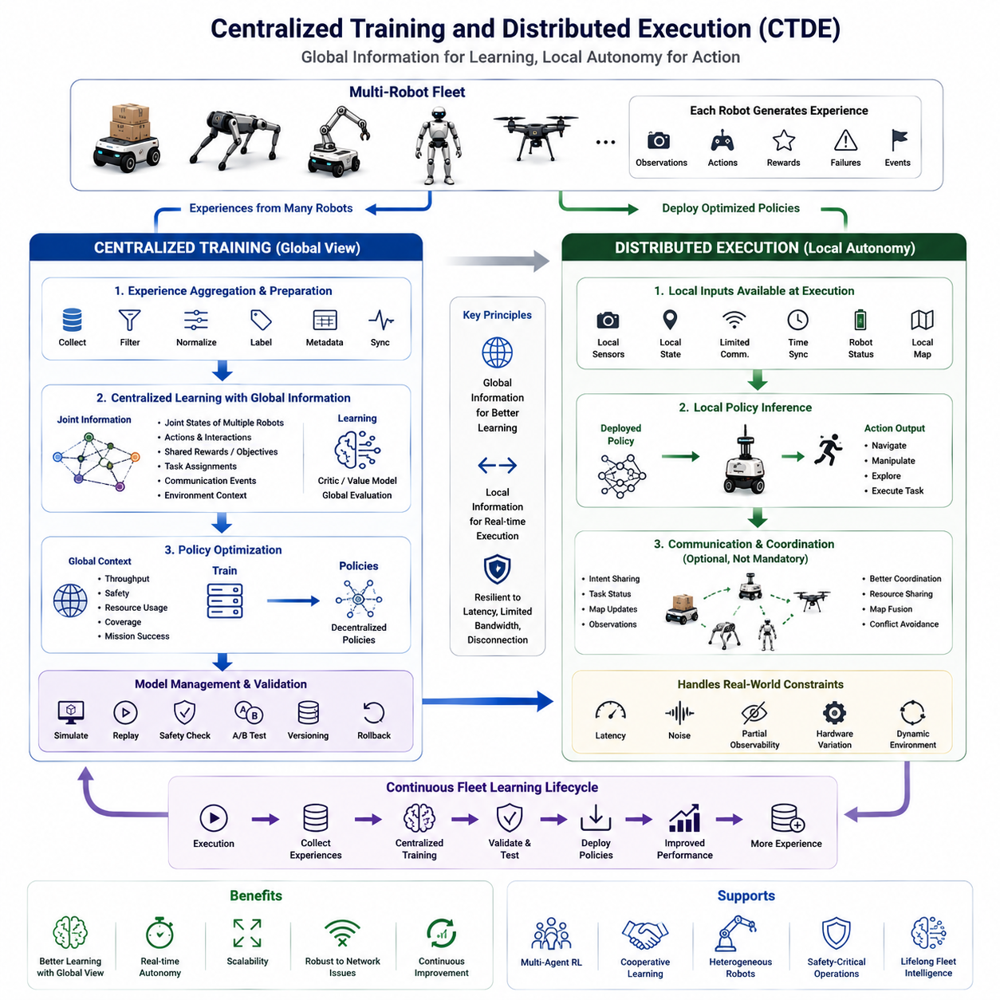{width="7.268055555555556in" height="7.268055555555556in"}

Centralized Training and Distributed Execution (CTDE) is a learning architecture designed to combine global information during training with autonomous local decision making during deployment. In a multi-robot Physical AI system, a centralized training process can access experiences collected across the fleet, while each deployed robot executes its learned policy using locally available observations, internal state, and permitted shared information.

The central motivation for CTDE is that training and execution operate under different information constraints. During training, historical trajectories from many robots can be aggregated without requiring every decision to satisfy real-time communication limits. The learning system can therefore examine relationships among robot states, actions, task outcomes, and environmental conditions that an individual robot cannot observe completely during physical operation.

Centralized training provides a broader view of collective behavior than isolated robot training. A trainer may observe joint states, actions, rewards, task assignments, communication events, and interactions among multiple robots. This additional context makes it possible to evaluate whether an individual action contributes to the overall mission rather than considering only its immediate local outcome, which is especially important when robots cooperate toward shared objectives.

Distributed execution removes dependence on a continuously available central intelligence during operation. Once training is completed, each robot receives a policy or model that can generate actions from information available at execution time. Navigation, manipulation, exploration, task execution, and local coordination can therefore continue even when communication with an on-premise or cloud training infrastructure becomes delayed, bandwidth-limited, intermittent, or temporarily unavailable.

This separation is particularly important for Physical AI because control decisions frequently have strict latency requirements. A robot cannot wait for a remote training server before reacting to a nearby person, avoiding an obstacle, stabilizing motion, or handling an unexpected physical event. Distributed execution keeps time-critical inference close to the robot, while computationally intensive learning and fleet-wide optimization can be performed using more powerful centralized computing resources.

A typical CTDE lifecycle begins with robots operating independently or cooperatively and generating trajectories containing observations, actions, rewards, task results, failures, and coordination events. Selected experiences are transferred to shared storage, where they can be synchronized, filtered, normalized, labeled, and associated with robot identity, environment, policy version, confidence, and other contextual metadata before being used for centralized learning.

The centralized learner can exploit joint experience to discover relationships that are difficult to identify from a single robot\'s history. For example, one robot\'s path choice may create congestion for another robot, or one agent\'s exploration behavior may reduce uncertainty for the entire team. Training with collective context enables the model to associate local decisions with their broader effects on throughput, safety, resource utilization, coverage, and mission success.

However, the policy deployed to a robot must respect the information available during execution. A model that requires the exact states of every fleet member during training may fail if those states are unavailable in the field. CTDE therefore requires careful separation between privileged training information and executable policy inputs. Global information can guide learning, but the resulting local policy must remain usable under realistic sensing and communication conditions.

One common approach is to use centralized value estimation together with decentralized policies. During training, a critic or value model can evaluate actions using information from multiple agents, while each robot\'s policy uses only its local observation or limited communication context. The centralized component helps estimate the consequences of coordinated behavior, whereas the distributed policies preserve autonomous execution after deployment.

CTDE can also improve the credit assignment problem in cooperative learning. When a team receives a shared reward, it may be unclear which robot or action caused success or failure. Access to joint trajectories during training provides additional evidence for identifying useful contributions and harmful interactions. This can help robots learn complementary behaviors rather than independently maximizing local objectives that may conflict with overall fleet performance.

Distributed execution does not necessarily mean that robots operate without communication. Robots may still exchange intent, task status, map updates, local observations, or coordination messages when connectivity is available. The essential principle is that execution should not require continuous centralized decision making. Communication becomes an operational resource that improves coordination rather than a mandatory dependency whose loss immediately prevents autonomous behavior.

Different robots can also receive different policies within the same CTDE architecture. In homogeneous fleets, parameter sharing may allow many robots to use a common policy, reducing training and deployment complexity. In heterogeneous fleets, AMRs, manipulators, quadrupeds, humanoids, and UAVs may require embodiment-specific policies while sharing centralized representations, objectives, critics, world knowledge, or training experience.

The architecture must also manage the transition between training and real-world deployment. Centralized models may be trained using richer information, large datasets, simulation, replay buffers, and fleet-wide statistics, but execution occurs under sensor noise, latency, partial observability, hardware variation, and environmental change. Evaluation must therefore verify that decentralized policies remain stable and effective when privileged training information is removed.

Continuous fleet learning extends CTDE beyond a single training cycle. Deployed robots generate new physical experience, which returns to the centralized learning infrastructure for analysis and model improvement. Updated policies are validated before controlled redistribution to the fleet. This creates a repeated sequence of distributed experience generation, centralized learning, verification, deployment, and renewed experience collection.

Safety and version management become critical as this cycle accelerates. A newly trained policy should not automatically replace every deployed policy simply because centralized evaluation reports improved average performance. Policies can be tested in simulation, replayed against difficult fleet episodes, evaluated on safety-critical scenarios, and gradually deployed to selected robots before wider rollout. Rollback mechanisms can restore previously validated versions if unexpected behavior appears.

CTDE therefore provides a practical bridge between fleet-scale collective intelligence and robot-level autonomy. Centralized training allows the system to learn from shared experience and global interactions, while distributed execution preserves responsiveness, scalability, and resilience in the physical world. Within collective learning, this architecture establishes an important foundation for multi-agent reinforcement learning, cooperative policy optimization, heterogeneous robot learning, and continuously improving Physical AI fleets.

## 05.04. Multi Agent Reinforcement Learning

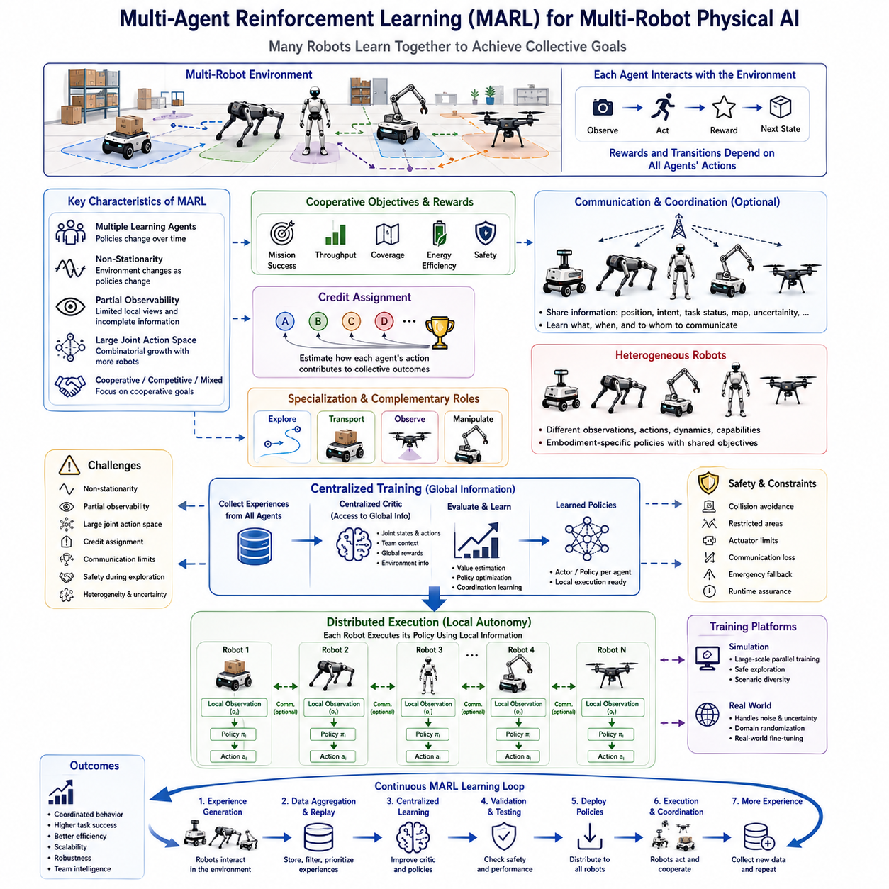{width="7.268055555555556in" height="7.268055555555556in"}

Multi-Agent Reinforcement Learning (MARL) extends reinforcement learning from a single decision-making agent to multiple agents that learn while interacting within the same environment. In multi-robot Physical AI, each robot selects physical actions according to its observations and policy, while the resulting rewards and state transitions may depend on the simultaneous behavior of other robots. Learning therefore becomes a problem of both individual adaptation and collective interaction.

Unlike single-agent reinforcement learning, MARL introduces other learning agents into the effective environment of each robot. As their policies change during training, the transition and reward patterns observed by any individual robot also change. This creates non-stationarity, because a behavior that produced a useful result under one set of teammate policies may produce a different outcome after those policies have been updated.

MARL problems can be cooperative, competitive, or mixed, but collective robot learning commonly emphasizes cooperative objectives. Robots may share a global reward associated with mission completion, throughput, coverage, energy efficiency, safety, or task success. The learning process must then discover policies that produce useful joint behavior rather than merely improving the immediate performance of each robot independently.

Partial observability is another fundamental challenge. A physical robot normally observes only a limited region through its onboard sensors and cannot directly access the complete state of the environment or every teammate. Its decisions must therefore be based on local observations, internal memory, shared messages, or estimated team context. Effective MARL policies must learn useful behavior despite incomplete and potentially delayed information.

The joint action space grows rapidly as the number of robots increases. If every robot has several possible actions, the number of possible joint action combinations can become extremely large even for a moderate fleet. This combinatorial growth makes direct optimization difficult and motivates scalable approaches based on parameter sharing, factorized value functions, hierarchical policies, local interaction structures, or centralized training with decentralized execution.

Centralized Training and Distributed Execution (CTDE) is especially relevant to MARL because it provides richer information during learning without requiring centralized control during deployment. A centralized critic may observe joint states, actions, rewards, or team context while evaluating behavior, whereas each robot maintains an actor or policy that operates from locally available information. This structure supports coordinated learning while preserving physical autonomy.

Reward design strongly influences the collective behavior that emerges. Purely individual rewards may encourage robots to compete for resources or select locally efficient actions that reduce fleet-level performance. A purely global reward can encourage cooperation but may make it difficult to determine which robot contributed to an outcome. Practical MARL systems often balance individual, team, safety, and task-specific reward components to shape desirable behavior.

This leads directly to the credit assignment problem. When several robots cooperate and receive a shared reward, the learner must estimate how individual actions contributed to collective success or failure. For example, a robot that temporarily takes a longer route may reduce congestion and improve total fleet throughput even though its own travel time increases. Effective credit assignment allows learning to recognize such indirectly beneficial actions.

Communication can become part of the learned coordination process. Robots may exchange positions, intentions, task status, map information, uncertainty, or compact latent messages. In more advanced approaches, the system can learn what information should be communicated, when communication is valuable, and which teammates should receive it. Communication-aware MARL is particularly useful when bandwidth and connectivity are limited operational resources.

MARL can also support specialization and complementary roles. Instead of learning identical behavior, robots may discover policies that divide responsibilities according to position, capability, task demand, or embodiment. One robot may explore while another transports material, observes a hazardous area, relays communication, or performs manipulation. Collective reward encourages these different behaviors when their combination improves the overall mission outcome.

Heterogeneous robots make this problem more complex because their observation spaces, action spaces, dynamics, and physical capabilities may differ significantly. An AMR cannot execute the same actions as a UAV or manipulator, yet all may participate in one mission. MARL architectures for heterogeneous fleets can combine embodiment-specific policies with shared representations, team objectives, centralized critics, or common task-level abstractions.

Training MARL policies directly on physical robots is expensive and potentially unsafe because effective reinforcement learning can require large numbers of interactions and exploratory actions. Simulation therefore plays an important role in generating parallel multi-agent experience. Large numbers of virtual robots can explore coordination strategies, congestion situations, task assignments, communication failures, and recovery scenarios before policies are transferred and validated in real systems.

Simulation alone is insufficient because real robots encounter sensor noise, actuator variation, communication delay, localization errors, friction changes, human behavior, and unexpected environmental conditions. Policies intended for physical deployment must therefore be evaluated under disturbances and uncertainty. Domain randomization, realistic communication models, hardware-aware dynamics, safety constraints, and controlled real-world fine-tuning can reduce the gap between simulated collective behavior and actual fleet operation.

Experience replay across robots can improve data efficiency by allowing trajectories generated by different agents to contribute to subsequent learning. However, replay data may have been collected under older policies, making it increasingly inconsistent with the current behavior of the fleet. Policy version information, recency weighting, prioritized sampling, and careful replay management help prevent outdated experience from destabilizing multi-agent learning.

Safety constraints must remain explicit because exploration in MARL affects not only one robot but potentially an entire physical team. Collision avoidance, restricted areas, human safety, actuator limits, communication loss behavior, and emergency fallback policies should not depend solely on learned rewards. Runtime assurance and conventional safety mechanisms can operate alongside learned policies to constrain unsafe actions during both experimentation and deployment.

At fleet scale, MARL provides a mechanism through which repeated local interactions can produce coordinated collective policies. Robots generate distributed experience, centralized or distributed learners extract patterns from joint outcomes, and improved policies return to the fleet for further execution. This feedback cycle connects reinforcement learning with shared experience, CTDE, policy sharing, experience replay, transfer learning, and continual fleet adaptation.

Multi-Agent Reinforcement Learning therefore provides a core learning framework for robots whose performance depends on the behavior of other robots. Its central challenge is not simply to make many individual agents intelligent, but to learn policies whose interactions produce effective collective behavior under partial observability, limited communication, heterogeneous embodiment, and physical uncertainty. In collective Physical AI, MARL turns repeated multi-robot interaction into progressively improved coordination and team intelligence.

## 05.05. Cooperative Imitation Learning

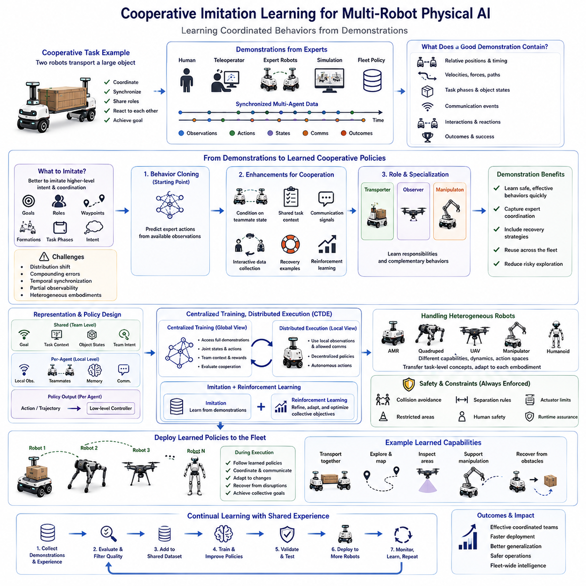{width="7.268055555555556in" height="7.268055555555556in"}

Cooperative imitation learning extends imitation learning from a single robot copying demonstrations to multiple robots learning behaviors that depend on coordinated actions. Instead of asking only how one robot should reproduce an expert trajectory, the learning problem asks how several embodied agents should divide roles, synchronize actions, and respond to one another so that the team can reproduce successful collective behavior.

The demonstrations used for cooperative learning may come from humans, teleoperators, scripted controllers, expert robot teams, simulation, or previously validated fleet policies. A demonstration can contain synchronized observations, actions, task states, communication events, and outcomes from several agents. Preserving these relationships is important because the meaning of one robot\'s action may depend strongly on what other robots are doing at the same moment.

Consider a cooperative transport task in which two mobile robots move a large object together. Observing the trajectory of either robot independently provides only part of the required behavior. The useful demonstration includes their relative positions, timing, velocities, forces, path choices, and reactions to each other. Cooperative imitation learning attempts to capture this joint structure so that coordinated behavior can be reproduced rather than merely copying isolated motions.

A central challenge is deciding what information should be imitated. Low-level motor commands may reproduce demonstrations accurately but transfer poorly across robots, environments, or hardware configurations. Higher-level representations such as goals, roles, waypoints, relative formations, task phases, object states, or coordination intentions can provide greater flexibility. Practical systems may combine high-level shared behavior with embodiment-specific low-level controllers.

Behavior cloning provides a straightforward starting point. Demonstrated observation-action pairs are collected and policies are trained to predict expert actions from available observations. In cooperative settings, however, the training data must represent interactions among agents. A robot may need to condition its action not only on its own sensory input but also on teammate state, shared task context, communication, or inferred intent.

Pure behavior cloning can suffer from distribution shift. Small execution errors may move robots into states that were rarely represented in demonstrations, after which prediction errors accumulate. This problem can become more severe in multi-robot systems because one robot\'s deviation changes the conditions experienced by others. Interactive data collection, corrective demonstrations, recovery examples, and reinforcement learning can therefore complement imitation.

Role representation is especially important when demonstrations involve complementary behaviors. A warehouse team may include robots that transport goods, reposition containers, inspect aisles, or support manipulation. Cooperative imitation learning can associate actions with explicit roles or infer role structure from repeated demonstrations. Policies can then reproduce not only individual skills but also patterns of responsibility that make the overall team effective.

Communication may also be part of the demonstrated behavior. Expert teams can reveal when robots should share position, intent, task status, uncertainty, or requests for assistance. A learning system may imitate explicit communication actions or infer latent coordination signals from behavior. This enables robots to learn communication as a functional component of cooperation rather than treating message exchange as an independently engineered mechanism.

Temporal synchronization creates another challenge. Cooperative tasks frequently require actions to occur in a particular sequence or within a limited time relationship. One robot may need to wait until another reaches a location, holds an object, clears a passage, or completes an inspection. Demonstrations therefore contain temporal structure that should be preserved through task phases, event dependencies, recurrent memory, or other sequence-aware representations.

Cooperative demonstrations can also provide valuable examples of recovery. Expert operators often respond to blocked paths, failed grasps, communication delays, localization errors, or unexpected human activity with behaviors that are difficult to specify manually. Capturing these episodes allows the learning system to imitate not only nominal cooperation but also how a team reorganizes its behavior when normal execution is disrupted.

Shared experience increases the amount and diversity of demonstration data available to the fleet. Successful behaviors learned or demonstrated on one subset of robots can be stored, evaluated, and reused for others. Repeated demonstrations from different environments help distinguish essential coordination patterns from incidental details. The resulting dataset can gradually become a fleet-scale library of cooperative tasks, skills, recoveries, and interaction strategies.

Heterogeneous fleets require careful transfer because different embodiments cannot necessarily imitate the same physical action. An AMR, quadruped, UAV, manipulator, and humanoid have different mobility, sensing, dynamics, and action spaces. Cooperative imitation can instead transfer task-level concepts such as explore, observe, transport, support, relay, or manipulate while allowing each embodiment to realize the assigned behavior through its own controller and capabilities.

Centralized training and distributed execution can support cooperative imitation learning. During training, synchronized demonstrations from multiple robots can provide global context about team behavior, roles, interactions, and outcomes. During execution, each robot can use a decentralized policy based on locally available observations and permitted communication. The training system therefore benefits from rich demonstrations without requiring permanent centralized control.

Imitation learning and multi-agent reinforcement learning can also complement each other. Demonstrations provide a useful initial policy and reduce the amount of unsafe or inefficient exploration required from physical robots. Reinforcement learning can subsequently refine the imitated policy, adapt it to conditions not covered by demonstrations, and optimize collective objectives. This combination is attractive when expert examples are available but cannot cover every operational situation.

Demonstration quality remains critical because imitation reproduces systematic weaknesses as well as useful expertise. Inconsistent operators, inefficient coordination, unsafe shortcuts, or poorly synchronized demonstrations can introduce undesirable behavior. Fleet learning pipelines should therefore track demonstration provenance, evaluate outcomes, filter low-quality episodes, preserve safety constraints, and assign confidence or quality measures before incorporating demonstrations into shared training data.

Safety is particularly important when learned coordination involves physical interaction among robots or with humans. An imitated action should not automatically be accepted merely because it appeared in expert data. Collision constraints, separation requirements, actuator limits, restricted areas, human safety rules, and runtime assurance can remain independent of the learned policy. This allows imitation to improve behavior while established safety mechanisms constrain unacceptable actions.

Cooperative imitation learning ultimately provides a mechanism for converting successful team behavior into reusable fleet knowledge. Demonstrations capture how robots coordinate, specialize, communicate, synchronize, and recover, while learning transforms these examples into policies and skills that can be redistributed across the fleet. Within collective learning, it connects shared experience with policy sharing, cross-robot transfer, continual learning, and increasingly capable multi-robot Physical AI systems.

## 05.06. Federated Robot Learning

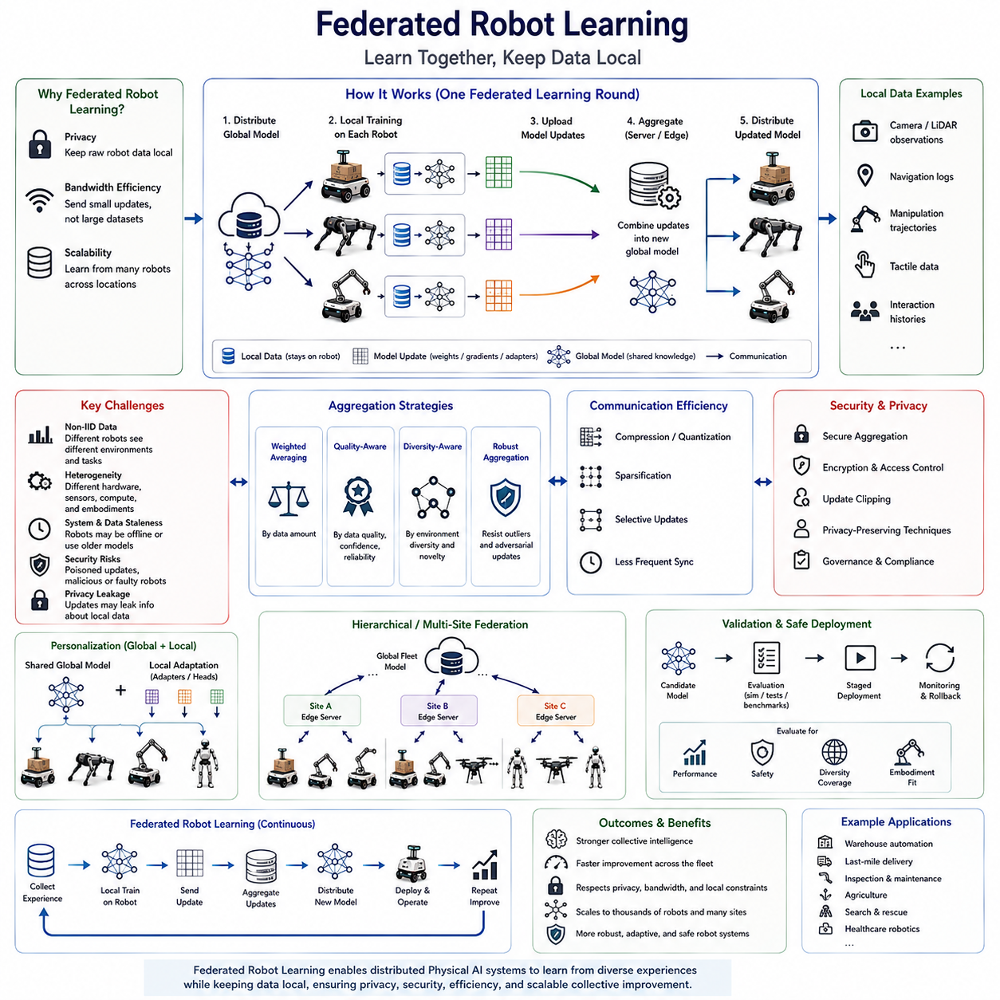{width="7.268055555555556in" height="7.268055555555556in"}

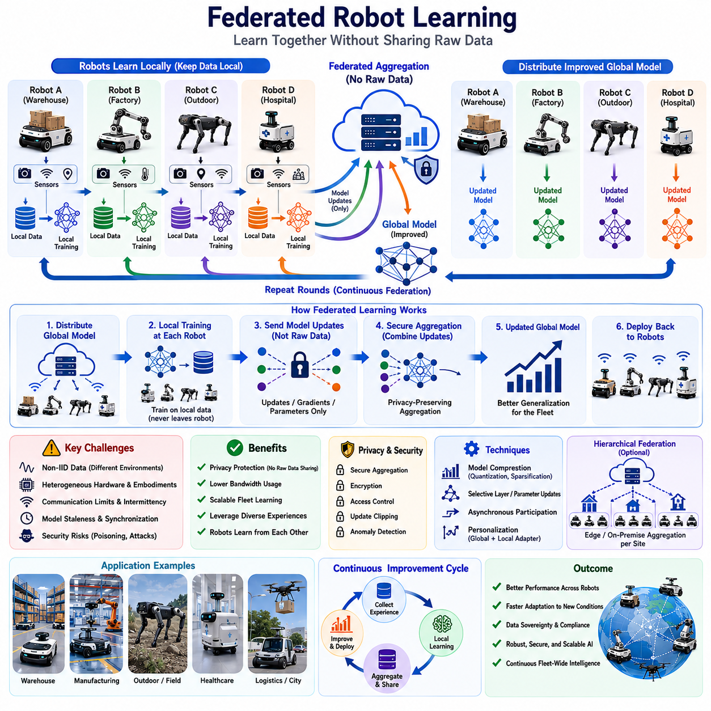{width="7.268055555555556in" height="7.268055555555556in"}

Federated Robot Learning extends federated learning to embodied systems by allowing multiple robots to improve a shared model without continuously transferring their raw operational data to a central repository. Each robot learns from locally collected observations and experiences, produces model updates, and contributes those updates to an aggregation process. The resulting global model can then be redistributed across the participating robot fleet.

The central principle is to move learning toward the data rather than moving all data toward a centralized training system. Cameras, LiDARs, tactile sensors, navigation logs, manipulation trajectories, and interaction histories can remain on individual robots or local sites. Instead of uploading complete datasets, robots perform local training and communicate parameters, gradients, adapters, or other compact model updates required for collective improvement.

A typical federated learning round begins when a global model is distributed to selected robots. Each participating robot uses its local dataset to perform one or more training steps and generates an updated local model. These updates are transmitted to an aggregation system, where they are combined into a new global model. The improved model is subsequently redistributed, creating repeated cycles of local learning, aggregation, validation, and deployment.

This architecture is attractive when raw robot data are expensive, sensitive, or impractical to centralize. Physical robots can generate large volumes of high-bandwidth sensor information, while communication networks may provide limited or intermittent connectivity. Federated learning reduces the requirement to transfer complete sensor histories and allows useful learning to occur where the experience was originally generated, although model updates themselves still consume communication resources.

Federated robot learning differs from conventional federated learning because robot data arise from physical interaction rather than passive digital records. A robot\'s dataset depends on its policy, embodiment, environment, assigned tasks, sensor configuration, and previous experiences. Consequently, data collected by different robots are rarely identically distributed, creating substantial statistical heterogeneity across the fleet and making simple model averaging potentially insufficient.

Non-independent and identically distributed data, commonly described as non-IID data, are therefore a central challenge. One warehouse robot may primarily encounter narrow aisles and pallets, while another operates near loading docks and humans. An outdoor robot may experience terrain and weather conditions absent from indoor datasets. Federated aggregation must combine these different experience distributions without allowing dominant or highly repetitive participants to overwhelm less common but valuable knowledge.

Hardware and embodiment heterogeneity introduce additional complexity. Robots may have different processors, sensors, control frequencies, mobility mechanisms, manipulators, and computational budgets. Some robots can perform substantial local training, while others may support only lightweight adaptation. Federated robot learning may therefore require heterogeneous training schedules, selective parameter updates, shared representation layers, adapters, or embodiment-specific model components.

Aggregation determines how distributed learning contributions become collective knowledge. Basic approaches can combine local model parameters according to the amount of training data contributed by each robot. More advanced approaches may consider data quality, novelty, confidence, robot reliability, task relevance, environmental diversity, or model performance. The objective is not merely to average every contribution equally, but to construct a global model that benefits from diverse fleet experience.

Communication efficiency is essential because federated learning can require many rounds of model exchange. Large robot models may contain millions or billions of parameters, making repeated full-model transmission costly. Update compression, quantization, sparsification, selective layer training, parameter-efficient fine-tuning, and less frequent synchronization can reduce communication requirements while preserving much of the benefit of collaborative learning.

Participation does not need to be synchronous. In real fleets, some robots may be operating, charging, disconnected, undergoing maintenance, or executing safety-critical missions when a training round begins. Synchronous federated learning can wait for a selected group of participants, whereas asynchronous approaches can incorporate updates as robots become available. The architecture must tolerate variable availability without allowing delayed or obsolete updates to destabilize the shared model.

Model staleness becomes important when updates are generated from different global model versions. A robot that remains offline for a long period may eventually return an update based on an outdated policy or representation. Version tracking, update timestamps, compatibility checks, recency weighting, and rejection of excessively stale contributions help maintain consistency as the fleet learns under intermittent connectivity and different operating schedules.

Privacy is an important motivation for federated learning, but keeping raw data local does not automatically guarantee privacy. Model updates can potentially reveal information about local training data under certain conditions. Secure aggregation, access control, encryption, update clipping, privacy-preserving techniques, and carefully designed data governance may therefore be required when robots operate in factories, hospitals, homes, public spaces, or other sensitive environments.

Security introduces another challenge because a compromised or malfunctioning robot may submit harmful updates. Model poisoning, corrupted training data, faulty sensors, or unauthorized participants can degrade the global model and potentially affect many robots after redistribution. Federated robot learning therefore benefits from robot authentication, update validation, anomaly detection, robust aggregation, provenance tracking, and controlled deployment of newly aggregated models.

Personalization can coexist with federation. A single global model may capture knowledge useful across the fleet, while each robot maintains local parameters that reflect its hardware, environment, task distribution, or operating history. Shared backbone models combined with local adapters or specialized policy heads provide one way to preserve collective knowledge while allowing individual robots to adapt to conditions that should not be forced into a universal fleet policy.

Federated learning can also operate hierarchically. Robots within one facility may first aggregate updates through an edge or on-premise server, while multiple sites subsequently contribute higher-level updates to a broader fleet model. Such hierarchical federation can reduce long-distance communication, preserve site-specific knowledge, and support large deployments containing many robots distributed across factories, warehouses, campuses, cities, or geographic regions.

Validation remains necessary before an aggregated model is distributed to operational robots. A global update that improves average training performance may degrade a rare task, particular embodiment, or safety-critical scenario. Models can therefore be evaluated against reference datasets, simulation scenarios, replayed fleet episodes, robot-specific benchmarks, and safety tests before staged deployment. Versioning and rollback provide additional protection against unexpected degradation.

Federated robot learning ultimately creates a distributed learning loop in which physical experience remains decentralized while useful knowledge flows across the fleet. Robots collect experience, learn locally, contribute validated updates, receive improved shared models, and continue operating under new conditions. Within collective learning, this approach complements shared experience, CTDE, distributed model updates, policy sharing, cross-robot transfer, and continual learning.

The broader objective is not simply to avoid central data storage, but to enable scalable collective intelligence across robots that cannot or should not pool all of their raw experience. By combining local adaptation with global aggregation, Federated Robot Learning allows distributed Physical AI systems to learn from diverse environments while respecting communication, embodiment, privacy, security, and operational constraints. It therefore provides an important architecture for continuously improving robot fleets at scale.

## 05.07. Distributed Model Updates

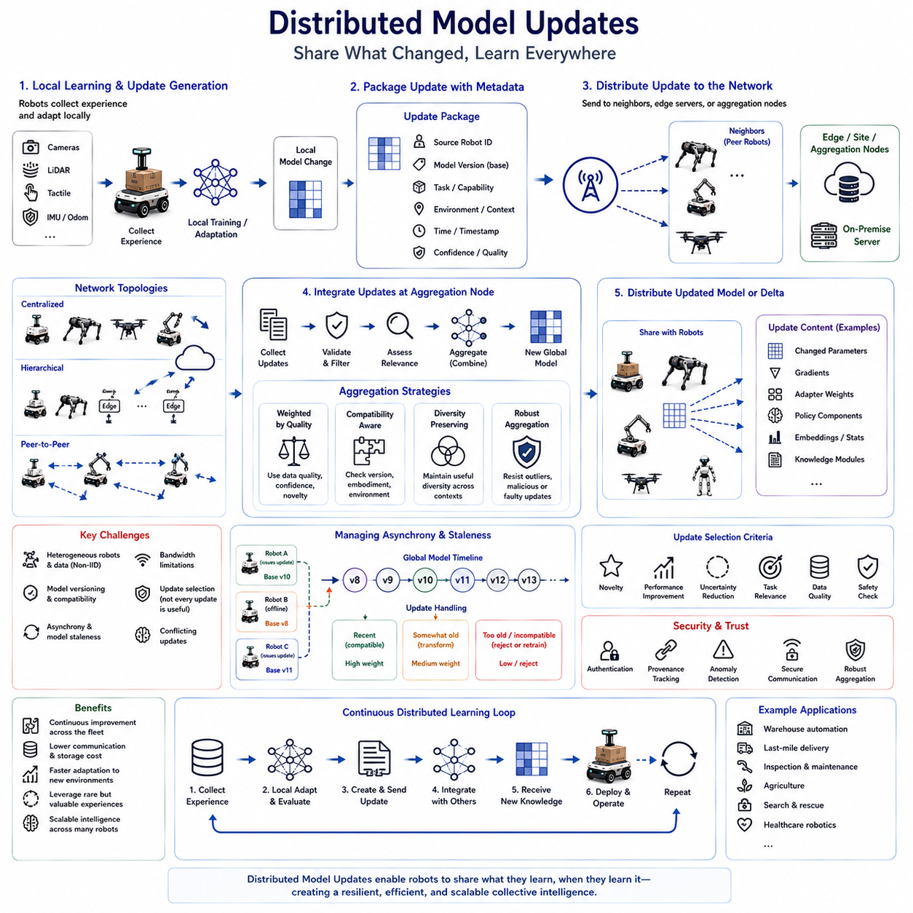{width="7.268055555555556in" height="7.268055555555556in"}

Distributed model updates allow a robot fleet to improve shared intelligence without requiring every learning event to pass through a single centralized training process. Individual robots, edge nodes, or local sites can generate model changes from their own operational experience and propagate useful updates across the network. Collective learning therefore becomes an ongoing exchange of learned information rather than a sequence of isolated retraining events.

The information exchanged between robots does not always need to be a complete model. A distributed update may contain changed parameters, gradients, adapter weights, policy components, embeddings, statistics, or selected knowledge modules. By transmitting only what has changed, the system can reduce communication and storage requirements while allowing robots to benefit from learning performed elsewhere in the fleet.

A basic update cycle begins when a robot collects new experience and performs local adaptation. The resulting model change is evaluated locally and packaged together with metadata describing its source, model version, task, environment, time, and confidence. The update can then be transmitted to neighboring robots, an edge server, an on-premise learning system, or another aggregation node depending on the architecture of the fleet.

Distributed updates differ from simple software distribution because learned parameters depend on data distributions and operational context. An update that improves navigation in one warehouse may not improve performance in an outdoor environment or on a robot with different sensors. The system must therefore understand where an update originated and determine whether its learned information is relevant to the receiving robot before applying it.

Model version management becomes essential when many robots learn simultaneously. Different robots may begin from different model versions and produce updates at different times. Without explicit version information, incompatible parameters may be combined or an older update may overwrite more recent knowledge. Version identifiers, update lineage, timestamps, compatibility rules, and dependency tracking help preserve consistency across a continuously evolving fleet.

Synchronous updating provides one method for maintaining consistency. A group of robots can train from a common model version, submit their updates within a defined learning round, and wait while those contributions are aggregated. This simplifies coordination and produces a clear sequence of global model versions, but slow or disconnected robots can delay progress when the system requires all selected participants to complete their local training.

Asynchronous updates provide greater flexibility for operational robot fleets. Robots can contribute learning results whenever they have sufficient data, computational availability, or network connectivity. The shared model can therefore evolve without waiting for every participant. However, asynchronous operation introduces model staleness because an update may have been generated from a model that has already been replaced by several newer versions.

Staleness can be controlled by comparing the base version of an incoming update with the current model. Recent updates may receive greater weight, while significantly outdated contributions can be transformed, re-evaluated, or rejected. Temporal weighting and compatibility checks prevent old information from dominating current learning while still allowing useful rare experiences from intermittently connected robots to contribute to collective knowledge.

Communication topology also influences how updates propagate. A centralized topology sends local changes to one aggregation server, whereas hierarchical architectures first combine updates at edge or site-level nodes. Peer-to-peer systems may allow robots to exchange updates directly with nearby teammates. Hybrid architectures can combine local peer sharing, on-premise aggregation, and higher-level fleet synchronization according to communication availability and operational scale.

Peer-to-peer model exchange can be valuable when robots operate beyond reliable infrastructure. Nearby robots may exchange selected skills, representations, or policy updates through local communication without contacting a remote server. This can accelerate adaptation in field operations, but it also requires mechanisms for determining trust, compatibility, and update quality because information can spread through the fleet without centralized inspection.

Bandwidth limitations encourage parameter-efficient update strategies. Instead of transmitting an entire foundation model, robots can exchange low-rank adapters, selected layers, sparse parameter differences, quantized updates, or task-specific heads. These approaches reduce network traffic and can preserve a stable shared backbone while allowing selected capabilities to evolve more rapidly across robots and operational environments.

Update selection is equally important because not every local change deserves fleet-wide propagation. A model modification based on repetitive or low-confidence experience may offer little value, while an update derived from a rare failure or successful recovery may be highly useful. Novelty, performance improvement, uncertainty reduction, task relevance, data quality, and safety evaluation can be used to determine which updates should be shared.

Conflicting updates can occur when robots learn different responses to similar situations. One robot may adapt to a slippery floor while another learns from high-friction terrain, producing parameter changes that interfere when combined. Aggregation mechanisms must therefore identify compatible, complementary, or contradictory learning signals. Clustering, weighting, specialization, or separate model branches can preserve useful diversity instead of forcing all knowledge into one universal model.

Security and trust become critical because model updates directly influence future robot behavior. A malfunctioning, compromised, or poorly calibrated robot could distribute harmful parameters that degrade many agents. Authentication, provenance tracking, anomaly detection, update validation, secure communication, and robust aggregation help prevent corrupted or malicious learning signals from propagating throughout the collective system.

Validation should occur at multiple stages of the update pipeline. A robot may first test its local adaptation against stored examples or safety constraints before sharing it. Aggregation nodes can evaluate combined updates in simulation, replay buffers, benchmarks, or digital twins. Candidate models can then be deployed gradually to selected robots before wider release, with monitoring and rollback mechanisms protecting operational stability.

Distributed model updates also support personalization. Robots can share a common backbone while maintaining local adapters, calibration components, policy heads, or environment-specific parameters. Fleet updates improve generally useful representations, whereas local components preserve specialization. This architecture is particularly valuable for heterogeneous robots because collective learning does not require every embodiment to converge toward exactly the same model.

The broader result is a continuous distributed learning network in which experience can generate improvements at many points in the fleet. Robots collect data, adapt locally, evaluate changes, exchange useful updates, integrate knowledge from other agents, and continue operating with improved models. Distributed model updates therefore connect federated learning, policy sharing, cross-robot transfer, continual learning, and fleet-wide adaptation into a scalable mechanism for collective Physical AI.

## 05.08. Policy and Skill Sharing

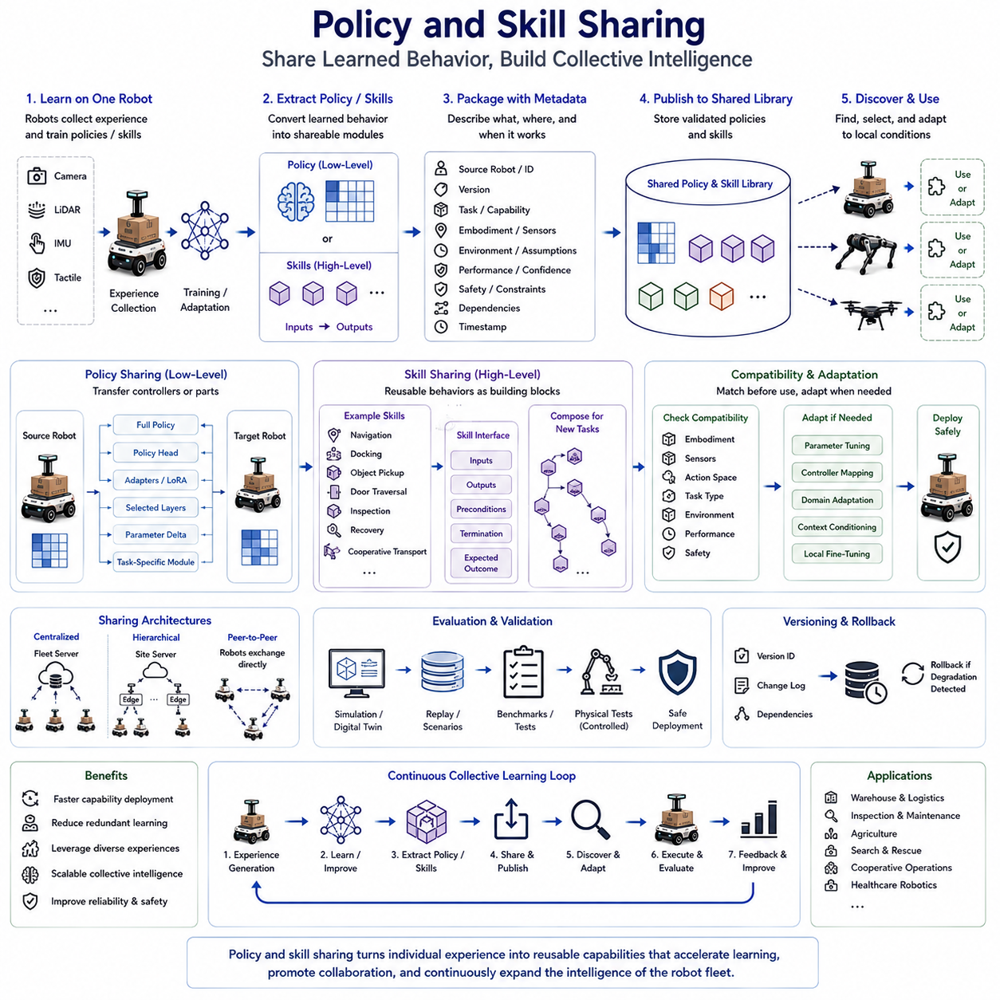{width="7.268055555555556in" height="7.268055555555556in"}

Policy and skill sharing allows a multi-robot system to distribute learned behavior directly across the fleet rather than requiring every robot to rediscover useful strategies through independent experience. A policy determines how observations or states are transformed into actions, while a skill represents a reusable behavioral capability that can be invoked within different tasks. Sharing both enables collective experience to become executable knowledge.

Policy sharing is most straightforward when robots have similar embodiments, sensors, action spaces, and operational objectives. A navigation policy learned by one autonomous mobile robot may be transferred to another compatible platform, allowing the receiving robot to benefit immediately from previous training. This reduces duplicated learning effort and allows improvements discovered by one part of the fleet to propagate rapidly to other robots.

A complete policy does not always need to be transferred. Large robot models may contain general perception, reasoning, world modeling, and control components that should remain stable while only selected capabilities change. Robots can therefore exchange policy heads, adapters, selected neural network layers, parameter differences, or task-specific modules. This modular approach reduces communication cost and limits unnecessary modification of already validated capabilities.

Skill sharing operates at a higher behavioral level. A skill may represent docking, obstacle avoidance, object pickup, door traversal, inspection, formation keeping, recovery, or cooperative transport. Instead of transferring every low-level action from a previous trajectory, the fleet can represent the capability through a reusable skill module with defined inputs, outputs, preconditions, termination conditions, and expected outcomes.

This abstraction allows skills to become building blocks for more complex robot behavior. A mission such as warehouse inspection may combine navigation, localization recovery, elevator interaction, visual inspection, anomaly reporting, and charging skills. Once individual capabilities have been learned and validated, planners or higher-level policies can compose them into new task sequences without retraining the complete robot behavior from the beginning.

Skill libraries provide an organizational mechanism for collective learning. Successfully learned capabilities can be registered in a shared repository together with metadata describing the source robot, compatible embodiments, required sensors, environment assumptions, performance, safety constraints, and version. Other robots can search the library for relevant capabilities and determine whether a skill can be executed directly, adapted locally, or rejected as incompatible.

Heterogeneous robot fleets make compatibility particularly important. A navigation policy designed for a wheeled AMR cannot be copied directly to a quadruped or UAV because their dynamics and action spaces differ. However, the higher-level skill objective, such as reaching a target, exploring an area, following another agent, or inspecting an object, may still be transferable. Each embodiment can map the shared skill representation to its own low-level controller.

Policy and skill sharing therefore benefit from separating task knowledge from embodiment-specific execution. Shared representations can describe goals, semantic actions, task phases, constraints, object relationships, or expected outcomes, while local controllers translate these concepts into platform-specific commands. This separation increases transferability and allows collective intelligence to span robots with different mechanical structures and sensing configurations.

Context must accompany shared behavior because a policy that performs well in one environment may be inappropriate elsewhere. Floor friction, lighting, terrain, payload, obstacle density, communication quality, sensor configuration, and human activity can influence performance. Policies and skills should therefore include applicability information that helps receiving robots estimate whether the transferred knowledge matches their current operating conditions.

Performance evidence is also necessary when deciding what should be shared. A skill may have been successful in hundreds of executions, while another may have been generated from only a few experiments. Success rate, uncertainty, task completion time, energy consumption, intervention frequency, safety events, and environmental diversity can provide indicators of maturity. Fleet systems can prioritize well-supported skills while treating experimental capabilities cautiously.

Policy sharing can occur through centralized, hierarchical, or peer-to-peer architectures. A fleet server may maintain validated policies and distribute them to compatible robots, while site-level servers can manage local variants. Robots operating without reliable infrastructure may exchange selected capabilities directly with nearby teammates. The communication topology can therefore adapt to deployment scale, connectivity, and operational requirements.

Peer-to-peer skill sharing is particularly useful when one robot discovers a successful response to a local problem that nearby robots are likely to encounter. A robot that learns how to traverse difficult terrain, recover from a localization failure, or negotiate a temporary obstacle can distribute the relevant capability locally. Rapid sharing converts individual adaptation into immediate team-level benefit without waiting for complete fleet retraining.

Shared skills can also support cooperative behavior. Robots may exchange policies for formation control, cooperative transport, area coverage, task handoff, communication relay, or coordinated exploration. In these cases, the skill is not defined solely by one robot\'s behavior but by relationships among several agents. Shared representations must capture roles, timing, interaction requirements, and communication assumptions needed for coordinated execution.

Safety validation remains essential because learned behavior directly controls physical systems. A policy that improves average task performance may still introduce unsafe behavior in rare situations. Before fleet-wide distribution, candidate skills can be evaluated in simulation, digital twins, replayed failure scenarios, controlled physical tests, and safety-critical benchmarks. Runtime constraints can continue to supervise execution after deployment.

Versioning and rollback are equally important because policies and skills evolve continuously. Each capability should have a traceable version, dependency information, training history, compatibility requirements, and validation status. If a newly distributed skill produces unexpected degradation, robots should be able to return to a previously verified version while the problematic update is isolated and investigated.

Policy and skill sharing also creates the foundation for continual capability accumulation. A fleet does not need to replace all existing knowledge whenever a new behavior is learned. Instead, validated capabilities can be added, refined, specialized, recombined, and transferred over time. The robot fleet gradually develops a growing repertoire of reusable behaviors derived from experiences accumulated across different robots, environments, and missions.

The resulting collective learning process transforms successful behavior into a shared operational asset. Robots generate experience, learn or refine policies, extract reusable skills, validate their performance, publish compatible capabilities, and adapt received knowledge to local conditions. Policy and skill sharing therefore connects distributed model updates, cross-robot experience, transfer learning, continual learning, and coordinated execution into an expanding library of fleet intelligence.

## 05.09. Experience Replay Across Robots

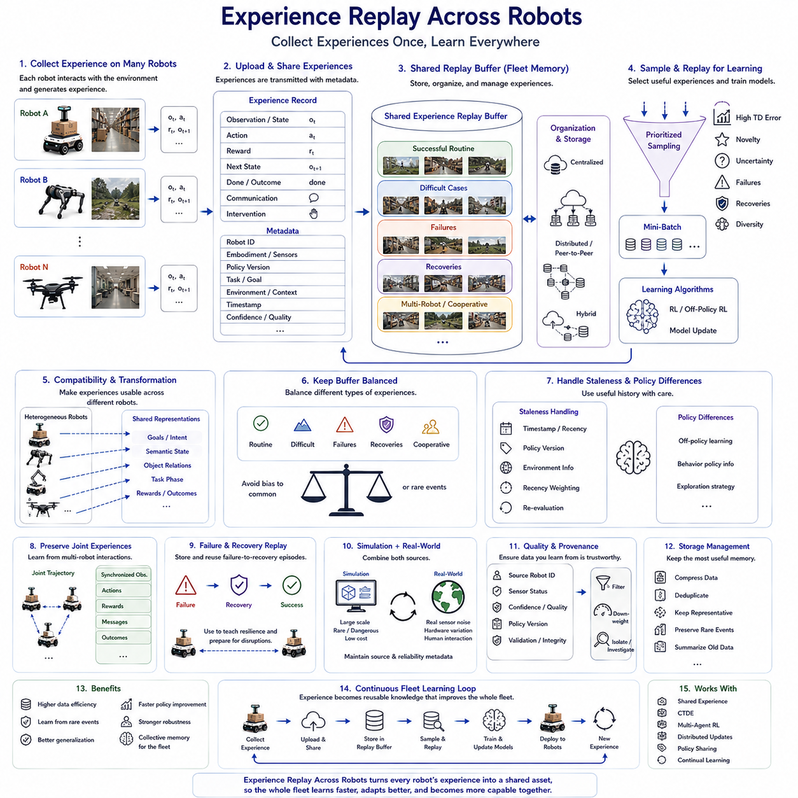{width="7.268055555555556in" height="7.268055555555556in"}

Experience replay across robots extends the idea of replay memory from individual reinforcement learning to a shared fleet-level learning process. Instead of each robot learning only from trajectories generated by its own operation, experiences collected by many robots can be stored, selected, and reused during later training. This allows physical interactions generated once by one robot to contribute repeatedly to learning across the wider multi-robot system.

A robot experience can contain observations, states, actions, rewards, next states, task outcomes, communication events, failures, interventions, and contextual metadata. When experiences from multiple robots are combined, the replay system becomes more than a simple memory buffer. It forms a distributed record of how different agents behaved under different environmental conditions, embodiments, policies, tasks, and operational constraints.

The primary advantage of cross-robot replay is improved data efficiency. Physical robot experience is expensive because collecting it consumes time, energy, hardware life, human supervision, and operational resources. Reusing previously collected trajectories allows learning algorithms to extract additional value from existing interactions. One robot\'s difficult experience can therefore improve policies used by robots that have never directly encountered the same situation.

Experience diversity is another major benefit. Individual robots usually operate within limited regions of the overall environment distribution. One robot may encounter crowded corridors, another slippery terrain, another unusual objects, and another communication failures. Combining these experiences expands the learning distribution and helps models develop behaviors that generalize beyond the narrow operating history of any single robot.

Replay becomes especially valuable for rare events. Successful routine operations can dominate fleet datasets, while collisions, localization failures, unusual obstacles, failed grasps, communication loss, emergency stops, and recovery behaviors may occur infrequently. If these rare episodes are preserved and replayed with appropriate priority, the fleet can continue learning from them long after the original event occurred.

A shared replay buffer can be organized centrally, hierarchically, or in distributed form. A centralized repository may collect selected trajectories from the entire fleet, while site-level buffers can preserve experiences relevant to particular facilities. Individual robots may also maintain local buffers and exchange selected episodes with nearby agents. Hybrid architectures can combine these levels according to bandwidth, storage capacity, privacy, and operational requirements.

Not every experience should be replayed with equal probability. Uniform sampling is simple but can repeatedly select common, low-information trajectories while overlooking rare and informative events. Prioritized experience replay can assign greater importance to samples associated with high prediction error, unexpected outcomes, novelty, uncertainty, failure, successful recovery, or significant policy improvement. The replay process then focuses learning resources on experiences with greater potential value.

Priority alone is insufficient because highly unusual experiences can dominate learning if repeatedly sampled. Replay systems therefore need mechanisms that balance novelty with representativeness. A useful buffer should contain routine behavior, difficult cases, failures, recoveries, environmental diversity, and multiple task conditions. Balanced sampling helps the model improve robustness without becoming excessively specialized toward rare events that do not represent normal fleet operation.

Cross-robot replay introduces compatibility challenges when experiences originate from heterogeneous robots. An action generated by a wheeled AMR may not have the same meaning for a quadruped, manipulator, humanoid, or UAV. Direct replay may therefore be limited to compatible embodiments, while higher-level information such as goals, semantic states, object relationships, rewards, task phases, or outcomes can be transformed into shared representations for broader reuse.

Policy differences also affect replay quality. Experiences stored in the buffer may have been generated by older policies, different robot configurations, or different exploration strategies. As fleet policies evolve, historical trajectories can become increasingly different from current behavior. Off-policy learning methods can use such data, but policy version information and behavior-policy metadata are important for determining how historical experience should influence current learning.

This creates the problem of replay staleness. Old experience is not automatically useless because it may contain rare and valuable knowledge, but environmental conditions or robot capabilities may have changed since collection. Timestamp information, model versions, environment metadata, recency weighting, and periodic re-evaluation can help distinguish enduring knowledge from experiences that no longer accurately represent current operating conditions.

Replay can also support cooperative multi-agent learning by preserving joint trajectories. Instead of storing each robot\'s transition independently, the system can retain synchronized observations, actions, rewards, messages, and outcomes from multiple agents participating in the same event. These joint experiences help learners analyze coordination, congestion, task handoffs, cooperative transport, formation behavior, and other outcomes that depend on interactions among robots.

Failure and recovery replay provides a particularly important mechanism for improving fleet resilience. When one robot becomes trapped, loses localization, fails a manipulation attempt, encounters an unexpected obstacle, or requires human intervention, the complete episode can be preserved. If a successful recovery follows, the transition from failure to recovery becomes reusable knowledge that can prepare other robots for similar operational disruptions.

Simulation and real-world replay can complement each other. Simulation can generate large numbers of diverse experiences, including dangerous or unusual situations that should not be intentionally reproduced with physical robots. Real-world trajectories provide evidence about actual sensor noise, hardware variation, human interaction, and environmental complexity. Replay buffers can combine both sources while maintaining metadata that identifies their origin and reliability.

Data quality and provenance remain essential because incorrect experiences can contaminate learning. Sensor faults, corrupted timestamps, inaccurate localization, software errors, or poorly calibrated hardware may produce misleading trajectories. Replay pipelines should preserve source identity, confidence, sensor status, policy version, and validation information so that unreliable experiences can be filtered, down-weighted, isolated, or investigated before they influence fleet models.

Storage management becomes important as deployment scales. A large fleet can generate far more experience than can be retained indefinitely. Replay systems may compress observations, retain representative episodes, remove redundant samples, preserve rare events, or maintain summaries of older experience. The objective is not to store everything, but to maintain a compact memory that represents the most useful history of collective physical interaction.

Experience replay across robots ultimately creates a form of collective memory for Physical AI. Every robot can contribute episodes to a shared learning resource, while future robots can learn from experiences they did not personally generate. Combined with shared experience, CTDE, multi-agent reinforcement learning, distributed updates, policy sharing, and continual learning, cross-robot replay transforms fleet history into reusable knowledge that progressively improves collective behavior.

## 05.10. Cross Robot Transfer Learning

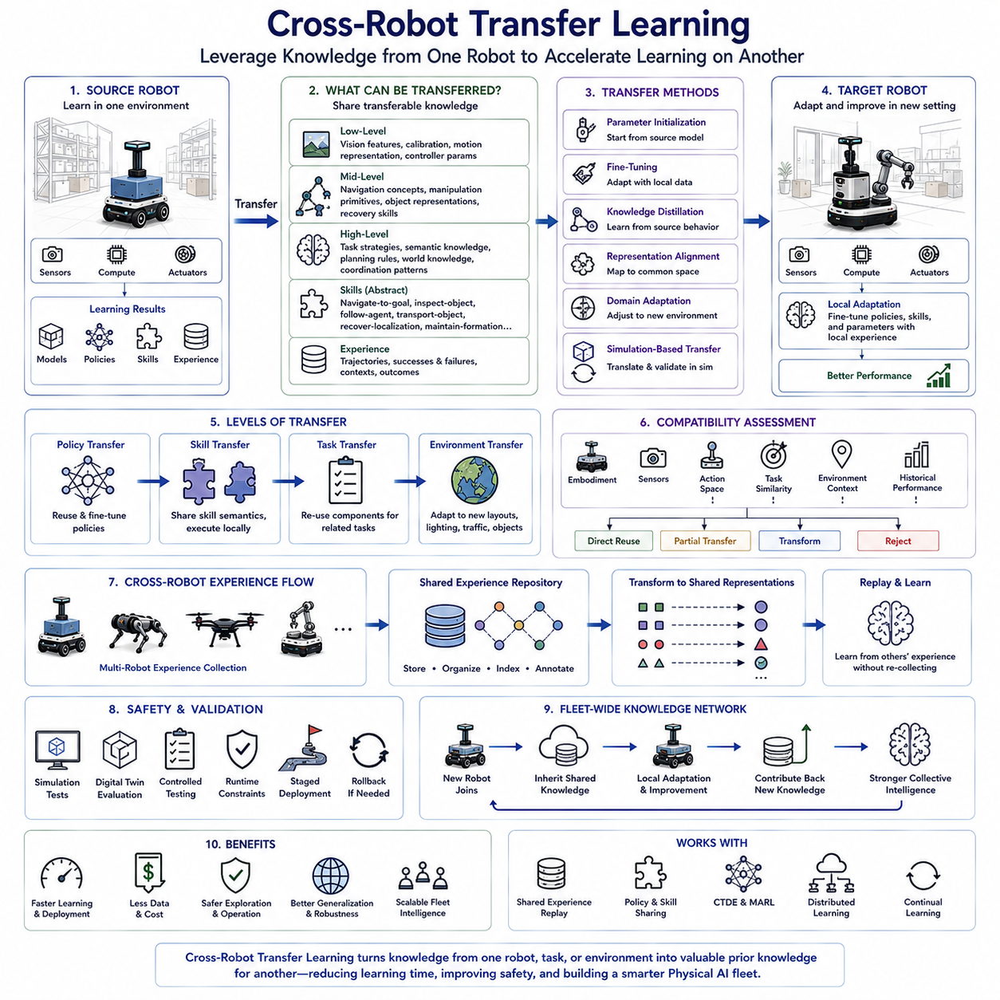{width="7.268055555555556in" height="7.268055555555556in"}

Cross-robot transfer learning enables knowledge acquired by one robot, robot group, or deployment environment to accelerate learning on another robot. Instead of treating every new platform or mission as an independent learning problem, previously learned representations, models, policies, skills, and experience can provide a starting point. The objective is to reuse transferable knowledge while adapting those elements that depend on embodiment, sensors, tasks, or environments.

The simplest transfer occurs between robots with similar hardware and operating conditions. A navigation model trained on one AMR can initialize another robot using comparable sensors, kinematics, and control interfaces. The receiving robot may require only limited local adaptation rather than complete retraining. This reduces data collection, computation, deployment time, and the amount of risky exploration required in the physical environment.

Transfer becomes more challenging as differences between source and target robots increase. Robots may differ in wheel configuration, manipulators, camera placement, LiDAR characteristics, payload, control frequency, dynamics, or action spaces. A policy expressed directly as motor commands may therefore transfer poorly. Cross-robot learning must identify which parts of knowledge are platform-independent and which must remain specific to the target embodiment.

Representation learning provides an important mechanism for achieving this separation. Instead of transferring raw sensor values or actuator commands, robots can share latent representations describing objects, geometry, traversability, goals, task phases, spatial relationships, affordances, or expected outcomes. A common representation allows physically different robots to reason about similar situations while their local controllers translate abstract decisions into embodiment-specific actions.

Transfer can occur at multiple levels of the learning architecture. Low-level transfer may reuse perception features, calibration priors, motion representations, or controller parameters between similar platforms. Intermediate transfer can share navigation concepts, manipulation primitives, object representations, or recovery skills. Higher-level transfer can reuse task strategies, semantic knowledge, planning rules, world knowledge, and coordination patterns across substantially different robot embodiments.

Policy transfer is useful when the source policy already captures behavior relevant to the target task. The target robot can initialize its policy from selected source parameters and then fine-tune them using local experience. When direct parameter reuse is inappropriate, knowledge distillation can train a target policy to reproduce useful behavior from a source model while respecting a different architecture, observation space, computational budget, or action interface.

Skill transfer offers greater flexibility because skills can be represented above the actuator level. Concepts such as navigate-to-goal, inspect-object, follow-agent, explore-region, recover-localization, transport-object, or maintain-formation describe behavioral objectives rather than exact motor commands. Different robots can therefore share the same skill semantics while implementing execution through their own planners, controllers, sensors, and physical capabilities.

Task transfer allows knowledge learned for one objective to accelerate another related objective. Experience from autonomous navigation may support inspection, delivery, patrol, or search tasks because these missions share localization, obstacle avoidance, map understanding, and motion planning capabilities. Transfer learning can preserve these reusable components while adapting task-specific policies, rewards, decision layers, or skill compositions for the new mission.

Environmental transfer addresses differences between deployment domains. A robot trained in one warehouse may be transferred to another facility with different layouts, lighting, traffic patterns, floor surfaces, or objects. The target robot should retain generally useful representations while adapting to local conditions. Domain adaptation, fine-tuning, feature alignment, and environment-specific parameters can reduce the need to relearn capabilities that remain valid across sites.

Positive transfer occurs when reused knowledge improves target learning or performance, but transfer is not always beneficial. Negative transfer can occur when source knowledge contains assumptions that are inappropriate for the target robot or environment. A policy optimized for smooth indoor floors, for example, may provide misleading behavior for rough outdoor terrain. Transfer mechanisms must therefore estimate compatibility rather than assuming that previously learned knowledge is universally useful.

Compatibility assessment can consider embodiment, sensor configuration, action space, task similarity, environmental context, model architecture, and historical performance. Metadata associated with policies, skills, datasets, and experiences can help determine whether direct reuse, partial transfer, transformation, or complete rejection is appropriate. Transfer then becomes a selective knowledge-routing process rather than indiscriminate copying between robots.

Cross-robot transfer also benefits from modular architectures. A shared perception or world-model backbone can capture broadly useful knowledge while robot-specific adapters, policy heads, or controllers represent local differences. When a new robot joins the fleet, it can inherit the common backbone and train only a relatively small set of specialized parameters. This approach supports rapid onboarding while preserving embodiment-specific behavior.

Experience can be transferred even when models cannot. Trajectories generated by one robot may provide useful supervision, goals, semantic relationships, failure cases, or task outcomes for another platform. Cross-robot experience replay can transform compatible portions of historical trajectories into shared representations. The target robot can then learn from events it never physically experienced, increasing data efficiency and expanding its operational knowledge.

Simulation can provide an intermediate transfer layer between heterogeneous robots. Source experiences can be reconstructed or approximated in simulation, where the target embodiment attempts equivalent tasks using its own dynamics and sensors. This allows knowledge to be translated before physical deployment. Simulation can also test whether transferred policies or skills remain safe and effective before they are adapted on real hardware.

Safety validation is necessary because transferred knowledge may fail in ways that were absent on the source platform. Differences in braking distance, payload, stability, reach, sensor blind spots, or actuator limits can turn previously successful behavior into unsafe behavior. Simulation, digital twins, controlled testing, runtime constraints, staged deployment, and rollback mechanisms should therefore accompany transfer into operational Physical AI systems.

At fleet scale, transfer learning creates a knowledge network in which learning performed by one robot can reduce the learning burden of future robots. New platforms begin from accumulated fleet knowledge instead of an empty model, contribute their own adaptations, and return useful improvements to the shared knowledge base. The process gradually increases the diversity and maturity of transferable representations, policies, skills, and experience.

Cross-robot transfer learning therefore connects individual adaptation with collective capability accumulation. Shared experience provides the source material, experience replay preserves useful history, policy and skill sharing exposes reusable behavior, and distributed learning propagates improvements. Together, these mechanisms allow a heterogeneous Physical AI fleet to convert knowledge acquired across robots, tasks, environments, and missions into progressively broader collective intelligence.

## 05.11. Catastrophic Interference and Knowledge Conflict

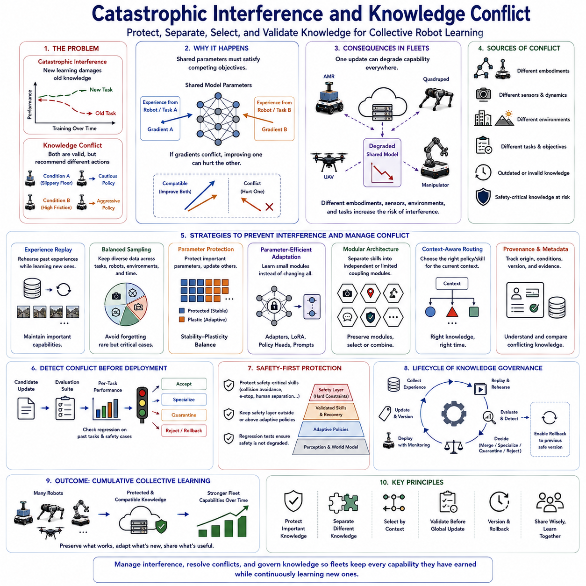{width="7.268055555555556in" height="7.268055555555556in"}

Catastrophic interference occurs when learning from new robot experiences modifies a model in ways that damage knowledge acquired from earlier tasks, environments, or robots. In collective learning, this problem extends beyond individual forgetting because updates produced by one robot can propagate through shared models and influence an entire fleet. A useful update for one operating condition may therefore unintentionally degrade capabilities that were previously reliable elsewhere.

The underlying difficulty comes from shared model parameters. Neural networks often reuse the same parameters and representations across perception, world modeling, planning, and control. When new gradients modify parameters that encode earlier capabilities, the optimization direction for new knowledge may conflict with the direction needed to preserve old knowledge. Sequential learning can consequently replace rather than accumulate useful information.

Knowledge conflict is broader than catastrophic forgetting because two experiences can both remain valid while recommending different behaviors. A robot operating on a slippery floor may learn a cautious motion policy, whereas another operating on a high-friction surface may learn aggressive acceleration. Neither experience is necessarily incorrect. The conflict appears when a collective learning system attempts to represent both context-dependent behaviors through the same parameters or policy.

The problem becomes more difficult in heterogeneous fleets because robots differ in embodiment, sensors, dynamics, payload, control interfaces, and operational objectives. Knowledge learned by an AMR, quadruped, UAV, manipulator, or humanoid may describe different relationships between observations and actions. Combining these experiences without recognizing embodiment context can create interference even when each robot\'s local knowledge is individually correct.

Environmental diversity creates another source of conflict. Policies learned in warehouses, factories, hospitals, outdoor terrain, or public environments may encode different assumptions about obstacles, people, surfaces, visibility, communication, and acceptable behavior. A collective model must distinguish knowledge that is universally transferable from knowledge that applies only under particular conditions. Otherwise, global aggregation can produce a policy that performs poorly everywhere.

Gradient conflict provides a practical way to understand interference during distributed learning. If updates from two robots point toward compatible parameter changes, aggregation can improve both capabilities. If their gradients oppose each other, improving one objective may increase the loss associated with another. Detecting gradient similarity, parameter sensitivity, or task-level performance changes can therefore help identify destructive interactions before updates are widely propagated.

Experience replay provides one defense against catastrophic interference. When a model learns from new fleet experience, representative historical episodes can be replayed alongside recent data. The learner is therefore reminded of behaviors that should remain functional while incorporating new knowledge. Rare failures, recovery episodes, safety-critical scenarios, and previously mastered tasks are particularly valuable because they can otherwise disappear from the current training distribution.

Replay must remain balanced because simply storing large quantities of historical data does not guarantee knowledge preservation. Routine experiences can dominate the buffer while rare but important capabilities receive insufficient rehearsal. Sampling strategies can preserve representative examples across tasks, robots, environments, failures, and historical model versions. The objective is to maintain a learning distribution that reflects both current adaptation needs and important past competence.

Parameter protection offers another approach. Parameters that are strongly associated with established capabilities can be identified and constrained against large changes during subsequent learning. Other parameters remain more plastic and can absorb new knowledge. This creates a stability-plasticity balance in which important existing behavior is protected without preventing the model from adapting to genuinely new operating conditions.

Parameter-efficient adaptation can reduce interference by limiting which parts of a large model are modified. Instead of fine-tuning an entire shared foundation model, robots can learn adapters, low-rank updates, specialized policy heads, prompts, or other compact modules. The common backbone remains relatively stable while local or task-specific knowledge is stored in smaller components, reducing the probability that one adaptation will damage unrelated fleet capabilities.

Modularity provides a stronger form of knowledge separation. Perception, navigation, manipulation, communication, recovery, and task-specific skills can be represented through partially independent modules rather than forcing all knowledge into a single parameter space. When conflicts occur, the system can preserve multiple specialized modules and select among them according to embodiment, environment, task, or context instead of averaging incompatible behaviors.

Context-aware routing is therefore important for resolving knowledge conflict. A fleet does not always need to determine that one policy is globally correct and another is wrong. Both may be retained and activated under different conditions. Metadata describing robot type, terrain, payload, sensor configuration, task, environment, model version, and confidence can help a routing mechanism select the most appropriate policy, adapter, skill, or memory for the current situation.

Conflict detection should occur before model updates become fleet-wide knowledge. Candidate updates can be evaluated against regression suites containing previously mastered tasks and safety-critical scenarios. If performance improves on the new task but declines substantially on established capabilities, the update indicates interference. Per-task metrics are therefore more informative than a single average score, which can hide severe degradation in a minority of important behaviors.

Knowledge provenance also helps determine how conflicts should be resolved. Every shared policy, skill, experience, or model update can retain information about which robot generated it, under what conditions, from which model version, and with what performance evidence. When contradictory knowledge appears, the system can examine its origin rather than blindly averaging it. Provenance turns conflicting updates into interpretable alternatives that can be compared and validated.

Some conflicts reflect outdated knowledge rather than true incompatibility. A route that was once safe may become blocked, a warehouse layout may change, or a sensor configuration may be replaced. Temporal information and revalidation are therefore necessary before protecting historical knowledge indefinitely. Continual learning must distinguish valuable long-term competence from obsolete assumptions, preserving the former while allowing the latter to be revised or removed.

Safety-critical knowledge deserves particularly strong protection. Collision avoidance, emergency stopping, human separation, actuator constraints, and validated recovery behavior should not be sacrificed simply because a new policy improves average task efficiency. Safety constraints can remain outside or above adaptive policies, while regression testing ensures that learning updates do not silently remove behaviors required for dependable physical operation.

At fleet scale, interference management becomes a form of knowledge governance. Distributed updates should not immediately become universal truth simply because they improved one robot. New knowledge can be classified, validated, replayed against historical experience, compared with existing policies, and either merged, specialized, quarantined, or rejected. Versioning and rollback ensure that harmful integration can be reversed after deployment.

The broader objective is to make collective learning cumulative rather than destructive. Shared experience, cross-robot transfer, distributed updates, and policy sharing increase the rate at which knowledge enters the fleet, but mechanisms for replay, parameter protection, modularity, contextual routing, provenance, validation, and rollback determine whether that knowledge can coexist. Managing catastrophic interference and knowledge conflict is therefore fundamental to building robot fleets that become more capable over time without repeatedly sacrificing what they have already learned.

## 05.12. Collective Curriculum and Continual Learning

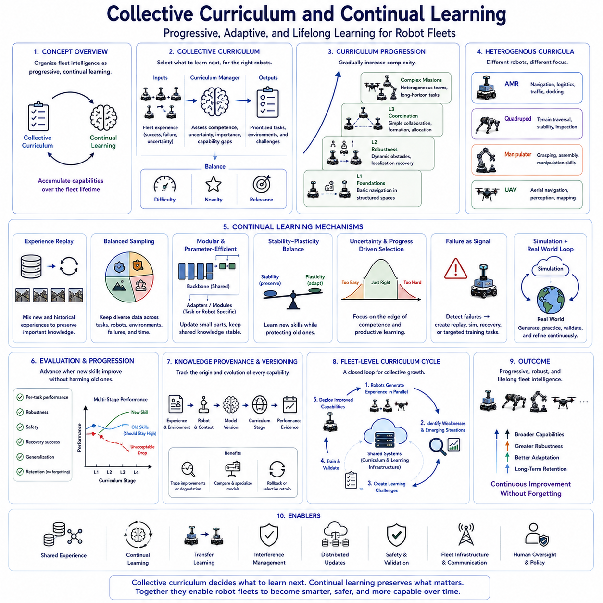{width="7.268055555555556in" height="7.268055555555556in"}

Collective curriculum and continual learning organize fleet intelligence as a progressive learning process rather than a sequence of independent training episodes. A collective curriculum determines which tasks, environments, failures, and coordination problems robots should learn from and in what progression, while continual learning preserves useful knowledge as new experience arrives. Together, they enable a robot fleet to accumulate capabilities throughout its operational lifetime.

Traditional robot training often follows a fixed dataset and a predefined task distribution. Physical deployments are different because robots continuously encounter new layouts, objects, users, teammates, disturbances, and mission requirements. The learning problem therefore changes over time. A collective curriculum responds to this changing distribution by selecting experiences and training challenges according to fleet competence, uncertainty, operational importance, and emerging capability gaps.

Curriculum learning introduces complexity gradually so that previously acquired capabilities provide foundations for more difficult behaviors. A robot may first learn stable navigation in structured spaces, then operate around dynamic obstacles, coordinate with teammates, recover from localization failures, and eventually execute complex multi-robot missions. This progression reduces unnecessary difficulty during early learning while creating reusable knowledge for later stages.

At fleet scale, curriculum generation can use experience from many robots rather than relying on a single predetermined sequence. If several robots repeatedly fail in similar situations, those situations can receive greater training priority. Conversely, tasks that are already performed reliably across the fleet may require less training attention. The curriculum therefore evolves according to collective performance instead of remaining fixed throughout development and deployment.

A useful collective curriculum must balance difficulty, novelty, and relevance. Experiences that are too easy provide little learning value, while challenges far beyond current capability may generate unstable training or meaningless failures. Tasks near the boundary of existing competence often provide stronger learning signals. Novel situations can be introduced progressively while maintaining enough familiar experience to preserve previously mastered behavior.

Different robots do not necessarily require identical curricula. Heterogeneous embodiments may possess different sensors, mobility systems, manipulators, computational resources, and mission roles. An AMR may require advanced navigation and logistics curricula, while a quadruped focuses on terrain traversal and stability. Shared task abstractions can connect these specialized curricula while allowing each embodiment to progress according to its own capabilities.

Collective curricula can also include cooperative tasks whose difficulty depends on relationships among robots. Initial stages may involve simple task allocation or formation maintenance, followed by coordinated exploration, cooperative transport, congestion management, communication-constrained operation, and heterogeneous team missions. Learning increasingly complex interaction structures allows collective behavior to develop from simpler coordination primitives.

Continual learning provides the mechanism for integrating these successive experiences without repeatedly retraining the entire system from the beginning. As new tasks and environments appear, models adapt while retaining important previous capabilities. This requires managing the stability-plasticity balance: the system must remain sufficiently plastic to acquire new knowledge while remaining sufficiently stable to prevent destructive changes to established skills.

Experience replay is one important mechanism for maintaining this balance. New curriculum experiences can be mixed with representative historical episodes during training so that older competencies remain active. Replay buffers may preserve routine operations, rare failures, successful recoveries, safety-critical cases, and representative tasks from previous curriculum stages. The fleet can therefore rehearse important knowledge while progressing toward new capabilities.

Modular and parameter-efficient learning can further reduce interference. Shared perception or world-model components may remain relatively stable while adapters, policy heads, skill modules, or other specialized parameters are updated for new curriculum stages. This allows the system to add capabilities without modifying every parameter simultaneously and supports different learning paths for robots operating under different conditions.

Curriculum selection can be driven by uncertainty and learning progress. Situations in which the model shows high uncertainty may indicate knowledge gaps, while tasks showing rapid improvement may represent productive learning regions. Persistent failure without improvement may indicate that prerequisite skills are missing. The curriculum manager can respond by selecting intermediate tasks that bridge the gap between current competence and the desired capability.

Failures are therefore valuable curriculum signals rather than merely undesirable outcomes. A localization loss, navigation deadlock, failed grasp, communication breakdown, or coordination error can reveal where the fleet lacks knowledge. Once detected and validated, these cases can be converted into replay episodes, simulation scenarios, recovery exercises, or targeted training tasks. Individual failures then become structured learning opportunities for the wider fleet.

Simulation provides a scalable environment for expanding the curriculum beyond situations that can be safely or economically generated with physical robots. Difficulty can be adjusted by changing terrain, object placement, sensor noise, communication quality, robot density, human activity, or task complexity. Rare and dangerous situations can be practiced repeatedly before the resulting capabilities are validated through controlled real-world deployment.

Real-world experience remains essential because simulation cannot reproduce every physical interaction or operational condition. Fleet observations reveal unexpected situations that designers did not include in the original curriculum. These experiences can be evaluated, clustered, prioritized, and converted into new training challenges. The curriculum therefore becomes a feedback loop between simulation, physical deployment, experience collection, learning, and validation.

Evaluation determines when the fleet is ready to progress. Advancement should not depend only on average reward or task success, because improvements in new capabilities can conceal degradation in older ones. Per-task performance, robustness, safety, recovery success, generalization, and retention should be evaluated across current and previous curriculum stages. Progression occurs when new competence is demonstrated without unacceptable loss of established knowledge.

Curriculum management also benefits from knowledge provenance and versioning. Each capability can retain information about the experiences, environments, robots, model versions, and curriculum stages that contributed to its development. When performance changes, this history helps identify which learning stage introduced the improvement or degradation. Models can then be compared, specialized, rolled back, or selectively retrained when necessary.

At fleet scale, the curriculum becomes a dynamic mechanism for directing collective learning resources. Robots generate experience in parallel, shared systems identify common weaknesses and emerging situations, training infrastructure creates appropriate learning challenges, and validated improvements return to compatible robots. The fleet therefore does not merely accumulate data; it actively decides what should be learned next and what knowledge must continue to be preserved.

Collective curriculum and continual learning ultimately transform robot deployment into an ongoing developmental process. Shared experience identifies what the fleet has encountered, replay preserves what it should remember, transfer learning spreads useful capabilities, and curriculum management determines the next frontier of learning. Combined with interference management and distributed updates, these mechanisms allow collective Physical AI to become progressively broader, more robust, and more capable without repeatedly forgetting previously acquired knowledge.

## 05.13. Fleet Data Flywheel

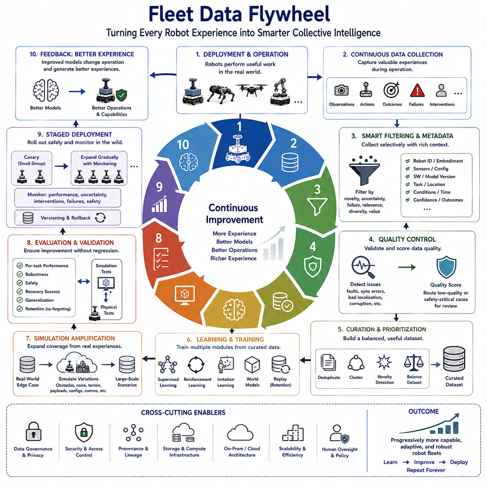{width="7.268055555555556in" height="7.268055555555556in"}

A fleet data flywheel transforms routine robot operation into a continuous mechanism for improving collective intelligence. Every deployed robot generates observations, actions, outcomes, failures, interventions, and environmental interactions while performing useful work. Instead of treating these records as temporary logs, the fleet captures valuable experience and converts it into training resources that improve future models, policies, skills, and operational decisions.

The flywheel begins with deployment because real-world operation provides experiences that cannot be completely anticipated during offline development. Robots encounter changing layouts, unfamiliar objects, unusual traffic, sensor degradation, communication interruptions, human behavior, and unexpected task conditions. Each deployment therefore expands the distribution of situations represented in the fleet\'s accumulated knowledge and reveals gaps that existing models have not yet mastered.

Continuous collection does not mean that every sensor stream must be stored indefinitely. Large fleets can generate enormous quantities of camera, LiDAR, state, control, and diagnostic data, much of which may be repetitive. A practical data engine identifies useful episodes according to novelty, uncertainty, failure, intervention, task relevance, environmental diversity, and learning value. Selective capture concentrates storage and processing resources on experiences most likely to improve the system.

Metadata gives collected experience the context required for later reuse. Robot identity, embodiment, sensor configuration, software and model versions, task type, location category, operating conditions, timestamps, confidence, intervention history, and outcomes can accompany each episode. This information allows the learning system to distinguish universally useful experience from knowledge that applies only to particular robots, environments, or operational circumstances.

Data quality control is necessary before operational experience becomes training material. Sensor faults, synchronization errors, incorrect localization, corrupted logs, incomplete trajectories, or abnormal hardware conditions can create misleading examples. Automated validation can detect inconsistencies and assign confidence or quality scores, while uncertain or safety-critical cases can be routed for additional inspection. The objective is to prevent low-quality experience from silently contaminating collective models.

Failures and edge cases provide especially strong momentum to the flywheel. A navigation deadlock, localization loss, unexpected obstacle, failed grasp, task handoff error, communication breakdown, or human intervention identifies a boundary of current competence. These events can be extracted from routine fleet operation and converted into replay episodes, labeled examples, simulation scenarios, evaluation cases, or targeted curriculum tasks for subsequent learning.

Successful recoveries are equally valuable because they demonstrate how difficult situations can be resolved. When a robot encounters a failure and later completes the task through replanning, human guidance, another robot\'s assistance, or an alternative skill, the complete sequence provides richer information than the failure alone. The fleet can preserve these transitions and use them to train recovery policies that reduce future dependence on external intervention.

Human intervention can function as an important supervision channel within the data flywheel. Teleoperation, corrective commands, task reassignment, approval, rejection, and manual recovery reveal situations in which autonomous behavior was insufficient. These interactions can become demonstrations or preference signals for later learning. As models improve, intervention frequency can decline, while remaining interventions increasingly identify more difficult and informative edge cases.

Collected experience enters a data curation stage where redundant samples can be removed and valuable episodes prioritized. Clustering can identify recurring operational patterns, while novelty detection can expose previously unseen situations. Balanced datasets can preserve routine behavior together with failures, recoveries, rare environments, and safety-critical events. Curation therefore converts raw fleet history into a more compact and useful representation of operational knowledge.

The curated data can support several learning mechanisms simultaneously. Supervised learning can improve perception and prediction, reinforcement learning can refine policies, imitation learning can reproduce successful demonstrations, world models can learn environmental dynamics, and experience replay can preserve historical competence. The same operational episode may therefore contribute to multiple components of the Physical AI stack rather than serving only one training objective.

Simulation strengthens the flywheel by amplifying important real-world observations. A rare failure discovered by one robot can be reconstructed in simulation and varied across obstacle positions, sensor noise, terrain properties, payloads, robot configurations, or communication conditions. Thousands of related scenarios can then be generated from one physical event. Simulation converts sparse real-world evidence into broader training coverage without repeatedly exposing physical robots to dangerous conditions.

Training produces candidate improvements rather than automatically trusted models. Updated perception modules, world models, policies, skills, or adapters must be evaluated against current tasks and historical capabilities. Regression testing, replay evaluation, simulation, safety benchmarks, and controlled physical experiments determine whether new knowledge improves the fleet without introducing catastrophic interference or unacceptable degradation in previously reliable behaviors.

Validated models can be released through staged deployment rather than immediate fleet-wide replacement. Initial deployment to a small subset of robots provides evidence under real operating conditions. Performance, uncertainty, interventions, failures, and safety indicators can be monitored before the update expands to larger groups. Versioning and rollback mechanisms allow the system to recover if an apparently successful update produces unexpected behavior after deployment.

Once improved models return to operation, they alter the experiences generated by the fleet. Better navigation reduces some failures, stronger recovery creates new successful trajectories, improved perception exposes subtler edge cases, and new skills allow robots to enter more complex tasks. The data distribution therefore changes as intelligence improves. This creates the essential feedback mechanism of the flywheel: better models generate better and more informative future experience.

Fleet scale provides a compounding advantage because many robots can explore different portions of the operational distribution simultaneously. A situation encountered rarely by one robot may occur frequently somewhere across hundreds or thousands of deployed systems. Aggregating these distributed experiences increases the rate at which rare cases are discovered and validated. Deployment scale can therefore become a learning advantage rather than merely an operational expansion.

The flywheel can operate hierarchically across robot, site, on-premise, and broader fleet levels. Individual robots may perform local filtering and adaptation, while site infrastructure aggregates operational experience and identifies recurring patterns. Higher-level learning systems can combine knowledge across multiple deployments and redistribute validated improvements. This architecture reduces unnecessary data movement while preserving the benefits of large-scale collective learning.

Data governance, privacy, security, and provenance must remain integrated throughout the cycle. Operational data may contain sensitive environmental information, while corrupted or malicious contributions can damage shared intelligence. Access control, secure transfer, provenance tracking, retention policies, validation, and controlled model release help ensure that faster learning does not undermine trustworthiness. The flywheel must improve both capability and operational reliability.

The fleet data flywheel ultimately connects deployment, experience collection, curation, learning, validation, redistribution, and renewed deployment into one continuous loop. Shared experience supplies the data, replay preserves valuable history, transfer learning spreads knowledge, continual learning integrates new capabilities, and curriculum mechanisms determine what should be learned next. Each cycle transforms physical operation into reusable collective knowledge.

As the cycle repeats, the fleet becomes both the user and the producer of its own learning system. More operation generates broader experience, broader experience supports stronger models, stronger models enable more capable deployment, and expanded deployment generates still richer experience. The Fleet Data Flywheel therefore provides a scalable mechanism through which distributed Physical AI can progressively convert real-world activity into increasingly capable, adaptive, and robust collective intelligence.

## 05.14. Collective Learning Pipeline [w/Code]

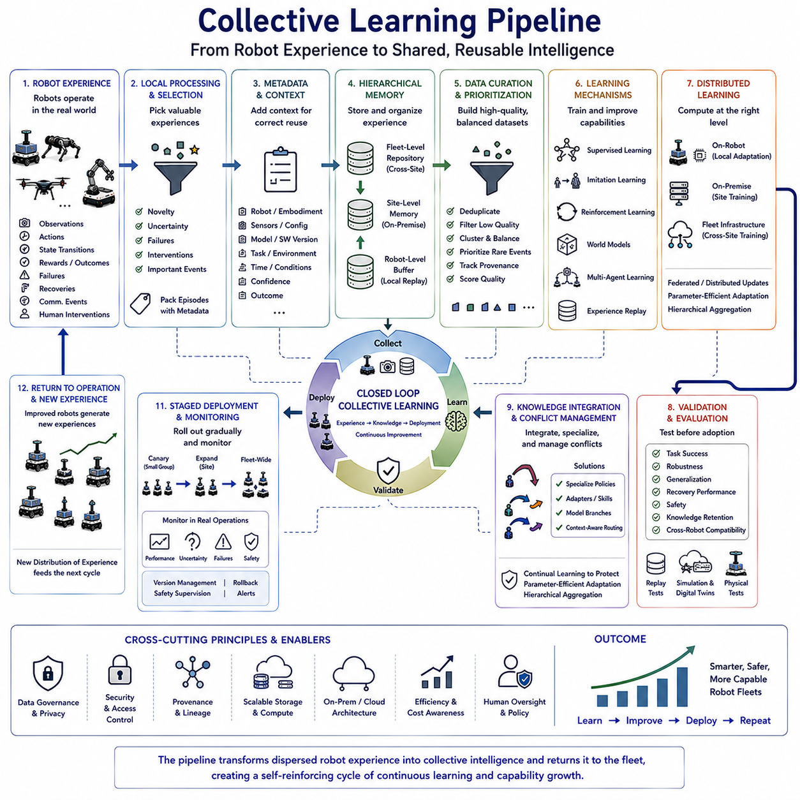{width="7.268055555555556in" height="7.268055555555556in"}

A collective learning pipeline provides the operational structure through which experiences generated by many robots are transformed into shared and reusable intelligence. It connects physical deployment, data collection, experience management, distributed learning, validation, knowledge integration, and model redistribution into a continuous system. Rather than treating learning as an isolated offline activity, the pipeline embeds learning directly into the lifecycle of a robot fleet.

The pipeline begins at the robot level, where individual agents perform missions and interact with the physical world. Each robot continuously produces observations, actions, state transitions, task outcomes, rewards, failures, recovery attempts, communication events, and human interventions. These experiences represent the raw material of collective learning because they capture situations encountered under actual operating conditions across different robots, environments, and tasks.

Local processing determines which experiences should leave the robot and enter the wider learning system. Raw sensor streams may be too large, repetitive, sensitive, or irrelevant to transmit continuously. Robots can therefore detect novelty, uncertainty, failures, interventions, unusual state transitions, or important task outcomes and package selected episodes with metadata. This creates a filtered experience stream with substantially higher learning value than indiscriminate data collection.

Metadata provides the context required to interpret distributed robot experience correctly. Each episode can identify the robot embodiment, sensor configuration, model and software versions, task, environment, timestamp, operating conditions, confidence, and outcome. Without this information, experiences collected by heterogeneous robots can be incorrectly combined. Context allows later stages to determine compatibility, relevance, freshness, and transferability before knowledge is reused.

Selected experiences can enter local, site-level, or fleet-level memory depending on communication and deployment architecture. Local replay buffers preserve recent robot-specific experience, while on-premise systems can aggregate knowledge from robots operating within the same facility. Higher-level repositories may combine selected experience across multiple sites. This hierarchical memory structure reduces unnecessary data movement while creating progressively broader collective knowledge.

Data curation transforms distributed experience into structured learning resources. Duplicate or low-quality samples can be removed, while rare failures, successful recoveries, novel environments, difficult interactions, and safety-critical episodes receive greater attention. Clustering, prioritization, balancing, provenance tracking, and quality scoring help construct datasets that represent both normal operation and important edge cases rather than simply reflecting the most frequently generated data.

The curated experience can feed several learning mechanisms according to the capability being improved. Supervised learning can refine perception, imitation learning can reproduce successful behavior, reinforcement learning can optimize policies, and world models can learn temporal dynamics and future consequences. Multi-agent learning can use joint trajectories to improve coordination, while replay mechanisms preserve historical knowledge during adaptation to new experiences.

Distributed learning allows computational work to occur at different levels of the architecture. Robots with sufficient resources may perform lightweight local adaptation, while on-premise infrastructure can conduct more substantial training using site-level experience. Broader fleet infrastructure can integrate knowledge across deployments. Federated learning, distributed model updates, parameter-efficient adaptation, and hierarchical aggregation provide different mechanisms for combining these learning contributions.

Not every locally learned improvement should become global fleet knowledge. Candidate updates must first be evaluated for compatibility and usefulness. A policy adapted to one robot, terrain, payload, or sensor configuration may not transfer safely to another platform. The pipeline therefore compares embodiment, task, environment, model version, performance evidence, and operational context before determining whether knowledge should remain local, become site-specific, or propagate more broadly.

Knowledge conflict management becomes necessary when different robots produce incompatible learning signals. One experience may favor cautious behavior while another favors aggressive execution because their operating conditions differ. Rather than averaging every update into one universal model, the pipeline can detect conflicts and preserve specialized policies, adapters, skills, or model branches. Context-aware routing can then activate the appropriate knowledge for each operating situation.

Continual learning mechanisms protect established capabilities while new knowledge enters the system. Historical replay, parameter protection, modular learning, adapters, and balanced sampling reduce catastrophic interference. The objective is not simply to maximize performance on the newest fleet data, but to expand capability while preserving navigation, manipulation, coordination, recovery, and safety behaviors that have already been validated during previous learning stages.

A collective curriculum determines which knowledge gaps deserve learning resources next. Repeated failures, high uncertainty, frequent human intervention, emerging environments, or insufficient coordination performance can become targeted training objectives. Tasks can be ordered according to difficulty and prerequisite capabilities. The learning pipeline therefore does more than process incoming data; it actively converts fleet weaknesses into structured challenges that guide future capability development.

Simulation can amplify important experiences before new models return to physical robots. Rare events collected during deployment can be reconstructed and systematically varied across terrain, sensor noise, robot density, payload, communication quality, or environmental conditions. Simulation provides large-scale training and stress testing while reducing physical risk. Real-world episodes keep these synthetic variations grounded in operationally relevant problems.

Evaluation and validation form a critical gate between learning and deployment. Candidate models should be tested against new objectives as well as previously mastered capabilities. Task success, robustness, generalization, recovery performance, safety, knowledge retention, and cross-robot compatibility can be evaluated using replay datasets, simulation, digital twins, benchmarks, and controlled physical experiments. Improvements that introduce unacceptable regression should not proceed automatically.

Validated knowledge can then be packaged according to its appropriate scope. Some updates may modify a common perception or world-model backbone, while others become policy heads, low-rank adapters, robot-specific controllers, reusable skills, or environment-specific modules. Version information, provenance, compatibility requirements, dependencies, and validation evidence accompany these packages so receiving robots can determine how and where they should be applied.

Deployment should proceed gradually rather than replacing the entire fleet simultaneously. A candidate model or skill can first be released to a small group of compatible robots and monitored under real operating conditions. If performance remains stable, distribution can expand to a site and eventually to the wider fleet. Monitoring, version management, rollback, and safety supervision provide protection when unexpected behavior appears after release.

Once updated robots return to operation, they generate a new distribution of experience. Previously common failures may decline, new capabilities may expose more difficult situations, and improved policies may create new forms of coordination and recovery behavior. These experiences re-enter the pipeline and become material for the next learning cycle. Deployment is therefore both the output of collective learning and the source of its next generation of data.

The complete pipeline forms a closed loop from physical experience to collective knowledge and back to physical execution. Robots experience the world, useful episodes are selected and curated, distributed learning produces candidate improvements, conflicts and interference are managed, models are validated, and appropriate knowledge is redistributed. Each cycle converts dispersed individual experience into increasingly reusable fleet-level intelligence.

At scale, the collective learning pipeline becomes the learning backbone of Collective Physical AI. Shared experience supplies evidence, federated and distributed learning combine contributions, replay preserves memory, transfer learning spreads capabilities, curriculum learning directs progress, and the fleet data flywheel sustains continuous improvement. The result is a robot fleet that does not merely operate as many individual machines, but progressively learns as a connected collective system.
