**Volume 09. Multi Robot and Swarm Physical AI**


# Chapter 06. Fleet World Memory and Shared Traversability

##  

## 06.01. Why Fleets Need Shared World Memory

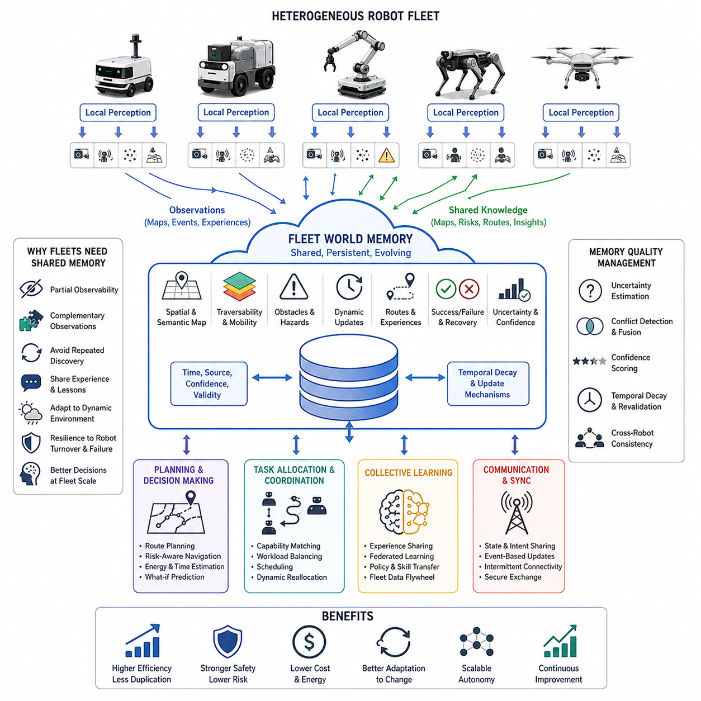{width="7.268055555555556in" height="7.268055555555556in"}

A robot operating alone can build a useful memory of its surroundings, but a fleet requires something more persistent and collective. Each robot observes only a limited portion of the environment during a limited period of time. Shared world memory allows these fragmented observations to accumulate into knowledge that remains available beyond the experience, location, or operating lifetime of any individual robot.

Without shared memory, robots repeatedly rediscover the same facts. One robot may identify a blocked corridor, slippery surface, narrow passage, unstable terrain, or reliable charging location, yet another robot arriving later may encounter the same condition as if it were completely unknown. Fleet world memory converts isolated observations into reusable operational knowledge and reduces unnecessary exploration, repeated failures, and duplicated perception effort.

The need becomes more important because physical environments are only partially observable. Walls, occlusions, sensor range, weather, lighting, terrain geometry, and moving objects prevent any robot from maintaining a complete global state. A fleet can compensate for this limitation by combining observations collected from different viewpoints, locations, sensor configurations, and times into a broader representation of the operational world.

Shared world memory is therefore different from simply exchanging current robot positions. It can contain spatial structure, semantic information, traversability estimates, obstacles, hazards, routes, task-relevant objects, interaction outcomes, and historical observations. This information creates a persistent context through which robots can reason not only about what they currently perceive, but also about what the fleet has previously experienced.

Traversability illustrates why this memory is valuable. A geometric map may indicate that a region is physically open, while previous robots may have learned that the surface causes wheel slip, excessive vibration, localization degradation, or high energy consumption. Recording such mobility experience allows later robots to distinguish between geometrically possible routes and routes that are operationally practical for a particular robot or mission.

Fleet memory also enables experience to propagate without requiring every robot to reproduce the original event. If one robot discovers that a ramp is unsuitable under certain payload conditions, that experience can inform route planning for other robots. A failed traversal can therefore become fleet-level knowledge rather than remaining an isolated failure, increasing the value extracted from every physical interaction with the environment.

This capability is especially important when the environment changes dynamically. Warehouses contain pallets, workers, vehicles, temporary storage zones, and changing traffic patterns, while outdoor environments contain weather effects, construction, vegetation, surface degradation, and moving hazards. Shared memory provides a mechanism for recording these changes and distributing updated knowledge so that fleet decisions reflect more than a static map.

However, shared world memory cannot be treated as an unquestioned database of facts. Observations may be uncertain, outdated, contradictory, or dependent on the sensing capability of the reporting robot. Useful fleet memory must therefore preserve information about confidence, observation time, source, spatial validity, and possibly the conditions under which an experience occurred. Knowledge becomes valuable when its reliability can also be evaluated.

Temporal information is particularly important because physical knowledge has different lifetimes. A building wall may remain valid for years, a damaged floor may remain relevant for weeks, and a parked vehicle may disappear within minutes. Fleet memory should therefore distinguish persistent structure from temporary conditions and dynamic events, allowing information to decay, be replaced, or be reconfirmed according to its expected temporal stability.

Robot diversity introduces another reason for maintaining structured shared memory. A route traversable by a small wheeled AMR may be inaccessible to a larger vehicle, while a quadruped may cross terrain that is unsuitable for wheels. Shared knowledge should consequently describe both environmental properties and robot-dependent experience, enabling the fleet to interpret the same world according to embodiment, payload, mobility, sensing, and operational constraints.

Shared memory also improves coordination because planning decisions can be based on accumulated fleet knowledge rather than only instantaneous state. Task allocation can consider known route difficulty, congestion, hazard history, expected travel time, energy cost, and robot-specific accessibility. The fleet can assign tasks to robots whose capabilities and locations best match the remembered characteristics of the environment and the expected mission conditions.

This changes the role of memory from passive storage to an active component of collective intelligence. Historical experience can influence prediction, planning, scheduling, risk estimation, and recovery. When robots remember where previous missions succeeded, where localization frequently failed, which routes became congested, and which recovery actions worked, future decisions become informed by operational history rather than being generated from current perception alone.

Shared world memory also supports resilience when communication is intermittent. Robots may operate temporarily with local cached knowledge and synchronize new observations when connectivity becomes available. The fleet does not require every decision to depend on continuous centralized communication; instead, persistent knowledge can be replicated, updated, and reconciled across local robot memory, edge infrastructure, and fleet-level storage according to system requirements.

At larger scales, this persistence becomes essential because the fleet itself is continuously changing. Robots enter and leave service, batteries are replaced, software is updated, sensors are recalibrated, and individual machines may fail. If environmental knowledge exists only inside particular robots, valuable experience disappears with them. Fleet memory separates accumulated operational intelligence from the lifecycle of any individual physical platform.

The result is a transition from many robots independently operating in the same environment toward a fleet that progressively develops a shared understanding of that environment. Perception produces observations, experience gives those observations operational meaning, and memory preserves that meaning for later decisions. Each robot can therefore benefit from events it did not personally observe and from actions it did not personally execute.

In this sense, shared world memory forms a bridge between collective learning and fleet-level world modeling. Collective learning determines how experience improves policies and skills, while world memory preserves knowledge about where, when, and under what conditions those experiences occurred. Together they allow physical AI fleets to transform distributed interaction histories into persistent, reusable, and increasingly informative representations of the world.

단독으로 작동하는 로봇은 주변 환경에 대한 유용한 기억(memory)을 구축할 수 있지만, 플릿(fleet)은 그보다 더 지속적이고 집단적인 기억을 필요로 한다. 각 로봇은 제한된 시간 동안 환경의 일부만 관찰할 수 있다. 공유 월드 메모리(shared world memory)는 이렇게 분산된 관찰 결과를 축적하여 특정 로봇의 경험, 위치 또는 운용 수명을 넘어 지속적으로 활용할 수 있는 지식(knowledge)으로 전환한다.

공유 메모리(shared memory)가 없다면 로봇들은 동일한 사실을 반복해서 다시 발견해야 한다. 한 로봇이 차단된 통로, 미끄러운 표면, 좁은 구간, 불안정한 지형 또는 신뢰할 수 있는 충전 위치를 발견하더라도, 나중에 도착한 다른 로봇은 이를 완전히 새로운 상황처럼 다시 경험할 수 있다. 플릿 월드 메모리(fleet world memory)는 개별 관찰을 재사용 가능한 운용 지식(operational knowledge)으로 전환하여 불필요한 탐색, 반복되는 실패, 중복된 인지 작업(perception effort)을 줄인다.

물리적 환경(physical environment)은 부분 관측 가능(partially observable)하기 때문에 이러한 필요성은 더욱 커진다. 벽, 가림(occlusion), 센서 범위, 날씨, 조명, 지형 형상, 이동 객체 등으로 인해 개별 로봇이 완전한 전역 상태(global state)를 유지하기는 어렵다. 플릿은 서로 다른 시점(viewpoint), 위치, 센서 구성 및 시간에서 수집한 관찰을 결합하여 이러한 한계를 보완하고, 운용 세계에 대한 보다 광범위한 표현(representation)을 구축할 수 있다.

따라서 공유 월드 메모리(shared world memory)는 단순히 현재 로봇 위치를 교환하는 것과는 다르다. 여기에는 공간 구조(spatial structure), 의미 정보(semantic information), 주행 가능성 추정(traversability estimate), 장애물, 위험 요소, 경로, 작업 관련 객체, 상호작용 결과 및 과거 관찰 정보가 포함될 수 있다. 이러한 정보는 로봇이 현재 인지하는 것뿐만 아니라 플릿이 과거에 경험했던 것까지 바탕으로 추론할 수 있도록 지속적인 맥락(persistent context)을 제공한다.

주행 가능성(traversability)은 이러한 메모리가 왜 중요한지를 잘 보여준다. 기하학적 지도(geometric map)에서는 특정 영역이 물리적으로 개방되어 있다고 표시될 수 있지만, 이전 로봇의 경험을 통해 해당 표면에서 바퀴 미끄러짐(wheel slip), 과도한 진동, 위치 추정 성능 저하(localization degradation) 또는 높은 에너지 소비가 발생한다는 사실을 알 수 있다. 이러한 이동 경험(mobility experience)을 기록하면 이후 로봇은 기하학적으로 가능한 경로와 특정 로봇 또는 임무에서 실제 운용 가능한 경로를 구분할 수 있다.

플릿 메모리(fleet memory)는 모든 로봇이 최초 사건을 직접 재현하지 않고도 경험을 전파할 수 있게 한다. 한 로봇이 특정 적재 조건(payload condition)에서 경사로가 적합하지 않다는 사실을 발견하면, 그 경험은 다른 로봇의 경로 계획(route planning)에 활용될 수 있다. 따라서 한 번의 주행 실패(traversal failure)가 개별적인 실패로 끝나지 않고 플릿 수준 지식(fleet-level knowledge)으로 전환되어 환경과의 모든 물리적 상호작용에서 얻을 수 있는 정보의 가치를 높인다.

이러한 기능은 환경이 동적으로 변화할 때 특히 중요하다. 창고에는 팔레트, 작업자, 차량, 임시 적재 구역 및 변화하는 교통 패턴이 존재하며, 야외 환경에는 날씨의 영향, 공사, 식생, 노면 상태 변화 및 이동하는 위험 요소가 존재한다. 공유 메모리(shared memory)는 이러한 변화를 기록하고 갱신된 지식을 배포하는 메커니즘을 제공함으로써 플릿의 의사결정이 정적인 지도(static map)에만 의존하지 않도록 한다.

그러나 공유 월드 메모리(shared world memory)를 의심 없이 받아들이는 사실 데이터베이스(database of facts)로 취급해서는 안 된다. 관찰 정보는 불확실하거나 오래되었거나 서로 모순될 수 있으며, 정보를 제공한 로봇의 센싱 능력(sensing capability)에 따라 달라질 수도 있다. 따라서 유용한 플릿 메모리는 신뢰도(confidence), 관찰 시간, 정보 출처(source), 공간적 유효성(spatial validity), 그리고 경우에 따라 해당 경험이 발생한 조건까지 보존해야 한다. 지식은 그 신뢰성을 함께 평가할 수 있을 때 더욱 가치가 높아진다.

물리적 지식(physical knowledge)은 서로 다른 유효 수명(lifetime)을 가지므로 시간 정보(temporal information)는 특히 중요하다. 건물의 벽은 수년 동안 유효할 수 있고, 손상된 바닥은 수주 동안 관련성이 유지될 수 있으며, 주차된 차량은 몇 분 안에 사라질 수 있다. 따라서 플릿 메모리는 영구적인 구조(persistent structure), 일시적인 조건(temporary condition), 동적 사건(dynamic event)을 구분하고 예상되는 시간적 안정성(temporal stability)에 따라 정보를 감쇠(decay), 교체 또는 재확인할 수 있어야 한다.

로봇의 다양성(robot diversity)은 구조화된 공유 메모리(structured shared memory)가 필요한 또 다른 이유이다. 소형 바퀴형 자율이동로봇(Autonomous Mobile Robot, AMR)이 통과할 수 있는 경로가 더 큰 차량에는 적합하지 않을 수 있으며, 사족보행 로봇(quadruped)은 바퀴형 로봇이 이동하기 어려운 지형을 통과할 수도 있다. 따라서 공유 지식(shared knowledge)은 환경 특성과 로봇 의존적 경험(robot-dependent experience)을 모두 표현하여 플릿이 형태(embodiment), 적재량, 이동 능력, 센싱 및 운용 제약에 따라 동일한 환경을 서로 다르게 해석할 수 있도록 해야 한다.

공유 메모리(shared memory)는 계획 의사결정(planning decision)을 순간적인 상태뿐만 아니라 축적된 플릿 지식에 기반하도록 함으로써 협업(coordination)도 향상시킨다. 작업 할당(task allocation)은 알려진 경로 난이도, 혼잡도, 위험 이력, 예상 이동 시간, 에너지 비용 및 로봇별 접근 가능성을 고려할 수 있다. 이를 통해 플릿은 환경에 축적된 특성과 예상 임무 조건에 가장 적합한 능력과 위치를 가진 로봇에게 작업을 할당할 수 있다.

이로 인해 메모리(memory)의 역할은 수동적인 저장소(passive storage)에서 집단 지능(collective intelligence)의 능동적인 구성요소로 변화한다. 과거 경험은 예측(prediction), 계획(planning), 스케줄링(scheduling), 위험 추정(risk estimation) 및 복구(recovery)에 영향을 줄 수 있다. 로봇들이 이전 임무가 성공했던 위치, 위치 추정이 반복적으로 실패했던 구간, 혼잡이 발생했던 경로, 효과적이었던 복구 행동을 기억한다면 미래의 의사결정은 현재 인지만이 아니라 운용 이력(operational history)을 기반으로 이루어질 수 있다.

공유 월드 메모리(shared world memory)는 통신이 간헐적인 상황에서도 복원력(resilience)을 지원한다. 로봇은 일시적으로 로컬 캐시 지식(local cached knowledge)을 사용하여 운용하고, 연결성이 회복되면 새로운 관찰 정보를 동기화할 수 있다. 따라서 모든 의사결정이 지속적인 중앙 집중형 통신(centralized communication)에 의존할 필요가 없으며, 시스템 요구사항에 따라 로컬 로봇 메모리(local robot memory), 엣지 인프라(edge infrastructure), 플릿 수준 저장소(fleet-level storage) 사이에서 지속적인 지식을 복제, 갱신 및 조정할 수 있다.

규모가 커질수록 플릿 자체가 지속적으로 변화하기 때문에 이러한 지속성(persistence)은 필수적이다. 로봇은 운용에 투입되거나 제외되고, 배터리가 교체되며, 소프트웨어가 업데이트되고, 센서가 재보정되며, 개별 장비가 고장날 수도 있다. 환경 지식이 특정 로봇 내부에만 존재한다면 해당 로봇과 함께 가치 있는 경험도 사라진다. 플릿 메모리(fleet memory)는 축적된 운용 지능(operational intelligence)을 개별 물리 플랫폼의 수명주기(lifecycle)로부터 분리한다.

그 결과 동일한 환경에서 여러 로봇이 독립적으로 작동하는 단계에서, 환경에 대한 공유된 이해(shared understanding)를 점진적으로 발전시키는 플릿으로 전환할 수 있다. 인지(perception)는 관찰 정보를 생성하고, 경험(experience)은 그 관찰에 운용적 의미를 부여하며, 메모리(memory)는 그 의미를 이후의 의사결정을 위해 보존한다. 따라서 각 로봇은 자신이 직접 관찰하지 않은 사건과 직접 수행하지 않은 행동으로부터도 이점을 얻을 수 있다.

이러한 의미에서 공유 월드 메모리(shared world memory)는 집단 학습(collective learning)과 플릿 수준 월드 모델링(fleet-level world modeling)을 연결하는 가교 역할을 한다. 집단 학습은 경험을 통해 정책(policy)과 기술(skill)을 개선하는 방법을 결정하고, 월드 메모리는 그러한 경험이 어디서, 언제, 어떤 조건에서 발생했는지에 대한 지식을 보존한다. 이 두 요소가 결합되면 물리 AI 플릿(Physical AI fleet)은 분산된 상호작용 이력(distributed interaction history)을 지속적이고 재사용 가능하며 점점 더 풍부해지는 세계 표현(world representation)으로 전환할 수 있다.

##  

## 06.02. Local Robot Memory vs Fleet Memory

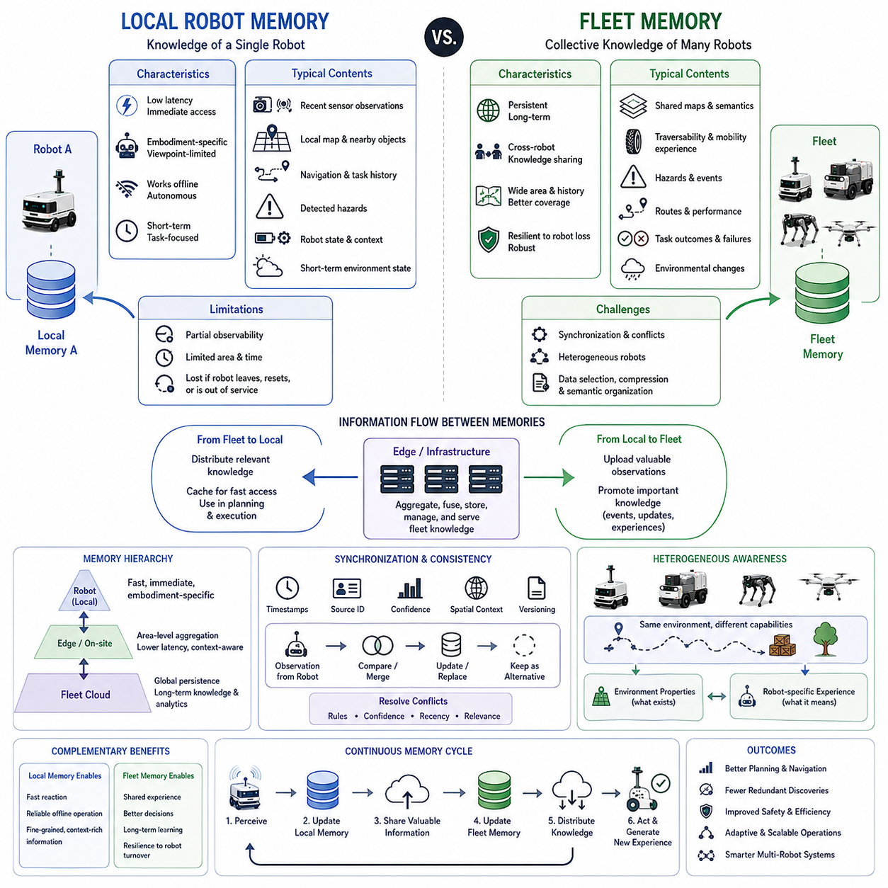{width="7.268055555555556in" height="7.268055555555556in"}

Local robot memory represents the knowledge accumulated by an individual robot through its own perception, actions, and interaction history. It may contain recent sensor observations, local maps, object states, navigation history, task progress, detected hazards, and short-term environmental context. Because this memory is maintained close to the robot, it supports fast decisions without depending on continuous communication with external systems.

Fleet memory extends this idea from an individual platform to a collective system. Instead of preserving only what one robot has experienced, it aggregates knowledge contributed by multiple robots operating across different locations and times. The resulting memory can describe spatial structure, semantic objects, traversability, hazards, routes, task outcomes, failures, and environmental changes that no single robot could observe completely.

The distinction is fundamentally one of perspective and persistence. Local memory reflects the world from the viewpoint and history of a particular robot, while fleet memory represents knowledge accumulated across the operational community. A robot may leave an area, lose connectivity, restart, or even be removed from service, but information transferred into fleet memory can remain available to other robots and future missions.

Local memory has important advantages because it is immediately accessible. Navigation, obstacle avoidance, manipulation, and safety functions often operate under strict latency constraints and cannot wait for remote synchronization. A robot can therefore maintain a locally consistent representation optimized for its current task and embodiment. This enables autonomous operation even when communication bandwidth is limited, intermittent, or completely unavailable.

However, local memory is inherently incomplete. A robot observes only what its sensors can detect along the trajectories it has traveled. Occlusion, sensor limitations, environmental scale, and limited operating time produce partial knowledge. Another robot may simultaneously observe a different region or encounter conditions that the first robot has never experienced. Fleet memory combines these complementary observations into a broader representation of the shared environment.

Consider two robots approaching the same corridor at different times. The first robot may discover that the corridor is temporarily blocked and store this information locally. If that observation remains only in its local memory, the second robot may travel toward the same blockage and repeat the discovery. If the event is synchronized with fleet memory, other robots can incorporate it into route planning before reaching the affected area.

The same principle applies to traversability experience. Local memory can record that a particular robot experienced wheel slip, localization instability, excessive vibration, or high energy consumption on a specific surface. Fleet memory can preserve this experience together with robot type, payload, environmental condition, and confidence, allowing other robots to determine whether the information is relevant to their own mobility characteristics.

This does not mean that fleet memory should simply copy every item stored by every robot. Local memories may contain high-frequency sensor data, temporary states, redundant observations, or information that has little value beyond the current mission. A fleet-level representation requires selection, abstraction, compression, and semantic organization so that operationally meaningful knowledge can be retained without overwhelming communication and storage resources.

Information therefore moves between memory levels according to its value and urgency. Immediate obstacle observations may remain local when they are relevant only for a few seconds, while persistent hazards, route closures, structural changes, or repeated navigation failures may be promoted to fleet memory. Conversely, fleet knowledge relevant to a robot\'s assigned region or mission can be distributed and cached locally for rapid access during execution.

Synchronization creates an important architectural challenge because robots do not observe the world simultaneously. A robot reconnecting after an extended communication outage may contain observations that conflict with newer fleet information. Effective memory management must therefore associate knowledge with timestamps, sources, confidence estimates, spatial context, and version information so that observations can be compared, merged, replaced, or preserved as alternative hypotheses.

Fleet memory must also account for heterogeneous embodiments. Information generated by an AMR, quadruped, UAV, or mobile manipulator may describe the same environment but have different operational meanings. A narrow passage may be traversable for one platform but inaccessible to another. Consequently, shared memory should separate properties of the environment from robot-specific interpretations, capabilities, and experiences whenever possible.

Local and fleet memory also differ in failure characteristics. Local memory remains usable when infrastructure or network connectivity fails, providing a foundation for graceful degradation and autonomous fallback behavior. Fleet memory, meanwhile, protects collective knowledge from the loss of individual robots. Combining the two creates resilience at both levels: robots retain immediate autonomy while the fleet preserves long-term operational experience.

A practical architecture therefore treats local and fleet memory as complementary rather than competing alternatives. Local memory emphasizes low latency, immediate context, embodiment-specific information, and disconnected operation. Fleet memory emphasizes persistence, cross-robot knowledge sharing, broader spatial coverage, historical experience, and collective consistency. Information flows between these levels according to communication conditions, mission priorities, and knowledge relevance.

This relationship can be extended through edge or on-premise infrastructure. Robots maintain operational caches and short-term state locally, while edge systems aggregate observations from nearby robots and fleet-level services preserve longer-term world knowledge. Such a hierarchy reduces unnecessary communication while allowing important discoveries to propagate across the fleet, creating multiple memory timescales rather than relying on a single centralized database.

Planning and task allocation can exploit both forms of memory simultaneously. Local memory provides the robot\'s immediate state, nearby obstacles, current progress, and recent interactions, while fleet memory contributes historical route performance, known hazards, congestion patterns, shared task context, and experience from other robots. Decisions can therefore combine what the robot knows now with what the fleet has learned over time.

The most capable multi-robot systems ultimately operate through a continuous memory cycle. Robots perceive and update local memory, valuable observations are transferred into fleet memory, shared knowledge is fused and maintained, and relevant information is redistributed to robots that can use it. Their subsequent actions generate new experience, which again updates the memory system and progressively improves the collective representation of the world.

Local robot memory and fleet memory should therefore be understood as two interconnected layers of physical AI intelligence rather than separate storage mechanisms. Local memory enables each robot to remain responsive and autonomous, while fleet memory allows experience to persist and spread across the population. Their integration transforms individual robot histories into shared operational knowledge that supports scalable, adaptive, and increasingly capable multi-robot systems.

로컬 로봇 메모리(local robot memory)는 개별 로봇이 자체적인 인지(perception), 행동(action), 상호작용 이력(interaction history)을 통해 축적한 지식을 나타낸다. 여기에는 최근 센서 관찰, 로컬 지도(local map), 객체 상태, 주행 이력, 작업 진행 상태, 감지된 위험 요소, 단기적인 환경 맥락(environmental context) 등이 포함될 수 있다. 이러한 메모리는 로봇 가까이에서 유지되므로 외부 시스템과의 지속적인 통신에 의존하지 않고 빠른 의사결정을 지원한다.

플릿 메모리(fleet memory)는 이러한 개념을 개별 플랫폼에서 집단 시스템(collective system)으로 확장한다. 하나의 로봇이 경험한 내용만 보존하는 대신, 서로 다른 위치와 시간에서 작동하는 여러 로봇이 제공한 지식을 통합한다. 그 결과 단일 로봇이 완전하게 관찰할 수 없는 공간 구조, 의미 객체(semantic object), 주행 가능성(traversability), 위험 요소, 경로, 작업 결과, 실패 및 환경 변화 등을 표현할 수 있다.

두 메모리의 차이는 근본적으로 관점(perspective)과 지속성(persistence)에 있다. 로컬 메모리(local memory)는 특정 로봇의 관점과 경험 이력을 통해 세계를 표현하지만, 플릿 메모리는 전체 운용 집단(operational community)에 걸쳐 축적된 지식을 나타낸다. 로봇이 특정 영역을 떠나거나 연결이 끊기거나 재시작되거나 운용에서 제외되더라도 플릿 메모리로 전달된 정보는 다른 로봇과 향후 임무에서 계속 사용할 수 있다.

로컬 메모리(local memory)는 즉시 접근할 수 있다는 중요한 장점을 가진다. 주행, 장애물 회피, 조작(manipulation), 안전 기능은 엄격한 지연시간 제약(latency constraint)에서 동작하는 경우가 많기 때문에 원격 동기화를 기다릴 수 없다. 따라서 로봇은 현재 작업과 형태(embodiment)에 최적화된 로컬 일관성 표현(locally consistent representation)을 유지할 수 있으며, 통신 대역폭이 제한되거나 간헐적이거나 완전히 사용할 수 없는 경우에도 자율적으로 작동할 수 있다.

그러나 로컬 메모리는 본질적으로 불완전하다. 로봇은 자신의 센서가 감지할 수 있는 범위와 실제 이동한 경로에서 얻은 정보만 관찰한다. 가림(occlusion), 센서 한계, 환경 규모 및 제한된 운용 시간으로 인해 부분적인 지식만 형성된다. 동시에 다른 로봇은 전혀 다른 영역을 관찰하거나 첫 번째 로봇이 경험하지 못한 상황을 마주할 수 있다. 플릿 메모리는 이러한 상호보완적 관찰(complementary observation)을 결합하여 공유 환경에 대한 더 광범위한 표현을 구축한다.

서로 다른 시간에 동일한 통로에 접근하는 두 로봇을 생각할 수 있다. 첫 번째 로봇이 통로가 일시적으로 차단되었다는 사실을 발견하여 이를 로컬에 저장할 수 있다. 이 관찰이 로컬 메모리에만 남는다면 두 번째 로봇은 동일한 차단 지점으로 이동하여 같은 사실을 다시 발견해야 한다. 반면 해당 사건이 플릿 메모리와 동기화된다면 다른 로봇들은 영향을 받는 영역에 도착하기 전에 이를 경로 계획(route planning)에 반영할 수 있다.

동일한 원리는 주행 가능성 경험(traversability experience)에도 적용된다. 로컬 메모리는 특정 로봇이 특정 표면에서 바퀴 미끄러짐(wheel slip), 위치 추정 불안정(localization instability), 과도한 진동 또는 높은 에너지 소비를 경험했다는 사실을 기록할 수 있다. 플릿 메모리는 이러한 경험을 로봇 유형, 적재량(payload), 환경 조건 및 신뢰도(confidence)와 함께 보존하여 다른 로봇이 자신의 이동 특성에 해당 정보가 적합한지를 판단하도록 할 수 있다.

그렇다고 해서 플릿 메모리가 모든 로봇에 저장된 모든 정보를 단순히 복사해야 하는 것은 아니다. 로컬 메모리에는 고주파 센서 데이터(high-frequency sensor data), 일시적인 상태, 중복된 관찰 또는 현재 임무 이후에는 가치가 거의 없는 정보가 포함될 수 있다. 플릿 수준 표현(fleet-level representation)은 통신 및 저장 자원을 과도하게 소비하지 않으면서 운용적으로 의미 있는 지식을 유지할 수 있도록 선택(selection), 추상화(abstraction), 압축(compression), 의미적 구조화(semantic organization)를 필요로 한다.

따라서 정보는 그 가치와 긴급성에 따라 메모리 계층(memory level) 사이를 이동한다. 즉각적인 장애물 관찰은 몇 초 동안만 관련성이 있다면 로컬에 유지될 수 있지만, 지속적인 위험 요소, 경로 폐쇄, 구조적 변화 또는 반복적인 주행 실패는 플릿 메모리로 승격될 수 있다. 반대로 로봇에게 할당된 영역이나 임무와 관련된 플릿 지식은 실행 과정에서 빠르게 접근할 수 있도록 로컬에 배포되고 캐싱(caching)될 수 있다.

로봇들은 동일한 시간에 세계를 관찰하지 않기 때문에 동기화(synchronization)는 중요한 아키텍처상의 과제를 만든다. 장기간 통신이 중단된 이후 다시 연결된 로봇은 최신 플릿 정보와 충돌하는 관찰 데이터를 보유할 수 있다. 따라서 효과적인 메모리 관리(memory management)는 관찰 정보를 비교, 병합, 교체하거나 대안적 가설(alternative hypothesis)로 보존할 수 있도록 지식에 타임스탬프(timestamp), 출처(source), 신뢰도 추정(confidence estimate), 공간적 맥락(spatial context), 버전 정보(version information)를 연결해야 한다.

플릿 메모리는 이기종 형태(heterogeneous embodiment)도 고려해야 한다. 자율이동로봇(Autonomous Mobile Robot, AMR), 사족보행 로봇(quadruped), 무인항공기(Unmanned Aerial Vehicle, UAV), 모바일 매니퓰레이터(mobile manipulator)가 생성한 정보는 동일한 환경을 설명하더라도 서로 다른 운용적 의미를 가질 수 있다. 좁은 통로가 한 플랫폼에는 통과 가능하지만 다른 플랫폼에는 접근 불가능할 수 있으므로, 공유 메모리는 가능한 경우 환경 자체의 특성과 로봇별 해석, 능력 및 경험을 분리해야 한다.

로컬 메모리와 플릿 메모리는 장애 특성(failure characteristics)에서도 차이가 있다. 로컬 메모리는 인프라 또는 네트워크 연결이 실패하더라도 사용할 수 있어 점진적 성능 저하(graceful degradation)와 자율 폴백 행동(autonomous fallback behavior)의 기반을 제공한다. 반면 플릿 메모리는 개별 로봇이 손실되더라도 집단 지식(collective knowledge)을 보호한다. 두 메모리를 결합하면 로봇의 즉각적인 자율성을 유지하면서 플릿의 장기적인 운용 경험도 보존하는 이중적인 복원력(resilience)을 확보할 수 있다.

따라서 실용적인 아키텍처는 로컬 메모리와 플릿 메모리를 서로 경쟁하는 대안이 아니라 상호보완적인 요소로 취급한다. 로컬 메모리는 낮은 지연시간(low latency), 즉각적인 맥락, 형태별 정보(embodiment-specific information), 연결이 끊긴 상태에서의 운용을 중시한다. 플릿 메모리는 지속성, 로봇 간 지식 공유(cross-robot knowledge sharing), 더 넓은 공간적 범위, 과거 경험 및 집단적 일관성(collective consistency)을 중시한다. 정보는 통신 상태, 임무 우선순위 및 지식의 관련성에 따라 두 계층 사이를 이동한다.

이러한 관계는 엣지(edge) 또는 온프레미스 인프라(on-premise infrastructure)를 통해 더욱 확장될 수 있다. 로봇은 운용 캐시(operational cache)와 단기 상태를 로컬에서 유지하고, 엣지 시스템은 인접한 로봇들의 관찰 정보를 통합하며, 플릿 수준 서비스는 보다 장기적인 월드 지식(world knowledge)을 보존한다. 이러한 계층 구조(hierarchy)는 불필요한 통신을 줄이면서 중요한 발견을 플릿 전체로 전파할 수 있게 하며, 하나의 중앙집중식 데이터베이스에 의존하는 대신 여러 메모리 시간 척도(memory timescale)를 형성한다.

계획(planning)과 작업 할당(task allocation)은 두 종류의 메모리를 동시에 활용할 수 있다. 로컬 메모리는 로봇의 즉각적인 상태, 주변 장애물, 현재 작업 진행 상황 및 최근 상호작용을 제공하며, 플릿 메모리는 과거 경로 성능, 알려진 위험 요소, 혼잡 패턴, 공유 작업 맥락(shared task context), 다른 로봇의 경험을 제공한다. 따라서 의사결정은 로봇이 현재 알고 있는 정보와 플릿이 시간에 걸쳐 학습한 지식을 함께 결합할 수 있다.

가장 발전된 다중 로봇 시스템(multi-robot system)은 궁극적으로 지속적인 메모리 순환(memory cycle)을 통해 작동한다. 로봇은 환경을 인지하고 로컬 메모리를 갱신하며, 가치 있는 관찰 정보는 플릿 메모리로 전달된다. 공유 지식은 융합(fusion)되고 유지되며, 관련 정보는 이를 활용할 수 있는 로봇에게 다시 배포된다. 이후 로봇의 행동은 새로운 경험을 생성하고, 이 경험은 다시 메모리 시스템을 갱신하여 세계에 대한 집단적 표현(collective representation)을 점진적으로 향상시킨다.

따라서 로컬 로봇 메모리(local robot memory)와 플릿 메모리(fleet memory)는 서로 분리된 저장 메커니즘이 아니라 물리 AI 지능(Physical AI intelligence)을 구성하는 상호 연결된 두 계층으로 이해해야 한다. 로컬 메모리는 각 로봇이 즉각적으로 대응하고 자율성을 유지하도록 하며, 플릿 메모리는 경험이 로봇 집단 전체에 걸쳐 지속되고 확산되도록 한다. 두 계층의 통합은 개별 로봇의 경험 이력을 공유 운용 지식(shared operational knowledge)으로 전환하여 확장 가능하고 적응적이며 지속적으로 능력이 향상되는 다중 로봇 시스템을 가능하게 한다.

##  

## 06.03. Shared Spatial and Semantic Maps

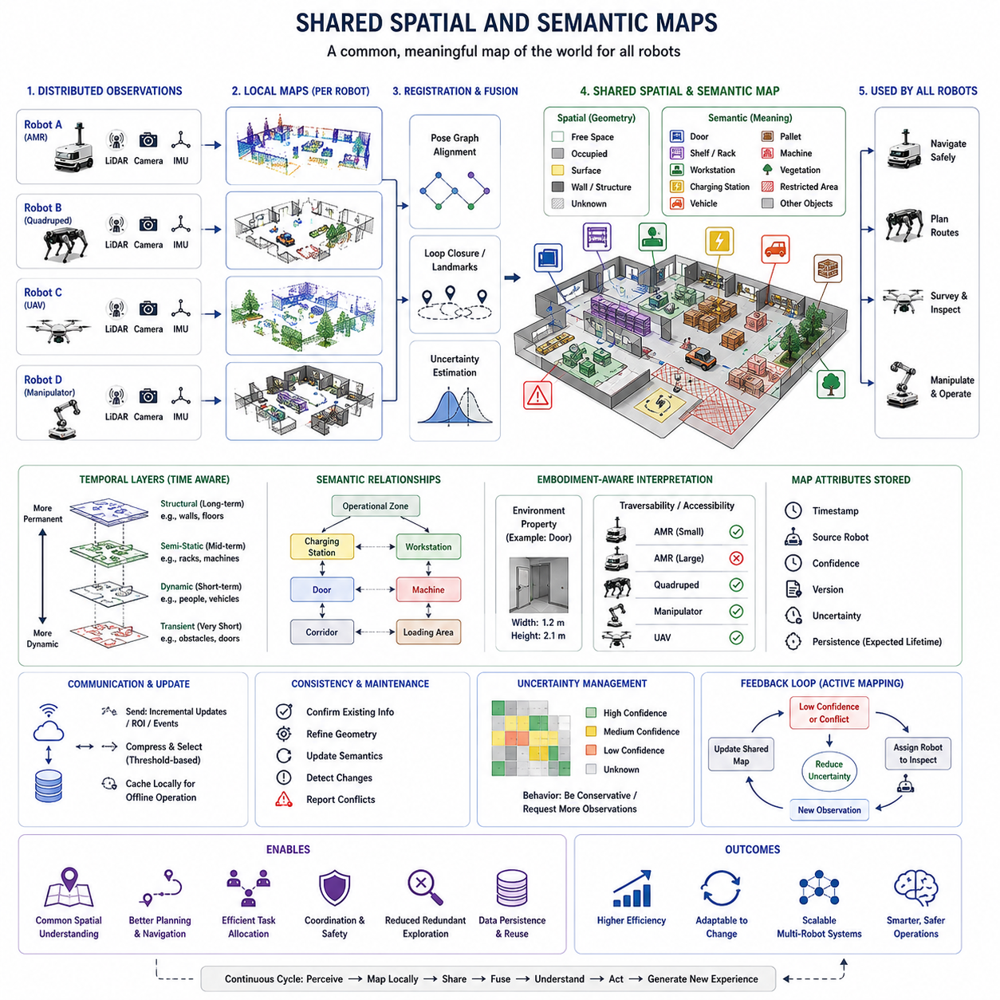{width="7.268055555555556in" height="7.268055555555556in"}

Shared spatial and semantic maps provide a common environmental representation that allows multiple robots to reason about the same physical world. A spatial map describes geometric structure such as free space, occupied regions, walls, corridors, surfaces, and landmarks, while a semantic map associates those structures with meaningful concepts such as doors, shelves, workstations, charging stations, roads, vegetation, equipment, or restricted areas.

For an individual robot, spatial mapping supports localization, navigation, obstacle avoidance, and path planning. In a fleet, however, the map becomes a shared knowledge resource rather than a representation created independently by every robot. Observations collected by different robots can be registered into a common coordinate system, allowing areas explored by one robot to become immediately useful to robots that have never physically visited those locations.

This shared representation addresses the fundamental limitation of partial observability. Each robot sees only a portion of the environment because of sensor range, occlusion, viewpoint, mobility constraints, and mission assignments. By combining spatial observations from multiple robots, the fleet can progressively increase coverage, reduce unknown regions, improve map completeness, and maintain environmental knowledge beyond the trajectory of any single platform.

Semantic information adds operational meaning to geometry. A rectangular obstacle in a geometric map may simply appear as occupied space, but semantic interpretation can identify it as a pallet, vehicle, machine, storage rack, temporary barrier, or person. These distinctions matter because different objects have different persistence, mobility, safety requirements, interaction possibilities, and implications for robot planning and behavior.

Shared semantic maps therefore enable robots to communicate about environments using meaningful entities rather than only coordinates and occupancy values. A task can refer to a loading station, inspection point, doorway, hazardous zone, or charging area, while the fleet map connects these concepts to physical locations. This creates a common spatial-semantic vocabulary through which perception, task allocation, planning, and coordination can interact.

Building such a map requires observations from different robots to be aligned correctly. Robots may use LiDAR, cameras, depth sensors, radar, GNSS, inertial sensing, or combinations of these modalities. Their local maps must be transformed into compatible reference frames using localization, map matching, loop closure, landmarks, or other registration mechanisms before observations can contribute consistently to a shared fleet representation.

Map fusion is more complex than simply overlaying local maps. Different robots may observe the same region with different sensor resolutions, viewpoints, uncertainties, and timestamps. A fleet mapping system must determine whether observations describe the same object or location, estimate their reliability, combine compatible information, and identify conflicting evidence instead of assuming that every incoming observation is equally accurate.

Time is particularly important because spatial and semantic knowledge changes at different rates. Structural elements such as walls may remain stable for years, while pallets, vehicles, equipment, people, doors, or temporary barriers can change rapidly. A useful shared map should therefore represent not only where something was observed and what it was, but also when it was observed and how persistent that information is expected to be.

This distinction allows shared maps to contain multiple temporal layers. Relatively static geometry can form a persistent structural map, while semi-static objects and temporary conditions can be maintained in more frequently updated layers. Dynamic entities may be represented as current states or trajectories rather than permanent map features. Separating these timescales prevents transient observations from incorrectly becoming long-term world knowledge.

Semantic maps can also describe relationships between entities. A charging station may belong to a particular operational zone, a pallet may occupy a loading area, a machine may contain designated inspection points, and a corridor may connect two work regions. Such relationships transform the map from a collection of labeled objects into a structured representation that supports higher-level reasoning about places, functions, accessibility, and tasks.

In heterogeneous fleets, the shared map should distinguish environmental facts from embodiment-dependent interpretations. A doorway has a measurable width and height as properties of the environment, but whether it is traversable depends on the dimensions and mobility characteristics of a particular robot. The same spatial-semantic map can therefore support different accessibility or traversability interpretations for AMRs, quadrupeds, manipulators, UAVs, and other platforms.

Shared maps also improve task allocation and mission coordination. When robots operate from a common representation, tasks can be assigned according to robot location, accessibility, environmental conditions, and nearby resources. Robots can coordinate routes around shared obstacles, avoid repeatedly exploring known areas, identify which platform is best positioned for a task, and reason about interactions between simultaneous missions occurring in the same space.

Communication constraints require the representation to be selective. Continuously transmitting complete high-resolution maps from every robot would consume substantial bandwidth and processing resources. Practical systems can exchange incremental changes, selected map regions, compressed features, semantic events, or updates whose importance exceeds a defined threshold. Robots may also cache relevant portions of the shared map for operation during temporary network disconnection.

Map consistency becomes a continuous process rather than a one-time construction step. As robots observe previously mapped regions, they can confirm existing knowledge, refine geometry, update semantic labels, detect environmental changes, or report contradictions. Fleet memory can preserve the source, timestamp, confidence, and version of these observations so that updates can be fused while maintaining traceability of how the shared representation evolved.

Uncertainty should remain explicitly associated with shared map information. Localization error, sensor noise, imperfect semantic classification, ambiguous data association, and outdated observations can all produce incorrect conclusions. Rather than presenting the map as absolute truth, the fleet can maintain confidence estimates that allow planning systems to behave conservatively in uncertain regions or request additional observations from other robots.

This creates an important feedback loop between mapping and fleet behavior. If a region has low spatial confidence or conflicting semantic labels, a robot can be assigned to inspect it from another viewpoint. The resulting observation updates the shared map, which then improves planning for subsequent robots. Mapping therefore becomes an active fleet process in which robots collectively reduce uncertainty through coordinated physical exploration.

Shared spatial and semantic maps ultimately form a foundational layer of fleet world memory. They connect geometry with meaning, individual perception with collective knowledge, and current observations with persistent environmental history. By continuously integrating distributed observations into a common representation, a multi-robot system can develop a progressively richer understanding of where things are, what they are, how they change, and how they matter to collective action.

공유 공간 및 의미 지도(shared spatial and semantic maps)는 여러 로봇이 동일한 물리적 세계(physical world)에 대해 추론할 수 있도록 공통 환경 표현(common environmental representation)을 제공한다. 공간 지도(spatial map)는 자유 공간, 점유 영역, 벽, 통로, 표면, 랜드마크와 같은 기하학적 구조를 표현하며, 의미 지도(semantic map)는 이러한 구조에 문, 선반, 작업대, 충전소, 도로, 식생, 장비 또는 제한 구역과 같은 의미 있는 개념을 연결한다.

개별 로봇에서 공간 매핑(spatial mapping)은 위치 추정(localization), 주행(navigation), 장애물 회피(obstacle avoidance), 경로 계획(path planning)을 지원한다. 그러나 플릿(fleet)에서는 지도가 각 로봇이 독립적으로 생성하는 표현이 아니라 공유 지식 자원(shared knowledge resource)이 된다. 서로 다른 로봇이 수집한 관찰 정보를 공통 좌표계(common coordinate system)에 정합하면 한 로봇이 탐색한 영역을 실제로 방문한 적이 없는 다른 로봇도 즉시 활용할 수 있다.

이러한 공유 표현(shared representation)은 부분 관측 가능성(partial observability)이라는 근본적인 한계를 해결하는 데 도움을 준다. 각 로봇은 센서 범위, 가림(occlusion), 관찰 시점(viewpoint), 이동성 제약, 임무 할당으로 인해 환경의 일부만 볼 수 있다. 여러 로봇의 공간 관찰을 결합하면 플릿은 점진적으로 탐색 범위를 확대하고, 미지 영역을 줄이며, 지도의 완전성을 높이고, 개별 플랫폼의 이동 경로를 넘어 환경 지식을 유지할 수 있다.

의미 정보(semantic information)는 기하 정보(geometry)에 운용적 의미를 추가한다. 기하 지도에서 직사각형 장애물은 단순한 점유 공간으로 표현될 수 있지만, 의미적 해석(semantic interpretation)을 통해 팔레트, 차량, 기계, 보관 랙, 임시 장벽 또는 사람으로 식별할 수 있다. 이러한 구분은 객체마다 지속성, 이동성, 안전 요구사항, 상호작용 가능성 및 로봇의 계획과 행동에 미치는 영향이 서로 다르기 때문에 중요하다.

따라서 공유 의미 지도(shared semantic map)를 사용하면 로봇은 단순한 좌표와 점유 값(occupancy value)이 아니라 의미 있는 개체(entity)를 이용하여 환경에 대해 통신할 수 있다. 작업은 적재 스테이션, 검사 지점, 출입구, 위험 구역 또는 충전 구역을 참조할 수 있으며, 플릿 지도는 이러한 개념을 실제 물리적 위치와 연결한다. 이를 통해 인지(perception), 작업 할당(task allocation), 계획(planning), 협업(coordination)이 상호작용할 수 있는 공통 공간-의미 어휘(spatial-semantic vocabulary)가 형성된다.

이러한 지도를 구축하려면 서로 다른 로봇의 관찰 정보가 정확하게 정렬되어야 한다. 로봇은 라이다(LiDAR), 카메라, 깊이 센서(depth sensor), 레이더(radar), 위성항법시스템(GNSS), 관성 센싱(inertial sensing) 또는 이들의 조합을 사용할 수 있다. 각 로봇의 로컬 지도(local map)는 위치 추정, 지도 매칭(map matching), 루프 폐쇄(loop closure), 랜드마크 또는 기타 정합(registration) 메커니즘을 이용하여 호환 가능한 기준 좌표계(reference frame)로 변환되어야 공유 플릿 표현에 일관되게 기여할 수 있다.

지도 융합(map fusion)은 단순히 로컬 지도들을 겹치는 것보다 복잡하다. 서로 다른 로봇은 동일한 영역을 서로 다른 센서 해상도, 관찰 시점, 불확실성 및 시간에서 관찰할 수 있다. 플릿 매핑 시스템(fleet mapping system)은 관찰 정보가 동일한 객체나 위치를 나타내는지 판단하고, 신뢰성을 추정하며, 호환되는 정보를 결합해야 한다. 또한 모든 관찰 정보가 동일하게 정확하다고 가정하는 대신 서로 충돌하는 증거를 식별해야 한다.

공간 및 의미 지식(spatial and semantic knowledge)은 서로 다른 속도로 변화하기 때문에 시간(time)은 특히 중요하다. 벽과 같은 구조 요소는 수년간 유지될 수 있지만, 팔레트, 차량, 장비, 사람, 문 또는 임시 장벽은 빠르게 변화할 수 있다. 따라서 유용한 공유 지도는 무엇이 어디에서 관찰되었는지만 표현하는 것이 아니라 언제 관찰되었으며 해당 정보가 얼마나 지속될 것으로 예상되는지도 표현해야 한다.

이러한 구분을 통해 공유 지도(shared map)는 여러 시간 계층(temporal layer)을 포함할 수 있다. 비교적 정적인 기하 구조는 지속적 구조 지도(persistent structural map)를 형성하고, 준정적 객체(semi-static object)와 일시적인 조건은 더 자주 갱신되는 계층에서 관리할 수 있다. 동적 개체(dynamic entity)는 영구적인 지도 요소가 아니라 현재 상태 또는 이동 궤적(trajectory)으로 표현할 수 있다. 이러한 시간 척도의 분리는 일시적인 관찰이 장기적인 월드 지식(world knowledge)으로 잘못 저장되는 것을 방지한다.

의미 지도(semantic map)는 개체 사이의 관계도 표현할 수 있다. 충전소는 특정 운용 구역에 속할 수 있고, 팔레트는 적재 구역을 점유할 수 있으며, 기계에는 지정된 검사 지점이 존재할 수 있고, 통로는 두 작업 영역을 연결할 수 있다. 이러한 관계는 지도를 단순히 라벨이 지정된 객체들의 집합에서 장소, 기능, 접근 가능성 및 작업에 대한 고수준 추론(higher-level reasoning)을 지원하는 구조화된 표현(structured representation)으로 발전시킨다.

이기종 플릿(heterogeneous fleet)에서 공유 지도는 환경 자체의 사실과 형태 의존적 해석(embodiment-dependent interpretation)을 구분해야 한다. 출입구의 너비와 높이는 환경의 측정 가능한 특성이지만, 해당 출입구를 통과할 수 있는지는 특정 로봇의 크기와 이동 특성에 따라 달라진다. 따라서 동일한 공간-의미 지도는 자율이동로봇(AMR), 사족보행 로봇(quadruped), 매니퓰레이터(manipulator), 무인항공기(UAV) 및 기타 플랫폼에 서로 다른 접근 가능성(accessibility)이나 주행 가능성(traversability) 해석을 제공할 수 있다.

공유 지도는 작업 할당(task allocation)과 임무 협업(mission coordination)도 향상시킨다. 로봇들이 공통 표현을 기반으로 작동하면 로봇의 위치, 접근 가능성, 환경 조건 및 주변 자원을 고려하여 작업을 할당할 수 있다. 로봇들은 공유 장애물을 고려하여 경로를 조정하고, 이미 알려진 영역의 반복 탐색을 피하며, 특정 작업에 가장 적합한 위치의 플랫폼을 식별하고, 동일한 공간에서 동시에 수행되는 여러 임무 사이의 상호작용을 추론할 수 있다.

통신 제약(communication constraint)으로 인해 공유 표현은 선택적으로 관리되어야 한다. 모든 로봇이 완전한 고해상도 지도(high-resolution map)를 지속적으로 전송한다면 상당한 통신 대역폭과 처리 자원이 소비된다. 실용적인 시스템은 증분 변화(incremental change), 선택된 지도 영역, 압축 특징(compressed feature), 의미 사건(semantic event) 또는 정의된 중요도 임계값을 초과하는 업데이트만 교환할 수 있다. 또한 로봇은 일시적인 네트워크 단절 상황에서 운용하기 위해 공유 지도의 관련 부분을 로컬에 캐싱할 수 있다.

지도 일관성(map consistency)은 일회성 구축 작업이 아니라 지속적인 과정이 된다. 로봇이 이전에 매핑된 영역을 다시 관찰하면서 기존 지식을 확인하고, 기하 구조를 정교화하며, 의미 라벨(semantic label)을 갱신하고, 환경 변화를 감지하거나 모순을 보고할 수 있다. 플릿 메모리(fleet memory)는 이러한 관찰의 출처, 타임스탬프(timestamp), 신뢰도(confidence), 버전(version)을 보존하여 공유 표현이 어떻게 변화했는지 추적 가능성(traceability)을 유지하면서 업데이트를 융합할 수 있다.

불확실성(uncertainty)은 공유 지도 정보와 명시적으로 연결되어야 한다. 위치 추정 오차, 센서 잡음, 불완전한 의미 분류(semantic classification), 모호한 데이터 연관(data association), 오래된 관찰 정보는 모두 잘못된 결론을 만들 수 있다. 지도를 절대적인 사실로 제시하는 대신 플릿은 신뢰도 추정(confidence estimate)을 유지하여 계획 시스템이 불확실한 영역에서 보수적으로 행동하거나 다른 로봇에게 추가적인 관찰을 요청하도록 할 수 있다.

이를 통해 매핑(mapping)과 플릿 행동(fleet behavior) 사이에 중요한 피드백 루프(feedback loop)가 형성된다. 특정 영역의 공간적 신뢰도가 낮거나 의미 라벨이 서로 충돌한다면 다른 시점에서 해당 영역을 검사하도록 로봇을 할당할 수 있다. 새롭게 얻은 관찰은 공유 지도를 갱신하고, 갱신된 지도는 이후 로봇의 계획을 향상시킨다. 따라서 매핑은 로봇들이 협력적인 물리 탐색을 통해 집단적으로 불확실성을 감소시키는 능동적인 플릿 프로세스(active fleet process)가 된다.

궁극적으로 공유 공간 및 의미 지도(shared spatial and semantic maps)는 플릿 월드 메모리(fleet world memory)의 핵심 기반 계층을 형성한다. 이는 기하 구조와 의미, 개별 인지와 집단 지식, 현재 관찰과 지속적인 환경 이력을 서로 연결한다. 분산된 관찰 정보를 공통 표현으로 지속적으로 통합함으로써 다중 로봇 시스템(multi-robot system)은 사물이 어디에 있는지, 무엇인지, 어떻게 변화하는지, 그리고 집단 행동(collective action)에 어떤 의미를 가지는지에 대해 점진적으로 더욱 풍부한 이해를 구축할 수 있다.

##  

## 06.04. Shared World State Representation

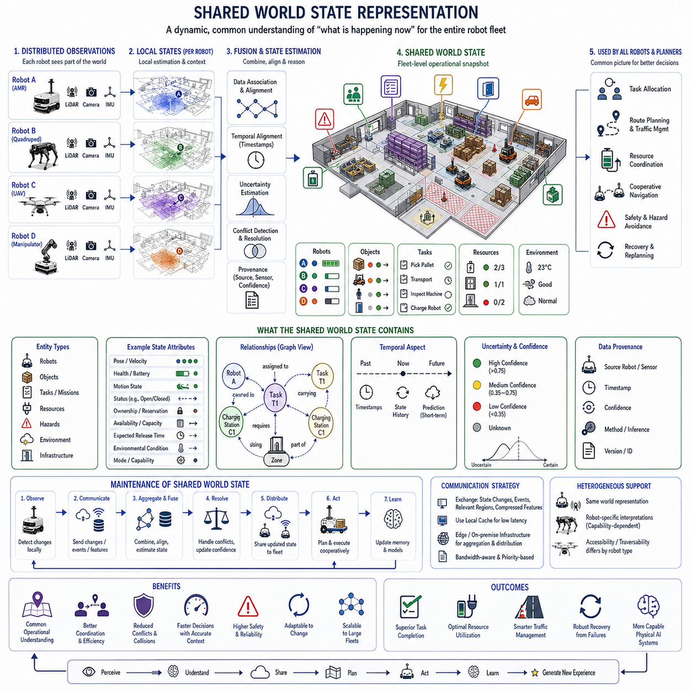{width="7.268055555555556in" height="7.268055555555556in"}

A shared world state representation provides a fleet with a common description of what is currently happening in the environment. While shared maps primarily preserve spatial and semantic structure, world state extends this representation to include robots, objects, tasks, resources, hazards, environmental conditions, and their relationships. It therefore acts as a dynamic operational snapshot that supports collective reasoning and coordinated action.

For a single robot, world state is estimated from local sensors, internal status, localization, and task context. In a multi-robot system, however, no individual platform possesses complete information. Each robot observes only part of the environment and may hold different knowledge about objects, routes, tasks, or events. A shared state combines these distributed observations into a broader fleet-level estimate of the operational world.

The representation must distinguish between relatively persistent world knowledge and rapidly changing state. A wall, doorway, road, or charging station may belong to long-term world memory, while robot poses, moving people, temporary obstacles, battery levels, task assignments, and traffic conditions change continuously. Shared world state connects these timescales by referencing persistent knowledge while maintaining the latest operational conditions.

Robot state forms an essential component of this representation. The fleet may need to know each robot\'s pose, velocity, operational mode, battery level, payload, health condition, current task, available capabilities, and expected future activity. This information allows other robots and fleet-level planners to understand not merely where a robot is located, but what it is doing and what actions it can potentially perform.

Object state provides another dynamic layer. Objects can have positions, orientations, semantic identities, motion states, ownership, accessibility, and interaction status. A pallet may be waiting for transport, a machine may be under inspection, a doorway may be temporarily closed, or a loading zone may already be occupied. Representing these states enables robots to reason about actionable conditions rather than static object existence.

Task and mission state must also be integrated into the shared representation. Tasks can be pending, assigned, executing, blocked, completed, failed, or awaiting verification. Connecting tasks to robots, locations, resources, and dependencies creates a common operational context. A robot can therefore understand how its own activity relates to other ongoing actions instead of executing an isolated sequence of commands.

Resources are equally important because many fleet conflicts arise from shared physical constraints. Charging stations, elevators, narrow corridors, loading docks, manipulation stations, communication zones, and other infrastructure may have limited capacity. Representing availability, reservation, occupancy, and expected release time allows planners to coordinate resource usage and prevent robots from independently competing for the same physical opportunity.

A shared world state must explicitly represent relationships between entities. A robot may be assigned to a task, a task may require a particular workstation, an obstacle may block a route, and a charging station may serve a specific operational zone. Graph-based representations are particularly useful because entities can be modeled as nodes while spatial, semantic, temporal, functional, and task relationships are represented as edges.

Time is fundamental because shared state is never perfectly simultaneous. Observations arrive with different timestamps because sensing, processing, networking, and communication delays vary across robots. Each state element should therefore include temporal information so that the system can distinguish current observations from stale information. State estimation may also predict short-term evolution when exact synchronization is impossible.

Uncertainty must accompany state estimates because a shared representation is constructed from imperfect observations. Robot localization can drift, objects can be misclassified, communication can be delayed, and different robots can report conflicting conditions. Confidence values, probability distributions, covariance estimates, or alternative hypotheses can express uncertainty and prevent downstream planning systems from treating every shared state element as absolute truth.

Data provenance further strengthens the representation. The fleet should know which robot, sensor, infrastructure component, or inference process produced an observation. Source identity enables reliability assessment and supports conflict resolution when multiple reports disagree. Provenance combined with timestamps and confidence allows the system to determine whether information should be accepted, fused, downgraded, replaced, or verified through additional observation.

Consistency management becomes necessary when many robots update shared state concurrently. Two robots may detect different positions for the same object, or one may report a corridor as open while another detects an obstruction. Rather than relying on simple last-write-wins behavior, the fleet can evaluate recency, confidence, sensor capability, spatial consistency, and environmental dynamics to construct a more reliable state estimate.

The representation must also support heterogeneous robots. Environmental state should describe objective properties where possible, while robot-specific interpretations remain associated with individual capabilities. A stairway can exist as a shared environmental entity, yet its accessibility differs for a wheeled AMR, quadruped, humanoid, or UAV. This separation allows one world representation to support multiple embodiments without forcing identical interpretations.

Communication limitations make complete continuous synchronization impractical at fleet scale. Robots can therefore exchange state changes, events, compressed features, relevant regions, or task-specific subsets rather than transmitting the entire world state repeatedly. Local caches can preserve the information needed for immediate operation, while edge or on-premise infrastructure can aggregate and distribute broader fleet state according to operational relevance.

Shared world state becomes particularly valuable for planning and coordination. A planner can simultaneously consider robot locations, capabilities, active tasks, obstacles, resource occupancy, route conditions, hazards, and predicted motion. Task allocation, traffic management, cooperative navigation, and recovery can therefore operate from a common operational picture rather than independently maintained and potentially contradictory local assumptions.

The state representation can also connect perception with prediction. Current observations describe what appears to be happening now, while historical memory provides information about how similar situations evolved previously. A fleet world model can use both to estimate future object motion, congestion, resource availability, route conditions, or task progress. Shared state thus becomes the present-time interface between fleet memory and predictive world modeling.

A practical architecture may distribute this representation across several computational layers. Robots maintain latency-critical local state, edge or on-premise systems aggregate regional information, and fleet-level services maintain broader operational consistency and history. The objective is not necessarily to create one physically centralized database, but to provide a logically shared state that authorized components can interpret consistently.

The shared world state is continuously reconstructed rather than permanently fixed. Robots perceive changes, update local estimates, communicate relevant observations, fuse information, resolve conflicts, and receive revised fleet knowledge. Their subsequent actions alter the physical environment and generate new observations. This closed loop connects perception, memory, communication, planning, action, and learning within the multi-robot system.

Ultimately, shared world state representation provides the common operational language required for fleet intelligence. Shared maps explain where entities exist and what they mean, while shared state explains their current conditions and relationships. By maintaining this dynamic representation across robots, tasks, objects, resources, and environmental events, a fleet can reason and act increasingly as a coordinated physical AI system rather than as independent robots sharing the same space.

공유 월드 상태 표현(shared world state representation)은 플릿(fleet)이 환경에서 현재 무엇이 발생하고 있는지를 공통된 방식으로 표현할 수 있도록 한다. 공유 지도(shared map)가 주로 공간 및 의미 구조(spatial and semantic structure)를 보존한다면, 월드 상태(world state)는 로봇, 객체, 작업, 자원, 위험 요소, 환경 조건 및 이들 사이의 관계까지 포함하도록 표현을 확장한다. 따라서 집단 추론(collective reasoning)과 협력 행동(coordinated action)을 지원하는 동적인 운용 스냅샷(dynamic operational snapshot)의 역할을 한다.

단일 로봇에서 월드 상태(world state)는 로컬 센서(local sensor), 내부 상태, 위치 추정(localization), 작업 맥락(task context)을 통해 추정된다. 그러나 다중 로봇 시스템(multi-robot system)에서는 어떠한 개별 플랫폼도 완전한 정보를 보유하지 못한다. 각 로봇은 환경의 일부만 관찰하며 객체, 경로, 작업 또는 사건에 대해 서로 다른 지식을 가질 수 있다. 공유 상태(shared state)는 이러한 분산 관찰(distributed observation)을 결합하여 운용 세계에 대한 보다 광범위한 플릿 수준 추정(fleet-level estimate)을 형성한다.

이러한 표현은 비교적 지속적인 월드 지식(world knowledge)과 빠르게 변화하는 상태(state)를 구분해야 한다. 벽, 출입구, 도로 또는 충전소는 장기 월드 메모리(long-term world memory)에 속할 수 있지만, 로봇 위치, 이동 중인 사람, 임시 장애물, 배터리 수준, 작업 할당 및 교통 상황은 지속적으로 변화한다. 공유 월드 상태는 지속적인 지식을 참조하면서 최신 운용 조건을 유지함으로써 이러한 서로 다른 시간 척도(timescale)를 연결한다.

로봇 상태(robot state)는 이러한 표현의 핵심 구성요소이다. 플릿은 각 로봇의 위치 및 자세(pose), 속도, 운용 모드, 배터리 수준, 적재량(payload), 상태 건전성(health condition), 현재 작업, 사용 가능한 능력(capability), 예상되는 향후 활동 등을 알아야 할 수 있다. 이러한 정보를 통해 다른 로봇과 플릿 수준 계획 시스템은 단순히 로봇이 어디에 있는지만이 아니라 무엇을 수행하고 있으며 잠재적으로 어떤 행동을 수행할 수 있는지를 이해할 수 있다.

객체 상태(object state)는 또 다른 동적 계층(dynamic layer)을 제공한다. 객체는 위치, 방향(orientation), 의미적 정체성(semantic identity), 이동 상태, 소유 관계, 접근 가능성 및 상호작용 상태를 가질 수 있다. 팔레트는 운송을 기다리고 있을 수 있고, 기계는 검사 중일 수 있으며, 출입구는 일시적으로 닫혀 있거나 적재 구역이 이미 사용 중일 수 있다. 이러한 상태를 표현하면 로봇은 객체의 정적인 존재 여부가 아니라 실제 행동 가능한 조건(actionable condition)을 기반으로 추론할 수 있다.

작업 및 임무 상태(task and mission state) 역시 공유 표현에 통합되어야 한다. 작업은 대기, 할당, 실행, 차단, 완료, 실패 또는 검증 대기 상태가 될 수 있다. 작업을 로봇, 위치, 자원 및 의존 관계(dependency)와 연결하면 공통 운용 맥락(common operational context)을 구축할 수 있다. 따라서 로봇은 독립적인 명령의 연속만 수행하는 것이 아니라 자신의 활동이 동시에 진행되는 다른 행동과 어떻게 연결되어 있는지를 이해할 수 있다.

많은 플릿 충돌(fleet conflict)이 공유된 물리적 제약에서 발생하기 때문에 자원(resource) 역시 중요하다. 충전소, 엘리베이터, 좁은 통로, 적재 도크, 조작 스테이션, 통신 구역 및 기타 인프라는 제한된 용량을 가질 수 있다. 가용성(availability), 예약 상태(reservation), 점유 상태(occupancy), 예상 해제 시간(expected release time)을 표현하면 계획 시스템은 자원 사용을 조정하고 여러 로봇이 동일한 물리적 기회를 독립적으로 차지하려는 상황을 방지할 수 있다.

공유 월드 상태(shared world state)는 개체(entity) 사이의 관계를 명시적으로 표현해야 한다. 로봇은 특정 작업에 할당될 수 있고, 작업에는 특정 워크스테이션(workstation)이 필요할 수 있으며, 장애물은 경로를 차단하고, 충전소는 특정 운용 구역을 지원할 수 있다. 그래프 기반 표현(graph-based representation)은 개체를 노드(node)로 모델링하고 공간적, 의미적, 시간적, 기능적 및 작업 관계를 엣지(edge)로 표현할 수 있기 때문에 특히 유용하다.

공유 상태는 완벽하게 동시에 생성되지 않기 때문에 시간(time)은 핵심적인 요소이다. 센싱, 처리, 네트워킹 및 통신 지연이 로봇마다 다르므로 관찰 정보는 서로 다른 타임스탬프(timestamp)를 가지고 도착한다. 따라서 각각의 상태 요소에는 시간 정보를 포함하여 현재 관찰과 오래된 정보(stale information)를 구분할 수 있어야 한다. 정확한 동기화가 불가능한 경우 상태 추정(state estimation)을 통해 단기적인 변화를 예측할 수도 있다.

공유 표현은 불완전한 관찰을 기반으로 구축되기 때문에 상태 추정에는 불확실성(uncertainty)이 함께 표현되어야 한다. 로봇의 위치 추정은 드리프트(drift)할 수 있고, 객체가 잘못 분류될 수 있으며, 통신이 지연되고 서로 다른 로봇이 상충되는 상태를 보고할 수도 있다. 신뢰도 값(confidence value), 확률 분포(probability distribution), 공분산 추정(covariance estimate), 대안적 가설(alternative hypothesis)을 이용하면 불확실성을 표현하고 후속 계획 시스템이 모든 공유 상태 정보를 절대적인 사실로 취급하는 것을 방지할 수 있다.

데이터 출처 정보(data provenance)는 이러한 표현을 더욱 강화한다. 플릿은 어떤 로봇, 센서, 인프라 구성요소 또는 추론 프로세스(inference process)가 특정 관찰을 생성했는지 알아야 한다. 출처 식별(source identity)은 신뢰성 평가를 가능하게 하며 여러 보고가 서로 일치하지 않을 때 충돌 해결(conflict resolution)을 지원한다. 출처 정보에 타임스탬프와 신뢰도를 결합하면 정보를 수용, 융합, 신뢰도 하향 조정, 교체 또는 추가 관찰을 통해 검증할 것인지 판단할 수 있다.

많은 로봇이 공유 상태를 동시에 갱신하면 일관성 관리(consistency management)가 필요해진다. 두 로봇이 동일한 객체의 서로 다른 위치를 감지하거나, 한 로봇은 통로가 개방되어 있다고 보고하지만 다른 로봇은 장애물을 감지할 수 있다. 단순한 최종 기록 우선(last-write-wins) 방식에 의존하는 대신 최신성(recency), 신뢰도, 센서 능력, 공간적 일관성 및 환경 동역학(environmental dynamics)을 평가하여 보다 신뢰성 높은 상태 추정을 구성할 수 있다.

공유 표현은 이기종 로봇(heterogeneous robot)도 지원해야 한다. 가능한 경우 환경 상태는 객관적인 속성을 표현하고, 로봇별 해석(robot-specific interpretation)은 개별 능력과 연계되어야 한다. 계단은 공유 환경 개체(shared environmental entity)로 존재하지만 접근 가능성은 바퀴형 자율이동로봇(AMR), 사족보행 로봇(quadruped), 휴머노이드(humanoid), 무인항공기(UAV)에 따라 달라진다. 이러한 분리를 통해 하나의 월드 표현이 서로 다른 형태(embodiment)에 동일한 해석을 강요하지 않고 다양한 플랫폼을 지원할 수 있다.

통신 제약(communication limitation)으로 인해 플릿 규모에서는 완전하고 지속적인 동기화가 현실적으로 어렵다. 따라서 로봇은 전체 월드 상태를 반복적으로 전송하는 대신 상태 변화(state change), 사건(event), 압축 특징(compressed feature), 관련 영역 또는 작업별 정보 부분집합(task-specific subset)을 교환할 수 있다. 로컬 캐시(local cache)는 즉각적인 운용에 필요한 정보를 유지하고, 엣지(edge) 또는 온프레미스 인프라(on-premise infrastructure)는 운용 관련성에 따라 보다 광범위한 플릿 상태를 통합하고 배포할 수 있다.

공유 월드 상태는 계획(planning)과 협업(coordination)에서 특히 높은 가치를 제공한다. 계획 시스템은 로봇 위치, 능력, 활성 작업, 장애물, 자원 점유 상태, 경로 조건, 위험 요소 및 예측된 움직임을 동시에 고려할 수 있다. 따라서 작업 할당(task allocation), 교통 관리(traffic management), 협력 주행(cooperative navigation), 복구(recovery)는 서로 독립적으로 유지되어 충돌할 가능성이 있는 로컬 가정이 아니라 공통 운용 상황(common operational picture)을 기반으로 수행될 수 있다.

상태 표현(state representation)은 인지(perception)와 예측(prediction)을 연결할 수도 있다. 현재의 관찰은 지금 무엇이 일어나고 있는지를 설명하며, 과거 메모리(historical memory)는 유사한 상황이 이전에 어떻게 변화했는지에 대한 정보를 제공한다. 플릿 월드 모델(fleet world model)은 이 두 정보를 활용하여 미래 객체 이동, 혼잡, 자원 가용성, 경로 조건 또는 작업 진행 상태를 추정할 수 있다. 따라서 공유 상태는 플릿 메모리(fleet memory)와 예측 월드 모델링(predictive world modeling)을 연결하는 현재 시점의 인터페이스가 된다.

실용적인 아키텍처에서는 이러한 표현을 여러 컴퓨팅 계층(computational layer)에 분산할 수 있다. 로봇은 지연시간에 민감한 로컬 상태(latency-critical local state)를 유지하고, 엣지 또는 온프레미스 시스템은 지역 정보를 통합하며, 플릿 수준 서비스는 보다 광범위한 운용 일관성과 이력을 유지한다. 목표는 반드시 하나의 물리적으로 중앙집중된 데이터베이스를 구축하는 것이 아니라, 권한을 가진 구성요소들이 일관되게 해석할 수 있는 논리적으로 공유된 상태(logically shared state)를 제공하는 것이다.

공유 월드 상태(shared world state)는 영구적으로 고정되는 것이 아니라 지속적으로 재구성된다. 로봇은 변화를 인지하고 로컬 추정을 갱신하며, 관련 관찰 정보를 통신하고, 정보를 융합(fusion)하고, 충돌을 해결하며, 수정된 플릿 지식을 다시 전달받는다. 이후 로봇의 행동은 물리적 환경을 변화시키고 새로운 관찰을 생성한다. 이러한 폐루프(closed loop)는 다중 로봇 시스템에서 인지, 메모리, 통신, 계획, 행동 및 학습을 서로 연결한다.

궁극적으로 공유 월드 상태 표현(shared world state representation)은 플릿 지능(fleet intelligence)에 필요한 공통 운용 언어(common operational language)를 제공한다. 공유 지도는 개체가 어디에 존재하며 무엇을 의미하는지를 설명하고, 공유 상태는 그 개체의 현재 조건과 관계를 설명한다. 로봇, 작업, 객체, 자원 및 환경 사건 전반에서 이러한 동적 표현을 유지함으로써 플릿은 동일한 공간을 공유하는 독립적인 로봇 집합이 아니라 하나의 협력적인 물리 AI 시스템(coordinated Physical AI system)으로서 점차 더 높은 수준의 추론과 행동을 수행할 수 있다.

##  

## 06.05. Fleet World Model Concept

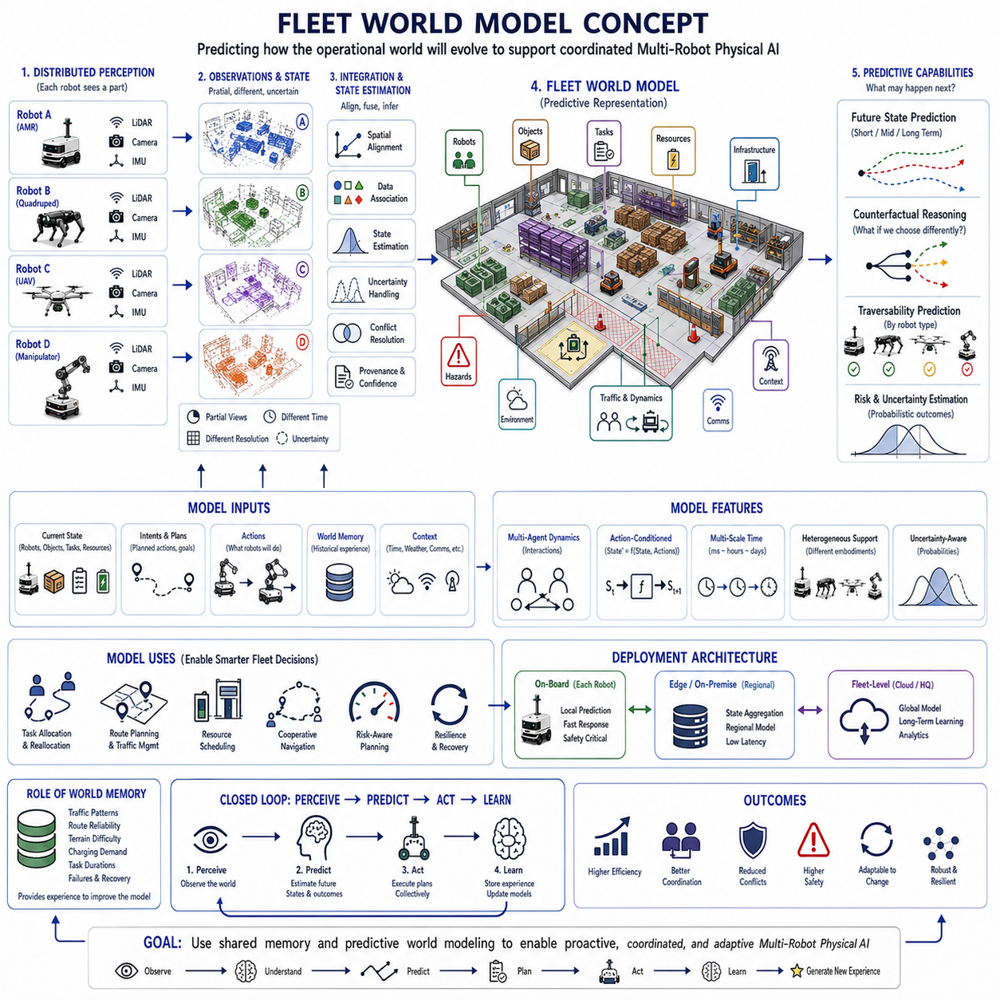{width="7.268055555555556in" height="7.268055555555556in"}

A fleet world model extends the idea of a world model from an individual robot to a coordinated population of physical agents. Instead of predicting the environment only from one robot's observations and actions, it integrates distributed observations, shared state, historical experience, and collective actions. The result is a common predictive representation that helps the fleet understand how the operational world may evolve.

Shared world memory and a fleet world model are closely related but serve different purposes. Memory preserves what robots have observed, experienced, and learned about the environment, whereas the world model uses that accumulated information to estimate hidden state and predict possible future states. Memory therefore provides historical evidence, while the world model transforms that evidence into expectations about what may happen next.

A fleet world model begins with distributed perception. Each robot observes only a limited region through cameras, LiDAR, radar, proprioception, localization systems, or other sensors. These observations may differ in viewpoint, time, resolution, and uncertainty. By aligning and combining them, the fleet can construct a richer estimate of the environment than any individual robot could obtain from its local sensory stream.

The model must represent more than physical geometry. Relevant state can include robots, people, vehicles, objects, terrain, infrastructure, hazards, tasks, resources, communication conditions, and environmental context. Semantic relationships are also important because the meaning of an entity often determines how the fleet should interact with it. A blocked corridor and an occupied charging station require different predictions and different responses.

Temporal dynamics distinguish a world model from a static shared map. A map may describe where a corridor or workstation exists, while a world model attempts to estimate how traffic, obstacles, resources, tasks, and robot states will change over time. This enables the fleet to reason about future conditions rather than planning solely from the current snapshot of the environment.

Actions must also be represented because robots actively change the world they are predicting. Moving a pallet changes free space, entering a narrow corridor affects traffic, reserving a charger changes resource availability, and assigning a robot changes future task state. An action-conditioned fleet world model therefore predicts possible future states as a function of the current state, planned actions, and interactions among multiple agents.

Multi-robot interaction makes this prediction problem fundamentally different from single-robot forecasting. The future state depends not only on environmental dynamics but also on what other robots intend to do. Planned routes, task assignments, resource reservations, formation behavior, and cooperative manipulation can all influence future conditions. Shared intent therefore becomes an important input to fleet-level prediction and coordination.

A useful fleet world model can support counterfactual reasoning by estimating what may happen under different collective decisions. The fleet can compare alternative task assignments, routes, schedules, or resource allocations before executing them physically. If one plan is predicted to create congestion or resource conflicts, another can be evaluated. This turns the model into an internal predictive environment for collective decision making.

Traversability is a particularly important component of such a model. The fleet can combine geometric information with historical mobility experience to predict whether a robot can safely and efficiently traverse a region. Terrain type, slope, surface condition, robot embodiment, payload, weather, energy consumption, localization quality, and previous successes or failures may all contribute to future traversability estimates.

The model should also preserve uncertainty rather than producing only a single deterministic future. Sensor noise, partial observability, unpredictable human behavior, communication delays, and interactions among robots create multiple plausible outcomes. Probabilistic predictions or multiple future hypotheses allow planners to evaluate risk and choose actions that remain effective across a range of possible environmental developments.

Different prediction horizons serve different fleet functions. Very short-term prediction may support collision avoidance and cooperative motion, while predictions over minutes can support traffic management, charging coordination, and task scheduling. Longer horizons may help estimate mission completion, resource demand, environmental change, or fleet workload. A practical fleet world model can therefore operate across multiple temporal scales.

Heterogeneous fleets add another dimension because different embodiments interact with the same environment differently. An AMR, quadruped, UAV, humanoid, and mobile manipulator may observe different features and possess different action possibilities. The fleet world model should maintain common environmental structure while allowing embodiment-specific dynamics, capabilities, accessibility, and action consequences to influence predictions.

Fleet world modeling does not require every computation to occur in one centralized server. Latency-critical predictions can remain on individual robots, regional models can operate on edge or on-premise infrastructure, and broader fleet models can integrate longer-term information across many robots. These layers can exchange state, predictions, model updates, and relevant experience according to bandwidth, latency, privacy, and reliability constraints.

Historical fleet memory provides the experience needed to improve predictive accuracy. Repeated observations reveal traffic patterns, route reliability, terrain difficulty, charging demand, task duration, failure conditions, and recovery effectiveness. As these experiences accumulate, learning systems can update predictive models so that future decisions reflect not only engineered assumptions but also evidence gathered during actual fleet operation.

The relationship between world modeling and collective learning is therefore cyclical. Robots act in the physical environment, observe the consequences, store important experience in fleet memory, and use accumulated data to improve models. Improved models generate better predictions, which support better plans and actions. Those actions create new experience, establishing a continuous fleet-level perception, prediction, action, and learning loop.

A fleet world model can become particularly powerful when connected directly to task allocation and planning. Instead of assigning tasks based only on current distance or availability, the fleet can estimate future travel time, congestion, energy demand, route risk, resource conflicts, and task interactions. Allocation can then optimize expected future outcomes rather than reacting only to the current operational state.

The same predictive capability supports resilience and recovery. When a robot fails, a route becomes blocked, communication deteriorates, or environmental conditions change, the model can estimate the consequences for other robots and ongoing missions. The fleet can evaluate alternative routes, redistribute tasks, reserve different resources, or modify coordination strategies before disruption propagates through the larger system.

Ultimately, the fleet world model represents a transition from shared information toward shared predictive intelligence. Shared maps describe where things are, shared world state describes what is happening now, and fleet memory preserves what has happened before. The fleet world model connects these layers to estimate what could happen next and how collective actions may influence that future, providing a predictive foundation for coordinated multi-robot Physical AI.

플릿 월드 모델(fleet world model)은 개별 로봇의 월드 모델(world model) 개념을 서로 협력하는 물리적 에이전트(physical agent) 집단으로 확장한 것이다. 하나의 로봇이 관찰과 행동만을 기반으로 환경을 예측하는 대신, 분산 관찰(distributed observation), 공유 상태(shared state), 과거 경험(historical experience), 집단 행동(collective action)을 통합한다. 그 결과 플릿은 운용 세계가 앞으로 어떻게 변화할 수 있는지를 이해하는 데 활용할 수 있는 공통 예측 표현(common predictive representation)을 구축할 수 있다.

공유 월드 메모리(shared world memory)와 플릿 월드 모델(fleet world model)은 밀접하게 관련되어 있지만 서로 다른 목적을 가진다. 메모리는 로봇이 환경에서 관찰하고 경험하고 학습한 내용을 보존하는 반면, 월드 모델은 축적된 정보를 이용하여 숨겨진 상태(hidden state)를 추정하고 가능한 미래 상태를 예측한다. 따라서 메모리는 과거의 증거(historical evidence)를 제공하고, 월드 모델은 그 증거를 앞으로 발생할 수 있는 상황에 대한 예측으로 변환한다.

플릿 월드 모델은 분산 인지(distributed perception)에서 시작한다. 각 로봇은 카메라, 라이다(LiDAR), 레이더(radar), 고유수용감각(proprioception), 위치 추정 시스템(localization system) 또는 기타 센서를 통해 제한된 영역만 관찰한다. 이러한 관찰은 시점(viewpoint), 시간, 해상도 및 불확실성이 서로 다를 수 있다. 이를 정렬하고 결합하면 플릿은 개별 로봇이 자신의 로컬 센서 스트림만으로 얻을 수 있는 것보다 훨씬 풍부한 환경 상태 추정을 구축할 수 있다.

이 모델은 단순한 물리적 기하 구조(physical geometry) 이상의 정보를 표현해야 한다. 관련 상태에는 로봇, 사람, 차량, 객체, 지형, 인프라, 위험 요소, 작업, 자원, 통신 상태 및 환경 맥락(environmental context)이 포함될 수 있다. 의미적 관계(semantic relationship) 역시 중요하다. 개체의 의미에 따라 플릿이 해당 개체와 상호작용하는 방법이 달라지기 때문이다. 차단된 통로와 사용 중인 충전소는 서로 다른 예측과 대응을 필요로 한다.

시간적 동역학(temporal dynamics)은 월드 모델을 정적인 공유 지도(shared map)와 구분하는 핵심 요소이다. 지도는 통로나 작업대가 어디에 존재하는지를 설명할 수 있지만, 월드 모델은 교통 흐름, 장애물, 자원, 작업 및 로봇 상태가 시간에 따라 어떻게 변화할지를 추정한다. 이를 통해 플릿은 현재 환경의 스냅샷만을 기반으로 계획하는 것이 아니라 미래 조건을 고려하여 추론할 수 있다.

로봇은 자신이 예측하는 세계를 능동적으로 변화시키므로 행동(action) 역시 표현되어야 한다. 팔레트를 이동하면 자유 공간이 변화하고, 좁은 통로에 진입하면 교통 흐름에 영향을 주며, 충전기를 예약하면 자원 가용성이 달라지고, 로봇에게 작업을 할당하면 미래 작업 상태가 변화한다. 따라서 행동 조건부 플릿 월드 모델(action-conditioned fleet world model)은 현재 상태, 계획된 행동 및 여러 에이전트 간의 상호작용을 기반으로 가능한 미래 상태를 예측한다.

다중 로봇 상호작용(multi-robot interaction)은 이러한 예측 문제를 단일 로봇의 예측과 근본적으로 다르게 만든다. 미래 상태는 환경 동역학뿐만 아니라 다른 로봇이 무엇을 하려고 하는지에도 영향을 받는다. 계획된 경로, 작업 할당, 자원 예약, 포메이션 행동(formation behavior), 협력 조작(cooperative manipulation) 등이 모두 미래 조건에 영향을 줄 수 있다. 따라서 공유 의도(shared intent)는 플릿 수준 예측과 협업을 위한 중요한 입력 정보가 된다.

유용한 플릿 월드 모델은 서로 다른 집단적 의사결정에 따라 어떤 일이 발생할지를 추정하는 반사실적 추론(counterfactual reasoning)을 지원할 수 있다. 플릿은 실제 행동을 수행하기 전에 서로 다른 작업 할당, 경로, 일정 또는 자원 배분을 비교할 수 있다. 특정 계획이 혼잡이나 자원 충돌을 발생시킬 것으로 예측된다면 다른 계획을 평가할 수 있다. 이를 통해 월드 모델은 집단 의사결정(collective decision making)을 위한 내부 예측 환경(internal predictive environment)의 역할을 한다.

주행 가능성(traversability)은 이러한 모델에서 특히 중요한 구성요소이다. 플릿은 기하학적 정보와 과거 이동 경험(historical mobility experience)을 결합하여 특정 로봇이 어떤 영역을 안전하고 효율적으로 통과할 수 있는지를 예측할 수 있다. 지형 유형, 경사, 표면 상태, 로봇 형태(embodiment), 적재량(payload), 날씨, 에너지 소비, 위치 추정 품질 및 이전의 성공이나 실패 경험 등이 미래의 주행 가능성 추정에 활용될 수 있다.

월드 모델은 하나의 결정론적 미래(deterministic future)만 생성하는 대신 불확실성(uncertainty)을 함께 보존해야 한다. 센서 잡음, 부분 관측 가능성(partial observability), 예측하기 어려운 인간 행동, 통신 지연 및 로봇 간 상호작용으로 인해 여러 가지 미래 결과가 가능하기 때문이다. 확률적 예측(probabilistic prediction)이나 복수의 미래 가설(multiple future hypotheses)을 활용하면 계획 시스템은 위험을 평가하고 다양한 환경 변화에서도 효과적인 행동을 선택할 수 있다.

서로 다른 예측 시간 범위(prediction horizon)는 서로 다른 플릿 기능을 지원한다. 매우 단기적인 예측은 충돌 회피와 협력 이동(cooperative motion)에 활용될 수 있으며, 수분 단위의 예측은 교통 관리, 충전 조정 및 작업 스케줄링에 활용될 수 있다. 더 장기적인 예측은 임무 완료, 자원 수요, 환경 변화 또는 플릿 작업량을 추정하는 데 도움을 줄 수 있다. 따라서 실용적인 플릿 월드 모델은 여러 시간 척도(temporal scale)에 걸쳐 동작할 수 있다.

이기종 플릿(heterogeneous fleet)은 서로 다른 형태가 동일한 환경과 서로 다른 방식으로 상호작용하기 때문에 또 다른 차원을 추가한다. 자율이동로봇(AMR), 사족보행 로봇(quadruped), 무인항공기(UAV), 휴머노이드(humanoid), 모바일 매니퓰레이터(mobile manipulator)는 서로 다른 특징을 관찰하고 서로 다른 행동 가능성을 가질 수 있다. 플릿 월드 모델은 공통 환경 구조를 유지하면서 형태별 동역학, 능력, 접근 가능성 및 행동 결과가 예측에 반영되도록 해야 한다.

플릿 월드 모델링(fleet world modeling)을 위해 모든 연산을 하나의 중앙 서버에서 수행할 필요는 없다. 지연시간에 민감한 예측(latency-critical prediction)은 개별 로봇에서 수행하고, 지역 모델(regional model)은 엣지(edge) 또는 온프레미스 인프라(on-premise infrastructure)에서 실행하며, 보다 광범위한 플릿 모델은 여러 로봇의 장기 정보를 통합할 수 있다. 이러한 계층들은 대역폭, 지연시간, 개인정보 보호, 신뢰성 등의 제약에 따라 상태, 예측, 모델 업데이트 및 관련 경험을 교환할 수 있다.

과거 플릿 메모리(historical fleet memory)는 예측 정확도를 향상시키는 데 필요한 경험을 제공한다. 반복적인 관찰을 통해 교통 패턴, 경로 신뢰성, 지형 난이도, 충전 수요, 작업 소요 시간, 실패 조건 및 복구 효과를 파악할 수 있다. 이러한 경험이 축적되면 학습 시스템은 예측 모델을 갱신하여 향후 의사결정이 설계 단계의 가정뿐만 아니라 실제 플릿 운용 과정에서 수집된 증거를 반영하도록 할 수 있다.

따라서 월드 모델링(world modeling)과 집단 학습(collective learning)의 관계는 순환적이다. 로봇은 물리적 환경에서 행동하고 그 결과를 관찰하며, 중요한 경험을 플릿 메모리에 저장하고, 축적된 데이터를 이용하여 모델을 개선한다. 개선된 모델은 더 나은 예측을 생성하고, 이는 다시 더 나은 계획과 행동을 지원한다. 이러한 행동은 새로운 경험을 만들어 지속적인 플릿 수준의 인지, 예측, 행동 및 학습 루프(perception-prediction-action-learning loop)를 형성한다.

플릿 월드 모델은 작업 할당(task allocation) 및 계획(planning)과 직접 연결될 때 특히 강력해질 수 있다. 현재 거리나 가용성만을 기준으로 작업을 할당하는 대신, 플릿은 미래 이동 시간, 혼잡, 에너지 수요, 경로 위험, 자원 충돌 및 작업 간 상호작용을 추정할 수 있다. 따라서 작업 할당은 현재 운용 상태에만 반응하는 것이 아니라 예상되는 미래 결과(expected future outcome)를 최적화하도록 수행될 수 있다.

동일한 예측 능력은 복원력(resilience)과 복구(recovery)도 지원한다. 로봇이 고장나거나 경로가 차단되거나 통신 상태가 악화되거나 환경 조건이 변화하면 월드 모델은 이러한 사건이 다른 로봇과 진행 중인 임무에 미치는 영향을 추정할 수 있다. 플릿은 장애가 전체 시스템으로 확산되기 전에 대체 경로, 작업 재분배, 다른 자원의 예약 또는 협업 전략 변경을 평가할 수 있다.

궁극적으로 플릿 월드 모델(fleet world model)은 공유 정보(shared information)에서 공유 예측 지능(shared predictive intelligence)으로의 전환을 의미한다. 공유 지도(shared map)는 사물이 어디에 있는지를 설명하고, 공유 월드 상태(shared world state)는 현재 무엇이 일어나고 있는지를 설명하며, 플릿 메모리(fleet memory)는 과거에 무엇이 일어났는지를 보존한다. 플릿 월드 모델은 이러한 계층을 연결하여 앞으로 무엇이 일어날 수 있는지와 집단 행동이 그 미래에 어떤 영향을 미칠 수 있는지를 예측함으로써 협력적인 다중 로봇 물리 AI(multi-robot Physical AI)를 위한 예측 기반을 제공한다.

##  

## 06.06. Shared Traversability Representation

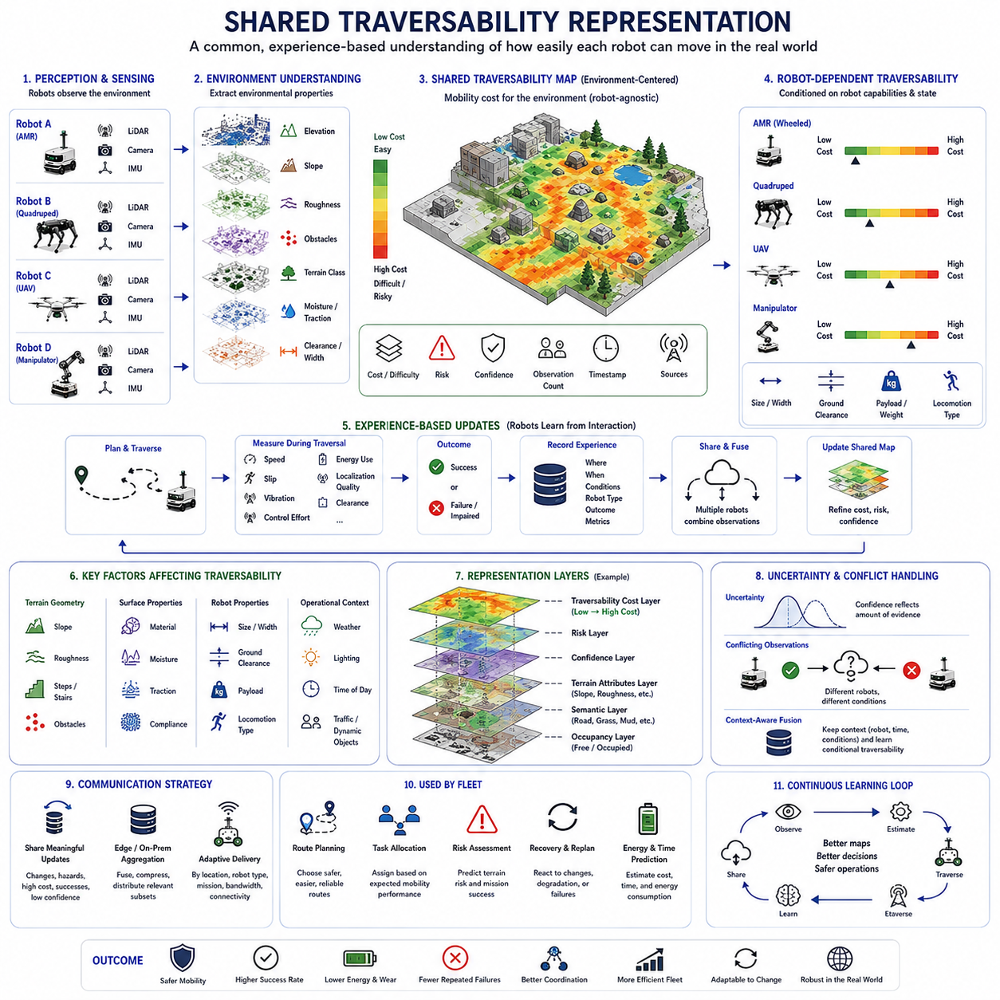{width="7.268055555555556in" height="7.268055555555556in"}

Traversability describes whether a robot can move through a region safely, efficiently, and with acceptable operational risk. In multi-robot Physical AI, this concept must extend beyond a binary distinction between free and occupied space. A shared traversability representation expresses degrees of mobility difficulty so that robots can reason about how suitable different parts of the environment are for actual movement.

A conventional occupancy map answers whether physical space appears available, but availability does not guarantee mobility. A surface may contain no obvious obstacle while still being difficult because of steep slope, loose soil, mud, snow, vegetation, roughness, insufficient clearance, or poor traction. Traversability therefore adds robot-environment interaction knowledge to geometric mapping and provides a more operational representation for navigation.

Traversability can be represented as continuous costs or probabilities rather than simple passable and impassable labels. Low-cost regions indicate relatively safe and efficient movement, while higher costs indicate increasing difficulty or risk. Completely inaccessible regions can be assigned prohibitive costs. This representation allows planners to compare alternative routes according to expected mobility performance instead of considering only geometric distance.

Estimating these values requires multiple environmental properties. Terrain elevation, slope, surface normal, roughness, obstacle density, semantic terrain class, moisture, traction, compliance, and vegetation can all affect mobility. LiDAR, cameras, depth sensing, radar, inertial measurements, and other sensors provide complementary evidence from which the robot can estimate terrain structure and likely vehicle-terrain interaction.

Traversability is not purely a property of the environment. The same terrain can have different meanings for robots with different dimensions, locomotion mechanisms, ground clearance, suspension, wheel or leg configuration, payload, and stability limits. A narrow or uneven region that is difficult for a wheeled AMR may remain accessible to a quadruped, while terrain suitable for a small robot may be unsafe for a heavier platform.

A shared representation should therefore separate environment-centered properties from robot-dependent traversability estimates. Slope, surface type, width, roughness, and obstacle geometry can be stored as common environmental knowledge, while expected slip, stability, clearance, energy cost, or probability of successful traversal can be conditioned on robot characteristics. This enables heterogeneous fleets to share one world while interpreting mobility differently.

The value of sharing becomes clear when robots encounter terrain sequentially. A robot that discovers severe wheel slip or localization degradation can record the location and conditions of the event. Later robots do not need to encounter the same difficulty without warning. Their planners can incorporate the previous experience into route evaluation, reducing repeated failures and converting individual mobility experience into fleet-level knowledge.

Shared traversability should combine perception-based estimates with experience-based evidence. Before a region has been traversed, the fleet may estimate mobility from geometry and semantic terrain classification. After robots actually cross the region, measured velocity, slip, vibration, control effort, energy consumption, localization quality, and traversal success can refine the estimate. The representation therefore becomes increasingly grounded in physical interaction.

Success and failure provide particularly valuable supervision. A successful traversal confirms that a route was feasible under specific robot and environmental conditions, while immobilization, excessive slip, rollover risk, collision, or aborted traversal provides negative evidence. Recording both outcomes allows the fleet to distinguish terrain that merely appears difficult from terrain that repeatedly produces operational problems.

Context must accompany traversability experience because mobility changes with conditions. A dirt road that is easily traversable when dry may become difficult after rain, while snow, ice, payload, tire condition, lighting, or vegetation growth may alter performance. Shared knowledge should therefore associate estimates with relevant temporal and environmental context rather than treating traversability as an unchanging property of a location.

Time also determines how long traversability information should remain valid. Structural constraints such as passage width may change slowly, whereas mud, water, snow, temporary debris, or construction conditions can change rapidly. Timestamped observations and temporal decay mechanisms allow the fleet to preserve stable mobility knowledge while reducing confidence in conditions that may no longer reflect the current environment.

Uncertainty is essential because traversability is estimated from incomplete sensing and limited experience. A region observed from a distance may have lower confidence than terrain repeatedly traversed by several robots. The representation can therefore store confidence, observation count, source robot, sensing conditions, and variance in outcomes. Planners can use this information to balance efficient routes against uncertainty and operational risk.

Conflicting observations should not automatically invalidate shared knowledge. One robot may successfully cross a region while another fails because of different payload, embodiment, control settings, or environmental conditions. Instead of forcing these observations into a single universal label, the fleet can preserve their context and learn conditional traversability relationships that explain why mobility outcomes differ across robots and missions.

Shared traversability can be represented spatially as a layered cost map aligned with the fleet\'s spatial and semantic maps. Each cell or region may contain terrain properties, mobility cost, risk, confidence, temporal information, and robot-specific accessibility estimates. Graph-based representations can complement these maps by associating routes and transitions with historical traversal performance, constraints, and expected cost.

Communication does not require every robot to continuously exchange complete traversability maps. Robots can transmit meaningful changes, newly discovered hazards, significant cost increases, successful route confirmations, or uncertain regions requiring inspection. Edge or on-premise infrastructure can aggregate these updates and distribute relevant subsets to robots according to location, embodiment, mission, and connectivity conditions.

Planning systems can use shared traversability to optimize more than travel distance. Candidate paths can be evaluated according to expected traversal time, energy consumption, terrain risk, localization reliability, mechanical stress, and probability of mission success. A slightly longer route may therefore be preferred when fleet experience indicates that it provides substantially safer, faster, or more reliable mobility under current conditions.

Traversability also connects fleet memory with predictive world modeling. Historical mobility experience explains how robots previously interacted with terrain, while a fleet world model can predict how future environmental conditions or robot states may alter accessibility. Traversability can consequently become a prediction target alongside future occupancy, trajectories, robot state, risk, and semantic state in predictive Physical AI architectures.

Ultimately, shared traversability representation transforms navigation knowledge from isolated local estimates into reusable fleet intelligence. Robots perceive terrain, estimate mobility, attempt traversal, measure outcomes, share significant experience, and update collective knowledge. Through this continuous cycle, the fleet progressively learns not only where movement is geometrically possible, but where each type of robot can move safely, efficiently, and reliably under changing real-world conditions.

주행 가능성(traversability)은 로봇이 특정 영역을 안전하고 효율적으로, 그리고 허용 가능한 운용 위험(operational risk) 수준에서 이동할 수 있는지를 나타낸다. 다중 로봇 물리 AI(multi-robot Physical AI)에서는 이 개념을 단순한 자유 공간과 점유 공간의 이진 구분을 넘어 확장해야 한다. 공유 주행 가능성 표현(shared traversability representation)은 이동 난이도의 정도를 표현하여 로봇들이 환경의 서로 다른 영역이 실제 이동에 얼마나 적합한지를 판단할 수 있도록 한다.

전통적인 점유 지도(occupancy map)는 물리적 공간이 비어 있는지를 알려주지만, 공간이 비어 있다고 해서 반드시 이동할 수 있는 것은 아니다. 명확한 장애물이 없는 표면이라도 급경사, 느슨한 토양, 진흙, 눈, 식생, 높은 거칠기, 부족한 여유 공간(clearance), 낮은 접지력(traction) 때문에 이동하기 어려울 수 있다. 따라서 주행 가능성은 기하학적 매핑(geometric mapping)에 로봇-환경 상호작용 지식을 추가하여 주행을 위한 보다 운용적인 표현을 제공한다.

주행 가능성(traversability)은 단순히 통과 가능과 통과 불가능이라는 라벨 대신 연속적인 비용(cost)이나 확률(probability)로 표현할 수 있다. 낮은 비용 영역은 상대적으로 안전하고 효율적인 이동을 의미하고, 높은 비용은 증가된 난이도나 위험을 나타낸다. 완전히 접근할 수 없는 영역에는 금지 수준의 비용(prohibitive cost)을 부여할 수 있다. 이를 통해 계획 시스템은 기하학적 거리뿐만 아니라 예상 이동 성능에 따라 대체 경로들을 비교할 수 있다.

이러한 값을 추정하려면 여러 환경 특성(environmental property)을 고려해야 한다. 지형 고도, 경사, 표면 법선(surface normal), 거칠기, 장애물 밀도, 의미적 지형 클래스(semantic terrain class), 수분, 접지력, 순응성(compliance), 식생 등이 모두 이동성에 영향을 줄 수 있다. 라이다(LiDAR), 카메라, 깊이 센싱(depth sensing), 레이더, 관성 측정(inertial measurement) 및 기타 센서는 지형 구조와 예상되는 로봇-지형 상호작용을 추정하기 위한 상호보완적인 정보를 제공한다.

주행 가능성은 환경만의 특성이 아니다. 동일한 지형이라도 크기, 이동 메커니즘(locomotion mechanism), 지상고(ground clearance), 서스펜션, 바퀴 또는 다리 구성, 적재량(payload), 안정성 한계가 서로 다른 로봇에는 다른 의미를 가진다. 바퀴형 자율이동로봇(AMR)이 이동하기 어려운 좁거나 불규칙한 영역을 사족보행 로봇(quadruped)은 통과할 수 있으며, 소형 로봇에 적합한 지형이 더 무거운 플랫폼에는 위험할 수도 있다.

따라서 공유 표현(shared representation)은 환경 중심 특성과 로봇 의존적 주행 가능성 추정(robot-dependent traversability estimate)을 분리해야 한다. 경사, 표면 유형, 폭, 거칠기, 장애물 형상은 공통 환경 지식(common environmental knowledge)으로 저장할 수 있으며, 예상 미끄러짐, 안정성, 여유 공간, 에너지 비용 또는 성공적인 통과 확률은 로봇 특성에 따라 조건화할 수 있다. 이를 통해 이기종 플릿(heterogeneous fleet)은 하나의 세계를 공유하면서도 이동 가능성을 서로 다르게 해석할 수 있다.

로봇들이 순차적으로 지형을 경험할 때 공유의 가치는 더욱 명확해진다. 한 로봇이 심각한 바퀴 미끄러짐(wheel slip)이나 위치 추정 성능 저하(localization degradation)를 발견하면 해당 사건의 위치와 조건을 기록할 수 있다. 이후의 로봇은 동일한 어려움을 아무런 사전 정보 없이 다시 경험할 필요가 없다. 계획 시스템은 이전 경험을 경로 평가에 반영하여 반복적인 실패를 줄이고 개별 이동 경험을 플릿 수준 지식(fleet-level knowledge)으로 전환할 수 있다.

공유 주행 가능성(shared traversability)은 인지 기반 추정(perception-based estimate)과 경험 기반 증거(experience-based evidence)를 결합해야 한다. 특정 영역을 실제로 통과하기 전에는 기하 구조와 의미적 지형 분류를 통해 이동성을 추정할 수 있다. 로봇이 실제로 해당 영역을 통과한 이후에는 측정된 속도, 미끄러짐, 진동, 제어 노력(control effort), 에너지 소비, 위치 추정 품질 및 통과 성공 여부를 이용하여 추정치를 개선할 수 있다. 따라서 표현은 실제 물리적 상호작용에 점차 더 강하게 기반하게 된다.

성공과 실패는 특히 가치 있는 지도 정보(supervision)를 제공한다. 성공적인 통과는 특정 로봇 및 환경 조건에서 해당 경로가 이동 가능했다는 사실을 확인하며, 이동 불능(immobilization), 과도한 미끄러짐, 전복 위험(rollover risk), 충돌 또는 중단된 통과는 부정적인 증거를 제공한다. 두 결과를 모두 기록하면 플릿은 단순히 어려워 보이는 지형과 실제 운용 문제를 반복적으로 발생시키는 지형을 구분할 수 있다.

이동성은 조건에 따라 변화하기 때문에 주행 가능성 경험에는 맥락(context)이 함께 저장되어야 한다. 건조한 상태에서 쉽게 통과할 수 있는 비포장도로도 비가 내린 이후에는 이동하기 어려워질 수 있으며, 눈, 얼음, 적재량, 타이어 상태, 조명 또는 식생의 성장도 이동 성능을 변화시킬 수 있다. 따라서 공유 지식은 주행 가능성을 위치의 고정된 속성으로 취급하는 대신 관련 시간 및 환경 맥락과 연결해야 한다.

시간(time)은 주행 가능성 정보가 얼마나 오랫동안 유효하게 유지되어야 하는지도 결정한다. 통로 폭과 같은 구조적 제약은 천천히 변화하지만, 진흙, 물, 눈, 임시 잔해 또는 공사 상태는 빠르게 변화할 수 있다. 타임스탬프가 포함된 관찰(timestamped observation)과 시간적 감쇠 메커니즘(temporal decay mechanism)을 사용하면 플릿은 안정적인 이동 지식을 보존하면서 현재 환경을 더 이상 정확하게 반영하지 못할 가능성이 있는 정보의 신뢰도를 낮출 수 있다.

주행 가능성은 불완전한 센싱과 제한된 경험으로 추정되기 때문에 불확실성(uncertainty)이 필수적이다. 멀리서 관찰된 영역은 여러 로봇이 반복적으로 통과한 지형보다 낮은 신뢰도를 가질 수 있다. 따라서 표현에는 신뢰도(confidence), 관찰 횟수, 정보 출처 로봇(source robot), 센싱 조건 및 결과의 분산(variance)을 저장할 수 있다. 계획 시스템은 이러한 정보를 이용하여 효율적인 경로와 불확실성 및 운용 위험 사이의 균형을 조정할 수 있다.

서로 충돌하는 관찰(conflicting observation)이 발생한다고 해서 공유 지식을 자동으로 무효화해서는 안 된다. 한 로봇은 특정 영역을 성공적으로 통과했지만 다른 로봇은 서로 다른 적재량, 형태(embodiment), 제어 설정 또는 환경 조건 때문에 실패할 수 있다. 이러한 관찰을 하나의 보편적인 라벨로 강제 통합하는 대신, 플릿은 각각의 맥락을 보존하고 로봇과 임무에 따라 이동 결과가 달라지는 이유를 설명하는 조건부 주행 가능성 관계(conditional traversability relationship)를 학습할 수 있다.

공유 주행 가능성은 플릿의 공간 및 의미 지도(spatial and semantic map)에 정렬된 계층형 비용 지도(layered cost map)로 공간적으로 표현할 수 있다. 각 셀(cell) 또는 영역에는 지형 특성, 이동 비용, 위험, 신뢰도, 시간 정보 및 로봇별 접근 가능성 추정이 포함될 수 있다. 그래프 기반 표현(graph-based representation)은 경로와 상태 전이(transition)에 과거 통과 성능, 제약 조건 및 예상 비용을 연결하여 이러한 지도를 보완할 수 있다.

통신 과정에서 모든 로봇이 완전한 주행 가능성 지도를 지속적으로 교환할 필요는 없다. 로봇은 의미 있는 변화, 새롭게 발견된 위험 요소, 중요한 비용 증가, 성공적인 경로 확인 또는 추가 조사가 필요한 불확실한 영역을 전송할 수 있다. 엣지(edge) 또는 온프레미스 인프라(on-premise infrastructure)는 이러한 업데이트를 통합하고 위치, 형태, 임무 및 연결 상태에 따라 관련 정보의 부분집합을 로봇들에게 배포할 수 있다.

계획 시스템(planning system)은 공유 주행 가능성을 이용하여 이동 거리 이상의 요소를 최적화할 수 있다. 후보 경로는 예상 통과 시간, 에너지 소비, 지형 위험, 위치 추정 신뢰성, 기계적 스트레스(mechanical stress), 임무 성공 확률에 따라 평가할 수 있다. 따라서 플릿 경험에서 현재 조건에서 훨씬 안전하고 빠르며 신뢰성이 높다고 판단되는 경우, 거리가 조금 더 긴 경로가 더 좋은 선택이 될 수 있다.

주행 가능성은 플릿 메모리(fleet memory)와 예측 월드 모델링(predictive world modeling)을 연결하는 역할도 한다. 과거 이동 경험은 로봇이 이전에 지형과 어떻게 상호작용했는지를 설명하고, 플릿 월드 모델(fleet world model)은 미래의 환경 조건이나 로봇 상태가 접근 가능성을 어떻게 변화시킬지를 예측할 수 있다. 따라서 주행 가능성은 예측형 물리 AI 아키텍처(predictive Physical AI architecture)에서 미래 점유 상태, 이동 궤적, 로봇 상태, 위험 및 의미 상태와 함께 중요한 예측 대상이 될 수 있다.

궁극적으로 공유 주행 가능성 표현(shared traversability representation)은 주행 지식을 고립된 로컬 추정(local estimate)에서 재사용 가능한 플릿 지능(fleet intelligence)으로 전환한다. 로봇은 지형을 인지하고 이동 가능성을 추정하며 실제 통과를 시도하고 그 결과를 측정한 후 중요한 경험을 공유하여 집단 지식을 갱신한다. 이러한 지속적인 순환을 통해 플릿은 단순히 기하학적으로 어디를 이동할 수 있는지만 학습하는 것이 아니라, 변화하는 실제 환경 조건에서 각 유형의 로봇이 어디를 안전하고 효율적이며 신뢰성 있게 이동할 수 있는지를 점진적으로 학습한다.

##  

## 06.07. Terrain Difficulty and Mobility Experience

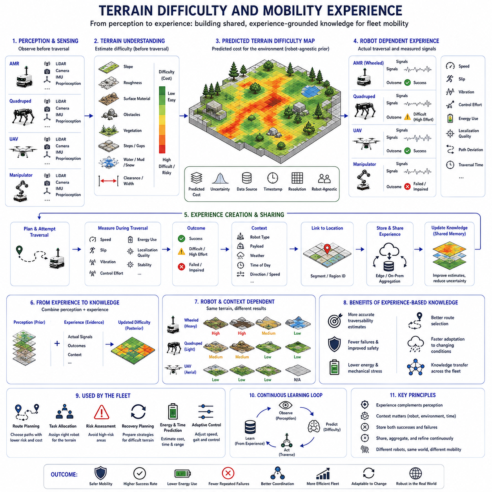{width="7.268055555555556in" height="7.268055555555556in"}

Terrain difficulty describes how demanding a region is for physical movement, while mobility experience records how robots actually perform when interacting with that terrain. Geometry and semantic perception can estimate difficulty before traversal, but direct experience reveals whether those estimates correspond to real operational behavior. Combining predicted terrain difficulty with accumulated mobility experience creates a stronger basis for fleet navigation and learning.

Terrain difficulty cannot be determined from obstacle presence alone. Slope, roughness, surface material, deformation, loose soil, vegetation, steps, gaps, water, mud, snow, and available clearance can influence movement. Even when a region appears geometrically traversable, its physical characteristics may produce slip, instability, excessive vibration, poor localization, increased control effort, or unexpectedly high energy consumption.

Perception provides the first estimate of these conditions. LiDAR can measure terrain geometry and surface structure, cameras can contribute semantic terrain classification and visual texture, while inertial sensors reveal orientation and motion responses. Depth sensing, radar, proprioception, and other modalities can provide additional evidence. Together, these observations allow robots to estimate terrain difficulty before committing to physical traversal.

However, perceived difficulty and experienced difficulty are not always identical. A visually rough surface may provide excellent traction, while apparently smooth terrain may contain slippery material that is difficult to detect remotely. Terrain appearance therefore provides a prior estimate, whereas actual traversal supplies physical evidence. Mobility experience closes the gap between what the robot predicts from perception and what its body encounters during movement.

Mobility experience can include speed, wheel or track slip, foot contact stability, vibration, suspension response, motor current, control effort, energy consumption, localization quality, path deviation, and traversal time. These signals describe the interaction between the robot and terrain more directly than visual or geometric observations alone. They allow terrain knowledge to become grounded in measurable physical performance.

Traversal outcomes provide another important source of information. A robot may complete a route normally, cross it with difficulty, require recovery behavior, become immobilized, or abort the attempt because risk exceeds acceptable limits. These outcomes can be associated with the terrain region and operating conditions, creating experience records that distinguish reliably traversable terrain from areas that repeatedly generate mobility problems.

The robot itself is part of the terrain difficulty equation. Ground clearance, wheel diameter, leg geometry, suspension, mass, center of gravity, payload, locomotion mechanism, actuator capability, and control policy influence how difficult the same terrain becomes. Consequently, terrain difficulty should not always be represented as one universal value. A shared system should preserve both environmental characteristics and embodiment-dependent mobility experience.

This distinction becomes especially important in heterogeneous fleets. A wheeled AMR may struggle with steps or loose ground, while a quadruped can potentially traverse them. A heavy vehicle may cross soft terrain differently from a lightweight platform, and a UAV may avoid ground constraints entirely while facing different mobility limitations. Shared experience should therefore indicate which robot configuration produced each observation and outcome.

Operational context can change terrain difficulty even when the physical location remains the same. Rain may reduce traction, snow may conceal obstacles, temperature may alter surface properties, and additional payload may increase wheel sinkage or energy consumption. Speed and direction can also matter because ascending a slope may produce different difficulty from descending it. Mobility records should therefore preserve relevant contextual conditions.

Repeated experience allows the fleet to move from isolated observations toward statistical knowledge. If multiple robots repeatedly traverse a region successfully, confidence in its mobility characteristics increases. If outcomes vary significantly, the fleet can identify uncertainty or context sensitivity. A region may eventually be represented not simply as easy or difficult, but as having conditional performance distributions associated with robot type and environmental state.

Failures are especially valuable because they reveal limitations that may not be visible from perception. Excessive slip, localization loss, motor overload, instability, collision, high vibration, or immobilization can identify terrain where predicted traversability was overly optimistic. Recording these failures allows future robots to approach cautiously, select alternative routes, modify speed, change control strategy, or avoid the region entirely.

Successful traversals are equally important because they prevent the fleet from becoming unnecessarily conservative. Terrain that initially appears difficult may repeatedly prove safe for particular robot configurations. Positive experience can reduce estimated cost or uncertainty and allow future planners to use efficient routes that would otherwise be avoided. Learning therefore requires both successful and unsuccessful mobility evidence.

Experience should be linked spatially so that performance measurements can update terrain representations. A route can be divided into regions or segments, with each segment associated with terrain attributes and measured mobility outcomes. This enables the fleet to determine where slip increased, where localization deteriorated, or where energy demand changed instead of assigning one performance value to an entire mission.

Temporal information is also necessary because terrain conditions evolve. A route that was easy yesterday may become difficult after rainfall, construction, erosion, debris accumulation, or vegetation growth. Experience records should therefore include timestamps and appropriate validity assumptions. Persistent structural characteristics can retain long-term influence, while rapidly changing surface conditions may require frequent confirmation or confidence decay.

The combination of perception and experience enables continuous refinement of traversability estimates. Before traversal, the robot predicts difficulty using available environmental observations and fleet memory. During traversal, proprioceptive and control signals measure actual interaction. After traversal, the predicted and experienced outcomes can be compared, and the difference becomes useful learning information for updating terrain models and future predictions.

This process can support learning models that estimate mobility performance from terrain characteristics. Historical fleet experience provides examples connecting perceived terrain features, robot configuration, operating context, actions, and resulting outcomes. Over time, models can learn relationships between environmental observations and quantities such as expected slip, traversal time, energy cost, stability risk, or probability of successful passage.

Mobility experience also supports more informed route planning. Instead of selecting the shortest geometric route, a planner can consider expected terrain difficulty, energy consumption, mechanical stress, localization reliability, uncertainty, and historical success. The preferred path may therefore differ among robot types or mission priorities. A heavy transport robot and a fast reconnaissance robot need not interpret the same terrain costs identically.

At fleet scale, experience sharing prevents every robot from learning terrain characteristics independently through trial and error. Significant successes, failures, hazards, and performance changes can be transferred into shared memory and aggregated by edge or on-premise systems. Relevant knowledge can then be distributed according to robot type, mission, location, and current conditions, turning physical interaction into reusable collective experience.

Terrain difficulty and mobility experience ultimately create a bridge between perception, embodiment, memory, and action. Terrain is first observed, its difficulty is estimated, a robot physically interacts with it, and the resulting performance becomes new evidence. By repeatedly comparing predicted difficulty with experienced mobility, the fleet develops increasingly grounded knowledge of how different robots can move through complex and changing environments.

지형 난이도(terrain difficulty)는 특정 영역에서 물리적으로 이동하는 것이 얼마나 어려운지를 나타내며, 이동 경험(mobility experience)은 로봇이 해당 지형과 실제로 상호작용할 때 어떤 성능을 보였는지를 기록한다. 기하 구조(geometry)와 의미 인지(semantic perception)를 통해 주행 전에 난이도를 추정할 수 있지만, 직접적인 경험은 이러한 추정이 실제 운용 행동과 일치하는지를 보여준다. 예측된 지형 난이도와 축적된 이동 경험을 결합하면 플릿 주행과 학습을 위한 더욱 강력한 기반을 구축할 수 있다.

지형 난이도는 장애물의 존재 여부만으로 결정할 수 없다. 경사, 거칠기, 표면 재질, 변형, 느슨한 토양, 식생, 계단, 틈, 물, 진흙, 눈, 사용 가능한 여유 공간(clearance) 등이 모두 이동에 영향을 줄 수 있다. 특정 영역이 기하학적으로 주행 가능해 보이더라도 물리적 특성으로 인해 미끄러짐(slip), 불안정성, 과도한 진동, 낮은 위치 추정 품질, 증가된 제어 노력(control effort), 예상보다 높은 에너지 소비가 발생할 수 있다.

인지(perception)는 이러한 조건에 대한 최초의 추정을 제공한다. 라이다(LiDAR)는 지형의 기하 구조와 표면 구조를 측정할 수 있고, 카메라는 의미적 지형 분류(semantic terrain classification)와 시각적 질감 정보를 제공하며, 관성 센서(inertial sensor)는 자세와 움직임 반응을 파악하는 데 활용된다. 깊이 센싱(depth sensing), 레이더, 고유수용감각(proprioception) 및 기타 센서 양식도 추가적인 정보를 제공한다. 이러한 관찰을 결합하면 로봇은 실제로 지형에 진입하기 전에 지형 난이도를 추정할 수 있다.

그러나 인지된 난이도(perceived difficulty)와 실제 경험된 난이도(experienced difficulty)가 항상 동일한 것은 아니다. 시각적으로 거칠어 보이는 표면이 뛰어난 접지력(traction)을 제공할 수도 있으며, 반대로 매끄럽게 보이는 지형에 원격 센싱으로 탐지하기 어려운 미끄러운 물질이 존재할 수도 있다. 따라서 지형의 외관은 사전 추정(prior estimate)을 제공하고, 실제 주행은 물리적인 증거를 제공한다. 이동 경험은 로봇이 인지로 예측한 것과 실제 로봇의 몸체가 이동 과정에서 경험한 것 사이의 차이를 보완한다.

이동 경험(mobility experience)에는 속도, 바퀴 또는 트랙의 미끄러짐, 발 접촉 안정성(foot contact stability), 진동, 서스펜션 반응, 모터 전류, 제어 노력, 에너지 소비, 위치 추정 품질, 경로 이탈(path deviation), 통과 시간 등이 포함될 수 있다. 이러한 신호들은 시각적 또는 기하학적 관찰만으로 얻는 정보보다 로봇과 지형 사이의 상호작용을 더욱 직접적으로 설명한다. 이를 통해 지형 지식은 측정 가능한 물리적 성능에 기반한 정보로 발전한다.

주행 결과(traversal outcome)는 또 다른 중요한 정보의 원천이다. 로봇은 경로를 정상적으로 완료하거나, 어려움을 겪으면서 통과하거나, 복구 행동(recovery behavior)이 필요하거나, 이동 불능 상태가 되거나, 위험이 허용 가능한 수준을 초과하여 시도를 중단할 수 있다. 이러한 결과를 지형 영역과 운용 조건에 연결하면 안정적으로 주행할 수 있는 지형과 반복적으로 이동 문제를 발생시키는 영역을 구분하는 경험 기록(experience record)을 구축할 수 있다.

로봇 자체도 지형 난이도를 결정하는 요소이다. 지상고(ground clearance), 바퀴 직경, 다리 구조, 서스펜션, 질량, 무게중심(center of gravity), 적재량(payload), 이동 메커니즘(locomotion mechanism), 액추에이터 능력(actuator capability), 제어 정책(control policy)은 동일한 지형의 난이도에 영향을 준다. 따라서 지형 난이도를 항상 하나의 보편적인 값으로 표현해서는 안 된다. 공유 시스템은 환경 특성과 형태 의존적 이동 경험(embodiment-dependent mobility experience)을 모두 보존해야 한다.

이러한 구분은 이기종 플릿(heterogeneous fleet)에서 특히 중요하다. 바퀴형 자율이동로봇(AMR)은 계단이나 느슨한 지면에서 어려움을 겪을 수 있지만, 사족보행 로봇(quadruped)은 이를 통과할 가능성이 있다. 무거운 차량은 연약 지반에서 경량 플랫폼과 다르게 움직이며, 무인항공기(UAV)는 지상 제약을 피할 수 있지만 다른 형태의 이동성 한계를 가진다. 따라서 공유 경험에는 어떤 로봇 구성(robot configuration)이 각각의 관찰과 결과를 생성했는지를 포함해야 한다.

물리적 위치가 동일하더라도 운용 맥락(operational context)에 따라 지형 난이도가 달라질 수 있다. 비가 내리면 접지력이 감소할 수 있고, 눈은 장애물을 가릴 수 있으며, 온도는 표면 특성을 변화시킬 수 있고, 추가 적재량은 바퀴 침하(wheel sinkage)나 에너지 소비를 증가시킬 수 있다. 속도와 이동 방향도 중요하다. 경사로를 올라갈 때와 내려갈 때의 난이도가 서로 다를 수 있기 때문이다. 따라서 이동 기록에는 관련된 맥락 조건(contextual condition)을 함께 보존해야 한다.

반복적인 경험을 통해 플릿은 개별적인 관찰에서 통계적 지식(statistical knowledge)으로 발전할 수 있다. 여러 로봇이 특정 영역을 반복적으로 성공하여 통과하면 해당 영역의 이동 특성에 대한 신뢰도가 높아진다. 반대로 결과가 크게 달라지면 플릿은 불확실성이나 상황 의존성(context sensitivity)을 식별할 수 있다. 결국 특정 영역을 단순히 쉽거나 어렵다고 표현하는 대신 로봇 유형과 환경 상태에 따른 조건부 성능 분포(conditional performance distribution)로 표현할 수 있다.

실패(failure)는 인지만으로 확인하기 어려운 한계를 드러내기 때문에 특히 가치가 높다. 과도한 미끄러짐, 위치 추정 손실(localization loss), 모터 과부하, 불안정성, 충돌, 높은 진동 또는 이동 불능은 예측된 주행 가능성(traversability)이 지나치게 낙관적이었던 지형을 식별할 수 있게 한다. 이러한 실패를 기록하면 이후 로봇은 보다 신중하게 접근하고, 대체 경로를 선택하거나, 속도를 변경하거나, 제어 전략을 조정하거나, 해당 영역을 완전히 회피할 수 있다.

성공적인 주행(successful traversal) 역시 플릿이 지나치게 보수적으로 변하는 것을 방지하기 때문에 중요하다. 처음에는 어려워 보였던 지형도 특정 로봇 구성에서는 반복적으로 안전하게 통과할 수 있음이 확인될 수 있다. 긍정적인 경험(positive experience)은 예상 비용이나 불확실성을 낮추고, 이후의 계획 시스템이 그렇지 않았다면 회피했을 효율적인 경로를 사용할 수 있도록 한다. 따라서 학습에는 성공과 실패에 대한 이동 증거가 모두 필요하다.

경험은 공간적으로 연결되어야 하며, 이를 통해 성능 측정값이 지형 표현(terrain representation)을 갱신할 수 있다. 하나의 경로를 여러 영역 또는 구간(segment)으로 나누고 각 구간에 지형 속성과 측정된 이동 결과를 연결할 수 있다. 이를 통해 전체 임무에 하나의 성능값을 부여하는 대신 어느 지점에서 미끄러짐이 증가했는지, 위치 추정 성능이 저하되었는지, 에너지 요구량이 변화했는지를 플릿이 판단할 수 있다.

지형 조건은 시간에 따라 변화하기 때문에 시간 정보(temporal information)도 필요하다. 어제 쉽게 이동했던 경로가 강우, 공사, 침식, 잔해 축적 또는 식생 성장 이후에는 어려워질 수 있다. 따라서 경험 기록에는 타임스탬프(timestamp)와 적절한 유효성 가정(validity assumption)이 포함되어야 한다. 지속적인 구조 특성은 장기적인 영향을 유지할 수 있지만, 빠르게 변화하는 표면 상태는 빈번한 재확인이나 신뢰도 감쇠(confidence decay)가 필요할 수 있다.

인지와 경험을 결합하면 주행 가능성 추정(traversability estimate)을 지속적으로 개선할 수 있다. 주행 전에는 사용 가능한 환경 관찰과 플릿 메모리(fleet memory)를 이용하여 난이도를 예측한다. 주행 중에는 고유수용감각 및 제어 신호를 이용하여 실제 상호작용을 측정한다. 주행 후에는 예측 결과와 실제 경험 결과를 비교할 수 있으며, 그 차이는 지형 모델과 향후 예측을 갱신하기 위한 유용한 학습 정보가 된다.

이러한 과정은 지형 특성으로부터 이동 성능을 추정하는 학습 모델(learning model)을 지원할 수 있다. 과거의 플릿 경험은 인지된 지형 특징, 로봇 구성, 운용 맥락, 행동 및 그에 따른 결과를 연결하는 학습 사례를 제공한다. 시간이 지나면서 모델은 환경 관찰과 예상 미끄러짐, 통과 시간, 에너지 비용, 안정성 위험 또는 성공적인 통과 확률과 같은 값 사이의 관계를 학습할 수 있다.

이동 경험은 더욱 정교한 경로 계획(route planning)도 지원한다. 계획 시스템은 가장 짧은 기하학적 경로만 선택하는 대신 예상 지형 난이도, 에너지 소비, 기계적 스트레스(mechanical stress), 위치 추정 신뢰성, 불확실성 및 과거 성공률을 고려할 수 있다. 따라서 선호되는 경로는 로봇 유형이나 임무 우선순위에 따라 달라질 수 있으며, 중량 운송 로봇과 고속 정찰 로봇이 동일한 지형 비용을 동일하게 해석할 필요는 없다.

플릿 규모에서 경험 공유(experience sharing)는 모든 로봇이 시행착오를 통해 지형 특성을 독립적으로 학습해야 하는 상황을 방지한다. 중요한 성공, 실패, 위험 요소 및 성능 변화는 공유 메모리(shared memory)로 전달되고 엣지(edge) 또는 온프레미스 시스템(on-premise system)에서 통합될 수 있다. 이후 관련 지식은 로봇 유형, 임무, 위치 및 현재 조건에 따라 배포되어 물리적 상호작용 경험을 재사용 가능한 집단 경험(collective experience)으로 전환한다.

궁극적으로 지형 난이도(terrain difficulty)와 이동 경험(mobility experience)은 인지(perception), 형태(embodiment), 메모리(memory), 행동(action)을 연결하는 가교를 형성한다. 먼저 지형을 관찰하고 난이도를 추정한 다음 로봇이 해당 지형과 물리적으로 상호작용하며, 그 결과로 나타난 성능이 새로운 증거가 된다. 예측된 난이도와 실제 이동 경험을 반복적으로 비교함으로써 플릿은 복잡하고 변화하는 환경에서 서로 다른 로봇이 어떻게 이동할 수 있는지에 대해 점점 더 실제 경험에 기반한 지식(grounded knowledge)을 발전시킬 수 있다.

##  

## 06.08. Obstacle Hazard and Risk Memory

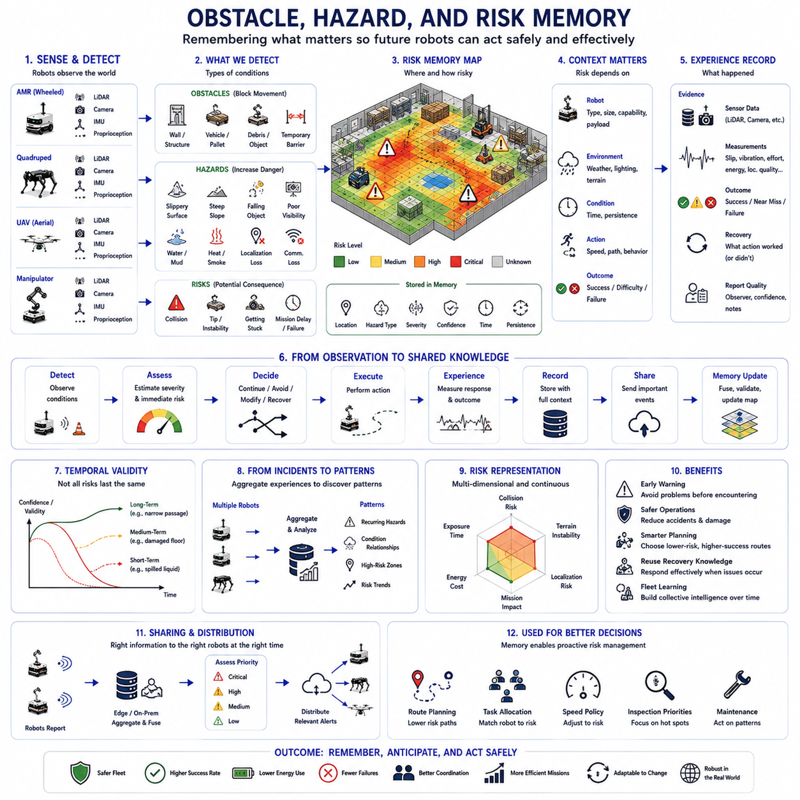{width="7.268055555555556in" height="7.268055555555556in"}

Obstacle, hazard, and risk memory allows a robot fleet to preserve knowledge about conditions that can interfere with movement, damage equipment, reduce mission performance, or threaten people and other robots. Instead of treating every dangerous condition as a temporary sensor event, the fleet records meaningful experiences so that future robots can anticipate problems before physically encountering them.

An obstacle is generally a physical condition that restricts movement, but its operational meaning depends on context. Walls and fixed structures may represent permanent constraints, while pallets, parked vehicles, fallen objects, debris, or temporary barriers may appear and disappear. Remembering obstacle type, location, extent, observation time, and persistence helps the fleet distinguish structural limitations from temporary changes.

Hazards extend beyond physical blockage. Slippery surfaces, unstable terrain, excessive slope, falling-object zones, heat, smoke, water, poor visibility, electromagnetic interference, localization degradation, or unreliable communication may permit movement while increasing operational danger. Hazard memory therefore captures conditions that affect safety and reliability even when geometric navigation remains technically possible.

Risk differs from both obstacle and hazard because it expresses the expected consequence of operating under uncertain conditions. A hazard may exist, but the resulting risk depends on exposure, probability of failure, robot capability, payload, mission importance, and potential consequences. Fleet memory should therefore preserve observations and outcomes that allow risk to be evaluated according to the robot and mission rather than using a universal danger label.

Risk memory becomes especially valuable when direct perception cannot reveal the complete problem. A surface may appear normal while previous robots experienced severe wheel slip, vibration, localization loss, or motor overload at the same location. Historical experience can warn later robots that apparently traversable space contains hidden operational risk, allowing memory to complement current perception.

Each recorded event should contain sufficient context to explain what occurred. Useful information can include spatial location, semantic hazard type, timestamp, observing robot, sensor evidence, confidence, robot configuration, payload, environmental conditions, action being performed, measured response, and final outcome. Context prevents a failure experienced under one condition from being incorrectly generalized to every robot and mission.

Temporal validity is critical because hazards have different lifetimes. A damaged floor or narrow passage may remain dangerous for months, whereas spilled liquid, temporary construction, smoke, congestion, or a parked vehicle may disappear quickly. Hazard memory should therefore include persistence estimates, expiration rules, confidence decay, or requirements for confirmation so that outdated warnings do not permanently distort fleet behavior.

Repeated observations can increase confidence and reveal patterns. If several robots independently report poor localization in the same corridor, the fleet can infer that the problem is systematic rather than an isolated sensor failure. Similarly, repeated slip events after rainfall may reveal a conditional hazard. Aggregating experience transforms individual incidents into statistically stronger knowledge about recurring operational conditions.

Contradictory observations should be preserved with their context rather than immediately collapsed into one value. One robot may cross a region safely while another experiences instability because of different mass, speed, payload, locomotion, weather, or control policy. Fleet memory can retain these differences and learn conditional risk relationships that explain which combinations of robot, environment, and behavior create danger.

Obstacle and hazard information can be spatially integrated with shared maps. Regions may contain occupancy, semantic labels, traversability cost, hazard category, severity, confidence, observation history, and expected persistence. Route graphs can similarly associate edges with previous incidents, temporary restrictions, localization reliability, or failure probability, creating a richer navigation representation than geometry alone.

Risk can be represented as a continuous quantity rather than a binary safe-or-dangerous classification. A route may have low geometric difficulty but moderate collision exposure, while another may have excellent visibility but high terrain instability. Multiple risk dimensions can remain separate or be combined according to mission priorities, allowing planners to distinguish different reasons why a route deserves caution.

Near misses are also important sources of knowledge. A robot does not need to collide, become immobilized, or fail completely before an event becomes useful. Emergency braking, unexpected obstacle avoidance, excessive control correction, temporary localization loss, or stability margins approaching critical thresholds can reveal developing hazards. Recording near misses enables preventive learning before severe failures occur.

Failure and recovery should be linked in the same memory. When a robot encounters a hazard, the fleet should preserve not only what went wrong but also which response succeeded or failed. Reducing speed, reversing, selecting another route, changing localization mode, requesting assistance, or transferring a task to another robot may become reusable recovery knowledge associated with similar future conditions.

This creates a progression from hazard detection toward experience-based risk management. Initial perception identifies a possible danger, current state determines immediate exposure, historical memory provides evidence from previous encounters, and predictive models estimate possible consequences. Planning can then select actions that reduce expected risk while still considering mission efficiency, time, energy, and task objectives.

Shared risk memory is particularly important for heterogeneous fleets because different robots possess different vulnerability profiles. A low obstacle may be irrelevant to a large vehicle but critical for a small AMR, while stairs may block a wheeled platform but remain traversable for a quadruped. The memory should preserve objective environmental properties while allowing robot-specific risk interpretation based on embodiment and capability.

Communication should prioritize hazards according to urgency and relevance. A newly discovered severe obstacle or safety-critical condition may require immediate fleet-wide or regional distribution, whereas low-confidence observations can be aggregated before transmission. Edge or on-premise infrastructure can fuse reports, remove redundancy, assess severity, and distribute warnings to robots whose routes or missions are likely to be affected.

Risk memory also supports predictive fleet world models. Historical incidents reveal where failures tend to occur, under which conditions they appear, and how they propagate into delays, resource conflicts, or mission disruption. Predictive models can use this evidence to estimate future hazard exposure and compare alternative actions before execution, shifting fleet behavior from reactive avoidance toward proactive risk management.

As experience accumulates, the fleet can develop operational risk patterns that are difficult to encode manually. Particular intersections may repeatedly produce congestion, certain surfaces may become hazardous after rain, or localization may degrade near specific structures. Such patterns convert scattered events into reusable knowledge that can influence routing, task allocation, speed policies, inspection priorities, and maintenance decisions.

Ultimately, obstacle, hazard, and risk memory transforms safety-related events into persistent collective intelligence. Robots detect conditions, assess severity, experience consequences, record context, share significant events, and learn from successful recovery. The resulting memory allows the fleet to remember not only where problems occurred, but why they mattered, which robots were affected, and how future missions can avoid or manage similar risks.

장애물, 위험 요소 및 위험 메모리(obstacle, hazard, and risk memory)는 이동을 방해하거나 장비를 손상시키고, 임무 성능을 저하시키거나 사람과 다른 로봇의 안전을 위협할 수 있는 조건에 대한 지식을 로봇 플릿(robot fleet)이 보존할 수 있도록 한다. 모든 위험한 조건을 일시적인 센서 사건(sensor event)으로만 처리하는 대신, 플릿은 의미 있는 경험을 기록하여 이후의 로봇이 해당 문제를 물리적으로 마주치기 전에 미리 예상할 수 있도록 한다.

장애물(obstacle)은 일반적으로 이동을 제한하는 물리적 조건을 의미하지만, 그 운용적 의미는 맥락(context)에 따라 달라진다. 벽과 고정 구조물은 영구적인 제약이 될 수 있지만, 팔레트, 주차된 차량, 떨어진 물체, 잔해 또는 임시 장벽은 나타났다가 사라질 수 있다. 장애물의 유형, 위치, 범위, 관찰 시간 및 지속성(persistence)을 기억하면 플릿은 구조적인 제약과 일시적인 변화를 구분할 수 있다.

위험 요소(hazard)는 단순한 물리적 차단을 넘어선다. 미끄러운 표면, 불안정한 지형, 과도한 경사, 낙하물 위험 구역, 열, 연기, 물, 낮은 가시성, 전자기 간섭(electromagnetic interference), 위치 추정 성능 저하(localization degradation), 불안정한 통신 등은 이동 자체는 가능하더라도 운용 위험을 증가시킬 수 있다. 따라서 위험 요소 메모리(hazard memory)는 기하학적 주행이 기술적으로 가능한 상황에서도 안전성과 신뢰성에 영향을 미치는 조건을 기록한다.

위험(risk)은 장애물 및 위험 요소와는 다르며, 불확실한 조건에서 운용할 때 예상되는 결과(expected consequence)를 표현한다. 위험 요소가 존재하더라도 실제 위험 수준은 노출 정도(exposure), 실패 확률, 로봇 능력, 적재량(payload), 임무 중요도 및 잠재적인 결과에 따라 달라진다. 따라서 플릿 메모리는 하나의 보편적인 위험 라벨을 사용하는 대신 로봇과 임무에 따라 위험을 평가할 수 있도록 관찰 정보와 결과를 보존해야 한다.

직접적인 인지(perception)만으로 전체 문제를 파악할 수 없는 경우 위험 메모리(risk memory)의 가치는 특히 커진다. 표면이 정상적으로 보이더라도 이전 로봇들이 동일한 위치에서 심각한 바퀴 미끄러짐(wheel slip), 진동, 위치 추정 손실(localization loss) 또는 모터 과부하를 경험했을 수 있다. 과거 경험은 이후의 로봇에게 겉으로는 주행 가능한 공간에도 숨겨진 운용 위험(hidden operational risk)이 존재한다는 사실을 알려주어 현재의 인지를 보완할 수 있다.

기록되는 각각의 사건(event)은 무엇이 발생했는지를 설명하기에 충분한 맥락을 포함해야 한다. 유용한 정보에는 공간적 위치, 의미적 위험 유형(semantic hazard type), 타임스탬프(timestamp), 관찰 로봇, 센서 증거(sensor evidence), 신뢰도(confidence), 로봇 구성, 적재량, 환경 조건, 수행 중이던 행동, 측정된 반응 및 최종 결과가 포함될 수 있다. 이러한 맥락은 특정 조건에서 발생한 실패가 모든 로봇과 임무에 잘못 일반화되는 것을 방지한다.

위험 요소마다 지속 시간이 서로 다르기 때문에 시간적 유효성(temporal validity)은 매우 중요하다. 손상된 바닥이나 좁은 통로는 수개월 동안 위험한 상태로 유지될 수 있지만, 흘러내린 액체, 임시 공사, 연기, 혼잡 또는 주차된 차량은 빠르게 사라질 수 있다. 따라서 위험 요소 메모리는 오래된 경고가 플릿 행동을 영구적으로 왜곡하지 않도록 지속성 추정(persistence estimate), 만료 규칙(expiration rule), 신뢰도 감쇠(confidence decay) 또는 재확인 요구사항을 포함해야 한다.

반복적인 관찰은 신뢰도를 높이고 패턴(pattern)을 발견할 수 있도록 한다. 여러 로봇이 동일한 통로에서 독립적으로 낮은 위치 추정 성능을 보고한다면 플릿은 이를 단일 센서의 우발적인 오류가 아니라 체계적인 문제로 판단할 수 있다. 마찬가지로 강우 이후 반복적으로 미끄러짐이 발생한다면 조건부 위험 요소(conditional hazard)를 발견할 수 있다. 경험을 통합하면 개별 사건이 반복적인 운용 조건에 대한 통계적으로 더욱 강력한 지식으로 전환된다.

서로 모순되는 관찰(contradictory observation)은 즉시 하나의 값으로 통합하기보다 각각의 맥락과 함께 보존해야 한다. 한 로봇은 특정 영역을 안전하게 통과하지만 다른 로봇은 서로 다른 질량, 속도, 적재량, 이동 방식(locomotion), 날씨 또는 제어 정책 때문에 불안정성을 경험할 수 있다. 플릿 메모리는 이러한 차이를 유지하고 어떤 로봇, 환경 및 행동의 조합이 위험을 발생시키는지를 설명하는 조건부 위험 관계(conditional risk relationship)를 학습할 수 있다.

장애물 및 위험 요소 정보는 공유 지도(shared map)와 공간적으로 통합할 수 있다. 각 영역에는 점유 상태(occupancy), 의미 라벨(semantic label), 주행 가능성 비용(traversability cost), 위험 요소 범주, 심각도(severity), 신뢰도, 관찰 이력 및 예상 지속성을 포함할 수 있다. 경로 그래프(route graph)의 엣지(edge)에도 과거 사고, 일시적 제한, 위치 추정 신뢰성 또는 실패 확률을 연결하여 기하 구조만으로 구성된 지도보다 풍부한 주행 표현을 구축할 수 있다.

위험(risk)은 단순한 안전 또는 위험의 이진 분류(binary classification)가 아니라 연속적인 값으로 표현할 수 있다. 특정 경로는 기하학적 난이도는 낮지만 충돌 노출(collision exposure)이 중간 수준일 수 있으며, 다른 경로는 가시성이 뛰어나지만 지형 불안정성이 높을 수 있다. 여러 위험 차원(risk dimension)을 개별적으로 유지하거나 임무 우선순위에 따라 결합함으로써 계획 시스템은 특정 경로에서 주의가 필요한 서로 다른 이유를 구분할 수 있다.

아차 사고(near miss) 역시 중요한 지식의 원천이다. 로봇이 실제로 충돌하거나 이동 불능 상태에 빠지거나 완전히 실패해야만 사건이 유용한 것은 아니다. 비상 제동(emergency braking), 예상하지 못한 장애물 회피, 과도한 제어 보정(control correction), 일시적인 위치 추정 손실 또는 안정성 여유(stability margin)가 임계 수준에 접근한 상황은 잠재적인 위험 요소를 보여줄 수 있다. 아차 사고를 기록하면 심각한 실패가 발생하기 전에 예방적 학습(preventive learning)이 가능하다.

실패(failure)와 복구(recovery)는 동일한 메모리 안에서 서로 연결되어야 한다. 로봇이 위험 요소를 마주쳤을 때 플릿은 무엇이 잘못되었는지만이 아니라 어떤 대응이 성공하거나 실패했는지도 보존해야 한다. 속도 감소, 후진, 다른 경로 선택, 위치 추정 모드 변경, 지원 요청 또는 다른 로봇으로 작업 이전 등의 대응은 향후 유사한 조건에서 활용할 수 있는 재사용 가능한 복구 지식(reusable recovery knowledge)이 될 수 있다.

이를 통해 위험 요소 감지(hazard detection)에서 경험 기반 위험 관리(experience-based risk management)로 발전할 수 있다. 초기 인지는 잠재적인 위험을 식별하고, 현재 상태는 즉각적인 노출 수준을 결정하며, 과거 메모리는 이전 경험에서 얻은 증거를 제공하고, 예측 모델(predictive model)은 가능한 결과를 추정한다. 계획 시스템은 이를 기반으로 임무 효율성, 시간, 에너지 및 작업 목표를 고려하면서 예상 위험을 감소시키는 행동을 선택할 수 있다.

공유 위험 메모리(shared risk memory)는 서로 다른 로봇이 서로 다른 취약성 특성(vulnerability profile)을 가지므로 이기종 플릿(heterogeneous fleet)에서 특히 중요하다. 낮은 장애물은 대형 차량에는 중요하지 않을 수 있지만 소형 자율이동로봇(AMR)에는 심각한 문제가 될 수 있으며, 계단은 바퀴형 플랫폼의 이동을 차단하지만 사족보행 로봇(quadruped)은 통과할 수 있다. 따라서 메모리는 객관적인 환경 특성을 보존하면서 형태(embodiment)와 능력에 따른 로봇별 위험 해석을 가능하게 해야 한다.

통신(communication)은 긴급성과 관련성에 따라 위험 요소의 우선순위를 결정해야 한다. 새롭게 발견된 심각한 장애물이나 안전 필수 조건(safety-critical condition)은 즉시 플릿 전체 또는 해당 지역에 배포해야 할 수 있지만, 신뢰도가 낮은 관찰은 전송 전에 통합할 수 있다. 엣지(edge) 또는 온프레미스 인프라(on-premise infrastructure)는 보고를 융합하고 중복을 제거하며 심각도를 평가한 후 영향을 받을 가능성이 높은 경로나 임무를 수행하는 로봇에게 경고를 배포할 수 있다.

위험 메모리는 예측형 플릿 월드 모델(predictive fleet world model)도 지원한다. 과거 사고는 어디에서 실패가 자주 발생하는지, 어떤 조건에서 문제가 나타나는지, 그리고 그것이 지연, 자원 충돌 또는 임무 중단으로 어떻게 확산되는지를 보여준다. 예측 모델은 이러한 증거를 활용하여 미래의 위험 노출(hazard exposure)을 추정하고 실행 전에 대체 행동을 비교함으로써 플릿 행동을 반응적 회피(reactive avoidance)에서 선제적 위험 관리(proactive risk management)로 발전시킬 수 있다.

경험이 축적되면 플릿은 수동으로 정의하기 어려운 운용 위험 패턴(operational risk pattern)을 발견할 수 있다. 특정 교차로에서 혼잡이 반복되거나, 특정 표면이 비가 내린 후 위험해지거나, 특정 구조물 주변에서 위치 추정 성능이 저하될 수 있다. 이러한 패턴은 흩어진 개별 사건을 재사용 가능한 지식으로 전환하여 경로 설정, 작업 할당(task allocation), 속도 정책, 검사 우선순위 및 유지보수 의사결정에 영향을 줄 수 있다.

궁극적으로 장애물, 위험 요소 및 위험 메모리(obstacle, hazard, and risk memory)는 안전과 관련된 사건을 지속적인 집단 지능(collective intelligence)으로 전환한다. 로봇은 조건을 감지하고 심각도를 평가하며 결과를 경험하고, 맥락을 기록하고, 중요한 사건을 공유하며, 성공적인 복구 과정으로부터 학습한다. 그 결과 플릿은 단순히 문제가 어디에서 발생했는지만 기억하는 것이 아니라 왜 그것이 중요했는지, 어떤 로봇이 영향을 받았는지, 그리고 미래 임무에서 유사한 위험을 어떻게 회피하거나 관리할 수 있는지를 함께 기억할 수 있다.

##  

## 06.09. Dynamic Environment Updates

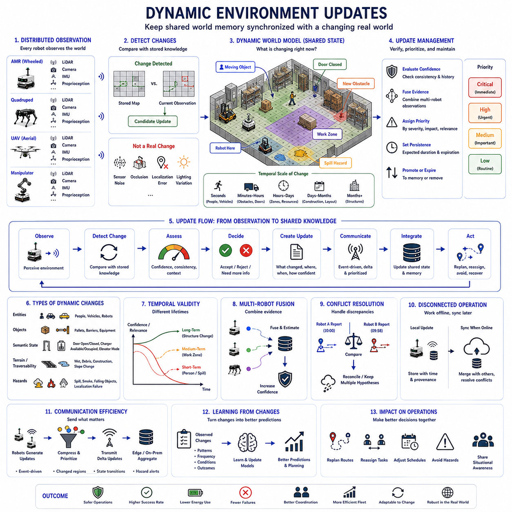{width="7.268055555555556in" height="7.268055555555556in"}

Dynamic environments require robot fleets to treat world knowledge as continuously evolving rather than permanently fixed. Objects move, routes become blocked, work zones change, resources become occupied, and terrain conditions vary over time. Dynamic environment updates allow the fleet to detect these changes, evaluate their significance, and revise shared representations so that decisions remain aligned with the current physical world.

A static map provides useful structural knowledge, but it cannot fully describe an active operational environment. Walls and permanent infrastructure may remain stable, while pallets, vehicles, people, doors, equipment, temporary barriers, and work areas can change frequently. Fleet intelligence therefore requires a distinction between persistent structure and dynamic state, with each type of information updated according to its expected rate of change.

Every robot can act as a distributed observer of environmental change. Cameras, LiDAR, radar, depth sensors, localization systems, and proprioceptive signals provide evidence about conditions encountered during operation. When a robot detects a difference between its current observation and stored world knowledge, that difference becomes a candidate update that may need to be incorporated into local or fleet-level memory.

Not every detected difference represents a meaningful environmental change. Sensor noise, localization error, occlusion, lighting variation, imperfect semantic classification, or temporary visibility loss can create apparent differences. An update mechanism must therefore evaluate confidence, spatial consistency, observation history, and supporting evidence before modifying persistent shared knowledge. This prevents transient perception errors from unnecessarily destabilizing the fleet representation.

Changes can occur across multiple temporal scales. A person crossing a corridor may matter for seconds, a parked vehicle may remain for hours, a construction zone may persist for weeks, and a structural modification may remain for years. Dynamic environment updates should therefore associate observations with timestamps, expected persistence, confidence, and expiration behavior so that information can be maintained according to its likely lifetime.

The system can organize changing information into dynamic layers. Highly dynamic entities such as people and moving vehicles can be represented through current state and predicted trajectories. Semi-static elements such as pallets, temporary barriers, or parked equipment can remain in memory while periodically requiring confirmation. Persistent structural changes can eventually be promoted into longer-term spatial and semantic world knowledge.

Change detection should also consider semantic state rather than geometry alone. A charging station may remain physically unchanged but become unavailable, a door may switch from open to closed, a workstation may become occupied, and an elevator may enter maintenance mode. These changes affect robot behavior even though the underlying geometry remains similar. Dynamic updates therefore include state transitions associated with meaningful environmental entities.

Traversability can also change dynamically. Rain, snow, water, debris, construction activity, vegetation, or repeated vehicle traffic may alter the mobility characteristics of terrain. A route that was previously safe can become difficult, while a formerly blocked area may become accessible again. Updated traversability information allows fleet planning to respond to current physical conditions instead of relying entirely on historical mobility experience.

Hazards require particularly rapid updates because outdated information can directly affect safety. Newly detected spills, smoke, fallen objects, unstable surfaces, localization failures, or communication dead zones may need immediate distribution to nearby robots. Conversely, temporary hazards should be removed or downgraded after they disappear. Effective update policies therefore balance rapid warning propagation with mechanisms for verification, expiration, and correction.

Shared world state provides the operational location where many dynamic updates are integrated. Robot positions, object states, task progress, resource occupancy, hazards, and route conditions can change continuously. Incoming observations update this shared state, while persistent changes may also modify fleet memory. The distinction between current state and historical memory allows the system to retain useful experience without confusing previous conditions with present reality.

Multiple robots can provide complementary evidence about the same change. One robot may observe an obstacle from a distance while another approaches from a different viewpoint and confirms its extent. Combining observations can improve confidence and reduce ambiguity. Repeated confirmation can promote a suspected change into accepted fleet knowledge, while contradictory evidence can trigger additional observation rather than forcing an immediate conclusion.

Conflicting updates are unavoidable in distributed systems. Robots may observe the same region at different times, possess different localization accuracy, or experience communication delays. The fleet should compare timestamps, confidence, source reliability, sensor capability, and spatial consistency when reconciling updates. In some cases, preserving multiple hypotheses temporarily is more appropriate than selecting one observation as unquestionably correct.

Communication efficiency becomes important as fleet size increases. Continuously transmitting complete maps or world states from every robot would create unnecessary network load. Robots can instead communicate event-driven updates, changed regions, semantic state transitions, hazard alerts, or compressed differences. This delta-based approach allows communication resources to focus on information that meaningfully changes the fleet\'s understanding of the environment.

Update priority should depend on operational relevance. A safety-critical obstacle affecting several active routes deserves rapid distribution, while a minor change in an unused region may tolerate delayed synchronization. Priority can consider severity, confidence, affected robots, mission relevance, spatial proximity, and expected persistence. This allows the fleet to allocate communication and processing resources according to the consequences of environmental change.

Disconnected operation requires robots to maintain local updates even when fleet communication is unavailable. A robot can modify its local representation, record observations with timestamps and provenance, and continue operating from cached knowledge. When connectivity returns, accumulated changes can be synchronized with edge or on-premise systems, where they are compared with updates generated by other robots during the disconnection period.

Dynamic updates also provide valuable learning signals. Differences between expected and observed environmental states reveal where the fleet\'s assumptions or predictive models were inaccurate. Repeated changes can expose temporal patterns such as recurring congestion, periodic resource occupancy, weather-dependent terrain conditions, or frequently moved objects. These patterns can improve future prediction rather than being treated merely as isolated map corrections.

A fleet world model can use dynamic updates to continuously correct its internal predictions. The model predicts how objects, robots, resources, hazards, and environmental conditions may evolve, while incoming observations reveal what actually happened. Prediction errors provide evidence for state correction and model improvement. The fleet therefore develops a closed loop between prediction, observation, update, memory, and subsequent planning.

Dynamic environment updates directly influence coordinated decision making. When a route becomes blocked, tasks may need to be reassigned; when a charger becomes occupied, charging schedules may change; when a hazardous region appears, multiple robots may require rerouting. Updating shared knowledge quickly allows these decisions to occur collectively rather than forcing each robot to independently discover the same environmental change.

Ultimately, dynamic environment updates keep shared world memory synchronized with a changing physical world. Robots continuously observe, compare, detect change, assess confidence, communicate significant differences, fuse evidence, and revise shared representations. Through this process, fleet knowledge becomes a living operational model rather than a static database, enabling multi-robot Physical AI to remain adaptive, coordinated, and reliable as real-world conditions evolve.

동적 환경(dynamic environment)에서는 로봇 플릿(robot fleet)이 월드 지식(world knowledge)을 영구적으로 고정된 정보가 아니라 지속적으로 변화하는 정보로 다루어야 한다. 객체는 이동하고, 경로는 차단되며, 작업 구역은 변경되고, 자원은 점유되며, 지형 조건도 시간에 따라 달라진다. 동적 환경 업데이트(dynamic environment updates)는 플릿이 이러한 변화를 감지하고 중요성을 평가하며 공유 표현(shared representation)을 수정하여 의사결정이 현재의 물리적 세계와 일치하도록 한다.

정적 지도(static map)는 유용한 구조적 지식을 제공하지만, 활발하게 변화하는 운용 환경을 완전히 표현할 수는 없다. 벽과 영구적인 인프라는 안정적으로 유지될 수 있지만, 팔레트, 차량, 사람, 문, 장비, 임시 장벽 및 작업 영역은 빈번하게 변화할 수 있다. 따라서 플릿 지능(fleet intelligence)은 지속적 구조(persistent structure)와 동적 상태(dynamic state)를 구분하고, 각 정보 유형을 예상되는 변화 속도에 따라 갱신해야 한다.

모든 로봇은 환경 변화를 감지하는 분산 관찰자(distributed observer)의 역할을 수행할 수 있다. 카메라, 라이다(LiDAR), 레이더(radar), 깊이 센서(depth sensor), 위치 추정 시스템(localization system), 고유수용감각 신호(proprioceptive signal)는 운용 중 마주치는 조건에 대한 증거를 제공한다. 로봇이 현재 관찰과 저장된 월드 지식 사이의 차이를 감지하면, 해당 차이는 로컬 또는 플릿 수준 메모리에 반영해야 할 후보 업데이트(candidate update)가 된다.

감지된 모든 차이가 의미 있는 환경 변화를 나타내는 것은 아니다. 센서 잡음, 위치 추정 오차, 가림(occlusion), 조명 변화, 불완전한 의미 분류(semantic classification), 일시적인 가시성 저하는 실제로 존재하지 않는 차이를 만들어낼 수 있다. 따라서 업데이트 메커니즘은 지속적인 공유 지식을 수정하기 전에 신뢰도(confidence), 공간적 일관성(spatial consistency), 관찰 이력 및 보조 증거를 평가해야 한다. 이를 통해 일시적인 인지 오류가 플릿 표현을 불필요하게 불안정하게 만드는 것을 방지할 수 있다.

변화는 여러 시간 척도(temporal scale)에 걸쳐 발생할 수 있다. 통로를 지나가는 사람은 몇 초 동안 중요할 수 있고, 주차된 차량은 몇 시간 동안 유지될 수 있으며, 공사 구역은 수주 동안 지속되고, 구조적 변경은 수년 동안 유지될 수 있다. 따라서 동적 환경 업데이트는 관찰 정보에 타임스탬프(timestamp), 예상 지속성(expected persistence), 신뢰도 및 만료 동작(expiration behavior)을 연결하여 예상되는 수명에 따라 정보를 관리해야 한다.

시스템은 변화하는 정보를 동적 계층(dynamic layer)으로 구성할 수 있다. 사람이나 이동 차량처럼 매우 동적인 개체는 현재 상태와 예측 궤적(predicted trajectory)을 통해 표현할 수 있다. 팔레트, 임시 장벽, 주차된 장비와 같은 준정적 요소(semi-static element)는 주기적인 확인이 필요하지만 일정 기간 메모리에 유지할 수 있다. 지속적인 구조 변화는 최종적으로 장기적인 공간 및 의미 월드 지식(spatial and semantic world knowledge)으로 승격될 수 있다.

변화 감지(change detection)는 기하 구조만이 아니라 의미 상태(semantic state)도 고려해야 한다. 충전소의 물리적 구조는 변하지 않았지만 사용 불가능한 상태가 될 수 있고, 문은 열림 상태에서 닫힘 상태로 변경될 수 있으며, 작업대는 점유될 수 있고, 엘리베이터는 유지보수 모드로 전환될 수 있다. 이러한 변화는 기본 기하 구조가 동일하더라도 로봇 행동에 영향을 준다. 따라서 동적 업데이트에는 의미 있는 환경 개체와 연관된 상태 전이(state transition)도 포함된다.

주행 가능성(traversability) 역시 동적으로 변화할 수 있다. 비, 눈, 물, 잔해, 공사 활동, 식생 또는 반복적인 차량 통행은 지형의 이동 특성을 변화시킬 수 있다. 이전에는 안전했던 경로가 이동하기 어려워질 수 있으며, 반대로 이전에 차단되었던 영역이 다시 접근 가능한 상태가 될 수도 있다. 갱신된 주행 가능성 정보는 플릿 계획(fleet planning)이 과거의 이동 경험에만 의존하지 않고 현재의 물리적 조건에 대응할 수 있도록 한다.

오래된 정보가 안전에 직접적인 영향을 줄 수 있으므로 위험 요소(hazard)는 특히 신속하게 업데이트해야 한다. 새롭게 감지된 유출물, 연기, 낙하 물체, 불안정한 표면, 위치 추정 장애 또는 통신 음영 지역(communication dead zone)은 주변 로봇에게 즉시 배포해야 할 수 있다. 반대로 일시적인 위험 요소가 사라지면 해당 정보도 제거하거나 신뢰도를 낮춰야 한다. 따라서 효과적인 업데이트 정책은 신속한 경고 전파와 검증, 만료 및 수정 메커니즘 사이의 균형을 유지해야 한다.

공유 월드 상태(shared world state)는 많은 동적 업데이트가 통합되는 운용적 위치를 제공한다. 로봇 위치, 객체 상태, 작업 진행 상태, 자원 점유 상태, 위험 요소 및 경로 조건은 지속적으로 변화할 수 있다. 새롭게 들어오는 관찰 정보는 이러한 공유 상태를 갱신하며, 지속적인 변화는 플릿 메모리(fleet memory)에도 반영될 수 있다. 현재 상태와 과거 메모리를 구분하면 이전 조건과 현재 현실을 혼동하지 않으면서 유용한 경험을 보존할 수 있다.

여러 로봇은 동일한 변화에 대해 상호보완적인 증거(complementary evidence)를 제공할 수 있다. 한 로봇이 멀리서 장애물을 관찰하고, 다른 로봇이 다른 시점(viewpoint)에서 접근하여 그 범위를 확인할 수 있다. 여러 관찰을 결합하면 신뢰도를 높이고 모호성을 줄일 수 있다. 반복적인 확인을 통해 의심되는 변화를 승인된 플릿 지식(accepted fleet knowledge)으로 승격할 수 있으며, 서로 모순되는 증거가 존재한다면 즉시 결론을 강제하는 대신 추가적인 관찰을 요청할 수 있다.

분산 시스템(distributed system)에서는 서로 충돌하는 업데이트가 불가피하다. 로봇들은 동일한 영역을 서로 다른 시간에 관찰할 수 있고, 서로 다른 위치 추정 정확도를 가지며, 통신 지연도 경험할 수 있다. 플릿은 업데이트를 조정할 때 타임스탬프, 신뢰도, 정보 출처의 신뢰성(source reliability), 센서 능력 및 공간적 일관성을 비교해야 한다. 경우에 따라 하나의 관찰을 절대적으로 올바른 것으로 선택하기보다 여러 가설(multiple hypotheses)을 일시적으로 보존하는 것이 더 적절하다.

플릿 규모가 증가하면 통신 효율성(communication efficiency)이 중요해진다. 모든 로봇이 완전한 지도나 월드 상태를 지속적으로 전송하면 불필요한 네트워크 부하가 발생한다. 대신 로봇은 사건 기반 업데이트(event-driven update), 변경된 영역, 의미 상태 전이, 위험 경고 또는 압축된 차이(compressed difference)를 통신할 수 있다. 이러한 델타 기반 접근(delta-based approach)은 플릿의 환경 이해를 실질적으로 변화시키는 정보에 통신 자원을 집중할 수 있도록 한다.

업데이트 우선순위(update priority)는 운용 관련성(operational relevance)에 따라 결정되어야 한다. 여러 활성 경로에 영향을 미치는 안전 필수 장애물(safety-critical obstacle)은 신속하게 배포해야 하지만, 사용되지 않는 영역의 사소한 변화는 동기화를 지연해도 될 수 있다. 우선순위는 심각도(severity), 신뢰도, 영향을 받는 로봇, 임무 관련성, 공간적 근접성 및 예상 지속성을 고려할 수 있다. 이를 통해 플릿은 환경 변화의 결과에 따라 통신 및 처리 자원을 할당할 수 있다.

통신이 끊어진 상태(disconnected operation)에서는 플릿 통신을 사용할 수 없더라도 로봇이 로컬 업데이트(local update)를 유지해야 한다. 로봇은 자신의 로컬 표현을 수정하고 관찰 정보를 타임스탬프 및 출처 정보(provenance)와 함께 기록하며 캐시된 지식(cached knowledge)을 이용하여 계속 운용할 수 있다. 연결이 복구되면 축적된 변화를 엣지(edge) 또는 온프레미스 시스템(on-premise system)과 동기화하고, 통신 단절 기간 동안 다른 로봇이 생성한 업데이트와 비교할 수 있다.

동적 업데이트는 가치 있는 학습 신호(learning signal)도 제공한다. 예상된 환경 상태와 실제로 관찰된 환경 상태 사이의 차이는 플릿의 가정이나 예측 모델이 부정확했던 부분을 보여준다. 반복적인 변화는 주기적인 혼잡, 반복적인 자원 점유, 날씨에 따른 지형 조건 또는 빈번하게 이동되는 객체와 같은 시간적 패턴(temporal pattern)을 드러낼 수 있다. 이러한 패턴은 단순한 개별 지도 수정으로 처리되는 것이 아니라 미래 예측을 향상시키는 데 활용될 수 있다.

플릿 월드 모델(fleet world model)은 동적 업데이트를 이용하여 내부 예측을 지속적으로 수정할 수 있다. 월드 모델은 객체, 로봇, 자원, 위험 요소 및 환경 조건이 어떻게 변화할지를 예측하고, 새롭게 들어오는 관찰 정보는 실제로 어떤 일이 발생했는지를 보여준다. 예측 오차(prediction error)는 상태 수정과 모델 개선을 위한 증거가 된다. 따라서 플릿은 예측, 관찰, 업데이트, 메모리 및 후속 계획을 연결하는 폐루프(closed loop)를 발전시킬 수 있다.

동적 환경 업데이트는 협력적 의사결정(coordinated decision making)에 직접적인 영향을 미친다. 경로가 차단되면 작업을 재할당해야 할 수 있고, 충전기가 점유되면 충전 일정을 변경해야 하며, 위험 지역이 새롭게 나타나면 여러 로봇의 경로를 다시 설정해야 할 수 있다. 공유 지식을 신속하게 갱신하면 각각의 로봇이 동일한 환경 변화를 독립적으로 다시 발견하도록 하는 대신 플릿 전체가 공동으로 대응할 수 있다.

궁극적으로 동적 환경 업데이트(dynamic environment updates)는 공유 월드 메모리(shared world memory)가 변화하는 물리적 세계와 지속적으로 동기화되도록 한다. 로봇은 계속해서 환경을 관찰하고, 기존 지식과 비교하고, 변화를 감지하며, 신뢰도를 평가하고, 중요한 차이를 통신하고, 증거를 융합하며, 공유 표현을 수정한다. 이러한 과정을 통해 플릿 지식은 정적인 데이터베이스가 아니라 살아 있는 운용 모델(living operational model)로 발전하며, 다중 로봇 물리 AI(multi-robot Physical AI)가 실제 환경의 변화에 따라 적응적이고 협력적이며 신뢰성 있게 작동할 수 있도록 한다.

##  

## 06.10. Shared Route and Path Experience

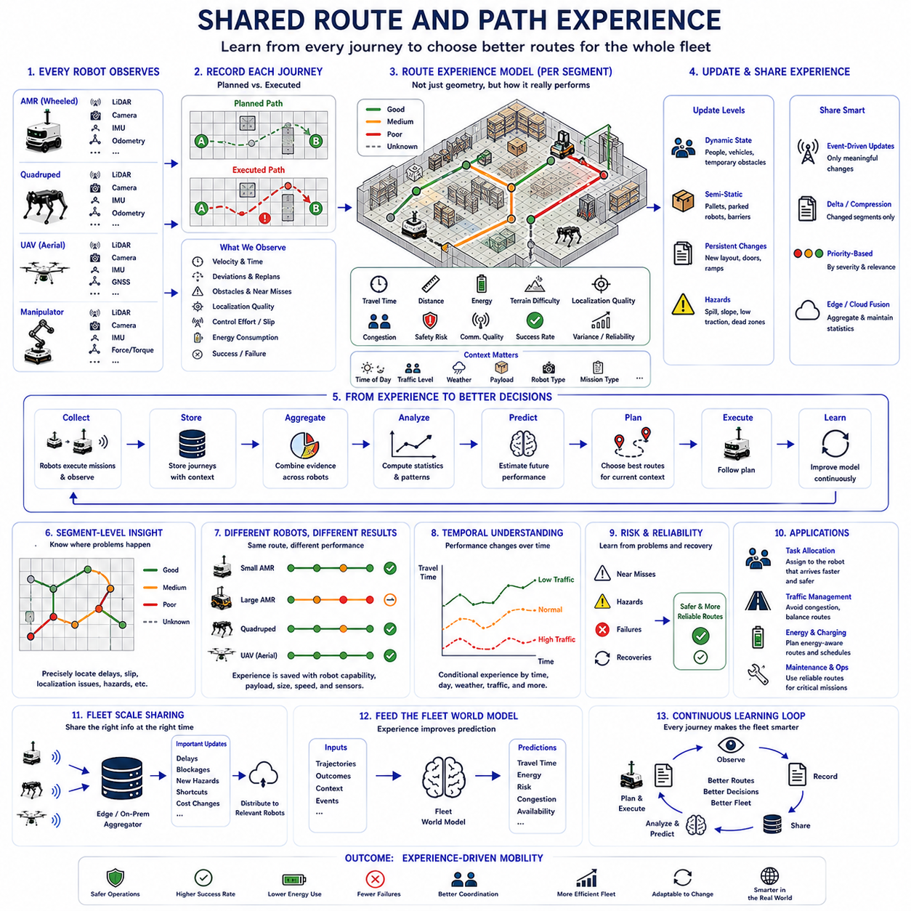{width="7.268055555555556in" height="7.268055555555556in"}

Shared route and path experience allows a robot fleet to preserve knowledge about how movement through the environment actually performs over time. A geometric map may indicate that several routes connect the same locations, but it does not reveal which routes are consistently faster, safer, more energy efficient, easier to localize within, or more reliable under real operating conditions. Experience adds this operational dimension to navigation.

A route represents more than a sequence of coordinates. It can be understood as a spatial transition associated with travel time, distance, terrain difficulty, energy consumption, localization quality, congestion, safety risk, communication quality, and probability of successful completion. By recording these properties after repeated missions, the fleet can gradually transform ordinary map connectivity into experience-enriched mobility knowledge.

Individual robots naturally accumulate route experience while executing missions. Their navigation systems observe commanded paths, actual trajectories, velocity, delays, replanning events, obstacle encounters, control effort, localization performance, and final outcomes. If these observations remain only in local memory, other robots must independently rediscover the same characteristics. Sharing them allows one robot\'s journey to improve later navigation decisions across the fleet.

The distinction between planned path and executed path is especially informative. A planner may generate an apparently optimal trajectory, but the robot can deviate because of dynamic obstacles, poor traction, localization uncertainty, traffic, or controller limitations. Comparing the intended path with the actual trajectory reveals where environmental assumptions were inaccurate and identifies route segments that repeatedly require correction, slowdown, or replanning.

Travel time is one of the simplest forms of route experience, but even this quantity should not be treated as constant. A corridor may be fast during low traffic and slow during busy periods, while elevators, intersections, loading zones, or shared passages can introduce variable delays. Historical observations can therefore be associated with time, traffic conditions, task type, and other context to produce more realistic estimates of future traversal duration.

Energy experience adds another important dimension. Two routes of similar distance may require very different amounts of energy because of slope, surface resistance, acceleration patterns, payload, repeated stopping, or terrain roughness. Recording actual energy consumption allows the fleet to estimate route cost in terms of battery demand rather than distance alone, which becomes especially important when robots must coordinate missions with charging schedules.

Localization quality can also become part of route memory. Certain corridors, open spaces, repetitive structures, reflective surfaces, vegetation, or degraded GNSS regions may repeatedly produce localization uncertainty. A route that is geometrically short may therefore be operationally undesirable if robots frequently lose localization confidence. Shared experience allows planners to prefer routes with stronger localization reliability when mission precision or safety requires it.

Route safety can be learned from obstacles, hazards, near misses, and recovery events encountered during navigation. Repeated emergency braking at an intersection, frequent human traffic in a corridor, wheel slip on a slope, or communication loss in a remote region can become associated with particular path segments. Future robots can then evaluate not only whether a route is physically available but also how much operational risk it historically carries.

Experience should normally be associated with route segments rather than only complete journeys. A long mission may contain both highly reliable sections and a small problematic region. Segment-level records allow the fleet to identify where delay, energy consumption, slip, localization degradation, or hazards actually occur. These localized observations can then update spatial maps, traversability representations, risk memory, and route graphs more precisely.

Robot embodiment must remain part of the interpretation. A route that performs well for a small AMR may be inefficient or inaccessible for a larger vehicle, while a quadruped may exploit terrain unavailable to wheeled robots. Payload, dimensions, turning radius, locomotion mechanism, speed capability, and sensing configuration can all influence route performance. Shared experience should therefore retain the robot context associated with each traversal.

Environmental context is equally important because route quality changes over time. Rain can alter traction, temporary construction can create detours, vegetation can reduce visibility, and warehouse activity can create recurring congestion. Instead of assigning one permanent cost to every path, the fleet can maintain conditional route experience describing how performance changes with time, weather, traffic, operational state, and other relevant environmental factors.

Repeated traversals allow route knowledge to become statistical rather than anecdotal. Mean travel time, variance, energy distribution, failure frequency, localization reliability, hazard occurrence, and recovery frequency can be estimated from accumulated experience. A route with slightly longer average travel time but very low variance may be preferable for a time-critical mission because its performance is more predictable than a nominally faster but unreliable alternative.

Recent observations should be balanced against historical experience. A single temporary blockage should not necessarily erase years of successful route usage, but it may require immediate avoidance. Conversely, old performance records should not dominate when the environment has permanently changed. Timestamping, confidence weighting, temporal decay, and change detection allow route memory to combine long-term patterns with current operational conditions.

Shared route experience also enables prediction of congestion caused by the fleet itself. If several robots are expected to use the same narrow corridor, independently optimal paths may create collectively poor performance. Historical traffic patterns combined with current robot intentions can help predict waiting time and interference. Fleet planning can then distribute traffic across alternative paths before congestion develops.

This capability connects route memory directly with task allocation. The nearest robot is not always the robot that can complete a task fastest or most reliably. Historical route performance can estimate expected travel time, energy demand, terrain risk, congestion, and accessibility for each candidate robot. Task assignment can therefore consider experienced mobility cost rather than relying only on Euclidean distance or current position.

Recovery experience can also be attached to routes. When navigation fails because of blockage, localization loss, traction problems, or traffic conflicts, the successful response can be remembered together with the event. Alternative passages, safe turnaround locations, reduced-speed strategies, localization recovery points, or assistance procedures become reusable knowledge that improves resilience when similar route problems occur again.

At fleet scale, communication should focus on meaningful route information rather than transmitting complete trajectories continuously. Significant delays, newly blocked segments, unusual energy consumption, localization failures, successful shortcuts, hazards, or major changes in traversal cost can be shared as updates. Edge or on-premise infrastructure can aggregate these observations and maintain route statistics for distribution to relevant robots.

Shared route and path experience also provides training evidence for a fleet world model. Historical trajectories reveal how robot actions, environmental conditions, traffic, and route choices produce future travel outcomes. Predictive models can use this experience to estimate travel time, congestion, energy demand, risk, and route availability before execution, allowing the fleet to compare alternative collective movement strategies internally.

Ultimately, shared route and path experience transforms navigation from repeated independent path planning into collective mobility learning. Each journey becomes evidence about how the environment actually behaves when robots move through it. By preserving and sharing this evidence, the fleet progressively learns which routes work best, for which robots, under which conditions, and with what expected cost, enabling safer, more efficient, and more coordinated Physical AI operation.

공유 경로 및 이동 경로 경험(shared route and path experience)은 로봇 플릿(robot fleet)이 환경을 실제로 이동할 때 경로의 성능이 시간에 따라 어떻게 나타나는지에 대한 지식을 보존할 수 있도록 한다. 기하 지도(geometric map)는 동일한 위치를 연결하는 여러 경로가 존재한다는 사실을 보여줄 수 있지만, 어떤 경로가 지속적으로 더 빠르고, 안전하며, 에너지 효율적이고, 위치 추정이 용이하며, 실제 운용 조건에서 신뢰성이 높은지는 알려주지 않는다. 경험(experience)은 이러한 운용적 차원을 주행에 추가한다.

경로(route)는 단순한 좌표의 연속 이상의 의미를 가진다. 경로는 이동 시간, 거리, 지형 난이도(terrain difficulty), 에너지 소비, 위치 추정 품질(localization quality), 혼잡, 안전 위험, 통신 품질 및 성공적인 완료 확률과 연결된 공간적 전이(spatial transition)로 이해할 수 있다. 반복적인 임무 수행 후 이러한 특성을 기록함으로써 플릿은 일반적인 지도 연결성(map connectivity)을 경험이 강화된 이동 지식(experience-enriched mobility knowledge)으로 점진적으로 전환할 수 있다.

개별 로봇은 임무를 수행하면서 자연스럽게 경로 경험(route experience)을 축적한다. 주행 시스템은 명령된 경로, 실제 이동 궤적(actual trajectory), 속도, 지연, 재계획 사건(replanning event), 장애물 조우, 제어 노력(control effort), 위치 추정 성능 및 최종 결과를 관찰한다. 이러한 관찰이 로컬 메모리(local memory)에만 남아 있다면 다른 로봇은 동일한 특성을 독립적으로 다시 발견해야 한다. 이를 공유하면 한 로봇의 이동 경험이 플릿 전체의 이후 주행 의사결정을 개선할 수 있다.

계획된 경로(planned path)와 실제 실행된 경로(executed path)의 차이는 특히 중요한 정보를 제공한다. 계획 시스템은 겉보기에 최적인 궤적을 생성할 수 있지만, 로봇은 동적 장애물, 낮은 접지력, 위치 추정 불확실성, 교통 상황 또는 제어기의 한계 때문에 계획된 경로에서 벗어날 수 있다. 의도된 경로와 실제 궤적을 비교하면 환경에 대한 가정이 부정확했던 지점을 발견하고 반복적으로 보정, 감속 또는 재계획이 필요한 경로 구간을 식별할 수 있다.

이동 시간(travel time)은 가장 단순한 형태의 경로 경험 중 하나이지만, 이 값조차 일정한 것으로 취급해서는 안 된다. 특정 통로는 교통량이 적을 때 빠르게 통과할 수 있지만 혼잡 시간에는 느려질 수 있으며, 엘리베이터, 교차로, 적재 구역 또는 공유 통로에서 가변적인 지연이 발생할 수 있다. 따라서 과거 관찰을 시간, 교통 상태, 작업 유형 및 기타 맥락과 연결하면 향후 통과 시간에 대한 더욱 현실적인 추정이 가능하다.

에너지 경험(energy experience)은 또 다른 중요한 차원을 추가한다. 비슷한 거리의 두 경로라도 경사, 표면 저항, 가속 패턴, 적재량(payload), 반복적인 정지 또는 지형 거칠기로 인해 필요한 에너지가 크게 달라질 수 있다. 실제 에너지 소비를 기록하면 플릿은 거리만이 아니라 배터리 요구량(battery demand)을 기준으로 경로 비용을 추정할 수 있으며, 이는 로봇 임무와 충전 일정을 함께 조정해야 할 때 특히 중요하다.

위치 추정 품질(localization quality) 역시 경로 메모리(route memory)의 일부가 될 수 있다. 특정 통로, 개방 공간, 반복적인 구조물, 반사 표면, 식생 또는 위성항법시스템(GNSS)이 불안정한 영역에서는 위치 추정 불확실성이 반복적으로 발생할 수 있다. 따라서 기하학적으로 짧은 경로라도 로봇이 위치 추정 신뢰도를 자주 잃는다면 운용상 바람직하지 않을 수 있다. 공유 경험을 활용하면 임무의 정밀도나 안전성이 중요한 경우 위치 추정 신뢰성이 높은 경로를 우선적으로 선택할 수 있다.

경로 안전성(route safety)은 주행 과정에서 경험한 장애물, 위험 요소, 아차 사고(near miss) 및 복구 사건(recovery event)을 통해 학습할 수 있다. 특정 교차로에서 반복되는 비상 제동, 통로의 빈번한 사람 이동, 경사면에서의 바퀴 미끄러짐 또는 원격 지역에서의 통신 단절 등을 특정 경로 구간과 연결할 수 있다. 이후 로봇은 경로가 물리적으로 사용 가능한지만 판단하는 것이 아니라 해당 경로가 과거에 어느 정도의 운용 위험을 가지고 있었는지도 평가할 수 있다.

경험은 일반적으로 전체 이동 여정이 아니라 경로 구간(route segment)과 연결되어야 한다. 긴 임무에는 매우 신뢰성이 높은 구간과 작은 문제 영역이 동시에 포함될 수 있다. 구간 수준의 기록을 사용하면 플릿은 지연, 에너지 소비, 미끄러짐, 위치 추정 성능 저하 또는 위험 요소가 실제로 어디에서 발생했는지를 식별할 수 있다. 이러한 지역화된 관찰은 공간 지도, 주행 가능성 표현(traversability representation), 위험 메모리(risk memory) 및 경로 그래프(route graph)를 보다 정밀하게 갱신하는 데 활용할 수 있다.

로봇 형태(embodiment)는 경로 경험을 해석할 때 반드시 고려되어야 한다. 소형 자율이동로봇(AMR)에 적합한 경로가 대형 차량에는 비효율적이거나 접근 불가능할 수 있으며, 사족보행 로봇(quadruped)은 바퀴형 로봇이 사용할 수 없는 지형을 활용할 수도 있다. 적재량, 크기, 회전 반경, 이동 메커니즘(locomotion mechanism), 속도 능력 및 센싱 구성은 모두 경로 성능에 영향을 미칠 수 있다. 따라서 공유 경험에는 각 이동 기록과 연결된 로봇 맥락(robot context)이 유지되어야 한다.

환경 맥락(environmental context) 역시 경로 품질이 시간에 따라 변화하기 때문에 중요하다. 비는 접지력을 변화시키고, 임시 공사는 우회로를 발생시키며, 식생은 가시성을 낮추고, 창고 활동은 반복적인 혼잡을 만들 수 있다. 모든 경로에 하나의 영구적인 비용을 부여하는 대신 플릿은 시간, 날씨, 교통량, 운용 상태 및 기타 관련 환경 요소에 따라 성능이 어떻게 변화하는지를 설명하는 조건부 경로 경험(conditional route experience)을 유지할 수 있다.

반복적인 주행을 통해 경로 지식은 개별 사례 중심의 정보에서 통계적 지식(statistical knowledge)으로 발전할 수 있다. 평균 이동 시간, 분산(variance), 에너지 분포, 실패 빈도, 위치 추정 신뢰성, 위험 발생 빈도 및 복구 빈도를 축적된 경험으로부터 추정할 수 있다. 평균 이동 시간이 조금 더 길더라도 변동성이 매우 낮은 경로는 성능 예측이 어려운 명목상 더 빠른 경로보다 시간 제약이 중요한 임무에서 더 적합할 수 있다.

최근 관찰(recent observation)은 과거 경험과 균형 있게 활용되어야 한다. 일시적인 단일 경로 차단이 수년간 축적된 성공적인 경로 사용 경험을 반드시 삭제해야 하는 것은 아니지만, 현재 시점에서는 즉각적인 회피가 필요할 수 있다. 반대로 환경이 영구적으로 변화했다면 오래된 성능 기록이 계속해서 지배적인 영향을 미쳐서는 안 된다. 타임스탬프(timestamp), 신뢰도 가중치(confidence weighting), 시간적 감쇠(temporal decay), 변화 감지(change detection)를 이용하면 장기 패턴과 현재 운용 조건을 함께 반영할 수 있다.

공유 경로 경험(shared route experience)은 플릿 자체가 만들어내는 혼잡을 예측하는 것도 가능하게 한다. 여러 로봇이 동일한 좁은 통로를 사용할 예정이라면 각 로봇에게 개별적으로 최적인 경로가 플릿 전체에는 좋지 않은 결과를 만들 수 있다. 과거 교통 패턴과 현재 로봇의 이동 의도(robot intention)를 결합하면 대기 시간과 상호 간섭을 예측할 수 있다. 플릿 계획은 혼잡이 실제로 발생하기 전에 교통을 대체 경로로 분산할 수 있다.

이러한 능력은 경로 메모리를 작업 할당(task allocation)과 직접 연결한다. 현재 위치에서 가장 가까운 로봇이 항상 작업을 가장 빠르고 신뢰성 있게 완료할 수 있는 로봇은 아니다. 과거 경로 성능을 이용하면 각각의 후보 로봇에 대해 예상 이동 시간, 에너지 요구량, 지형 위험, 혼잡 및 접근 가능성을 추정할 수 있다. 따라서 작업 할당은 단순한 유클리드 거리(Euclidean distance)나 현재 위치뿐만 아니라 실제 경험에 기반한 이동 비용(experienced mobility cost)을 고려할 수 있다.

복구 경험(recovery experience) 역시 경로와 연결할 수 있다. 장애물, 위치 추정 손실, 접지 문제 또는 교통 충돌로 인해 주행에 실패했을 때 성공적인 대응 방법을 해당 사건과 함께 기억할 수 있다. 대체 통로, 안전한 회차 위치, 감속 전략, 위치 추정 복구 지점(localization recovery point), 지원 절차 등은 유사한 경로 문제가 다시 발생했을 때 활용할 수 있는 재사용 가능한 지식이 되어 시스템의 복원력(resilience)을 향상시킨다.

플릿 규모에서는 완전한 이동 궤적을 지속적으로 전송하기보다 의미 있는 경로 정보에 통신을 집중해야 한다. 중요한 지연, 새롭게 차단된 구간, 비정상적인 에너지 소비, 위치 추정 실패, 성공적인 지름길, 위험 요소 또는 주행 비용의 큰 변화 등을 업데이트로 공유할 수 있다. 엣지(edge) 또는 온프레미스 인프라(on-premise infrastructure)는 이러한 관찰을 통합하고 관련 로봇에게 배포하기 위한 경로 통계(route statistics)를 유지할 수 있다.

공유 경로 및 이동 경로 경험은 플릿 월드 모델(fleet world model)을 위한 학습 증거(training evidence)도 제공한다. 과거 이동 궤적은 로봇 행동, 환경 조건, 교통 상황 및 경로 선택이 미래의 이동 결과를 어떻게 만들어내는지를 보여준다. 예측 모델은 이러한 경험을 이용하여 실행 전에 이동 시간, 혼잡, 에너지 요구량, 위험 및 경로 가용성을 추정할 수 있으며, 이를 통해 플릿은 여러 집단 이동 전략(collective movement strategy)을 내부적으로 비교할 수 있다.

궁극적으로 공유 경로 및 이동 경로 경험(shared route and path experience)은 주행을 반복적인 개별 경로 계획(independent path planning)에서 집단 이동 학습(collective mobility learning)으로 전환한다. 각각의 이동은 로봇이 실제 환경을 통과할 때 환경이 어떻게 작동하는지에 대한 새로운 증거가 된다. 이러한 증거를 보존하고 공유함으로써 플릿은 어떤 경로가 어떤 로봇에게, 어떤 조건에서, 어느 정도의 예상 비용으로 가장 적합한지를 점진적으로 학습하며, 더욱 안전하고 효율적이며 협력적인 물리 AI(Physical AI) 운용을 가능하게 한다.

##  

## 06.11. Success Failure and Recovery Memory

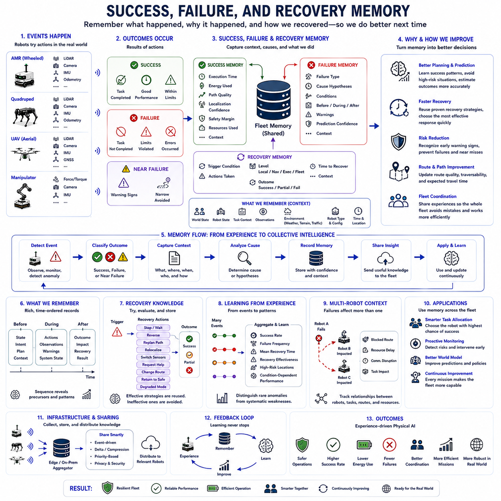{width="7.268055555555556in" height="7.268055555555556in"}

Success, failure, and recovery memory captures what happened when robots attempted actions, why outcomes differed from expectations, and how operation was restored afterward. In a fleet, this memory prevents valuable experience from disappearing when a mission ends. Each execution becomes evidence that can improve future planning, prediction, coordination, and decision making across robots rather than benefiting only the robot that experienced the event.

Success should represent more than task completion. A robot may technically complete a mission while consuming excessive energy, requiring repeated replanning, approaching safety limits, or arriving much later than expected. Useful success memory therefore preserves performance quality together with completion status, including execution time, energy consumption, trajectory quality, localization confidence, control stability, safety margin, and resource usage.

Successful experiences provide positive evidence about which combinations of state, action, robot capability, and environment work reliably. Repeated success on a route can strengthen confidence in its traversability, while repeated successful docking can validate a localization and control strategy. When stored with sufficient context, these experiences become reusable operational knowledge rather than isolated records of completed missions.

Failure memory captures cases in which the expected objective was not achieved or acceptable operational limits were violated. Failures can include collision, immobilization, localization loss, excessive slip, communication interruption, manipulation failure, resource conflict, navigation timeout, energy shortage, or task abandonment. Recording the failure category helps the fleet distinguish fundamentally different causes that may require different future responses.

A useful failure record should preserve conditions before, during, and after the event. The fleet may store relevant world state, robot state, task context, recent observations, planned actions, executed actions, warnings, prediction confidence, environmental conditions, and measured responses. This temporal context helps determine whether failure emerged gradually, occurred suddenly, or resulted from an interaction among several factors.

Near failures are also important because they reveal weaknesses before complete failure occurs. Emergency braking, excessive wheel slip, unstable motion, repeated path correction, declining localization confidence, unusually high motor current, or a narrowly avoided collision may indicate that the system approached an operational boundary. Remembering these events enables preventive learning without waiting for severe incidents to provide supervision.

Failure memory becomes more useful when it preserves causal hypotheses rather than only error codes. A navigation failure might result from an obstacle, poor localization, unsuitable terrain, excessive payload, communication delay, or interaction with another robot. The system may not always know the true cause immediately, so multiple hypotheses and confidence levels can be retained until later observations provide stronger evidence.

Recovery memory records what the robot or fleet attempted after abnormal conditions were detected. Recovery actions can include stopping, reversing, replanning, reducing speed, relocalizing, clearing a local map, switching sensors, requesting assistance, transferring a task, changing routes, returning to a safe location, or entering a degraded operating mode. The outcome of each recovery attempt should be stored together with the triggering condition.

Recovery success is highly contextual. A maneuver that successfully resolves wheel slip on one robot may not work for another platform, and a localization recovery strategy effective indoors may fail outdoors. Robot embodiment, payload, sensor configuration, software state, terrain, environmental conditions, and mission constraints should therefore accompany recovery records so that future systems can determine whether an earlier solution is applicable.

Failed recovery attempts are also valuable and should not be discarded. If repeated relocalization fails in a particular region, or reversing makes an immobilization problem worse, this information can prevent future robots from wasting time on ineffective strategies. Memory can preserve sequences of attempted recoveries and their consequences, allowing the fleet to learn which responses should be preferred, avoided, or escalated.

Recovery can occur at several levels of the system. A local controller may compensate for temporary slip, a navigation system may generate a new path, a robot executive may restart a task, and a fleet manager may reassign the mission to another robot. Recording these hierarchical responses allows the fleet to understand not only individual recovery behaviors but also how local problems can be resolved through collective coordination.

Multi-robot failures require relational memory because one robot\'s problem can affect others. A disabled robot may block a corridor, a delayed robot may hold a shared resource, or communication failure may disrupt coordinated movement. The memory should therefore record affected robots, tasks, routes, and resources. This enables future reasoning about how local failures propagate through the operational network and how fleet-level recovery can limit disruption.

Time and sequence are essential to understanding these events. A failure is often the result of a chain rather than one isolated cause: localization confidence decreases, path tracking deteriorates, corrective control increases, energy consumption rises, and eventually the robot stops. Preserving event sequences allows learning systems to identify precursors and potentially predict failure early enough for preventive intervention.

Success and failure memory should connect directly with shared world memory. A failed traversal can update terrain difficulty, a collision or near miss can modify risk memory, a successful detour can improve route experience, and repeated localization problems can become a spatially anchored warning. Operational outcomes therefore refine multiple layers of fleet knowledge rather than remaining separated in a diagnostic database.

Statistical aggregation transforms individual incidents into fleet-level patterns. The system can estimate success probability, failure frequency, mean recovery time, recovery effectiveness, repeated failure locations, and condition-dependent performance. With sufficient experience, the fleet can distinguish rare anomalies from systematic weaknesses and identify combinations of environment, robot state, and task conditions associated with elevated failure probability.

Historical experience can also support case-based reasoning. When a robot encounters an abnormal condition, the system can search memory for similar situations and retrieve previous actions and outcomes. Similarity may consider location, terrain, robot type, sensor state, task, failure symptoms, or environmental conditions. Previous experience then becomes evidence for selecting a recovery strategy instead of starting from an entirely new diagnosis.

Predictive world models can use these memories as learning signals. Successful transitions demonstrate state-action sequences that produced acceptable future states, while failures reveal predictions or decisions that led toward undesirable outcomes. Recovery episodes show how the system returned from abnormal states toward viable operation. Together, these experiences provide structured evidence for learning future-state prediction and risk-aware decision policies.

Shared recovery knowledge can progressively improve fleet resilience. When one robot discovers an effective response to a previously unknown problem, that experience can be distributed to other relevant robots through edge or on-premise infrastructure. Later robots can recognize similar conditions earlier and apply proven responses more quickly, converting isolated problem solving into reusable collective operational competence.

Ultimately, success, failure, and recovery memory transforms robot operation into a continuous learning process. The fleet remembers what worked, what failed, what warning signs preceded failure, what recovery actions were attempted, and which responses restored operation. By linking outcomes with context and sharing them across robots, the fleet can reduce repeated mistakes, improve prediction, accelerate recovery, and develop increasingly resilient collective Physical AI.

성공, 실패 및 복구 메모리(success, failure, and recovery memory)는 로봇이 행동을 시도했을 때 어떤 일이 발생했는지, 결과가 예상과 달랐던 이유는 무엇인지, 그리고 이후 어떻게 운용이 복구되었는지를 기록한다. 플릿(fleet)에서 이러한 메모리는 임무가 종료될 때 가치 있는 경험이 사라지는 것을 방지한다. 각각의 실행은 해당 사건을 경험한 로봇에게만 도움이 되는 것이 아니라 로봇 전체의 향후 계획, 예측, 협업 및 의사결정을 개선하는 증거가 된다.

성공(success)은 단순한 작업 완료 이상의 의미를 가져야 한다. 로봇이 기술적으로 임무를 완료했더라도 과도한 에너지를 소비하거나, 반복적인 재계획(replanning)이 필요하거나, 안전 한계에 근접하거나, 예상보다 훨씬 늦게 도착할 수 있다. 따라서 유용한 성공 메모리는 완료 상태와 함께 실행 시간, 에너지 소비, 궤적 품질(trajectory quality), 위치 추정 신뢰도(localization confidence), 제어 안정성(control stability), 안전 여유(safety margin), 자원 사용량 등 성능의 품질도 함께 보존해야 한다.

성공적인 경험은 어떤 상태(state), 행동(action), 로봇 능력(robot capability), 환경의 조합이 신뢰성 있게 작동하는지에 대한 긍정적인 증거(positive evidence)를 제공한다. 특정 경로에서 반복적으로 성공하면 해당 경로의 주행 가능성(traversability)에 대한 신뢰도를 높일 수 있으며, 반복적인 도킹 성공은 위치 추정 및 제어 전략을 검증할 수 있다. 충분한 맥락과 함께 저장하면 이러한 경험은 단순한 임무 완료 기록이 아니라 재사용 가능한 운용 지식(reusable operational knowledge)이 된다.

실패 메모리(failure memory)는 예상한 목표를 달성하지 못했거나 허용 가능한 운용 한계를 위반한 사례를 기록한다. 실패에는 충돌, 이동 불능(immobilization), 위치 추정 손실(localization loss), 과도한 미끄러짐, 통신 중단, 조작 실패(manipulation failure), 자원 충돌(resource conflict), 주행 시간 초과, 에너지 부족 또는 작업 포기 등이 포함될 수 있다. 실패 범주를 기록하면 플릿은 향후 서로 다른 대응이 필요한 근본적으로 다른 원인을 구분할 수 있다.

유용한 실패 기록은 사건 발생 전, 발생 중, 발생 후의 조건을 보존해야 한다. 플릿은 관련 월드 상태(world state), 로봇 상태(robot state), 작업 맥락(task context), 최근 관찰, 계획된 행동, 실제 실행 행동, 경고, 예측 신뢰도, 환경 조건 및 측정된 반응을 저장할 수 있다. 이러한 시간적 맥락(temporal context)은 실패가 점진적으로 발생했는지, 갑작스럽게 발생했는지 또는 여러 요인의 상호작용으로 발생했는지를 판단하는 데 도움을 준다.

실패 직전 상황(near failure) 역시 완전한 실패가 발생하기 전에 시스템의 취약점을 보여주기 때문에 중요하다. 비상 제동(emergency braking), 과도한 바퀴 미끄러짐, 불안정한 움직임, 반복적인 경로 보정, 위치 추정 신뢰도의 감소, 비정상적으로 높은 모터 전류 또는 간신히 피한 충돌은 시스템이 운용 한계에 접근했음을 나타낼 수 있다. 이러한 사건을 기억하면 심각한 사고가 발생하여 학습 정보를 제공할 때까지 기다리지 않고 예방적 학습(preventive learning)을 수행할 수 있다.

실패 메모리는 단순한 오류 코드(error code)만 저장하는 것이 아니라 인과 가설(causal hypothesis)을 보존할 때 더욱 유용해진다. 주행 실패는 장애물, 낮은 위치 추정 성능, 부적절한 지형, 과도한 적재량(payload), 통신 지연 또는 다른 로봇과의 상호작용 때문에 발생할 수 있다. 시스템이 실제 원인을 즉시 알 수 없는 경우도 있으므로 이후 관찰을 통해 더 강력한 증거가 확보될 때까지 여러 가설과 각각의 신뢰도 수준을 유지할 수 있다.

복구 메모리(recovery memory)는 비정상적인 조건이 감지된 이후 로봇 또는 플릿이 시도한 행동을 기록한다. 복구 행동에는 정지, 후진, 재계획, 속도 감소, 재위치 추정(relocalization), 로컬 지도 초기화, 센서 전환, 지원 요청, 작업 이전, 경로 변경, 안전 위치로 복귀 또는 성능 저하 운용 모드(degraded operating mode)로의 전환 등이 포함될 수 있다. 각각의 복구 시도 결과는 해당 행동을 유발한 조건과 함께 저장해야 한다.

복구 성공(recovery success)은 맥락에 크게 의존한다. 한 로봇에서 바퀴 미끄러짐을 성공적으로 해결한 동작이 다른 플랫폼에서는 작동하지 않을 수 있으며, 실내에서 효과적인 위치 추정 복구 전략이 실외에서는 실패할 수도 있다. 따라서 로봇 형태(embodiment), 적재량, 센서 구성, 소프트웨어 상태, 지형, 환경 조건 및 임무 제약을 복구 기록과 함께 저장하여 향후 시스템이 이전 해결책의 적용 가능성을 판단할 수 있도록 해야 한다.

실패한 복구 시도(failed recovery attempt) 역시 가치가 있으므로 폐기해서는 안 된다. 특정 영역에서 반복적인 재위치 추정이 실패하거나 후진 동작이 이동 불능 문제를 더욱 악화시킨다면, 이러한 정보는 이후 로봇이 효과가 없는 전략에 시간을 낭비하는 것을 방지할 수 있다. 메모리는 시도된 복구 행동의 순서와 그 결과를 보존하여 플릿이 어떤 대응을 우선하고, 피하거나, 상위 수준으로 에스컬레이션(escalation)해야 하는지를 학습할 수 있도록 한다.

복구(recovery)는 시스템의 여러 계층에서 발생할 수 있다. 로컬 제어기(local controller)는 일시적인 미끄러짐을 보상하고, 주행 시스템은 새로운 경로를 생성하며, 로봇 실행 관리자(robot executive)는 작업을 재시작하고, 플릿 관리자(fleet manager)는 임무를 다른 로봇에 재할당할 수 있다. 이러한 계층적 대응(hierarchical response)을 기록하면 플릿은 개별적인 복구 행동뿐만 아니라 로컬 문제를 집단적 협업을 통해 어떻게 해결할 수 있는지도 이해할 수 있다.

다중 로봇 실패(multi-robot failure)는 하나의 로봇 문제가 다른 로봇에게 영향을 미칠 수 있으므로 관계형 메모리(relational memory)를 필요로 한다. 고장 난 로봇이 통로를 차단하거나, 지연된 로봇이 공유 자원을 계속 점유하거나, 통신 장애가 협력 이동을 방해할 수 있다. 따라서 메모리는 영향을 받은 로봇, 작업, 경로 및 자원을 기록해야 한다. 이를 통해 향후 로컬 실패가 운용 네트워크 전체로 어떻게 전파되는지와 플릿 수준 복구가 이러한 영향을 어떻게 제한할 수 있는지를 추론할 수 있다.

이러한 사건을 이해하려면 시간과 순서(time and sequence)가 필수적이다. 실패는 하나의 독립된 원인이 아니라 연속적인 사건의 결과인 경우가 많다. 예를 들어 위치 추정 신뢰도가 감소하고, 경로 추종 성능(path tracking)이 저하되고, 보정 제어가 증가하며, 에너지 소비가 상승한 후 최종적으로 로봇이 정지할 수 있다. 사건의 순서를 보존하면 학습 시스템은 실패의 전조(precursor)를 식별하고 예방적 개입(preventive intervention)이 가능할 정도로 조기에 실패를 예측할 수 있다.

성공 및 실패 메모리는 공유 월드 메모리(shared world memory)와 직접 연결되어야 한다. 주행 실패는 지형 난이도(terrain difficulty)를 갱신할 수 있고, 충돌이나 아차 사고(near miss)는 위험 메모리(risk memory)를 수정할 수 있으며, 성공적인 우회는 경로 경험(route experience)을 개선할 수 있다. 또한 반복적인 위치 추정 문제는 특정 공간에 연결된 경고가 될 수 있다. 따라서 운용 결과는 진단 데이터베이스에 분리되어 남는 것이 아니라 플릿 지식의 여러 계층을 개선한다.

통계적 통합(statistical aggregation)은 개별 사건을 플릿 수준 패턴(fleet-level pattern)으로 변환한다. 시스템은 성공 확률, 실패 빈도, 평균 복구 시간(mean recovery time), 복구 효과, 반복적인 실패 위치 및 조건별 성능을 추정할 수 있다. 충분한 경험이 축적되면 플릿은 드물게 발생하는 이상 현상과 구조적인 취약점을 구분하고, 환경, 로봇 상태 및 작업 조건의 어떤 조합이 높은 실패 확률과 관련되는지를 식별할 수 있다.

과거 경험은 사례 기반 추론(case-based reasoning)도 지원할 수 있다. 로봇이 비정상적인 조건에 직면하면 시스템은 메모리에서 유사한 상황을 검색하고 이전에 수행했던 행동과 그 결과를 불러올 수 있다. 유사성은 위치, 지형, 로봇 유형, 센서 상태, 작업, 실패 증상 또는 환경 조건을 고려하여 판단할 수 있다. 이를 통해 이전 경험은 완전히 새로운 진단을 처음부터 수행하는 대신 복구 전략을 선택하기 위한 증거로 활용될 수 있다.

예측 월드 모델(predictive world model)은 이러한 메모리를 학습 신호(learning signal)로 활용할 수 있다. 성공적인 상태 전이(state transition)는 허용 가능한 미래 상태를 만들어낸 상태-행동 순서를 보여주고, 실패는 바람직하지 않은 결과로 이어진 예측이나 의사결정을 드러낸다. 복구 사례는 시스템이 비정상 상태에서 정상적인 운용 가능 상태로 어떻게 복귀했는지를 보여준다. 이러한 경험은 미래 상태 예측과 위험 인지형 의사결정 정책(risk-aware decision policy)을 학습하기 위한 구조화된 증거를 제공한다.

공유 복구 지식(shared recovery knowledge)은 플릿 복원력(fleet resilience)을 점진적으로 향상시킬 수 있다. 한 로봇이 이전에 알려지지 않았던 문제에 대해 효과적인 대응 방법을 발견하면 해당 경험을 엣지(edge) 또는 온프레미스 인프라(on-premise infrastructure)를 통해 관련된 다른 로봇에게 배포할 수 있다. 이후의 로봇은 유사한 조건을 더 빠르게 인식하고 검증된 대응을 신속하게 적용함으로써 개별적인 문제 해결 경험을 재사용 가능한 집단 운용 역량(collective operational competence)으로 전환할 수 있다.

궁극적으로 성공, 실패 및 복구 메모리(success, failure, and recovery memory)는 로봇 운용을 지속적인 학습 과정(continuous learning process)으로 전환한다. 플릿은 무엇이 성공했는지, 무엇이 실패했는지, 어떤 경고 신호가 실패에 앞서 나타났는지, 어떤 복구 행동이 시도되었는지, 그리고 어떤 대응이 실제 운용을 복원했는지를 기억한다. 이러한 결과를 맥락과 연결하고 로봇 전체에 공유함으로써 플릿은 반복적인 실수를 줄이고, 예측 능력을 향상시키며, 복구를 가속하고, 점점 더 높은 복원력을 갖춘 집단 물리 AI(collective Physical AI)로 발전할 수 있다.

##  

## 06.12. Uncertainty and Confidence in Shared Knowledge

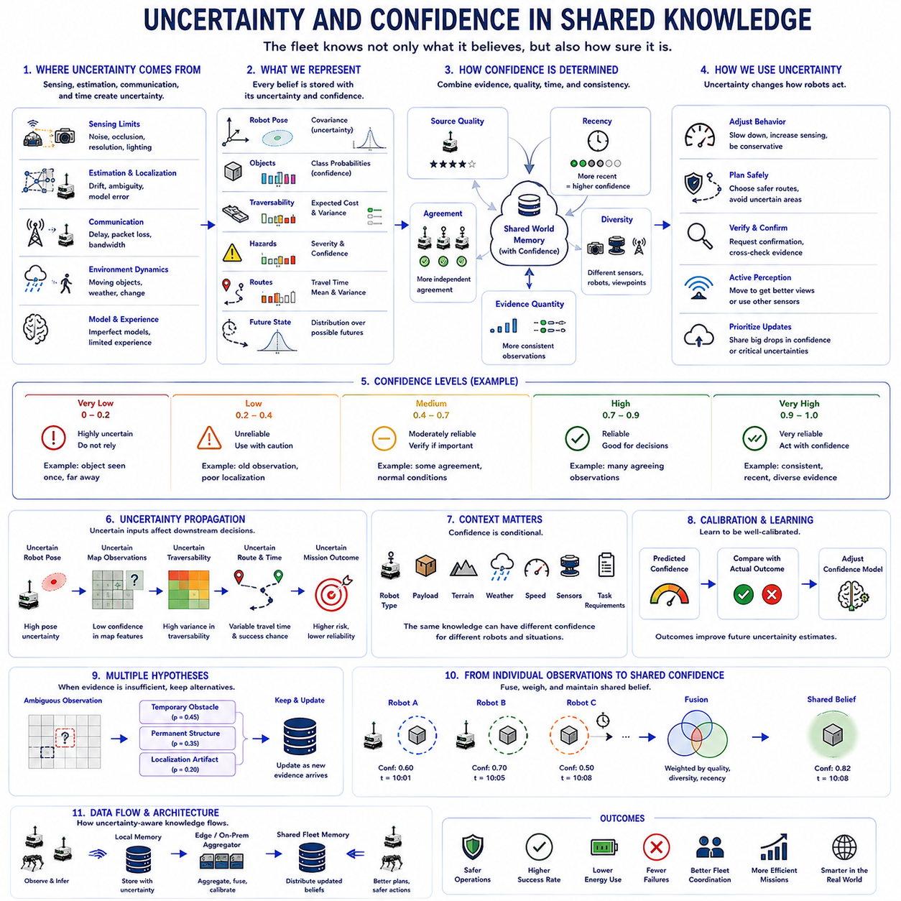{width="7.268055555555556in" height="7.268055555555556in"}

Shared knowledge in a robot fleet is never perfectly certain. Every map feature, object state, traversability estimate, hazard report, route experience, and predicted future condition originates from sensors, models, communication, or previous experience that may contain error. A useful fleet memory must therefore represent not only what the system believes about the world, but also how strongly that belief is supported.

Uncertainty arises because robots observe the world through incomplete and noisy sensing. Objects may be occluded, LiDAR measurements may be sparse, cameras may be affected by illumination, localization may drift, and communication may delay information. A robot can therefore possess a reasonable estimate without knowing the exact state, making uncertainty an inherent component of shared world representation.

Confidence expresses how strongly the system currently trusts a particular piece of knowledge. A detected obstacle supported by several recent observations may have high confidence, while an object observed once at long range may have low confidence. Confidence does not guarantee correctness; rather, it provides a quantitative or categorical indication of how much evidence supports the current belief.

Different types of shared knowledge require different uncertainty representations. Robot pose may use covariance, object classification may use probability distributions, traversability may use expected cost and variance, and route experience may use statistics derived from repeated traversal. Hazards can include severity and confidence separately, ensuring that an uncertain but potentially severe condition is not incorrectly treated as harmless.

Source quality strongly influences confidence. An observation from a well-localized robot with appropriate sensors may deserve greater weight than one produced under degraded sensing conditions. Fleet memory should therefore retain provenance such as source robot, sensor, inference method, timestamp, model version, and observation conditions. Confidence can then reflect not only the reported value but also the reliability of its origin.

Recency is another important factor. A highly confident observation from yesterday may be less useful than a moderately confident observation from seconds ago when describing a dynamic obstacle. Confidence should therefore interact with temporal validity. Stable structural knowledge can retain confidence for long periods, while information about people, vehicles, temporary barriers, or weather-dependent terrain may lose confidence rapidly.

Repeated independent observations can strengthen shared knowledge. If several robots detect the same obstacle at a consistent location, confidence in its existence can increase. Similarly, repeated successful traversal can strengthen confidence that a route is usable under comparable conditions. Agreement across independent sources is especially valuable because it reduces dependence on a single sensor, robot, or isolated experience.

However, repeated observations are not always independent. Multiple robots may use identical sensors, localization infrastructure, map priors, or perception models and therefore reproduce the same systematic error. Simply counting agreeing reports can create artificial confidence. Fleet systems should consider source diversity and correlated uncertainty so that repeated evidence is weighted according to how much genuinely new information it contributes.

Low confidence should not automatically mean that information is ignored. Instead, it can change how the fleet behaves. A robot approaching an uncertain obstacle may reduce speed, increase sensing, request confirmation, select a safer route, or postpone a risky action. Uncertainty therefore becomes an operational signal that controls information gathering, planning conservatism, and the amount of verification required before execution.

High confidence must also be treated carefully because overconfidence can be dangerous. A perception model may repeatedly assign strong confidence to incorrect classifications, or historical route knowledge may remain confident after environmental conditions have changed. Confidence values should therefore be calibrated against actual outcomes so that reported certainty corresponds as closely as possible to observed reliability.

Calibration can be improved through fleet experience. When predictions, classifications, traversability estimates, or risk assessments are later compared with actual outcomes, the system can determine whether confidence was justified. If events assigned 90 percent confidence are correct only 60 percent of the time, the system is overconfident. Such discrepancies provide learning signals for improving future uncertainty estimates.

Shared knowledge may also preserve multiple hypotheses when evidence is insufficient for a single conclusion. An observed region might contain a temporary obstacle, a permanent structure, or a localization artifact. Instead of immediately committing to one interpretation, the fleet can maintain alternative hypotheses with associated probabilities or confidence levels until additional observations resolve the ambiguity.

Uncertainty can propagate through planning and prediction. An uncertain robot pose affects confidence in mapped observations, uncertain terrain properties affect predicted traversability, and uncertain route availability affects estimated mission completion time. Fleet reasoning should therefore avoid treating uncertain inputs as exact facts. Downstream decisions should reflect how uncertainty in shared knowledge influences expected outcomes and operational risk.

Spatial representations can explicitly encode confidence. Cells or regions in shared maps may contain occupancy probability, semantic confidence, traversability uncertainty, hazard confidence, and observation count. Route graphs can similarly associate edges with expected travel cost and variance. This allows planners to distinguish well-known regions from areas that appear usable but remain poorly observed or weakly validated.

Confidence should also remain conditional on robot embodiment and operational context. Strong evidence that a route is traversable for a small AMR does not imply equal confidence for a heavy vehicle or quadruped. Payload, weather, speed, sensor configuration, and mission requirements can change the applicability of previous experience. Shared knowledge should therefore express confidence in context rather than assuming universal validity.

Communication policies can use uncertainty to determine what information deserves transmission. A major reduction in confidence, a newly uncertain route, or a safety-critical observation may be more important than repeatedly communicating stable high-confidence knowledge. Robots can prioritize updates that significantly change uncertainty, while edge or on-premise infrastructure aggregates evidence and redistributes revised confidence estimates.

Uncertainty can also guide active perception. When the fleet identifies an important region with insufficient knowledge, a robot can deliberately gather additional evidence by changing viewpoint, approaching cautiously, revisiting the location, or using another sensing modality. Information gathering then becomes part of intelligent action: robots do not merely react to uncertainty but actively perform actions intended to reduce it.

Fleet world models depend on this uncertainty-aware memory because future states are inherently uncertain. Rather than predicting one guaranteed outcome, a model can represent several possible futures or distributions over trajectories, hazards, resource availability, and route conditions. Confidence in current shared knowledge influences these predictions, while new observations continuously correct both state estimates and future expectations.

Ultimately, uncertainty and confidence transform shared world memory from a collection of asserted facts into an evidence-aware knowledge system. The fleet remembers observations, their sources, their age, their agreement with other evidence, and how reliably similar beliefs predicted reality in the past. This allows robots to know not only what the fleet currently believes, but also when to trust that knowledge, when to verify it, and when to act cautiously.

로봇 플릿(robot fleet)의 공유 지식(shared knowledge)은 결코 완벽하게 확실하지 않다. 모든 지도 특징(map feature), 객체 상태(object state), 주행 가능성 추정(traversability estimate), 위험 요소 보고(hazard report), 경로 경험(route experience), 예측된 미래 조건은 오류를 포함할 수 있는 센서, 모델, 통신 또는 과거 경험에서 비롯된다. 따라서 유용한 플릿 메모리(fleet memory)는 시스템이 세계에 대해 무엇을 믿고 있는지뿐만 아니라 그 믿음이 얼마나 강력한 증거에 의해 뒷받침되는지도 표현해야 한다.

불확실성(uncertainty)은 로봇이 불완전하고 잡음이 포함된 센싱을 통해 세계를 관찰하기 때문에 발생한다. 객체는 가려질 수 있고, 라이다(LiDAR) 측정값은 희소할 수 있으며, 카메라는 조명의 영향을 받을 수 있고, 위치 추정(localization)은 드리프트(drift)할 수 있으며, 통신으로 인해 정보 전달이 지연될 수 있다. 따라서 로봇은 합리적인 추정값을 가지고 있으면서도 정확한 상태를 알지 못할 수 있으며, 이로 인해 불확실성은 공유 월드 표현(shared world representation)의 본질적인 구성요소가 된다.

신뢰도(confidence)는 시스템이 현재 특정 지식을 얼마나 강하게 신뢰하는지를 나타낸다. 최근의 여러 관찰에 의해 뒷받침되는 장애물은 높은 신뢰도를 가질 수 있지만, 먼 거리에서 한 번만 관찰된 객체는 낮은 신뢰도를 가질 수 있다. 신뢰도가 정확성을 보장하는 것은 아니다. 대신 현재의 믿음이 얼마나 많은 증거에 의해 뒷받침되는지를 정량적 또는 범주적으로 나타낸다.

서로 다른 유형의 공유 지식에는 서로 다른 불확실성 표현(uncertainty representation)이 필요하다. 로봇 위치 및 자세(robot pose)는 공분산(covariance)을 사용할 수 있고, 객체 분류는 확률 분포(probability distribution)를 사용할 수 있으며, 주행 가능성은 예상 비용과 분산(variance)을 이용할 수 있다. 경로 경험은 반복적인 주행에서 얻은 통계를 활용할 수 있다. 위험 요소는 심각도(severity)와 신뢰도를 별도로 포함하여 불확실하지만 잠재적으로 심각한 조건이 잘못해서 무해한 것으로 처리되지 않도록 할 수 있다.

정보 출처의 품질(source quality)은 신뢰도에 큰 영향을 미친다. 위치 추정이 정확하고 적절한 센서를 가진 로봇의 관찰은 센싱 성능이 저하된 조건에서 생성된 관찰보다 더 높은 가중치를 받을 수 있다. 따라서 플릿 메모리는 정보 출처(provenance)로서 출처 로봇, 센서, 추론 방법(inference method), 타임스탬프(timestamp), 모델 버전 및 관찰 조건 등을 유지해야 한다. 이를 통해 신뢰도는 보고된 값뿐만 아니라 그 정보가 생성된 출처의 신뢰성까지 반영할 수 있다.

최신성(recency) 역시 중요한 요소이다. 동적 장애물을 설명할 때 어제 생성된 높은 신뢰도의 관찰보다 몇 초 전에 생성된 중간 수준 신뢰도의 관찰이 더 유용할 수 있다. 따라서 신뢰도는 시간적 유효성(temporal validity)과 함께 고려되어야 한다. 안정적인 구조적 지식은 오랜 기간 신뢰도를 유지할 수 있지만, 사람, 차량, 임시 장벽 또는 날씨에 영향을 받는 지형 정보는 신뢰도가 빠르게 감소할 수 있다.

반복적인 독립 관찰(independent observation)은 공유 지식을 강화할 수 있다. 여러 로봇이 동일한 위치에서 동일한 장애물을 감지하면 해당 장애물의 존재에 대한 신뢰도가 증가할 수 있다. 마찬가지로 특정 경로를 반복적으로 성공하여 통과하면 유사한 조건에서 해당 경로를 사용할 수 있다는 신뢰도가 높아질 수 있다. 독립적인 출처 사이의 일치는 하나의 센서, 로봇 또는 개별 경험에 대한 의존성을 감소시키기 때문에 특히 중요하다.

그러나 반복적인 관찰이 항상 독립적인 것은 아니다. 여러 로봇이 동일한 센서, 위치 추정 인프라(localization infrastructure), 지도 사전정보(map prior) 또는 인지 모델(perception model)을 사용하면 동일한 체계적 오류(systematic error)를 반복할 수 있다. 단순히 일치하는 보고의 수만 계산하면 인위적으로 높은 신뢰도가 만들어질 수 있다. 따라서 플릿 시스템은 출처의 다양성(source diversity)과 상관된 불확실성(correlated uncertainty)을 고려하여 반복된 증거가 실제로 얼마나 새로운 정보를 제공하는지에 따라 가중치를 부여해야 한다.

낮은 신뢰도가 반드시 해당 정보를 무시해야 한다는 의미는 아니다. 대신 플릿의 행동 방식을 변화시킬 수 있다. 불확실한 장애물에 접근하는 로봇은 속도를 줄이고, 센싱을 강화하고, 추가 확인을 요청하거나, 더 안전한 경로를 선택하거나, 위험한 행동을 연기할 수 있다. 따라서 불확실성은 정보 수집, 계획의 보수성(planning conservatism), 실행 전에 필요한 검증 수준을 조절하는 운용 신호(operational signal)가 된다.

높은 신뢰도 역시 신중하게 다루어야 한다. 과신(overconfidence)은 위험할 수 있기 때문이다. 인지 모델이 잘못된 분류에 반복적으로 높은 신뢰도를 부여할 수 있으며, 환경 조건이 변화한 이후에도 과거 경로 지식이 높은 신뢰도를 유지할 수 있다. 따라서 신뢰도 값은 실제 결과와 비교하여 보정(calibration)되어야 하며, 보고된 확실성이 실제로 관찰된 신뢰성과 가능한 한 일치하도록 해야 한다.

신뢰도 보정(confidence calibration)은 플릿 경험을 통해 개선할 수 있다. 예측, 분류, 주행 가능성 추정 또는 위험 평가를 이후의 실제 결과와 비교하면 시스템은 당시의 신뢰도가 정당했는지를 판단할 수 있다. 예를 들어 90퍼센트의 신뢰도가 부여된 사건이 실제로는 60퍼센트만 정확하다면 시스템은 과신하고 있는 것이다. 이러한 차이는 향후 불확실성 추정을 개선하기 위한 학습 신호(learning signal)를 제공한다.

공유 지식은 하나의 결론을 내리기에 증거가 충분하지 않을 경우 여러 가설(multiple hypotheses)을 보존할 수도 있다. 관찰된 영역에 임시 장애물이 존재할 수도 있고, 영구적인 구조물이 있을 수도 있으며, 위치 추정 오류(localization artifact)로 인해 그렇게 보이는 것일 수도 있다. 플릿은 즉시 하나의 해석으로 확정하는 대신 추가 관찰을 통해 모호성이 해결될 때까지 각각의 확률 또는 신뢰도가 연결된 대안 가설(alternative hypothesis)을 유지할 수 있다.

불확실성은 계획(planning)과 예측(prediction)을 통해 전파될 수 있다. 불확실한 로봇 위치는 지도에 기록되는 관찰 정보의 신뢰도에 영향을 주고, 불확실한 지형 특성은 예측된 주행 가능성에 영향을 주며, 불확실한 경로 가용성은 예상 임무 완료 시간에 영향을 준다. 따라서 플릿 추론(fleet reasoning)은 불확실한 입력을 정확한 사실처럼 취급해서는 안 된다. 후속 의사결정은 공유 지식의 불확실성이 예상 결과와 운용 위험에 어떤 영향을 미치는지를 반영해야 한다.

공간 표현(spatial representation)은 신뢰도를 명시적으로 인코딩할 수 있다. 공유 지도의 셀(cell) 또는 영역에는 점유 확률(occupancy probability), 의미적 신뢰도(semantic confidence), 주행 가능성 불확실성, 위험 요소 신뢰도 및 관찰 횟수를 포함할 수 있다. 경로 그래프(route graph)의 엣지(edge)에도 예상 이동 비용과 분산을 연결할 수 있다. 이를 통해 계획 시스템은 충분히 알려진 영역과 사용 가능해 보이지만 관찰이나 검증이 부족한 영역을 구분할 수 있다.

신뢰도는 로봇 형태(embodiment)와 운용 맥락(operational context)에 따라 조건부로 유지되어야 한다. 특정 경로가 소형 자율이동로봇(AMR)에 주행 가능하다는 강력한 증거가 있다고 해서 중량 차량이나 사족보행 로봇(quadruped)에도 동일한 수준의 신뢰도가 적용되는 것은 아니다. 적재량(payload), 날씨, 속도, 센서 구성 및 임무 요구사항은 과거 경험의 적용 가능성을 변화시킬 수 있다. 따라서 공유 지식은 보편적인 유효성을 가정하는 대신 맥락에 따른 신뢰도를 표현해야 한다.

통신 정책(communication policy)은 어떤 정보를 전송해야 하는지 결정할 때 불확실성을 활용할 수 있다. 신뢰도의 큰 감소, 새롭게 불확실해진 경로 또는 안전 필수 관찰(safety-critical observation)은 안정적이고 높은 신뢰도의 정보를 반복적으로 전송하는 것보다 중요할 수 있다. 로봇은 불확실성을 크게 변화시키는 업데이트를 우선적으로 전송하고, 엣지(edge) 또는 온프레미스 인프라(on-premise infrastructure)는 증거를 통합하여 수정된 신뢰도 추정값을 다시 배포할 수 있다.

불확실성은 능동 인지(active perception)를 유도할 수도 있다. 플릿이 중요하지만 충분한 지식이 확보되지 않은 영역을 식별하면 로봇은 관찰 시점을 변경하고, 신중하게 접근하거나, 해당 위치를 다시 방문하거나, 다른 센싱 양식(sensing modality)을 사용하여 의도적으로 추가 증거를 수집할 수 있다. 이때 정보 수집 자체가 지능적 행동의 일부가 된다. 즉, 로봇은 단순히 불확실성에 반응하는 것이 아니라 이를 줄이기 위한 행동을 능동적으로 수행한다.

플릿 월드 모델(fleet world model)은 미래 상태 자체가 본질적으로 불확실하기 때문에 이러한 불확실성 인지형 메모리(uncertainty-aware memory)에 의존한다. 하나의 보장된 결과를 예측하는 대신 월드 모델은 여러 가능한 미래 또는 궤적, 위험 요소, 자원 가용성 및 경로 조건에 대한 확률 분포를 표현할 수 있다. 현재 공유 지식의 신뢰도는 이러한 예측에 영향을 미치며, 새로운 관찰은 상태 추정과 미래 예상 모두를 지속적으로 수정한다.

궁극적으로 불확실성과 신뢰도(uncertainty and confidence)는 공유 월드 메모리(shared world memory)를 단순히 사실을 선언하는 정보 집합에서 증거 인지형 지식 시스템(evidence-aware knowledge system)으로 전환한다. 플릿은 관찰 내용뿐만 아니라 정보의 출처, 생성된 시점, 다른 증거와의 일치 정도, 그리고 과거에 유사한 믿음이 실제 세계를 얼마나 신뢰성 있게 예측했는지도 기억한다. 이를 통해 로봇은 플릿이 현재 무엇을 믿고 있는지만 아는 것이 아니라, 언제 그 지식을 신뢰하고, 언제 검증하며, 언제 신중하게 행동해야 하는지도 판단할 수 있다.

##  

## 06.13. Conflicting Observations and Memory Fusion

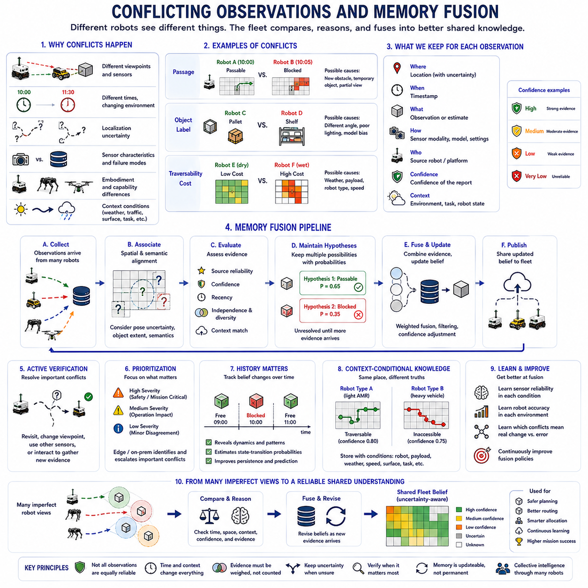{width="7.268055555555556in" height="7.268055555555556in"}

Conflicting observations are inevitable when multiple robots perceive and interact with the same environment. Different viewpoints, sensors, localization accuracy, observation times, and operating conditions can produce different descriptions of the same place or event. A fleet memory system must therefore manage disagreement explicitly instead of assuming that every incoming observation represents an equally valid and immediately compatible fact.

A conflict occurs when two or more observations cannot be directly reconciled under the current world representation. One robot may report an open passage while another reports an obstacle, or different robots may assign different semantic labels to the same object. Such disagreement does not necessarily indicate failure because the environment itself may have changed between observations or each robot may have observed only part of the situation.

Time is one of the first dimensions that should be examined when resolving conflicts. An obstacle observed several hours ago may have been removed before another robot arrives, while a door can change state within seconds. By preserving timestamps and expected persistence, the fleet can distinguish genuine contradictions from valid observations of different environmental states occurring at different moments.

Spatial uncertainty can also create apparent disagreement. Two robots may observe the same physical object but associate it with slightly different map positions because their localization estimates differ. Before treating the observations as contradictory, the system should consider pose uncertainty, coordinate alignment, object extent, and sensor resolution. Spatial association therefore becomes an important prerequisite for reliable memory fusion.

Sensor characteristics provide another explanation for conflicting evidence. Cameras, LiDAR, radar, depth sensors, and proprioceptive systems observe different physical properties and possess different failure modes. A camera may classify terrain semantically while LiDAR estimates its geometry, and these measurements may appear inconsistent without actually being incompatible. Fusion should preserve complementary information while identifying genuine disagreement.

Source reliability influences how conflicting observations should be weighted. A robot with strong localization and a clear sensor view may provide more reliable evidence than a robot observing through occlusion or degraded sensing. Fleet memory can retain provenance including source robot, sensor modality, model version, observation conditions, and confidence so that fusion decisions reflect the quality of the evidence rather than treating all reports identically.

Confidence provides a practical mechanism for representing disagreement without forcing immediate certainty. Instead of storing one absolute state, the system can maintain competing hypotheses with different confidence values. A region might be represented as probably blocked but possibly open, for example. Additional observations can then increase or decrease support for each hypothesis until sufficient evidence exists to make a stronger operational decision.

Repeated agreement can strengthen a hypothesis, but evidence should not be counted blindly. Several robots using the same perception model or shared localization infrastructure may reproduce the same systematic error. Memory fusion should therefore consider independence and source diversity. Agreement from different sensing modalities, viewpoints, robot platforms, or independently generated estimates can provide stronger confirmation than repeated observations derived from the same underlying assumptions.

Contradictions can also arise from robot embodiment. One robot may report that a route is traversable while another reports that it is inaccessible, yet both observations may be correct. Vehicle width, ground clearance, locomotion mechanism, payload, turning radius, and stability constraints can produce different mobility outcomes. Fusion should preserve the environmental facts while associating traversability conclusions with the robot configurations that produced them.

Environmental context creates similar conditional conflicts. A route may be safe when dry but difficult after rainfall, or a corridor may be clear during one operating period and congested during another. If context is discarded, these observations appear contradictory. By retaining weather, traffic, task state, surface condition, and other relevant factors, the fleet can transform apparent disagreement into conditional knowledge describing when each observation is valid.

Memory fusion combines observations into a coherent shared belief while preserving relevant uncertainty. Fusion may involve weighted evidence aggregation, probabilistic estimation, confidence adjustment, temporal filtering, spatial alignment, semantic association, or graph-based relationships. The objective is not simply to average every input but to construct a representation that reflects the quality, compatibility, context, and history of available evidence.

Some conflicts should remain unresolved temporarily. Prematurely selecting one interpretation can introduce false certainty into shared memory and propagate errors into planning. When evidence remains ambiguous, the fleet can retain multiple hypotheses, mark the region as uncertain, reduce operational confidence, and request further observation. Maintaining ambiguity can therefore be safer and more informative than forcing a single answer.

Active verification provides a mechanism for resolving important disagreements. A nearby robot can revisit the region, approach from another viewpoint, use a different sensor, or perform a controlled interaction to gather additional evidence. Verification effort can be prioritized according to operational relevance, allowing the fleet to spend sensing and movement resources on conflicts that could significantly affect safety, routing, or mission execution.

Conflict severity should influence communication priority. A disagreement about a rarely used semantic label may tolerate delayed resolution, while contradictory reports about a blocked evacuation route or severe hazard may require immediate attention. Edge or on-premise infrastructure can identify high-impact conflicts, request additional evidence, coordinate verification, and distribute revised shared beliefs to affected robots.

Memory fusion should preserve the history of important belief changes. If a location transitions from free to blocked and later becomes free again, retaining the sequence helps distinguish dynamic behavior from inconsistent sensing. Observation histories can reveal recurring patterns, estimate state-transition probabilities, and improve predictions about how long particular environmental conditions are likely to persist.

The same principle applies to route, hazard, and mobility experience. One robot may report high energy consumption on a path while others report normal performance. Instead of averaging the measurements without context, the fleet can examine payload, speed, terrain condition, robot type, and mechanical state. What initially appears to be conflicting evidence may reveal an important relationship between operating conditions and mobility performance.

Fusion errors can propagate throughout the fleet if incorrect shared beliefs are accepted too quickly. A falsely reported obstacle may cause unnecessary rerouting, while an incorrectly removed hazard may expose several robots to danger. Shared memory should therefore support revision and rollback of beliefs when stronger evidence appears. Knowledge must remain updateable rather than becoming permanently fixed after its first fusion.

Conflict resolution can improve through accumulated experience. The fleet can learn which sensors are reliable under particular conditions, which robots produce accurate observations in specific environments, and which types of disagreement frequently correspond to real environmental changes. Historical outcomes can therefore calibrate future fusion policies and improve the weighting of incoming evidence.

Fleet world models can further support memory fusion by evaluating whether observations are consistent with expected state transitions. If an object was predicted to move, two observations at different locations may be compatible rather than conflicting. Conversely, an unexpected observation can indicate either model error or a genuine environmental change. Prediction provides temporal context that helps interpret disagreement rather than merely comparing static observations.

Ultimately, conflicting observations and memory fusion transform disagreement from a synchronization problem into a source of collective intelligence. The fleet preserves who observed what, when, where, under which conditions, and with what confidence; compares competing evidence; requests verification when necessary; and continuously revises shared beliefs. Through this process, multiple imperfect robot perspectives become a more reliable, contextual, and adaptive shared understanding of the physical world.

여러 로봇이 동일한 환경을 인지하고 상호작용할 때 상충하는 관찰(conflicting observations)은 불가피하게 발생한다. 서로 다른 관찰 시점(viewpoint), 센서, 위치 추정 정확도(localization accuracy), 관찰 시간 및 운용 조건으로 인해 동일한 장소나 사건에 대해 서로 다른 설명이 생성될 수 있다. 따라서 플릿 메모리 시스템(fleet memory system)은 모든 입력 관찰을 동일하게 유효하고 즉시 호환 가능한 사실로 가정하지 않고, 이러한 불일치를 명시적으로 관리해야 한다.

충돌(conflict)은 둘 이상의 관찰이 현재의 월드 표현(world representation)에서 직접적으로 조정될 수 없을 때 발생한다. 한 로봇은 통로가 열려 있다고 보고하지만 다른 로봇은 장애물이 있다고 보고할 수 있으며, 서로 다른 로봇이 동일한 객체에 서로 다른 의미 라벨(semantic label)을 부여할 수도 있다. 이러한 불일치가 반드시 실패를 의미하는 것은 아니다. 관찰 사이에 환경 자체가 변화했거나 각각의 로봇이 상황의 일부만 관찰했을 수도 있기 때문이다.

시간(time)은 충돌을 해결할 때 가장 먼저 검토해야 하는 요소 중 하나이다. 몇 시간 전에 관찰된 장애물은 다른 로봇이 도착하기 전에 제거되었을 수 있으며, 문(door)의 상태는 몇 초 만에도 바뀔 수 있다. 타임스탬프(timestamp)와 예상 지속성(expected persistence)을 보존하면 플릿은 실제적인 모순과 서로 다른 시점에 발생한 서로 다른 환경 상태에 대한 유효한 관찰을 구분할 수 있다.

공간적 불확실성(spatial uncertainty)도 겉으로 보이는 불일치를 발생시킬 수 있다. 두 로봇이 동일한 물리적 객체를 관찰하더라도 위치 추정값이 다르기 때문에 지도상에서 약간 다른 위치에 연결할 수 있다. 관찰을 상충한다고 판단하기 전에 시스템은 자세 불확실성(pose uncertainty), 좌표 정렬(coordinate alignment), 객체 범위(object extent), 센서 해상도를 고려해야 한다. 따라서 공간적 연관(spatial association)은 신뢰성 있는 메모리 융합(memory fusion)을 위한 중요한 선행 조건이 된다.

센서 특성(sensor characteristics)은 상충하는 증거를 설명하는 또 다른 요인이다. 카메라, 라이다(LiDAR), 레이더(radar), 깊이 센서(depth sensor), 고유수용감각 시스템(proprioceptive system)은 서로 다른 물리적 특성을 관찰하며 각각 다른 실패 모드(failure mode)를 가진다. 카메라는 지형을 의미적으로 분류하고 라이다는 기하 구조를 추정할 수 있으며, 두 측정값은 실제로 호환 가능함에도 겉으로는 일치하지 않는 것처럼 보일 수 있다. 융합은 상호보완적인 정보를 유지하면서 실제적인 불일치를 식별해야 한다.

정보 출처의 신뢰성(source reliability)은 상충하는 관찰에 어떤 가중치를 부여할지를 결정하는 데 영향을 준다. 정확한 위치 추정과 명확한 센서 시야를 가진 로봇의 관찰은 가림(occlusion)이나 성능이 저하된 센싱 조건에서 관찰한 로봇의 정보보다 신뢰성이 높을 수 있다. 플릿 메모리는 출처 로봇, 센서 양식(sensor modality), 모델 버전, 관찰 조건 및 신뢰도(confidence)와 같은 정보 출처(provenance)를 유지하여 모든 보고를 동일하게 처리하지 않고 증거의 품질에 따라 융합 결정을 수행할 수 있다.

신뢰도(confidence)는 즉각적으로 하나의 확정된 결론을 강제하지 않으면서 불일치를 표현하는 실용적인 메커니즘을 제공한다. 하나의 절대적인 상태만 저장하는 대신 시스템은 서로 다른 신뢰도 값을 가진 경쟁 가설(competing hypotheses)을 유지할 수 있다. 예를 들어 특정 영역이 차단되었을 가능성이 높지만 개방되어 있을 가능성도 있다고 표현할 수 있다. 이후 추가 관찰을 통해 각 가설에 대한 지지를 증가시키거나 감소시키면서 더욱 확실한 운용 결정을 내릴 수 있다.

반복적인 일치는 하나의 가설을 강화할 수 있지만 증거를 무조건적으로 계산해서는 안 된다. 여러 로봇이 동일한 인지 모델(perception model)이나 공유 위치 추정 인프라(shared localization infrastructure)를 사용한다면 동일한 체계적 오류(systematic error)를 반복할 수 있다. 따라서 메모리 융합은 독립성(independence)과 출처 다양성(source diversity)을 고려해야 한다. 서로 다른 센서 양식, 관찰 시점, 로봇 플랫폼 또는 독립적으로 생성된 추정값 사이의 일치는 동일한 기본 가정에서 생성된 반복 관찰보다 강력한 확인 증거가 될 수 있다.

로봇 형태(embodiment)의 차이로 인해 모순처럼 보이는 결과가 발생할 수도 있다. 한 로봇은 특정 경로가 주행 가능하다고 보고하고 다른 로봇은 접근할 수 없다고 보고할 수 있지만, 두 관찰 모두 정확할 수 있다. 차량 폭, 지상고(ground clearance), 이동 메커니즘(locomotion mechanism), 적재량(payload), 회전 반경 및 안정성 제약은 서로 다른 이동 결과를 발생시킬 수 있다. 따라서 융합은 환경에 대한 객관적인 사실을 유지하면서 주행 가능성에 대한 결론을 해당 관찰을 생성한 로봇 구성과 연결해야 한다.

환경 맥락(environmental context)도 유사한 조건부 충돌(conditional conflict)을 발생시킨다. 특정 경로가 건조한 상태에서는 안전하지만 비가 내린 후에는 이동하기 어려울 수 있으며, 통로가 특정 운용 시간에는 비어 있지만 다른 시간에는 혼잡할 수 있다. 맥락을 제거하면 이러한 관찰은 서로 모순되는 것처럼 보인다. 날씨, 교통량, 작업 상태, 표면 조건 및 기타 관련 요소를 보존하면 플릿은 겉으로 보이는 불일치를 각각의 관찰이 언제 유효한지를 설명하는 조건부 지식(conditional knowledge)으로 전환할 수 있다.

메모리 융합(memory fusion)은 관련된 불확실성을 유지하면서 여러 관찰을 일관된 공유 믿음(shared belief)으로 결합한다. 융합에는 가중 증거 통합(weighted evidence aggregation), 확률적 추정(probabilistic estimation), 신뢰도 조정, 시간적 필터링(temporal filtering), 공간 정렬, 의미적 연관(semantic association) 또는 그래프 기반 관계(graph-based relationship)가 포함될 수 있다. 목표는 모든 입력값을 단순히 평균화하는 것이 아니라 사용 가능한 증거의 품질, 호환성, 맥락 및 이력을 반영하는 표현을 구축하는 것이다.

일부 충돌은 일시적으로 해결되지 않은 상태로 유지하는 것이 적절하다. 하나의 해석을 너무 일찍 선택하면 공유 메모리에 잘못된 확실성(false certainty)이 도입되고 그 오류가 계획 시스템으로 전파될 수 있다. 증거가 여전히 모호한 경우 플릿은 여러 가설을 유지하고, 해당 영역을 불확실한 상태로 표시하며, 운용 신뢰도를 낮추고 추가 관찰을 요청할 수 있다. 따라서 모호성(ambiguity)을 유지하는 것이 하나의 답을 강제로 선택하는 것보다 더 안전하고 유용할 수 있다.

능동 검증(active verification)은 중요한 불일치를 해결하는 메커니즘을 제공한다. 주변 로봇이 해당 영역을 다시 방문하거나, 다른 관찰 시점에서 접근하거나, 다른 센서를 사용하거나, 제어된 상호작용(controlled interaction)을 수행하여 추가 증거를 수집할 수 있다. 검증 노력은 운용 관련성(operational relevance)에 따라 우선순위를 지정할 수 있으므로 플릿은 안전, 경로 계획 또는 임무 수행에 큰 영향을 줄 수 있는 충돌에 센싱과 이동 자원을 집중할 수 있다.

충돌 심각도(conflict severity)는 통신 우선순위에 영향을 주어야 한다. 거의 사용되지 않는 의미 라벨에 대한 불일치는 해결을 지연해도 되지만, 차단된 대피 경로나 심각한 위험 요소에 관한 상충된 보고는 즉각적인 대응이 필요할 수 있다. 엣지(edge) 또는 온프레미스 인프라(on-premise infrastructure)는 영향이 큰 충돌을 식별하고, 추가 증거를 요청하고, 검증을 조정하며, 수정된 공유 믿음을 영향을 받는 로봇에 배포할 수 있다.

메모리 융합은 중요한 믿음 변화(belief change)의 이력을 보존해야 한다. 특정 위치가 자유 공간에서 차단 상태로 변경되었다가 다시 자유 공간으로 바뀌는 경우, 이러한 순서를 유지하면 동적인 환경 변화와 일관되지 않은 센싱을 구분하는 데 도움이 된다. 관찰 이력(observation history)은 반복적인 패턴을 발견하고 상태 전이 확률(state-transition probability)을 추정하며 특정 환경 조건이 얼마나 오랫동안 지속될 가능성이 있는지에 대한 예측을 향상시킬 수 있다.

동일한 원리는 경로(route), 위험 요소(hazard) 및 이동 경험(mobility experience)에도 적용된다. 한 로봇이 특정 경로에서 높은 에너지 소비를 보고하지만 다른 로봇들은 정상적인 성능을 보고할 수 있다. 이러한 측정값을 맥락 없이 평균화하는 대신 플릿은 적재량, 속도, 지형 조건, 로봇 유형 및 기계적 상태를 검토할 수 있다. 처음에는 상충하는 증거처럼 보였던 정보가 실제로는 운용 조건과 이동 성능 사이의 중요한 관계를 보여줄 수 있다.

잘못된 공유 믿음이 너무 빠르게 받아들여지면 융합 오류(fusion error)가 플릿 전체로 전파될 수 있다. 잘못 보고된 장애물은 불필요한 경로 재설정(rerouting)을 발생시킬 수 있고, 위험 요소가 잘못 제거되면 여러 로봇이 위험에 노출될 수 있다. 따라서 공유 메모리는 더 강력한 증거가 나타날 경우 기존 믿음을 수정하고 되돌릴 수 있는 개정 및 롤백(revision and rollback) 기능을 지원해야 한다. 지식은 최초 융합 이후 영구적으로 고정되는 것이 아니라 지속적으로 갱신 가능해야 한다.

충돌 해결(conflict resolution)은 축적된 경험을 통해 향상될 수 있다. 플릿은 특정 조건에서 어떤 센서가 신뢰할 수 있는지, 특정 환경에서 어떤 로봇이 정확한 관찰을 생성하는지, 그리고 어떤 유형의 불일치가 실제 환경 변화와 자주 연결되는지를 학습할 수 있다. 따라서 과거 결과는 향후 융합 정책(fusion policy)을 보정하고 새롭게 입력되는 증거의 가중치를 더욱 정확하게 결정하는 데 활용될 수 있다.

플릿 월드 모델(fleet world model)은 관찰이 예상되는 상태 전이(expected state transition)와 일치하는지를 평가하여 메모리 융합을 추가로 지원할 수 있다. 객체가 이동할 것으로 예측되었다면 서로 다른 위치에서 이루어진 두 관찰은 상충하는 것이 아니라 서로 호환될 수 있다. 반대로 예상하지 못한 관찰은 모델 오류 또는 실제 환경 변화를 나타낼 수 있다. 따라서 예측(prediction)은 단순히 정적인 관찰을 비교하는 것을 넘어 불일치를 해석하기 위한 시간적 맥락(temporal context)을 제공한다.

궁극적으로 상충하는 관찰과 메모리 융합(conflicting observations and memory fusion)은 불일치를 단순한 동기화 문제(synchronization problem)에서 집단 지능(collective intelligence)의 원천으로 전환한다. 플릿은 누가 무엇을, 언제, 어디에서, 어떤 조건으로, 어느 정도의 신뢰도로 관찰했는지를 보존하고, 경쟁하는 증거를 비교하며, 필요한 경우 검증을 요청하고, 공유 믿음을 지속적으로 수정한다. 이러한 과정을 통해 여러 로봇의 불완전한 관점은 물리적 세계에 대한 더욱 신뢰성 있고 맥락적이며 적응적인 공유 이해(shared understanding)로 발전한다.

##  

## 06.14. Temporal Decay and World Memory Update

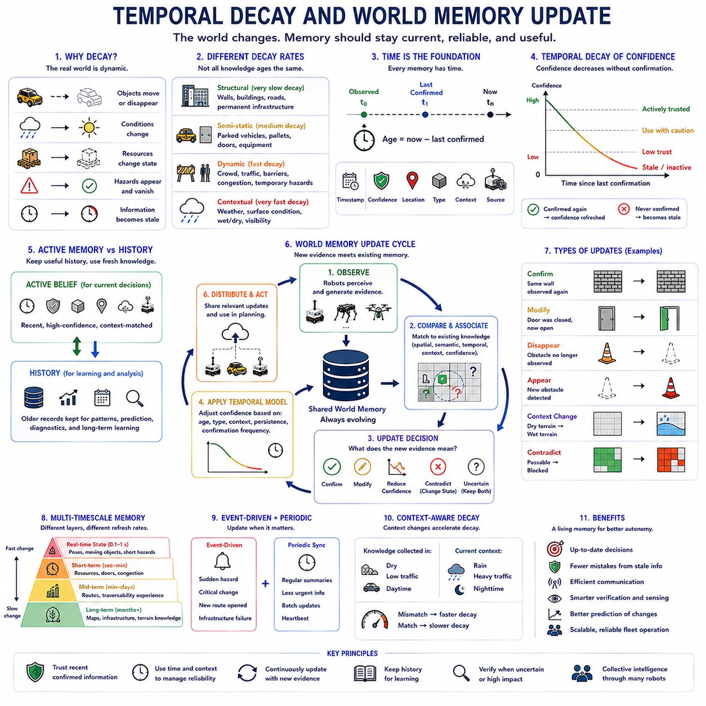{width="7.268055555555556in" height="7.268055555555556in"}

World memory must change as the physical world changes. Information that was accurate when first observed may gradually become unreliable as objects move, terrain conditions evolve, resources change state, and temporary hazards disappear. Temporal decay provides a systematic mechanism for reducing the influence of aging knowledge so that fleet decisions reflect both accumulated experience and the likelihood that stored information still represents current reality.

Not all knowledge should decay at the same rate. Structural information such as walls, building geometry, fixed infrastructure, and permanent road boundaries may remain valid for long periods. In contrast, parked vehicles, pallets, doors, temporary barriers, congestion, weather effects, and surface conditions can change rapidly. World memory therefore requires different temporal models according to the expected persistence of each information type.

A timestamp is the basic foundation for temporal reasoning. Each observation, state estimate, hazard report, route experience, or semantic update can record when it was created and when it was last confirmed. This allows the fleet to distinguish recently verified knowledge from information that has not been observed for a long time. Age alone does not determine correctness, but it provides important evidence about whether revalidation may be necessary.

Temporal decay can reduce confidence as time passes without confirmation. A recently observed obstacle may initially receive high confidence, but its confidence can gradually decline if no robot observes it again. The rate of decline can depend on object type, environmental dynamics, historical persistence, and operational context. This prevents temporary conditions from remaining indefinitely embedded in shared memory as if they were permanent facts.

Decay should not necessarily delete information immediately. Older observations may still provide useful historical context even when they are no longer trusted as current state. A fleet can therefore separate active belief from historical memory. Current planning may use only sufficiently recent or high-confidence information, while older records remain available for pattern analysis, prediction, diagnostics, and learning about recurring environmental behavior.

World memory update occurs when new evidence interacts with existing knowledge. A new observation may confirm a stored belief, modify its attributes, reduce uncertainty, contradict it, or indicate that the underlying state has changed. Update mechanisms should compare spatial location, semantic identity, timestamp, confidence, and context before deciding whether observations describe the same persistent entity or different states occurring at different times.

Confirmation can refresh memory and restore confidence. If several robots repeatedly observe the same wall, charging station, terrain boundary, or persistent obstacle, the associated knowledge becomes increasingly stable. For dynamic objects, repeated confirmation indicates continued presence rather than permanence. The system can therefore update both confidence and estimated persistence according to how frequently and consistently a condition is observed.

Disappearance is also an important update event. When a robot revisits a location and fails to observe a previously recorded temporary obstacle, the system should not always remove it immediately because occlusion or sensing failure may explain the absence. Repeated negative observations from reliable viewpoints can progressively reduce confidence until the obstacle is removed from active world state while its historical record remains preserved.

Different memory layers can use different update frequencies. Current robot poses and moving objects may require updates many times per second, while route congestion or resource occupancy may change over seconds or minutes. Terrain experience may remain useful for days or months, and structural maps may persist much longer. Multi-timescale memory prevents the fleet from applying one inappropriate refresh policy to every form of world knowledge.

Event-driven updates complement periodic refresh. A sudden hazard, blocked corridor, damaged surface, failed charging station, or newly opened route may require immediate modification regardless of the normal update schedule. Robots can transmit significant changes as events, while less urgent information is synchronized periodically. This combination provides responsiveness without requiring continuous transmission of the complete shared world representation.

Temporal decay should also depend on environmental context. Traversability information about dry terrain may lose relevance rapidly after heavy rain, while route performance collected during low traffic may not represent peak operating periods. Instead of considering only elapsed clock time, memory can evaluate whether the conditions under which knowledge was acquired still match current conditions. Context changes can therefore accelerate effective decay.

Historical recurrence can influence persistence estimates. If an obstacle repeatedly appears in the same location during certain hours, the fleet may learn that it is temporary but predictable. Similarly, congestion may recur around shift changes, or terrain may become difficult after rainfall. Memory can retain these temporal patterns even after individual observations expire, allowing apparently transient events to contribute to longer-term predictive knowledge.

Conflicting observations require careful temporal interpretation. A robot reporting an open corridor may not contradict another robot that reported blockage thirty minutes earlier. Both observations may be correct descriptions of different states. By preserving observation sequences, the fleet can interpret disagreement as state transition when appropriate, rather than treating every difference as sensor error or forcing incompatible observations into one static representation.

Memory update should preserve provenance and revision history. When a shared belief changes, the system can retain which robot supplied the new evidence, which sensors were used, what previous state was replaced, and why confidence changed. This history supports debugging, trust assessment, rollback, and learning. It also prevents the current world model from becoming detached from the evidence that produced it.

Uncertainty naturally interacts with temporal decay. Knowledge with low initial confidence may become unusable quickly, while strongly confirmed structural information may remain reliable for long periods. Decay can therefore operate on probability distributions, confidence scores, covariance, or other uncertainty representations rather than simply applying fixed expiration times. This creates smoother transitions between trusted, uncertain, stale, and inactive knowledge.

Update policies should consider operational importance as well as age. A low-risk semantic detail can tolerate stale information, while an uncertain obstacle on an active high-speed route may require immediate verification. Safety-critical knowledge can trigger shorter validation intervals or active sensing requests. Temporal memory management therefore allocates observation and communication resources according to the consequences of being wrong.

Active verification closes the gap between passive decay and deliberate knowledge maintenance. When important information becomes too old or uncertain, the fleet can request a nearby robot to revisit the region, inspect an object, test route accessibility, or confirm resource availability. Robots thus become active maintainers of shared world knowledge rather than merely producers of observations encountered during normal missions.

Edge or on-premise infrastructure can coordinate these updates across the fleet. It can maintain timestamps, confidence histories, persistence models, observation counts, and change events while reconciling reports from multiple robots. Instead of broadcasting the complete memory continuously, it can distribute relevant updates, invalidations, and verification requests according to robot location, mission, capability, and current information needs.

Temporal memory also supports predictive world modeling. Observation histories reveal how long states typically persist and how frequently transitions occur. A fleet world model can learn that certain doors remain closed for predictable periods, specific corridors become congested at particular times, or temporary obstacles usually disappear after a characteristic duration. Memory therefore supports prediction of when stored knowledge is likely to become invalid.

The resulting system forms a continuous perception-memory-update loop. Robots observe the world, compare new evidence with shared knowledge, refresh confirmed information, reduce confidence in aging information, revise changed states, preserve historical records, and request verification when uncertainty becomes operationally significant. Memory is therefore continuously reconstructed from evidence rather than treated as a static database.

Ultimately, temporal decay and world memory update allow a fleet to balance remembering with forgetting. Without persistence, robots repeatedly rediscover the same world; without decay, outdated information accumulates and corrupts future decisions. By preserving stable knowledge, weakening stale beliefs, incorporating new evidence, and retaining useful history, the fleet develops a shared world memory that remains adaptive, current, and increasingly valuable over long-term operation.

월드 메모리(world memory)는 물리적 세계가 변화함에 따라 함께 변화해야 한다. 처음 관찰되었을 때 정확했던 정보도 객체가 이동하고, 지형 조건이 변화하며, 자원의 상태가 바뀌고, 일시적인 위험 요소가 사라지면서 점차 신뢰성을 잃을 수 있다. 시간적 감쇠(temporal decay)는 오래된 지식의 영향력을 체계적으로 감소시켜 플릿의 의사결정이 축적된 경험과 저장된 정보가 현재 현실을 여전히 반영할 가능성을 함께 고려하도록 하는 메커니즘을 제공한다.

모든 지식이 동일한 속도로 감쇠되어서는 안 된다. 벽, 건물의 기하 구조, 고정 인프라 및 영구적인 도로 경계와 같은 구조적 정보(structural information)는 오랜 기간 유효하게 유지될 수 있다. 반면 주차된 차량, 팔레트, 문, 임시 장벽, 혼잡, 날씨의 영향 및 표면 상태는 빠르게 변화할 수 있다. 따라서 월드 메모리는 각각의 정보 유형에 예상되는 지속성(expected persistence)에 따라 서로 다른 시간 모델(temporal model)을 적용해야 한다.

타임스탬프(timestamp)는 시간적 추론(temporal reasoning)의 기본적인 기반이다. 각각의 관찰, 상태 추정(state estimate), 위험 요소 보고(hazard report), 경로 경험(route experience) 또는 의미적 업데이트(semantic update)는 언제 생성되었으며 마지막으로 언제 확인되었는지를 기록할 수 있다. 이를 통해 플릿은 최근에 검증된 지식과 오랫동안 관찰되지 않은 정보를 구분할 수 있다. 정보의 나이(age)만으로 정확성을 판단할 수는 없지만 재검증(revalidation)이 필요한지를 판단하는 중요한 증거를 제공한다.

시간적 감쇠는 확인되지 않은 상태로 시간이 경과함에 따라 신뢰도(confidence)를 낮출 수 있다. 최근 관찰된 장애물은 처음에는 높은 신뢰도를 가질 수 있지만, 어떤 로봇도 이를 다시 관찰하지 않으면 신뢰도가 점차 감소할 수 있다. 감소 속도는 객체 유형, 환경의 동적 특성, 과거 지속성 및 운용 맥락(operational context)에 따라 달라질 수 있다. 이를 통해 일시적인 조건이 영구적인 사실처럼 공유 메모리에 무기한 남는 것을 방지할 수 있다.

감쇠가 반드시 정보를 즉시 삭제해야 한다는 의미는 아니다. 오래된 관찰도 현재 상태로 신뢰할 수 없게 된 이후에 유용한 과거 맥락(historical context)을 제공할 수 있다. 따라서 플릿은 활성 믿음(active belief)과 과거 메모리(historical memory)를 분리할 수 있다. 현재 계획에는 충분히 최근이거나 신뢰도가 높은 정보만 사용하면서, 오래된 기록은 패턴 분석, 예측, 진단 및 반복적인 환경 행동에 대한 학습을 위해 유지할 수 있다.

월드 메모리 업데이트(world memory update)는 새로운 증거가 기존 지식과 상호작용할 때 발생한다. 새로운 관찰은 저장된 믿음을 확인하거나, 그 속성을 변경하거나, 불확실성을 감소시키거나, 기존 정보와 충돌하거나, 근본적인 상태가 변화했음을 나타낼 수 있다. 업데이트 메커니즘은 관찰들이 동일한 지속적 개체(persistent entity)를 설명하는지 또는 서로 다른 시간에 발생한 서로 다른 상태를 나타내는지를 판단하기 전에 공간적 위치, 의미적 정체성(semantic identity), 타임스탬프, 신뢰도 및 맥락을 비교해야 한다.

확인(confirmation)은 메모리를 새롭게 갱신하고 신뢰도를 복원할 수 있다. 여러 로봇이 동일한 벽, 충전소, 지형 경계 또는 지속적인 장애물을 반복적으로 관찰하면 관련 지식은 점점 더 안정적으로 유지될 수 있다. 동적 객체의 경우 반복적인 확인은 영구성을 의미하는 것이 아니라 해당 객체가 계속 존재하고 있음을 나타낸다. 따라서 시스템은 어떤 조건이 얼마나 빈번하고 일관되게 관찰되는지에 따라 신뢰도와 예상 지속성을 함께 갱신할 수 있다.

소멸(disappearance) 역시 중요한 업데이트 사건이다. 로봇이 특정 위치를 다시 방문했을 때 이전에 기록된 임시 장애물을 관찰하지 못했다고 해서 시스템이 항상 즉시 해당 정보를 삭제해서는 안 된다. 가림(occlusion)이나 센싱 실패가 관찰 부재의 원인일 수 있기 때문이다. 신뢰할 수 있는 관찰 시점에서 반복적인 부정 관찰(negative observation)이 축적되면 신뢰도를 점진적으로 낮추고, 최종적으로 장애물을 활성 월드 상태(active world state)에서 제거하면서 과거 기록은 계속 보존할 수 있다.

서로 다른 메모리 계층(memory layer)은 서로 다른 업데이트 주기(update frequency)를 사용할 수 있다. 현재 로봇 위치와 이동 객체는 초당 여러 번 업데이트해야 할 수 있지만, 경로 혼잡이나 자원 점유 상태는 수초 또는 수분 단위로 변화할 수 있다. 지형 경험은 수일 또는 수개월 동안 유용할 수 있으며, 구조 지도(structural map)는 훨씬 더 오랫동안 유지될 수 있다. 다중 시간 척도 메모리(multi-timescale memory)는 모든 형태의 월드 지식에 하나의 부적절한 갱신 정책을 적용하는 것을 방지한다.

사건 기반 업데이트(event-driven update)는 주기적 갱신(periodic refresh)을 보완한다. 갑작스러운 위험 요소, 차단된 통로, 손상된 표면, 고장 난 충전소 또는 새롭게 개방된 경로는 일반적인 업데이트 일정과 관계없이 즉시 수정해야 할 수 있다. 로봇은 중요한 변화를 사건으로 전송하고 덜 긴급한 정보는 주기적으로 동기화할 수 있다. 이러한 조합은 완전한 공유 월드 표현을 지속적으로 전송하지 않으면서도 변화에 신속하게 대응할 수 있도록 한다.

시간적 감쇠는 환경 맥락(environmental context)에 따라서도 달라져야 한다. 건조한 지형에서 얻은 주행 가능성 정보(traversability information)는 폭우가 내린 후 빠르게 관련성을 잃을 수 있으며, 교통량이 적은 시간대에 수집된 경로 성능은 혼잡 시간대의 상태를 제대로 표현하지 못할 수 있다. 따라서 단순히 경과 시간만 고려하는 대신 메모리는 지식이 획득된 조건과 현재 조건이 여전히 일치하는지를 평가할 수 있다. 맥락 변화(context change)는 실질적인 감쇠 속도를 가속할 수 있다.

과거의 반복성(historical recurrence)은 지속성 추정(persistence estimate)에 영향을 줄 수 있다. 특정 시간대에 동일한 위치에서 장애물이 반복적으로 나타난다면 플릿은 해당 장애물이 일시적이지만 예측 가능하다는 것을 학습할 수 있다. 마찬가지로 교대 시간 전후에 혼잡이 반복되거나 강우 후 지형 이동이 어려워질 수 있다. 개별 관찰이 만료된 이후에도 이러한 시간적 패턴(temporal pattern)을 유지함으로써 일시적으로 보이는 사건을 장기적인 예측 지식으로 활용할 수 있다.

상충하는 관찰(conflicting observation)은 신중한 시간적 해석을 필요로 한다. 한 로봇이 통로가 열려 있다고 보고하는 것이 30분 전에 통로가 차단되었다고 보고한 다른 로봇의 관찰과 반드시 모순되는 것은 아니다. 두 관찰 모두 서로 다른 상태를 정확하게 설명했을 수 있다. 관찰 순서(observation sequence)를 보존하면 플릿은 모든 차이를 센서 오류로 처리하거나 서로 호환되지 않는 관찰을 하나의 정적 표현으로 강제 통합하는 대신 적절한 경우 상태 전이(state transition)로 해석할 수 있다.

메모리 업데이트는 정보 출처(provenance)와 수정 이력(revision history)을 보존해야 한다. 공유 믿음(shared belief)이 변경될 때 시스템은 어떤 로봇이 새로운 증거를 제공했는지, 어떤 센서를 사용했는지, 이전의 어떤 상태가 대체되었는지, 그리고 신뢰도가 왜 변경되었는지를 유지할 수 있다. 이러한 이력은 디버깅, 신뢰성 평가, 롤백(rollback) 및 학습을 지원한다. 또한 현재 월드 모델(world model)이 그것을 생성한 실제 증거와 분리되는 것을 방지한다.

불확실성(uncertainty)은 자연스럽게 시간적 감쇠와 상호작용한다. 초기 신뢰도가 낮은 지식은 빠르게 사용할 수 없게 될 수 있지만, 강력하게 확인된 구조적 정보는 오랫동안 신뢰성을 유지할 수 있다. 따라서 감쇠는 단순히 고정된 만료 시간(expiration time)을 적용하는 대신 확률 분포(probability distribution), 신뢰도 점수, 공분산(covariance) 또는 기타 불확실성 표현에 적용할 수 있다. 이를 통해 신뢰 가능한 지식, 불확실한 지식, 오래된 지식(stale knowledge), 비활성 지식 사이를 보다 부드럽게 전환할 수 있다.

업데이트 정책(update policy)은 정보의 나이뿐만 아니라 운용 중요성(operational importance)도 고려해야 한다. 위험도가 낮은 의미적 세부 정보는 다소 오래되어도 허용될 수 있지만, 활성 고속 경로에 존재하는 불확실한 장애물은 즉각적인 검증이 필요할 수 있다. 안전 필수 지식(safety-critical knowledge)은 더 짧은 검증 주기(validation interval) 또는 능동 센싱 요청(active sensing request)을 유발할 수 있다. 따라서 시간적 메모리 관리는 정보가 잘못되었을 때 발생할 결과에 따라 관찰 및 통신 자원을 할당한다.

능동 검증(active verification)은 수동적인 감쇠와 의도적인 지식 유지 관리 사이의 간극을 연결한다. 중요한 정보가 지나치게 오래되거나 불확실해지면 플릿은 주변 로봇에게 해당 영역을 다시 방문하거나, 객체를 검사하거나, 경로 접근 가능성을 시험하거나, 자원 가용성을 확인하도록 요청할 수 있다. 이를 통해 로봇은 정상적인 임무 수행 과정에서 우연히 관찰 정보를 생성하는 존재를 넘어 공유 월드 지식을 능동적으로 유지하는 관리자(active maintainer)의 역할을 수행한다.

엣지(edge) 또는 온프레미스 인프라(on-premise infrastructure)는 플릿 전체에서 이러한 업데이트를 조정할 수 있다. 타임스탬프, 신뢰도 이력, 지속성 모델(persistence model), 관찰 횟수 및 변화 사건(change event)을 관리하면서 여러 로봇의 보고를 조정할 수 있다. 전체 메모리를 지속적으로 브로드캐스트하는 대신 로봇의 위치, 임무, 능력 및 현재 정보 요구에 따라 관련된 업데이트, 무효화(invalidation) 및 검증 요청을 배포할 수 있다.

시간적 메모리(temporal memory)는 예측 월드 모델링(predictive world modeling)도 지원한다. 관찰 이력은 특정 상태가 일반적으로 얼마나 오랫동안 지속되는지와 상태 전이가 얼마나 자주 발생하는지를 보여준다. 플릿 월드 모델(fleet world model)은 특정 문이 일정한 시간 동안 닫혀 있거나, 특정 통로가 특정 시간대에 혼잡해지거나, 임시 장애물이 일정 시간이 지나면 사라지는 경향을 학습할 수 있다. 따라서 메모리는 저장된 지식이 언제 유효하지 않게 될 가능성이 높은지를 예측하는 기반을 제공한다.

그 결과 시스템은 지속적인 인지-메모리-업데이트 루프(perception-memory-update loop)를 형성한다. 로봇은 세계를 관찰하고, 새로운 증거를 공유 지식과 비교하고, 확인된 정보를 갱신하며, 오래된 정보의 신뢰도를 낮추고, 변화한 상태를 수정하며, 과거 기록을 보존하고, 불확실성이 운용상 중요해지면 검증을 요청한다. 따라서 메모리는 정적인 데이터베이스로 취급되는 것이 아니라 새로운 증거를 기반으로 지속적으로 재구성된다.

궁극적으로 시간적 감쇠와 월드 메모리 업데이트(temporal decay and world memory update)는 플릿이 기억(remembering)과 망각(forgetting) 사이의 균형을 유지하도록 한다. 지속성이 없다면 로봇은 동일한 세계를 반복적으로 다시 발견해야 하며, 감쇠가 없다면 오래된 정보가 계속 축적되어 향후 의사결정을 왜곡하게 된다. 안정적인 지식을 보존하고, 오래된 믿음의 영향력을 약화시키며, 새로운 증거를 반영하고, 유용한 과거 이력을 유지함으로써 플릿은 장기간 운용에서도 적응적이고 최신 상태를 유지하며 지속적으로 가치가 증가하는 공유 월드 메모리(shared world memory)를 발전시킬 수 있다.

##  

## 06.15. Cross Site and Cross Robot World Memory

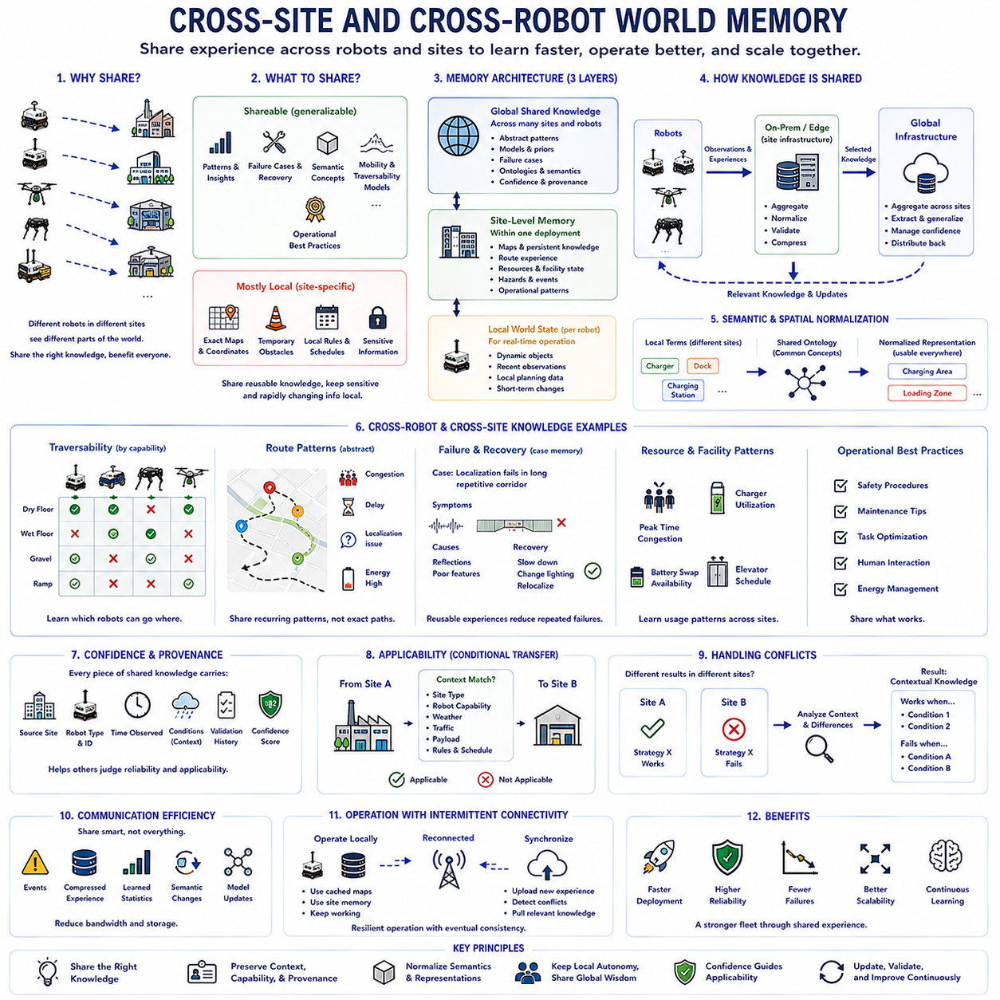{width="7.268055555555556in" height="7.268055555555556in"}

Cross-site and cross-robot world memory extends collective robot knowledge beyond a single robot or local fleet. Robots operating in different buildings, factories, warehouses, campuses, outdoor areas, or geographic regions can accumulate experiences that contain reusable patterns. By sharing appropriate knowledge across sites, organizations can transform isolated deployments into a distributed learning system in which operational experience gained in one environment can benefit others.

Cross-robot memory begins with the recognition that individual robots observe only a limited portion of the physical world. Each robot experiences different routes, obstacles, terrain conditions, failures, human interactions, and task outcomes. When these experiences are represented in compatible forms, observations from many robots can be combined into broader knowledge that exceeds the spatial, temporal, and experiential coverage of any individual platform.

Cross-site memory introduces an additional challenge because environments are not identical. Two warehouses may contain similar loading areas and corridors but have different layouts, traffic patterns, floor conditions, equipment, and operating rules. Shared memory should therefore distinguish knowledge that is site-specific from knowledge that can generalize across locations. Transfer should preserve context rather than assuming that experience from one site applies universally.

A useful architecture can separate local world state, site-level memory, and global shared knowledge. Local world state represents rapidly changing information needed by individual robots. Site memory aggregates persistent maps, route experience, hazards, resource states, and operational patterns within one deployment. Global memory extracts reusable knowledge across sites without requiring every local observation to become a universally accepted fact.

Spatial information requires careful treatment when transferred between sites. Absolute coordinates from one facility normally have no direct meaning in another facility, but structural relationships may still be reusable. Concepts such as narrow corridor, loading zone, ramp, doorway, intersection, charging area, or high-traffic region can provide transferable spatial abstractions. Cross-site memory therefore benefits from semantic and relational representations in addition to metric maps.

Semantic normalization is essential for combining knowledge produced by heterogeneous deployments. Different robots or sites may use different object identifiers, map labels, task names, or operational conventions. A shared ontology or compatible semantic representation can map these local descriptions into common concepts. Without this normalization, technically similar experiences may remain disconnected because they are encoded using different names or structures.

Robot heterogeneity creates another important dimension. Fleets may contain AMRs, autonomous vehicles, manipulators, quadrupeds, drones, or specialized inspection robots with different sensors and mobility capabilities. Cross-robot memory should preserve embodiment information so that experience can be interpreted according to the platform that generated it. Knowledge may be shared broadly while its applicability remains conditional on robot capability.

Capability-aware transfer prevents inappropriate generalization. A route successfully traversed by a small lightweight robot should not automatically be considered safe for a large loaded vehicle. Likewise, manipulation experience from one gripper configuration may not directly apply to another. Memory records can therefore include dimensions, payload, locomotion type, sensor configuration, control limits, and other capability descriptors that determine whether experience is transferable.

Shared traversability knowledge illustrates the value of cross-robot experience. Robots with different mobility systems may observe the same terrain and report different outcomes. Rather than forcing these observations into one universal traversability value, the system can learn relationships between terrain properties and robot capabilities. This creates a richer model that predicts which classes of robots can safely traverse particular environmental conditions.

Cross-site route experience can also be transferred at an abstract level. Exact paths remain local, but patterns such as congestion near loading areas, delays at shared intersections, localization degradation in repetitive corridors, or increased energy consumption on ramps may recur across facilities. Aggregating these patterns allows new deployments to begin with useful operational priors rather than learning every behavior entirely from scratch.

Success, failure, and recovery memory can provide especially valuable cross-site knowledge. A localization failure caused by reflective surfaces, a docking problem under particular lighting, or an effective recovery strategy may recur in many facilities. When context and robot configuration are preserved, such experiences can be shared as reusable cases. A failure encountered once can therefore reduce the probability of repetition across a much larger fleet.

Confidence should accompany transferred knowledge because applicability decreases as environments diverge. Knowledge generated repeatedly across many sites and robot types may deserve strong general confidence, while an observation supported by only one specialized deployment should remain conditional. Cross-site systems can estimate confidence from repetition, diversity of sources, similarity of context, historical success, and the quality of the original evidence.

Provenance becomes increasingly important as memory expands across sites. The system should retain where knowledge originated, which robot generated it, when it was observed, under which conditions, and how it was subsequently validated. Provenance enables receiving systems to judge relevance and reliability rather than treating remotely generated knowledge as unquestionable truth. It also supports revision when later evidence contradicts earlier conclusions.

Temporal validity must remain associated with cross-site knowledge. Some shared knowledge represents long-term patterns, while other information becomes stale rapidly. A structural lesson about localization may remain useful for years, whereas a temporary route blockage at another facility has little value outside its local context. Temporal decay and persistence models help determine which knowledge should remain local, which should be shared temporarily, and which should contribute to long-term global memory.

Communication efficiency requires selective synchronization. Transmitting every sensor frame, local map update, and trajectory from every robot to a global system would create enormous bandwidth and storage demands. Robots and site infrastructure can instead share compressed experiences, significant events, learned statistics, semantic changes, model updates, and representative cases. The objective is to transfer useful knowledge rather than duplicate all raw operational data.

Edge and on-premise systems can serve as intermediate memory layers. Individual robots maintain fast local memory, while on-premise infrastructure integrates observations across the local fleet and constructs a coherent site-level world model. Selected knowledge can then be synchronized with higher-level infrastructure, where patterns from multiple sites are aggregated. This hierarchy reduces communication while preserving local autonomy and enabling broader collective learning.

Disconnected operation must remain possible because sites or robots may temporarily lose access to shared infrastructure. Local systems should continue using cached maps, policies, route experience, and site memory without depending on continuous global connectivity. When communication is restored, new experiences can be synchronized, conflicts identified, and relevant global knowledge incorporated without interrupting local operation.

Cross-site memory must also manage conflicting evidence. A strategy successful at one facility may perform poorly elsewhere because environmental or operational conditions differ. Rather than averaging contradictory outcomes blindly, the system should identify the variables explaining the difference. Site type, robot configuration, weather, traffic, payload, infrastructure, and task context can convert apparent contradictions into conditional knowledge with clearly defined applicability.

Privacy, security, and operational boundaries become more important when knowledge crosses deployment boundaries. Some maps, task histories, facility structures, or operational patterns may be inappropriate to distribute globally. Memory architecture should therefore support access control and selective abstraction, allowing transferable learning to be separated from sensitive site-specific information. Collective learning does not require unrestricted replication of every local detail.

A fleet world model can use cross-site experience to learn broader transition patterns. Instead of predicting future states from one environment alone, it can learn how robot actions interact with recurring structures, terrain types, resources, hazards, and traffic conditions across many deployments. Local observations can then adapt these general predictions to the current site, combining broad prior experience with immediate physical evidence.

Cross-site memory also supports faster deployment of new robots and facilities. A new site initially has limited local experience, but it does not need to begin with completely empty operational knowledge. Relevant priors, failure cases, recovery strategies, mobility models, and semantic relationships can be transferred from similar deployments. Local experience then progressively updates and specializes this inherited knowledge for the new environment.

Ultimately, cross-site and cross-robot world memory transforms separate robotic deployments into a distributed collective learning network. Local robots contribute observations, site systems consolidate operational experience, and broader infrastructure extracts reusable knowledge while preserving context, confidence, provenance, and embodiment. Each deployment can learn locally while contributing selectively to shared intelligence, allowing the entire robot ecosystem to become more capable as cumulative physical experience grows.

사이트 간 및 로봇 간 월드 메모리(cross-site and cross-robot world memory)는 집단 로봇 지식(collective robot knowledge)을 단일 로봇이나 로컬 플릿(local fleet)의 범위를 넘어 확장한다. 서로 다른 건물, 공장, 창고, 캠퍼스, 야외 지역 또는 지리적 영역에서 운용되는 로봇은 재사용 가능한 패턴을 포함하는 경험을 축적할 수 있다. 적절한 지식을 사이트 간에 공유함으로써 조직은 개별적으로 분리된 배치 환경을 하나의 분산 학습 시스템(distributed learning system)으로 전환하여 한 환경에서 얻은 운용 경험이 다른 환경에도 도움이 되도록 할 수 있다.

로봇 간 메모리(cross-robot memory)는 개별 로봇이 물리적 세계의 제한된 부분만 관찰한다는 인식에서 시작한다. 각각의 로봇은 서로 다른 경로, 장애물, 지형 조건, 실패, 인간과의 상호작용 및 작업 결과를 경험한다. 이러한 경험이 호환 가능한 형태로 표현되면 여러 로봇의 관찰을 결합하여 개별 플랫폼이 가질 수 있는 공간적, 시간적 및 경험적 범위를 넘어서는 더욱 광범위한 지식을 구축할 수 있다.

사이트 간 메모리(cross-site memory)는 환경들이 서로 동일하지 않기 때문에 추가적인 과제를 발생시킨다. 두 창고가 유사한 적재 구역과 통로를 가지고 있더라도 레이아웃, 교통 패턴, 바닥 조건, 장비 및 운용 규칙은 서로 다를 수 있다. 따라서 공유 메모리(shared memory)는 특정 사이트에만 적용되는 지식과 여러 위치에 일반화할 수 있는 지식을 구분해야 한다. 지식 이전(transfer)은 한 사이트의 경험이 모든 곳에 보편적으로 적용된다고 가정하지 않고 해당 경험의 맥락(context)을 보존해야 한다.

유용한 아키텍처는 로컬 월드 상태(local world state), 사이트 수준 메모리(site-level memory), 글로벌 공유 지식(global shared knowledge)을 분리할 수 있다. 로컬 월드 상태는 개별 로봇이 필요로 하는 빠르게 변화하는 정보를 표현한다. 사이트 메모리는 하나의 배치 환경에서 지속적인 지도, 경로 경험, 위험 요소, 자원 상태 및 운용 패턴을 통합한다. 글로벌 메모리(global memory)는 모든 로컬 관찰을 보편적으로 인정되는 사실로 만들 필요 없이 여러 사이트에서 재사용할 수 있는 지식을 추출한다.

공간 정보(spatial information)를 사이트 간에 이전할 때는 신중한 처리가 필요하다. 한 시설의 절대 좌표(absolute coordinates)는 일반적으로 다른 시설에서 직접적인 의미를 가지지 않지만 구조적 관계(structural relationship)는 여전히 재사용할 수 있다. 좁은 통로, 적재 구역, 경사로, 출입구, 교차로, 충전 구역 또는 혼잡 지역과 같은 개념은 이전 가능한 공간적 추상화(spatial abstraction)를 제공한다. 따라서 사이트 간 메모리는 미터법 지도(metric map)뿐만 아니라 의미적 및 관계적 표현(semantic and relational representation)을 활용하는 것이 유용하다.

의미 정규화(semantic normalization)는 서로 다른 배치 환경에서 생성된 지식을 결합하기 위해 필수적이다. 서로 다른 로봇이나 사이트에서는 객체 식별자, 지도 라벨, 작업 이름 또는 운용 규칙에 서로 다른 표현을 사용할 수 있다. 공유 온톨로지(shared ontology) 또는 호환 가능한 의미 표현을 사용하면 이러한 로컬 설명을 공통 개념으로 매핑할 수 있다. 이러한 정규화가 없다면 기술적으로 유사한 경험도 서로 다른 이름이나 구조로 인코딩되어 있기 때문에 연결되지 않은 상태로 남을 수 있다.

로봇 이질성(robot heterogeneity)은 또 다른 중요한 차원을 형성한다. 플릿에는 서로 다른 센서와 이동 능력을 가진 자율이동로봇(AMR), 자율주행 차량, 매니퓰레이터(manipulator), 사족보행 로봇(quadruped), 드론(drone) 또는 특수 검사 로봇이 포함될 수 있다. 로봇 간 메모리는 형태 정보(embodiment information)를 보존하여 경험이 해당 경험을 생성한 플랫폼에 따라 해석될 수 있도록 해야 한다. 지식 자체는 광범위하게 공유할 수 있지만 그 적용 가능성(applicability)은 로봇의 능력에 따라 조건부로 유지되어야 한다.

능력 인지형 이전(capability-aware transfer)은 부적절한 일반화를 방지한다. 작고 가벼운 로봇이 성공적으로 통과한 경로를 대형 적재 차량에도 자동으로 안전하다고 판단해서는 안 된다. 마찬가지로 특정 그리퍼 구성(gripper configuration)에서 얻은 조작 경험이 다른 구성에 직접 적용되지 않을 수 있다. 따라서 메모리 기록에는 크기, 적재량(payload), 이동 방식(locomotion type), 센서 구성, 제어 한계 및 경험의 이전 가능성을 결정하는 기타 능력 기술자(capability descriptor)를 포함할 수 있다.

공유 주행 가능성 지식(shared traversability knowledge)은 로봇 간 경험의 가치를 잘 보여준다. 서로 다른 이동 시스템을 가진 로봇은 동일한 지형을 관찰하면서 서로 다른 결과를 보고할 수 있다. 이러한 관찰을 하나의 보편적인 주행 가능성 값으로 강제로 통합하는 대신 시스템은 지형 특성과 로봇 능력 사이의 관계를 학습할 수 있다. 이를 통해 특정 환경 조건을 어떤 종류의 로봇이 안전하게 통과할 수 있는지를 예측하는 더욱 풍부한 모델을 구축할 수 있다.

사이트 간 경로 경험(cross-site route experience)도 추상화된 수준에서 이전할 수 있다. 정확한 이동 경로 자체는 로컬 정보로 유지되지만 적재 구역 주변의 혼잡, 공유 교차로에서의 지연, 반복적인 통로 구조에서의 위치 추정 성능 저하 또는 경사로에서의 에너지 소비 증가와 같은 패턴은 여러 시설에서 반복될 수 있다. 이러한 패턴을 통합하면 새로운 배치 환경이 모든 운용 특성을 처음부터 학습하는 대신 유용한 운용 사전지식(operational prior)을 가지고 시작할 수 있다.

성공, 실패 및 복구 메모리(success, failure, and recovery memory)는 특히 가치 있는 사이트 간 지식을 제공할 수 있다. 반사 표면으로 인한 위치 추정 실패, 특정 조명 조건에서의 도킹 문제 또는 효과적인 복구 전략은 여러 시설에서 반복적으로 발생할 수 있다. 맥락과 로봇 구성이 보존된다면 이러한 경험을 재사용 가능한 사례(reusable case)로 공유할 수 있다. 따라서 한 번 경험한 실패가 훨씬 더 큰 플릿 전체에서 동일한 문제가 반복될 가능성을 감소시킬 수 있다.

이전된 지식에는 신뢰도(confidence)가 함께 포함되어야 한다. 환경의 차이가 커질수록 지식의 적용 가능성이 감소하기 때문이다. 여러 사이트와 여러 로봇 유형에서 반복적으로 생성된 지식은 높은 일반적 신뢰도(general confidence)를 가질 수 있지만, 하나의 특수한 배치 환경에서만 확인된 관찰은 조건부로 유지되어야 한다. 사이트 간 시스템은 반복성, 정보 출처의 다양성(source diversity), 맥락의 유사성, 과거 성공 여부 및 원래 증거의 품질을 바탕으로 신뢰도를 추정할 수 있다.

메모리가 여러 사이트로 확장될수록 정보 출처(provenance)는 더욱 중요해진다. 시스템은 지식이 어디에서 생성되었는지, 어떤 로봇이 생성했는지, 언제 관찰되었는지, 어떤 조건에서 생성되었는지, 그리고 이후 어떻게 검증되었는지를 유지해야 한다. 정보 출처를 통해 지식을 수신하는 시스템은 원격에서 생성된 정보를 의심할 수 없는 사실로 취급하는 대신 관련성과 신뢰성을 판단할 수 있다. 또한 이후의 증거가 이전 결론과 충돌할 경우 이를 수정할 수 있도록 지원한다.

시간적 유효성(temporal validity) 역시 사이트 간 지식과 연결되어 유지되어야 한다. 일부 공유 지식은 장기적인 패턴을 나타내지만 다른 정보는 빠르게 오래된 정보가 된다. 위치 추정과 관련된 구조적인 교훈은 수년 동안 유용할 수 있지만, 다른 시설에서 발생한 일시적인 경로 차단은 해당 로컬 환경을 벗어나면 거의 가치가 없다. 시간적 감쇠(temporal decay)와 지속성 모델(persistence model)은 어떤 지식을 로컬에 유지하고, 어떤 지식을 일시적으로 공유하며, 어떤 지식을 장기적인 글로벌 메모리에 반영해야 하는지를 결정하는 데 도움을 준다.

통신 효율성(communication efficiency)을 위해서는 선택적 동기화(selective synchronization)가 필요하다. 모든 로봇의 센서 프레임, 로컬 지도 업데이트 및 이동 궤적을 글로벌 시스템에 전송하면 막대한 대역폭과 저장 공간이 필요하다. 대신 로봇과 사이트 인프라는 압축된 경험(compressed experience), 중요한 사건, 학습된 통계, 의미적 변화, 모델 업데이트 및 대표적인 사례를 공유할 수 있다. 목표는 모든 원시 운용 데이터를 복제하는 것이 아니라 유용한 지식을 전달하는 것이다.

엣지(edge) 및 온프레미스 시스템(on-premise system)은 중간 메모리 계층(intermediate memory layer)의 역할을 수행할 수 있다. 개별 로봇은 빠른 로컬 메모리를 유지하고, 온프레미스 인프라는 로컬 플릿 전체의 관찰을 통합하여 일관된 사이트 수준 월드 모델(site-level world model)을 구축한다. 선택된 지식은 이후 상위 수준 인프라와 동기화되고 여러 사이트의 패턴이 통합된다. 이러한 계층 구조는 로컬 자율성(local autonomy)을 유지하면서 통신량을 감소시키고 더 광범위한 집단 학습(collective learning)을 가능하게 한다.

사이트 또는 로봇이 공유 인프라와 일시적으로 연결되지 않을 수 있으므로 연결 단절 운용(disconnected operation)이 가능해야 한다. 로컬 시스템은 지속적인 글로벌 연결에 의존하지 않고 캐시된 지도, 정책, 경로 경험 및 사이트 메모리를 이용하여 계속 작동해야 한다. 통신이 복구되면 새로운 경험을 동기화하고, 충돌을 식별하며, 관련 글로벌 지식을 로컬 운용을 중단하지 않고 반영할 수 있다.

사이트 간 메모리는 상충하는 증거(conflicting evidence)도 관리해야 한다. 한 시설에서 성공한 전략이 환경이나 운용 조건의 차이 때문에 다른 시설에서는 제대로 작동하지 않을 수 있다. 서로 모순되는 결과를 무조건 평균화하는 대신 시스템은 차이를 설명하는 변수를 식별해야 한다. 사이트 유형, 로봇 구성, 날씨, 교통량, 적재량, 인프라 및 작업 맥락을 고려하면 겉으로 보이는 모순을 명확한 적용 조건을 가진 조건부 지식(conditional knowledge)으로 전환할 수 있다.

지식이 배치 경계(deployment boundary)를 넘어 이동하면 개인정보 보호(privacy), 보안(security) 및 운용 경계(operational boundary)가 더욱 중요해진다. 일부 지도, 작업 이력, 시설 구조 또는 운용 패턴은 글로벌하게 배포하기에 적절하지 않을 수 있다. 따라서 메모리 아키텍처는 접근 제어(access control)와 선택적 추상화(selective abstraction)를 지원하여 이전 가능한 학습 지식과 민감한 사이트별 정보를 분리할 수 있어야 한다. 집단 학습은 모든 로컬 세부 정보를 제한 없이 복제할 필요가 없다.

플릿 월드 모델(fleet world model)은 사이트 간 경험을 활용하여 보다 광범위한 상태 전이 패턴(state-transition pattern)을 학습할 수 있다. 하나의 환경만을 기반으로 미래 상태를 예측하는 대신 로봇 행동이 여러 배치 환경에서 반복적으로 나타나는 구조, 지형 유형, 자원, 위험 요소 및 교통 조건과 어떻게 상호작용하는지를 학습할 수 있다. 이후 로컬 관찰을 이용하여 이러한 일반적인 예측을 현재 사이트에 적응시킴으로써 광범위한 사전 경험과 즉각적인 물리적 증거를 결합할 수 있다.

사이트 간 메모리는 새로운 로봇과 시설을 더욱 빠르게 배치하는 것도 지원한다. 새로운 사이트는 처음에는 로컬 경험이 제한되어 있지만 완전히 비어 있는 운용 지식에서 시작할 필요는 없다. 유사한 배치 환경에서 관련 사전지식(prior), 실패 사례, 복구 전략, 이동 모델 및 의미적 관계를 이전할 수 있다. 이후 로컬 경험이 축적되면서 상속된 지식(inherited knowledge)을 새로운 환경에 맞게 점진적으로 갱신하고 특화할 수 있다.

궁극적으로 사이트 간 및 로봇 간 월드 메모리(cross-site and cross-robot world memory)는 서로 분리된 로봇 배치 환경을 분산형 집단 학습 네트워크(distributed collective learning network)로 전환한다. 로컬 로봇은 관찰 정보를 제공하고, 사이트 시스템은 운용 경험을 통합하며, 상위 인프라는 맥락, 신뢰도, 정보 출처 및 로봇 형태를 보존하면서 재사용 가능한 지식을 추출한다. 각각의 배치 환경은 로컬에서 학습하는 동시에 선택적으로 공유 지능(shared intelligence)에 기여할 수 있으며, 이를 통해 누적되는 물리적 경험이 증가할수록 전체 로봇 생태계(robot ecosystem)의 능력도 함께 향상될 수 있다.

##  

## 06.16. Fleet Memory for Planning and Task Allocation

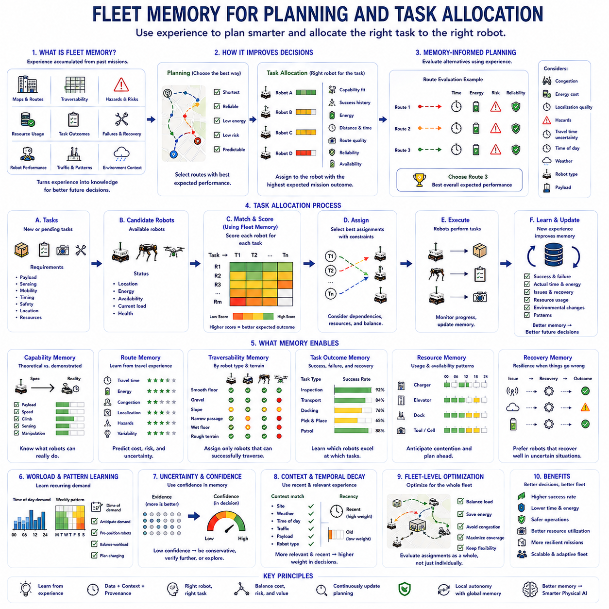{width="7.268055555555556in" height="7.268055555555556in"}

Fleet memory provides planning and task allocation with knowledge accumulated from previous robot operations rather than forcing every decision to depend only on the current snapshot of the environment. Maps, route experience, traversability, hazards, resource usage, task outcomes, failures, and recovery histories can all influence future decisions. Planning therefore becomes experience-aware, while task allocation becomes grounded in demonstrated fleet capability.

Traditional task allocation often considers simple variables such as robot availability, distance to a task, nominal capability, and estimated execution time. These variables are useful but incomplete because two robots with similar specifications may perform differently under actual operating conditions. Fleet memory adds empirical knowledge about how particular robots, routes, environments, payloads, and task types have performed in previous missions.

Planning can use shared spatial and semantic memory to understand more than geometric connectivity. A route may be physically open but historically congested, energy intensive, difficult to localize within, or associated with repeated hazards. Another route may be slightly longer but consistently reliable. By incorporating stored experience, planners can evaluate alternatives according to expected operational performance rather than shortest distance alone.

Task allocation benefits from the same principle. The robot closest to a task is not necessarily the best robot for that task. A more distant robot may have suitable sensing, higher remaining energy, better mobility for the required terrain, stronger historical success on similar tasks, or easier access through reliable routes. Memory allows assignment decisions to reflect expected mission outcome instead of proximity alone.

Capability memory provides a bridge between nominal specifications and demonstrated performance. Robot descriptions may state payload, speed, sensing, manipulation, or mobility limits, but operational history reveals how these capabilities behave under real conditions. Repeated successful and failed missions can refine estimates of effective capability, allowing the fleet to distinguish what a robot theoretically supports from what it has reliably demonstrated.

Route memory contributes expected travel time, energy consumption, congestion, localization quality, hazards, and variability. These values can be conditioned on robot type, payload, time of day, weather, traffic, or operational state. A planner can therefore estimate not only the nominal cost of reaching a task but also the uncertainty and reliability of that estimate, improving scheduling and assignment decisions.

Traversability memory is especially important in heterogeneous fleets. Wheeled robots, heavy vehicles, quadrupeds, and other platforms may experience the same terrain differently. Historical mobility outcomes can indicate which robot classes have successfully crossed particular surfaces, slopes, narrow passages, or degraded terrain. Task allocation can use this knowledge to avoid assigning missions whose access requirements exceed demonstrated mobility capability.

Hazard and risk memory adds a safety dimension to planning. Routes and work areas may contain recurring human traffic, unstable terrain, poor communication, localization degradation, or previous near misses. These conditions can be incorporated into planning costs and assignment constraints. Safety-sensitive missions may favor robots and routes with stronger historical reliability even when they require additional travel time or energy.

Success and failure memory provides evidence about task suitability. If a robot has repeatedly completed a particular inspection, manipulation, transport, or navigation task successfully, the fleet gains confidence in assigning similar missions. Conversely, repeated failures under comparable conditions may lower assignment priority or trigger additional safeguards. Failure becomes information for future decisions rather than merely an operational loss.

Recovery memory helps planners evaluate resilience as well as nominal success probability. Two robots may have similar expected task performance, but one may possess proven recovery strategies for localization loss, blocked routes, or manipulation errors. When missions occur in uncertain environments, the ability to recover can significantly affect expected completion probability. Planning can therefore value recoverability as an operational capability.

Task allocation can be formulated as a memory-informed matching problem between task requirements and robot capability. Task requirements may include payload, sensing, manipulation, terrain access, precision, energy, timing, safety, and communication constraints. Fleet memory provides evidence about how well each robot or robot class satisfies those requirements under comparable conditions, producing a more realistic suitability estimate.

Memory can also improve estimates of task duration. Nominal execution times often ignore setup delays, traffic, docking difficulty, resource contention, recovery events, or site-specific operating patterns. Historical task records reveal actual completion-time distributions. Schedulers can use these distributions to create more realistic plans, estimate uncertainty, and reduce cascading delays caused by systematically optimistic assumptions.

Resource memory is important when tasks depend on chargers, elevators, docking stations, tools, work cells, loading zones, or shared infrastructure. Historical usage patterns can indicate when resources become congested or unavailable. Current resource state combined with past experience allows planning systems to anticipate contention and coordinate robot assignments before several robots independently compete for the same resource.

Fleet memory also supports multi-robot task dependencies. Some missions require sequential operations, cooperative transport, shared sensing, handoffs, or synchronized arrival. Historical records can reveal which robot combinations coordinate effectively, how long handoffs normally take, and where synchronization failures occur. Allocation can therefore consider relationships among robots rather than evaluating each robot-task pair independently.

The fleet can learn recurring workload patterns from memory. Certain task types may appear at predictable times, specific areas may experience periodic demand, and charging requirements may increase after particular mission sequences. These temporal patterns allow planning to move from reactive assignment toward anticipatory resource positioning, charging, staging, and workload balancing before demand actually occurs.

Uncertainty and confidence should accompany memory-informed planning. Historical evidence may be sparse, outdated, or collected under different conditions. A robot with one successful traversal should not necessarily receive the same confidence as one with hundreds of successful examples. Planners can combine expected performance with uncertainty so that poorly supported estimates trigger conservative choices, additional verification, or exploration.

Temporal decay prevents old experience from dominating decisions after conditions change. A route that was reliable months ago may now contain construction, while a robot that previously failed may have received hardware or software improvements. Fleet memory should therefore weight experience according to recency, persistence, context similarity, and subsequent validation. Planning must use memory as evolving evidence rather than permanent truth.

Conflicting experiences can reveal conditional relationships useful for allocation. One robot may perform well on a route while another repeatedly struggles, or the same robot may succeed when lightly loaded and fail with a heavy payload. Instead of averaging these outcomes into a single fleet-wide score, memory can preserve contextual differences and learn which combinations of robot, task, environment, and operating condition produce success.

Fleet world models can extend memory-informed planning from historical evaluation to future prediction. Current shared state and accumulated experience can be used to simulate likely consequences of alternative assignments. The system may predict travel time, congestion, energy demand, resource conflicts, hazards, task completion probability, and downstream effects before committing robots to missions.

This enables planning to evaluate collective consequences rather than optimizing each assignment independently. Sending the individually closest robot to every task may overload one region, create corridor congestion, exhaust nearby batteries, or leave another area uncovered. Fleet-level reasoning can compare assignment combinations and select solutions that balance mission performance, energy, safety, resource usage, and future flexibility across the entire fleet.

On-premise infrastructure can maintain the memory and computational context required for these decisions. It can aggregate robot experience, update route and task statistics, track shared resources, evaluate confidence, and provide fleet-level predictions while robots retain local autonomy for immediate control and safety. This division allows fast local response to coexist with broader experience-based coordination.

Ultimately, fleet memory transforms planning and task allocation from snapshot-based optimization into experience-based collective decision making. The fleet remembers where robots have traveled, what they accomplished, which conditions caused difficulty, how resources were used, and which recovery strategies succeeded. Each mission therefore improves the evidence available for future assignments, enabling progressively safer, more efficient, adaptive, and coordinated Physical AI.

플릿 메모리(fleet memory)는 모든 의사결정이 현재 환경의 순간적인 상태에만 의존하도록 하는 대신, 이전 로봇 운용에서 축적된 지식을 계획(planning)과 작업 할당(task allocation)에 제공한다. 지도, 경로 경험(route experience), 주행 가능성(traversability), 위험 요소, 자원 사용, 작업 결과, 실패 및 복구 이력은 모두 향후 의사결정에 영향을 줄 수 있다. 따라서 계획은 경험 인지형(experience-aware)으로 발전하고, 작업 할당은 실제로 입증된 플릿 능력(demonstrated fleet capability)을 기반으로 수행된다.

전통적인 작업 할당은 일반적으로 로봇 가용성(robot availability), 작업까지의 거리, 명목상 능력(nominal capability), 예상 실행 시간과 같은 단순한 변수를 고려한다. 이러한 변수는 유용하지만 완전하지는 않다. 유사한 사양을 가진 두 로봇도 실제 운용 조건에서는 서로 다른 성능을 나타낼 수 있기 때문이다. 플릿 메모리는 특정 로봇, 경로, 환경, 적재량(payload) 및 작업 유형이 과거 임무에서 실제로 어떤 성능을 보였는지에 대한 경험적 지식(empirical knowledge)을 추가한다.

계획은 공유 공간 및 의미 메모리(shared spatial and semantic memory)를 활용하여 단순한 기하학적 연결성(geometric connectivity) 이상의 정보를 이해할 수 있다. 특정 경로가 물리적으로 열려 있더라도 과거에 지속적인 혼잡, 높은 에너지 소비, 위치 추정의 어려움 또는 반복적인 위험 요소와 연관되었을 수 있다. 다른 경로는 조금 더 길지만 지속적으로 높은 신뢰성을 보일 수 있다. 저장된 경험을 반영하면 계획 시스템은 최단 거리만이 아니라 예상되는 실제 운용 성능을 기준으로 대안을 평가할 수 있다.

작업 할당 역시 동일한 원리를 활용할 수 있다. 작업 위치에서 가장 가까운 로봇이 반드시 해당 작업에 가장 적합한 로봇인 것은 아니다. 더 멀리 있는 로봇이 필요한 센싱 능력, 더 많은 잔여 에너지, 요구되는 지형에 적합한 이동 능력, 유사한 작업에서의 높은 과거 성공률 또는 신뢰할 수 있는 경로를 통한 더 좋은 접근성을 가질 수 있다. 메모리를 활용하면 할당 의사결정은 단순한 근접성이 아니라 예상되는 임무 결과(expected mission outcome)를 반영할 수 있다.

능력 메모리(capability memory)는 명목상 사양과 실제로 입증된 성능 사이를 연결한다. 로봇 사양에는 적재량, 속도, 센싱, 조작 또는 이동 한계가 명시될 수 있지만, 실제 운용 이력은 이러한 능력이 현실적인 조건에서 어떻게 나타나는지를 보여준다. 반복적인 성공 및 실패 임무를 통해 실효 능력(effective capability)에 대한 추정을 개선함으로써 플릿은 로봇이 이론적으로 지원하는 기능과 실제로 신뢰성 있게 입증한 기능을 구분할 수 있다.

경로 메모리(route memory)는 예상 이동 시간, 에너지 소비, 혼잡, 위치 추정 품질(localization quality), 위험 요소 및 변동성(variability)에 대한 정보를 제공한다. 이러한 값은 로봇 유형, 적재량, 시간대, 날씨, 교통량 또는 운용 상태에 따라 조건화할 수 있다. 따라서 계획 시스템은 작업에 도달하는 명목상 비용뿐만 아니라 해당 추정의 불확실성과 신뢰성까지 평가하여 더욱 정확한 일정 계획과 작업 할당을 수행할 수 있다.

주행 가능성 메모리(traversability memory)는 이기종 플릿(heterogeneous fleet)에서 특히 중요하다. 바퀴형 로봇, 중량 차량, 사족보행 로봇(quadruped) 및 기타 플랫폼은 동일한 지형에서도 서로 다른 이동 성능을 보일 수 있다. 과거 이동 결과를 이용하면 어떤 로봇 유형이 특정 표면, 경사면, 좁은 통로 또는 열악한 지형을 성공적으로 통과했는지를 파악할 수 있다. 작업 할당 시스템은 이러한 지식을 이용하여 입증된 이동 능력을 초과하는 접근 요구조건을 가진 임무가 잘못 할당되는 것을 방지할 수 있다.

위험 요소 및 위험 메모리(hazard and risk memory)는 계획에 안전성 차원을 추가한다. 경로와 작업 영역에는 반복적인 사람 이동, 불안정한 지형, 낮은 통신 품질, 위치 추정 성능 저하 또는 과거의 아차 사고(near miss)가 존재할 수 있다. 이러한 조건은 계획 비용(planning cost)과 작업 할당 제약조건에 반영할 수 있다. 안전성이 중요한 임무에서는 이동 시간이나 에너지가 더 필요하더라도 과거 신뢰성이 높은 로봇과 경로를 우선할 수 있다.

성공 및 실패 메모리(success and failure memory)는 작업 적합성(task suitability)에 대한 증거를 제공한다. 특정 로봇이 특정 검사, 조작, 운송 또는 주행 작업을 반복적으로 성공했다면 플릿은 유사한 임무를 해당 로봇에 할당하는 데 더 높은 신뢰도를 가질 수 있다. 반대로 유사한 조건에서 반복적인 실패가 발생했다면 작업 할당 우선순위를 낮추거나 추가적인 안전 조치를 적용할 수 있다. 실패는 단순한 운용 손실이 아니라 향후 의사결정을 위한 정보가 된다.

복구 메모리(recovery memory)는 계획 시스템이 명목상 성공 확률뿐만 아니라 복원력(resilience)도 평가할 수 있도록 한다. 두 로봇의 예상 작업 성능이 비슷하더라도 한 로봇이 위치 추정 손실, 경로 차단 또는 조작 오류에 대해 검증된 복구 전략을 가지고 있을 수 있다. 불확실한 환경에서 수행되는 임무에서는 복구 능력이 예상 완료 확률에 상당한 영향을 줄 수 있다. 따라서 계획은 복구 가능성(recoverability)을 하나의 운용 능력으로 평가할 수 있다.

작업 할당은 작업 요구사항(task requirements)과 로봇 능력(robot capability) 사이의 메모리 기반 매칭 문제(memory-informed matching problem)로 구성할 수 있다. 작업 요구사항에는 적재량, 센싱, 조작, 지형 접근성, 정밀도, 에너지, 시간, 안전 및 통신 제약조건이 포함될 수 있다. 플릿 메모리는 각각의 로봇 또는 로봇 유형이 유사한 조건에서 이러한 요구사항을 얼마나 잘 충족했는지에 대한 증거를 제공하여 더욱 현실적인 적합성 추정(suitability estimate)을 가능하게 한다.

메모리는 작업 수행 시간(task duration)의 추정도 개선할 수 있다. 명목상 실행 시간은 준비 지연, 교통량, 도킹 난이도, 자원 경합(resource contention), 복구 사건 또는 사이트별 운용 패턴을 고려하지 않는 경우가 많다. 과거 작업 기록은 실제 완료 시간 분포(completion-time distribution)를 보여준다. 스케줄러(scheduler)는 이러한 분포를 활용하여 더욱 현실적인 계획을 생성하고 불확실성을 추정하며, 지나치게 낙관적인 가정으로 인해 연쇄적으로 발생하는 지연을 줄일 수 있다.

작업이 충전기, 엘리베이터, 도킹 스테이션, 도구, 작업 셀(work cell), 적재 구역 또는 공유 인프라에 의존하는 경우 자원 메모리(resource memory)가 중요하다. 과거 사용 패턴은 특정 자원이 언제 혼잡해지거나 사용할 수 없게 되는지를 보여줄 수 있다. 현재 자원 상태와 과거 경험을 결합하면 여러 로봇이 동일한 자원을 독립적으로 사용하려고 경쟁하기 전에 계획 시스템이 자원 경합을 예상하고 작업 할당을 조정할 수 있다.

플릿 메모리는 다중 로봇 작업 의존성(multi-robot task dependency)도 지원한다. 일부 임무는 순차적인 작업, 협력 운송, 공유 센싱, 작업 인계(handoff) 또는 동기화된 도착을 필요로 한다. 과거 기록은 어떤 로봇 조합이 효과적으로 협력했는지, 작업 인계에 일반적으로 어느 정도 시간이 필요한지, 그리고 동기화 실패가 어디에서 발생하는지를 보여줄 수 있다. 따라서 작업 할당은 각각의 로봇-작업 쌍만 독립적으로 평가하는 대신 로봇 사이의 관계도 고려할 수 있다.

플릿은 메모리를 통해 반복적인 작업 부하 패턴(workload pattern)을 학습할 수 있다. 특정 작업 유형이 예측 가능한 시간에 발생하거나, 특정 영역에서 주기적인 수요가 발생하거나, 특정 임무 순서 이후 충전 요구가 증가할 수 있다. 이러한 시간적 패턴(temporal pattern)을 활용하면 계획 시스템은 단순한 반응형 할당(reactive assignment)에서 벗어나 실제 수요가 발생하기 전에 선제적으로 자원을 배치하고, 충전하고, 대기시키며, 작업 부하를 균형 있게 분산할 수 있다.

불확실성과 신뢰도(uncertainty and confidence)는 메모리 기반 계획(memory-informed planning)에 함께 포함되어야 한다. 과거 증거는 부족하거나 오래되었거나 현재와 다른 조건에서 수집되었을 수 있다. 한 번 성공적으로 경로를 통과한 로봇과 수백 번 성공한 로봇에 동일한 신뢰도를 부여해서는 안 된다. 계획 시스템은 예상 성능과 불확실성을 결합하여 증거가 부족한 추정에 대해서는 보수적인 선택, 추가 검증 또는 탐색(exploration)을 수행할 수 있다.

시간적 감쇠(temporal decay)는 환경 조건이 변화한 이후에도 오래된 경험이 의사결정을 지배하는 것을 방지한다. 몇 달 전에는 신뢰할 수 있었던 경로가 현재는 공사 중일 수 있으며, 이전에 실패했던 로봇도 하드웨어 또는 소프트웨어 개선을 통해 성능이 향상되었을 수 있다. 따라서 플릿 메모리는 최신성(recency), 지속성(persistence), 맥락 유사성(context similarity) 및 이후의 검증 결과에 따라 경험의 가중치를 조정해야 한다. 계획 시스템은 메모리를 영구적인 진실이 아니라 지속적으로 변화하는 증거로 활용해야 한다.

서로 상충하는 경험(conflicting experience)은 작업 할당에 유용한 조건부 관계(conditional relationship)를 드러낼 수 있다. 한 로봇은 특정 경로에서 좋은 성능을 보이지만 다른 로봇은 반복적으로 어려움을 겪을 수 있으며, 동일한 로봇도 가벼운 적재 상태에서는 성공하지만 무거운 적재 상태에서는 실패할 수 있다. 이러한 결과를 하나의 플릿 전체 점수로 단순 평균화하는 대신 메모리는 맥락적 차이를 유지하고 어떤 로봇, 작업, 환경 및 운용 조건의 조합이 성공을 만들어내는지를 학습할 수 있다.

플릿 월드 모델(fleet world model)은 메모리 기반 계획을 과거 경험의 평가에서 미래 예측(future prediction)으로 확장할 수 있다. 현재의 공유 상태(shared state)와 축적된 경험을 이용하여 서로 다른 작업 할당의 예상 결과를 내부적으로 시뮬레이션할 수 있다. 시스템은 실제로 로봇을 임무에 투입하기 전에 이동 시간, 혼잡, 에너지 요구량, 자원 충돌, 위험 요소, 작업 완료 확률 및 이후에 발생할 영향을 예측할 수 있다.

이를 통해 계획 시스템은 각각의 작업 할당을 독립적으로 최적화하는 대신 집단적 결과(collective consequence)를 평가할 수 있다. 모든 작업에 개별적으로 가장 가까운 로봇을 배치하면 특정 영역에 작업이 집중되고, 통로 혼잡이 발생하며, 주변 로봇의 배터리가 고갈되거나 다른 영역에 필요한 로봇이 부족해질 수 있다. 플릿 수준 추론(fleet-level reasoning)은 여러 할당 조합을 비교하여 전체 플릿에서 임무 성능, 에너지, 안전, 자원 사용 및 미래 유연성(future flexibility)의 균형을 유지하는 해법을 선택할 수 있다.

온프레미스 인프라(on-premise infrastructure)는 이러한 의사결정에 필요한 메모리와 계산 맥락(computational context)을 유지할 수 있다. 로봇 경험을 통합하고, 경로 및 작업 통계를 갱신하며, 공유 자원을 추적하고, 신뢰도를 평가하며, 플릿 수준 예측을 제공할 수 있다. 동시에 개별 로봇은 즉각적인 제어와 안전을 위한 로컬 자율성(local autonomy)을 유지한다. 이러한 역할 분담은 빠른 로컬 대응과 광범위한 경험 기반 협업을 동시에 가능하게 한다.

궁극적으로 플릿 메모리(fleet memory)는 계획 및 작업 할당(planning and task allocation)을 순간 상태 기반 최적화(snapshot-based optimization)에서 경험 기반 집단 의사결정(experience-based collective decision making)으로 전환한다. 플릿은 로봇이 어디를 이동했는지, 무엇을 수행했는지, 어떤 조건에서 어려움이 발생했는지, 자원이 어떻게 사용되었는지, 어떤 복구 전략이 성공했는지를 기억한다. 따라서 각각의 임무는 향후 작업 할당에 활용할 수 있는 증거를 지속적으로 향상시키며, 점점 더 안전하고 효율적이며 적응적이고 협력적인 물리 AI(Physical AI)를 가능하게 한다.

##  

## 06.17. Fleet World Memory Architecture

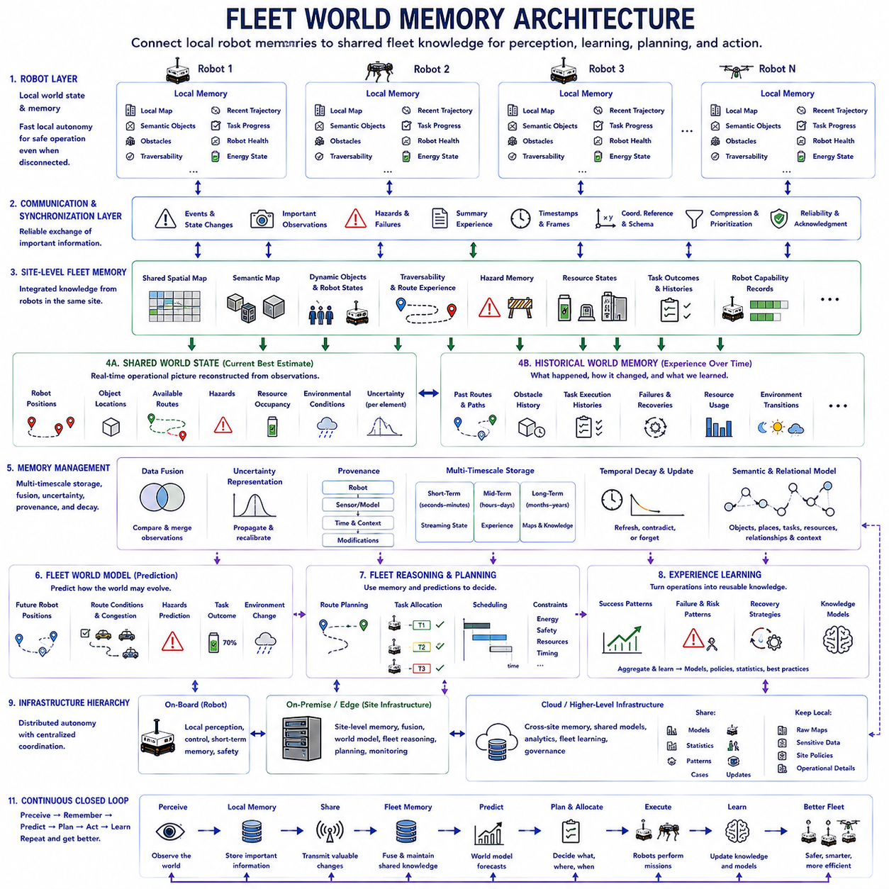{width="7.268055555555556in" height="7.268055555555556in"}

A fleet world memory architecture provides the structural framework through which multiple robots can observe, store, exchange, integrate, and reuse knowledge about their shared physical environment. Rather than treating each robot as an isolated autonomous system, the architecture connects local perception and memory with fleet-level knowledge, enabling individual experiences to become persistent information that supports coordinated operation, prediction, planning, and collective learning.

The architecture begins at the robot level, where each robot maintains a local world state derived from its sensors, localization system, perception models, control state, and task context. This local representation must support fast decision cycles because collision avoidance, motion control, manipulation, and immediate safety cannot depend on remote infrastructure. Local memory therefore preserves the autonomy required for real-time operation even when communication is delayed or unavailable.

Robot memory can contain local maps, semantic objects, nearby obstacles, traversability estimates, recent trajectories, task progress, robot health, energy state, and short-term interaction history. These elements form the robot\'s immediate operational context. Only information that has potential fleet value needs to move upward, reducing communication requirements while allowing the robot to retain detailed high-frequency data required for local reasoning and control.

An edge communication and synchronization layer connects individual robot memories with shared infrastructure. This layer manages message exchange, timestamps, coordinate references, data schemas, compression, prioritization, and communication reliability. Instead of continuously transmitting every sensor measurement, robots can communicate state changes, important observations, summarized experience, hazards, failures, and other events that materially affect the shared understanding of the world.

Above the robot layer, site-level fleet memory integrates observations generated by multiple robots operating within the same environment. This memory can contain shared spatial maps, semantic maps, dynamic object states, traversability information, route experience, hazard memory, resource states, task outcomes, and robot capability records. It provides a common operational knowledge base that extends beyond the sensing range and experience of any single robot.

Memory fusion is a central function of this architecture because incoming observations may overlap, disagree, or represent different moments in time. Fusion mechanisms compare location, timestamp, semantic identity, source reliability, uncertainty, and environmental context before updating shared beliefs. The objective is not simply to merge data, but to maintain a coherent representation that preserves both supporting evidence and meaningful disagreement.

A shared world state layer represents the fleet\'s current best estimate of operational reality. It can describe where robots and relevant objects are located, which routes are available, where hazards exist, which resources are occupied, and what environmental conditions affect mobility. This state is continuously reconstructed from distributed observations rather than stored as a permanently fixed map, allowing the representation to evolve with the physical environment.

Historical world memory complements current state by preserving how the environment and fleet have behaved over time. Routes that were traversed, obstacles that appeared and disappeared, task execution histories, failures, recoveries, resource usage, and environmental transitions become temporal experience. Historical memory enables the architecture to distinguish immediate state from accumulated knowledge and provides evidence for learning recurring patterns.

Different information types require different storage and update policies. Fast-changing robot poses and dynamic obstacles may remain in short-term or streaming memory, while route statistics, terrain experience, and operational patterns can be retained in longer-term stores. Structural maps and validated semantic knowledge may persist even longer. A multi-timescale architecture prevents rapidly changing data and durable knowledge from being managed identically.

Temporal decay mechanisms control how stored knowledge loses operational authority as it becomes older. Temporary obstacles may decay rapidly, while structural geometry may remain valid for months or years. New observations can refresh confidence, contradict existing beliefs, or invalidate outdated states. This creates a continuously maintained memory in which remembering, updating, and forgetting are coordinated according to expected persistence and evidence.

Uncertainty should be represented throughout the architecture rather than added only at the final decision stage. Robot observations can include localization covariance, perception confidence, classification probabilities, traversability uncertainty, or prediction distributions. When information is fused, uncertainty can be propagated and recalibrated, allowing downstream planning systems to understand not only the estimated world state but also how reliable each component is.

Provenance provides traceability for shared knowledge. Memory entries can retain which robot produced an observation, which sensor or model generated it, when it was recorded, under which operating conditions it was obtained, and how it was later modified. Provenance allows the architecture to evaluate source reliability, investigate failures, resolve conflicts, and revise beliefs when stronger evidence becomes available.

Semantic and relational representations make fleet memory more useful than a collection of independent map cells or database records. Objects, robots, places, tasks, hazards, routes, and resources can be connected through relationships such as located-at, accessible-by, blocked-by, assigned-to, observed-by, or dependent-on. These relationships provide a foundation for reasoning about how changes in one part of the environment affect other robots and missions.

A fleet world model can operate above the shared memory layers to predict how the current world may evolve. It can use current state together with historical transitions to estimate future robot positions, route conditions, congestion, hazards, resource availability, task outcomes, or environmental changes. Memory supplies the evidence from past and present, while the world model transforms that evidence into expectations about possible future states.

Planning and task allocation consume these shared representations to make fleet-level decisions. Planners can evaluate routes using distance, energy, risk, congestion, traversability, uncertainty, and historical reliability. Task allocators can compare mission requirements with demonstrated robot capabilities, availability, recovery performance, and resource constraints. Shared memory therefore becomes an operational substrate connecting perception and experience directly to coordinated action.

The architecture should also include an experience learning layer that converts repeated operations into reusable knowledge. Successful missions can strengthen preferred strategies, failures can reveal risk conditions, and recovery episodes can identify effective responses to abnormal situations. Statistical aggregation and learning can transform individual events into route models, task performance distributions, mobility knowledge, risk patterns, and recovery policies.

On-premise infrastructure is well suited to host site-level memory, fusion, world modeling, and fleet reasoning because these functions require information from multiple robots and may demand more computation and storage than individual platforms can provide. It can maintain the coherent operational picture while robots retain local autonomy. This creates a hierarchy in which immediate intelligence remains distributed while collective intelligence emerges from shared infrastructure.

Higher-level infrastructure can extend the architecture beyond a single site. Selected experience, learned statistics, semantic abstractions, failure cases, recovery knowledge, and model updates can be synchronized across deployments. Raw site-specific information does not need to be transferred universally. Cross-site memory can instead preserve transferable knowledge while maintaining privacy, security, bandwidth efficiency, and local operational boundaries.

Selective communication is therefore an architectural requirement. Robots should prioritize information according to novelty, uncertainty change, safety relevance, task importance, and expected value to other agents. Stable high-confidence information does not require constant retransmission, while newly detected hazards or major state changes may require immediate distribution. Communication becomes part of intelligent memory management rather than simple data transport.

Disconnected operation must remain a first-class capability. Robots should continue navigating and executing tasks using local memory when shared infrastructure becomes temporarily unavailable. Site-level systems should similarly preserve essential knowledge during external network interruptions. When connectivity returns, synchronization mechanisms can reconcile updates, identify conflicts, and distribute revised beliefs without requiring the entire system to restart or reconstruct its knowledge from zero.

Access control, security, and governance become increasingly important as memory grows. Different robots, operators, applications, and sites may require different permissions for maps, task histories, sensor information, or learned knowledge. The architecture should distinguish operationally shared information from restricted data and support controlled synchronization. Collective intelligence depends on trustworthy information exchange, not unrestricted access to every stored record.

A practical architecture therefore forms a continuous closed loop: robots perceive and act, local memories summarize experience, communication layers transmit valuable changes, fleet memory fuses evidence, world models predict future conditions, planners coordinate actions, and execution generates new observations and outcomes. Each cycle updates the shared knowledge base, allowing current operation and accumulated experience to continuously influence one another.

Ultimately, fleet world memory architecture transforms distributed robots into a persistent collective cognitive system. Local intelligence provides immediate perception and control, shared memory preserves fleet experience, fusion constructs coherent beliefs, world models provide temporal prediction, and fleet reasoning converts knowledge into coordinated action. As operations accumulate, the architecture enables the fleet to remember more, predict better, recover faster, and progressively develop more capable collective Physical AI.

플릿 월드 메모리 아키텍처(fleet world memory architecture)는 여러 로봇이 공유하는 물리적 환경에 관한 지식을 관찰하고, 저장하고, 교환하고, 통합하며, 재사용할 수 있도록 하는 구조적 프레임워크(structural framework)를 제공한다. 각각의 로봇을 고립된 자율 시스템으로 취급하는 대신, 이 아키텍처는 로컬 인지(local perception) 및 메모리를 플릿 수준 지식(fleet-level knowledge)과 연결하여 개별 경험이 협력 운용, 예측, 계획 및 집단 학습(collective learning)을 지원하는 지속적인 정보로 발전하도록 한다.

아키텍처는 로봇 수준(robot level)에서 시작되며, 각각의 로봇은 센서, 위치 추정 시스템(localization system), 인지 모델(perception model), 제어 상태(control state) 및 작업 맥락(task context)으로부터 생성된 로컬 월드 상태(local world state)를 유지한다. 충돌 회피, 모션 제어, 조작 및 즉각적인 안전 기능은 원격 인프라에 의존할 수 없으므로 이러한 로컬 표현은 빠른 의사결정 주기(decision cycle)를 지원해야 한다. 따라서 로컬 메모리(local memory)는 통신이 지연되거나 사용할 수 없는 상황에서도 실시간 운용에 필요한 자율성을 유지한다.

로봇 메모리(robot memory)는 로컬 지도, 의미 객체(semantic object), 주변 장애물, 주행 가능성 추정(traversability estimate), 최근 이동 궤적, 작업 진행 상태, 로봇 상태(robot health), 에너지 상태 및 단기 상호작용 이력(short-term interaction history)을 포함할 수 있다. 이러한 요소는 로봇의 즉각적인 운용 맥락을 형성한다. 플릿 차원의 가치가 있는 정보만 상위 계층으로 전달하면 통신 요구량을 줄이면서 로봇은 로컬 추론과 제어에 필요한 상세한 고주파수 데이터를 유지할 수 있다.

엣지 통신 및 동기화 계층(edge communication and synchronization layer)은 개별 로봇 메모리와 공유 인프라를 연결한다. 이 계층은 메시지 교환, 타임스탬프(timestamp), 좌표 기준(coordinate reference), 데이터 스키마(data schema), 압축, 우선순위 및 통신 신뢰성을 관리한다. 모든 센서 측정값을 지속적으로 전송하는 대신 로봇은 공유된 세계 이해에 실질적인 영향을 주는 상태 변화, 중요한 관찰, 요약된 경험, 위험 요소, 실패 및 기타 사건을 전달할 수 있다.

로봇 계층 상위에는 동일한 환경에서 운용되는 여러 로봇이 생성한 관찰을 통합하는 사이트 수준 플릿 메모리(site-level fleet memory)가 존재한다. 이 메모리는 공유 공간 지도(shared spatial map), 의미 지도(semantic map), 동적 객체 상태, 주행 가능성 정보, 경로 경험(route experience), 위험 메모리(hazard memory), 자원 상태(resource state), 작업 결과 및 로봇 능력 기록(robot capability record)을 포함할 수 있다. 이를 통해 개별 로봇의 센싱 범위와 경험을 넘어서는 공통 운용 지식 기반(common operational knowledge base)을 제공한다.

메모리 융합(memory fusion)은 입력되는 관찰이 서로 중복되거나, 충돌하거나, 서로 다른 시점의 상태를 나타낼 수 있기 때문에 이 아키텍처의 핵심 기능이다. 융합 메커니즘은 공유 믿음(shared belief)을 갱신하기 전에 위치, 타임스탬프, 의미적 정체성(semantic identity), 출처 신뢰성(source reliability), 불확실성(uncertainty) 및 환경 맥락을 비교한다. 목적은 단순히 데이터를 병합하는 것이 아니라 이를 뒷받침하는 증거와 의미 있는 불일치를 모두 보존하면서 일관된 표현을 유지하는 것이다.

공유 월드 상태 계층(shared world state layer)은 운용 현실에 대한 플릿의 현재 최선 추정값(current best estimate)을 표현한다. 로봇과 관련 객체의 위치, 사용 가능한 경로, 위험 요소의 위치, 점유된 자원 및 이동성에 영향을 미치는 환경 조건을 표현할 수 있다. 이러한 상태는 영구적으로 고정된 지도처럼 저장되는 것이 아니라 분산된 관찰로부터 지속적으로 재구성되며, 이를 통해 물리적 환경의 변화에 따라 표현 자체도 지속적으로 변화할 수 있다.

과거 월드 메모리(historical world memory)는 환경과 플릿이 시간에 따라 어떻게 변화하고 행동했는지를 보존함으로써 현재 상태를 보완한다. 로봇이 이동한 경로, 나타났다가 사라진 장애물, 작업 실행 이력, 실패, 복구, 자원 사용 및 환경 상태 전이(environmental transition)는 시간적 경험(temporal experience)으로 축적된다. 과거 메모리는 현재 상태와 누적 지식을 구분할 수 있게 하며 반복적으로 발생하는 패턴을 학습하기 위한 증거를 제공한다.

서로 다른 정보 유형에는 서로 다른 저장 및 업데이트 정책(storage and update policy)이 필요하다. 빠르게 변화하는 로봇 위치와 동적 장애물은 단기 또는 스트리밍 메모리(streaming memory)에 유지될 수 있는 반면, 경로 통계, 지형 경험 및 운용 패턴은 장기 저장소에 보존할 수 있다. 구조 지도(structural map)와 검증된 의미 지식은 더욱 오랫동안 유지될 수 있다. 다중 시간 척도 아키텍처(multi-timescale architecture)는 빠르게 변화하는 데이터와 지속적인 지식이 동일한 방식으로 관리되는 것을 방지한다.

시간적 감쇠 메커니즘(temporal decay mechanism)은 저장된 지식이 오래됨에 따라 운용상 영향력을 어떻게 잃는지를 제어한다. 임시 장애물은 빠르게 감쇠될 수 있지만 구조적 기하 정보는 수개월 또는 수년 동안 유효할 수 있다. 새로운 관찰은 신뢰도를 갱신하고, 기존 믿음과 충돌하거나, 오래된 상태를 무효화할 수 있다. 이를 통해 기억, 업데이트 및 망각이 예상 지속성(expected persistence)과 증거에 따라 조정되는 지속적으로 유지되는 메모리를 구축할 수 있다.

불확실성(uncertainty)은 최종 의사결정 단계에서만 추가되는 것이 아니라 아키텍처 전체에서 표현되어야 한다. 로봇 관찰에는 위치 추정 공분산(localization covariance), 인지 신뢰도(perception confidence), 분류 확률, 주행 가능성 불확실성 또는 예측 분포(prediction distribution)를 포함할 수 있다. 정보가 융합될 때 불확실성을 전파하고 재보정(recalibration)함으로써 하위 계획 시스템은 추정된 월드 상태뿐만 아니라 각각의 구성요소가 얼마나 신뢰할 수 있는지도 이해할 수 있다.

정보 출처(provenance)는 공유 지식에 대한 추적 가능성(traceability)을 제공한다. 메모리 항목은 어떤 로봇이 관찰을 생성했는지, 어떤 센서 또는 모델이 이를 생성했는지, 언제 기록되었는지, 어떤 운용 조건에서 획득되었는지, 이후 어떻게 수정되었는지를 유지할 수 있다. 정보 출처는 아키텍처가 출처의 신뢰성을 평가하고, 실패를 조사하고, 충돌을 해결하며, 더 강력한 증거가 확보되었을 때 기존 믿음을 수정할 수 있도록 한다.

의미적 및 관계적 표현(semantic and relational representation)은 플릿 메모리를 독립적인 지도 셀(map cell)이나 데이터베이스 기록의 집합보다 더욱 유용하게 만든다. 객체, 로봇, 장소, 작업, 위험 요소, 경로 및 자원은 위치함(located-at), 접근 가능(accessible-by), 차단됨(blocked-by), 할당됨(assigned-to), 관찰됨(observed-by), 의존함(dependent-on)과 같은 관계를 통해 연결될 수 있다. 이러한 관계는 환경의 한 부분에서 발생한 변화가 다른 로봇과 임무에 어떠한 영향을 미치는지를 추론하기 위한 기반을 제공한다.

플릿 월드 모델(fleet world model)은 공유 메모리 계층 위에서 작동하면서 현재의 세계가 앞으로 어떻게 변화할지를 예측할 수 있다. 현재 상태와 과거의 상태 전이를 함께 이용하여 미래 로봇 위치, 경로 상태, 혼잡, 위험 요소, 자원 가용성, 작업 결과 또는 환경 변화를 추정할 수 있다. 메모리는 과거와 현재의 증거를 제공하고, 월드 모델은 이러한 증거를 가능한 미래 상태(possible future state)에 대한 예상으로 변환한다.

계획 및 작업 할당(planning and task allocation)은 이러한 공유 표현을 활용하여 플릿 수준의 의사결정을 수행한다. 계획 시스템은 거리, 에너지, 위험, 혼잡, 주행 가능성, 불확실성 및 과거 신뢰성을 이용하여 경로를 평가할 수 있다. 작업 할당 시스템은 임무 요구사항과 실제로 입증된 로봇 능력, 가용성, 복구 성능 및 자원 제약을 비교할 수 있다. 따라서 공유 메모리는 인지와 경험을 협력 행동(coordinated action)에 직접 연결하는 운용 기반(operational substrate)이 된다.

아키텍처에는 반복적인 운용을 재사용 가능한 지식으로 변환하는 경험 학습 계층(experience learning layer)도 포함되어야 한다. 성공적인 임무는 선호 전략을 강화하고, 실패는 위험 조건을 드러내며, 복구 사례는 비정상적인 상황에 효과적으로 대응하는 방법을 식별할 수 있다. 통계적 통합(statistical aggregation)과 학습을 통해 개별 사건을 경로 모델, 작업 성능 분포, 이동 지식, 위험 패턴 및 복구 정책(recovery policy)으로 변환할 수 있다.

온프레미스 인프라(on-premise infrastructure)는 여러 로봇의 정보를 필요로 하고 개별 플랫폼보다 더 많은 계산 및 저장 자원을 요구하는 사이트 수준 메모리, 융합, 월드 모델링 및 플릿 추론(fleet reasoning)을 호스팅하기에 적합하다. 개별 로봇은 로컬 자율성(local autonomy)을 유지하면서 온프레미스 인프라는 일관된 운용 상황을 관리할 수 있다. 이를 통해 즉각적인 지능은 분산된 상태로 유지되고 집단 지능(collective intelligence)은 공유 인프라를 통해 형성되는 계층 구조가 만들어진다.

상위 수준 인프라는 아키텍처를 단일 사이트 이상으로 확장할 수 있다. 선택된 경험, 학습된 통계, 의미적 추상화(semantic abstraction), 실패 사례, 복구 지식 및 모델 업데이트를 여러 배치 환경 사이에서 동기화할 수 있다. 사이트별 원시 정보를 모두 전송할 필요는 없다. 대신 사이트 간 메모리(cross-site memory)는 개인정보 보호, 보안, 대역폭 효율성 및 로컬 운용 경계를 유지하면서 이전 가능한 지식(transferable knowledge)을 보존할 수 있다.

따라서 선택적 통신(selective communication)은 아키텍처의 필수 요구사항이다. 로봇은 새로움(novelty), 불확실성 변화, 안전 관련성, 작업 중요도 및 다른 에이전트에게 제공할 것으로 예상되는 가치에 따라 정보의 우선순위를 정해야 한다. 안정적이고 신뢰도가 높은 정보는 지속적으로 재전송할 필요가 없지만 새롭게 발견된 위험 요소나 중요한 상태 변화는 즉시 배포해야 할 수 있다. 통신은 단순한 데이터 전송이 아니라 지능형 메모리 관리(intelligent memory management)의 일부가 된다.

연결 단절 운용(disconnected operation)은 핵심 기능으로 유지되어야 한다. 공유 인프라를 일시적으로 사용할 수 없더라도 로봇은 로컬 메모리를 이용하여 주행하고 작업을 계속 수행할 수 있어야 한다. 사이트 수준 시스템 역시 외부 네트워크가 중단되었을 때 필수 지식을 유지해야 한다. 연결이 복구되면 전체 시스템을 재시작하거나 지식을 처음부터 재구성하지 않고도 동기화 메커니즘을 통해 업데이트를 조정하고, 충돌을 식별하며, 수정된 믿음을 배포할 수 있다.

메모리가 증가할수록 접근 제어(access control), 보안(security) 및 거버넌스(governance)는 더욱 중요해진다. 서로 다른 로봇, 운영자, 애플리케이션 및 사이트는 지도, 작업 이력, 센서 정보 또는 학습된 지식에 대해 서로 다른 접근 권한을 필요로 할 수 있다. 아키텍처는 운용상 공유되는 정보와 제한된 데이터를 구분하고 제어된 동기화(controlled synchronization)를 지원해야 한다. 집단 지능은 저장된 모든 기록에 대한 무제한 접근이 아니라 신뢰할 수 있는 정보 교환에 기반한다.

실용적인 아키텍처는 따라서 지속적인 폐루프(closed loop)를 형성한다. 로봇은 세계를 인지하고 행동하며, 로컬 메모리는 경험을 요약하고, 통신 계층은 가치 있는 변화를 전달하며, 플릿 메모리는 증거를 융합하고, 월드 모델은 미래 조건을 예측하며, 계획 시스템은 행동을 조정하고, 실행 결과는 다시 새로운 관찰과 결과를 생성한다. 각각의 순환 과정에서 공유 지식 기반(shared knowledge base)이 갱신되며 현재 운용과 축적된 경험이 지속적으로 서로 영향을 주게 된다.

궁극적으로 플릿 월드 메모리 아키텍처(fleet world memory architecture)는 분산된 로봇들을 지속적인 집단 인지 시스템(collective cognitive system)으로 전환한다. 로컬 지능(local intelligence)은 즉각적인 인지와 제어를 제공하고, 공유 메모리는 플릿 경험을 보존하며, 메모리 융합은 일관된 믿음을 구축하고, 월드 모델은 시간적 예측을 제공하며, 플릿 추론은 지식을 협력 행동으로 변환한다. 운용 경험이 축적될수록 이 아키텍처는 플릿이 더 많이 기억하고, 더 정확하게 예측하고, 더 빠르게 복구하며, 점진적으로 더욱 높은 수준의 집단 물리 AI(collective Physical AI)로 발전할 수 있도록 한다.

##  

## 06.18. Shared Traversability Map [w/Code]

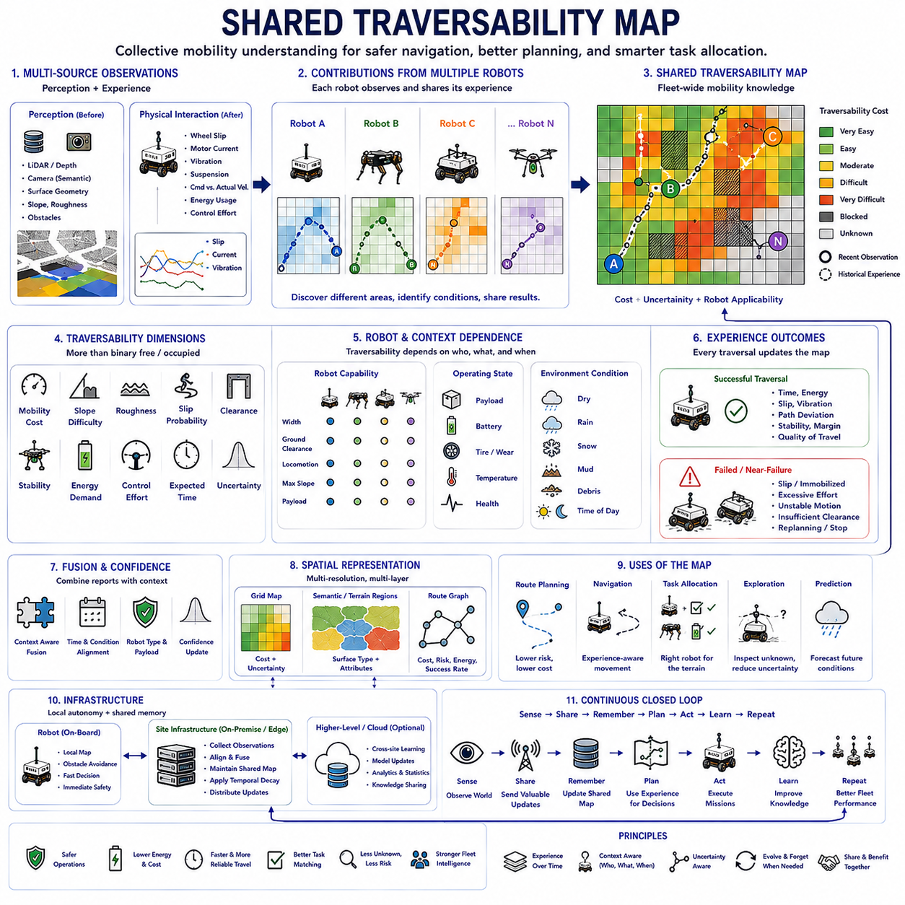{width="7.268055555555556in" height="7.268055555555556in"}

A shared traversability map represents the collective understanding of where robots can move safely and effectively within a physical environment. Unlike a conventional occupancy map that mainly distinguishes free and occupied space, traversability memory describes how difficult, risky, costly, or uncertain movement may be. By combining observations and mobility experience from multiple robots, the fleet develops a richer operational representation for navigation and coordination.

Traversability is not simply a binary property of terrain. A region may be technically passable while requiring low speed, high energy, increased control effort, or greater safety margins. Surfaces can therefore be represented along continuous dimensions such as mobility cost, slope difficulty, roughness, slip probability, clearance, stability, energy demand, and expected travel time. This allows planning systems to distinguish easy movement from merely possible movement.

The map can combine geometric perception with semantic understanding. LiDAR and depth sensing may estimate slope, height variation, obstacle geometry, and surface discontinuities, while cameras can identify semantic classes such as asphalt, gravel, grass, mud, stairs, ramps, or floor transitions. Combining geometry and semantics provides an initial estimate of traversability before a robot physically attempts to cross the region.

Physical interaction provides an additional source of evidence that perception alone cannot fully capture. Wheel slip, motor current, vibration, suspension response, body motion, commanded versus actual velocity, traction loss, and control effort reveal how the robot actually interacts with terrain. These proprioceptive signals can update the map after traversal, transforming predicted traversability into experience-grounded mobility knowledge.

A shared traversability map becomes especially valuable when multiple robots contribute observations. One robot may discover a slippery floor, another may identify a narrow passage, and another may experience excessive energy consumption on a slope. When these experiences are spatially aligned and fused, later robots can benefit from conditions they have never personally encountered. Individual mobility experience becomes persistent fleet-level knowledge.

Robot embodiment must remain associated with traversability information because the same environment can produce very different mobility outcomes for different platforms. A narrow passage may be easy for a small AMR but inaccessible to a large vehicle, while rough terrain may be unsuitable for small wheels but manageable for a quadruped. Traversability should therefore be modeled as a relationship between environmental properties and robot capabilities.

Relevant capability attributes can include robot width, length, ground clearance, wheel diameter, locomotion mechanism, turning radius, payload, maximum slope, traction characteristics, and stability limits. Instead of assigning one universal cost to every map region, the system can derive robot-specific or robot-class-specific traversability estimates. This allows a shared map to support heterogeneous fleets without incorrectly assuming identical mobility.

Payload and operating state can further change traversability. A slope that is easily crossed by an unloaded robot may become difficult when carrying a heavy payload, and low battery state may make an energy-intensive route undesirable. Tire condition, actuator temperature, mechanical degradation, or reduced control performance can also influence mobility. Traversability therefore depends on both environment and current robot state.

Environmental conditions introduce another dynamic dimension. Rain can transform firm soil into mud, water can reduce friction on indoor surfaces, snow can hide terrain geometry, and debris can make previously smooth routes difficult. A shared traversability map should preserve the conditions under which mobility experience was obtained so that historical observations are not applied blindly when the physical environment has changed.

Time is consequently important to map maintenance. Structural features such as slopes or narrow passages may remain stable, while surface friction, temporary obstacles, vegetation, water, or construction conditions may change quickly. Each traversability observation can include timestamps and persistence estimates. Temporal decay then reduces the influence of information whose validity is likely to decrease unless new observations confirm it.

Confidence and uncertainty should accompany every traversability estimate. A region observed remotely but never crossed may have a predicted mobility score with significant uncertainty. A region repeatedly traversed successfully by similar robots can have much stronger confidence. The map can therefore represent both expected traversability and uncertainty, allowing planners to distinguish known difficult terrain from terrain whose difficulty is simply unknown.

Successful traversal provides positive evidence but should include performance quality. The system can record travel time, energy consumption, slip, vibration, control stability, path deviation, and safety margin rather than merely recording that the robot reached the other side. Repeated experiences can then estimate distributions of mobility performance, providing planners with realistic expectations about cost and reliability.

Failed traversal provides equally important information. Immobilization, excessive slip, unstable motion, inability to climb, insufficient clearance, repeated replanning, or emergency stopping can indicate that a region exceeds the capabilities of a particular robot under particular conditions. These failures can update traversability costs and constraints so that other robots do not unnecessarily repeat the same unsuccessful attempt.

Near-failure events can reveal regions approaching operational limits. High motor current, increasing wheel slip, excessive body roll, repeated traction control intervention, or rapidly decreasing velocity may indicate difficult terrain even when traversal ultimately succeeds. Recording these signals allows the fleet to identify marginal areas before a complete mobility failure occurs and to apply conservative planning when similar conditions are encountered.

Memory fusion combines traversability reports from different robots while preserving context. Conflicting reports should not simply be averaged because one robot may be lightweight while another is heavily loaded, or environmental conditions may have changed between observations. Fusion should consider robot type, payload, timestamp, sensor quality, weather, surface state, confidence, and actual traversal outcome before updating shared mobility beliefs.

The shared map can support several spatial representations. Grid cells may contain traversability cost and uncertainty, terrain regions may carry semantic and mobility attributes, and route graphs may associate edges with travel cost, risk, energy, and historical success. Multi-resolution representations can preserve detailed local terrain information while supporting efficient planning across large operational areas.

Planning systems can use the map to evaluate routes according to more than geometric distance. A short path through uncertain or difficult terrain may be less desirable than a slightly longer path with reliable mobility. Route costs can incorporate expected travel time, energy consumption, slip risk, stability, localization quality, safety, and uncertainty. Navigation therefore becomes experience-aware rather than purely geometry-driven.

The map can also guide task allocation. If a mission requires reaching a difficult area, the fleet can identify robots whose mobility characteristics and historical experience match the required terrain. A quadruped, high-clearance vehicle, or lightweight AMR may be selected according to environmental conditions. Traversability knowledge thus connects world representation directly with robot capability and mission assignment.

Unknown regions can be treated differently from known hazards. A high-cost region may be well understood and consistently difficult, while an unexplored region may simply have insufficient evidence. Preserving this distinction allows the fleet to balance exploitation and exploration. When operationally appropriate, robots can deliberately inspect uncertain terrain and contribute new observations that reduce uncertainty for the entire fleet.

A fleet world model can extend the shared traversability map from current estimation toward prediction. Historical experience can reveal how terrain changes after rain, how congestion affects mobility, or how particular surfaces degrade over time. The model can estimate future traversability under expected environmental conditions, allowing planning to anticipate mobility changes rather than reacting only after routes become difficult.

On-premise infrastructure can maintain the site-level shared traversability representation by collecting observations, aligning them spatially, fusing mobility evidence, applying temporal decay, and distributing relevant updates. Individual robots retain local maps and immediate obstacle avoidance, while shared infrastructure preserves broader experience across missions. This division combines real-time local autonomy with long-term collective mobility intelligence.

Ultimately, a shared traversability map transforms navigation knowledge from static geometry into accumulated physical experience. The fleet learns not only where space exists, but which robots can move through it, under what conditions, with what cost, risk, and confidence. As observations and traversal outcomes accumulate, the map becomes an evolving mobility memory that supports safer planning, better task allocation, and increasingly capable collective Physical AI.

공유 주행 가능성 지도(shared traversability map)는 로봇이 물리적 환경 내에서 어디를 안전하고 효과적으로 이동할 수 있는지에 대한 플릿의 집단적 이해(collective understanding)를 표현한다. 주로 자유 공간과 점유 공간을 구분하는 기존 점유 지도(occupancy map)와 달리, 주행 가능성 메모리(traversability memory)는 이동이 얼마나 어렵고, 위험하며, 비용이 많이 들거나 불확실한지를 표현한다. 여러 로봇의 관찰과 이동 경험을 결합함으로써 플릿은 주행과 협업을 위한 더욱 풍부한 운용 표현(operational representation)을 구축한다.

주행 가능성(traversability)은 단순한 이진적 지형 속성이 아니다. 특정 영역은 기술적으로 통과할 수 있지만 낮은 속도, 높은 에너지 소비, 증가된 제어 노력 또는 더 큰 안전 여유(safety margin)를 요구할 수 있다. 따라서 표면은 이동 비용(mobility cost), 경사 난이도, 거칠기(roughness), 미끄러짐 확률, 여유 공간(clearance), 안정성, 에너지 요구량 및 예상 이동 시간과 같은 연속적인 차원으로 표현할 수 있다. 이를 통해 계획 시스템은 쉬운 이동과 단순히 가능한 이동을 구분할 수 있다.

지도는 기하학적 인지(geometric perception)와 의미적 이해(semantic understanding)를 결합할 수 있다. 라이다(LiDAR)와 깊이 센싱(depth sensing)은 경사, 높이 변화, 장애물 기하 구조 및 표면 불연속성을 추정할 수 있으며, 카메라는 아스팔트, 자갈, 잔디, 진흙, 계단, 경사로 또는 바닥 전이와 같은 의미 클래스(semantic class)를 식별할 수 있다. 기하 정보와 의미 정보를 결합하면 로봇이 해당 영역을 실제로 통과하기 전에도 초기 주행 가능성을 추정할 수 있다.

물리적 상호작용(physical interaction)은 인지만으로는 완전히 파악하기 어려운 추가적인 증거를 제공한다. 바퀴 미끄러짐(wheel slip), 모터 전류, 진동, 서스펜션 반응, 본체 움직임, 명령 속도와 실제 속도의 차이, 견인력 손실(traction loss) 및 제어 노력은 로봇이 실제 지형과 어떻게 상호작용하는지를 보여준다. 이러한 고유수용감각 신호(proprioceptive signal)는 주행 이후 지도를 갱신하여 예측된 주행 가능성을 실제 경험에 기반한 이동 지식(experience-grounded mobility knowledge)으로 전환할 수 있다.

여러 로봇이 관찰 정보를 제공할 때 공유 주행 가능성 지도는 특히 높은 가치를 가진다. 한 로봇은 미끄러운 바닥을 발견하고, 다른 로봇은 좁은 통로를 식별하며, 또 다른 로봇은 경사면에서 과도한 에너지 소비를 경험할 수 있다. 이러한 경험을 공간적으로 정렬하고 융합하면 이후의 로봇은 자신이 직접 경험하지 않은 조건에서도 해당 정보를 활용할 수 있다. 개별 이동 경험은 지속적인 플릿 수준 지식(fleet-level knowledge)으로 발전한다.

동일한 환경도 플랫폼에 따라 매우 다른 이동 결과를 만들 수 있으므로 로봇 형태(embodiment)는 주행 가능성 정보와 연결된 상태로 유지되어야 한다. 좁은 통로는 소형 자율이동로봇(AMR)에게는 쉽게 통과할 수 있지만 대형 차량에는 접근할 수 없는 공간일 수 있으며, 거친 지형은 작은 바퀴에는 부적합하지만 사족보행 로봇(quadruped)은 이동할 수 있다. 따라서 주행 가능성은 환경 특성과 로봇 능력(robot capability) 사이의 관계로 모델링되어야 한다.

관련된 능력 속성(capability attribute)에는 로봇의 폭, 길이, 지상고(ground clearance), 바퀴 직경, 이동 메커니즘(locomotion mechanism), 회전 반경, 적재량(payload), 최대 경사도, 견인 특성(traction characteristics) 및 안정성 한계가 포함될 수 있다. 모든 지도 영역에 하나의 보편적인 비용을 할당하는 대신 시스템은 로봇별 또는 로봇 클래스별 주행 가능성 추정값을 생성할 수 있다. 이를 통해 공유 지도는 모든 로봇의 이동성이 동일하다고 잘못 가정하지 않고 이기종 플릿(heterogeneous fleet)을 지원할 수 있다.

적재량과 운용 상태(operating state)는 주행 가능성을 추가적으로 변화시킬 수 있다. 적재하지 않은 로봇이 쉽게 통과할 수 있는 경사면도 무거운 화물을 운반할 때는 어려워질 수 있으며, 배터리 잔량이 낮은 상태에서는 에너지 소비가 높은 경로가 바람직하지 않을 수 있다. 타이어 상태, 액추에이터 온도, 기계적 성능 저하 또는 제어 성능 감소도 이동성에 영향을 줄 수 있다. 따라서 주행 가능성은 환경뿐만 아니라 현재 로봇 상태(current robot state)에도 의존한다.

환경 조건(environmental condition)은 또 다른 동적인 차원을 추가한다. 비는 단단한 토양을 진흙으로 변화시킬 수 있고, 물은 실내 표면의 마찰력을 감소시키며, 눈은 지형의 기하 구조를 가릴 수 있고, 잔해물은 이전에 평탄했던 경로를 이동하기 어렵게 만들 수 있다. 공유 주행 가능성 지도는 이동 경험이 획득된 당시의 조건을 보존하여 물리적 환경이 변화한 이후에도 과거 관찰을 무조건적으로 적용하지 않도록 해야 한다.

따라서 시간(time)은 지도 유지 관리에서 중요하다. 경사면이나 좁은 통로와 같은 구조적 특징은 안정적으로 유지될 수 있지만, 표면 마찰력, 임시 장애물, 식생, 물 또는 공사 상태는 빠르게 변화할 수 있다. 각각의 주행 가능성 관찰에는 타임스탬프(timestamp)와 지속성 추정값(persistence estimate)을 포함할 수 있다. 이후 시간적 감쇠(temporal decay)를 통해 새로운 관찰로 확인되지 않는 정보의 유효성이 감소할 가능성에 따라 그 영향력을 낮출 수 있다.

모든 주행 가능성 추정에는 신뢰도와 불확실성(confidence and uncertainty)이 함께 포함되어야 한다. 원격으로 관찰되었지만 실제로 통과한 적이 없는 영역은 상당한 불확실성을 가진 예측 이동성 점수를 가질 수 있다. 반면 유사한 로봇이 반복적으로 성공하여 통과한 영역은 훨씬 높은 신뢰도를 가질 수 있다. 따라서 지도는 예상 주행 가능성과 불확실성을 동시에 표현하여 계획 시스템이 이미 어려운 것으로 확인된 지형과 단순히 난이도가 알려지지 않은 지형을 구분하도록 할 수 있다.

성공적인 주행(successful traversal)은 긍정적인 증거를 제공하지만 성능 품질(performance quality)도 함께 포함해야 한다. 시스템은 단순히 로봇이 반대편에 도달했다는 사실만 기록하는 대신 이동 시간, 에너지 소비, 미끄러짐, 진동, 제어 안정성(control stability), 경로 이탈(path deviation) 및 안전 여유를 기록할 수 있다. 반복적인 경험을 통해 이동 성능의 분포를 추정하면 계획 시스템은 비용과 신뢰성에 대해 더욱 현실적인 예측을 수행할 수 있다.

실패한 주행(failed traversal) 역시 동일하게 중요한 정보를 제공한다. 이동 불능(immobilization), 과도한 미끄러짐, 불안정한 움직임, 경사 등판 실패, 부족한 여유 공간, 반복적인 재계획(replanning) 또는 비상 정지는 특정 조건에서 해당 영역이 특정 로봇의 능력을 초과한다는 것을 의미할 수 있다. 이러한 실패는 주행 가능성 비용과 제약조건을 갱신하여 다른 로봇이 동일한 실패를 불필요하게 반복하지 않도록 할 수 있다.

실패 직전 사건(near-failure event)은 운용 한계에 가까워지는 영역을 보여줄 수 있다. 높은 모터 전류, 증가하는 바퀴 미끄러짐, 과도한 본체 롤(body roll), 반복적인 견인력 제어 개입 또는 급격한 속도 감소는 최종적으로 주행에 성공했더라도 어려운 지형임을 나타낼 수 있다. 이러한 신호를 기록하면 플릿은 완전한 이동 실패가 발생하기 전에 한계 영역(marginal area)을 식별하고 유사한 조건에서 더욱 보수적인 계획을 적용할 수 있다.

메모리 융합(memory fusion)은 서로 다른 로봇의 주행 가능성 보고를 결합하면서 각각의 맥락을 보존한다. 한 로봇은 가벼운 상태이고 다른 로봇은 무거운 화물을 적재했을 수 있으며, 관찰 사이에 환경 조건이 변화했을 수도 있으므로 상충하는 보고를 단순히 평균화해서는 안 된다. 융합 과정은 공유 이동성 믿음(shared mobility belief)을 갱신하기 전에 로봇 유형, 적재량, 타임스탬프, 센서 품질, 날씨, 표면 상태, 신뢰도 및 실제 주행 결과를 고려해야 한다.

공유 지도는 여러 종류의 공간 표현(spatial representation)을 지원할 수 있다. 격자 셀(grid cell)은 주행 가능성 비용과 불확실성을 포함할 수 있고, 지형 영역은 의미적 및 이동성 속성을 가질 수 있으며, 경로 그래프(route graph)의 엣지(edge)는 이동 비용, 위험, 에너지 및 과거 성공률과 연결될 수 있다. 다중 해상도 표현(multi-resolution representation)을 사용하면 상세한 로컬 지형 정보를 유지하면서도 넓은 운용 영역에 대한 효율적인 계획을 지원할 수 있다.

계획 시스템은 이 지도를 이용하여 단순한 기하학적 거리 이상의 요소를 기준으로 경로를 평가할 수 있다. 불확실하거나 어려운 지형을 통과하는 짧은 경로보다 이동성이 안정적으로 검증된 조금 더 긴 경로가 더 바람직할 수 있다. 경로 비용(route cost)에는 예상 이동 시간, 에너지 소비, 미끄러짐 위험, 안정성, 위치 추정 품질, 안전성 및 불확실성을 포함할 수 있다. 따라서 주행은 단순한 기하학 기반 방식에서 경험 인지형(experience-aware) 방식으로 발전한다.

지도는 작업 할당(task allocation)에도 활용될 수 있다. 임무 수행을 위해 어려운 영역에 접근해야 한다면 플릿은 요구되는 지형에 적합한 이동 특성과 과거 경험을 가진 로봇을 식별할 수 있다. 환경 조건에 따라 사족보행 로봇, 높은 지상고를 가진 차량 또는 경량 자율이동로봇을 선택할 수 있다. 따라서 주행 가능성 지식은 월드 표현(world representation)을 로봇 능력 및 임무 할당과 직접 연결한다.

알려지지 않은 영역(unknown region)은 이미 확인된 위험 지역(known hazard)과 다르게 처리할 수 있다. 높은 비용을 가진 영역은 충분히 이해된 상태에서 지속적으로 이동하기 어려운 곳일 수 있지만, 탐색되지 않은 영역은 단순히 증거가 부족한 것일 수 있다. 이러한 차이를 유지하면 플릿은 활용(exploitation)과 탐색(exploration)의 균형을 조정할 수 있다. 운용상 적절한 경우 로봇은 의도적으로 불확실한 지형을 조사하고 새로운 관찰을 제공하여 전체 플릿의 불확실성을 감소시킬 수 있다.

플릿 월드 모델(fleet world model)은 공유 주행 가능성 지도를 현재 상태의 추정에서 미래 예측(prediction)으로 확장할 수 있다. 과거 경험을 통해 비가 내린 이후 지형이 어떻게 변화하는지, 혼잡이 이동성에 어떤 영향을 미치는지 또는 특정 표면이 시간에 따라 어떻게 열화되는지를 파악할 수 있다. 월드 모델은 예상되는 환경 조건에서 미래의 주행 가능성을 추정하여 경로가 실제로 어려워진 이후에 대응하는 대신 이동성 변화를 사전에 고려한 계획을 가능하게 한다.

온프레미스 인프라(on-premise infrastructure)는 여러 로봇의 관찰을 수집하고, 공간적으로 정렬하고, 이동성 증거를 융합하며, 시간적 감쇠를 적용하고, 관련 업데이트를 배포함으로써 사이트 수준 공유 주행 가능성 표현(site-level shared traversability representation)을 관리할 수 있다. 개별 로봇은 로컬 지도와 즉각적인 장애물 회피 기능을 유지하고, 공유 인프라는 여러 임무에서 축적된 광범위한 경험을 보존한다. 이러한 역할 분담은 실시간 로컬 자율성(real-time local autonomy)과 장기적인 집단 이동 지능(collective mobility intelligence)을 결합한다.

궁극적으로 공유 주행 가능성 지도(shared traversability map)는 주행 지식을 정적인 기하 정보(static geometry)에서 축적된 물리적 경험(accumulated physical experience)으로 전환한다. 플릿은 단순히 공간이 어디에 존재하는지를 학습하는 것이 아니라 어떤 로봇이 어떤 조건에서 해당 공간을 이동할 수 있는지, 그리고 그 이동에 어느 정도의 비용, 위험 및 신뢰도가 수반되는지를 학습한다. 관찰과 실제 주행 결과가 축적될수록 지도는 지속적으로 진화하는 이동 메모리(evolving mobility memory)로 발전하며, 더욱 안전한 계획, 효과적인 작업 할당 및 점진적으로 향상되는 집단 물리 AI(collective Physical AI)를 지원한다.
