**Volume 09. Multi Robot and Swarm Physical AI**

# Chapter 07. Heterogeneous Fleets

## 07.01. What is a Heterogeneous Robot Fleet

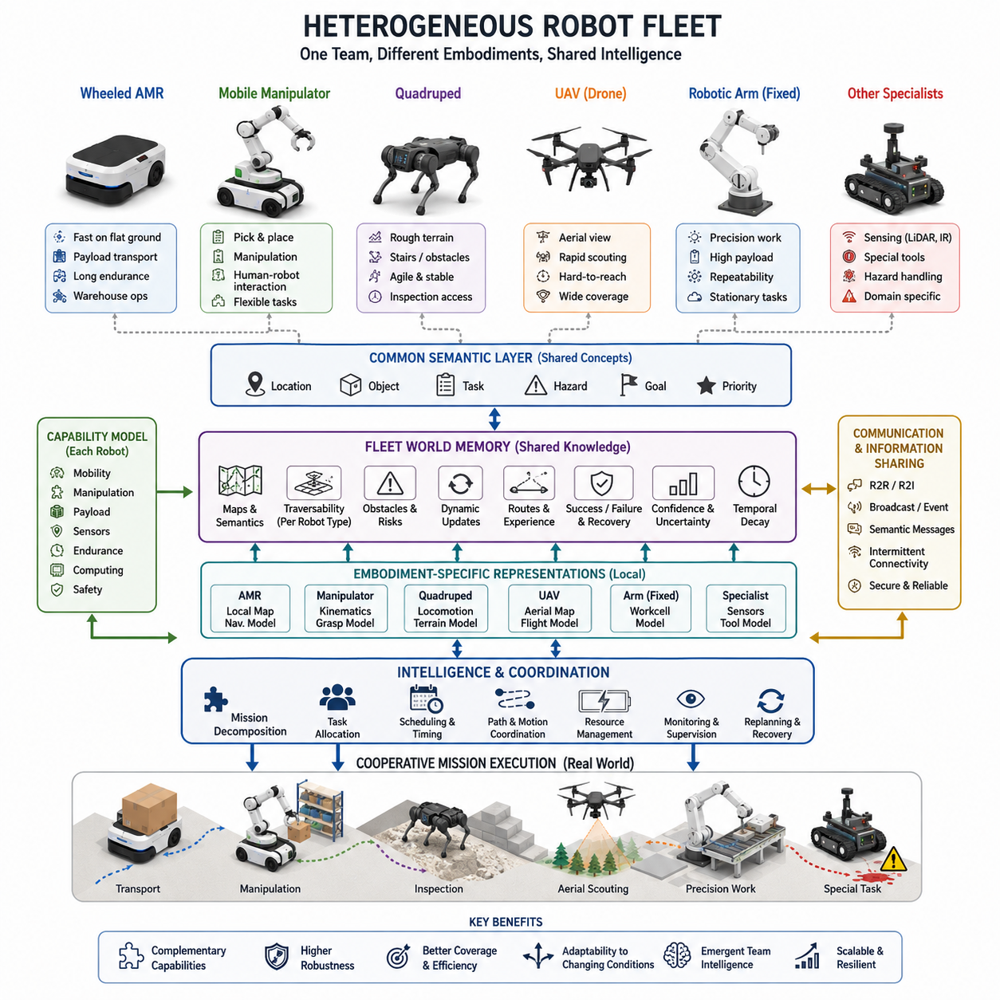{width="7.268055555555556in" height="7.268055555555556in"}

이기종 로봇 플릿(Heterogeneous Robot Fleet)은 형태(embodiment), 이동성(mobility), 센싱(sensing), 조작(manipulation), 연산(computation), 또는 운용 역할(operational role)이 서로 다른 로봇들이 공통 임무(common mission)를 수행하도록 조정된 로봇 집합이다. 유사한 플랫폼으로 구성되는 동종 플릿(homogeneous fleet)과 달리, 이기종 플릿은 서로 다른 로봇 역량(robot capability)을 의도적으로 결합하여 단일 유형의 로봇만으로는 효율적으로 수행하기 어려운 작업을 전체 시스템 차원에서 수행한다.

이질성(heterogeneity)은 여러 수준에서 나타날 수 있다. 로봇은 바퀴(wheel), 트랙(track), 다리(leg), 로봇 팔(robot arm), 공중 추진 장치(aerial propulsion), 페이로드 장치(payload mechanism), 특수 도구(specialized tool)와 같은 물리적 요소에서 차이가 날 수 있다. 또한 센서 구성(sensor suite), 온보드 프로세서(onboard processor), 인공지능 모델(AI model), 통신 인터페이스(communication interface), 자율성 수준(autonomy level)과 같은 연산 측면에서도 서로 다를 수 있다. 이러한 차이는 플릿 조정을 복잡하게 만들지만 상호 보완적 전문화(complementary specialization)의 기회를 제공한다.

창고(warehouse)는 이러한 기본 개념을 잘 보여준다. 자율이동로봇(Autonomous Mobile Robot, AMR)은 장소 사이에서 자재를 운송하고, 모바일 매니퓰레이터(mobile manipulator)는 물체를 집거나 배치하며, 로봇 팔(robotic arm)은 고정된 위치에서 물류 작업을 수행할 수 있다. 여기에 검사 로봇(inspection robot)이 설비나 재고를 감시할 수 있다. 각각의 로봇은 공유된 작업 흐름(shared workflow)에 서로 다른 역량을 제공하며, 플릿은 독립적인 기계들의 집합이 아니라 조정된 물리 시스템(coordinated physical system)으로 발전한다.

동일한 원리는 비정형 환경(unstructured environment)에서 더욱 중요해진다. 지상 로봇(ground robot)은 주행 가능한 지형을 통해 무거운 장비를 운반할 수 있고, 4족 보행 로봇(quadruped)은 계단이나 불규칙한 통로에 진입할 수 있으며, 무인항공기(Unmanned Aerial Vehicle, UAV)는 지상에서 접근하기 어려운 영역을 빠르게 관찰할 수 있다. 이러한 플랫폼의 결합을 통해 플릿은 각 형태가 가진 물리적 강점에 따라 인지(perception), 이동(mobility), 운송(transportation), 검사(inspection), 개입(intervention)을 분담할 수 있다.

따라서 이기종 플릿에는 로봇 역량(robot capability)에 대한 명시적인 표현이 필요하다. 시스템은 어떤 로봇이 특정 지형을 이동할 수 있는지, 특정 페이로드(payload)를 운반할 수 있는지, 특정 물체를 조작할 수 있는지, 충분한 시간 동안 작동할 수 있는지, 필요한 센서를 사용할 수 있는지, 안전 제약조건(safety constraint)을 충족하는지를 이해해야 한다. 그러면 작업 할당(task allocation)은 모든 로봇을 상호 교환 가능한 대상으로 간주하는 대신 임무 요구사항과 사용 가능한 역량을 대응시킬 수 있다.

이러한 역량 인식 관점(capability-aware perspective)은 이기종 플릿 지능(heterogeneous fleet intelligence)을 기존 플릿 관리(conventional fleet management)와 구분한다. 전통적인 플릿 시스템은 흔히 유사한 로봇들이 비슷한 작업을 수행한다고 가정한다. 반면 이기종 피지컬 AI(Heterogeneous Physical AI)는 에이전트(agent) 사이의 차이를 추론하고 이러한 차이를 어떻게 생산적으로 결합할 것인지 결정해야 한다. 다양성(diversity)은 계획(planning), 스케줄링(scheduling), 협업(collaboration), 예기치 않은 상황에서의 복구(recovery)에 영향을 주는 연산 자원(computational resource)이 된다.

형태(embodiment)는 특히 중요하다. 물리적 역량은 항상 추상화할 수 있는 것이 아니기 때문이다. 자율이동로봇(AMR)과 4족 보행 로봇(quadruped)은 동일한 목적지(destination)에 대한 의미 표현(semantic representation)을 공유할 수 있지만, 목적지에 도달하기 위한 실행 가능한 경로(feasible path)는 완전히 다를 수 있다. 무인항공기(UAV)는 동일한 환경을 상공에서 관찰할 수 있는 반면, 매니퓰레이터(manipulator)는 도달 가능한 물체와 파지 구성(grasp configuration)을 중심으로 환경을 이해한다. 공유 지능(shared intelligence)은 공통 의미와 형태별 제약조건을 모두 보존해야 한다.

이러한 이유로 이기종 플릿에는 모든 로봇을 동일한 내부 모델(internal model)에 강제로 맞추지 않으면서도 사용할 수 있는 공통 표현(common representation)이 필요하다. 위치(location), 물체(object), 작업(task), 위험요소(hazard), 목표(goal), 임무 우선순위(mission priority)와 같은 공유 개념은 플릿 수준 의미 계층(fleet-level semantic layer)을 제공할 수 있다. 그 아래에서 각 플랫폼은 이동(locomotion), 조작(manipulation), 인지(perception), 제어(control), 로컬 안전(local safety)을 위한 형태별 표현(embodiment-specific representation)을 유지한다. 조정(coordination)은 이 두 계층을 연결한다.

통신(communication) 역시 서로 다른 플랫폼 간의 차이를 연결해야 한다. 로봇은 센서와 액추에이터(actuator)가 서로 다르더라도 의미를 유지할 수 있는 형태로 정보를 교환해야 한다. 예를 들어 무인항공기(UAV)가 장애물(obstacle)을 발견했다면 플랫폼에 종속된 센서 데이터만 전송하는 것이 아니라 장애물의 위치, 범위, 신뢰도(confidence), 의미적 정보(semantic meaning)를 전달해야 한다. 그러면 다른 로봇들은 자신의 이동성과 계획 요구사항에 맞게 해당 관측 정보를 해석할 수 있다.

공유 월드 메모리(shared world memory)는 한 형태가 획득한 경험을 다른 로봇들이 활용할 수 있도록 함으로써 이러한 조정을 강화한다. 어떤 로봇이 차단된 통로, 위험한 노면, 임시 공사 구역, 접근 가능한 충전 위치를 발견하면 플릿 지식(fleet knowledge)을 갱신할 수 있다. 그러나 동일한 정보의 실제 의미는 로봇마다 다를 수 있다. 바퀴형 자율이동로봇(wheeled AMR)이 통과할 수 없는 경로라도 4족 보행 로봇(quadruped)이나 공중 플랫폼(aerial platform)은 통과할 수 있다.

따라서 이기종 플릿 지식(heterogeneous fleet knowledge)은 환경적 사실(environmental fact)과 형태 의존적 해석(embodiment-dependent interpretation)을 구분해야 한다. 플릿은 지형 구조(terrain geometry), 장애물, 물체, 의미 영역(semantic region), 동적 상태(dynamic condition)에 대한 공통 표현을 공유하면서 로봇 종류별로 주행 가능성(traversability), 도달 가능성(reachability), 위험도(risk), 에너지 비용(energy cost), 작업 실행 가능성(task feasibility)을 별도로 추정할 수 있다. 이러한 분리는 지식 공유와 물리적으로 현실적인 의사결정을 동시에 지원한다.

작업 할당(task allocation)은 형태 간 추론(cross-embodiment reasoning)의 한 형태가 된다. 단순히 어떤 로봇이 작업에 가장 가까운지만 판단하는 것이 아니라 플릿은 역량, 위치, 작업 부하(workload), 에너지, 위험, 시간, 협업 요구사항을 함께 고려한다. 복잡한 임무는 서로 다른 형태에 할당되는 하위 작업(subtask)으로 분해될 수 있으며, 이를 통해 인지, 운송, 조작, 검사, 감독(supervision)이 팀 전체에 분산되는 조정된 작업 흐름을 구성할 수 있다.

이기종 협력(heterogeneous cooperation)은 개별 로봇에는 존재하지 않는 새로운 역량을 만들어낼 수도 있다. 공중 로봇(aerial robot)이 특정 지역을 정찰하고 목표물을 식별하면, 지상 로봇이 장비를 해당 지역으로 운반하고, 매니퓰레이터가 목표물과 물리적으로 상호작용할 수 있다. 따라서 유용한 지능의 단위(unit of intelligence)는 점차 고립된 개별 플랫폼이 아니라 조정된 플릿(coordinated fleet)이 된다. 임무 수행 역량이 전문화된 에이전트 사이의 관계에서 발생하기 때문이다.

이러한 아키텍처(architecture)는 자연스럽게 계층적 조직(hierarchical organization)을 지원한다. 개별 로봇은 실시간 인지(real-time perception)와 제어를 로컬에서 수행하고, 플릿 수준 시스템은 임무 맥락(mission context), 공유 지식, 자원 상태(resource state), 조정 정책(coordination policy)을 유지한다. 중간 수준에서는 특정 작업을 중심으로 임시 팀(temporary team)이 형성될 수 있다. 이러한 계층 구조는 통신이 지연되거나 저하되고 간헐적이거나 사용할 수 없는 상황에서도 로컬 자율성(local autonomy)을 유지하면서 전체 복잡성을 관리할 수 있게 한다.

학습(learning)은 이질성에 또 다른 차원을 추가한다. 한 로봇에서 획득한 경험은 관측(observation), 행동 공간(action space), 동역학(dynamics), 형태(morphology)가 서로 다르기 때문에 다른 로봇으로 항상 직접 전이될 수 있는 것은 아니다. 따라서 형태 간 학습(cross-embodiment learning)에는 전이 가능한 지식(transferable knowledge)과 플랫폼별 행동(platform-specific behavior)을 분리하는 표현이 필요하다. 저수준 제어 정책(low-level control policy)은 전이되지 않더라도 의미 개념, 환경 구조, 작업 지식, 고수준 기술(high-level skill)은 전이될 수 있다.

잘 설계된 이기종 플릿은 다양성을 활용하면서도 그 다양성 때문에 시스템이 분절되지 않도록 해야 한다. 공통 인터페이스(common interface), 역량 기술(capability description), 공유 의미 체계(shared semantics), 동기화된 월드 지식(synchronized world knowledge), 상호운용 가능한 통신(interoperable communication)이 시스템을 연결하는 구조를 제공한다. 동시에 형태별 인지와 제어는 각 플랫폼의 물리적 전문성을 유지한다. 이 두 요구사항이 서로를 대체하는 것이 아니라 공존할 때 아키텍처는 효과적으로 작동한다.

강건성(robustness) 역시 중요한 장점이다. 모든 로봇이 동일한 역량을 가지고 있다면 공통된 제약이나 고장 유형(failure mode)이 전체 플릿에 영향을 줄 수 있다. 이기종 시스템은 임무를 완료하기 위한 대안적인 방법을 제공할 수 있다. 특정 로봇이 어떤 영역에 접근하거나 물체를 조작하거나 계속 운용할 수 없게 되었을 때, 다른 형태의 로봇이 임무 일부를 대신하거나 상호 보완적 역량을 활용해 수정된 전략(revised strategy)을 가능하게 할 수 있다.

동시에 이질성은 조정의 난이도를 높인다. 속도, 운동학(kinematics), 운용 지속시간(endurance), 센서 범위(sensor coverage), 통신 품질, 안전 영역(safety envelope), 자율성, 연산 자원(computational resource)의 차이는 플래너(planner)가 명시적으로 관리해야 하는 의존관계를 만든다. 따라서 상호운용성(interoperability)은 단순한 공학적 문제뿐만 아니라 지능 문제(intelligence problem)가 된다. 플릿은 로봇들이 서로 다르다는 사실뿐만 아니라 그 차이가 집단 행동(collective action)에 어떤 영향을 미치는지 이해해야 한다.

다중 로봇 피지컬 AI(Multi-Robot Physical AI)의 관점에서 이기종 로봇 플릿은 궁극적으로 물리적 다양성을 공유 목표(shared objective)를 중심으로 의도적으로 조직한 분산 체화 지능 시스템(distributed embodied intelligence system)으로 볼 수 있다. 핵심은 단순히 여러 종류의 로봇이 존재한다는 것이 아니라, 서로 지식을 교환하고 상호 보완적인 역량을 이해하며 의사결정을 조정하고 전문화된 형태들을 일관된 집단 행동(coherent collective behavior)으로 결합할 수 있다는 데 있다.

## 07.02. Capability and Embodiment Differences

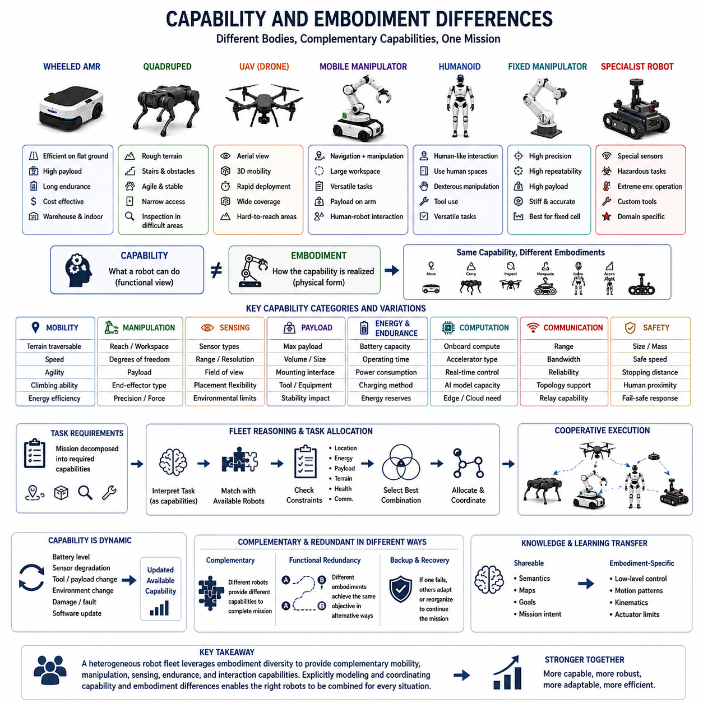{width="7.268055555555556in" height="7.268055555555556in"}

역량(Capability)은 로봇이 무엇을 수행할 수 있는지를 설명하는 반면, 체화(Embodiment)는 그러한 역량이 구현되는 물리적 형태를 의미한다. 이기종 로봇 플릿(Heterogeneous Robot Fleet)에서 이 두 개념은 밀접하게 연관되어 있지만 동일한 것으로 취급해서는 안 된다. 두 로봇이 동일한 고수준 작업(high-level task)을 수행하더라도 서로 다른 신체 구조, 센서, 액추에이터(actuator), 이동 전략, 제어 시스템을 사용하여 요구되는 결과를 달성할 수 있다.

체화(Embodiment)는 로봇의 물리적 구조, 형태학(morphology), 이동 메커니즘(locomotion mechanism), 액추에이터 구성(actuator configuration), 센싱 배치(sensing arrangement), 페이로드 인터페이스(payload interface), 상호작용 메커니즘(interaction mechanism)을 포함한다. 따라서 바퀴형 자율이동로봇(wheeled AMR), 4족 보행 로봇(quadruped), 무인항공기(UAV), 휴머노이드(humanoid), 모바일 매니퓰레이터(mobile manipulator)는 근본적으로 서로 다른 체화 형태를 나타낸다. 이러한 물리적 구조는 공유 환경에서 지형, 물체, 인프라, 사람, 다른 로봇과 상호작용하는 방식을 결정한다.

역량(Capability)은 이러한 물리적·연산 자원이 무엇을 가능하게 하는지에 대한 기능적 설명(functional description)이다. 대표적인 역량에는 내비게이션(navigation), 운송(transportation), 조작(manipulation), 검사(inspection), 매핑(mapping), 감시(surveillance), 등반(climbing), 리프팅(lifting), 파지(grasping), 통신(communication), 환경 센싱(environmental sensing) 등이 있다. 따라서 역량은 물리적 구현이 크게 다른 로봇들을 추론하기 위한 공통 언어를 제공하며, 플릿 지능(fleet intelligence)이 각 플랫폼이 임무에 무엇을 기여할 수 있는지를 중심으로 판단하도록 한다.

이동성(Mobility)은 역량과 체화의 관계를 명확하게 보여주는 사례이다. 바퀴형 자율이동로봇(wheeled AMR)은 평탄한 바닥에서 효율적으로 이동하며 낮은 에너지 소비로 상당한 페이로드를 운반할 수 있다. 4족 보행 로봇(quadruped)은 바퀴형 시스템의 이동을 제한하는 계단, 불규칙 지형, 틈, 장애물을 통과할 수 있다. 무인항공기(UAV)는 페이로드와 운용 지속시간(endurance)을 일부 희생하는 대신 3차원 이동성, 신속한 배치, 높은 위치 또는 접근하기 어려운 영역에 대한 접근성을 제공한다.

조작 역량(Manipulation Capability)도 유사한 방식으로 달라진다. 고정형 로봇 팔(fixed robotic arm)은 제한된 작업공간(workspace) 내에서 높은 정밀도, 반복성(repeatability), 강성(stiffness), 페이로드 성능을 제공할 수 있다. 모바일 매니퓰레이터(mobile manipulator)는 내비게이션과 관절형 로봇 팔(articulated arm)을 결합하여 더 넓은 환경으로 조작 범위를 확장한다. 휴머노이드(humanoid)는 인간을 위해 설계된 공간과 인터페이스에서 조작 능력을 제공할 수 있지만 이동성과 제어 요구사항은 훨씬 복잡해질 수 있다.

센싱 역량(Sensing Capability) 역시 체화에 따라 달라진다. 무인항공기(UAV)는 넓은 지역을 대상으로 공중 관측(aerial observation)을 수행할 수 있는 반면, 지상 로봇(ground robot)은 물체와 표면에 가까운 위치에서 상세한 정보를 획득할 수 있다. 4족 보행 로봇(quadruped)은 카메라, 라이다(LiDAR), 열 센서(thermal sensor), 가스 감지기(gas detector), 음향 센서(acoustic sensor)를 험난한 지형으로 운반할 수 있다. 따라서 센서의 가치는 사양뿐만 아니라 로봇이 센서를 어디에 위치시킬 수 있으며 어떤 방식으로 관측 정보를 획득할 수 있는지에 의해서도 결정된다.

페이로드 용량(Payload Capacity)은 또 다른 중요한 차이를 만든다. 대형 지상 플랫폼은 무거운 자재, 배터리, 매니퓰레이터, 특수 장비를 운반할 수 있는 반면, 소형 공중 로봇은 엄격한 질량 제약(mass constraint) 아래에서 작동하는 경우가 많다. 따라서 플릿 플래너(fleet planner)는 물체를 운송할 수 있다는 추상적 역량과 특정 로봇이 실제로 요구된 경로를 통해 해당 물체를 운반할 수 있는지를 결정하는 정량적 제약조건(quantitative constraint)을 구분해야 한다.

에너지(Energy)와 운용 지속시간(Endurance)은 로봇 역량을 더욱 차별화한다. 예측 가능한 표면에서 운용되는 바퀴형 로봇은 장시간 운용할 수 있는 반면, 공중 비행체는 비행 상태를 유지하기 위해 상당한 에너지를 소비한다. 다족 보행 시스템(legged system)은 바퀴형 시스템보다 많은 에너지가 필요할 수 있지만 뛰어난 지형 접근성(terrain accessibility)을 제공한다. 따라서 임무 계획은 로봇이 작업을 수행할 수 있는지만이 아니라 보유한 에너지와 운용시간 내에서 해당 작업을 완료할 수 있는지도 고려해야 한다.

로봇 역량은 온보드 연산(Onboard Computation)에 의해서도 결정된다. 일부 플랫폼에는 인지 모델(perception model), 월드 모델(world model), 파운데이션 모델(foundation model), 고급 로컬 플래너(local planner)를 실행할 수 있는 강력한 가속기(accelerator)가 탑재될 수 있지만, 다른 플랫폼은 실시간 제어(real-time control)에 최적화된 소형 프로세서를 사용할 수 있다. 이러한 연산 이질성(computational heterogeneity)은 어떤 지능 기능을 로컬에서 실행할 수 있으며 어떤 기능이 다른 로봇, 엣지 인프라(edge infrastructure), 또는 플릿 수준 연산 자원의 지원을 필요로 하는지에 영향을 준다.

통신 역량(Communication Capability)은 또 다른 차이의 원천이다. 로봇들은 서로 다른 무선 기술, 통신 거리, 대역폭(bandwidth), 네트워크 토폴로지(network topology), 연결성 수준을 지원할 수 있다. 공중 로봇은 일시적으로 통신 중계기(communication relay) 역할을 수행할 수 있으며, 다른 플랫폼은 간헐적인 네트워크 접속 상태에서 운용될 수 있다. 정보 가용성(information availability)은 공유 인지, 계획, 작업 할당, 집단 의사결정에 직접 영향을 주기 때문에 플릿 조정은 이러한 통신 특성을 인식해야 한다.

안전 역량(Safety Capability) 역시 체화에 의존한다. 경량 실내 자율이동로봇, 중량 운송 로봇, 고속 무인항공기, 산업용 매니퓰레이터, 휴머노이드는 서로 다른 물리적 위험을 발생시키므로 각각 다른 안전 제약조건(safety constraint)이 필요하다. 안전 속도, 정지 거리(stopping distance), 충돌 회피(collision avoidance), 제한 구역(restricted zone), 인간과의 근접 거리, 액추에이터 한계, 고장 대응(failure response)은 각 플랫폼의 운용 역량(operational capability)의 일부로 표현되어야 한다.

이러한 차이는 역량을 단순한 이진 속성(binary property)의 목록으로 표현해서는 안 된다는 것을 의미한다. 로봇은 기술적으로 특정 역량을 보유하고 있더라도 특정 조건에서만 이를 사용할 수 있다. 예를 들어 4족 보행 로봇은 계단을 오를 수 있지만 경사도, 계단 높이, 페이로드, 표면 마찰(surface friction), 배터리 상태 등의 한계 내에서만 가능하다. 매니퓰레이터 역시 물체의 형상, 질량, 자세(pose), 도달 가능성, 요구 힘이 허용 가능한 운용 범위(operating envelope) 내에 있을 때만 물체를 파지할 수 있다.

따라서 역량 표현(Capability Representation)은 정성적 정보와 정량적 정보를 함께 포함해야 한다. 로봇은 운송 기능을 지원한다는 사실과 함께 최대 페이로드, 크기, 속도, 운용 지속시간, 지형 제약조건, 위치추정 정확도(localization accuracy), 환경적 한계를 기술할 수 있다. 마찬가지로 조작 역량에는 도달 범위(reach), 자유도(degrees of freedom), 페이로드, 엔드 이펙터 유형(end-effector type), 파지 유형(grasp class), 정밀도, 상호작용 힘(interaction force)이 포함될 수 있다. 이러한 정보는 역량 기술을 자동화된 추론(automated reasoning)에 활용할 수 있도록 한다.

역량과 체화의 관계는 작업 할당(Task Allocation) 과정에서 특히 중요해진다. 작업을 특정 로봇 유형에 즉시 할당하기보다는 먼저 필요한 역량의 관점에서 해석해야 한다. 이후 플릿은 이러한 요구사항을 사용 가능한 로봇의 현재 역량과 비교할 수 있으며, 이 과정에서 위치, 에너지 상태, 작업 부하(workload), 건전성(health), 장비 구성, 환경 적합성(environmental suitability), 예상 수행 비용(expected execution cost)을 함께 고려할 수 있다.

일부 작업에는 단일 체화 형태가 보유하지 못한 여러 역량의 조합이 필요하다. 공중 로봇은 신속한 정찰(reconnaissance)을 수행할 수 있지만 조작 능력이 없을 수 있다. 지상 로봇은 장비를 운반할 수 있지만 험난한 지형을 통과하지 못할 수 있으며, 4족 보행 로봇은 목표 지역에 접근할 수 있지만 페이로드가 제한될 수 있다. 플릿은 임무를 분해하여 여러 전문화된 로봇이 협력하도록 함으로써 여러 체화 형태로부터 복합 역량(composite capability)을 구성할 수 있다.

이러한 개념은 이기종 플릿에서 중복성(Redundancy)의 의미도 변화시킨다. 중복성이 반드시 동일한 백업 로봇을 요구하는 것은 아니다. 서로 다른 체화 형태가 동일한 목표를 달성하기 위한 대안적인 방법을 제공한다면 기능적 중복성(functional redundancy)이 존재할 수 있다. 통로가 자율이동로봇(AMR)에 접근 불가능해지면 4족 보행 로봇이 다른 경로를 통해 소형 페이로드를 전달하거나, 무인항공기(UAV)가 정보를 제공하여 장애물을 중심으로 임무를 재구성하도록 지원할 수 있다.

역량은 영구적으로 고정된 것이 아니라 동적(Dynamic)으로 변화하기도 한다. 배터리 소모, 센서 성능 저하(sensor degradation), 페이로드 장착, 도구 교체, 환경 조건, 통신 단절, 기계적 손상, 소프트웨어 업데이트는 로봇이 현재 수행할 수 있는 기능을 변화시킬 수 있다. 따라서 플릿 지능은 플랫폼이 설계상 수행할 수 있는 기능을 의미하는 명목 역량(nominal capability)과 현재 시점에서 신뢰성 있게 수행할 수 있는 기능을 의미하는 가용 역량(available capability)을 구분해야 한다.

체화의 차이는 지식 및 학습 전이(Knowledge and Learning Transfer)에도 영향을 준다. 장애물, 목적지, 물체, 위험요소, 검사 대상, 임무 우선순위와 같은 고수준 개념은 서로 다른 로봇 유형 사이에서 공유될 수 있다. 그러나 저수준 행동(low-level action)은 체화에 따라 달라질 수 있다. 예를 들어 "검사 지점에 도달하라"라는 명령은 공통된 의미를 가지면서도 각 로봇에서는 바퀴 궤적(wheel trajectory), 다리 움직임(leg motion), 비행 명령(flight command), 매니퓰레이터 구성(manipulator configuration)으로 각각 변환될 수 있다.

따라서 확장 가능한 이기종 플릿 아키텍처(scalable heterogeneous fleet architecture)는 공유 작업 의미(shared task semantics)와 체화별 실행(embodiment-specific execution)을 분리함으로써 이점을 얻을 수 있다. 플릿 지능은 목표, 역량, 제약조건, 자원, 예상 결과를 중심으로 추론하고, 개별 로봇은 할당된 목표를 물리적으로 실행 가능한 행동으로 변환한다. 이러한 분리를 통해 모든 로봇이 다른 체화 형태의 세부 제어 메커니즘을 이해하거나 재현하지 않아도 다양한 플랫폼이 협력할 수 있다.

궁극적으로 역량과 체화의 차이(Capability and Embodiment Differences)는 제거해야 하는 불일치가 아니라 집단적 강점(collective strength)의 원천으로 다루어져야 한다. 물리적 다양성은 상호 보완적인 이동성, 센싱, 조작, 운용 지속시간, 페이로드, 상호작용 특성을 제공한다. 이러한 차이를 명시적으로 모델링하고 조정하면 이기종 플릿은 각 상황에 적합한 로봇 조합을 동적으로 구성하고 개별 플랫폼의 능력을 넘어서는 임무 수행 역량(mission capability)을 달성할 수 있다.

## 07.03. AMR Manipulator Humanoid Quadruped and UAV Teams

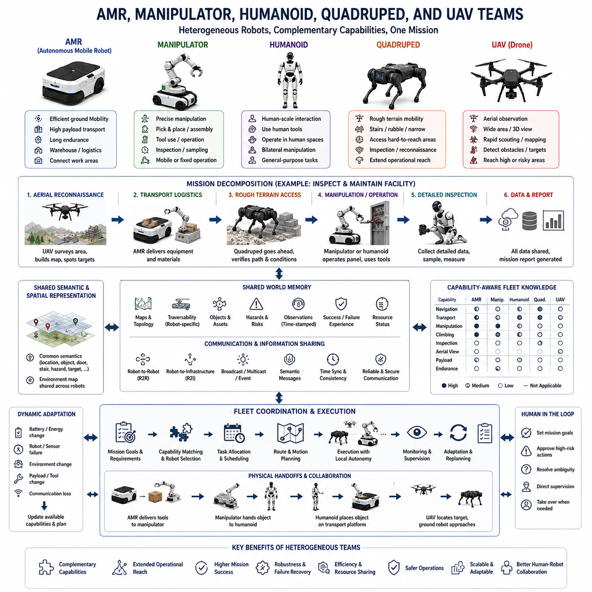{width="7.268055555555556in" height="7.268055555555556in"}

이기종 로봇 팀(Heterogeneous Robot Team)은 자율이동로봇(Autonomous Mobile Robot, AMR), 매니퓰레이터(manipulator), 휴머노이드(humanoid), 4족 보행 로봇(quadruped), 무인항공기(Unmanned Aerial Vehicle, UAV)를 결합하여 개별 체화(embodiment)의 능력을 넘어서는 집단적 역량(collective capability)을 가진 물리 시스템을 구성할 수 있다. 각 플랫폼은 서로 다른 이동성, 센싱, 조작, 페이로드, 접근성, 상호작용 특성을 제공하며, 이를 통해 특정 로봇의 정체성이 아니라 물리적 역량을 기준으로 임무를 분해할 수 있다.

자율이동로봇(AMR)은 구조화되거나 어느 정도 구조화된 환경에서 효율적인 지상 이동성과 운송 기능을 제공한다. 바퀴형 베이스(wheeled base)는 긴 운용시간, 비교적 높은 페이로드, 예측 가능한 내비게이션, 에너지 효율적인 이동을 지원한다. 이기종 팀에서 AMR은 물류 운반체, 이동형 에너지 또는 장비 플랫폼, 자재 운송 수단, 그리고 다른 전문 로봇이 복잡한 물리적 작업을 수행하는 작업 영역을 연결하는 역할을 할 수 있다.

매니퓰레이터(Manipulator)는 물체 및 인프라와의 물리적 상호작용(physical interaction)을 담당한다. 고정형 매니퓰레이터(fixed manipulator)는 정해진 작업공간에서 높은 정밀도, 반복성, 페이로드 능력, 안정적인 운용을 제공하며, 모바일 매니퓰레이터(mobile manipulator)는 관절형 로봇 팔과 이동 베이스를 결합한다. 주요 역할에는 피킹, 배치, 개폐, 조립, 도구 사용, 샘플 채취, 장비 적재, 환경과의 제어된 접촉이 필요한 검사 작업 등이 포함될 수 있다.

휴머노이드(Humanoid)는 원래 인간을 위해 만들어진 환경과 인터페이스에서 작동하도록 설계된 체화 형태를 제공한다. 인간과 유사한 도달 범위, 양팔 조작(bilateral manipulation), 다족 이동성, 기존 도구를 사용할 수 있는 잠재력은 인프라를 새롭게 설계하기 어려운 작업에서 중요한 장점이 된다. 이기종 팀에서 휴머노이드는 고효율 전문 로봇과 인간과 유사한 물리적 상호작용을 요구하는 환경 사이를 연결하는 유연한 범용 에이전트(general-purpose agent) 역할을 수행할 수 있다.

4족 보행 로봇(Quadruped)은 기존 바퀴형 플랫폼이 이동하기 어려운 지형에서 이동성을 제공한다. 계단, 잔해, 경사면, 좁은 통로, 불규칙한 표면, 산업 시설 구조물 등은 AMR이 중요한 위치에 접근하는 것을 제한할 수 있지만 다족 보행 로봇(legged robot)은 이러한 영역에 접근할 수 있다. 따라서 4족 보행 로봇은 검사, 정찰, 센싱, 경량 개입(lightweight intervention)을 수행하며 전체 플릿의 운용 범위를 일반적인 바퀴형 주행 영역 너머로 확장할 수 있다.

무인항공기(UAV)는 3차원 이동성(three-dimensional mobility)과 지상 로봇과 근본적으로 다른 관측 시점(viewpoint)을 제공한다. UAV는 넓은 지역을 빠르게 조사하고, 높은 구조물을 검사하며, 지상 팀 전방의 장애물을 탐지하고, 공중 지도(aerial map)를 생성하며, 목표물을 탐색하고, 지상 접근이 위험하거나 비효율적인 지역을 관찰할 수 있다. 상대적으로 제한된 페이로드와 운용시간은 높은 속도, 넓은 관측 범위, 독특한 시점, 지상 장애물을 우회할 수 있는 능력으로 보완될 수 있다.

이러한 체화 형태들을 단순히 독립적인 작업에 할당하여 병렬 시스템처럼 운용해서는 안 된다. 가장 큰 가치는 한 로봇의 역량이 다른 로봇에게 새로운 기회를 제공할 때 발생한다. UAV가 경로를 탐색하고, AMR이 접근 가능한 구간까지 장비를 운반하며, 4족 보행 로봇이 험난한 지형을 계속 이동하고, 최종 목적지에서는 매니퓰레이터나 휴머노이드가 필요한 물리적 상호작용을 수행할 수 있다.

이러한 협력을 위해서는 임무를 역량 요구사항(capability requirement)의 형태로 표현해야 한다. 임무를 단순히 "로봇 A를 보내라"라고 정의하는 대신 40킬로그램의 페이로드 운송, 높은 구조물 검사, 계단 통과, 접근 패널 개방, 열화상 정보 획득과 같은 요구사항으로 표현할 수 있다. 그러면 플릿 지능(fleet intelligence)은 물리적, 시간적, 안전 및 자원 제약조건을 만족하는 체화 형태 또는 체화 형태의 조합을 결정할 수 있다.

단일 로봇이 전체 작업을 완료할 수 없는 경우에는 임무 분해(Mission Decomposition)가 특히 중요해진다. 복잡한 검사 임무에는 신속한 지역 정찰, 검사 장비 운송, 불규칙 지형 접근, 패널 조작, 상세 센서 측정 등이 필요할 수 있다. 이러한 하위 작업은 UAV, AMR, 4족 보행 로봇, 매니퓰레이터 사이에 분산될 수 있으며, 동시에 공통 임무 목표와 조정된 실행 순서(coordinated execution sequence)를 유지할 수 있다.

로봇들은 각자의 작업 사이에 존재하는 의존관계(dependency)도 이해해야 한다. 필요한 자재가 도착하기 전에는 매니퓰레이터가 작업을 수행할 수 없으며, AMR은 익숙하지 않은 지역에 진입하기 전에 UAV가 생성한 지도가 필요할 수 있다. 다른 플랫폼이 이동하기 전에 4족 보행 로봇이 접근 가능성을 확인할 수도 있다. 따라서 작업 계획은 독립적인 작업의 단순한 집합이 아니라 시간적·인과적 관계(temporal and causal relationship)를 고려해야 하며, 이기종 조정은 다단계 물리적 추론 문제(multi-stage physical reasoning problem)가 된다.

공유 공간 및 의미 표현(shared spatial and semantic representation)은 이러한 협력의 공통 기반을 제공한다. 로봇들이 환경을 서로 다른 방식으로 인식하더라도 목적지, 출입구, 기계, 팔레트, 계단, 위험요소, 검사 대상, 제한 구역과 같은 개념은 공통된 의미를 유지해야 한다. 이후 각 체화 형태는 이러한 플릿 수준 개념을 자신의 물리적 특성에 따라 로컬 내비게이션, 인지, 조작, 제어 표현으로 변환할 수 있다.

주행 가능성(Traversability)은 특히 체화 의존적(embodiment-dependent)이다. 평탄한 복도는 AMR에는 매우 적합하지만 4족 보행 로봇에는 비효율적일 수 있으며 UAV에는 거의 의미가 없을 수도 있다. 계단은 일반적인 AMR에는 접근할 수 없는 영역이지만 휴머노이드 또는 4족 보행 로봇에는 이동 가능한 영역이 될 수 있다. 따라서 플릿 지도(fleet map)는 환경의 기하학적 구조와 의미 정보는 공유하면서도 로봇별 주행 가능성, 에너지 비용, 위험도, 예상 실행 성능을 별도로 표현해야 한다.

통신(Communication)을 통해 한 체화 형태의 관측 결과가 다른 로봇의 행동에 영향을 줄 수 있다. UAV가 잔해를 발견하면 지상 로봇이 해당 위치에 도달하기 전에 공유 월드 메모리(shared world memory)를 갱신할 수 있다. 4족 보행 로봇이 위험한 표면을 발견하면 위치와 신뢰도(confidence)를 보고할 수 있으며, 매니퓰레이터는 예상과 달리 특정 물체를 파지할 수 없다는 사실을 공유할 수 있다. 의미 정보 공유(semantic information sharing)는 개별 관측을 플릿 수준 지식으로 전환하여 조정된 적응을 지원한다.

플릿 월드 메모리(Fleet World Memory)는 팀이 시간에 따라 경험을 축적할 수 있도록 한다. AMR이 성공적으로 통과한 경로, 4족 보행 로봇이 경험한 험난한 지형, UAV가 획득한 공중 관측, 조작 실패, 성공적인 파지, 인간과의 상호작용, 복구 절차 등이 모두 공유 지식에 기여할 수 있다. 그러나 이러한 메모리는 어떤 관측이 보편적인 환경 사실(universal environmental fact)이고 어떤 정보가 특정 체화 형태나 역량에만 적용되는지를 보존해야 한다.

조정(Coordination)은 로봇 사이의 물리적 인계(physical handoff)를 포함할 수도 있다. AMR이 모바일 매니퓰레이터에 도구를 전달하거나, 휴머노이드가 물체를 운송 플랫폼에 넘겨주거나, UAV가 식별한 목표물에 지상 로봇이 접근할 수 있다. 이러한 인계 과정에는 공유된 물체 식별정보(object identity), 위치 추정, 시간 정보, 준비 상태(readiness state), 완료 조건이 필요하며, 이를 통해 독립적으로 제어되는 로봇들이 하나의 연속적인 물리적 작업 흐름처럼 행동할 수 있다.

팀 아키텍처(team architecture)는 로컬 자율성(local autonomy)을 제거하지 않으면서 계층적(hierarchical)으로 구성될 수 있다. 플릿 수준 지능은 임무 분해, 로봇 선택, 우선순위, 자원 할당, 협력 패턴을 결정하고, 각 로봇은 실시간 인지, 내비게이션, 제어, 안전 기능을 로컬에서 수행한다. 이러한 역할 분담은 전역 조정(global coordination)이 이기종 역량을 활용하면서도 장애물, 외란, 통신 지연, 예기치 않은 물리적 상황에 대한 신속한 로컬 대응을 유지하도록 한다.

고장 복구(Failure Recovery)는 이기종 팀이 제공하는 또 다른 장점을 보여준다. AMR이 손상된 지역을 통과하지 못하면 4족 보행 로봇이 검사를 계속할 수 있다. UAV가 에너지 부족이나 환경 조건으로 비행을 유지할 수 없다면 지상 로봇이 더 느린 방식으로 관측을 제공할 수 있다. 매니퓰레이터를 사용할 수 없는 경우 휴머노이드가 일부 호환 가능한 상호작용을 수행할 수도 있다. 따라서 복구는 동일한 예비 로봇뿐만 아니라 기능적 대안(functional alternative)을 활용할 수 있다.

인간 참여(Human Participation) 역시 이러한 구조에 통합할 수 있다. 운영자는 임무 목표를 제공하고, 고위험 행동을 승인하며, 모호한 상황을 해결하거나 어려운 작업을 직접 감독할 수 있으며, 로봇은 일상적인 부분을 자율적으로 수행한다. 휴머노이드와 매니퓰레이터는 작업자와 물리적으로 상호작용하고, AMR은 물류를 지원하며, 4족 보행 로봇은 접근하기 어려운 지역을 검사하고, UAV는 상황 인식(situational awareness)을 제공함으로써 상호 보완적인 강점을 중심으로 인간-로봇 혼합 팀을 구성할 수 있다.

이러한 팀에서의 학습은 공유 지식(shared knowledge)과 체화별 기술(embodiment-specific skill)을 분리해야 한다. 의미적 이해, 작업 구조, 환경 지식, 물체 식별, 위험 정보, 임무 경험은 여러 플랫폼에서 재사용할 수 있다. 반면 이동 및 저수준 조작 정책(low-level manipulation policy)은 체화에 더욱 의존적이다. 따라서 체화 간 학습(cross-embodiment learning)은 공통된 지식을 전이하면서 물리적 차이로 인해 직접적인 정책 공유가 적합하지 않은 경우에는 전문화된 제어 모델을 유지해야 한다.

이기종 팀(Heterogeneous Team)의 구성은 고정되어 있을 필요가 없다. 로봇은 임무 요구사항, 현재 가용성, 배터리 상태, 위치, 건전성, 페이로드 구성, 환경 조건, 통신 품질에 따라 동적으로 선택될 수 있다. 따라서 플릿은 임시적인 역량 중심 팀(capability-oriented team)을 구성하고, 작업 완료 후 이를 해체하며, 운용 조건이나 우선순위가 변화하면 사용 가능한 플랫폼을 다시 조합할 수 있다.

궁극적으로 자율이동로봇(AMR), 매니퓰레이터, 휴머노이드, 4족 보행 로봇, 무인항공기(UAV)는 집단 지능(collective intelligence)과 현실 세계(real world)를 연결하는 상호 보완적인 물리적 인터페이스를 의미한다. 목표는 모든 로봇을 동일한 능력을 가진 시스템으로 만드는 것이 아니라 공유 의미 체계(shared semantics), 월드 메모리(world memory), 통신, 역량 인식 계획(capability-aware planning), 분산 실행(distributed execution)을 통해 전문화된 체화 형태를 조정하는 것이다. 이를 통해 이기종 플릿은 조정된 팀 자체가 하나의 유효한 체화(effective embodiment)가 되는 복합 피지컬 AI 시스템(composite Physical AI system)으로 동작할 수 있다.

## 07.04. Common vs Embodiment Specific Representations

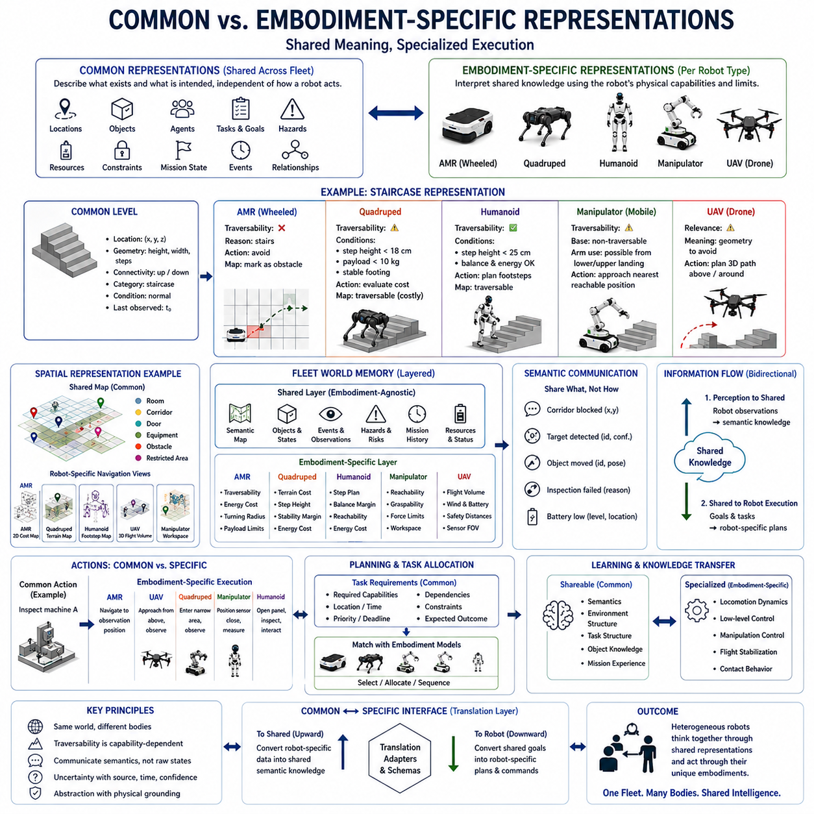{width="7.268055555555556in" height="7.268055555555556in"}

이기종 로봇 플릿(Heterogeneous Robot Fleet)은 근본적으로 서로 다른 로봇들이 동일한 임무를 이해할 수 있도록 하면서도 각 체화(embodiment)에 필요한 물리적 정보를 보존하는 표현(representation)을 필요로 한다. 이로 인해 플릿 전체가 공유하는 지식을 표현하는 공통 표현(common representation)과 특정 로봇 유형이 해당 지식을 어떻게 해석하고 행동으로 옮기는지를 기술하는 체화별 표현(embodiment-specific representation) 사이에 아키텍처적 구분이 형성된다.

공통 표현(Common Representation)은 서로 다른 센서, 액추에이터(actuator), 이동 시스템, 제어 아키텍처를 가진 로봇들이 사용할 수 있는 공유 개념 언어(shared conceptual language)를 제공한다. 공통 표현은 특정 로봇이 물리적으로 어떻게 상호작용하는지를 전제하지 않고 위치, 물체, 에이전트, 작업, 목표, 위험요소, 자원, 제약조건, 임무 상태 등을 기술한다. 이러한 추상화를 통해 이기종 플랫폼들은 동일한 세계와 임무 맥락을 중심으로 조정될 수 있다.

예를 들어 계단(staircase)은 공통 수준에서 위치, 기하학적 구조(geometry), 연결성(connectivity), 의미 범주(semantic category), 현재 상태를 가진 공간 구조물로 표현할 수 있다. 이러한 정보는 자율이동로봇(AMR), 4족 보행 로봇(quadruped), 휴머노이드(humanoid), 무인항공기(UAV)가 모두 이해할 수 있다. 그러나 각 로봇의 이동 메커니즘과 운용 제약조건이 근본적으로 다르기 때문에 계단이 가지는 물리적 의미는 체화 형태에 따라 달라진다.

체화별 표현(Embodiment-Specific Representation)은 공유된 환경 지식을 특정 로봇의 물리적 역량에 적합한 정보로 변환한다. 바퀴형 자율이동로봇(wheeled AMR)에서 계단은 주행 불가능(non-traversable)한 영역으로 분류될 수 있다. 4족 보행 로봇이나 휴머노이드에서는 경사도, 계단 높이, 페이로드, 안정성 제약조건에 따라 주행 가능할 수 있다. UAV에서는 주변 공간을 비행할 때 회피해야 하는 기하학적 구조로 주로 해석될 수 있다.

동일한 원리는 물체(object)에도 적용된다. 공통 수준에서 물체는 식별정보(identity), 의미 클래스(semantic class), 자세(pose), 크기, 상태, 소유 관계, 작업 관련성을 가질 수 있다. 매니퓰레이터(manipulator)는 추가적으로 파지점(grasp point), 도달 가능성(reachability), 필요한 힘, 충돌 제약조건을 표현할 수 있다. AMR은 동일한 물체를 주로 화물이나 장애물로 해석할 수 있으며, UAV는 탐지 또는 검사를 위한 시각적 목표물로 취급할 수 있다.

공유 공간 표현(Shared Spatial Representation)은 이기종 로봇들이 서로 다른 내비게이션 공간을 사용하면서도 동일한 환경에서 협력해야 하기 때문에 특히 중요하다. 공통 지도(common map)는 토폴로지(topology), 방, 복도, 출입문, 설비, 제한 구역, 장애물, 의미 영역을 기술할 수 있다. 이후 각 로봇은 2차원 비용 지도(2D cost map), 지형 모델(terrain model), 비행 공간(flight volume), 발걸음 지도(footstep map), 조작 작업공간(manipulation workspace)과 같은 자체 내비게이션 표현을 생성할 수 있다.

이러한 분리는 하나의 범용 주행 가능성 지도(universal traversability map)가 모든 체화 형태에 동일하게 적용된다는 잘못된 가정을 방지한다. 주행 가능성(Traversability)은 단순히 지형 자체의 속성이 아니라 지형과 로봇 역량 사이의 관계이다. 동일한 표면이 어떤 플랫폼에는 쉬울 수 있고, 다른 플랫폼에는 위험하며, 또 다른 플랫폼에는 통과 불가능할 수 있다. 따라서 플릿 지식은 공유된 기하학적 구조를 보존하면서 체화 의존적 주행 가능성 추정값을 유지해야 한다.

행동(Action) 역시 공통 표현과 체화별 표현을 모두 필요로 한다. "기계 A를 검사하라"와 같은 플릿 수준 행동은 물리적 실행 방법을 지정하지 않고 목표를 표현한다. AMR은 관측 위치까지 이동하고, UAV는 상공에서 접근하며, 4족 보행 로봇은 좁은 유지보수 구역에 진입하고, 매니퓰레이터는 센서를 부품 가까이에 위치시킬 수 있다. 공유 행동 의미(shared action semantics)는 유지되지만 실제 실행 방법은 서로 달라진다.

이러한 구분은 임무 분해(Mission Decomposition)와 작업 할당(Task Allocation)을 지원한다. 플릿 지능(fleet intelligence)은 필요한 역량, 위치, 마감시간, 우선순위, 의존관계, 예상 결과를 통해 작업을 표현할 수 있다. 이후 이러한 요구사항을 이동성, 조작, 센싱, 페이로드, 에너지, 안전, 통신을 설명하는 체화별 모델과 비교할 수 있다. 작업 할당은 공통 임무 요구사항을 물리적으로 실행 가능한 로봇 행동으로 변환하는 과정이 된다.

공통 표현은 통신(Communication)에서도 필수적이다. 체화별 원시 상태(raw embodiment-specific state)를 직접 교환하면 다른 로봇이 해당 플랫폼의 내부 변수를 이해하지 못할 수 있어 협력이 어려워진다. 대신 의미 통신(semantic communication)을 사용하면 로봇은 "복도 차단", "목표물 탐지", "물체 이동", "검사 실패"와 같은 정보를 위치, 시간, 신뢰도(confidence), 관련 맥락 정보와 함께 교환할 수 있다.

필요한 경우 체화별 세부 정보가 의미 메시지(semantic message)에 함께 포함될 수도 있다. 험난한 지형을 보고하는 4족 보행 로봇은 경사도, 표면 상태, 발의 안정성(foot stability), 예상 이동 비용을 제공할 수 있다. 이러한 세부 정보가 AMR에 직접 적용되지는 않더라도 플릿은 해당 정보를 관측과 연결된 근거(evidence)로 유지할 수 있다. 다른 로봇들은 자신의 체화 모델에 따라 기본 환경 정보를 다시 해석할 수 있다.

따라서 플릿 월드 메모리(Fleet World Memory)는 계층화된 표현(layered representation)을 활용함으로써 이점을 얻을 수 있다. 공유 메모리는 지속적인 환경 사실, 의미적 물체, 이벤트, 임무 이력, 위험요소, 관측 정보를 유지할 수 있다. 로봇별 계층은 서로 다른 체화 형태에 대한 주행 가능성, 도달 가능성, 파지 가능성(graspability), 에너지 비용, 위험도, 예상 성능을 유지할 수 있다. 이러한 구조는 지식이 획득된 물리적 맥락을 제거하지 않으면서도 전체 플릿에서 유용하게 사용할 수 있도록 한다.

불확실성(Uncertainty) 역시 이러한 계층 전체에서 표현되어야 한다. 공유된 관측은 의심할 수 없는 사실로 취급되는 대신 신뢰도, 정보 출처(source), 타임스탬프(timestamp), 유효성(validity) 정보를 포함해야 한다. 체화별 해석은 다른 플랫폼의 경험이 자신에게도 적용되는지 확실하지 않을 수 있기 때문에 추가적인 불확실성을 발생시킨다. 이러한 차이를 유지하면 물리적으로 다른 로봇들 사이에서 부적절한 결론이 전이되는 것을 방지할 수 있다.

학습(Learning)도 동일한 아키텍처 원리를 따른다. 고수준 의미 개념, 환경 관계, 작업 구조, 물체 지식, 임무 결과는 여러 체화 형태에서 공유될 수 있는 경우가 많다. 반면 저수준 이동 동역학(low-level locomotion dynamics), 액추에이터 명령, 파지 제어(grasp control), 비행 안정화(flight stabilization), 접촉 행동(contact behavior)은 체화에 훨씬 더 의존적이다. 따라서 체화 간 학습(cross-embodiment learning)은 전체 정책을 강제로 공유하기보다는 어떤 표현 수준이 전이 가능한지를 식별해야 한다.

공유 잠재 표현(shared latent representation)은 특정 센서나 액추에이터 형식과 독립적으로 작업 관련 구조를 포착할 수 있다면 전이를 더욱 지원할 수 있다. 카메라 영상, 라이다(LiDAR) 관측, 고유수용감각(proprioception), 언어 지시(language instruction), 지도 정보 등을 공통 개념을 중심으로 정렬된 표현으로 인코딩할 수 있다. 이후 로봇별 인코더(encoder)와 행동 디코더(action decoder)가 이러한 공유 공간을 서로 다른 인지 시스템 및 물리적 행동 공간과 연결할 수 있다.

그러나 지나친 추상화(excessive abstraction)는 안전한 물리적 실행에 필요한 정보를 제거할 수 있다. 단순히 목적지에 도달할 수 있다고 표현하면 특정 로봇이 실제로 해당 위치에 도달할 수 있는지를 결정하는 경사도, 여유 공간(clearance), 페이로드, 안정성, 에너지 제약조건 등이 숨겨질 수 있다. 따라서 공통 표현은 조정을 단순화하면서도 물리적으로 근거 있는 추론(physically grounded reasoning)과 안전에 필요한 체화별 제약조건을 제거해서는 안 된다.

반대의 극단도 마찬가지로 문제가 된다. 모든 로봇이 자체적인 플랫폼별 표현(platform-specific representation)만 유지한다면 플릿 지식이 분절된다. 지도, 관측, 작업 경험, 학습된 정보를 교환하기 어려워지고, 조정을 위해 서로 호환되지 않는 내부 모델 사이에서 반복적인 변환이 필요해진다. 따라서 이기종 플릿에는 공유 추상화(shared abstraction)와 전문화된 로컬 표현(specialized local representation)을 연결하도록 신중하게 설계된 인터페이스가 필요하다.

이러한 인터페이스는 양방향 변환 메커니즘(bidirectional translation mechanism)으로 볼 수 있다. 인지 과정에서는 체화별 관측이 다른 로봇들이 이해할 수 있는 공유 의미 지식(shared semantic knowledge)으로 변환된다. 계획 및 실행 과정에서는 공유된 목표와 작업이 다시 로봇별 내비게이션, 조작, 센싱, 제어 목표로 변환된다. 정보는 물리적 전문화(physical specialization)와 집단적 추상화(collective abstraction) 사이를 지속적으로 이동한다.

공통 정보와 체화별 정보 사이의 경계는 영구적으로 고정될 필요가 없다. 상호운용성(interoperability)이 향상되면서 일부 표현은 공유될 수 있고, 피할 수 없는 물리적 차이 때문에 다른 표현들은 계속 전문화된 상태로 남을 수 있다. 따라서 확장 가능한 아키텍처는 새로운 로봇 유형이 전체 집단 지능 시스템을 다시 설계하지 않고도 플릿에 참여할 수 있도록 확장 가능한 스키마(extensible schema), 역량 기술(capability description), 의미 인터페이스(semantic interface), 어댑터(adapter)를 지원해야 한다.

궁극적으로 공통 표현(Common Representation)과 체화별 표현(Embodiment-Specific Representation)은 서로 보완적인 두 가지 문제를 해결한다. 공통 표현은 이기종 로봇들이 의미, 월드 지식, 목표, 임무 맥락을 공유하도록 하고, 체화별 표현은 각 로봇이 무엇을 인지하고 수행할 수 있는지를 지배하는 물리적 현실을 보존한다. 이 두 계층을 연결함으로써 이기종 플릿은 여러 서로 다른 신체를 통해 행동하면서도 집단적으로 사고(think collectively)할 수 있다.

## 07.05. Capability Models and Robot Self Description

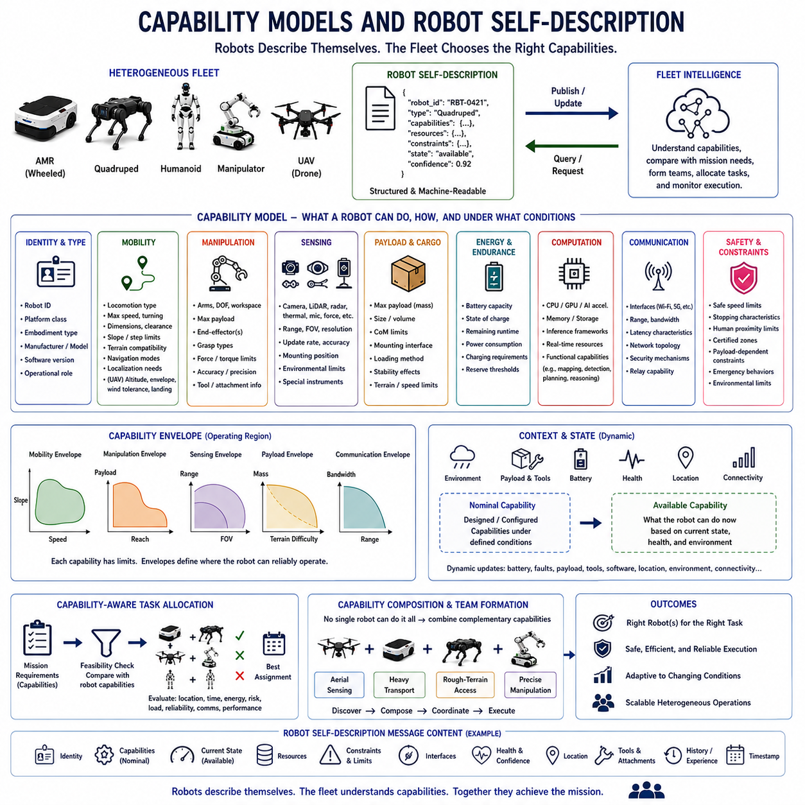{width="7.268055555555556in" height="7.268055555555556in"}

역량 모델(Capability Model)은 로봇이 무엇을 수행할 수 있는지, 어떤 조건에서 이를 수행할 수 있는지, 그리고 필요한 행동을 얼마나 신뢰성 있게 수행할 수 있는지를 구조화하여 표현한 것이다. 이기종 플릿(Heterogeneous Fleet)에서 역량 모델은 모든 로봇이 동일한 이동성, 센싱, 조작, 연산, 통신 또는 안전 특성을 가진다고 가정하지 않으면서도 근본적으로 서로 다른 체화 형태(embodiment)를 비교할 수 있는 공통 기반을 제공한다.

로봇 자기 기술(Robot Self-Description)은 각 로봇이 자신의 정체성(identity), 체화 형태, 자원, 인터페이스, 운용 한계, 현재 사용 가능한 역량을 플릿에 전달할 수 있도록 함으로써 이러한 개념을 확장한다. 플릿 지능(fleet intelligence)은 수동으로 설정된 지식에만 의존하는 대신 참여하는 로봇으로부터 구조화된 기술 정보를 질의하거나 전달받아 특정 임무에 적합한 플랫폼을 판단할 수 있다.

자기 기술(Self-Description)은 로봇의 정체성과 유형에서 시작한다. 고유 로봇 식별자(unique robot identifier), 플랫폼 클래스(platform class), 제조사 또는 모델 계열, 체화 범주(embodiment category), 소프트웨어 버전, 운용 역할 등을 기술할 수 있다. 이러한 속성을 통해 플릿 시스템은 개별 로봇을 구분하면서 바퀴형 자율이동로봇(wheeled AMR), 4족 보행 로봇(quadruped), 무인항공기(UAV), 휴머노이드(humanoid), 모바일 매니퓰레이터(mobile manipulator)와 같이 유사한 특성을 가진 플랫폼을 그룹화할 수 있다.

이동성(Mobility)은 역량 모델의 주요 구성요소이다. 로봇은 이동 방식(locomotion type), 최대 속도, 회전 특성, 크기, 지상고(ground clearance), 경사 한계, 단차 통과 능력, 지형 적합성, 위치추정 요구사항, 내비게이션 모드 등을 기술할 수 있다. UAV는 추가적으로 고도, 비행 영역(flight envelope), 바람 허용 범위, 착륙 요구조건을 기술할 수 있으며, 4족 보행 로봇은 단차 높이와 안정성 제약조건을 기술할 수 있다.

조작 역량(Manipulation Capability)은 다른 종류의 기술 항목을 필요로 한다. 로봇은 조작 기능의 사용 가능 여부, 로봇 팔의 수와 유형, 자유도(degrees of freedom), 도달 가능한 작업공간(reachable workspace), 최대 페이로드, 엔드 이펙터 구성(end-effector configuration), 지원 가능한 파지 유형, 힘의 한계, 조작 정확도를 보고할 수 있다. 도구 부착(tool attachment)은 이러한 속성을 추가적으로 변화시키므로 로봇의 실질적인 조작 역량은 현재의 물리적 구성에 따라 달라질 수 있다.

센싱 역량(Sensing Capability)은 로봇이 환경으로부터 어떤 정보를 획득할 수 있는지를 설명한다. 자기 기술에는 카메라, 라이다(LiDAR), 레이더(radar), 열 센서(thermal sensor), 마이크, 힘 센서(force sensor), 가스 감지기(gas detector), 고유수용감각 센서(proprioceptive sensor), 특수 검사 장비 등이 포함될 수 있다. 센서 기술에는 임무 계획과 관련된 측정 거리, 시야각(field of view), 해상도, 갱신 주기, 정확도, 장착 위치, 환경적 제한조건을 포함할 수 있다.

페이로드 역량(Payload Capability)은 단순한 최대 질량 하나만으로 표현해서는 안 된다. 페이로드 크기, 무게중심(center of mass) 한계, 장착 인터페이스, 적재 방법, 안정성에 미치는 영향, 지형이나 속도에 따른 제한조건 등이 실제 운송 가능성을 결정할 수 있다. 평탄한 바닥에서 무거운 페이로드를 운반할 수 있는 로봇이라도 경사면이나 불규칙한 지형에서는 역량이 크게 감소할 수 있다.

에너지(Energy)와 운용 지속시간(Endurance)은 자기 기술의 또 다른 중요한 부분이다. 로봇은 배터리 용량, 충전 상태(state of charge), 예상 잔여 운용시간, 충전 요구사항, 전력 소비 특성, 예비 전력 임계값(reserve threshold)을 제공할 수 있다. 사용 가능한 에너지는 지속적으로 변화하므로 플릿 지능은 작업 완료 가능성을 안전하게 평가할 때 로봇의 명목 운용 지속시간(nominal endurance)과 현재 임무 운용 지속시간(current mission endurance)을 구분해야 한다.

연산(Computation) 역시 하나의 역량으로 표현할 수 있다. 로봇은 사용 가능한 CPU, GPU, AI 가속기(AI accelerator), 메모리, 저장공간, 지원 추론 프레임워크(inference framework), 실시간 처리 자원을 기술할 수 있다. 더욱 유용한 방법은 플릿 시스템이 하드웨어 사양만으로 추론하도록 하는 대신 로컬 물체 탐지, 매핑, 월드 모델링(world modeling), 언어 추론(language reasoning), 궤적 계획(trajectory planning), 조작 추론과 같은 기능적 연산 역량을 직접 제공하는 것이다.

통신 자기 기술(Communication Self-Description)은 로봇이 다른 로봇 및 인프라와 정보를 어떻게 교환할 수 있는지를 나타낸다. 관련 속성에는 지원 인터페이스, 통신 거리, 대역폭(bandwidth), 지연 특성(latency characteristics), 네트워크 토폴로지(network topology), 보안 메커니즘, 예상 연결성이 포함된다. 네트워크 중계기(network relay) 역할을 수행할 수 있는 플랫폼은 이러한 역량을 공개할 수 있으며, 이를 통해 통신 요구사항 자체도 플릿 수준 작업 할당의 일부가 될 수 있다.

물리적으로 실행 가능하다는 것이 자동으로 운용 허가를 의미하지는 않으므로 안전 특성(Safety Characteristics)도 포함되어야 한다. 로봇은 안전 속도 제한, 정지 특성, 인간 근접 제한(human proximity restriction), 인증된 운용 구역, 페이로드 의존적 제약조건, 비상 행동(emergency behavior), 환경적 제한사항을 기술할 수 있다. 플릿 계획은 이를 이용하여 기술적으로는 가능하지만 요구되는 안전 조건과 호환되지 않는 작업 할당을 거부할 수 있다.

역량 모델은 능력을 단순한 이진 값(Boolean Value)으로 표현하는 대신 조건과 제약조건을 함께 표현해야 한다. "계단을 오를 수 있다"는 표현보다는 최대 단차 높이, 경사도, 페이로드, 표면 조건, 안정성 한계, 예상 에너지 비용을 기술하는 것이 더 유용하다. 마찬가지로 "조작할 수 있다"는 표현에도 도달 가능성, 페이로드, 엔드 이펙터, 정밀도, 힘, 물체 호환성 정보를 함께 포함해야 한다.

이는 자연스럽게 역량 범위(Capability Envelope)라는 개념으로 이어진다. 역량 범위는 로봇이 특정 기능을 신뢰성 있게 제공할 수 있는 운용 영역(operating region)을 의미한다. 이동, 조작, 센싱, 운송, 통신 역량은 각각 고유한 역량 범위를 가질 수 있다. 광범위한 로봇 분류나 고정된 가정에 의존하는 대신 임무 요구사항과 이러한 역량 범위를 비교하여 실행 가능성을 판단할 수 있다.

역량(Capability)은 또한 상황 의존적(contextual)이다. 정상적인 조건에서는 특정 작업에 적합한 로봇이라도 바닥이 젖거나, 통신 성능이 저하되거나, 가시성이 나빠지거나, 페이로드가 변경되거나, 사람이 작업공간에 진입하면 적합하지 않을 수 있다. 따라서 역량 모델은 로봇 속성과 환경 및 임무 조건을 연결하여 플릿 추론이 정적인 사양이 아니라 실제 물리적 상황을 반영하도록 해야 한다.

유용한 아키텍처는 명목 역량(Nominal Capability)과 가용 역량(Available Capability)을 구분한다. 명목 역량은 정의된 조건에서 로봇이 설계되고 구성된 목적에 따라 수행할 수 있는 기능을 의미한다. 가용 역량은 배터리 상태, 고장, 센서 건전성(sensor health), 페이로드, 장착 도구, 소프트웨어 상태, 위치, 연결성, 환경 제약조건 등을 고려했을 때 현재 시점에서 실제로 수행할 수 있는 기능을 의미한다.

따라서 로봇 자기 기술은 동적 갱신(Dynamic Update)을 지원해야 한다. 배터리 소모, 액추에이터 고장, 센서 성능 저하, 도구 교체, 페이로드 장착, 소프트웨어 변경, 통신 단절은 임무 수행 중 역량 상태를 변화시킬 수 있다. 로봇은 의미 있는 변화를 플릿에 전달해야 하며, 플릿 지능은 역량이 일정하게 유지된다고 가정하지 않고 작업 할당, 일정, 경로, 팀 구성, 비상 계획(contingency plan)을 갱신할 수 있어야 한다.

건전성(Health)과 신뢰도(Confidence)는 개별 역량과 연결할 수 있다. 하나의 센서 성능이 저하된 로봇도 낮아진 신뢰도를 보고하면서 위치추정 기능을 계속 제공할 수 있다. 매니퓰레이터 역시 액추에이터 이상을 감지한 이후 감소된 페이로드 또는 정밀도로 파지 기능을 유지할 수 있다. 이를 통해 플릿은 로봇을 정상 또는 고장이라는 두 상태로만 취급하지 않고 명시적으로 축소된 운용 범위 내에서 부분적으로 기능하는 로봇을 계속 활용하는 점진적 성능 저하(graceful degradation)를 구현할 수 있다.

자기 기술은 자동 등록 및 발견(Automatic Registration and Discovery)도 지원한다. 로봇이 플릿에 참여할 때 자신의 정체성, 인터페이스, 역량, 제약조건, 현재 상태를 오케스트레이션 계층(orchestration layer)에 제공할 수 있다. 이를 통해 모든 플랫폼 특성을 중앙 소프트웨어에 직접 내장하지 않고 새로운 로봇을 플릿에 통합할 수 있으며, 새로운 체화 형태, 도구, 센서, 전문 플랫폼이 추가될 때 더욱 확장 가능한 아키텍처를 구성할 수 있다.

표준화된 의미 체계(Standardized Semantics)는 상호운용성(interoperability)을 위해 중요하다. 서로 다른 제조사는 유사한 역량을 호환되지 않는 이름, 단위, 가정으로 기술할 수 있다. 공통 역량 온톨로지(capability ontology) 또는 스키마(schema)는 운송, 검사, 조작, 이동, 탐지, 통신, 충전과 같은 개념과 각각의 매개변수 및 제약조건을 정의할 수 있다. 플랫폼별 어댑터(platform-specific adapter)는 각 로봇의 고유 정보를 이러한 공유 플릿 어휘(shared fleet vocabulary)로 변환할 수 있다.

역량 모델은 이후 역량 인식 작업 할당(Capability-Aware Task Allocation)의 기반이 된다. 임무를 필요한 역량으로 분해하고 후보 로봇을 이러한 요구사항과 비교하여 평가할 수 있다. 플릿 지능은 먼저 실행 가능성을 판단한 후 실행 가능한 후보들 사이에서 위치, 실행시간, 에너지 비용, 위험도, 작업 부하, 신뢰성, 통신 품질, 예상 임무 성능을 고려하여 최적화할 수 있다.

더 복잡한 임무에서는 역량 구성(Capability Composition)이 필요할 수 있다. 한 로봇은 공중 센싱을 제공하고, 다른 로봇은 중량 운송을 담당하며, 또 다른 로봇은 험지 접근을 제공하고, 다른 로봇은 조작 작업을 수행할 수 있다. 자기 기술을 활용하면 플릿 지능은 하나의 로봇이 전체 임무를 만족하지 못한다는 사실을 판단하는 동시에 여러 로봇의 역량을 결합하여 임무를 수행할 수 있는 조합을 찾을 수 있다. 따라서 팀 구성(team formation)은 상호 보완적인 물리적 능력을 자동으로 조합하는 과정이 될 수 있다.

궁극적으로 역량 모델(Capability Model)과 로봇 자기 기술(Robot Self-Description)은 물리적 체화(physical embodiment)와 집단 지능(collective intelligence)을 연결하는 기계 판독 가능한 연결 계층(machine-readable bridge)을 제공한다. 이를 통해 각 로봇은 자신이 무엇인지, 현재 무엇을 수행할 수 있는지, 어떤 제약조건이 행동을 제한하는지, 그리고 해당 기능을 어느 정도의 신뢰도로 수행할 수 있는지를 표현한다. 이기종 플릿은 이를 기반으로 로봇을 동적으로 변화하는 역량 제공자(dynamic capability provider)로 이해하고, 변화하는 임무와 환경에 적합한 물리적 팀을 구성할 수 있다.

## 07.06. Cross Embodiment Task Allocation

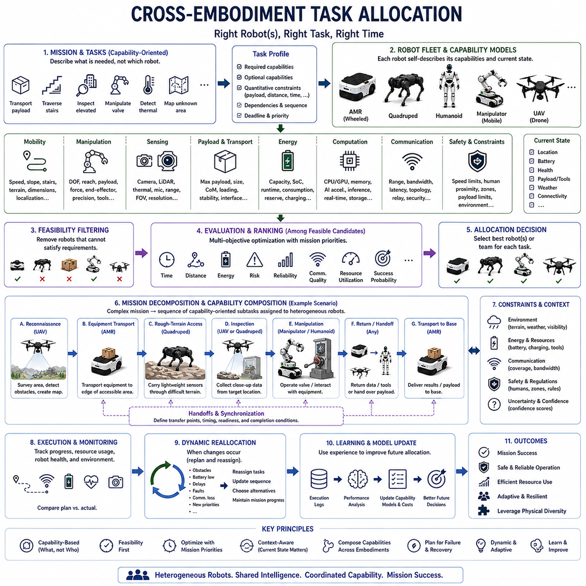{width="7.268055555555556in" height="7.268055555555556in"}

교차 체화 작업 할당(Cross-Embodiment Task Allocation)은 근본적으로 서로 다른 물리적 형태, 역량, 제약조건, 운용 특성을 가진 로봇들 사이에 임무 활동을 할당하는 과정이다. 동종 플릿(Homogeneous Fleet)의 작업 할당과 달리 로봇들이 서로 교환 가능하다고 가정할 수 없다. 작업 할당 시스템은 각 작업이 물리적으로 무엇을 요구하는지, 그리고 어떤 체화(embodiment) 또는 체화의 조합이 해당 요구사항을 충족할 수 있는지를 추론해야 한다.

이 과정은 특정 로봇의 정체성과 독립적으로 작업(Task)을 표현하는 것에서 시작한다. "AMR-03을 보내라"와 같이 명령을 정의하는 대신 장비 운송, 계단 통과, 높은 구조물 검사, 밸브 조작, 열 이상(thermal anomaly) 탐지, 미지 영역 매핑과 같은 요구사항으로 임무를 정의할 수 있다. 이러한 역량 중심 기술(capability-oriented description)을 통해 서로 다른 로봇 유형이 기능적 적합성(functional suitability)에 따라 경쟁하거나 협력할 수 있다.

각 작업에는 정량적 제약조건과 함께 필수 역량(required capability)과 선택적 역량(optional capability)을 연결할 수 있다. 운송 작업에는 페이로드 질량, 크기, 목적지, 지형, 배송 마감시간 등이 포함될 수 있다. 검사에는 센서 유형, 관측 거리, 해상도, 시야각이 필요할 수 있다. 조작에는 도달 범위, 힘, 정밀도, 엔드 이펙터 호환성(end-effector compatibility), 물체 특성을 지정할 수 있다. 이러한 요구사항은 기계 판독 가능한 작업 프로파일(machine-readable task profile)을 구성한다.

로봇 역량 모델(Robot Capability Model)은 작업 할당 문제에서 이에 대응하는 공급 측면(supply side)을 제공한다. AMR, 매니퓰레이터(manipulator), 휴머노이드(humanoid), 4족 보행 로봇(quadruped), UAV는 자신의 이동성, 센싱, 조작, 페이로드, 에너지, 연산, 통신, 안전 역량을 기술한다. 작업 할당은 작업 요구사항과 이러한 기술 정보를 비교하여 현재의 역량 범위(capability envelope)가 임무의 물리적·운용적 조건을 충족하는 로봇을 식별한다.

실제 작업 할당에서는 명목 역량(Nominal Capability)보다 현재 역량(Current Capability)이 더욱 중요하다. 4족 보행 로봇은 일반적으로 계단을 통과할 수 있지만 배터리가 부족하거나 페이로드가 장착된 상태에서는 적합하지 않을 수 있다. UAV는 공중 검사를 수행할 수 있지만 바람의 영향을 받을 수 있다. 모바일 매니퓰레이터는 필요한 로봇 팔을 가지고 있어도 적절한 엔드 이펙터가 없을 수 있다. 따라서 작업 할당은 플랫폼 사양에만 의존하지 않고 로봇의 현재 상태를 평가해야 한다.

최적화(Optimization)에 앞서 실행 가능성 필터링(Feasibility Filtering)이 이루어져야 한다. 물리적, 안전상, 또는 운용상의 이유로 작업을 수행할 수 없는 로봇을 먼저 후보에서 제거해야 한다. 이후 남은 후보를 실행시간, 이동 거리, 에너지 소비, 위험도, 작업 부하, 신뢰성, 통신 품질, 자원 활용도, 예상 임무 성공 확률과 같은 임무 관련 목표를 기준으로 평가하고 순위를 결정할 수 있다.

체화(Embodiment)는 이러한 평가를 다차원적으로 만드는 상충관계(trade-off)를 발생시킨다. AMR은 효율적인 운송 능력을 제공하지만 험지 접근성이 낮을 수 있다. 4족 보행 로봇은 높은 에너지 비용을 감수하면서 어려운 장소에 접근할 수 있다. UAV는 빠르게 도착할 수 있지만 운용시간과 페이로드가 제한적이다. 휴머노이드는 인간 중심 인터페이스를 조작할 수 있지만 더 많은 연산 및 제어 자원이 필요할 수 있다. 작업 할당은 임무 우선순위에 따라 이러한 차이를 균형 있게 고려해야 한다.

많은 임무는 활동 사이에 시간적·인과적 의존관계(temporal and causal dependency)가 존재하기 때문에 서로 독립된 작업으로 표현할 수 없다. 조작을 시작하기 전에 장비가 도착해야 할 수 있고, 지상 이동 전에 정찰이 수행되어야 할 수 있으며, 검사를 수행하기 전에 접근 패널을 열어야 할 수도 있다. 따라서 교차 체화 작업 할당은 누가 각 작업을 수행할 것인지뿐만 아니라 협력 행동이 언제 어떤 순서로 수행될 것인지도 결정해야 한다.

임무 분해(Mission Decomposition)는 복잡한 목표를 역량 중심의 하위 작업(capability-oriented subtask)으로 변환한다. 예를 들어 불규칙한 지형 너머에 위치한 높은 산업 구조물을 검사하는 임무를 생각할 수 있다. UAV가 초기 정찰을 수행하고, AMR이 접근 가능한 영역의 끝까지 장비를 운반하며, 4족 보행 로봇이 경량 센서를 더 먼 지역까지 운반하고, 매니퓰레이터 또는 휴머노이드가 목표 위치에서 장비와 상호작용할 수 있다. 작업 할당은 이러한 조정된 작업 사슬(coordinated chain)을 구성한다.

이 과정은 역량 구성(Capability Composition)으로 이해할 수 있다. 하나의 로봇이 모든 임무 요구사항을 충족하지 못할 경우 플릿은 여러 로봇의 역량을 결합하여 필요한 기능을 제공할 수 있는 조합을 탐색한다. 이렇게 구성된 팀은 단순히 사용 가능한 로봇들을 모아 놓은 것이 아니라 임무를 중심으로 구성된 임시 복합 체화(temporary composite embodiment)이다. 집단 역량(collective capability)은 전문화된 플랫폼 사이의 조정된 관계를 통해 발생한다.

공간 추론(Spatial Reasoning)은 역량의 유용성이 해당 역량을 어디에서 적용할 수 있는지에 따라 달라지기 때문에 필수적이다. 밸브를 조작할 수 있는 매니퓰레이터도 밸브 위치에 도달할 수 없다면 의미가 없다. 운송 로봇 역시 필요한 페이로드를 운반할 수 있어도 통과 가능한 경로가 없다면 작업을 수행할 수 없다. 따라서 작업 할당은 역량 추론을 체화별 주행 가능성(traversability), 도달 가능성(reachability), 접근 가능성(accessibility), 작업공간(workspace) 표현과 연결해야 한다.

에너지(Energy)는 개별 로봇과 팀 수준 모두에서 제약조건을 발생시킨다. 기술적으로 가장 빠른 로봇을 선택하더라도 해당 작업으로 인해 임무 완료 또는 복귀에 필요한 에너지가 부족해진다면 바람직하지 않을 수 있다. 작업 할당은 이동 에너지, 작업 수행 에너지, 예비 전력 임계값, 충전 가능성, 예상되는 향후 작업 등을 고려할 수 있다. 협력 임무에서는 하나의 로봇이 가진 에너지 한계가 전체 팀의 최적 작업 순서나 구성까지 변화시킬 수 있다.

통신 제약조건(Communication Constraint) 역시 작업 할당에 영향을 줄 수 있다. 안정적인 네트워크 범위를 벗어나 운용되는 로봇에는 더 높은 로컬 자율성(local autonomy), 통신 중계기 역할을 하는 다른 로봇, 또는 다른 임무 수행 순서가 필요할 수 있다. 일부 작업은 지속적인 데이터 스트리밍을 요구하지만 다른 작업은 간헐적 통신을 허용할 수 있다. 따라서 통신 역량은 작업 할당의 제약조건인 동시에 일부 임무에서는 그 자체가 할당 가능한 역량이 된다.

안전 요구사항(Safety Requirement)은 물리적 실행 가능성과 함께 평가되어야 한다. 중량 AMR은 기술적으로 특정 구역에 진입할 수 있지만 사람이 존재하는 상황에서는 적합하지 않을 수 있다. UAV는 민감한 장비 주변에서 운용이 제한될 수 있으며, 매니퓰레이터는 작업 중 통제된 출입 제한 구역(exclusion zone)을 필요로 할 수 있다. 교차 체화 작업 할당은 이러한 안전 조건을 명시적으로 표현하여 최적화 과정에서 효율적이지만 운용상 허용되지 않는 해결책이 선택되지 않도록 해야 한다.

역량과 환경에 관한 정보가 완벽한 경우는 드물기 때문에 불확실성(Uncertainty)은 작업 할당을 더욱 복잡하게 만든다. 지형 조건이 충분히 관측되지 않았을 수 있고, 배터리 예측에 오차가 존재할 수 있으며, 조작 성공 여부가 불확실한 물체 자세(object pose)에 의존할 수도 있다. 따라서 역량 기술과 작업 추정값에 신뢰도(confidence)를 포함할 수 있다. 작업 할당은 강건한 할당(robust assignment)을 우선하거나 신뢰성 있는 실행을 위한 불확실성이 지나치게 높은 경우 추가 센싱을 요청할 수 있다.

작업 할당은 문제가 발생하기 전부터 고장 및 복구(Failure and Recovery)를 고려해야 한다. 임무 계획은 핵심 작업을 위한 대체 로봇, 대체 역량(substitute capability), 복구 경로를 식별할 수 있다. UAV를 사용할 수 없게 되면 4족 보행 로봇이 더 느린 방식으로 정찰을 제공할 수 있으며, AMR의 경로가 차단되면 다른 체화 형태가 다른 영역을 통해 임무를 계속 수행할 수 있다. 따라서 이기종 플릿은 동일한 백업 로봇을 요구하기보다 기능적 중복성(functional redundancy)을 제공할 수 있다.

실행이 시작된 이후 환경이 변화하면 동적 재할당(Dynamic Reallocation)이 필요해진다. 새로운 장애물, 배터리 소모, 작업 지연, 센서 고장, 통신 단절, 예상하지 못한 인간 활동, 새롭게 발견된 임무 우선순위는 기존 할당을 무효화할 수 있다. 플릿 지능은 계획 당시의 가정과 현재 월드 및 로봇 상태를 지속적으로 비교하고, 다른 체화 형태가 더 실행 가능하거나 안전한 대안을 제공할 경우 작업을 재할당해야 한다.

재할당(Reallocation)은 불필요한 불안정성을 방지해야 한다. 작은 비용 차이가 발생할 때마다 작업을 계속 다른 로봇으로 이동시키면 효율성이 감소하고 조정 오버헤드(coordination overhead)가 증가할 수 있다. 따라서 시스템은 전환 비용(switching cost), 작업 진행도, 물리적 투입 상태(physical commitment), 인계 요구사항, 임무 중단 영향을 고려할 수 있다. 새로운 할당은 기존 실행 계획을 변경할 만큼 충분한 이점을 제공해야 한다.

물리적 인계(Physical Handoff)는 교차 체화 임무에서 특히 중요하다. AMR이 매니퓰레이터에 도구를 전달하거나, 휴머노이드가 물체를 운송 로봇에 적재하거나, 대형 플랫폼이 더 이상 진행할 수 없는 지점부터 4족 보행 로봇이 센서를 운반할 수 있다. 작업 할당은 이러한 전달 지점을 동기화(synchronization), 위치, 준비 상태(readiness), 완료 조건을 포함하는 명시적인 협력 작업으로 표현해야 한다.

플릿 수준 작업 할당(Fleet-Level Allocation)과 로봇 수준 자율성(Robot-Level Autonomy)은 서로 구분하면서도 연결되어야 한다. 플릿은 어떤 로봇 또는 팀이 목표를 달성해야 하는지를 결정하고, 개별 플랫폼은 로컬 환경 조건에서 할당된 행동을 어떻게 안전하게 실행할 것인지를 결정한다. 이러한 계층 구조는 중앙 작업 할당 시스템이 모든 체화 형태의 세부적인 제어 지식을 가질 필요 없이 플릿 전체의 물리적 차이를 활용한 전역적 의사결정을 수행할 수 있도록 한다.

학습(Learning)은 예측된 성능과 실제 실행 결과를 비교함으로써 작업 할당을 개선할 수 있다. 플릿은 서로 다른 체화 형태에 대해 이동시간, 에너지 사용량, 조작 성공률, 지형 난이도, 통신 품질, 실패, 복구 결과 등을 기록할 수 있다. 이러한 경험은 역량 모델과 비용 추정값(cost estimate)을 개선하여 향후 작업 할당이 명목상의 공학적 사양에만 의존하지 않고 실제 관측된 성능을 반영하도록 할 수 있다.

궁극적으로 교차 체화 작업 할당(Cross-Embodiment Task Allocation)은 물리적 다양성(physical diversity)을 조정된 임무 역량(coordinated mission capability)으로 전환한다. 이는 작업 의미(task semantics), 역량 모델, 체화별 제약조건, 월드 지식(world knowledge), 자원 상태, 안전, 최적화를 연속적인 의사결정 과정으로 연결한다. 현재 조건에서 실제로 무엇을 수행할 수 있는지를 기준으로 로봇을 선택하고 조합함으로써 이기종 플릿은 적응형 집단 물리 지능 시스템(adaptive collective physical intelligence system)으로 작동할 수 있다.

## 07.07. Cross Embodiment Communication

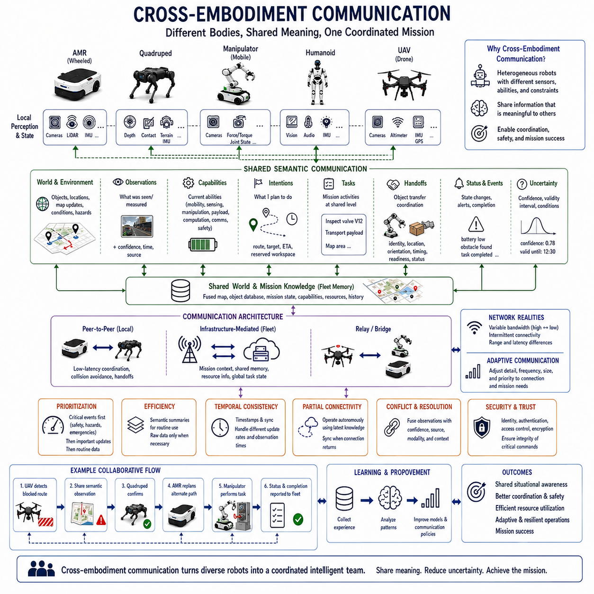{width="7.268055555555556in" height="7.268055555555556in"}

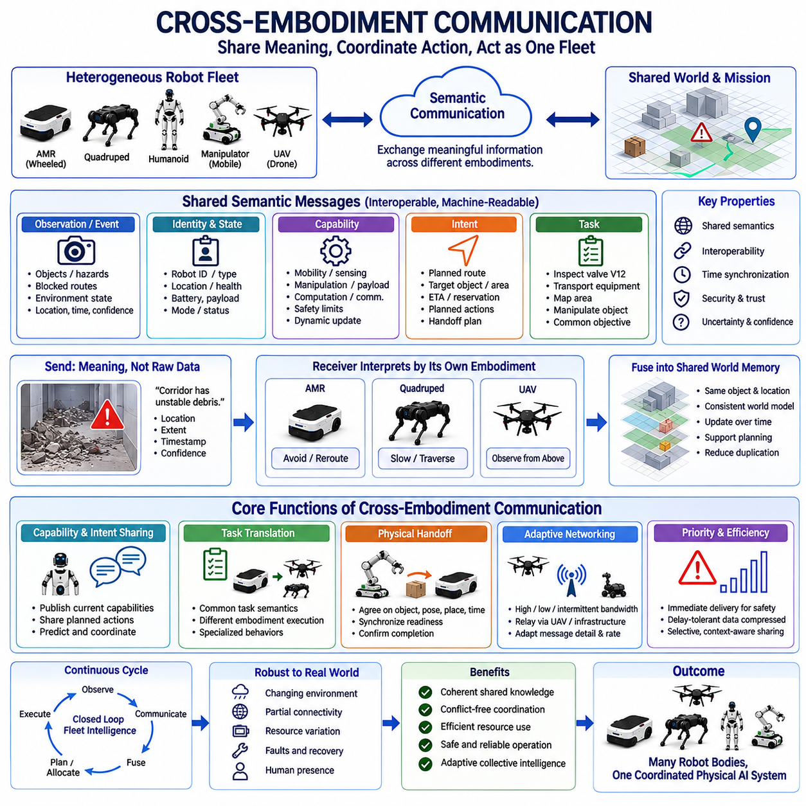{width="7.268055555555556in" height="7.268055555555556in"}

교차 체화 통신(Cross-Embodiment Communication)은 서로 다른 물리적 형태, 센서, 액추에이터(actuator), 연산 자원, 자율성 수준을 가진 로봇들이 플릿 전체에서 의미를 유지할 수 있는 정보를 교환하도록 한다. 핵심 과제는 단순히 기계 사이에서 데이터를 전송하는 것이 아니라, 하나의 체화(embodiment)가 생성한 정보를 인지 및 행동 공간이 근본적으로 다른 또 다른 체화가 해석하고 활용할 수 있도록 만드는 것이다.

이기종 플릿(Heterogeneous Fleet)은 자율이동로봇(AMR), 매니퓰레이터(manipulator), 휴머노이드(humanoid), 4족 보행 로봇(quadruped), 무인항공기(UAV), 특수 로봇 등으로 구성될 수 있으며, 각 로봇은 서로 다른 내부 상태와 센서 표현을 생성한다. 이러한 플랫폼별 변수를 직접 교환하면 로봇 아키텍처 사이에 강한 의존성이 발생한다. 교차 체화 통신은 특정 하드웨어와 독립적으로 관련 월드 상태, 이벤트, 의도, 역량, 임무 조건을 기술하는 공유 의미 체계(shared semantics)를 필요로 한다.

따라서 의미 통신(Semantic Communication)은 원시 표현(raw representation)보다 의미(meaning)를 강조한다. 4족 보행 로봇은 단순히 관절 상태나 로컬 지형 지도 셀(local terrain-map cell)을 전송하는 것이 아니라 복도에 불안정한 잔해가 존재한다는 사실을 전달해야 한다. UAV는 접근 경로가 차단되었다는 사실과 함께 위치, 범위, 타임스탬프(timestamp), 신뢰도(confidence)를 보고할 수 있다. 다른 로봇들은 이러한 정보를 자신의 이동성 및 운용 제약조건에 따라 다시 해석할 수 있다.

공유 물체 및 위치 식별정보(Shared Object and Location Identity)는 이러한 과정에 필수적이다. 하나의 로봇이 기계, 출입구, 팔레트, 위험요소, 충전소, 검사 대상을 보고할 때 다른 로봇들도 해당 메시지를 공유 월드 지식(shared world knowledge)의 동일한 개체와 연결할 수 있어야 한다. 공통 좌표 기준, 의미 식별자(semantic identifier), 타임스탬프, 물체 상태를 사용하면 서로 다른 체화에서 생성된 관측을 별개의 정보로 저장하지 않고 융합할 수 있다.

메시지는 환경적 사실(environmental fact)과 체화별 해석(embodiment-specific interpretation)의 차이를 보존해야 한다. 4족 보행 로봇이 계단을 관측하고 이를 통과 가능하다고 판단하더라도 AMR 역시 해당 계단을 통과할 수 있다는 의미는 아니다. 따라서 유용한 메시지는 기하학적 구조 및 표면 상태와 같은 관측 정보와 예상 이동 비용 같은 판단 결과를 분리할 수 있으며, 각각의 수신 로봇은 자신의 체화 특성에 따라 이를 다시 해석할 수 있다.

역량 정보(Capability Information)는 또 다른 중요한 통신 범주이다. 로봇은 현재의 이동성, 센싱, 조작, 페이로드, 연산, 통신, 안전 역량을 공개할 수 있다. 이러한 기술을 통해 플릿 지능(fleet intelligence)과 다른 로봇들은 어떤 플랫폼이 특정 작업에 기여할 수 있는지 이해할 수 있다. 배터리 상태, 고장, 장착 도구, 페이로드, 연결성, 환경 조건에 따라 운용 중 가용 역량(available capability)이 변할 수 있으므로 동적 갱신(dynamic update)이 중요하다.

의도 통신(Intent Communication)은 로봇이 무엇을 수행할 계획인지 설명함으로써 역량 통신을 보완한다. 로봇들은 예정 경로, 목표 물체, 예약된 작업공간, 예상 도착시간, 조작 행동, 계획된 인계(handoff) 등을 교환할 수 있다. 의도를 공유하면 다른 에이전트가 미래의 상호작용을 예측하고, 충돌을 회피하며, 의존관계를 조정하고, 실제 물리적 실행이 시작되기 전에 협력 행동을 준비할 수 있다.

작업 통신(Task Communication)은 서로 다른 체화별 행동으로 변환될 수 있는 수준에서 이루어져야 한다. "밸브 V12를 검사하라"라는 명령은 이동 방식이나 제어 명령을 지정하지 않으면서 공통 목표를 표현할 수 있다. AMR은 관측 위치까지 이동하고, UAV는 상공에서 관찰하며, 모바일 매니퓰레이터(mobile manipulator)는 로봇 팔이 도달할 수 있는 위치까지 접근할 수 있다. 공유 작업 의미(shared task semantics)는 이러한 전문화된 실행을 가능하게 한다.

통신은 서로 다른 체화 사이의 물리적 인계(Physical Handoff)도 지원한다. AMR이 매니퓰레이터에 도구를 전달하는 경우 두 로봇은 물체 식별정보, 전달 위치, 방향, 시간, 준비 상태(readiness), 완료 상태에 대해 합의해야 한다. 휴머노이드가 운송 로봇에 화물을 적재하거나 4족 보행 로봇이 바퀴형 플랫폼이 접근할 수 없는 지형의 경계에서 장비를 전달받는 경우에도 유사한 조정이 필요하다.

교차 체화 통신은 네트워크 역량(Network Capability)의 차이를 고려해야 한다. 일부 로봇은 이미지나 지도를 전송할 수 있는 고대역폭 연결을 사용할 수 있지만, 다른 로봇은 저대역폭 또는 간헐적인 연결 환경에서 작동할 수 있다. UAV는 일시적으로 통신 중계 범위를 제공할 수 있으며, 인프라는 로봇-인프라 통신(robot-to-infrastructure communication)을 지원할 수 있다. 통신 정책은 사용 가능한 연결성에 따라 메시지의 상세 수준, 빈도, 우선순위를 조정해야 한다.

이 때문에 정보 우선순위화(Information Prioritization)가 필수적이다. 안전 이벤트, 충돌 위험, 비상 정지, 새롭게 발견된 위험요소, 임무 핵심 상태 변화는 즉시 전달되어야 할 수 있지만 상세 지도나 과거 관측 정보는 지연을 허용할 수 있다. 플릿은 제한된 대역폭이 메시지 생성 빈도가 아니라 운용 중요도에 따라 할당되도록 핵심 이벤트 통신(critical event communication)과 일반적인 동기화(routine synchronization)를 구분해야 한다.

다른 시스템에서 상세한 근거가 필요한 경우 원시 센서 데이터(Raw Sensor Data)는 여전히 가치가 있지만, 모든 상호작용에서 원시 데이터를 지속적으로 교환하는 것은 필요하지도 효율적이지도 않다. 로봇은 일반적인 조정을 위해 압축된 의미 요약(semantic summary)을 전달하면서 더 심층적인 분석이 필요한 경우 풍부한 원본 관측에 대한 참조를 유지할 수 있다. 이러한 계층적 접근은 대역폭 소비를 줄이면서 불확실성이나 임무 중요성이 요구하는 경우 상세 정보에 접근할 수 있도록 한다.

신뢰도(Confidence)와 불확실성(Uncertainty)은 전달되는 정보와 함께 제공되어야 한다. UAV는 중간 수준의 신뢰도로 잠재적 장애물을 보고하고, 이후 지상 로봇이 정확한 위치를 확인할 수 있다. 메시지에는 출처(source), 타임스탬프, 신뢰도, 유효 기간(validity interval), 관측 조건을 포함할 수 있다. 플릿 월드 메모리(fleet world memory)는 이러한 속성을 활용하여 정보를 수용할지, 다른 관측과 융합할지, 재검증할지, 새로운 근거로 대체할지를 판단할 수 있다.

시간적 일관성(Temporal Consistency) 역시 중요하다. 이기종 로봇들은 서로 다른 시간과 갱신 주기로 환경을 관측하기 때문이다. 몇 분 전에 열려 있다고 보고된 문이 현재는 닫혀 있을 수 있으며, 이동 중인 차량은 이전 위치에 더 이상 존재하지 않을 수 있다. 시간 동기화(time synchronization)와 명시적인 타임스탬프는 플릿이 지속적인 지식과 일시적인 관측을 구분하고 오래된 정보가 현재 의사결정을 지배하는 것을 방지하도록 한다.

통신은 부분적인 연결성(Partial Connectivity)도 견딜 수 있어야 한다. 지하, 산업 구조물 내부, 장애물 뒤편, 인프라 통신 범위를 벗어난 곳에서 운용되는 로봇은 일시적으로 통신을 잃을 수 있다. 로컬 자율성(local autonomy)을 통해 로봇은 마지막으로 확보한 임무 상태를 사용하여 안전하게 운용을 계속할 수 있다. 연결이 복구되면 중요한 관측, 행동, 역량 변화, 임무 진행 상황을 공유 플릿 지식과 다시 동기화할 수 있다.

이러한 동기화(Synchronization)는 정보를 단순히 덮어쓰는 것이 아니라 서로 충돌하는 관측을 해결해야 한다. 두 로봇이 센서 오류, 서로 다른 관측 시점, 또는 서로 다른 시간에 이루어진 관측 때문에 동일한 물체에 대해 다른 상태를 보고할 수 있다. 정보 출처의 신뢰성, 타임스탬프, 신뢰도, 센서 모달리티(sensor modality), 상황적 근거를 활용하여 메모리 융합(memory fusion)을 수행하면 모든 메시지를 동일하게 신뢰하지 않으면서도 일관된 월드 모델(world model)을 유지할 수 있다.

전달된 정보가 실제 물리적 행동에 직접 영향을 줄 수 있으므로 보안(Security)과 신뢰(Trust) 역시 필요하다. 로봇 신원(robot identity), 메시지 무결성(message integrity), 권한 부여(authorization), 접근 제어(access control), 보안 통신 채널은 손상되거나 승인되지 않은 정보가 플릿 행동에 영향을 미치는 것을 방지하는 데 도움을 준다. 특히 로봇이 사람, 고가 장비, 위험 공정 주변에서 운용되는 경우 핵심 명령은 일반적인 관측 정보보다 더 강력한 검증이 필요할 수 있다.

통신 아키텍처(Communication Architecture)는 피어 투 피어(peer-to-peer) 방식과 인프라 중개 방식(infrastructure-mediated interaction)을 결합할 수 있다. 직접적인 로봇 간 통신(robot-to-robot communication)은 로컬 조정, 충돌 회피, 물리적 인계를 지원하고, 플릿 인프라는 보다 광범위한 임무 맥락, 공유 메모리, 자원 정보, 전역 작업 상태를 유지할 수 있다. 적절한 토폴로지는 연결성, 임무 규모, 지연 요구사항, 사용 가능한 연산 자원에 따라 동적으로 변화할 수 있다.

공유 통신 스키마(Shared Communication Schema)는 서로 다른 로봇 유형과 제조사 사이의 상호운용성(interoperability)을 제공한다. 개체, 작업, 역량, 관측, 위험요소, 의도, 자원, 상태에 대한 공통 정의를 사용하면 모든 로봇이 다른 모든 플랫폼의 고유 프로토콜을 직접 이해해야 하는 필요성을 줄일 수 있다. 체화별 어댑터(embodiment-specific adapter)는 로컬 데이터 구조를 공유 의미 메시지로 변환하고, 수신한 정보를 다시 로봇별 표현으로 변환할 수 있다.

학습(Learning)은 어떤 정보가 실제로 다른 로봇에 유용한지를 식별함으로써 교차 체화 통신을 개선할 수 있다. 플릿 경험을 통해 특정 지형 특성이 AMR의 이동 실패를 강하게 예측하거나, 특정 UAV 관측이 4족 보행 로봇의 경로 선택을 개선하거나, 특정 조작 상태가 인계 전에 중요하다는 사실을 발견할 수 있다. 이를 통해 모든 정보를 동일하게 전송하는 대신 통신을 점차 선택적이고 상황 인식적(context-aware)이며 임무 중심적으로 발전시킬 수 있다.

따라서 효율적인 통신(Efficient Communication)은 단순한 네트워크 인프라가 아니라 집단 지능(collective intelligence)의 일부가 된다. 로봇은 어떤 정보를 공유해야 하는지, 누구와 공유해야 하는지, 어느 추상화 수준(abstraction level)에서 전달해야 하는지, 어떤 우선순위를 부여해야 하는지, 언제 전달해야 하는지를 결정해야 한다. 이러한 의사결정은 통신을 월드 모델링(world modeling), 역량 추론(capability reasoning), 작업 할당(task allocation), 불확실성 관리, 이기종 플릿의 협력 계획(collaborative planning)과 연결한다.

궁극적으로 교차 체화 통신(Cross-Embodiment Communication)은 서로 다른 수많은 로봇 신체가 하나의 조정된 피지컬 AI 시스템(coordinated Physical AI system)으로 작동하도록 하는 의미적 연결 조직(semantic connective tissue)을 제공한다. 상호운용 가능한 표현을 통해 환경적 사실, 역량, 의도, 작업, 불확실성, 임무 상태를 공유함으로써 이기종 로봇은 고립된 관측과 행동을 공유 지식(shared knowledge), 조정된 행동(coordinated behavior), 적응형 집단 물리 지능(adaptive collective physical intelligence)으로 전환할 수 있다.

## 07.08. Cross Robot Map and Knowledge Sharing

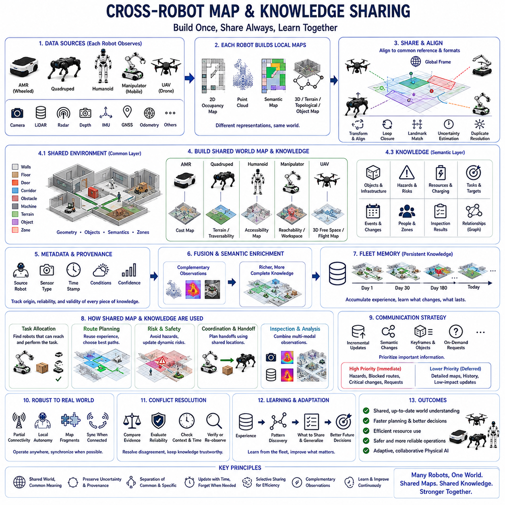{width="7.268055555555556in" height="7.268055555555556in"}

교차 로봇 지도 및 지식 공유(Cross-Robot Map and Knowledge Sharing)는 여러 로봇이 물리적 환경에 대한 공통 이해를 구축하고, 교환하고, 개선하며, 재사용할 수 있도록 한다. 각 로봇이 동일한 공간, 물체, 위험요소, 운용 조건을 반복적으로 새롭게 탐색하는 대신 하나의 플랫폼이 획득한 관측 정보를 전체 플릿(fleet)이 활용할 수 있는 지식으로 전환할 수 있다. 이를 통해 개별 인지(individual perception)는 지속적으로 축적되는 집단 환경 지능(collective environmental intelligence)으로 발전한다.

지도 공유(Map Sharing)는 카메라, 라이다(LiDAR), 레이더(radar), 깊이 센서(depth sensor), 위성항법시스템(GNSS), 관성 센싱(inertial sensing), 오도메트리(odometry) 또는 기타 위치추정 시스템을 통해 획득한 공간 정보에서 시작한다. 개별 로봇은 점유 지도(occupancy map), 포인트 클라우드(point cloud), 의미 지도(semantic map), 토폴로지 그래프(topological graph), 지형 모델(terrain model), 물체 수준 표현(object-level representation)을 생성할 수 있다. 플릿 아키텍처는 이러한 서로 다른 표현을 일관된 공간 기준으로 정렬할 수 있는 메커니즘을 제공해야 한다.

이기종 플릿(Heterogeneous Fleet)에서는 로봇들이 반드시 동일한 방식으로 환경을 인지하거나 이동하지 않기 때문에 이러한 과제가 더욱 복잡해진다. 자율이동로봇(AMR)은 2차원 내비게이션 지도(2D navigation map)를 유지할 수 있지만, 4족 보행 로봇(quadruped)은 지형의 기하학적 구조와 발 디딤 정보(foothold information)를 필요로 한다. UAV는 3차원 자유 공간(3D free space)을 표현할 수 있으며, 매니퓰레이터(manipulator)는 물체 자세(object pose)와 도달 가능한 작업공간에 집중할 수 있다. 공유 매핑(shared mapping)은 동일한 로컬 표현을 강제하지 않으면서 공통된 공간적 의미를 보존해야 한다.

유용한 아키텍처는 공유 환경 구조(shared environmental structure)와 체화별 해석(embodiment-specific interpretation)을 분리한다. 기하학적 구조, 물체 위치, 출입문, 복도, 기계, 장애물, 지형 영역, 의미 레이블(semantic label)은 공통 지도에 포함될 수 있다. 이후 주행 가능성(traversability), 도달 가능성(reachability), 비행 접근성(flight accessibility), 파지 가능성(graspability), 안정성, 에너지 비용은 각 로봇의 체화, 구성, 현재 역량 상태에 따라 별도로 도출할 수 있다.

이러한 구분을 통해 하나의 관측 정보가 서로 다른 의사결정을 지원할 수 있다. 4족 보행 로봇이 복도에서 잔해를 발견하면 공유 지도는 잔해의 위치, 크기, 표면 특성, 타임스탬프(timestamp), 신뢰도(confidence)를 기록할 수 있다. AMR은 해당 잔해를 경로 차단으로 해석할 수 있고, 다른 4족 보행 로봇은 증가된 비용으로 통과 가능한 영역으로 판단할 수 있으며, UAV는 단순히 비행 경로 아래에 존재하는 기하학적 구조로 취급할 수 있다.

지식 공유(Knowledge Sharing)는 기하학적 지도 작성보다 더 넓은 범위를 포함한다. 로봇은 물체, 인프라, 위험요소, 자원, 작업, 사람, 운용 구역, 충전 위치, 검사 대상, 임무 관련 이벤트에 관한 의미 정보(semantic information)를 교환할 수 있다. 따라서 공유 월드 표현(shared world representation)은 단순한 물리적 공간의 지도에서 무엇이 존재하고, 무엇이 발생했으며, 미래 행동에서 무엇이 중요할 수 있는지를 기술하는 구조화된 지식 계층(structured knowledge layer)으로 발전한다.

여러 로봇이 관측에 기여하는 경우 물체 식별정보(Object Identity)는 매우 중요하다. 서로 다른 플랫폼이 동일한 기계, 팔레트, 출입문, 차량 또는 검사 대상을 관측하면 플릿은 각각을 독립적인 개체로 생성하는 대신 동일한 공유 개체(shared entity)에 대한 관측인지 판단해야 한다. 공간적 근접성, 외형, 의미 클래스, 식별자, 시간 정보, 상황적 관계(contextual relationship)를 활용하여 교차 로봇 물체 연관(cross-robot object association)을 지원할 수 있다.

공유 지식(Shared Knowledge)은 정보 출처(Provenance)를 유지해야 한다. 어떤 로봇이 관측을 생성했는지, 어떤 센서를 사용했는지, 언제 획득했는지, 어떤 조건에서 수집했는지, 결과에 대해 어느 정도의 신뢰도를 가지는지를 기록할 수 있다. 정보 출처를 유지하면 플릿 지능(fleet intelligence)은 서로 충돌하는 근거를 비교하고, 정보의 신뢰성을 추정하며, 오래된 정보를 식별하고, 행동하기 전에 추가적인 관측이 필요한지를 판단할 수 있다.

물리적 환경은 지속적으로 변화하기 때문에 시간(Time)은 특히 중요하다. 출입문은 열리고 닫히며, 팔레트는 이동하고, 복도는 차단될 수 있으며, 사람이 작업 영역에 진입하고, 장비 상태가 변화하며, 일시적인 위험요소가 나타나거나 사라질 수 있다. 교차 로봇 지식 공유는 지속적인 구조(persistent structure), 동적 상태(dynamic state), 일시적 이벤트(transient event)를 구분하여 오래된 관측이 현재 계획에 잘못된 영향을 주지 않도록 해야 한다.

지도 융합(Map Fusion)은 서로 다른 로봇의 관측을 하나의 일관된 공간 표현으로 결합한다. 이를 위해 좌표 변환(coordinate transformation), 위치추정 정렬(localization alignment), 루프 폐쇄(loop closure), 랜드마크 매칭(landmark matching), 불확실성 추정, 중복 해소(duplicate resolution)가 필요할 수 있다. 서로 다른 관측 시점이나 센서 모달리티(sensor modality)를 사용하는 경우 모든 측정값이 동일한 정확도나 신뢰성을 가진다고 가정하지 않고 불확실성을 보존해야 한다.

의미 융합(Semantic Fusion)은 기하학적 정보뿐만 아니라 해석 결과까지 결합함으로써 또 다른 계층을 추가한다. 한 로봇은 물체를 산업 장비로 식별하고 다른 로봇은 구체적인 구성요소나 운용 상태까지 인식할 수 있다. 열 센서는 카메라에서 명확한 결함이 보이지 않는 영역에서 비정상적인 열을 감지할 수도 있다. 이러한 상호 보완적 관측을 결합하면 하나의 로봇이 자체 센싱 구성만으로 획득할 수 있는 것보다 풍부한 지식을 생성할 수 있다.

공유 지도(Shared Map)는 체화 의존적 계층(embodiment-dependent layer)을 포함할 수도 있다. 하나의 공통 기하 지도(common geometric map)를 기반으로 AMR 비용 지도(cost map), 4족 보행 로봇 지형 지도, UAV 비행 공간 표현, 휴머노이드 접근성 모델(accessibility model), 매니퓰레이터 도달 가능성 지도(reachability map)를 구성할 수 있다. 이러한 계층들은 동일한 물리적 세계에 연결되어 있기 때문에 플릿 계획은 서로 다른 체화 형태가 공통 목표물에 어떻게 접근하고 상호작용할 수 있는지를 비교할 수 있다.

지식 공유는 교차 체화 작업 할당(Cross-Embodiment Task Allocation)을 직접적으로 지원한다. 작업 플래너(task planner)는 공유 지도를 활용하여 어떤 로봇이 필요한 역량을 보유하는지뿐만 아니라 해당 역량을 요구된 위치에서 실제로 사용할 수 있는지도 판단할 수 있다. 매니퓰레이터가 적절한 도구를 가지고 있어도 물리적으로 접근하지 못할 수 있으며, 4족 보행 로봇은 목표물에 도달할 수 있지만 조작 역량이 없을 수 있다. 이러한 상황은 조정된 임무 분해(coordinated mission decomposition)를 필요로 한다.

경로 지식(Route Knowledge)은 그 의미를 신중하게 해석하는 경우 로봇들 사이에서 재사용할 수 있다. 성공적인 AMR 궤적은 복도의 연결성과 장애물 상태에 대한 근거를 제공하지만, 이것이 자동으로 4족 보행 로봇이나 휴머노이드의 최적 경로를 의미하는 것은 아니다. 따라서 공유 경로 경험(shared route experience)은 환경 관측과 체화별 비용을 분리하여 보존함으로써 각 플랫폼이 적절한 경로를 도출할 수 있도록 해야 한다.

플릿 메모리(Fleet Memory)를 사용하면 지도와 지식 공유를 개별 임무 이후에도 지속할 수 있다. 자주 차단되는 경로, 어려운 지형, 신뢰할 수 있는 도킹 위치, 성공적인 검사 관측 지점, 충전 가능성, 조작 실패, 반복적으로 발생하는 환경 변화에 관한 정보를 시간에 따라 축적할 수 있다. 미래 임무는 모든 배치를 완전히 미지의 환경으로 취급하는 대신 이러한 경험을 기반으로 시작할 수 있다.

그러나 지속적 메모리(Persistent Memory)는 오래된 정보를 망각하거나 갱신하거나 신뢰도를 낮추는 메커니즘을 포함해야 한다. 수개월 전에 생성된 지도는 현재 인프라를 더 이상 정확하게 반영하지 못할 수 있으며, 이전에 접근할 수 없었던 경로가 변경되었을 수도 있다. 따라서 지식에는 유효 기간(validity interval), 갱신 이력(update history), 신뢰도 감소(confidence decay), 검증 요구사항을 포함하여 저장된 정보를 언제 신뢰하고 언제 다시 관측해야 하는지를 결정할 수 있다.

공유 지도가 커질수록 통신 효율성(Communication Efficiency)이 중요해진다. 모든 로봇 사이에서 전체 포인트 클라우드, 이미지, 지도를 지속적으로 전송하면 과도한 대역폭을 소비할 수 있다. 대신 로봇은 증분 지도 갱신(incremental map update), 의미 변화(semantic change), 압축 표현(compressed representation), 선택된 키프레임(keyframe), 물체 수준 정보 또는 다른 위치에 저장된 상세 데이터에 대한 참조를 교환할 수 있다. 통신은 집단적 의사결정을 변화시키는 정보에 집중할 수 있다.

선택적 공유(Selective Sharing)는 제한된 연결성 환경에서 특히 중요하다. 대부분의 정보가 기존 플릿 지식과 중복된다면 로봇이 모든 관측을 즉시 전송할 필요는 없다. 새롭게 발견된 위험요소, 차단된 경로, 중요한 물체 상태 변화, 위치추정 보정(localization correction), 임무 핵심 발견, 다른 에이전트가 요청한 정보를 우선적으로 전달할 수 있다. 이를 통해 지도 공유는 수동적인 데이터 복제가 아니라 능동적인 지능 프로세스(active intelligence process)가 된다.

부분적 연결성(Partial Connectivity)이 유용한 지도 작성을 방해해서는 안 된다. 로봇은 통신이 끊긴 상태에서도 로컬 지도 조각(local map fragment)을 유지하고 자율적으로 운용을 계속할 수 있다. 통신이 다시 가능해지면 이러한 지도 조각을 플릿 메모리와 정렬하고 동기화할 수 있다. 이를 통해 지속적인 고대역폭 네트워크를 보장할 수 없는 대규모 시설, 지하 환경, 재난 지역, 원격 지형 등에서도 운용할 수 있다.

충돌하는 지식(Conflicting Knowledge)은 명시적인 해결 과정이 필요하다. 두 로봇은 통로가 차단되었는지, 물체가 이동했는지, 표면이 안전한지에 대해 서로 다른 정보를 보고할 수 있다. 플릿은 관측 시간, 센서 모달리티, 관측 시점(viewpoint), 신뢰도, 정보 출처의 신뢰성, 환경적 맥락을 비교할 수 있다. 일부 상황에서는 즉각적인 융합보다 다른 로봇을 할당하여 불확실한 상태를 검증하는 것이 적절할 수 있다.

공유 지식에는 관계 정보(Relational Information)도 포함될 수 있다. 플릿은 독립적인 물체만 표현하는 대신 도구가 특정 작업대에 속한다거나, 팔레트가 적재 구역을 점유하고 있다거나, 출입문이 두 공간을 연결한다거나, 위험요소가 특정 경로에 영향을 준다는 관계를 인코딩할 수 있다. 이러한 관계는 그래프 기반 추론(graph-based reasoning), 의미 계획(semantic planning), 운용 환경에 대한 더욱 정교한 집단적 이해의 기반을 제공한다.

학습(Learning)은 어떤 환경 특성이 서로 다른 체화 형태에 가장 유용한지를 식별함으로써 지도 및 지식 공유를 개선할 수 있다. 경험을 통해 특정 지형 특성이 AMR 이동 실패를 예측한다거나, 특정 시각적 단서가 UAV의 접근 가능한 지상 경로 식별에 도움이 된다거나, 특정 물체 구성이 조작 성공률에 영향을 준다는 사실을 발견할 수 있다. 플릿은 점차 어떤 관측을 일반화하여 공유하고 어떤 정보는 체화별로 유지해야 하는지를 학습할 수 있다.

궁극적으로 교차 로봇 지도 및 지식 공유(Cross-Robot Map and Knowledge Sharing)는 플릿 전체의 인지, 통신, 계획, 작업 할당, 학습, 실행을 연결하는 공유 월드 메모리(Shared World Memory)를 구축한다. 각 로봇은 자신의 물리적 관점에서 획득한 관측을 제공하고, 집단 시스템은 공통 환경 사실과 체화별 해석을 함께 보존한다. 그 결과 지속적으로 진화하는 월드 표현(world representation)이 형성되며, 이를 통해 이기종 로봇들은 서로의 경험으로부터 학습하고 공유된 경험(shared experience)을 기반으로 행동할 수 있다.

## 07.09. Cross Embodiment Learning and Transfer

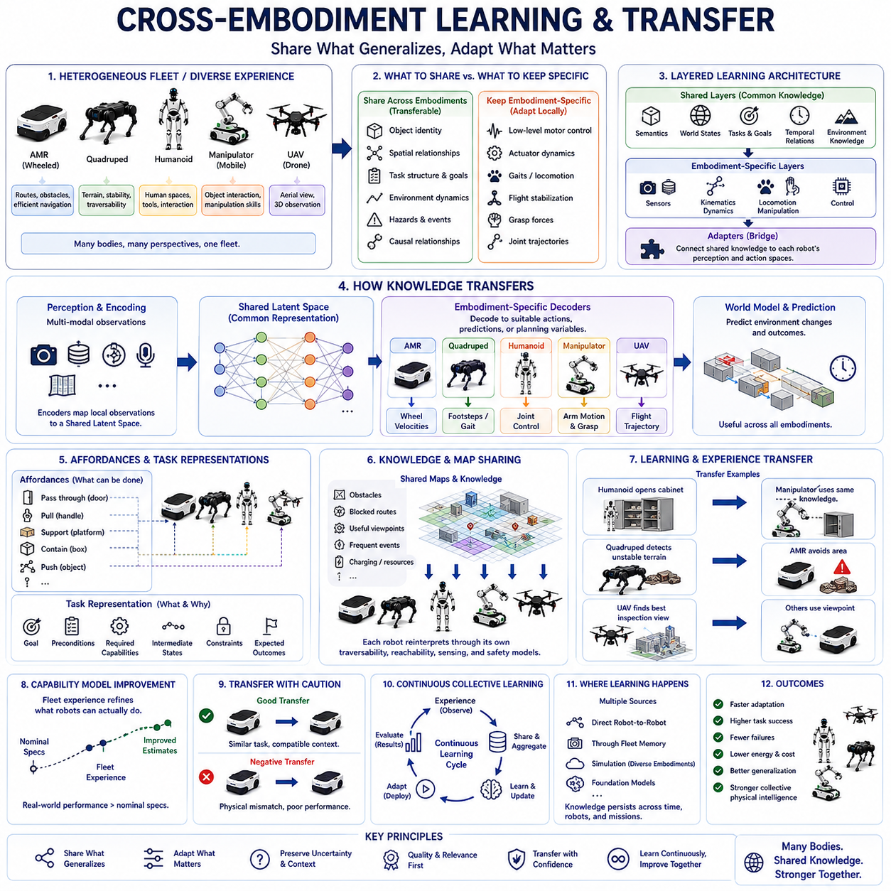{width="7.268055555555556in" height="7.268055555555556in"}

교차 체화 학습 및 전이(Cross-Embodiment Learning and Transfer)는 한 유형의 로봇이 획득한 지식을 서로 다른 물리적 신체, 센서, 액추에이터(actuator), 행동 공간(action space)을 가진 다른 로봇의 행동 개선에 활용할 수 있도록 한다. 목표는 모든 로봇이 동일한 정책(policy)을 실행하도록 만드는 것이 아니라, 체화(embodiment)가 달라져도 유지될 수 있는 재사용 가능한 지식을 식별하면서 각 물리적 플랫폼에 필요한 전문화된 제어를 보존하는 것이다.

이기종 플릿(Heterogeneous Fleet)은 자연스럽게 다양한 경험을 생성한다. 자율이동로봇(AMR)은 효율적인 경로와 장애물 패턴을 학습하고, 4족 보행 로봇(quadruped)은 지형 안정성과 주행 가능성(traversability)을 경험하며, 무인항공기(UAV)는 높은 시점에서 환경을 관측한다. 매니퓰레이터(manipulator)는 물체 상호작용을 학습하고, 휴머노이드(humanoid)는 인간 중심의 도구와 공간을 경험한다. 교차 체화 학습은 이러한 개별 경험을 여러 플릿 구성원이 활용할 수 있는 지식으로 전환한다.

핵심 과제는 무엇을 공유하고 무엇을 체화별로 유지해야 하는지를 결정하는 것이다. 물체 식별정보, 공간 관계, 작업 구조, 환경 동역학(environmental dynamics), 위험요소, 목표, 인과관계와 같은 고수준 개념은 전이 가능한 경우가 많다. 반면 저수준 모터 명령, 액추에이터 동역학, 보행 파라미터(gait parameter), 비행 안정화, 파지력, 관절 궤적은 일반적으로 물리적 체화에 강하게 의존한다.

이는 계층형 학습 아키텍처(Layered Learning Architecture)의 필요성으로 이어진다. 공유 계층(shared layer)은 의미 개념, 월드 상태(world state), 작업 목표, 시간적 관계, 일반적인 환경 지식을 표현할 수 있다. 체화별 계층(embodiment-specific layer)은 센서 특성, 운동학(kinematics), 동역학(dynamics), 이동, 조작, 제어를 인코딩할 수 있다. 전이는 공유 계층을 통해 이루어지며, 전문화된 어댑터(adapter)가 공통 지식을 각 로봇의 인지 및 행동 공간과 연결한다.

공유 잠재 표현(Shared Latent Representation)은 이러한 분리를 구현하는 하나의 메커니즘을 제공한다. 카메라, 라이다(LiDAR), 고유수용감각(proprioception), 촉각 센싱(tactile sensing), 지도, 언어 및 기타 모달리티(modality)의 관측을 작업 관련 정보를 포함하는 공통 잠재 공간(common latent space)으로 인코딩할 수 있다. 로봇별 인코더(encoder)는 로컬 관측을 이 공간으로 변환하고, 체화별 디코더(decoder)는 공유 표현을 적절한 행동, 예측 또는 계획 변수로 변환한다.

월드 모델(World Model)은 로봇이 사용하는 정확한 모터 인터페이스와 독립적으로 환경이 어떻게 변화하는지를 표현할 수 있기 때문에 교차 체화 전이에 특히 유용하다. 움직이는 물체가 특정 궤적을 따른다는 지식, 출입문이 열린 상태와 닫힌 상태 사이에서 변화한다는 지식, 장애물이 특정 영역의 접근성에 영향을 준다는 지식은 AMR, 4족 보행 로봇, 휴머노이드, UAV, 매니퓰레이터 모두에게 유용할 수 있다.

그러나 동일한 목표가 서로 다른 행동으로 실현될 수 있기 때문에 행동 조건부 예측(Action-Conditioned Prediction)은 신중하게 다루어야 한다. "검사 대상에 접근한다"는 목표는 AMR에서는 바퀴 속도, 4족 보행 로봇에서는 발걸음, 휴머노이드에서는 관절 협응(joint coordination), UAV에서는 비행 궤적을 의미할 수 있다. 따라서 공유 학습은 행동 의도(action intent) 또는 행동 효과를 추상적 수준에서 표현한 후 이를 체화별 제어 명령으로 변환해야 한다.

행동유도성(Affordance)은 서로 다른 체화를 연결하는 또 다른 가교를 제공한다. 행동유도성은 물체 자체의 속성만을 설명하는 것이 아니라 에이전트와 환경 사이에서 가능한 상호작용을 나타낸다. 출입문은 통과를 가능하게 하고, 손잡이는 당기는 행동을 가능하게 하며, 플랫폼은 지지를 제공할 수 있다. 서로 다른 로봇은 이러한 의미 개념을 공유하면서 자신의 도달 범위, 형태(morphology), 이동성, 힘, 엔드 이펙터(end effector)에 따라 실행 가능성을 평가할 수 있다.

전이는 공유 작업 표현(Shared Task Representation)을 통해서도 이루어질 수 있다. 작업을 플랫폼별 명령의 연속으로만 학습하는 대신 목표, 사전조건(precondition), 필요한 역량, 중간 상태, 제약조건, 예상 결과를 중심으로 표현할 수 있다. 그러면 하나의 체화가 학습한 작업이 다른 체화에 계획 지식을 제공할 수 있으며, 실제 물리적 실행 전략은 해당 로봇에 맞게 다시 생성할 수 있다.

따라서 하나의 체화에서 획득한 시연(Demonstration)은 그대로 복사하지 않더라도 유용할 수 있다. 휴머노이드가 캐비닛을 여는 시연은 관련 물체, 상호작용 순서, 접촉 위치, 원하는 상태 전이(state transition)를 제공할 수 있다. 모바일 매니퓰레이터(mobile manipulator)는 이러한 의미적·인과적 요소를 재사용하면서 자신의 형태에 적합한 베이스 위치, 로봇 팔 궤적, 파지 구성, 힘 프로파일(force profile)을 새롭게 생성할 수 있다.

교차 로봇 지도 및 지식 공유(Cross-Robot Map and Knowledge Sharing)는 전이 가능한 경험의 중요한 원천을 제공한다. 하나의 로봇이 차단된 통로, 불안정한 지형, 유용한 관측 지점, 자주 이동하는 물체를 발견하면 다른 체화들은 직접 해당 상황을 경험하기 전에 그 지식을 활용할 수 있다. 각 로봇은 공유된 환경적 근거를 자신의 주행 가능성, 도달 가능성, 센싱, 안전 모델을 통해 다시 해석할 수 있다.

경험 전이(Experience Transfer)는 역량 모델(Capability Model)의 개선에도 활용될 수 있다. 명목 사양(nominal specification)은 로봇이 설계상 무엇을 할 수 있는지를 나타내지만, 플릿 경험은 실제 조건에서 로봇이 무엇을 수행할 수 있는지를 보여준다. 반복된 관측을 통해 특정 경사면에서 4족 보행 로봇의 신뢰성이 높거나, 특정 표면에서 AMR이 어려움을 겪거나, 특정 가시성 조건에서만 UAV 검사가 효과적이라는 사실을 파악할 수 있다. 이러한 결과는 향후 역량 추정을 개선한다.

모든 경험을 동일하게 전이해서는 안 된다. 부정적 전이(Negative Transfer)는 중요한 물리적 차이에도 불구하고 한 체화에서 학습한 지식을 다른 체화에 적용할 때 발생한다. AMR에 효율적인 경로가 휴머노이드에는 적합하지 않을 수 있으며, UAV에 유용한 관측 지점이 지상 로봇에는 접근 불가능할 수 있다. 따라서 전이 메커니즘은 재사용 전에 체화 유사성, 작업 관련성, 상황, 신뢰도를 평가해야 한다.

역량 조건부 학습(Capability-Conditioned Learning)은 공유 모델을 로봇의 속성에 조건화함으로써 이러한 문제를 줄일 수 있다. 체화를 알려지지 않은 변동의 원인으로 취급하는 대신 학습 시스템은 크기, 이동 방식, 센서 구성, 페이로드, 도달 범위, 자유도(degrees of freedom), 엔드 이펙터 또는 기타 역량 기술자를 명시적으로 표현할 수 있다. 그러면 예측은 환경 상태와 해당 로봇의 물리적 특성을 동시에 고려하여 적응할 수 있다.

전이는 로봇 사이에서 직접 이루어지거나 플릿 메모리(Fleet Memory)를 통해 간접적으로 이루어질 수 있다. 직접 전이는 하나의 로봇이 다른 로봇에 작업 관련 정보를 제공할 때 즉각적인 협력을 지원할 수 있다. 플릿 메모리는 처음 경험을 생성한 로봇이 없어도 해당 경험을 지속적으로 보존할 수 있다. 관측, 결과, 실패, 성공 전략, 학습된 표현은 미래의 로봇과 임무에서 사용할 수 있는 집단 지식 기반(collective knowledge base)으로 축적될 수 있다.

시뮬레이션(Simulation)은 전이 가능한 지식을 확장하는 또 다른 메커니즘을 제공한다. 서로 다른 로봇 형태, 센서 구성, 환경, 작업 조건을 이용해 생성된 경험은 물리적 데이터만으로 확보할 수 있는 것보다 더 광범위한 체화에 공유 모델을 노출시킬 수 있다. 시뮬레이션은 체화에 불변하는 작업 구조(invariant task structure)를 식별하는 데 도움을 주며, 체화별 적응과 실제 환경 검증(real-world validation)은 배치 과정에서 남아 있는 물리적 차이를 보완할 수 있다.

파운데이션 모델(Foundation Model)은 로봇 플랫폼 전반에 걸쳐 공유되는 의미 및 추론 표현을 제공함으로써 전이를 더욱 지원할 수 있다. 언어, 비전, 행동 개념, 물체 관계, 작업 지식은 공통 표현 계층(common representational layer)을 형성할 수 있다. 로봇별 인지 및 제어 모듈은 이러한 일반 지식을 물리적 실행과 연결하여 서로 다른 체화가 동일한 센서나 액추에이터 인터페이스를 요구하지 않고도 추론 능력을 공유하도록 할 수 있다.

집단 학습(Collective Learning)은 어떤 경험이 공유 모델을 갱신해야 하는지를 선택하는 메커니즘을 필요로 한다. 모든 로컬 관측이 반드시 플릿 전체에 영향을 미칠 필요는 없다. 데이터 품질, 신규성(novelty), 작업 관련성, 신뢰도, 실패의 중요성, 환경 다양성, 체화 범위를 기준으로 어떤 경험을 저장하고 집계하며 학습에 사용할지를 결정할 수 있다. 이를 통해 반복적이거나 품질이 낮은 데이터가 집단 지식을 지배하는 것을 방지할 수 있다.

실패(Failure)는 올바르게 표현될 경우 특히 가치 있는 학습 정보가 된다. 이동 실패는 숨겨진 지형 제약조건을 드러낼 수 있고, 파지 실패는 행동유도성 추정의 한계를 보여줄 수 있으며, 검사 실패는 부적절한 센싱 조건을 식별할 수 있다. 실패가 발생한 상황적 맥락을 함께 보존하면 다른 체화는 동일한 실수를 반복하지 않거나, 자신의 서로 다른 물리적 역량을 이용해 이전에 실패한 작업을 수행할 수 있는지를 판단할 수 있다.

로봇과 환경은 모두 변화하기 때문에 학습은 지속적(continuous)이어야 한다. 새로운 센서, 도구, 소프트웨어, 페이로드 구성, 로봇 유형이 플릿에 추가될 수 있으며 운용 환경 역시 시간에 따라 변화한다. 공유 모델은 기존에 획득한 지식을 파괴하지 않으면서 유용한 새로운 경험을 통합해야 한다. 버전 관리(versioning), 검증(validation), 신뢰도 추적, 통제된 모델 갱신(controlled model update)은 지속적인 집단 학습 과정에서 안정성을 유지하는 데 도움을 준다.

전이의 효과는 표현의 유사성만으로 가정하는 것이 아니라 측정 가능한 성능 향상(measurable improvement)을 통해 평가해야 한다. 유용한 지표에는 작업 완료시간 감소, 에너지 소비 감소, 실패 횟수 감소, 예측 정확도 향상, 적응 속도 향상, 작업 성공률 증가, 새로운 체화에 필요한 데이터 양 감소 등이 포함된다. 공유 경험을 통해 다른 로봇이 처음부터 독립적으로 학습하는 것보다 더 높은 성능을 발휘할 수 있을 때 전이는 실질적인 가치를 가진다.

궁극적으로 교차 체화 학습 및 전이(Cross-Embodiment Learning and Transfer)는 이기종 로봇을 서로 분리된 학습자에서 집단 학습 시스템(collective learning system)의 기여자로 전환한다. 각 체화는 물리적 세계를 서로 다른 방식으로 경험하며 상호 보완적인 근거를 제공하고, 공유 표현은 특정 신체를 넘어 적용될 수 있는 지식을 포착한다. 전이 가능한 월드 지식(transferable world knowledge)과 체화별 적응(embodiment-specific adaptation)을 결합함으로써 플릿은 경험을 지속적으로 축적하고 집단 물리 지능 시스템(collective physical intelligence system)으로서 점진적으로 발전할 수 있다.

## 07.10. Hierarchical Heterogeneous Teams

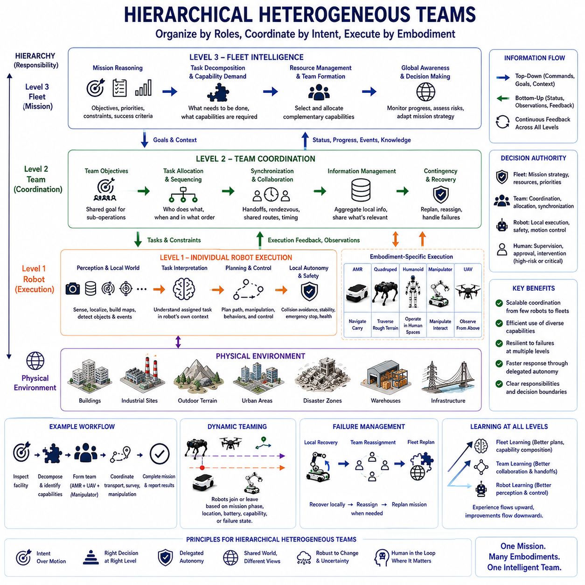{width="7.268055555555556in" height="7.268055555555556in"}

계층적 이기종 팀(Hierarchical Heterogeneous Teams)은 서로 다른 로봇 체화(embodiment)를 조정된 의사결정 계층으로 구성하여, 모든 로봇이 전체 시스템을 직접 추론하지 않고도 플릿 지능(fleet intelligence)이 복잡한 임무를 관리할 수 있도록 한다. 상위 계층은 임무 목표, 우선순위, 자원 제약조건, 팀 구성을 정의하고, 하위 계층은 이러한 의도를 체화별 작업, 궤적, 조작 행동, 센싱 행동, 실시간 제어로 변환한다.

이러한 계층 구조(Hierarchy)는 단순한 명령 체계(command chain)라기보다 책임의 계층(hierarchy of responsibility)에 가깝다. 플릿 수준 조정자(fleet-level coordinator)는 임무 완료와 전역 자원을 추론하고, 팀 수준 조정자(team-level coordinator)는 관련 하위 작업을 수행하는 그룹을 관리하며, 개별 로봇은 로컬 내비게이션, 조작, 인지, 안전에 대한 권한을 유지할 수 있다. 따라서 각 계층은 서로 다른 공간적, 시간적, 의미적 해상도에서 작동한다.

가장 높은 계층에서 임무 지능(Mission Intelligence)은 이기종 플릿이 달성해야 할 목표를 표현한다. 목표에는 시설 검사, 자재 운송, 위험 대응, 미지 지형 매핑, 인프라 유지보수 등이 포함될 수 있다. 임무 계획(Mission Planning)은 개별 체화에 필요한 세부적인 움직임이나 제어 명령을 즉시 결정하지 않고 이러한 목표를 역량 요구사항(capability requirement)과 의존관계(dependency)로 분해한다.

다음 계층에서는 사용 가능한 로봇들로부터 역량 중심 팀(capability-oriented team)을 구성할 수 있다. 자율이동로봇(AMR)은 운송 기능을 제공하고, 4족 보행 로봇(quadruped)은 험지 이동성을 제공하며, 무인항공기(UAV)는 공중 인지(aerial perception)를 제공하고, 매니퓰레이터(manipulator) 또는 휴머노이드(humanoid)는 물리적 상호작용을 담당할 수 있다. 팀 구성은 상호 보완적인 역량을 결합하여 여러 체화 형태가 필요한 임무를 분리된 개별 작업이 아니라 조정된 물리적 작업 흐름으로 실행하도록 한다.

팀 수준 조정(Team-Level Coordination)은 공통 목표에 할당된 로봇들 사이의 관계를 관리한다. 작업 순서, 동기화 지점(synchronization point), 공유 경로, 관측 책임, 물리적 인계(physical handoff), 통신 요구사항, 비상 대응 행동(contingency action)을 결정할 수 있다. 이러한 중간 계층은 임무 수준 계획의 부담을 줄이면서 현재 팀을 구성하는 로봇들의 구체적인 역량과 의존관계를 협력 과정에 반영할 수 있도록 한다.

개별 로봇은 할당된 목표를 물리적으로 실행 가능한 행동으로 변환하는 책임을 유지한다. "밸브 영역을 검사하라"라는 명령은 AMR에서는 바퀴형 내비게이션, UAV에서는 비행 궤적, 4족 보행 로봇에서는 발걸음 계획(footstep planning), 모바일 매니퓰레이터에서는 접근 및 조작 계획으로 변환될 수 있다. 따라서 계층 구조는 공통 임무 의미(common mission semantics)를 유지하면서 실제 실행은 체화별로 특화되도록 한다.

저수준 제어(Low-Level Control)는 플릿 수준 계획보다 훨씬 빠른 시간 규모에서 작동하기 때문에 이러한 분리가 중요하다. 충돌 회피, 균형 복구(balance recovery), 장애물 대응, 액추에이터 제어, 파지 안정화(grasp stabilization), 비상 정지는 밀리초 수준 또는 실시간에 가까운 의사결정을 요구할 수 있다. 반면 임무 할당은 훨씬 긴 시간 범위에서 수행될 수 있다. 계층적 구성은 각 의사결정을 물리적 결과에 적합한 수준과 주기로 수행하도록 한다.

정보는 계층 구조를 따라 상향으로도 이동한다. 개별 로봇은 관측, 작업 진행 상황, 역량 변화, 실패, 불확실성, 자원 상태, 새롭게 발견된 환경 조건을 보고한다. 팀 조정자는 로컬 협력에 필요한 정보를 집계하고, 플릿 지능은 임무 추론에 필요한 고수준 요약 정보를 전달받는다. 이를 통해 중앙 시스템이 모든 원시 센서 측정값이나 액추에이터 상태로 인해 과부하되는 것을 방지할 수 있다.

명령과 맥락(Context)은 반대 방향으로 하향 전달된다. 임무 목표는 팀 목표로, 팀 목표는 로봇 작업으로, 로봇 작업은 로컬 계획과 제어로 변환될 수 있다. 각 계층은 원래의 의도를 유지하면서 다음 계층에 필요한 세부 정보를 추가한다. 이러한 양방향 흐름(bidirectional flow)은 하나의 표현이 시스템의 모든 계층을 담당하도록 강제하지 않으면서 전략적 추론과 물리적 실행을 연결한다.

공유 월드 메모리(Shared World Memory)는 계층 전체에 공통적인 정보 기반을 제공한다. 플릿 수준 메모리는 의미 지도(semantic map), 물체, 위험요소, 임무 이력, 자원, 지속적인 환경 지식을 포함할 수 있다. 팀 수준의 뷰(view)는 특정 운용과 관련된 정보를 강조할 수 있으며, 로봇은 즉각적인 실행에 필요한 상세한 로컬 표현을 유지한다. 이러한 서로 다른 뷰는 동일하게 변화하는 월드 상태(world state)에 연결된다.

계층적 팀은 공유 정보에 대한 체화 의존적 해석(embodiment-dependent interpretation)도 보존해야 한다. 공통 지도에 계단이 표시되어 있더라도 AMR, 4족 보행 로봇, 휴머노이드, UAV는 서로 다른 접근 가능성(accessibility)을 도출한다. 상위 계층은 계단을 임무와 관련된 환경 요소로 추론하고, 하위 계층은 특정 로봇이 해당 계단을 안전하게 통과하거나 우회할 수 있는지와 그 방법을 결정할 수 있다.

역량 모델(Capability Model)은 계층 구조를 물리적 현실과 연결한다. 임무 수준 추론은 작업에 필요한 역량을 식별하고, 팀 구성은 상호 보완적인 역량 조합을 탐색하며, 개별 로봇은 자신의 현재 역량 범위(capability envelope)를 제공한다. 배터리 상태, 페이로드, 장착 도구, 센서 건전성(sensor health), 통신 품질, 환경 조건은 이러한 역량 범위를 변화시킬 수 있으므로 계층적 의사결정은 명목상의 로봇 성능이 아니라 현재의 실제 성능을 반영할 수 있다.

권한(Authority)이 항상 중앙에 집중될 필요는 없다. 팀에는 임무 목표와 함께 충분한 자율성을 부여하여 로컬 조건이 변화할 경우 자체적으로 작업을 재구성하도록 할 수 있다. 개별 로봇 역시 변경 사항이 정의된 제약조건 내에 존재한다면 플릿 수준의 승인을 요청하지 않고 경로나 실행 전략을 수정할 수 있다. 이러한 위임된 자율성(delegated autonomy)은 통신 요구량을 줄이고 로컬 이벤트에 더욱 빠르게 적응하도록 한다.

위임 수준(Degree of Delegation)은 임무 위험도와 불확실성에 따라 달라질 수 있다. 일반적인 운송 작업에는 상당한 로컬 자율성을 허용할 수 있지만, 위험한 조작 작업이나 사람 주변에서의 운용에는 상위 계층의 승인이 필요할 수 있다. 따라서 계층 구조는 어떤 행동을 로컬에서 수행할 수 있는지, 어떤 행동에 팀의 합의가 필요한지, 어떤 행동을 플릿 지능이나 인간 감독(human supervision)으로 상향 전달해야 하는지를 정의하는 의사결정 경계(decision boundary)를 설정할 수 있다.

동적 팀 구성(Dynamic Team Formation)은 또 다른 중요한 특성이다. 이기종 팀은 임무 전체에서 고정된 상태를 유지할 필요가 없다. 로봇은 작업 단계, 위치, 배터리 상태, 역량 요구사항, 고장 상태에 따라 팀에 참여하거나 이탈할 수 있다. UAV는 정찰 단계에서만 참여하고, AMR은 운송 단계에서 참여하며, 매니퓰레이터는 최종 상호작용 단계에서 참여할 수 있다. 계층 구조는 임무 진행에 따라 팀을 재구성할 수 있다.

임무 규모가 커지면 하위 팀(Subteam)을 중첩하여 구성할 수도 있다. 시설 전체를 대상으로 하는 운용은 정찰, 물류, 검사, 개입(intervention) 팀으로 구성될 수 있으며, 각각의 팀은 서로 다른 체화 조합을 포함할 수 있다. 이러한 그룹은 임무 우선순위와 월드 지식을 공유하면서 반독립적으로 운용될 수 있다. 따라서 계층적 분해(hierarchical decomposition)는 모든 에이전트가 다른 모든 에이전트와 직접 조정할 필요 없이 소수의 협력 로봇에서 대규모 플릿까지 확장할 수 있도록 한다.

통신 아키텍처(Communication Architecture) 역시 동일한 계층 구조를 따를 수 있다. 우선순위가 높은 임무 정보는 플릿 및 팀 계층 전체에 전달하고, 고대역폭 로컬 데이터는 하위 팀 내부에 유지할 수 있다. 물리적 인계를 수행하는 로봇들은 직접 통신할 수 있으며, 전역 작업 상태는 상위 인프라를 통해 동기화될 수 있다. 이를 통해 불필요한 네트워크 트래픽을 줄이면서 정보가 가장 유용한 의사결정 계층에 도달하도록 할 수 있다.

고장 관리(Failure Management)는 여러 계층에서 복구가 가능하기 때문에 계층 구조의 이점을 얻는다. 로봇은 내비게이션 장애를 로컬에서 복구할 수 있고, 팀은 실패한 하위 작업을 다른 체화에 재할당할 수 있으며, 특정 역량 전체를 사용할 수 없게 되면 플릿 지능이 전체 임무 구조를 다시 구성할 수 있다. 하위 계층이 자신의 권한과 가용 자원으로 문제를 해결할 수 없는 경우에만 상위 계층으로 에스컬레이션(escalation)이 이루어진다.

예를 들어 AMR이 예상하지 못한 장애물을 만나면 먼저 로컬 대체 경로를 탐색할 수 있다. 적절한 경로가 존재하지 않으면 팀 조정자가 4족 보행 로봇이 운송을 계속할 수 있는지 또는 물리적 인계가 가능한지를 판단할 수 있다. 이러한 대안으로도 임무를 만족할 수 없다면 플릿 수준 계획은 작업 순서를 변경하거나, 추가 로봇을 할당하거나, 임무 목표 자체를 수정할 수 있다.

인간 운영자(Human Operator)는 모든 로봇을 직접 제어하지 않으면서도 계층 구조 내에서 감독 역할을 수행할 수 있다. 인간은 임무 목표를 설정하고, 고위험 의사결정을 승인하며, 모호한 상황을 해결하거나 자동 복구가 실패했을 때 개입할 수 있다. 계층 구조는 상세한 로봇 활동을 의미 있는 임무 정보로 필터링하여 인간 감독이 판단, 책임, 외부 운용 지식이 가장 중요한 의사결정에 집중할 수 있도록 한다.

학습(Learning)은 모든 계층 수준에서 이루어질 수 있다. 개별 로봇은 로컬 인지와 제어를 개선하고, 팀은 효과적인 협력 패턴과 인계 전략을 학습하며, 플릿 지능은 더 나은 작업 분해, 역량 구성(capability composition), 자원 할당 방법을 학습한다. 경험은 집단 메모리(collective memory)로 상향 이동하고, 이후 개선된 정책, 모델, 제약조건, 계획 지식의 형태로 미래 임무를 위해 다시 하향 전달될 수 있다.

잘 설계된 계층 구조는 경직된 시스템이 되어서는 안 된다. 지나친 중앙집중화(excessive centralization)는 통신 병목과 느린 대응을 발생시키는 반면, 지나친 분산화(excessive decentralization)는 목표 충돌, 중복 작업, 비효율적인 자원 사용을 초래할 수 있다. 계층적 이기종 팀은 범위(scope), 긴급성, 역량, 불확실성, 실패의 결과에 따라 의사결정 권한을 분산함으로써 이러한 두 극단 사이의 균형을 유지한다.

궁극적으로 계층적 이기종 팀(Hierarchical Heterogeneous Teams)은 집단 물리 지능(Collective Physical Intelligence)을 위한 조직적 아키텍처(organizational architecture)를 제공한다. 임무 추론, 역량 기반 팀 구성, 협력 조정, 체화별 자율성, 공유 월드 지식, 로컬 제어가 상호 보완적인 계층에서 작동한다. 이러한 계층을 구조화된 정보와 위임된 권한을 통해 연결함으로써 이기종 로봇들은 독립적인 기계들의 집합이 아니라 적응형 다중 체화 시스템(adaptive multi-embodiment system)으로 행동할 수 있다.

## 07.11. Human Robot and Robot Robot Teaming

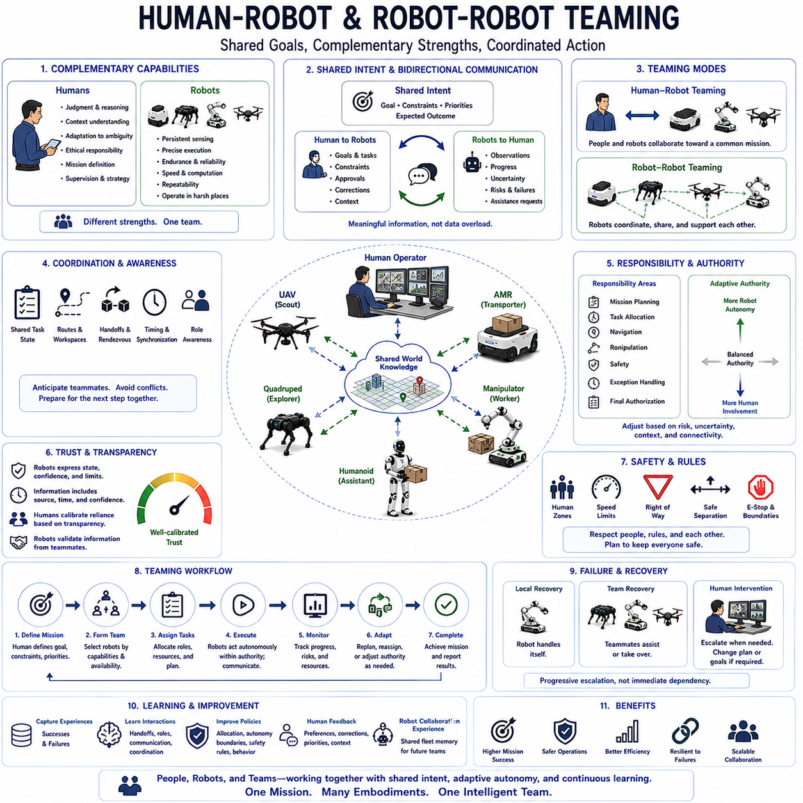{width="7.268055555555556in" height="7.268055555555556in"}

인간-로봇 및 로봇-로봇 팀 구성(Human-Robot and Robot-Robot Teaming)은 인간 운영자, 자율 로봇, 그리고 여러 로봇 에이전트가 공유된 물리적 목표를 향해 협력하는 조정된 협업을 의미한다. 효과적인 팀 구성은 원격 제어나 단순한 작업 할당을 넘어선다. 인간과 기계가 가진 서로 다른 강점과 한계를 바탕으로 공유 목표, 상호 보완적 역량, 상호 인식, 통신, 적응형 권한, 조정된 행동을 필요로 한다.

인간과 로봇은 팀에 근본적으로 서로 다른 역량을 제공한다. 인간은 상황적 판단(contextual judgment), 유연한 추론, 윤리적 책임, 모호한 상황에 대한 해석, 더 광범위한 조직적 의도에 대한 이해를 제공한다. 로봇은 지속적인 센싱, 정밀한 실행, 물리적 지속성, 빠른 연산, 반복성, 그리고 사람이 접근하기 어렵거나 위험하거나 비효율적인 환경에서의 운용 능력을 제공한다.

따라서 팀 구성의 목적은 단순히 인간의 활동을 자동화로 대체하는 것이 아니다. 더욱 강력한 아키텍처는 비교 우위(comparative advantage)에 따라 책임을 분배한다. 로봇은 반복적인 운송, 검사, 매핑, 모니터링, 조작, 데이터 수집을 수행하고, 인간은 임무 정의, 예외 처리, 불확실한 상황, 고위험 의사결정, 감독, 자동화된 추론이 충분하지 않은 경우의 전략적 적응에 집중할 수 있다.

공유 의도(Shared Intent)는 효과적인 인간-로봇 협업에 필수적이다. 로봇은 단순히 개별 명령만을 이해하는 것이 아니라 목표, 제약조건, 우선순위, 예상 결과에 대한 충분한 정보를 전달받아 적절한 행동을 자율적으로 선택할 수 있어야 한다. 마찬가지로 인간은 로봇이 무엇을 시도하고 있는지, 왜 특정 행동을 선택했는지, 현재 조건에서 성공적인 실행이 여전히 가능한지를 파악할 수 있어야 한다.

이를 위해 양방향 통신(Bidirectional Communication)이 필요하다. 인간은 목표, 제한조건, 승인, 수정사항, 상황 정보를 로봇에 전달하고, 로봇은 관측, 진행 상황, 불확실성, 역량 한계, 위험, 실패, 지원 요청을 인간에게 전달한다. 통신은 의사결정에 거의 도움이 되지 않는 지속적인 저수준 텔레메트리(low-level telemetry)로 운영자에게 부담을 주기보다 임무와 관련된 의미 있는 정보를 강조해야 한다.

로봇-로봇 팀 구성(Robot-Robot Teaming)은 이러한 원칙을 여러 자율 플랫폼으로 확장한다. 로봇들은 운송, 정찰, 조작, 검사, 통신 중계, 매핑, 안전 모니터링을 조정할 수 있다. 이기종 팀에서는 자율이동로봇(AMR), 4족 보행 로봇(quadruped), 무인항공기(UAV), 휴머노이드(humanoid), 매니퓰레이터(manipulator)가 서로 다른 물리적 역량을 제공하여 하나의 체화(embodiment)만으로는 효율적이거나 안전하게 수행할 수 없는 임무를 해결할 수 있다.

조정을 위해서는 로봇이 자신의 역할뿐만 아니라 팀원의 활동도 이해해야 한다. 공유 작업 상태(shared task state), 예정 경로, 예약된 작업공간, 예상 도착시간, 목표 물체, 계획된 인계(handoff)를 공유하면 로봇들이 상호작용을 미리 예측할 수 있다. 이러한 인식은 중복 작업과 물리적 충돌을 줄이고, 다른 로봇의 행동이 발생한 이후에 대응하는 것이 아니라 미래 행동에 앞서 협력 작업을 준비하도록 한다.

물리적 인계(Physical Handoff)는 명시적인 조정의 중요성을 잘 보여준다. AMR이 모바일 매니퓰레이터가 장비를 전달받을 수 있는 위치까지 운송하거나, 4족 보행 로봇이 바퀴형 플랫폼이 접근할 수 없는 지형 너머까지 센서를 운반할 수 있다. 성공적인 전달을 위해서는 물체 식별정보, 랑데부 위치(rendezvous location), 시간, 방향, 준비 상태, 책임 전환, 수신 로봇의 안전한 인계 완료 여부에 대한 합의가 필요하다.

인간-로봇 팀 구성 역시 명확한 책임 경계(Responsibility Boundary)를 필요로 한다. 인간이 임무를 정의하고 로봇이 로컬 경로를 결정하거나, 로봇이 일반적인 작업을 자율적으로 수행하면서 위험 구역에 진입하기 전에 승인을 요청할 수 있다. 따라서 책임은 인간이나 기계 어느 한쪽에 완전히 부여되는 것이 아니라 임무 계획, 작업 할당, 내비게이션, 조작, 안전, 예외 처리, 최종 승인에 걸쳐 분배될 수 있다.

조정 가능한 자율성(Adjustable Autonomy)을 사용하면 이러한 책임 경계를 상황에 따라 변경할 수 있다. 높은 신뢰도를 가진 일상적 운용에서는 높은 수준의 로봇 자율성을 허용할 수 있지만, 모호하거나 고위험인 조건에서는 인간의 개입 수준을 높일 수 있다. 반대로 통신 지연이나 제한된 연결성이 존재하는 환경에서는 로봇이 더 많은 로컬 권한을 유지해야 할 수 있다. 따라서 효과적인 팀 구성은 자율성을 고정된 시스템 속성이 아니라 동적으로 관리되는 관계로 취급한다.

인간의 개입(Human Intervention)은 의미 있는 의사결정 지점에서 이루어져야 한다. 모든 저수준 행동에 승인을 요구하면 지연이 발생하고 자율성의 이점이 감소하지만, 중요한 의사결정에서 인간 감독을 제거하면 허용할 수 없는 위험이 발생할 수 있다. 시스템은 불확실성, 안전 영향, 임무 중요도, 정책 제약조건, 반복되는 실패, 로봇의 검증된 운용 범위를 벗어나는 상황 등을 기준으로 에스컬레이션 조건(escalation condition)을 정의할 수 있다.

신뢰(Trust)는 로봇이 자신의 상태와 한계를 얼마나 효과적으로 전달하는지에 크게 영향을 받는다. 인간 운영자는 로봇이 확신하고 있는지, 불확실한지, 성능이 저하되었는지, 경로가 차단되었는지, 또는 역량 한계(capability boundary)에 가까운 상태로 운용되는지를 알아야 한다. 불확실성을 적절하게 전달하는 로봇은 모든 추정값을 동일하게 신뢰할 수 있는 것처럼 제시하는 로봇보다 더 나은 의사결정을 지원할 수 있다. 투명성(Transparency)은 단순히 자동화에 대한 신뢰를 최대화하는 것이 아니라 인간이 자동화에 대한 의존 수준을 적절하게 조정하도록 한다.

로봇 역시 팀원으로부터 전달받은 정보에 대해 일종의 운용적 신뢰(Operational Trust)를 필요로 한다. 공유된 관측 정보는 시간적 최신성, 정확도, 신뢰도, 관련성이 서로 다를 수 있다. 로봇은 다른 로봇이 특정 경로를 통과할 수 있다거나 물체를 안전하게 조작할 수 있다고 보고한 내용을 무조건 받아들여서는 안 된다. 정보 출처, 타임스탬프(timestamp), 신뢰도(confidence), 센서 모달리티(sensor modality), 체화 맥락(embodiment context)을 활용하여 공유 정보의 신뢰성에 따라 해석할 수 있다.

공유 월드 지식(Shared World Knowledge)은 팀 구성에 필요한 공통 맥락을 제공한다. 인간과 로봇은 공유 의미 표현(shared semantic representation)을 통해 동일한 물체, 위치, 위험요소, 작업, 자원, 임무 상태를 참조할 수 있다. 서로 다른 참여자는 이러한 지식을 서로 다른 세부 수준에서 확인할 수 있지만, 공통 식별정보와 관계를 사용하면 통신을 더욱 정확하게 만들고 물리적 행동을 조정할 때 발생하는 모호성을 줄일 수 있다.

상황 인식(Situation Awareness)은 인간 운영자에게만 중앙집중되어서는 안 되며 분산되어야 한다. 개별 로봇은 자신의 로컬 환경에 대한 상세한 인식을 유지하고, 팀은 협력 활동과 관련된 지식을 유지하며, 플릿 수준 시스템은 더욱 광범위한 임무 맥락을 유지한다. 인간은 모든 센서 스트림을 직접 통합하는 대신 변화, 위험, 충돌, 주의가 필요한 의사결정을 강조한 요약 정보를 제공받는다.

로봇-로봇 팀은 역할 전문화(Role Specialization)를 활용할 수도 있다. 하나의 로봇은 정찰자(scout), 다른 로봇은 운송자(transporter), 또 다른 로봇은 조작자(manipulator), 다른 로봇은 통신 중계기(communication relay)의 역할을 수행할 수 있다. 역할은 물리적 체화, 현재 역량, 위치, 에너지 상태, 임무 요구사항에 따라 결정될 수 있으며, 작업 진행에 따라 동적으로 변화함으로써 모든 플랫폼을 하나의 운용 기능에 영구적으로 고정하지 않고 팀 조직을 적응시킬 수 있다.

리더십(Leadership) 역시 동적으로 변화할 수 있다. 중앙집중형 플릿 조정자(centralized fleet coordinator)가 초기 작업을 할당한 후, 특정 로봇이 더 우수한 상황 인식이나 통신 연결성을 가지고 있기 때문에 일시적으로 하위 팀(subteam)을 조정할 수 있다. 다른 경우에는 공유 작업 상태와 분산 프로토콜(distributed protocol)을 통해 조정이 이루어질 수 있으므로 하나의 로봇이 영구적인 리더 역할을 수행할 필요가 없다. 적절한 구조는 임무 규모, 불확실성, 통신 조건에 따라 달라진다.

고장 복구(Failure Recovery)는 인간과 로봇의 협력을 통해 더욱 효과적으로 수행될 수 있다. 로봇이 먼저 로컬 복구를 시도하고, 팀원이 대체 역량이나 경로를 제공하며, 팀 조정자가 작업을 재할당할 수 있다. 자동 복구로 문제를 해결할 수 없거나 임무 목표를 변경해야 하는 경우 또는 결과가 사전에 정의된 권한을 초과하는 경우 인간의 개입이 필요하다. 이를 통해 운영자에게 즉시 의존하는 대신 점진적인 에스컬레이션 경로(progressive escalation path)를 구성할 수 있다.

통신 단절(Communication Loss)이 모든 팀 활동을 자동으로 중단시켜서는 안 된다. 로봇은 로컬 월드 모델(local world model), 캐시된 임무 정보(cached mission information), 사전에 합의된 책임을 활용하여 정의된 자율성 범위 내에서 작업을 계속할 수 있다. 연결이 복구되면 관측, 작업 진행 상황, 역량 변화, 의사결정을 다시 동기화할 수 있다. 인간은 모든 물리적 행동에 지속적으로 통신할 필요 없이 중요한 변경 사항을 검토할 수 있다.

안전(Safety)은 인간-로봇 및 로봇-로봇 조정 모두에 통합되어야 한다. 로봇은 인간 출입 제한 구역(human exclusion zone), 속도 제한, 통행 우선권 규칙(right-of-way rule), 비상 정지, 조작 경계, 안전 분리 거리 요구사항을 준수해야 한다. 로봇-로봇 계획 역시 충돌하는 궤적, 안전하지 않은 인계, 자원 경합(resource contention), 하나의 로봇이 다른 로봇이나 주변 인원에게 의도하지 않은 위험을 발생시키는 행동을 방지해야 한다.

학습(Learning)은 개별 로봇의 성능뿐만 아니라 상호작용 품질(interaction quality)을 포착함으로써 팀 구성을 개선할 수 있다. 시스템은 어떤 작업 할당이 인간의 업무 부담을 감소시키는지, 어떤 설명이 운영자의 의사결정을 개선하는지, 어떤 인계 전략이 신뢰성이 높은지, 어떤 로봇 체화 조합이 효과적으로 협력하는지를 학습할 수 있다. 이러한 경험은 조정 정책, 통신 패턴, 자율성 경계, 미래 팀 구성을 개선하는 데 활용될 수 있다.

인간 피드백(Human Feedback)은 작업 결과만으로 추론하기 어려운 선호도, 수정사항, 우선순위, 상황적 판단을 전달할 수 있기 때문에 특히 중요한 학습 신호를 제공한다. 피드백은 검증 및 안전 제약조건을 유지하면서 계획과 행동을 개선하는 데 활용될 수 있다. 시간이 지남에 따라 인간이 모든 세부 행동을 명시적으로 지정하지 않더라도 로봇은 실제 운용 방식과 더욱 잘 정렬된 행동을 수행할 수 있다.

로봇-로봇 경험(Robot-Robot Experience)은 상호 보완적인 학습 신호를 제공한다. 성공적인 협력은 효과적인 동기화, 역량 조합, 경로, 통신 전략, 복구 패턴을 보여주며, 실패는 숨겨진 의존관계나 서로 호환되지 않는 가정을 드러낸다. 공유 플릿 메모리(Shared Fleet Memory)를 통해 이러한 교훈을 해당 작업에 참여했던 개별 로봇을 넘어 지속적으로 보존할 수 있으며, 미래의 팀은 축적된 협력 경험을 기반으로 임무를 시작할 수 있다.

궁극적으로 인간-로봇 및 로봇-로봇 팀 구성(Human-Robot and Robot-Robot Teaming)은 집단 물리 지능(Collective Physical Intelligence)을 위한 통합 협업 아키텍처(unified collaboration architecture)를 형성한다. 인간은 판단, 의도, 감독, 책임을 제공하고, 이기종 로봇은 분산 인지, 전문화된 체화, 자율 실행, 지속적인 물리적 상호작용을 제공한다. 공유 지식, 적응형 권한, 조정된 역할, 통신, 학습을 통해 결합된 팀은 개별 인간이나 개별 로봇의 역량을 넘어서는 집단적 능력을 달성할 수 있다.

## 07.12. Interoperability and Common Interfaces

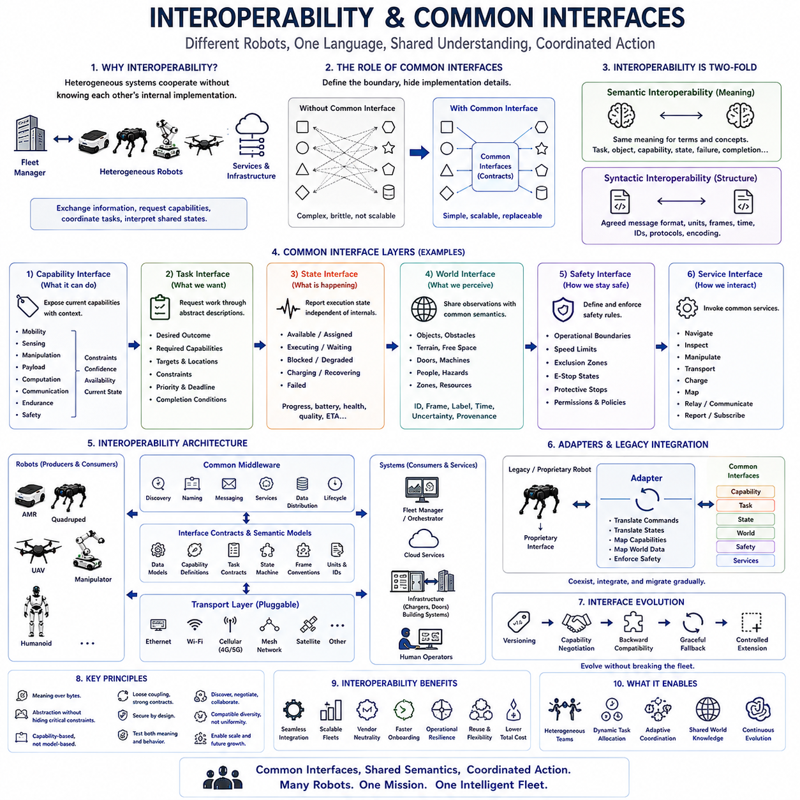{width="7.268055555555556in" height="7.268055555555556in"}

상호운용성(Interoperability)은 서로 다른 제조사 또는 기술 아키텍처를 사용하는 로봇, 플릿 관리자(fleet manager), 인프라 시스템, 소프트웨어 서비스가 각 구성요소의 내부 구현 방식을 모두 이해하지 않고도 서로 협력할 수 있도록 한다. 이기종 플릿(heterogeneous fleet)에서는 서로 다른 체화(embodiment)가 정보를 교환하고, 역량을 요청하며, 작업을 조정하고, 공유된 운용 상태를 일관되게 해석할 수 있을 때 물리적 다양성이 실질적인 가치를 가지므로 상호운용성이 필수적이다.

공통 인터페이스(Common Interface)는 불필요한 구현 세부사항을 숨기면서 시스템이 상호작용하는 경계를 정의한다. 로봇은 독점적인 모터 컨트롤러, 내비게이션 스택, 센서 드라이버 또는 내부 데이터 구조를 직접 노출하는 대신 내비게이션, 검사, 조작, 충전, 매핑, 상태 보고, 작업 실행, 역량 탐색(capability discovery)과 같은 기능에 대해 표준화된 인터페이스를 제공할 수 있다. 이를 통해 기능적 의도(functional intent)와 플랫폼별 구현을 분리할 수 있다.

목표는 모든 로봇의 내부 구조를 동일하게 만드는 것이 아니다. AMR은 차동 구동(differential drive)을 사용할 수 있고, 4족 보행 로봇(quadruped)은 다리 기반 이동을 사용하며, UAV는 멀티로터 비행 제어를 사용하고, 휴머노이드(humanoid)는 다수의 관절을 협응할 수 있다. 공통 이동 인터페이스(common mobility interface)는 목적지 도달이나 안전한 위치 유지와 같은 목표를 표현하고, 각 체화는 해당 목표를 달성하는 데 필요한 물리적 제어 전략을 독립적으로 결정할 수 있다.

이러한 원칙은 의미적 상호운용성(Semantic Interoperability)으로 설명할 수 있다. 두 시스템이 단순히 바이트나 메시지를 교환할 수 있다는 것만으로 상호운용 가능한 것은 아니며, 교환된 정보를 충분히 일관된 의미로 해석할 수 있어야 한다. 자율 시스템이 이를 기반으로 조정된 의사결정을 수행하려면 작업(task), 웨이포인트(waypoint), 물체(object), 역량(capability), 위험요소(hazard), 페이로드(payload), 실패(failure), 완료(completion), 예약(reservation)과 같은 용어에 대한 공유된 정의가 필요하다.

구문적 상호운용성(Syntactic Interoperability)은 이를 보완하는 기술적 기반을 제공한다. 시스템은 합의된 메시지 구조, 직렬화 형식(serialization format), 단위, 좌표 규칙, 타임스탬프(timestamp), 식별자, 통신 프로토콜을 필요로 한다. 메시지가 구문적으로 유효하더라도 의미적으로 모호할 수 있으므로 강건한 상호운용성을 위해서는 기계 판독 가능한 구조와 공통된 해석이 모두 필요하다. 인터페이스 계약(interface contract)은 정보가 어떻게 인코딩되는지뿐만 아니라 그 정보가 무엇을 의미하는지도 정의해야 한다.

역량 인터페이스(Capability Interface)는 이기종 로봇 팀에서 특히 중요하다. 플릿 소프트웨어가 모델명이나 하드웨어 사양으로부터 역량을 추론하도록 하는 대신 로봇이 현재 수행할 수 있는 기능을 직접 제공할 수 있다. 이동성, 센싱, 조작, 페이로드, 연산, 통신, 운용 지속시간(endurance), 안전 역량을 제약조건, 신뢰도(confidence), 가용성(availability), 현재 운용 상태와 함께 표준화된 기술자(descriptor)로 표현할 수 있다.

작업 인터페이스(Task Interface)는 작업을 요청하기 위한 이에 대응하는 추상화를 제공한다. 상위 수준 시스템은 체화별 명령을 직접 전달하는 대신 원하는 결과, 필요한 역량, 목표 개체, 위치, 제약조건, 우선순위, 마감시간, 완료 조건을 표현할 수 있다. 로봇별 어댑터(robot-specific adapter) 또는 로컬 자율성 계층(local autonomy layer)은 이러한 공통 작업 기술을 수신 플랫폼에 적합한 내비게이션, 조작, 센싱 또는 제어 행동으로 변환한다.

상태 인터페이스(State Interface)를 통해 플릿 지능(fleet intelligence)은 독점적인 내부 변수에 의존하지 않고 실행 상태를 이해할 수 있다. 로봇은 가용(available), 할당됨(assigned), 실행 중(executing), 대기 중(waiting), 차단됨(blocked), 성능 저하(degraded), 충전 중(charging), 복구 중(recovering), 실패(failed)와 같은 상태를 보고할 수 있다. 작업 진행도, 배터리 상태, 위치추정 품질, 센서 건전성(sensor health), 페이로드 상태, 안전 상태, 예상 완료시간 등을 추가적인 맥락으로 제공하면서도 로봇의 내부 소프트웨어 아키텍처와 독립적으로 유지할 수 있다.

공통 인터페이스는 공유 월드 표현(Shared World Representation)도 지원해야 한다. 로봇은 물체, 자유 공간(free space), 장애물, 지형, 출입문, 기계, 사람, 위험요소, 운용 구역에 대한 관측을 제공할 수 있다. 공유 식별자, 좌표계(coordinate frame), 의미 레이블(semantic label), 타임스탬프, 불확실성, 정보 출처(provenance)를 이용하면 서로 다른 플랫폼의 관측을 동일한 물리적 개체와 연결하고 플릿 수준 월드 지식에 통합할 수 있다.

지도 상호운용성(Map Interoperability)은 모든 로봇이 내부적으로 동일한 지도를 사용해야 한다는 것을 의미하지 않는다. AMR은 2차원 비용 지도(2D cost map), 4족 보행 로봇은 지형 기하학(terrain geometry), UAV는 3차원 자유 공간(3D free space), 매니퓰레이터(manipulator)는 물체 자세(object pose)와 도달 가능한 작업공간을 사용할 수 있다. 공통 인터페이스는 공유 환경 사실을 제공하면서 각 체화가 자체 계획과 제어에 필요한 표현을 도출하도록 할 수 있다.

통신 인터페이스(Communication Interface)는 서로 다른 네트워크 기술과 운용 조건을 고려해야 한다. 로봇은 유선 네트워크, Wi-Fi, 셀룰러 시스템, 사설 무선 인프라, 메시 네트워크(mesh network), 간헐적 연결을 통해 통신할 수 있다. 전송 메커니즘이 변경되더라도 상위 수준 인터페이스는 안정적으로 유지되어야 하며, 이를 통해 임무 및 조정 로직이 기반 통신 채널의 세부사항과 독립적으로 작동할 수 있다.

상호운용성은 표준화된 이벤트 및 오류 보고(Standardized Event and Error Reporting)도 필요로 한다. 단순한 실패 코드만으로는 자율적 조정에 충분하지 않은 경우가 많다. 로봇은 무엇이 실패했는지, 어떤 역량이 영향을 받았는지, 성능이 저하된 상태에서도 운용이 가능한지, 어떤 복구를 시도했는지, 지원이 필요한지를 전달해야 한다. 구조화된 실패 의미 체계(structured failure semantics)를 통해 팀 조정자는 재시도, 재할당, 재계획, 에스컬레이션(escalation), 축소된 역량으로 계속 운용할지를 결정할 수 있다.

안전 인터페이스(Safety Interface)는 명령이 실제 물리적 움직임을 발생시킬 수 있으므로 특히 명확한 계약을 필요로 한다. 인터페이스는 운용 경계, 속도 제약조건, 출입 제한 구역(exclusion zone), 비상 정지 상태, 보호 정지(protective stop), 안전 권한, 행동을 거부해야 하는 조건을 정의할 수 있다. 상위 수준 명령이 플릿 관리자나 다른 로봇에서 전달되었다는 이유만으로 로컬 안전 메커니즘을 우회해서는 안 된다.

인간 상호작용(Human Interaction)에도 동일한 상호운용성 원칙을 적용할 수 있다. 운영자가 각 로봇 유형마다 완전히 다른 개념 모델을 이해해야 할 필요는 없다. 공통 감독 인터페이스(common supervisory interface)는 공유 의미 체계를 이용하여 임무 상태, 로봇 역할, 진행 상황, 경고, 역량 한계, 불확실성, 승인 요청을 표시할 수 있다. 체화별 세부정보는 필요할 때 제공하되 일반적인 플릿 수준 감독을 지배하지 않도록 할 수 있다.

어댑터(Adapter)는 처음부터 공통 인터페이스를 중심으로 설계되지 않은 기존 로봇을 통합하기 위한 실용적인 메커니즘을 제공한다. 어댑터는 독점적인 명령, 상태 변수, 지도, 역량 기술을 공유 플릿 표현(shared fleet representation)으로 변환하고 필요한 경우 반대 방향으로도 변환한다. 이를 통해 레거시 플랫폼(legacy platform)과 새로운 로봇이 공존할 수 있으며, 제조사별 구현에 대한 직접적인 의존성을 점진적으로 줄일 수 있다.

미들웨어(Middleware)는 플릿 전반에서 공통 통신, 탐색(discovery), 명명(naming), 메시징, 서비스 호출(service invocation), 데이터 배포, 생명주기 관리(lifecycle management) 메커니즘을 제공할 수 있다. 그러나 미들웨어만으로 상호운용성이 보장되지는 않는다. 두 로봇이 동일한 통신 프레임워크를 사용하더라도 동일한 필드에 서로 다른 의미를 부여할 수 있다. 따라서 전송 계층 위에는 의미 모델, 인터페이스 계약, 역량 정의, 행동에 대한 기대가 여전히 필요하다.

시스템이 발전함에 따라 인터페이스 버전 관리(Interface Versioning)가 중요해진다. 새로운 로봇 역량, 메시지 필드, 작업 유형, 센서, 안전 요구사항은 지속적으로 추가될 수 있다. 인터페이스는 모든 구성요소를 동시에 업그레이드하지 않고도 통제된 확장을 지원해야 한다. 버전 식별자, 선택적 필드(optional field), 호환성 규칙, 역량 협상(capability negotiation), 점진적 대체 메커니즘(graceful fallback mechanism)을 통해 이기종 플릿이 운용 연속성을 유지하면서 발전할 수 있다.

역량 협상(Capability Negotiation)을 통해 시스템은 협업을 시작하기 전에 상호 지원되는 인터페이스 기능을 확인할 수 있다. 로봇은 기본 내비게이션은 지원하지만 궤적 예약(trajectory reservation)은 지원하지 않거나, 물체 탐지는 제공하지만 의미 분할(semantic segmentation)은 지원하지 않을 수 있다. 완전한 호환성을 가정하는 대신 시스템은 사용 가능한 기능을 탐색하고 양측이 이해할 수 있는 상호작용 방식을 선택할 수 있다. 이는 서로 다른 세대 또는 제조사의 로봇을 통합할 때 특히 유용하다.

상호운용성 테스트(Interoperability Testing)는 단순히 메시지가 전송되는지를 확인하는 것 이상을 요구한다. 시스템은 작업이 일관되게 해석되는지, 단위와 좌표계가 정확한지, 상태 전이(state transition)가 올바르게 이해되는지, 오류가 안전하게 처리되는지, 성능 저하 조건에서 예측 가능한 행동이 나타나는지를 테스트해야 한다. 시뮬레이션, 인터페이스 적합성 시험(interface conformance test), 기록된 시나리오, 하드웨어 인 더 루프 평가(Hardware-in-the-Loop Evaluation)를 통해 실제 배치 전에 통합 실패를 발견할 수 있다.

보안(Security)은 통합 이후에 추가하는 기능이 아니라 공통 인터페이스 자체에 포함되어야 한다. 로봇 신원, 인증(authentication), 권한 부여(authorization), 메시지 무결성(message integrity), 기밀성(confidentiality), 접근 제어(access control)는 어떤 시스템이 정보를 관측하거나 물리적 행동을 요청할 수 있는지를 결정한다. 특히 조작, 안전 설정, 임무 변경, 소프트웨어 업데이트, 공유 인프라에 영향을 미치는 명령에는 서로 다른 수준의 권한이 요구될 수 있다.

공통 인터페이스는 조직적 수준에서도 확장성(Scalability)을 지원한다. 추상화가 없다면 새로운 로봇 유형을 추가할 때 플릿 소프트웨어, 작업 플래너, 모니터링 시스템, 모든 협력 로봇을 수정해야 할 수 있다. 안정적인 인터페이스가 존재하면 새로운 플랫폼은 주로 합의된 계약을 구현하거나 이에 적응하면 된다. 나머지 시스템은 새로운 로봇의 내부 아키텍처를 알지 못해도 해당 로봇의 역량과 작업을 추론할 수 있다.

상호운용성은 로봇 자기 기술(Robot Self-Description)과 결합될 때 특히 강력해진다. 새롭게 연결된 로봇은 자신의 정체성을 식별하고, 지원하는 인터페이스를 알리며, 현재 역량을 공개하고, 운용 제약조건을 제공하며, 사용 가능한 서비스를 등록할 수 있다. 그러면 플릿 지능은 수동으로 설정된 플랫폼별 지식에만 의존하지 않고 해당 로봇이 어떤 방식으로 참여할 수 있는지를 판단할 수 있다. 이를 통해 이기종 체화의 더욱 유연한 탐색과 통합이 가능해진다.

그러나 공통 인터페이스는 지나친 추상화(Excessive Abstraction)를 피해야 한다. 인터페이스가 안전한 계획에 필수적인 물리적 제약조건을 제거하면 서로 다른 로봇이 마치 상호 교환 가능한 것처럼 잘못 인식될 수 있다. 효과적인 추상화는 협업에 불필요한 구현 세부사항은 숨기면서 역량 추론에 필요한 정보는 보존해야 한다. 목표는 인위적인 획일성(artificial uniformity)이 아니라 호환 가능한 다양성(compatible diversity)이다.

궁극적으로 상호운용성 및 공통 인터페이스(Interoperability and Common Interfaces)는 이기종 물리 시스템과 집단 플릿 지능(collective fleet intelligence)을 연결하는 아키텍처적 경계(architectural boundary)를 형성한다. 표준화된 의미 체계, 역량 기술, 작업 계약, 공유 상태, 월드 표현, 어댑터, 안전 규칙, 버전 관리된 통신 메커니즘을 통해 서로 다른 로봇들은 체화별 자율성(embodiment-specific autonomy)을 유지하면서 협력할 수 있다. 이를 기반으로 이기종 플릿은 단순히 통합된 기계들의 집합을 넘어 확장 가능한 집단 물리 지능 시스템(extensible collective physical intelligence system)으로 발전할 수 있다.

## 07.13. Heterogeneous Fleet Orchestration

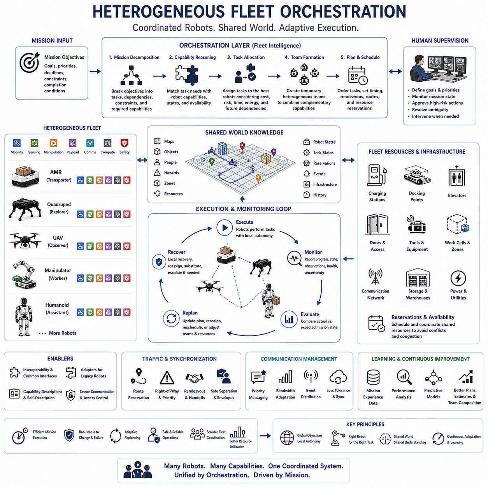{width="7.268055555555556in" height="7.268055555555556in"}

이기종 플릿 오케스트레이션(Heterogeneous Fleet Orchestration)은 서로 다른 체화(embodiment), 역량, 센서, 이동 시스템, 자율성 수준, 운용 역할을 가진 로봇들을 하나의 통합된 물리 시스템으로 조정한다. 각 로봇을 독립적인 기계로 관리하는 대신 오케스트레이션(orchestration)은 임무 목표와 플릿 자원을 연결하고, 다양한 로봇이 어떻게 협력하고, 활동 순서를 구성하며, 정보를 교환하고, 조건 변화에 따라 실행을 적응시켜야 하는지를 결정한다.

오케스트레이션은 개별 로봇 제어보다 상위 수준에서 작동한다. 로컬 자율성(Local Autonomy)은 로봇이 어떻게 이동하고, 조작하고, 인지하고, 스스로 안정화하는지를 결정하는 반면, 플릿 오케스트레이션(Fleet Orchestration)은 무엇을 달성해야 하는지, 어떤 역량이 필요한지, 어떤 로봇이 참여해야 하는지, 그리고 이들의 활동을 어떻게 조정해야 하는지를 결정한다. 이러한 분리를 통해 임무 로직은 각 체화의 세부적인 제어 아키텍처와 독립적으로 유지될 수 있다.

일반적으로 임무는 로봇별 명령의 집합이 아니라 목표(Objective)의 형태로 오케스트레이션 계층에 입력된다. 시스템은 목표를 작업, 의존관계, 제약조건, 필요한 역량, 위치, 우선순위, 마감시간, 완료 조건으로 분해할 수 있다. 오케스트레이션 시스템이 임무의 구조와 이를 달성하는 데 필요한 자원을 이해한 이후에 물리적 실행이 각 로봇에 할당된다.

역량 인식 오케스트레이션(Capability-Aware Orchestration)은 이기종 로봇을 서로 교환 가능한 자원으로 취급할 수 없기 때문에 필수적이다. 자율이동로봇(AMR)은 효율적인 운송을 제공하고, 4족 보행 로봇(quadruped)은 험난한 지형을 이동하며, 무인항공기(UAV)는 공중 관측을 제공하고, 매니퓰레이터(manipulator) 또는 휴머노이드(humanoid)는 물체와 물리적으로 상호작용할 수 있다. 오케스트레이터(orchestrator)는 실행 계획을 구성할 때 작업 요구사항과 이러한 상호 보완적 역량을 연결한다.

로봇 자기 기술(Robot Self-Description)은 이러한 매칭 과정에 필요한 정보를 제공한다. 각 로봇은 이동성, 센싱, 조작, 페이로드, 연산, 통신, 운용 지속시간(endurance), 안전, 도구 역량과 함께 운용 제약조건을 제공할 수 있다. 따라서 오케스트레이터는 고정된 로봇 모델이나 각 플랫폼이 수행할 수 있는 기능에 대한 수동 설정에만 의존하지 않고 현재의 역량 기술(capability description)을 기반으로 추론할 수 있다.

현재 상태(Current State)는 명목상의 역량만큼 중요하다. 기술적으로 특정 작업을 수행할 수 있는 로봇이라도 배터리가 부족하거나, 위치추정 성능이 저하되었거나, 센서를 사용할 수 없거나, 호환되지 않는 페이로드를 탑재했거나, 네트워크 연결 상태가 좋지 않을 수 있다. 오케스트레이션은 역량 가용성(capability availability)을 지속적으로 평가하여 로봇 사양만이 아니라 실제 플릿 상태를 반영해 작업을 할당해야 한다.

작업 할당(Task Allocation)은 임무 요구사항을 사용 가능한 체화에 대한 할당으로 변환한다. 할당 과정에서는 역량 적합도, 이동 거리, 에너지 비용, 작업 부하, 작업 우선순위, 예상 완료시간, 위험도, 통신 품질, 향후 임무 의존관계를 고려할 수 있다. 목표는 단순히 가장 가까운 로봇을 할당하는 것이 아니라 전체적으로 효과적인 임무 수행을 가능하게 하는 플릿 수준의 할당을 구성하는 것이다.

일부 작업은 하나의 로봇이 보유하지 못한 여러 역량의 조합을 필요로 한다. 따라서 오케스트레이터는 임시 이기종 팀(Temporary Heterogeneous Team)을 구성할 수 있다. UAV가 먼저 목표물을 탐색하고, AMR이 장비를 목표물 인근까지 운송하며, 4족 보행 로봇이 험지를 통과해 장비를 운반하고, 매니퓰레이터가 최종적인 물리적 상호작용을 수행할 수 있다. 오케스트레이션은 이러한 활동을 하나의 조정된 작업 흐름으로 연결한다.

작업 사이의 의존관계(Dependency)는 명시적으로 표현되어야 한다. 검사를 수행하기 전에 매핑이 완료되어야 할 수 있고, 조작은 운송에 의존할 수 있으며, 운송은 경로가 안전하다고 검증된 이후에 가능할 수 있다. 의존관계 인식 오케스트레이션(dependency-aware orchestration)은 로봇이 로컬에서는 유효하지만 전체 임무 관점에서는 너무 이른 행동을 수행하는 것을 방지하고, 임무의 인과 구조에 따라 자원을 스케줄링할 수 있도록 한다.

로봇들이 물리적으로 상호작용하거나 제한된 공간을 공유하는 경우 동기화(Synchronization)는 특히 중요해진다. 로봇들은 랑데부 지점(rendezvous point)에 도착하고, 복도를 예약하고, 적재 작업을 조정하고, 도구를 교환하거나, 다른 플랫폼의 준비가 완료될 때까지 대기해야 할 수 있다. 오케스트레이션 계층은 이러한 동기화 조건을 관리하며, 개별 로봇은 안전한 로컬 실행에 대한 책임을 유지한다.

공유 월드 지식(Shared World Knowledge)은 오케스트레이션에 필요한 환경적 맥락을 제공한다. 지도, 물체, 위험요소, 운용 구역, 자원, 작업 상태, 로봇 위치, 인프라 상태를 공유 플릿 메모리(shared fleet memory)에 유지할 수 있다. 오케스트레이터는 지속적으로 변화하는 이러한 표현을 사용하여 계획된 행동이 여전히 실행 가능한지를 평가하고, 최초 임무 생성 시점에는 알려지지 않았던 새로운 기회나 충돌을 식별한다.

월드 지식(World Knowledge)은 체화별 해석(embodiment-specific interpretation)을 보존해야 한다. 어떤 경로가 물리적으로 열려 있다는 사실이 모든 로봇이 그 경로를 사용할 수 있다는 것을 의미하지는 않는다. AMR, 4족 보행 로봇, 휴머노이드, UAV는 동일한 환경에서도 서로 다른 접근 가능성과 비용을 도출할 수 있다. 효과적인 오케스트레이션은 경로나 작업을 할당하기 전에 공유된 환경 사실과 로봇별 역량 모델을 결합한다.

실행 모니터링(Execution Monitoring)은 계획과 실제 물리적 운용 사이의 폐루프(closed loop)를 형성한다. 로봇은 작업 진행 상황, 완료, 지연, 실패, 역량 변화, 불확실성, 중요한 환경 관측을 보고한다. 오케스트레이터는 실제 실행 상태를 예상된 임무 상태와 비교하고 활동을 계속할지, 재스케줄링할지, 재할당할지, 일시 중지할지 또는 다른 의사결정 계층으로 에스컬레이션(escalation)할지를 결정한다.

재계획(Replanning)은 전체 임무가 실패한 이후에만 수행되는 것이 아니라 이벤트 기반(event-driven)으로 이루어져야 한다. 차단된 복도, 로봇의 지연, 배터리 부족, 새롭게 발견된 위험요소, 사용할 수 없는 도구, 조작 실패 등은 현재 계획의 일부를 무효화할 수 있다. 오케스트레이션 시스템은 가능한 경우 영향을 받은 작업과 의존관계만 갱신하여 전체 임무를 처음부터 다시 시작하지 않고 유효한 부분을 유지할 수 있다.

고장 복구(Failure Recovery)는 계층적인 대응 절차를 따를 수 있다. 로봇은 먼저 장애물 회피나 파지 재시도와 같은 로컬 복구를 시도할 수 있다. 로컬 복구가 실패하면 오케스트레이터는 경로를 변경하고, 다른 로봇을 할당하고, 역량을 대체하고, 팀을 재구성하거나 작업 순서를 변경할 수 있다. 자동화된 대안이 설정된 권한, 안전 또는 임무 제약조건을 초과하는 경우 인간의 개입을 요청할 수 있다.

자원 오케스트레이션(Resource Orchestration)은 로봇 자체를 넘어 확장된다. 충전소, 엘리베이터, 출입문, 통신 인프라, 도구, 도킹 지점, 작업 셀(work cell), 공유 장비도 스케줄링 가능한 플릿 자원이 될 수 있다. 이러한 자원을 조정하지 않고 로봇만 조정하면 혼잡이나 교착상태(deadlock)가 발생할 수 있으므로 오케스트레이션은 인프라의 가용성과 예약 상태를 전체 임무 상태의 일부로 표현해야 한다.

교통 관리(Traffic Management)는 물리적 공간을 공유하는 플릿을 위한 특수한 오케스트레이션 기능이다. 경로, 교차로, 좁은 복도, 도킹 구역, 작업 구역에는 혼잡과 충돌을 방지하기 위한 예약이나 우선순위가 필요할 수 있다. 이기종 교통 관리는 모든 이동 플랫폼이 동일하다고 가정하지 않고 서로 다른 로봇의 크기, 속도, 정지 거리, 기동성, 안전 범위(safety envelope)를 고려해야 한다.

통신 관리(Communication Management)는 관련 정보가 적절한 참여자에게 전달되도록 함으로써 오케스트레이션을 지원한다. 임무 핵심 이벤트, 안전 상태 변화, 작업 의존관계, 조정 메시지에는 높은 우선순위를 부여할 수 있으며, 상세한 센서 데이터는 로컬에 유지하거나 선택적으로 전송할 수 있다. 통신 정책은 대역폭, 지연시간, 연결성, 현재 플릿 의사결정에서 정보가 가지는 중요도에 따라 적응할 수 있다.

계층적 오케스트레이션(Hierarchical Orchestration)은 시스템의 확장성을 향상시킨다. 플릿 수준 지능은 임무 목표와 전역 자원을 관리하고, 팀 수준 조정자(team-level coordinator)는 협력적인 하위 작업을 관리하며, 개별 로봇은 로컬 자율성을 유지할 수 있다. 이를 통해 하나의 중앙 플래너가 모든 움직임을 제어할 필요가 없으면서도 완전히 독립적으로 행동하는 로봇들이 서로 충돌하거나 전체적으로 비효율적인 행동을 수행하는 것을 방지할 수 있다.

분산 운용(Decentralized Operation)은 연결성이 제한되거나 빠른 로컬 대응이 필요한 경우 계층적 조정을 보완할 수 있다. 하위 팀(subteam)은 목표, 제약조건, 권한 경계를 전달받은 후 지속적인 플릿 수준 통신 없이 로컬에서 협력할 수 있다. 연결이 복구되면 실행 이력과 월드 갱신 정보를 동기화하여 전역 임무 지식(global mission knowledge)의 일관성을 유지할 수 있다.

인간 감독(Human Supervision)은 판단, 책임, 외부 상황 정보가 필요한 의사결정을 위해 오케스트레이션의 일부로 유지된다. 운영자는 임무 목표를 정의하고, 우선순위를 변경하며, 고위험 행동을 승인하고, 모호한 상황을 해결하며, 자동화된 복구가 충분하지 않을 때 개입할 수 있다. 오케스트레이션 계층은 인간이 모든 로봇의 저수준 상태를 감독하도록 요구하는 대신 임무 수준의 설명과 예외 상황을 제공해야 한다.

상호운용성 및 공통 인터페이스(Interoperability and Common Interfaces)는 확장 가능한 오케스트레이션의 핵심 기반이다. 역량 기술, 작업 요청, 로봇 상태, 월드 관측, 실패, 안전 제약조건, 서비스 인터페이스는 가능한 한 공유된 계약(shared contract)을 사용해야 한다. 제조사별 어댑터(vendor-specific adapter)는 독점적인 로봇 시스템을 이러한 공통 표현으로 변환하여 전체 오케스트레이션 아키텍처를 다시 설계하지 않고도 새로운 체화를 플릿에 추가할 수 있도록 한다.

학습(Learning)은 축적된 플릿 경험을 활용하여 오케스트레이션을 개선할 수 있다. 과거 임무를 통해 어떤 로봇 조합이 효과적으로 협력하는지, 어떤 경로에서 지연이 발생하는지, 어떤 작업 할당이 과도한 에너지를 소비하는지, 특정 조건에서 어떤 복구 전략이 성공하는지를 파악할 수 있다. 이러한 패턴은 향후 작업 시간, 역량 신뢰성, 자원 수요, 팀 구성에 대한 추정 정확도를 향상시킬 수 있다.

따라서 오케스트레이션 시스템은 규칙 기반 조정(rule-based coordination)에서 적응형 집단 의사결정(adaptive collective decision-making)으로 발전할 수 있다. 월드 모델(World Model)은 미래의 환경 및 플릿 상태를 예측하고, 관계 모델(relational model)은 로봇, 작업, 자원, 위치 사이의 의존관계를 표현하며, 학습된 정책(learned policy)은 할당과 재계획을 개선할 수 있다. 이러한 구성요소는 단순히 사건에 반응하는 스케줄링을 넘어 점차 예측적인 조정(anticipatory coordination)을 지원한다.

궁극적으로 이기종 플릿 오케스트레이션(Heterogeneous Fleet Orchestration)은 분산된 로봇 역량을 조정된 집단 물리 지능(Collective Physical Intelligence)으로 전환한다. 임무 분해, 역량 추론, 작업 할당, 팀 구성, 공유 월드 지식, 동기화, 자원 관리, 모니터링, 복구, 학습을 통합함으로써 플릿은 안전한 로컬 자율성(safe local autonomy)을 유지하면서 변화하는 목표와 조건에 맞추어 다양한 체화를 지속적으로 재구성할 수 있다.

## 07.14. Heterogeneous Task Assignment [w/Code]

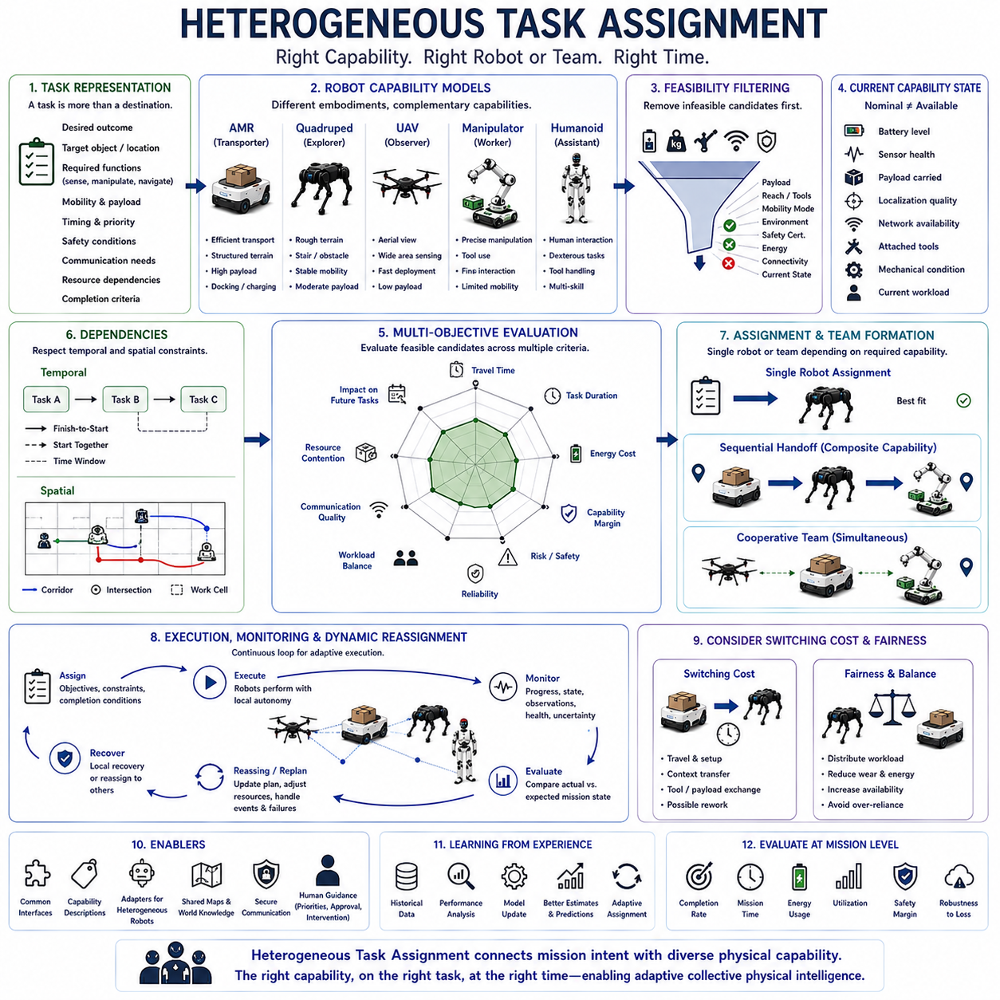{width="7.268055555555556in" height="7.268055555555556in"}

이기종 작업 할당(Heterogeneous Task Assignment)은 사용 가능한 플릿(fleet)이 서로 다른 체화(embodiment)와 역량을 가진 로봇들로 구성되어 있을 때, 임무의 각 부분을 어떤 로봇, 로봇 조합 또는 임시 팀이 수행해야 하는지를 결정한다. 동종 로봇 작업 할당과 달리 로봇들이 서로 교환 가능한 존재라고 가정할 수 없다. 작업 할당은 작업 요구사항을 물리적 역량, 현재 상태, 환경 접근성, 운용 제약조건, 작업 간 의존관계와 연결해야 한다.

따라서 작업(Task)은 단순한 목적지나 명령 이상의 정보로 표현되어야 한다. 작업 기술에는 원하는 결과, 목표 물체 또는 위치, 필요한 센싱 및 조작 기능, 이동성 요구사항, 페이로드, 시간 조건, 안전 조건, 통신 요구사항, 자원 의존관계, 완료 기준 등이 포함될 수 있다. 이러한 풍부한 표현을 통해 작업 할당 시스템은 로봇을 선택하기 전에 실제로 무엇이 필요한지를 추론할 수 있다.

로봇 역량 모델(Robot Capability Model)은 사용 가능한 자원에 대응하는 설명을 제공한다. 자율이동로봇(AMR)은 구조화된 바닥에서 효율적인 운송 능력을 제공하고, 4족 보행 로봇(quadruped)은 험지 이동성을 제공하며, 무인항공기(UAV)는 공중 센싱을 제공하고, 매니퓰레이터(manipulator)는 정밀한 물리적 상호작용을 제공할 수 있다. 역량 기술(capability description)은 이러한 체화 차이를 작업 요구사항과 체계적으로 비교할 수 있는 속성으로 변환한다.

역량 매칭(Capability Matching)은 먼저 물리적 또는 운용적으로 실행 불가능한 할당을 제거한다. 필요한 페이로드, 도달 범위, 센서, 도구, 이동 방식, 안전 인증 또는 환경 내성을 갖추지 못한 로봇은 단순히 가까운 위치에 있다는 이유만으로 후보가 되어서는 안 된다. 실행 가능성 필터링(feasibility filtering)은 탐색 공간을 줄이고, 수학적으로는 효율적으로 보이지만 실제로는 수행할 수 없는 할당이 최적화 알고리즘에 의해 선택되는 것을 방지한다.

현재 역량(Current Capability)은 명목 역량(Nominal Capability)과 구분되어야 한다. 배터리 수준, 센서 성능 저하, 현재 운반 중인 페이로드, 위치추정 품질, 통신 가용성, 장착된 도구, 기계적 상태, 현재 작업 부하는 로봇이 실제로 수행할 수 있는 작업을 변화시킬 수 있다. 따라서 작업 할당은 로봇 데이터베이스의 사양을 영구적으로 사용 가능한 자원으로 취급하지 않고 동적 역량 상태(dynamic capability state)를 활용해야 한다.

환경적 맥락(Environmental Context)은 작업 할당의 실행 가능성을 추가적으로 변화시킨다. 매니퓰레이터가 적절한 도구를 가지고 있어도 목표에 도달하지 못할 수 있으며, AMR이 충분한 페이로드 역량을 갖추고 있어도 계단이나 불안정한 지형을 통과할 수 없을 수 있다. 공유 지도(shared map)와 월드 지식(world knowledge)을 활용하면 작업 할당 과정에서 각 로봇이 필요한 위치나 물체에 물리적으로 도달하고, 관측하고, 조작하거나 다른 방식으로 상호작용할 수 있는지를 평가할 수 있다.

실행 불가능한 후보가 제거되면 작업 할당은 다목적 의사결정 문제(Multi-Objective Decision Problem)가 된다. 후보 로봇은 이동시간, 작업시간, 에너지 소비, 역량 여유도(capability margin), 위험도, 신뢰성, 작업 부하, 통신 품질, 자원 경합(resource contention), 향후 작업에 미치는 예상 영향을 기준으로 평가할 수 있다. 따라서 최적의 할당은 반드시 로컬에서 가장 빠른 선택이 아니라 전체 플릿의 효과적인 임무 수행을 지원하는 선택이어야 한다.

역량 여유도(Capability Margin)는 요구조건을 간신히 충족하는 계획이 취약할 수 있기 때문에 중요하다. 한계에 가까운 페이로드를 운반하거나 센서 범위의 경계에서 작동하는 로봇은 기술적으로는 자격을 충족하지만 불확실성을 수용할 여유가 거의 없을 수 있다. 임무 중요도, 환경 불확실성 또는 실패 결과를 고려해 추가적인 강건성(robustness)이 필요한 경우 충분한 예비 역량을 가진 로봇을 우선적으로 할당할 수 있다.

작업 우선순위(Task Priority)는 희소한 역량이 어떻게 배분되는지에 영향을 준다. 높은 우선순위의 검사, 긴급 대응, 안전 모니터링 또는 시간 제약이 큰 운송 작업을 위해 전문화된 로봇을 확보할 필요가 있으며, 이러한 로봇이 낮은 우선순위 작업을 효율적으로 수행할 수 있더라도 예약해 둘 수 있다. 작업 할당은 즉각적인 작업 가치뿐만 아니라 기회비용(opportunity cost)도 고려하여 다른 플랫폼이 수행할 수 있는 작업에 고유한 역량이 불필요하게 소비되지 않도록 해야 한다.

시간적 의존관계(Temporal Dependency) 역시 작업 할당에 영향을 준다. 일부 작업은 선행 작업이 완료될 때까지 시작할 수 없으며, 다른 작업들은 동시에 수행되거나 정해진 시간 범위 내에서 이루어져야 한다. UAV가 AMR 출발 전에 경로를 검증해야 하거나, 운송 로봇이 물체를 전달한 직후 매니퓰레이터가 도착해야 할 수 있다. 따라서 작업 할당과 스케줄링(scheduling)은 독립적인 과정이 아니라 긴밀하게 결합된다.

공간적 의존관계(Spatial Dependency)도 유사한 조정 요구사항을 발생시킨다. 로봇들은 좁은 복도, 엘리베이터, 도킹 스테이션, 충전 구역, 작업 셀(work cell), 적재 구역을 공유할 수 있다. 공유 공간을 고려하지 않고 개별적으로 최적인 작업을 할당하면 혼잡, 교착상태(deadlock), 안전하지 않은 상호작용이 발생할 수 있다. 이기종 작업 할당은 후보 할당의 실제 비용을 평가할 때 자원 예약과 예상 이동을 함께 고려해야 한다.

일부 작업은 상호 보완적인 역량을 필요로 하기 때문에 하나의 체화에만 할당할 수 없다. 운송 로봇은 장비를 효율적으로 운반할 수 있지만 험지를 통과하지 못할 수 있으며, 4족 보행 로봇은 목적지까지 도달할 수 있지만 운반 가능한 페이로드가 더 작을 수 있다. 작업을 여러 구간으로 분해하고 계획된 인계(handoff)를 통해 여러 로봇에 할당하면 플릿은 전문화된 체화들을 결합하여 복합 역량(composite capability)을 구성할 수 있다.

연합 구성(Coalition Formation)은 이러한 원칙을 동시 협력이 필요한 작업으로 확장한다. UAV가 지상 로봇의 이동 중 관측 정보를 제공하고, 매니퓰레이터가 개입 작업을 수행하는 동안 다른 로봇이 도구를 공급하거나, 여러 로봇이 대규모 환경을 공동으로 검사할 수 있다. 이 경우 작업 할당은 어떤 개별 로봇이 조건을 충족하는지만 결정하는 것이 아니라 어떤 로봇 조합이 필요한 집단 역량(collective capability)을 제공하는지도 판단해야 한다.

이기종 작업 할당은 작업이 배정된 이후에도 체화별 자율성(Embodiment-Specific Autonomy)을 유지해야 한다. 플릿 관리자는 모든 액추에이터 명령이나 궤적을 직접 지정하지 않고 목표, 제약조건, 완료 조건을 할당할 수 있다. 각 로봇은 할당된 작업을 자신의 내비게이션, 인지, 조작 또는 제어 전략으로 변환한다. 이를 통해 플릿 수준 자원 추론과 로컬 물리 실행 사이에 명확한 경계를 유지할 수 있다.

작업 할당 과정에서는 불확실성(Uncertainty)을 명시적으로 표현해야 한다. 이동시간 추정, 지형 조건, 작업 지속시간, 물체 상태, 로봇 신뢰성, 센서 성능에는 모두 불확실성이 존재할 수 있다. 따라서 후보 할당에는 결정론적 비용(deterministic cost)만 사용하는 대신 신뢰도 또는 위험도 추정을 포함할 수 있다. 불확실성이 안전이나 임무 완료에 큰 영향을 미칠 수 있는 경우 보다 보수적인 할당을 선택할 수 있다.

과거 플릿 경험(Historical Fleet Experience)으로부터의 학습은 이러한 추정치를 개선할 수 있다. 실제 실행 데이터는 특정 로봇-작업 조합에 필요한 시간, 어떤 환경에서 실패가 발생하는지, 페이로드에 따라 에너지 소비가 어떻게 변화하는지, 어떤 팀이 효과적으로 협력하는지를 보여준다. 작업 할당 모델은 이러한 경험을 활용하여 단순한 명목상의 가정을 실제 물리적 운용에 기반한 예측으로 대체할 수 있다.

실패(Failure)는 향후 작업 할당을 위한 특히 가치 있는 정보를 제공한다. AMR이 특정 표면에서 반복적으로 실패하거나 매니퓰레이터가 특정 물체 구성에서 어려움을 겪는다면 작업 할당 시스템은 해당 조합의 예상 적합도를 낮출 수 있다. 반대로 반복적인 성공은 신뢰도를 높일 수 있다. 따라서 역량 모델은 정적인 사양에서 경험에 따라 조건화된 실제 성능 추정(experience-conditioned performance estimate)으로 발전한다.

작업 할당은 실행이 시작된 이후에도 동적으로 유지되어야 한다. 로봇을 사용할 수 없게 되거나, 경로가 차단되거나, 작업이 예상보다 오래 걸리거나, 새로운 고우선순위 임무가 발생할 수 있다. 이벤트 기반 재할당(event-driven reassignment)은 완료된 행동과 기존 계획의 유효한 부분을 유지하면서 완료되지 않은 작업을 플릿 전체에 다시 배분할 수 있도록 한다. 이를 통해 작업 할당은 일회성 스케줄링 결정이 아니라 지속적인 프로세스가 된다.

재할당(Reassignment)은 전환 비용(Switching Cost)을 고려해야 한다. 부분적으로 완료된 작업을 다른 로봇으로 이전하면 이동, 설정, 상황 정보 전달(context transfer), 도구 교환 또는 이전 작업의 반복이 필요할 수 있다. 어떤 상황에서는 즉시 재할당하는 것보다 지연을 허용하는 것이 더 효율적일 수 있다. 시스템은 현재 할당을 변경함으로써 발생하는 중단 비용과 예상되는 복구 이점을 비교해야 한다.

장시간 운용되는 플릿에서는 공정성(Fairness)과 작업 부하 균형(Workload Balancing)도 중요할 수 있다. 항상 가장 높은 역량을 가진 로봇만 선택하면 특정 플랫폼에 과도한 마모, 배터리 사이클 증가, 유지보수 부담 또는 운용 의존성이 집중될 수 있다. 임무 성능이 허용하는 경우 작업 할당 정책은 작업 부하를 분산하여 플릿 수명을 늘리고, 전문화된 작업이 발생했을 때 핵심 로봇을 사용할 수 없게 되는 가능성을 줄일 수 있다.

인간 운영자(Human Operator)는 우선순위, 제약조건, 승인 또는 직접적인 개입을 통해 작업 할당에 영향을 줄 수 있다. 운영자는 예상되는 임무를 위해 특정 로봇을 예약하고, 특정 플랫폼-작업 조합을 금지하거나, 시스템이 알 수 없는 외부 정보를 보유한 경우 자동 할당을 재정의할 수 있다. 인간의 지침은 플릿 수준 의도를 수정하면서도 많은 일상적인 작업 할당 결정에는 자동화된 추론을 유지하도록 해야 한다.

서로 다른 제조사와 소프트웨어 아키텍처의 로봇에 작업을 할당하려면 상호운용성(Interoperability)이 필요하다. 공통 작업 인터페이스(Common Task Interface)와 역량 기술(Capability Description)을 사용하면 작업 할당 시스템은 독점적인 명령 형식이 아니라 기능을 중심으로 추론할 수 있다. 로봇별 어댑터(robot-specific adapter)는 공유 작업 할당을 각 플랫폼의 고유 실행 인터페이스로 변환하여 할당기가 모든 내부 구현을 이해하지 않아도 이기종 플랫폼이 참여할 수 있도록 한다.

계층적 작업 할당(Hierarchical Assignment)은 확장성을 향상시킬 수 있다. 플릿 수준 추론은 주요 임무 기능을 팀에 할당하고, 팀 수준 조정자는 세부적인 하위 작업을 구성원들에게 분배할 수 있다. 이후 개별 로봇은 로컬 실행을 계획한다. 이러한 분해는 중앙집중식 연산 부담을 줄이고 가장 관련성이 높은 정보가 존재하는 공간적·시간적 수준에서 작업 할당 결정을 수행할 수 있도록 한다.

분산 작업 할당(Distributed Assignment)은 제한된 연결성을 가진 환경에서의 운용을 추가적으로 지원할 수 있다. 중앙 오케스트레이터(orchestrator)에 지속적으로 접근할 수 없는 경우 로봇 또는 로컬 팀은 공유된 역량 및 상태 정보를 활용하여 작업을 협상할 수 있다. 통신이 복구되면 작업 할당, 결과, 관측 정보를 플릿 메모리(fleet memory)와 동기화하여 로컬 자율성과 전체 임무 조정 사이의 일관성을 유지할 수 있다.

이기종 작업 할당의 품질은 궁극적으로 임무 수준(Mission Level)에서 평가되어야 한다. 평가 지표에는 임무 완료율, 전체 임무 시간, 에너지 소비, 로봇 활용률, 혼잡, 안전 여유도(safety margin), 재할당 빈도, 고장 복구 성능, 로봇 손실에 대한 강건성 등이 포함될 수 있다. 로컬에서는 효율적인 할당이라도 이후의 병목현상을 발생시키거나 향후 작업에 필요한 핵심 역량을 사용할 수 없게 만든다면 성공적인 할당이라고 할 수 없다.

따라서 이기종 작업 할당(Heterogeneous Task Assignment)은 임무 의도(Mission Intent)와 다양한 물리적 역량(Diverse Physical Capability)을 연결하는 의사결정 가교(decision bridge)의 역할을 한다. 작업 요구사항, 동적 역량 모델, 공유 월드 지식, 다목적 최적화, 의존관계, 연합 구성, 불확실성, 학습, 지속적인 재할당을 결합함으로써 플릿은 적절한 역량을 적절한 작업과 시간에 배치하고, 이를 통해 적응형 집단 물리 지능(Adaptive Collective Physical Intelligence)을 구현할 수 있다.
