**Volume 09. Multi Robot and Swarm Physical AI**

# Chapter 08. Emergent Behavior

## 08.01. What is Emergent Behavior

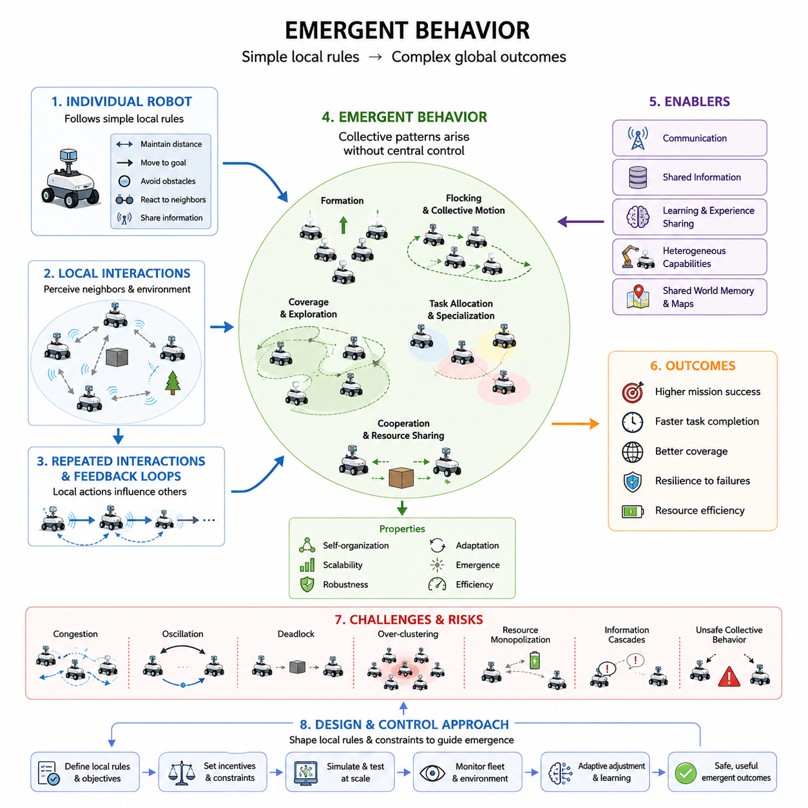{width="7.268055555555556in" height="7.268055555555556in"}

Emergent behavior refers to collective patterns, structures, or capabilities that arise from interactions among multiple robots even though those behaviors are not explicitly programmed as a complete global procedure. Each robot may follow relatively simple rules based on local observations, neighboring robots, shared information, and its own objectives, while the fleet produces coordinated behavior at a larger system level.

The defining characteristic of emergence is the distinction between individual rules and collective outcomes. A robot may only know how to maintain distance, move toward a target, avoid obstacles, or react to nearby teammates. When many robots repeatedly apply these rules, their interactions can generate formations, traffic flows, distributed exploration patterns, task specialization, or cooperative strategies that cannot be attributed to a single robot.

Emergence therefore differs from conventional centralized coordination. In a centrally planned system, a controller explicitly calculates assignments, routes, formations, or schedules for the entire fleet. In an emergent system, significant parts of the global organization develop through decentralized interactions. Centralized and emergent mechanisms can nevertheless coexist, producing hybrid architectures in which global constraints guide locally adaptive collective behavior.

Local interaction is one of the fundamental mechanisms behind emergence. Robots may observe relative position, velocity, task status, resource availability, environmental conditions, or messages from nearby agents. Each interaction changes subsequent decisions, creating feedback loops across the population. Repeated local adjustments propagate through the network and can gradually establish stable collective patterns without requiring every robot to maintain a complete global state.

Emergent behavior is closely connected with self-organization, but the concepts are not identical. Self-organization describes the process through which order develops from decentralized interactions, whereas emergence emphasizes the resulting system-level properties that cannot be understood simply by examining isolated agents. A self-organizing robot fleet can therefore generate emergent formations, roles, communication conventions, exploration strategies, and cooperative behaviors.

Physical embodiment makes emergence particularly important for multi-robot Physical AI. Robots do not interact only through abstract messages; they also influence one another through motion, occupied space, sensing, resource competition, environmental modification, and physical constraints. Consequently, an action performed by one robot can change what other robots perceive or can physically accomplish, creating indirect coordination through the shared environment.

Emergence can appear at multiple temporal and spatial scales. Short-term patterns may include collision avoidance, queue formation, synchronized movement, or temporary grouping. Longer-term patterns may include persistent division of labor, stable routes, territorial coverage, or specialized roles. These behaviors can also evolve as robots accumulate experience, learn policies, exchange knowledge, or adapt to changing environmental and operational conditions.

Learning substantially expands the range of possible emergent behavior. In learning-based multi-agent systems, robots are not limited to manually designed interaction rules. Reinforcement learning, imitation learning, policy adaptation, and collective experience sharing can allow coordination strategies to develop from repeated interaction. The resulting behavior may exploit relationships between agents that designers did not explicitly encode as deterministic coordination procedures.

Emergent cooperation provides an important example. Robots pursuing compatible objectives may discover that sharing observations, dividing spatial regions, assisting blocked teammates, yielding access to constrained resources, or coordinating complementary capabilities improves collective performance. Cooperation can therefore develop from incentives and repeated interactions rather than from fixed role assignments, particularly when individual rewards are connected to team-level outcomes.

Heterogeneous fleets create an additional dimension of emergence because robots possess different embodiments, sensors, mobility characteristics, manipulation capabilities, compute resources, and operating constraints. Repeated interaction can lead robots toward functional specialization. UAVs may naturally become scouts, mobile robots transporters, manipulators interaction specialists, and quadrupeds terrain-access agents even when every detailed role transition has not been predetermined.

Emergence is not inherently beneficial. The same decentralized mechanisms that generate efficient cooperation can produce congestion, oscillation, deadlocks, unstable formations, excessive clustering, resource monopolization, information cascades, or unsafe collective motion. A behavior that appears rational from the perspective of each individual robot may therefore become inefficient or dangerous when amplified across dozens, hundreds, or thousands of interacting agents.

This distinction makes beneficial versus undesired emergence a central engineering problem. Designers must consider not only whether individual robot policies satisfy local requirements, but also what population-level behavior those policies generate under changing fleet size, communication quality, environmental density, failures, and uncertainty. Testing a single robot successfully cannot demonstrate that the same policy will remain safe when deployed throughout a large interacting fleet.

Feedback is especially important because small local effects can become amplified. Positive feedback can rapidly reinforce successful routes, behaviors, conventions, or task choices, while negative feedback can stabilize the population by discouraging overcrowding or excessive resource use. Effective emergent systems often depend on a balance between amplification and stabilization, allowing useful patterns to form without permitting collective dynamics to become uncontrollable.

Robustness is another reason emergence is attractive for Physical AI. When coordination is distributed across many interactions rather than concentrated in one controller, the loss of an individual robot does not necessarily destroy the collective behavior. Other robots can modify their local decisions, redistribute tasks, alter formations, or occupy missing functional roles, enabling graceful adaptation to failures, environmental changes, and incomplete communication.

Scalability can also benefit from emergence because robots may coordinate primarily with relevant neighbors instead of exchanging complete state information with every member of the fleet. Local interaction can reduce communication and centralized computation requirements as the population grows. However, scalability is not automatic: interaction density, communication topology, delayed information, and environmental bottlenecks can fundamentally change collective dynamics at larger deployment scales.

Understanding emergence therefore requires measurements at both individual and collective levels. Individual metrics may describe policy decisions, communication, trajectories, energy use, or local safety, while collective metrics characterize coverage, throughput, coordination efficiency, spatial organization, resilience, diversity, convergence, and stability. Comparing these levels helps determine whether observed global behavior genuinely results from interactions rather than from predetermined centralized commands.

Predictability and controllability become particularly important when emergent behavior is deployed in safety-critical environments. Engineers may not need to prescribe every trajectory, but they must establish boundaries within which collective adaptation remains acceptable. Runtime constraints, safety envelopes, communication protocols, resource limits, supervisory policies, simulation testing, and fleet-level monitoring can constrain emergence while preserving the advantages of decentralized adaptation.

In this sense, emergent behavior represents a transition from programming every collective action toward engineering the conditions under which useful collective intelligence can arise. The design problem becomes one of shaping local policies, incentives, communication, environmental interfaces, learning mechanisms, and safety constraints so that interactions reliably produce desirable system-level capabilities while suppressing unstable or hazardous collective patterns.

Within Multi-Robot and Swarm Physical AI, emergence connects swarm intelligence, collective learning, shared world memory, heterogeneous fleets, and fleet-scale deployment. The preceding mechanisms provide robots with local intelligence, shared knowledge, communication, and diverse capabilities; emergence describes how their repeated interactions can transform these components into behaviors belonging to the fleet as a whole rather than to any individual machine.

## 08.02. Local Interactions and Global Patterns

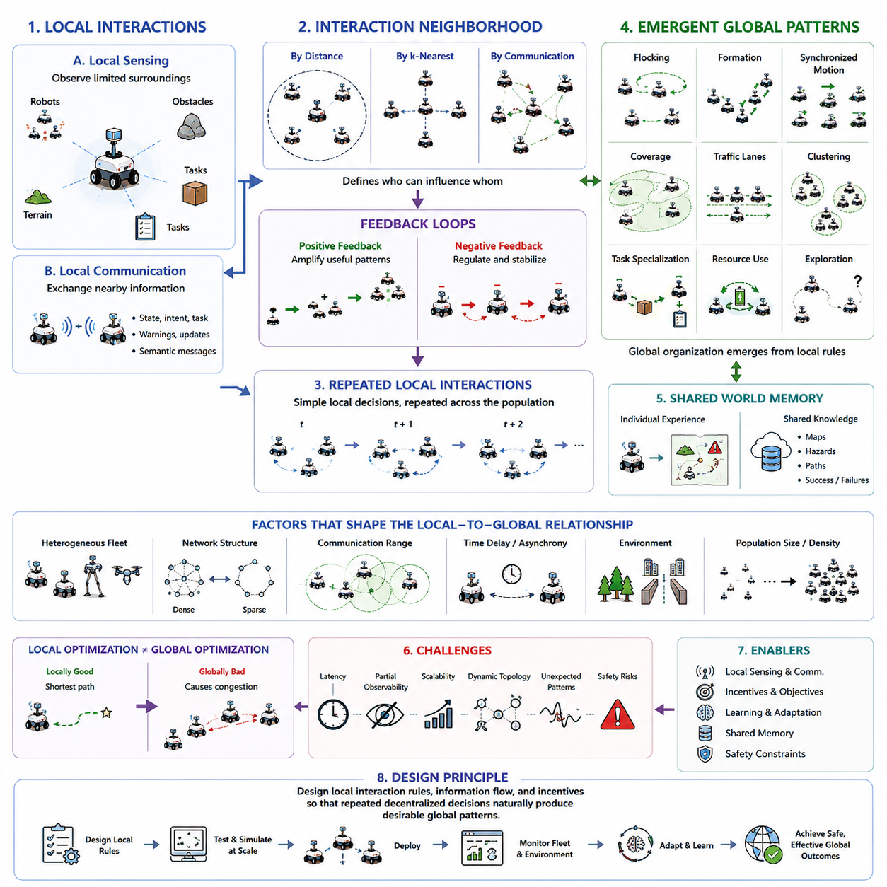{width="7.268055555555556in" height="7.268055555555556in"}

Local interactions are the fundamental mechanism through which large groups of robots can generate coordinated global patterns without requiring every robot to understand or control the entire system. Each robot observes only a limited portion of its surroundings and reacts to nearby robots, obstacles, resources, tasks, or environmental conditions. Repeated across a population, these local decisions can produce coherent behavior at fleet scale.

A local interaction occurs when the behavior of one robot directly or indirectly influences the state or decision of another robot within a limited interaction range. The interaction may involve relative position, distance, velocity, heading, task status, sensor observations, or communicated information. Because robots operate in physical space, interaction can also occur indirectly when one robot changes the environment encountered by others.

The relationship between local interactions and global patterns is fundamentally many-to-one. Numerous individual actions collectively contribute to a system-level outcome that cannot be assigned to any single robot. A robot maintaining separation from its neighbors performs only a local action, for example, but when every robot follows compatible separation and alignment rules, the fleet may organize itself into stable collective motion.

Interaction neighborhoods determine which robots can influence each other. A neighborhood may be defined geometrically by physical distance, topologically by a fixed number of nearby robots, or logically through communication and task relationships. Different neighborhood structures create different information flows through the fleet, affecting how quickly local changes propagate and whether coherent global behavior can form across large populations.

Local sensing allows robots to coordinate even when complete global information is unavailable. A robot may detect nearby positions, velocities, obstacles, terrain conditions, or resource availability and modify its action accordingly. This principle is especially valuable under partial observability, where maintaining an accurate centralized representation of every robot and environmental state would be computationally expensive, communication-intensive, or physically impossible.

Communication extends local interaction beyond direct physical sensing. Robots can exchange compact state estimates, intentions, warnings, task information, or semantic messages with nearby teammates. Communication therefore creates an informational neighborhood that may differ from the physical neighborhood. A robot can influence another robot outside sensor range, while bandwidth and connectivity constraints determine how widely and rapidly information propagates through the collective.

Feedback transforms isolated interactions into persistent collective dynamics. When one robot changes its motion, nearby robots respond, causing additional robots to adjust their own behavior. These responses may propagate repeatedly across the fleet. Positive feedback can amplify a useful pattern, such as robots converging toward a discovered target, while negative feedback can regulate density, separation, resource consumption, or other variables requiring collective stability.

Global patterns arise when these repeated interactions establish recognizable organization across the robot population. Examples include formations, flocking, synchronized motion, distributed coverage, traffic lanes, clustering, task specialization, and cooperative resource use. Importantly, the global pattern does not need to be represented explicitly inside each robot. It exists as a property of the collective configuration and behavior generated by interacting agents.

Spatial patterns are particularly visible manifestations of local interaction. Repulsion between nearby robots can prevent collisions and distribute agents across an area, while attraction can maintain group cohesion. Alignment can cause neighboring robots to adopt similar directions of motion. Combining these mechanisms can generate organized movement in which the fleet maintains structure while adapting its overall shape to obstacles and environmental boundaries.

Local interactions can also generate distributed exploration and coverage. Each robot may preferentially move toward unexplored regions while avoiding areas recently visited by itself or neighboring robots. No robot necessarily calculates the complete optimal coverage plan. Nevertheless, information exchanged locally or deposited into shared world memory can progressively distribute robots across the environment and reduce redundant exploration.

Task allocation provides another form of global pattern formation. Robots may locally evaluate task urgency, distance, capability compatibility, workload, and the intentions of neighboring agents. Repeated negotiation or adaptation can gradually distribute tasks across the fleet. At the global level, this appears as organized division of labor even though individual robots may only be making decisions from locally available information and limited shared context.

Heterogeneous fleets make the relationship between local interaction and global organization more complex. An AMR, manipulator, quadruped, humanoid, and UAV may perceive different environmental features and possess different action capabilities. Their local interactions must therefore incorporate capability and embodiment information. Global patterns can then reflect complementary specialization rather than identical behavior across every member of the fleet.

Shared world memory can strengthen local-to-global coordination by preserving information beyond immediate encounters. A robot that discovers a blocked route, hazardous terrain, useful object, or successful path can contribute that experience to shared knowledge. Other robots subsequently incorporate the information into their local decisions. The resulting global behavior reflects both current interactions and accumulated experience distributed across the fleet.

The structure of the interaction network strongly influences global behavior. Dense connectivity can accelerate information propagation but increase communication load and correlated responses. Sparse connectivity reduces communication requirements but may fragment collective behavior if information cannot travel between groups. Dynamic connectivity adds further complexity because movement continuously changes which robots can sense, communicate with, or influence one another.

Time delays can substantially alter the relationship between local rules and global patterns. A robot reacting to outdated neighbor positions or intentions may produce oscillations, unnecessary avoidance maneuvers, or unstable formations. As fleet size increases, communication latency and asynchronous updates can make these effects more significant. Robust local policies must therefore tolerate delayed, incomplete, and occasionally inconsistent information.

Global behavior can change dramatically even when the local rules remain unchanged. Increasing robot density may transform smooth movement into congestion, while changing communication range may convert coordinated exploration into fragmented groups. Environmental bottlenecks can create queues or traffic lanes that never appeared in smaller experiments. Consequently, collective behavior must be evaluated across different population sizes, spatial configurations, and operating conditions.

This sensitivity illustrates why local optimization does not necessarily produce global optimization. A robot choosing the shortest available path may improve its own travel time while contributing to fleet-wide congestion. Similarly, aggressive task acquisition may improve individual utilization but create competition and poor workload distribution. Multi-robot Physical AI must therefore connect local objectives with collective performance measures so that individually rational actions support desirable global outcomes.

Learning-based systems can discover local interaction policies rather than relying exclusively on manually designed rules. Multi-agent reinforcement learning can optimize policies using collective rewards, while imitation and experience sharing can transfer successful coordination strategies among robots. The challenge is ensuring that learned local behaviors generalize when fleet composition, environmental conditions, communication quality, or the number of participating robots changes.

Safety requires designers to evaluate both local actions and the global patterns they create. Collision-free behavior between pairs of robots does not guarantee that a large fleet will avoid deadlocks, congestion, unstable flows, or collective blockage. Simulation, stress testing, runtime monitoring, safety constraints, and fleet-level metrics are therefore necessary to identify undesirable patterns that may emerge only after many locally safe interactions accumulate.

The central engineering principle is to design local interactions so that desirable global organization becomes a natural consequence of repeated decentralized decisions. Local sensing, communication, incentives, shared memory, learning, and safety constraints form the mechanisms through which this relationship can be shaped. Multi-robot intelligence then becomes less about commanding every robot individually and more about engineering interaction rules that allow the fleet to organize itself.

Local interactions and global patterns therefore provide the essential bridge between individual robot intelligence and collective intelligence. Individual robots perceive and act within limited contexts, while their interconnected decisions generate fleet-level structures and capabilities. Understanding this local-to-global transformation is fundamental to self-organization, emergent cooperation, specialization, exploration, traffic behavior, and other forms of emergent behavior developed throughout this chapter.

## 08.03. Self Organization and Spontaneous Coordination

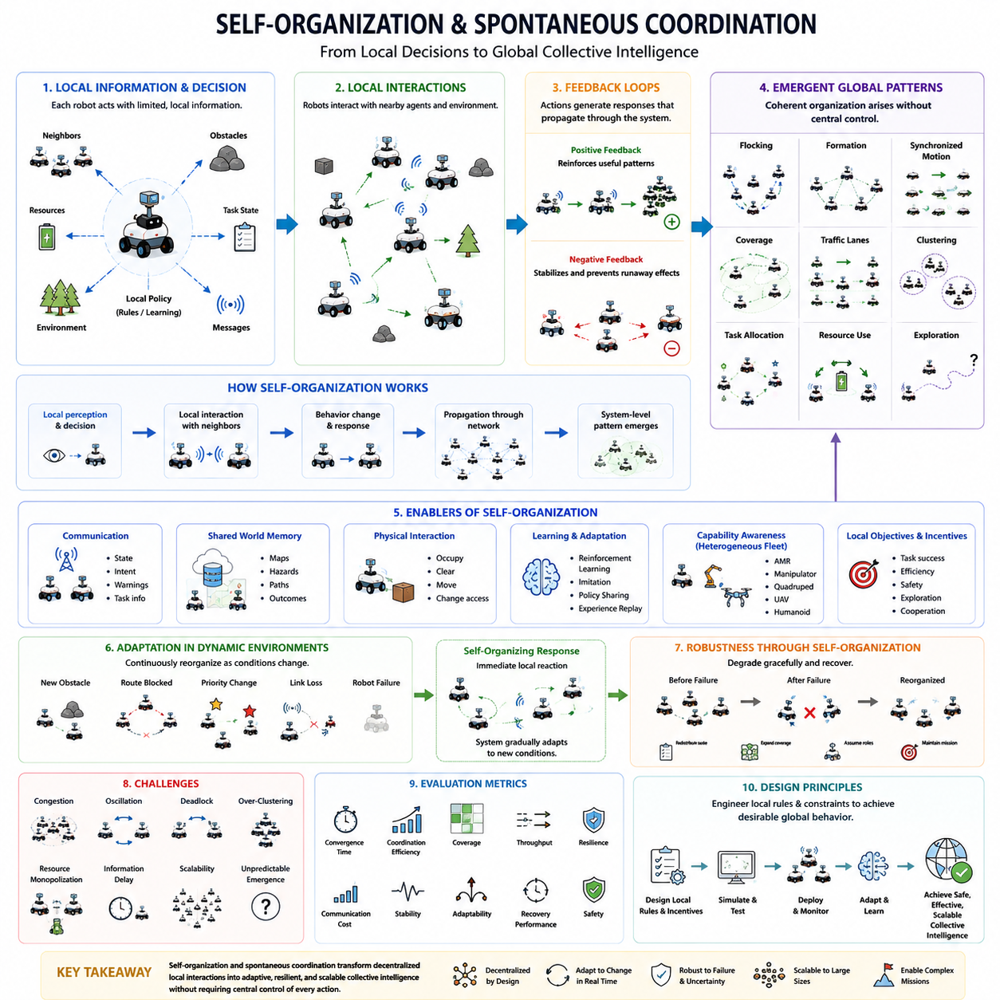{width="7.268055555555556in" height="7.268055555555556in"}

Self-organization is the process through which a multi-robot system develops coherent structures, roles, or coordinated behaviors without requiring a central controller to explicitly determine every action. Individual robots operate according to local observations, interaction rules, internal policies, and limited shared information. Through repeated interactions, these decentralized decisions collectively generate organized behavior at the fleet or swarm level.

Spontaneous coordination describes coordinated activity that develops dynamically from the current situation rather than from a complete predefined coordination plan. Robots may adjust their motion, task choices, communication, or resource use after observing nearby agents and environmental changes. Coordination therefore emerges continuously during operation, allowing the collective system to reorganize itself as conditions, objectives, and available robots change.

Self-organization depends strongly on local information. Each robot typically perceives only a portion of the global environment and interacts with a subset of the robot population. It may observe nearby positions, velocities, obstacles, task states, resources, or communication messages. Although this information is incomplete, repeated local decisions can propagate across interaction networks and gradually establish coordinated system-level patterns.

A simple example is collective motion. Individual robots may independently maintain safe separation, align their direction with nearby robots, and remain sufficiently close to the group. None of these rules explicitly specifies the final shape or trajectory of the fleet. Nevertheless, their combination can produce cohesive movement, formations, clustering, or adaptive flows that change naturally as robots encounter obstacles and environmental boundaries.

Feedback loops are central to self-organizing systems. When one robot changes its behavior, neighboring robots respond, creating additional changes that propagate through the collective. Positive feedback can reinforce successful behaviors, such as movement toward a useful region or adoption of an effective task strategy. Negative feedback can limit excessive concentration, stabilize spacing, regulate resource use, and prevent uncontrolled amplification of collective responses.

Spontaneous coordination can also emerge during distributed task allocation. Robots may evaluate task priority, distance, capability requirements, workload, and neighboring intentions before deciding whether to accept or avoid a task. As these decisions influence one another, assignments can gradually stabilize across the fleet. The resulting division of labor can appear globally organized even though no central entity explicitly assigned every robot to every task.

The physical environment itself can participate in self-organization. A robot can alter what other robots subsequently perceive by occupying a location, clearing a path, moving an object, identifying a hazard, or changing access to a resource. This form of indirect coordination allows robots to influence one another through environmental state as well as explicit communication, making physical embodiment an important component of self-organizing Physical AI.

Communication can strengthen spontaneous coordination by allowing robots to exchange state, intent, warnings, discoveries, or task information. However, self-organization does not necessarily require continuous communication with every robot. Local peer-to-peer exchange, event-based messages, shared maps, or periodically synchronized knowledge can provide sufficient information. This reduces dependence on globally connected communication infrastructure and supports operation under degraded connectivity.

Shared world memory extends self-organization beyond immediate local encounters. Information about traversable routes, obstacles, hazards, task outcomes, failures, recovery strategies, and environmental changes can persist after the originating robot has moved away. Other robots can incorporate this accumulated knowledge into their own local decisions, allowing collective organization to develop from both current interactions and previous fleet experience.

Self-organization becomes especially valuable in dynamic environments where fixed plans rapidly become obsolete. New obstacles may appear, routes may become unavailable, tasks may change priority, communication links may disappear, or individual robots may fail. Rather than waiting for complete centralized replanning, neighboring robots can immediately modify their local behavior, after which broader fleet organization can progressively adapt to the changed conditions.

Robot failure illustrates this adaptive property clearly. When a robot disappears from an active formation, task network, or exploration region, nearby robots can detect the resulting gap and modify their behavior. Tasks may be redistributed, spatial coverage may expand, or another robot may assume a missing function. The collective can therefore exhibit graceful degradation and recovery without requiring the original global configuration to remain intact.

Heterogeneous fleets introduce spontaneous coordination among robots with different embodiments and capabilities. An AMR may transport material, a manipulator may perform physical interaction, a quadruped may traverse difficult terrain, and a UAV may provide aerial observations. Local capability awareness enables robots to recognize complementary relationships, allowing temporary teams and functional roles to form according to the demands of the environment and mission.

Learning further expands self-organizing behavior because interaction policies can adapt from experience. Multi-agent reinforcement learning, imitation learning, policy sharing, and fleet experience replay can help robots discover coordination strategies that are difficult to specify manually. A learned system may gradually identify when to cooperate, yield, communicate, specialize, explore independently, or request assistance based on patterns encountered during collective operation.

Self-organization does not imply randomness or the absence of engineering control. The designer determines the local policies, objectives, incentives, communication mechanisms, capability constraints, safety boundaries, and learning conditions within which organization can emerge. The objective is not to remove system design, but to shift design effort from prescribing every global action toward constructing interaction mechanisms that reliably produce desirable collective behavior.

An important challenge is that locally reasonable decisions can generate undesirable global outcomes. Robots independently selecting efficient routes may create congestion, while repeated avoidance responses may produce oscillation or deadlock. Strong positive feedback may cause excessive clustering or resource monopolization. Consequently, self-organizing systems must be evaluated at both the individual and collective levels rather than assuming that locally correct behavior guarantees global effectiveness.

Stability is therefore a critical property of spontaneous coordination. A useful collective pattern should persist sufficiently long to accomplish its purpose while remaining responsive to meaningful environmental changes. Excessive stability can prevent adaptation, whereas insufficient stability can cause continuous reorganization and inefficient behavior. Effective systems must balance convergence toward coordinated patterns with flexibility to reorganize when conditions change.

Scalability is another major advantage and challenge. Because robots can coordinate primarily through local interactions, self-organizing mechanisms can reduce the computational and communication burden associated with centralized control as fleet size increases. However, larger populations can introduce new collective dynamics, including congestion, delayed information propagation, fragmented groups, and unexpected synchronization that may not appear in small-scale experiments.

Safety mechanisms must therefore constrain the space within which spontaneous coordination develops. Collision avoidance, protected zones, velocity limits, resource-access rules, runtime assurance, communication safeguards, and supervisory intervention can provide invariant boundaries around adaptive collective behavior. Within these boundaries, robots can retain substantial freedom to reorganize while critical safety requirements remain explicitly enforced.

Evaluation of self-organization should examine both how organization forms and what collective results it produces. Relevant properties include convergence time, coordination efficiency, resilience to robot loss, communication demand, coverage, throughput, adaptability, stability, and recovery performance. Experiments should vary population size, connectivity, environmental complexity, failures, and task conditions to determine whether the observed coordination remains robust beyond a single operating scenario.

Self-organization and spontaneous coordination ultimately represent a shift from centrally specifying collective behavior toward engineering systems capable of continuously organizing themselves. Local sensing, communication, shared memory, learning, feedback, and physical interaction provide the mechanisms, while safety constraints establish acceptable boundaries. Together they allow multi-robot Physical AI to transform decentralized individual decisions into adaptive, resilient, and scalable collective intelligence.

## 08.04. Emergent Roles and Specialization

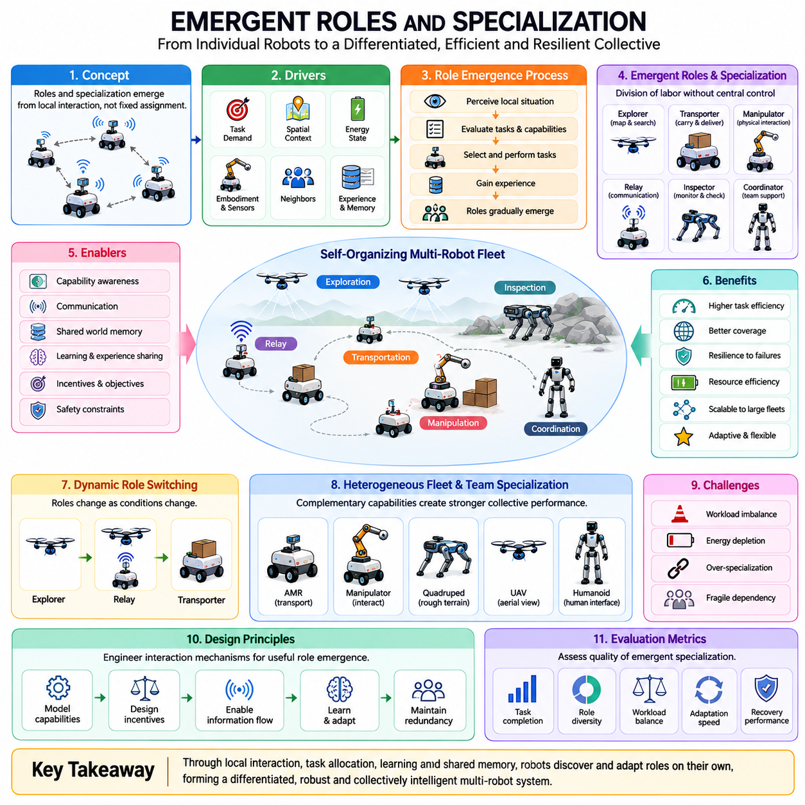{width="7.268055555555556in" height="7.268055555555556in"}

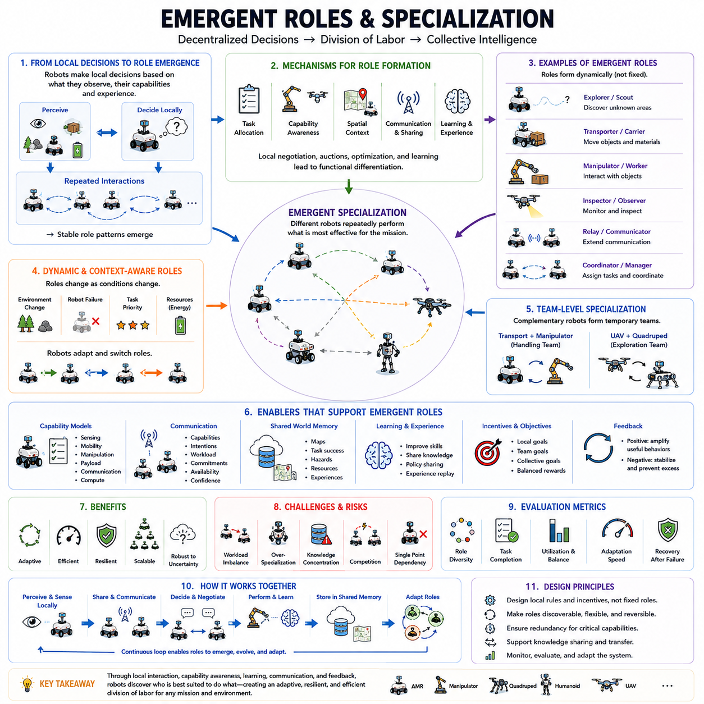{width="7.268055555555556in" height="7.268055555555556in"}

Emergent roles arise when robots in a multi-robot system develop different functional responsibilities through interaction rather than receiving every role from a centralized planner. Individual robots respond to local conditions, task demands, capabilities, neighboring agents, and accumulated experience. Repeated decisions can gradually produce a recognizable division of labor in which different members contribute distinct functions to collective objectives.

Specialization describes the process through which particular robots become better suited, more frequently selected, or behaviorally adapted to certain categories of tasks. A robot may repeatedly perform exploration, transportation, inspection, manipulation, communication relay, or coordination because its location, sensors, embodiment, experience, or current state makes that function advantageous. Over time, temporary task choices can develop into persistent functional patterns.

Emergent specialization differs from predefined specialization. In a predefined system, designers permanently assign roles such as scout, transporter, or manipulator before deployment. In an emergent system, roles may form dynamically from interactions between robot capabilities and operational conditions. The resulting organization can therefore change when the environment, mission objectives, fleet composition, workload, or availability of individual robots changes.

Role emergence can begin with small differences among otherwise similar robots. Two robots may initially possess identical hardware and policies, but one happens to encounter exploration tasks while another repeatedly interacts with transport requests. Their accumulated experience, position, workload, or learned policy can gradually influence subsequent task selection, producing behavioral differentiation even though the robots originally had equivalent physical capabilities.

Heterogeneous fleets provide even stronger conditions for specialization because their members possess fundamentally different embodiments and capabilities. AMRs may naturally perform transportation, manipulators can handle physical interaction, quadrupeds can access difficult terrain, UAVs can provide aerial observation, and humanoids may perform tasks requiring human-compatible interfaces. Collective organization can exploit these complementary capabilities without requiring every possible collaboration to be predefined.

Capability awareness is therefore an important mechanism for emergent role formation. Robots need representations describing what they and their teammates can perceive, reach, carry, manipulate, traverse, compute, or communicate. These capability models allow local decisions to consider functional compatibility. Roles can then emerge from the relationship between task requirements and available capabilities rather than from fixed robot identities alone.

Spatial context also influences specialization. A robot located near an unexplored region may temporarily become a scout, while another robot near a charging station may become available for energy-intensive transportation. A robot positioned where communication is weak may function as a relay. Roles can therefore reflect the current geometry of the fleet and environment, demonstrating that specialization may be situational rather than permanently associated with a particular machine.

Task allocation mechanisms provide a practical pathway for role emergence. Robots can evaluate task priority, distance, energy, capability requirements, workload, risk, and expected contribution before selecting tasks. Repeated local negotiation, auctions, distributed optimization, or learned allocation policies can produce stable patterns of responsibility. At the fleet level, these patterns appear as an organized division of labor generated from decentralized task decisions.

Learning can transform temporary specialization into acquired expertise. Robots repeatedly performing similar tasks accumulate relevant trajectories, observations, recovery strategies, and policy experience. This information may improve future performance on related tasks, increasing the likelihood that the same robots are selected again. Such feedback can create specialization loops in which experience improves competence and competence increases future task assignment.

Collective learning can also prevent specialization from becoming isolated knowledge. Experiences acquired by specialized robots can be stored in shared memory, transferred through policy or skill sharing, or used for fleet-level training. Other robots may learn parts of the specialized capability even if they do not perform the task frequently. The fleet can therefore combine specialization with redundancy, preserving knowledge beyond the individual robot that originally acquired it.

Emergent roles need not remain stable throughout a mission. A robot acting as an explorer may later become a communication relay, transporter, or support agent when conditions change. Dynamic role switching allows the fleet to respond to new priorities, robot failures, environmental changes, or resource shortages. Effective specialization therefore requires mechanisms for both role formation and role dissolution rather than permanently locking robots into early assignments.

Failure provides an important test of emergent specialization. If a specialized robot becomes unavailable, the collective must determine whether another robot can assume the role, whether the task can be decomposed differently, or whether mission priorities should change. Capability-aware reallocation and shared experience can allow substitute robots to take over essential functions, providing graceful degradation rather than catastrophic dependence on a single specialist.

Role redundancy is consequently important for robust collective intelligence. Extreme specialization can maximize efficiency under stable conditions but create fragile dependencies when specialists fail. Excessive redundancy, however, may waste resources and reduce the benefits of specialization. Multi-robot systems must balance efficiency and resilience by maintaining sufficient overlap between capabilities while still allowing robots to develop useful functional differentiation.

Communication affects how efficiently roles emerge. Robots can share their capabilities, workload, intentions, task commitments, confidence, and availability with nearby agents or fleet infrastructure. This information reduces unnecessary competition and enables complementary behavior. Semantic communication can be particularly valuable because robots can exchange compact statements about what they can do, what they intend to do, and what assistance they require.

Shared world memory further supports specialization by recording where particular skills, resources, hazards, and task opportunities are relevant. A fleet can remember which robots or robot types successfully handled certain terrain, objects, failures, or environmental conditions. Future local decisions can use this historical evidence, allowing specialization to reflect accumulated collective experience rather than only immediate observations.

Emergent specialization can also appear at the level of temporary teams rather than individual robots. A transportation robot and manipulator may repeatedly cooperate for material handling, while a UAV and quadruped may form an exploration pair combining aerial reconnaissance with ground inspection. Such complementary combinations create team-level roles in which the functional unit is a dynamically assembled group rather than a single autonomous agent.

However, specialization can produce undesirable collective effects. Positive feedback may repeatedly assign desirable tasks to the same robots, creating workload imbalance, energy depletion, knowledge concentration, or unfair resource use. Robots can also become excessively specialized and lose adaptability to unfamiliar tasks. Designers must therefore monitor whether emergent roles improve collective performance or create dependencies that reduce long-term resilience.

Incentive design strongly influences these outcomes. Rewards based entirely on individual performance may encourage competition for easy or valuable tasks, whereas purely collective rewards can make individual contributions difficult to distinguish. Effective systems often combine local and team objectives so that robots benefit from developing useful expertise while remaining responsive to broader fleet requirements, resource constraints, and mission success.

Evaluation should examine both the existence and quality of emergent specialization. Relevant properties include role diversity, task completion, workload balance, specialization stability, switching frequency, capability utilization, adaptation speed, redundancy, and recovery after robot loss. Comparing these measurements across changing fleet compositions and environments helps determine whether specialization represents useful collective adaptation rather than accidental behavioral imbalance.

Emergent roles and specialization ultimately transform a collection of autonomous robots into a differentiated collective system. Through capability awareness, local interaction, task allocation, learning, communication, shared memory, and feedback, robots can discover how responsibilities should be distributed under current conditions. When combined with redundancy and dynamic role switching, this process enables heterogeneous fleets to become more adaptive, efficient, resilient, and collectively intelligent.

## 08.05. Emergent Cooperation

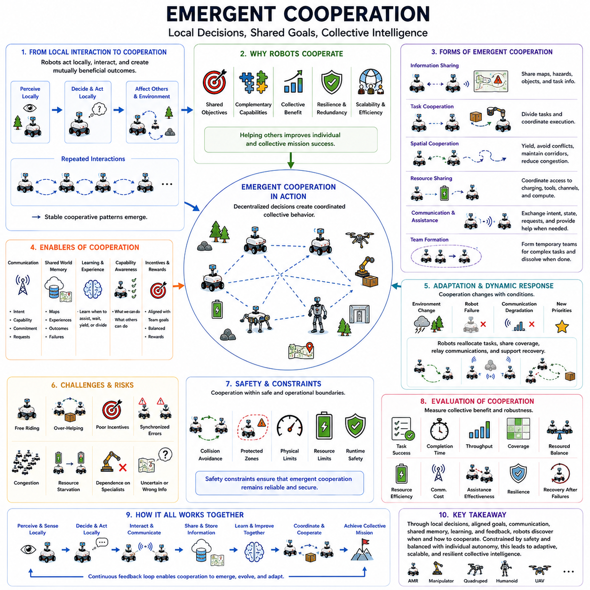{width="7.268055555555556in" height="7.268055555555556in"}

Emergent cooperation occurs when multiple robots develop mutually beneficial coordinated behavior through repeated interaction rather than relying entirely on predefined cooperative scripts or centralized commands. Each robot acts from local observations, objectives, capabilities, and shared information, yet the combined decisions can produce cooperation that improves task completion, coverage, resource utilization, resilience, and overall fleet performance.

Unlike explicitly programmed cooperation, emergent cooperation does not require designers to specify every sequence of assistance between robots. Instead, robots follow interaction policies that allow useful cooperative relationships to form when circumstances make them advantageous. A robot may yield a route, share information, assist another robot, divide a task, or coordinate movement because these actions improve individual or collective outcomes.

Local interaction provides the foundation for such cooperation. Robots observe nearby teammates, environmental conditions, task states, resource availability, and potential conflicts before adjusting their actions. One robot\'s decision changes the conditions encountered by others, creating a chain of responses across the fleet. When these interactions repeatedly produce beneficial results, stable cooperative patterns can gradually emerge from decentralized behavior.

Shared objectives strongly influence whether cooperation develops. When individual robot rewards are aligned with fleet-level mission success, helping another robot can indirectly improve the assisting robot\'s expected outcome. Collective objectives can encourage behaviors such as sharing exploration information, avoiding unnecessary competition, distributing workload, preserving shared resources, or supporting robots performing tasks that are critical to the overall mission.

Cooperation can emerge through complementary capabilities in heterogeneous fleets. An AMR may transport an object to a manipulator, a UAV may discover a target that a ground robot subsequently inspects, or a quadruped may explore terrain inaccessible to wheeled robots. No single robot possesses all required capabilities, so interaction among different embodiments creates opportunities for cooperative task structures that exploit the strengths of the fleet.

Information sharing is one of the simplest forms of emergent cooperation. A robot that discovers an obstacle, hazard, traversable route, object, or task opportunity can communicate that information to others. The receiving robots avoid repeating unnecessary exploration and make better decisions using experience acquired elsewhere. Individual perception thereby becomes a collective resource, increasing the effective knowledge available to the entire fleet.

Shared world memory extends this cooperation across time and space. Information contributed by one robot can remain available after direct communication or physical proximity has ended. Future robots may use stored maps, traversability estimates, successful routes, task outcomes, failures, or recovery experiences. Cooperation therefore becomes possible not only among robots operating together but also among robots whose missions occur at different times.

Cooperative task execution can arise when a task exceeds the capability of an individual robot or becomes more efficient when divided among multiple agents. Robots may independently recognize complementary subtasks and coordinate their actions through local negotiation or shared intent. Transportation, manipulation, inspection, exploration, monitoring, and infrastructure operations can consequently become distributed workflows assembled dynamically from available robots.

Spatial cooperation is especially important in mobile robot fleets. Robots may yield at intersections, maintain access corridors, redistribute themselves across unexplored regions, or adjust routes to reduce congestion. These behaviors may sacrifice short-term individual efficiency while improving fleet-level throughput. Cooperation therefore often requires robots to evaluate how their local motion decisions affect the mobility opportunities of neighboring agents.

Resource sharing creates another important cooperative mechanism. Charging stations, communication channels, tools, manipulation areas, narrow passages, and computing resources may be limited. Robots can coordinate access by yielding, reserving, prioritizing, or redistributing demand. Effective cooperative policies prevent individually rational resource acquisition from producing global congestion, starvation, or inefficient competition across the fleet.

Communication does not need to be continuous or globally available for cooperation to emerge. Robots can exchange compact messages describing intent, capability, urgency, confidence, task commitment, or requests for assistance. Event-based and semantic communication can reduce bandwidth while preserving important cooperative information. Under intermittent connectivity, local interaction and shared memory can maintain partial cooperation until communication becomes available again.

Learning can substantially expand emergent cooperation. Multi-agent reinforcement learning can expose robots to repeated situations in which coordinated actions produce higher collective rewards than independent actions. Through experience, policies can learn when to assist, communicate, wait, yield, divide tasks, or request support. Cooperative strategies can therefore be discovered from interaction rather than being completely specified by human designers.

Collective learning allows successful cooperative experience to propagate beyond the robots that originally discovered it. Trajectories, policies, skills, failures, and recovery strategies can be shared or incorporated into fleet-level training. A useful cooperative behavior discovered by a small group can eventually influence many robots. This creates a fleet data flywheel in which collective experience progressively improves future coordination and cooperation.

Cooperation may also lead to temporary coalitions or teams. Robots facing a complex task can form a short-lived group based on capability, location, energy, and task requirements. Once the objective is completed, the team can dissolve and its members can participate in different collaborations. Such dynamic teaming allows the fleet to create organizational structures appropriate to current circumstances without maintaining rigid permanent groups.

Emergent cooperation must remain adaptive because the value of cooperation changes with operational conditions. A robot that should assist a teammate during one mission may need to operate independently during another. Environmental changes, failures, communication degradation, workload, energy constraints, and new priorities can alter which relationships are beneficial. Effective policies must therefore support both cooperation and autonomous separation when appropriate.

Robot failures provide a particularly important opportunity for cooperative adaptation. When one robot becomes unavailable, neighboring robots can redistribute its tasks, cover abandoned regions, relay missing communications, or provide assistance to recover the failed platform. Shared capability models and experience allow the fleet to determine which robots can substitute for lost functions, transforming redundancy into active cooperative resilience.

However, cooperation can also produce undesirable behavior. Excessive assistance may reduce productivity if robots repeatedly abandon their own tasks, while poorly designed collective rewards may encourage free riding or inefficient dependence. Strong coordination can generate synchronized errors or cause many robots to react identically to incorrect information. Cooperation must therefore be evaluated according to mission effectiveness rather than simply by measuring interaction frequency.

The balance between individual autonomy and collective benefit is consequently a central design problem. Robots require enough independence to respond efficiently to local conditions while considering the effects of their actions on teammates. Incentive structures, shared objectives, task priorities, resource constraints, and communication policies can shape this balance so that cooperation occurs when it provides genuine system-level value rather than becoming an unconditional behavior.

Trust and uncertainty also influence cooperative decisions. Information received from another robot may be outdated, incomplete, or uncertain because sensors, localization, communication, and world models are imperfect. Robots should therefore associate shared observations and requests with confidence estimates. Cooperation based on uncertain knowledge can then be adjusted according to risk instead of treating every message or teammate estimate as equally reliable.

Safety constraints must remain valid even when cooperative behavior is learned or emergent. Robots may dynamically coordinate routes, tasks, or assistance, but collision avoidance, protected zones, physical limits, resource restrictions, and runtime safety requirements should constrain the resulting actions. This separation allows cooperation to remain flexible while preventing collective adaptation from violating critical operational boundaries.

Emergent cooperation can be evaluated through task success, completion time, throughput, coverage, workload balance, resource efficiency, communication cost, assistance effectiveness, resilience, and recovery after failures. Evaluation should compare cooperative and independent operation across changing fleet sizes, environments, communication conditions, and robot losses. This reveals whether observed cooperation provides robust collective benefits rather than advantages limited to a particular scenario.

Ultimately, emergent cooperation transforms interaction among autonomous robots into coordinated collective capability. Local decisions, aligned objectives, complementary embodiments, communication, shared memory, learning, and feedback allow robots to discover when collaboration is advantageous. When constrained by safety and balanced with individual autonomy, these mechanisms enable multi-robot Physical AI to develop adaptive, scalable, and resilient forms of collective intelligence.

## 08.06. Emergent Communication and Conventions

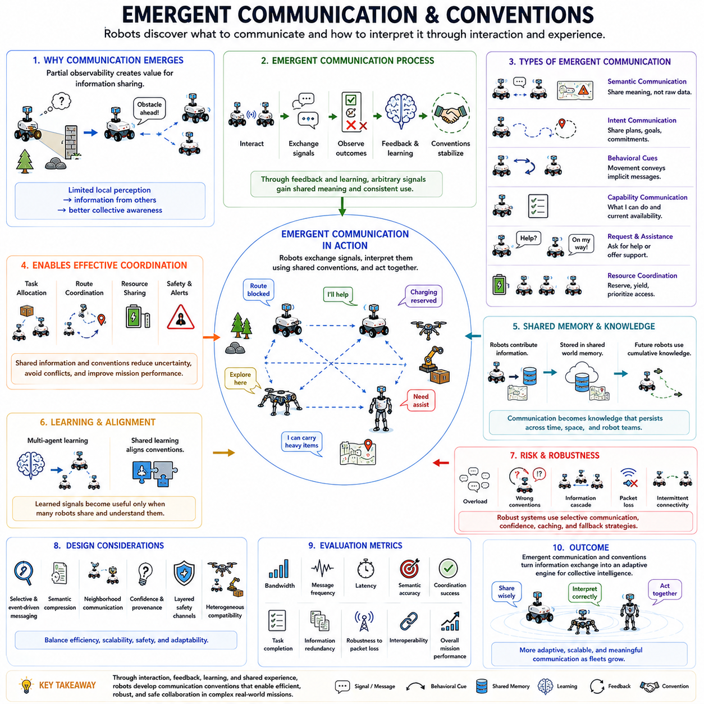{width="7.268055555555556in" height="7.268055555555556in"}

Emergent communication refers to the development of useful information-exchange behaviors among robots without requiring designers to specify every message, symbol, timing rule, or interaction sequence in advance. Through repeated interaction, robots can discover when communication is valuable, what information should be transmitted, and how received signals should influence behavior. Communication therefore becomes part of collective adaptation rather than only a fixed infrastructure service.

A communication convention is a shared pattern that gives consistent operational meaning to signals, messages, actions, or behavioral cues. For example, robots may learn that a particular signal indicates congestion, assistance, task commitment, route reservation, or discovered danger. The important property is not the signal itself but the shared interpretation that develops among interacting agents and allows them to coordinate more efficiently.

Emergent communication differs from predefined communication protocols. Conventional protocols define message formats and semantics before deployment, providing predictable interoperability. Emergent mechanisms instead allow some communication content or usage patterns to adapt through experience. Practical multi-robot systems can combine both approaches, using standardized transport and safety protocols while allowing higher-level semantic conventions to evolve according to operational needs.

Communication can emerge because individual robots operate under partial observability. No robot can directly perceive every relevant event, object, task, or teammate state across a large environment. Information obtained by one robot may therefore have significant value to others. Repeated interactions create pressure to identify which observations should be shared so that limited local perception can contribute to broader collective awareness.

The value of a message depends strongly on context. Continuously transmitting complete sensor streams or internal states is usually unnecessary and can overload communication resources. Robots can instead learn to communicate when information changes another agent\'s likely decision. A newly blocked route, urgent task, low-confidence localization estimate, detected hazard, or request for assistance may justify communication because it has immediate operational significance.

Semantic communication focuses on transmitting meaning relevant to decisions rather than reproducing all raw observations. A robot may communicate that a corridor is blocked instead of transmitting an entire camera sequence, or report that assistance is required instead of sharing every internal diagnostic variable. This compression of operational meaning can reduce bandwidth while preserving information needed for collective coordination.

Intent communication is especially important when robots share physical space. Knowing where another robot is currently located may be insufficient if its future motion or task commitment is unknown. Robots can communicate intended routes, target locations, task selections, yielding decisions, or resource reservations. Shared intent reduces ambiguity and allows neighboring robots to anticipate actions rather than reacting only after physical movement occurs.

Conventions can also emerge from observable behavior without explicit digital messages. A robot that slows before entering a narrow passage may implicitly indicate yielding, while positioning itself near a communication gap may signal a relay function. Repeated interpretation of such actions can create behavioral conventions. Physical movement therefore becomes both an action in the environment and a potential communication channel between embodied agents.

Feedback is essential for establishing useful conventions. A signal becomes meaningful when robots repeatedly observe relationships between the signal, subsequent actions, and resulting outcomes. Successful interpretations reinforce the convention, whereas unsuccessful coordination creates pressure to modify it. Through this feedback process, initially arbitrary signals or behavioral patterns can acquire stable functional meaning within the robot population.

Learning provides mechanisms for discovering communication strategies that are difficult to design manually. Multi-agent reinforcement learning can jointly optimize communication and action policies so that robots learn which messages improve collective reward. Learned representations may encode task status, environmental changes, confidence, requests, or intentions in compact forms that become useful because other agents learn corresponding interpretations.

Shared learning is important because a convention is useful only when sufficiently many participants understand it. If every robot develops an incompatible private communication scheme, fleet coordination becomes fragmented. Policy sharing, common training, experience replay, shared semantic representations, and fleet-level adaptation can align communication behaviors so that learned signals remain interpretable across multiple robots and operating sessions.

Heterogeneous fleets make convention formation more challenging because different robots perceive and act on the world differently. A UAV, AMR, manipulator, quadruped, and humanoid may have different sensors, coordinate frames, capabilities, and task vocabularies. Effective communication must therefore represent information at a sufficiently shared semantic level so that observations from one embodiment can become actionable knowledge for another.

Capability communication supports this cross-embodiment coordination. Robots can advertise what they can sense, carry, manipulate, traverse, compute, or communicate, along with current availability and confidence. Other robots can use this information when requesting assistance or forming temporary teams. Communication conventions can consequently evolve around functional capability rather than assuming that every robot possesses identical hardware or skills.

Shared world memory extends communication beyond direct exchanges between simultaneously connected robots. Messages about obstacles, hazards, routes, task outcomes, resource availability, and successful strategies can be stored in persistent fleet memory. Robots joining later can retrieve this knowledge and act upon information generated earlier, transforming communication from transient message passing into cumulative collective knowledge.

Communication conventions can support distributed task allocation by reducing uncertainty about what other robots intend to do. Robots may announce task interest, commitments, bids, completion states, or requests for reassignment. Repeated use of these signals creates coordination patterns that reduce duplicate work and unnecessary competition. Task organization can therefore emerge from communication among agents rather than depending entirely on centralized assignment.

Resource coordination provides another environment in which conventions can emerge. Robots sharing chargers, narrow passages, tools, communication channels, or manipulation zones require mechanisms for indicating priority and access. Simple conventions involving reservation, yielding, queue position, urgency, or release can stabilize resource use and prevent locally rational behavior from producing congestion or conflict at the fleet level.

Communication must remain robust when connectivity is intermittent. Robots may temporarily lose contact because of distance, obstacles, interference, bandwidth limitations, or infrastructure failure. Effective collective systems should degrade gracefully by relying on local sensing, cached knowledge, predicted intentions, and previously learned conventions. When connectivity returns, robots can synchronize relevant changes instead of requiring continuous global communication.

Uncertainty must also be represented because communicated information is not automatically correct. Sensor errors, stale observations, localization uncertainty, prediction errors, and changing environments can reduce message reliability. Robots can associate information with timestamps, confidence estimates, provenance, or validity conditions. Recipients can then determine how strongly a message should influence their decisions rather than treating every received statement as absolute truth.

Emergent communication can create undesirable effects if it is poorly constrained. Excessive messaging can consume bandwidth and computation, while redundant information may overwhelm decision processes. Incorrect conventions can propagate errors, and strongly synchronized communication can create correlated failures. Information cascades may cause many robots to adopt an incorrect belief simply because other robots appear to support it.

Scalability therefore requires selective communication. As fleet size increases, all-to-all exchange becomes increasingly expensive and often unnecessary. Robots can communicate primarily with relevant neighbors, task partners, infrastructure nodes, or agents affected by a particular event. Event-triggered messaging, semantic compression, hierarchical dissemination, and local broadcasting can preserve useful information flow without requiring every robot to receive every message.

Safety-critical communication should remain bounded by explicit engineering rules even when higher-level conventions are learned. Emergency stop signals, protected-zone information, collision warnings, authentication, and critical command channels should not depend entirely on emergent interpretation. A layered architecture can preserve deterministic safety communication while allowing adaptive conventions to develop for coordination, learning, task negotiation, and efficiency.

Evaluation of emergent communication should consider both communication efficiency and its effect on collective behavior. Useful measures include bandwidth consumption, message frequency, latency sensitivity, semantic accuracy, coordination success, task completion, information redundancy, robustness to packet loss, and interoperability across robots. Ablation tests can compare fleet performance with, without, or under degraded communication to determine the actual value of learned conventions.

Ultimately, emergent communication and conventions transform information exchange from a fixed technical interface into an adaptive component of collective intelligence. Through local interaction, feedback, semantic representation, learning, shared memory, and capability awareness, robots can discover what information matters and how it should influence coordinated action. This enables multi-robot Physical AI to communicate more selectively, adaptively, and meaningfully as fleet complexity grows.

## 08.07. Emergent Exploration and Coverage

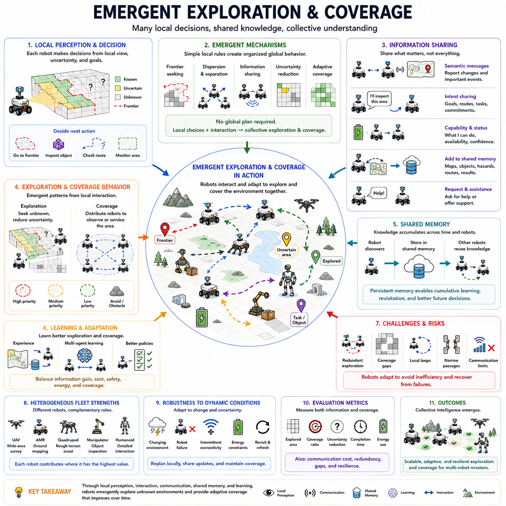{width="7.268055555555556in" height="7.268055555555556in"}

Emergent exploration and coverage describe how multiple robots can collectively discover, map, inspect, or monitor an environment through decentralized decisions rather than following a completely predefined global exploration plan. Each robot selects actions from local observations, shared knowledge, neighboring activity, uncertainty, and mission objectives. Their combined behavior can progressively organize the fleet across previously unknown or incompletely observed space.

Exploration focuses on acquiring new information about unknown regions, objects, hazards, routes, or environmental states, whereas coverage emphasizes distributing sensing or physical presence across an area of interest. The two processes are closely connected. Exploration reduces uncertainty about the world, while coverage ensures that available robots are positioned so that important regions can be observed, revisited, inspected, or serviced efficiently.

Emergent exploration begins with local perception. A robot may identify nearby unexplored space, frontier regions, uncertain map cells, unobserved objects, or alternative traversable paths and choose actions that increase information. No individual robot necessarily knows the globally optimal exploration sequence. Nevertheless, repeated local decisions distributed across many robots can gradually expand collective knowledge and reveal the structure of a large environment.

Local interaction helps prevent every robot from selecting the same destination. Robots can observe nearby teammates, exchange intended goals, or infer which regions are already being explored. They can then spread toward different areas rather than repeatedly duplicating one another\'s work. Simple local mechanisms for attraction, repulsion, goal separation, or territory preference can therefore produce organized global coverage without requiring continuous centralized assignment.

Shared world memory substantially strengthens this process. When one robot discovers a corridor, obstacle, hazard, object, or traversable region, the observation can be added to a shared representation. Other robots use this information when choosing their next actions. Knowledge obtained locally becomes a fleet resource, allowing exploration effort to accumulate instead of forcing every robot to rediscover the same environmental structure independently.

Frontier-based behavior provides an intuitive example of decentralized exploration. Robots can identify boundaries between known and unknown space and select promising frontiers according to distance, expected information gain, risk, and neighboring robot activity. When multiple robots make these choices while considering one another\'s intentions, they naturally distribute themselves across different frontiers and expand the explored region in parallel.

Information gain offers a more general principle for selecting exploration actions. Robots can estimate how much uncertainty may be reduced by visiting a location or performing an observation. Areas with poor visibility, incomplete maps, uncertain terrain, or ambiguous objects may receive higher exploration value. Combining information gain with travel cost and mission risk allows the fleet to balance learning about the environment against the resources required to obtain that information.

Coverage behavior can emerge from spatial interaction rules. Repulsion between nearby robots encourages spatial dispersion, while environmental boundaries and mission regions constrain the area over which they spread. Additional attraction toward unobserved or high-priority locations can shape the distribution. The resulting pattern may approximate useful area coverage even though no controller explicitly calculates the final position of every robot.

Coverage does not always require uniform distribution. Some regions may contain higher risk, greater uncertainty, more valuable assets, or rapidly changing conditions and therefore require greater sensing density. Emergent systems can create adaptive coverage by allowing local priorities to influence robot concentration. The fleet can become dense around important regions while maintaining lower-density monitoring in areas where information changes slowly.

Heterogeneous fleets extend exploration by combining different sensing and mobility capabilities. UAVs can rapidly survey large regions, quadrupeds can investigate difficult terrain, AMRs can map accessible ground routes, and manipulators or humanoids can inspect objects through physical interaction. Emergent task selection allows these platforms to contribute where their embodiments provide the greatest exploration value instead of forcing identical behavior across the fleet.

Cross-embodiment cooperation can create exploration strategies unavailable to individual robots. A UAV may detect a suspicious region from the air and communicate its location to a ground robot for detailed inspection. A quadruped may verify a route that an AMR cannot safely traverse, while another robot maintains communication connectivity. Exploration therefore becomes a cooperative information-gathering process distributed across complementary physical capabilities.

Communication helps robots avoid redundant exploration by sharing locations, goals, discoveries, uncertainty, and route information. However, transmitting complete maps or sensor streams continuously may be expensive. Semantic communication can instead report meaningful changes such as a blocked corridor, discovered target, completed region, or high-uncertainty area. Selective information exchange allows collective exploration to remain scalable as the fleet grows.

Exploration must also remain effective under intermittent communication. Robots may temporarily operate without access to the latest shared map or teammate intentions. Local memory, predicted teammate behavior, previously synchronized knowledge, and spatial separation policies can reduce duplication during these periods. When communication is restored, robots can merge relevant observations and reorganize their exploration priorities based on the updated collective state.

Learning can improve exploration beyond manually designed heuristics. Reinforcement learning can teach robots to select actions that balance information gain, travel cost, safety, energy, and collective coverage. Multi-agent learning can additionally reward complementary exploration, discouraging unnecessary overlap while encouraging useful cooperation. Policies can thereby discover exploration strategies adapted to recurring structures and mission conditions.

Collective learning allows exploration experience to accumulate across missions. Robots can preserve knowledge about difficult terrain, common bottlenecks, informative viewpoints, sensor failures, effective search strategies, and recovery behavior. Future deployments can use these experiences as priors rather than beginning from complete ignorance. The fleet progressively develops knowledge about how to explore, not merely knowledge about a particular environment.

Dynamic environments require persistent exploration rather than one-time mapping. Previously observed areas may change because objects move, routes become blocked, hazards appear, or infrastructure conditions evolve. Robots must therefore decide not only where to discover new space but also when known regions should be revisited. Coverage becomes a continuous process of maintaining sufficiently fresh knowledge about an environment whose state changes over time.

Uncertainty can guide this revisitation. Map regions or semantic observations can carry confidence values and timestamps that decay as information becomes older. Robots may preferentially revisit areas whose knowledge has become uncertain or operationally important. This creates an adaptive sensing cycle in which collective attention shifts according to how quickly different parts of the environment change and how important those changes are to the mission.

Energy and resource constraints strongly affect exploration patterns. A distant unexplored region may offer high information value but require excessive battery consumption or create recovery risk. Robots must balance exploration benefit against energy, communication availability, terrain difficulty, and access to charging resources. Fleet-level behavior can emerge from these local tradeoffs as robots with different resource states choose different exploration responsibilities.

Failures require the fleet to reorganize coverage dynamically. When an exploring robot becomes unavailable, its assigned or naturally occupied region may become uncovered. Neighboring robots can detect the resulting gap and expand their territories, while other robots may assume unfinished exploration tasks. Shared memory ensures that completed work remains available, allowing the collective to recover without restarting the failed robot\'s entire exploration process.

Emergent exploration can nevertheless create undesirable patterns. Robots may cluster around attractive frontiers, repeatedly revisit the same region, leave isolated coverage holes, become trapped in local exploration loops, or compete for narrow passages. Delayed information can cause multiple robots to pursue destinations that are no longer valuable. These effects demonstrate why individually sensible exploration decisions do not automatically guarantee efficient collective coverage.

Safety must constrain exploration even when the objective encourages discovering unknown areas. Robots should respect collision avoidance, terrain limits, protected regions, energy reserves, communication requirements, and mission-specific risk thresholds. Unknown space should not automatically be treated as traversable. Exploration policies must therefore balance curiosity and information acquisition with explicit operational boundaries that prevent unacceptable physical risk.

Evaluation should measure both information acquisition and spatial organization. Useful metrics include explored area, coverage ratio, map uncertainty, information gain, redundant observations, completion time, travel distance, energy consumption, communication cost, coverage gaps, and resilience after failures. Performance should also be tested across different fleet sizes, environmental complexity, connectivity conditions, and degrees of environmental change.

Emergent exploration and coverage ultimately transform many local information-seeking actions into a coordinated fleet-level understanding of the physical world. Local perception, shared memory, communication, uncertainty, learning, heterogeneous capabilities, and feedback allow robots to distribute exploration effort and adapt coverage as conditions change. This provides a foundation for scalable collective perception, persistent world modeling, and autonomous multi-robot operation.

## 08.08. Emergent Traffic and Flow Behavior

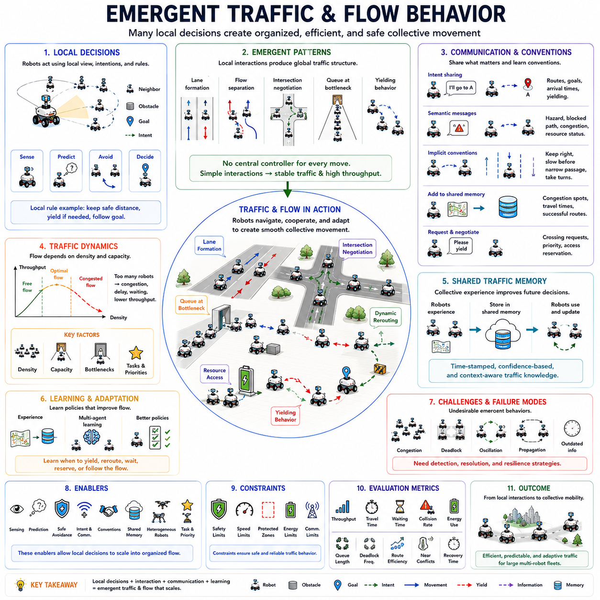{width="7.268055555555556in" height="7.268055555555556in"}

Emergent traffic and flow behavior describes how organized movement patterns arise when many mobile robots repeatedly interact within shared physical space. Instead of assigning every trajectory from a centralized traffic controller, robots make local navigation decisions using nearby positions, velocities, intentions, obstacles, priorities, and environmental constraints. These interactions can collectively produce stable lanes, queues, directional flows, yielding patterns, and coordinated passage through crowded environments.

Traffic emergence becomes important as fleet density increases. A navigation policy that works effectively for a small number of robots may behave differently when dozens or hundreds of agents occupy the same corridors, intersections, loading zones, or work areas. Each robot modifies the movement opportunities available to others, creating coupled dynamics in which individual route choices become part of a larger fleet-level traffic system.

Local collision avoidance provides the most basic interaction mechanism. Robots continuously adjust velocity and direction to maintain safe separation from nearby agents and obstacles. Although these adjustments are computed locally, repeated avoidance among many robots can create recognizable global patterns. Groups may separate into directional streams, maintain characteristic spacing, or organize themselves around bottlenecks without any robot explicitly representing the complete traffic configuration.

Lane formation is a common example of emergent flow. When robots traveling in opposite directions repeatedly encounter one another, continuous avoidance creates costs for both groups. Robots that follow others moving in the same direction experience fewer conflicts, encouraging directional clustering. Over time, opposing traffic can separate into relatively stable lanes, reducing encounters and improving collective throughput even when no permanent lanes were explicitly assigned.

Intersections create more complex emergent behavior because several movement streams compete for the same space. Robots may slow, yield, negotiate priority, or infer the intentions of approaching agents. Repeated interactions can produce informal right-of-way conventions in which certain arrival patterns or directions become temporarily dominant. These conventions reduce uncertainty and allow traffic to pass through shared regions with fewer unnecessary stops.

Bottlenecks strongly influence fleet-level flow. Narrow doors, corridors, elevators, docking stations, charging areas, and manipulation zones restrict how many robots can pass simultaneously. Local navigation alone may cause robots to accumulate near these locations. When robots incorporate queue length, predicted waiting time, alternative routes, or reservation information into their decisions, congestion can redistribute and more efficient traffic patterns can emerge.

Queue formation can itself be a useful emergent behavior. When access to a resource is limited, robots may organize according to arrival time, priority, urgency, or task importance rather than competing continuously for entry. Stable queues reduce repeated negotiation and physical interference. However, queue behavior must remain adaptive because excessive waiting may justify rerouting, reassignment, or temporary use of alternative resources elsewhere in the environment.

Flow behavior is shaped by the relationship between robot density and available spatial capacity. At low density, robots can often navigate independently with minimal interaction. As density increases, encounters become more frequent and collective organization becomes increasingly important. Beyond certain conditions, additional robots may reduce rather than increase throughput because congestion, avoidance maneuvers, waiting, and coordination overhead consume the benefits of greater fleet capacity.

This creates a fundamental difference between individual and collective efficiency. The shortest path for one robot may pass through an already congested corridor, while a slightly longer alternative could reduce travel time for the fleet as a whole. If every robot independently minimizes geometric distance, the resulting traffic may become inefficient. Effective flow therefore requires local route decisions to incorporate estimates of congestion, delay, and their effects on other agents.

Intent communication can substantially improve emergent traffic organization. Robots may exchange planned routes, target locations, intersection requests, yielding decisions, or expected arrival times. Knowing future intent allows robots to anticipate conflicts before they occur rather than relying entirely on reactive avoidance. Compact semantic messages can therefore reduce oscillation and unnecessary stopping without requiring continuous exchange of complete trajectories.

Behavioral conventions can also develop without explicit messages. A robot approaching one side of a corridor may consistently keep to a particular side after observing similar behavior from others. Slowing before a narrow passage may become an implicit yielding signal. Repeated interaction can stabilize these conventions across the fleet, turning physical motion itself into a communication mechanism that supports predictable and efficient traffic behavior.

Shared world memory extends traffic intelligence beyond immediate encounters. Robots can record locations where congestion frequently occurs, typical traversal times, recurring queues, temporary blockages, and successful alternative routes. Other robots can use this accumulated experience when planning future movement. The fleet therefore develops a dynamic traffic memory that reflects both the physical map and historical patterns of collective mobility.

Traffic information must remain time-sensitive because flow conditions can change rapidly. A corridor that was congested several minutes earlier may now be empty, while a previously efficient route may become blocked by a new task or obstacle. Traffic observations should therefore include timestamps, confidence, and expected validity. Routing decisions can weight recent information more strongly while gradually reducing reliance on outdated congestion estimates.

Heterogeneous fleets introduce additional flow complexity because robots differ in size, speed, acceleration, turning radius, payload, sensing, and mobility. A small AMR may pass through spaces unavailable to a larger platform, while a heavily loaded robot may require longer stopping distances. Quadrupeds and humanoids may move differently from wheeled robots. Traffic policies must account for these differences instead of treating every agent as an identical moving object.

Capability-aware flow can exploit these differences constructively. Faster robots may use alternative routes to avoid slower traffic, small robots may select narrow passages, and high-priority platforms may receive temporary access to critical corridors. Traffic organization can therefore emerge from both spatial interactions and functional requirements. The resulting flow resembles a dynamic allocation of mobility resources rather than simple geometric collision avoidance.

Learning can improve traffic behavior by allowing robots to discover patterns that reduce collective delay. Multi-agent reinforcement learning can reward throughput, travel efficiency, collision avoidance, and congestion reduction simultaneously. Policies may learn when to yield, reroute, wait, reserve space, or follow existing streams. Training across different densities and layouts can help these behaviors generalize beyond a single traffic configuration.

Collective learning allows successful traffic strategies to propagate across robots and facilities. Experience from repeated congestion events, difficult intersections, deadlocks, and recovery procedures can be incorporated into shared policies or fleet memory. Future robots can benefit from previous traffic encounters without individually rediscovering every solution, creating a cumulative improvement cycle for fleet-level mobility and navigation.

Deadlock is one of the most important undesirable emergent traffic behaviors. Several robots may enter mutually blocking configurations in which each waits for another to move. Local collision avoidance can maintain safety while providing no mechanism for progress. Deadlock resolution therefore requires additional reasoning such as priority changes, coordinated retreat, temporary reservations, role assignment, or supervisory intervention to restore movement.

Oscillation is another collective failure mode. Two robots may repeatedly choose opposite avoidance directions and then reverse their choices, while larger groups can generate waves of stopping and restarting. Communication delays and inconsistent predictions can amplify these effects. Stable conventions, hysteresis, trajectory commitment, and predictive coordination can reduce unnecessary switching and produce smoother collective motion.

Congestion can propagate through the environment rather than remaining localized. A queue at one bottleneck may extend backward into an intersection, blocking robots that are not using the original resource. This can generate cascading traffic failure across multiple regions. Fleet-level monitoring should therefore detect not only local robot density but also the spatial propagation of queues, waiting times, and reduced throughput across connected traffic areas.

Dynamic task allocation and traffic management are closely coupled. Assigning the nearest robot to every task may overload particular corridors or work zones, while selecting a slightly more distant robot may reduce congestion. Task assignment should therefore consider expected traffic cost as well as geometric distance and capability. Mobility conditions become part of collective task reasoning rather than a separate navigation problem handled only after assignments are made.

Safety remains a hard constraint regardless of the efficiency benefits of emergent flow. Collision avoidance, speed limits, protected zones, braking requirements, human-aware navigation, and emergency procedures must remain valid under dense traffic. Adaptive routing and learned conventions can optimize behavior inside these boundaries, but improvements in throughput should never depend on violating fundamental physical or operational safety requirements.

Evaluation of emergent traffic should consider both individual mobility and fleet-level flow. Relevant measures include throughput, travel time, waiting time, congestion density, collision rate, near conflicts, deadlock frequency, queue length, route efficiency, energy consumption, and recovery time. Testing across different robot densities, layouts, bottlenecks, communication conditions, and fleet compositions reveals whether traffic behavior remains stable as system complexity increases.

Ultimately, emergent traffic and flow behavior demonstrates how physical interaction among autonomous robots can create system-level mobility structures that were never explicitly prescribed. Local navigation, intent sharing, conventions, traffic memory, learning, and adaptive routing transform individual motion decisions into organized collective flow. Properly constrained by safety and resilience mechanisms, these processes allow large multi-robot Physical AI fleets to move efficiently, predictably, and adaptively through shared environments.

## 08.09. Beneficial vs Undesired Emergence

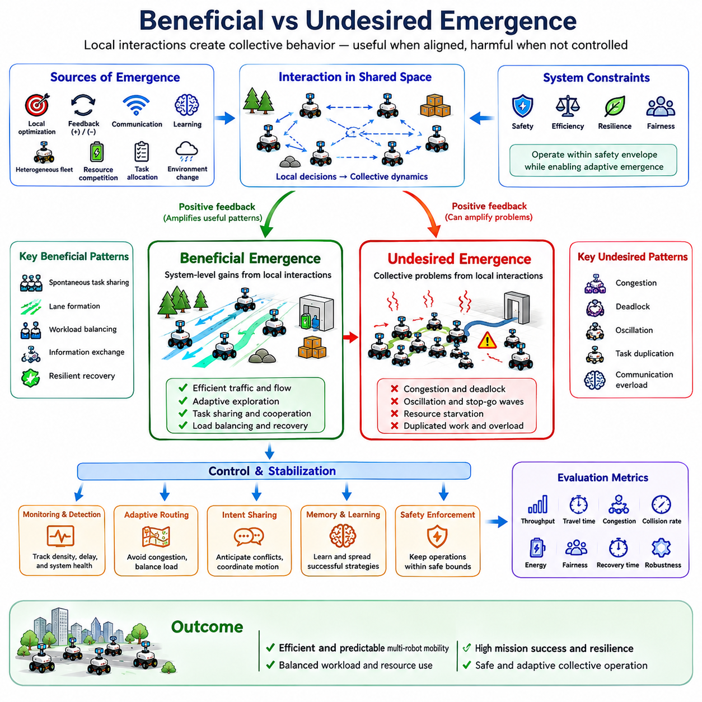{width="7.268055555555556in" height="7.268055555555556in"}

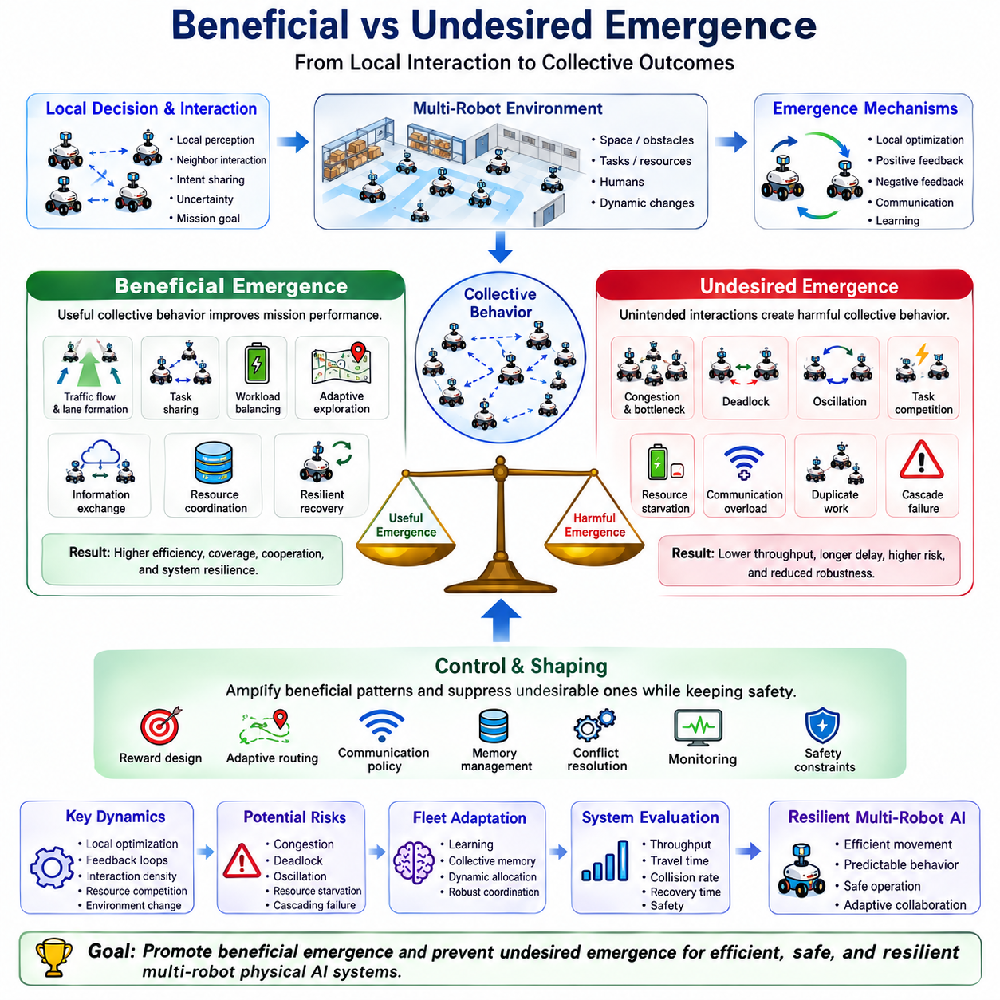{width="7.268055555555556in" height="7.268055555555556in"}

Beneficial emergence occurs when interactions among autonomous robots produce system-level behaviors that improve mission performance without requiring every collective pattern to be explicitly programmed. Examples include spontaneous task sharing, efficient lane formation, adaptive exploration, information exchange, workload balancing, and recovery after failures. Local autonomy becomes valuable when these behaviors create outcomes that are more effective than isolated individual actions.

Undesired emergence occurs when individually reasonable actions combine to create harmful or inefficient collective behavior. Robots may generate congestion, deadlock, excessive competition, unstable oscillation, duplicated work, communication overload, resource starvation, or synchronized errors. No individual robot needs to behave incorrectly for these problems to appear because the failure can originate from interactions among otherwise valid local policies.

The distinction between beneficial and undesired emergence depends on system-level consequences rather than whether a behavior was intentionally designed. A spontaneously formed traffic lane can be beneficial when it increases throughput and reduces conflicts, while spontaneous clustering can become undesirable when robots block access to critical areas. Emergence must therefore be evaluated according to mission objectives, safety, efficiency, resilience, and operational constraints.

Local optimization is a major source of both beneficial and harmful collective behavior. When each robot selects the shortest route, nearest task, fastest charging opportunity, or highest immediate reward, the resulting decisions may appear individually optimal. However, many robots making the same choice can overload corridors, tasks, or resources. Collective intelligence requires policies that consider how local actions modify opportunities available to other agents.

Positive feedback can amplify useful patterns. If robots experience lower travel cost when following an existing directional flow, additional robots may adopt the same behavior and strengthen lane formation. Similarly, successful information sharing can encourage further cooperation. When feedback reinforces behaviors aligned with fleet objectives, relatively simple interactions can generate scalable coordination without detailed centralized control.

The same positive feedback can amplify undesirable patterns. If robots repeatedly select a temporarily attractive location because others have already moved there, excessive clustering may emerge. Shared but incorrect information can propagate rapidly and create an information cascade. A small local error can therefore become a fleet-wide failure when feedback repeatedly reinforces the same incorrect assumption or behavior.

Negative feedback provides an important mechanism for stabilizing collective behavior. Congestion penalties, spatial repulsion, resource prices, waiting costs, confidence decay, and diminishing rewards can discourage excessive concentration. When too many robots choose the same route or task, its attractiveness can automatically decrease. Such mechanisms allow distributed systems to regulate themselves without eliminating the autonomy that enables adaptive emergence.

Multi-robot traffic provides a clear illustration of this balance. Local collision avoidance can generate safe directional lanes and smooth flow, but dense interaction can also produce stop-and-go waves, oscillation, bottlenecks, or deadlocks. The same navigation mechanisms can therefore create either efficient collective mobility or unstable traffic depending on density, geometry, communication, prediction accuracy, and the policies used to resolve conflicts.

Exploration presents a similar tradeoff. Decentralized robots can naturally spread across unknown regions, increasing coverage and reducing exploration time. However, attractive frontiers or delayed information may cause several robots to select the same destination while other areas remain unexplored. Beneficial exploration requires mechanisms that reward information gain and complementary coverage while penalizing unnecessary duplication and persistent coverage gaps.

Emergent cooperation can increase productivity when robots share tasks, information, capabilities, and resources. A robot may assist another agent because collective mission progress improves as a result. Yet excessive cooperation can become inefficient if robots repeatedly abandon their own tasks to provide unnecessary assistance. Policies must therefore distinguish between cooperation that produces system-level value and interaction that merely increases coordination activity.

Communication can similarly generate both positive and negative emergence. Selective semantic messages can improve collective awareness and reduce duplicated work, while uncontrolled communication can saturate networks and overwhelm decision processes. Incorrect information may also spread between robots and become increasingly trusted through repetition. Communication policies should therefore consider relevance, confidence, freshness, provenance, and expected decision value.

Shared world memory increases the persistence of collective intelligence but also increases the persistence of collective error. Accurate observations, successful routes, learned strategies, and failure experiences can benefit future robots long after the original event. Conversely, stale maps, incorrect semantic labels, or outdated traffic information may repeatedly influence new decisions. Memory therefore requires confidence management, timestamps, validation, and mechanisms for correction or forgetting.

Heterogeneous fleets can produce beneficial specialization because different embodiments naturally contribute different capabilities. UAVs may perform rapid reconnaissance, AMRs may transport materials, quadrupeds may traverse difficult terrain, and manipulators may interact physically with objects. However, specialization can create dependency if the fleet relies excessively on a small number of unique robots. The failure of a specialized platform may then remove a critical collective capability.

Resource competition is another source of emergence. Robots sharing chargers, communication channels, narrow passages, tools, or computing resources may spontaneously develop queues, reservation conventions, and priority rules. These patterns can improve utilization when balanced properly. Without suitable coordination, however, competition may create starvation, repeated reservation conflicts, monopolization, or cascading delays across dependent tasks.

Task allocation can exhibit similar system-level effects. Local bidding and capability-aware selection can dynamically distribute work according to location, energy, and skill. Yet poorly aligned incentives may cause robots to repeatedly prefer easy or highly rewarded tasks while neglecting difficult but essential work. Fleet-level objectives must therefore represent mission importance rather than assuming that individually attractive assignments automatically produce balanced execution.

Learning can discover beneficial emergent strategies that designers might not anticipate. Multi-agent reinforcement learning can expose robots to repeated interactions and reward behaviors that improve throughput, coverage, cooperation, resilience, or resource efficiency. However, learned policies may also exploit weaknesses in reward definitions, simulation assumptions, or teammate behavior, producing unexpected strategies that satisfy numerical objectives while violating operational intent.

Reward design is therefore central to controlling emergence. Rewards based only on individual speed may encourage aggressive navigation, while rewards based only on collective throughput may disadvantage particular robots or create unsafe coordination pressure. Effective objectives often require combinations of task success, safety, fairness, energy efficiency, communication cost, robustness, and long-term fleet performance so that desirable collective behavior is consistently reinforced.

Scale can change the character of emergence. A behavior that appears stable with five robots may become inefficient with fifty because interaction frequency, congestion, communication demand, and resource competition increase nonlinearly. Conversely, larger fleets can provide redundancy and specialization unavailable to smaller groups. Emergent behavior must therefore be evaluated across fleet sizes rather than assuming that small-scale results automatically generalize.

Environmental change can also shift a previously beneficial behavior into an undesirable one. A route-following convention may work efficiently until an obstacle blocks the preferred corridor, while a successful task allocation strategy may fail when resource availability changes. Adaptive systems need mechanisms for detecting when established collective patterns no longer produce expected outcomes and for reorganizing behavior before performance degrades significantly.

Failures can reveal whether emergence contributes to resilience or fragility. A robust fleet redistributes tasks, coverage, communication, and resources when robots become unavailable. A fragile fleet may experience cascading failures because many agents depend on the same robot, route, information source, or convention. Beneficial emergence should therefore support graceful degradation rather than maximizing performance only under ideal operating conditions.

Observability is essential because emergent problems may not be visible from individual robot logs. Each robot may appear to follow its policy correctly while fleet throughput collapses or coverage becomes unbalanced. System-level monitoring should track traffic density, task distribution, resource utilization, communication patterns, information propagation, failures, and collective performance so that undesirable patterns can be detected before they become persistent.

Intervention mechanisms should operate at several levels. Local policies can adjust behavior immediately, fleet-level coordination can modify priorities or assignments, and supervisory systems can impose temporary constraints when dangerous patterns develop. The objective is not to eliminate emergence through complete centralized control but to provide boundaries and corrective mechanisms that preserve useful adaptation while containing harmful collective dynamics.

Safety must remain independent of whether an emergent behavior appears efficient. Collision constraints, protected zones, physical limits, human safety requirements, emergency procedures, and critical communication rules should remain enforceable even when learned policies discover novel collective strategies. Emergent optimization should therefore operate inside a safety envelope that prevents performance improvements from creating unacceptable operational risk.

Evaluation requires comparison across normal, stressed, and failure conditions. Useful measures include task success, throughput, coverage, fairness, congestion, deadlock frequency, communication cost, energy consumption, resource utilization, recovery time, robustness, and safety violations. Testing with changing fleet sizes, communication loss, sensor uncertainty, robot failures, and environmental disturbances reveals whether collective behavior remains beneficial beyond nominal scenarios.

Ultimately, beneficial versus undesired emergence is not a choice between allowing or preventing emergence. Complex multi-robot Physical AI systems will naturally generate behaviors that cannot be completely predicted from individual components. The engineering objective is to shape interaction rules, learning, communication, memory, incentives, monitoring, and safety constraints so that useful collective patterns are amplified while harmful patterns are detected, suppressed, corrected, and learned from.

## 08.10. Stability Predictability and Controllability

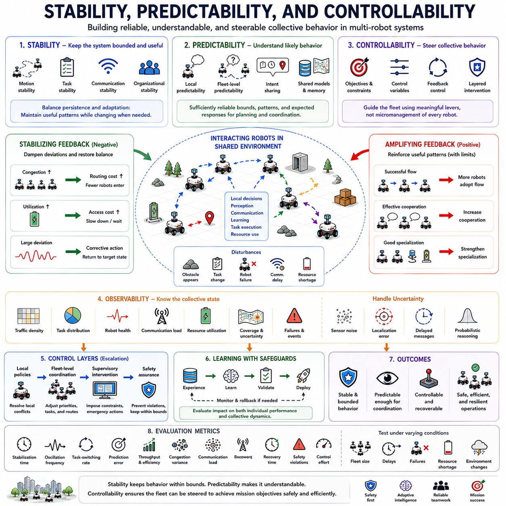{width="7.268055555555556in" height="7.268055555555556in"}

Stability in multi-robot systems describes the ability of collective behavior to remain bounded, coherent, and operationally useful despite continuous interactions among autonomous agents. A stable fleet does not require every robot to remain in a fixed state. Instead, local decisions, communication, task changes, and environmental responses may vary while the overall system remains within acceptable behavioral and safety limits.

Collective stability becomes difficult because each robot is simultaneously an independent decision-making system and part of a coupled network. A change in one robot's trajectory, task, communication state, or resource demand can alter the decisions of neighboring robots. These responses can propagate through the fleet, creating feedback loops that either damp disturbances and restore coordination or amplify small deviations into system-level instability.

Stability can therefore be understood at multiple levels. Motion stability concerns trajectories, spacing, and collision avoidance, while task stability concerns whether assignments converge instead of repeatedly switching. Communication stability concerns whether information exchange remains manageable, and organizational stability concerns whether roles, teams, traffic patterns, and resource allocation persist long enough to support useful collective operation.

A stable collective system must also remain adaptive. Excessive stability can make robots resistant to necessary changes when obstacles appear, tasks shift, resources become unavailable, or teammates fail. Conversely, excessive responsiveness can cause constant reorganization, oscillation, and inefficient switching. Effective multi-robot intelligence requires a balance between maintaining useful patterns and changing them when environmental evidence justifies adaptation.

Predictability refers to the ability to anticipate how individual robots and the collective system are likely to behave under specified conditions. Complete deterministic prediction may be unrealistic because learned policies, partial observations, environmental uncertainty, communication delays, and interactions among many agents create complex dynamics. Operational predictability instead requires sufficiently reliable bounds, patterns, and expected responses for planning and supervision.

Local predictability begins with understanding how a robot responds to observations, goals, constraints, and neighboring agents. If small changes in input repeatedly produce radically different actions, coordination becomes difficult. Policies should therefore provide consistent behavior where consistency is operationally valuable, while preserving enough flexibility to respond to genuinely different circumstances, hazards, task requirements, and uncertainty.

Fleet-level predictability is more challenging because collective behavior may not be directly inferred from individual policies. Robots that behave predictably in isolation can generate unexpected congestion, clustering, deadlock, communication bursts, or task imbalance when operating together. Evaluation must therefore examine interactions across different fleet sizes and configurations rather than assuming that predictable components automatically create a predictable collective system.

Predictability can be improved through intent sharing. Robots that communicate planned routes, target tasks, resource reservations, expected arrival times, or requests for assistance allow teammates to anticipate future actions. This reduces dependence on purely reactive behavior and enables conflicts to be identified earlier. Intent communication is particularly useful in dense traffic, shared workspaces, and cooperative manipulation where future actions strongly affect neighboring agents.

Shared world models and fleet memory further improve predictability by providing common context. Robots can reason from consistent representations of obstacles, routes, task states, hazards, resource availability, and teammate activity. When agents operate from incompatible or outdated representations, their actions may appear unpredictable to one another. Synchronization, timestamps, confidence estimates, and provenance help maintain a sufficiently coherent collective state.

Controllability describes the ability to influence collective behavior toward desired operational states. In decentralized systems, controllability does not necessarily mean issuing direct commands to every robot. Instead, fleet behavior can be shaped through task priorities, reward structures, routing costs, communication policies, resource constraints, role assignments, safety boundaries, or changes to the information available to local decision-making policies.

This distinction is important because large fleets cannot depend on continuous micromanagement. A supervisory system may specify objectives and constraints while local robots determine detailed actions. Controllability then becomes the ability to steer the collective system by adjusting a smaller number of meaningful control variables. The objective is guided autonomy in which distributed intelligence remains flexible while fleet-level behavior remains governable.

Feedback is central to controllability. The system must observe collective state, compare current behavior with desired performance, and apply corrective influence when deviations become significant. Traffic congestion may trigger routing penalties, workload imbalance may modify task priorities, communication overload may activate selective messaging, and coverage gaps may increase exploration incentives. Feedback closes the loop between observation and fleet-level intervention.

Negative feedback is particularly useful for maintaining stability. When excessive robot concentration increases congestion costs, additional robots become less likely to enter the same region. When resource utilization approaches capacity, access costs or reservation delays can increase. These responses oppose the original deviation and help return the system toward acceptable operating conditions without requiring a centralized controller to calculate every individual action.

Positive feedback can be useful when carefully bounded. Successful routes, cooperative strategies, or task specializations can be reinforced so that other robots adopt effective behavior. However, unrestricted amplification may create excessive clustering, synchronized decisions, or dependency on a single strategy. Controllability therefore requires mechanisms that determine when beneficial reinforcement should continue and when saturation or counteracting feedback should limit further growth.

Observability is a prerequisite for meaningful control. A fleet cannot reliably stabilize behavior that it cannot detect. System-level monitoring should therefore estimate traffic density, task distribution, robot health, communication load, resource utilization, coverage, uncertainty, failures, and collective performance. These measurements provide the state information needed to distinguish normal adaptive variation from patterns that indicate emerging instability.

Not every internal state needs to be observed continuously. Large fleets generate enormous volumes of sensor, policy, communication, and diagnostic data. Practical observability requires identifying variables that summarize collective behavior effectively. Aggregated congestion, queue length, task imbalance, communication rate, coverage uncertainty, failure concentration, and resource pressure can provide useful indicators without transmitting every internal state from every robot.

Uncertainty must be incorporated into prediction and control. Sensor noise, localization errors, incomplete maps, delayed messages, uncertain teammate intentions, and changing environments prevent perfect state estimation. Robots and supervisors should therefore reason using confidence ranges, probabilities, validity intervals, or risk estimates. Control actions can become more conservative as uncertainty increases rather than assuming that the estimated collective state is exact.

Communication delays can directly affect stability. A robot reacting to outdated teammate positions or resource states may repeatedly make corrections that are no longer appropriate. When many robots behave this way, delayed feedback can generate oscillation or congestion waves. Timestamped information, predictive state estimation, asynchronous coordination, and delay-aware control policies can reduce instability caused by stale or inconsistent information.

Learning introduces additional challenges because policies themselves may change. Collective behavior that was stable before an update may become unstable when newly learned strategies interact with existing robots. Fleet learning therefore requires controlled deployment, validation, compatibility testing, rollback mechanisms, and monitoring. Policy improvement should be evaluated not only by individual task performance but also by its effects on collective dynamics.

Heterogeneous fleets complicate stability and controllability because robots respond differently to identical conditions. Variations in size, mobility, sensing, payload, computation, and learned capabilities produce different dynamic responses. Supervisory control should therefore reason about capability and embodiment rather than treating the fleet as homogeneous. Stability may depend on how complementary robot types are distributed across tasks and physical space.

Failures provide an important test of stability. Removing a robot changes communication topology, workload, coverage, traffic, and available capabilities. A resilient fleet should absorb this disturbance, redistribute responsibilities, and converge toward a new acceptable operating state. Stability should therefore be defined around recovery and bounded adaptation rather than preservation of the exact configuration that existed before the failure.

Controllability also requires escalation mechanisms when decentralized adaptation is insufficient. Local policies may resolve minor conflicts, fleet-level coordination may handle broader imbalances, and supervisory intervention may address persistent or safety-critical instability. Emergency procedures can impose stronger restrictions when necessary. This layered control structure preserves autonomy during normal operation while maintaining authority to constrain collective behavior under abnormal conditions.

Safety provides the outer boundary for adaptive control. Learned or emergent behavior may vary inside the permitted operating region, but collision constraints, protected zones, velocity limits, physical limits, emergency stops, and human safety requirements should remain enforceable. Runtime assurance can supervise adaptive policies and prevent actions that would move the system outside predefined safety envelopes.

Predictability should not be confused with eliminating emergence. Some beneficial collective behaviors are valuable precisely because they adapt to conditions that designers did not explicitly enumerate. The goal is bounded emergence: robots can discover new coordination patterns while remaining within measurable limits of safety, performance, resource use, and organizational stability. Novel behavior becomes acceptable when its consequences remain observable and manageable.

Evaluation should therefore examine convergence, boundedness, sensitivity, recovery, and intervention effectiveness. Relevant measures include stabilization time, oscillation frequency, task-switching rate, prediction error, congestion variance, communication load, recovery time, control effort, safety violations, and performance after disturbances. Stress tests should vary fleet size, delays, uncertainty, failures, resource shortages, and environmental dynamics.

Ultimately, stability, predictability, and controllability form complementary requirements for scalable multi-robot Physical AI. Stability keeps collective dynamics within useful bounds, predictability makes future behavior sufficiently understandable for coordination, and controllability provides mechanisms for steering the fleet when conditions change. Together with observability, uncertainty management, layered feedback, learning safeguards, and safety constraints, they allow emergent collective intelligence to remain adaptive without becoming operationally unmanageable.

## 08.11. Measuring Emergent Behavior

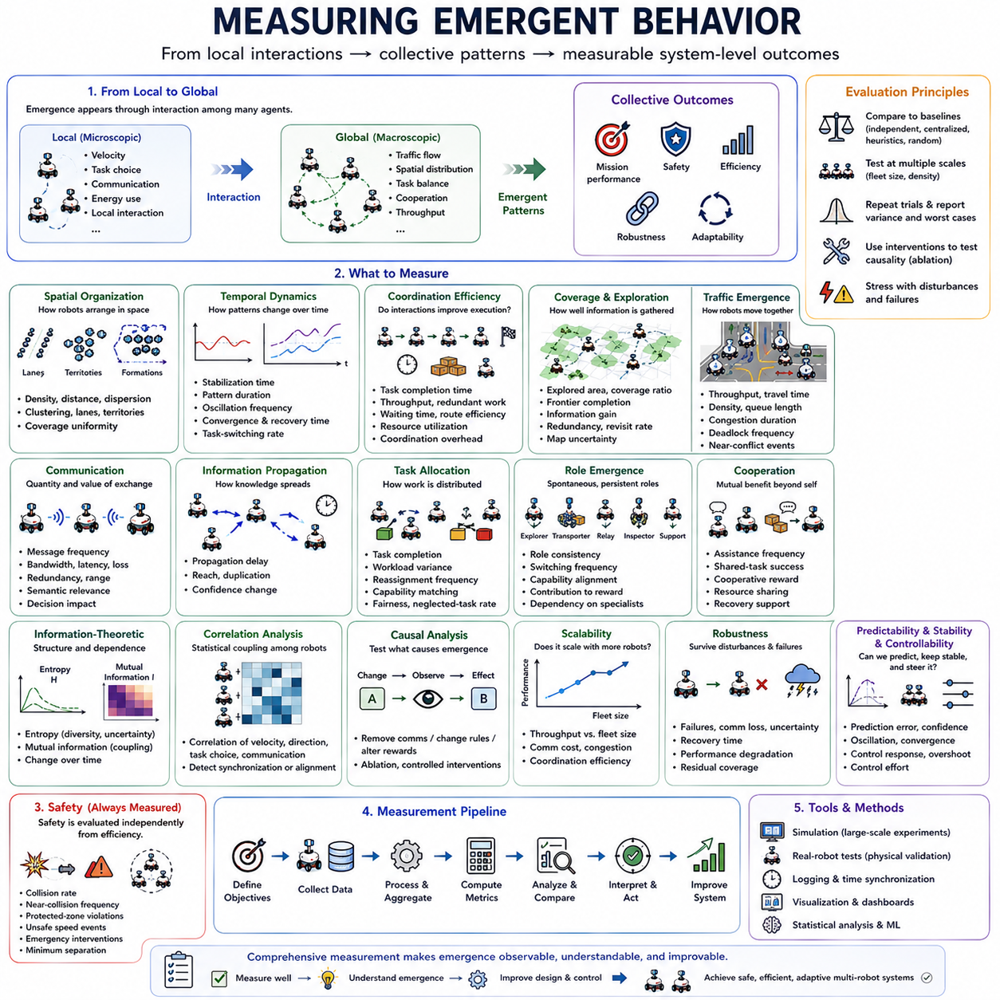{width="7.268055555555556in" height="7.268055555555556in"}

Emergent behavior cannot be measured adequately by observing individual robots alone because the defining patterns appear through interactions among multiple agents. Measurement therefore requires a shift from component-level metrics toward collective indicators that capture coordination, organization, adaptation, and system-wide outcomes. The central question is whether local behaviors combine to create meaningful global patterns that would not be obvious from isolated robot performance.

A useful measurement framework begins by distinguishing microscopic and macroscopic observations. Microscopic measurements describe individual actions such as velocity, task choice, communication events, energy use, or local interactions. Macroscopic measurements describe fleet-level properties such as traffic flow, spatial distribution, coverage, task balance, cooperation, and throughput. Emergence becomes visible by relating changes at these two levels.

Spatial organization is one of the most direct signatures of emergence. Robot positions can be analyzed to determine whether agents remain randomly distributed or form lanes, clusters, territories, queues, formations, or coverage patterns. Measures such as spatial density, inter-robot distance, dispersion, clustering, and coverage uniformity reveal whether repeated local interactions are producing persistent organization across the environment.

Temporal measurements are equally important because a pattern observed at one instant may be accidental. Emergent behavior should be evaluated according to how patterns form, persist, disappear, and reorganize over time. Stabilization time, pattern duration, oscillation frequency, task-switching rate, convergence speed, and recovery time help distinguish stable collective organization from temporary coincidence or unstable fluctuations.

Coordination efficiency measures whether interactions among robots actually improve collective execution. Relevant indicators include task completion time, throughput, redundant work, waiting time, route efficiency, resource utilization, and coordination overhead. A collective pattern should not be considered beneficial merely because it appears organized; its contribution to mission performance must also be evaluated against alternative coordination strategies.

Coverage and exploration require metrics that represent how effectively the fleet distributes information-gathering effort. Explored area, coverage ratio, frontier completion, information gain, observation redundancy, revisit frequency, and map uncertainty can quantify collective exploration. These measurements reveal whether robots complement one another by expanding shared knowledge or repeatedly concentrate on the same regions without increasing useful information.

Traffic emergence can be measured through throughput, average travel time, robot density, queue length, waiting time, congestion duration, deadlock frequency, and near-conflict events. Lane formation or yielding conventions may appear visually successful, but quantitative analysis determines whether they actually improve mobility. Measurements across different densities are particularly important because beneficial flow at low density may become unstable as fleet size increases.

Communication metrics should capture both information quantity and operational value. Message frequency, bandwidth consumption, latency, packet loss, redundancy, and communication range describe network behavior, while semantic relevance and decision impact indicate whether exchanged information improves collective action. Efficient emergent communication should increase coordination value without requiring communication traffic to grow excessively with fleet size.

Information propagation provides another important perspective. Researchers can measure how quickly a discovery, warning, task update, or learned convention spreads through the fleet and how accurately its meaning is preserved. Propagation delay, reach, duplication, confidence change, and correction time can reveal whether collective knowledge spreads effectively or whether communication creates stale information, cascades, or synchronized errors.

Task allocation can be evaluated by examining how work becomes distributed across the fleet. Task completion, workload variance, reassignment frequency, idle time, capability matching, fairness, and neglected-task rate indicate whether decentralized interactions produce useful specialization and balance. Emergent allocation is beneficial when robots organize around mission needs rather than merely selecting locally attractive tasks.

Role emergence requires identifying behavioral differences that persist without being completely predefined. Robots may gradually act as explorers, transporters, relays, coordinators, inspectors, or support agents. Role consistency, switching frequency, capability alignment, contribution to collective reward, and dependency on specialized agents can quantify whether specialization improves performance or creates fragile organizational structures.

Cooperation can be measured through interactions whose benefits extend beyond the acting robot. Assistance frequency, shared-task success, cooperative reward, resource sharing, joint manipulation success, and recovery support provide observable indicators. However, high interaction frequency does not necessarily imply effective cooperation. Measurement should determine whether cooperative actions increase system-level performance relative to their communication, energy, and coordination costs.

Information-theoretic measures can help quantify relationships between local and global behavior. Entropy can characterize uncertainty or diversity in robot states, while mutual information can indicate statistical dependence between agents or between local actions and collective patterns. Changes in these quantities can reveal increasing organization, synchronization, specialization, or coordination without requiring every emergent structure to be specified beforehand.

Correlation measures provide a simpler way to identify collective coupling. Researchers can examine correlations among robot velocities, directions, task choices, communication activity, or spatial movement. Strong correlation may indicate useful coordination such as synchronized transport, but it may also indicate undesirable synchronization. Interpretation therefore requires connecting statistical structure with mission outcomes and safety conditions.

Causal analysis is more informative than correlation alone. If removing communication, changing local interaction rules, or altering reward signals causes a collective pattern to disappear, stronger evidence exists that those mechanisms contributed to emergence. Controlled interventions and ablation experiments help distinguish genuine interaction-driven behavior from patterns caused mainly by environmental geometry, centralized commands, or coincidental similarity.

Baseline comparison is essential because emergence is meaningful only relative to an alternative. Fleet behavior can be compared against independent robots, centralized coordination, predefined heuristics, randomized policies, or versions with specific interaction mechanisms disabled. Differences in performance and organization reveal what collective interaction contributes beyond the capabilities already present in individual robots.

Scalability tests determine whether an emergent behavior remains useful as the number of robots changes. Metrics should be evaluated across progressively larger fleets while observing throughput, communication cost, congestion, coordination efficiency, and resource competition. A behavior that improves performance with ten robots but collapses with one hundred should not be considered generally scalable even if small experiments appear successful.

Robustness measurement examines whether collective patterns survive disturbances. Experiments can introduce robot failures, communication loss, sensor uncertainty, blocked routes, resource shortages, or unexpected task changes. Recovery time, performance degradation, redistribution efficiency, and residual coverage indicate whether the fleet reorganizes successfully. Robust emergence should support graceful adaptation rather than depend on ideal conditions.

Predictability is another measurable property of emergent behavior. Observed fleet trajectories, task distributions, traffic states, or resource demands can be compared with model predictions. Prediction error, confidence calibration, variance across repeated trials, and sensitivity to initial conditions indicate how reliably collective outcomes can be anticipated. Predictability is especially important when emergent behavior operates near humans or critical infrastructure.

Stability measurement determines whether collective dynamics remain bounded over time. Oscillation amplitude, convergence time, switching frequency, congestion variance, queue growth, communication bursts, and resource imbalance can expose unstable behavior. A fleet may achieve high average performance while experiencing unacceptable transient instability, so both steady-state outcomes and dynamic behavior should be included in evaluation.

Controllability can be evaluated by deliberately changing fleet-level inputs and measuring the resulting response. Researchers may modify task priorities, routing costs, resource access, communication policies, or exploration incentives and observe whether the collective system moves toward the desired state. Control effort, response time, overshoot, residual error, and recovery provide evidence about how effectively emergent dynamics can be steered.

Safety metrics must remain separate from efficiency metrics because high collective performance cannot compensate for unacceptable risk. Collision rate, near-collision frequency, protected-zone violations, unsafe velocity events, emergency interventions, and minimum separation distances should be measured directly. Emergent strategies should be considered operationally useful only when performance improvements remain inside defined safety envelopes.

Repeated trials are necessary because emergent behavior can depend strongly on initial positions, random policy choices, environmental conditions, and communication timing. Reporting only average performance may hide unstable or rare failure modes. Variance, confidence intervals, worst-case outcomes, failure probability, and distributional statistics provide a more complete representation of collective behavior than a single mean value.

Simulation enables large numbers of controlled experiments across fleet sizes, layouts, failures, and disturbances, but simulation results should be complemented by physical testing. Real robots introduce sensing errors, communication interference, actuator variation, timing uncertainty, and physical interactions that may change collective dynamics. Sim-to-real evaluation is therefore particularly important when measuring emergence in Physical AI systems.

Ultimately, measuring emergent behavior requires combining microscopic observations, macroscopic performance, temporal dynamics, information flow, robustness, safety, and causal experimentation. No single metric can determine whether emergence is beneficial. A comprehensive evaluation must establish what collective pattern formed, how it arose from local interactions, whether it persists under change, and whether it improves mission-level performance without creating unacceptable instability or risk.

## 08.12. Safety of Emergent Multi Robot Behavior

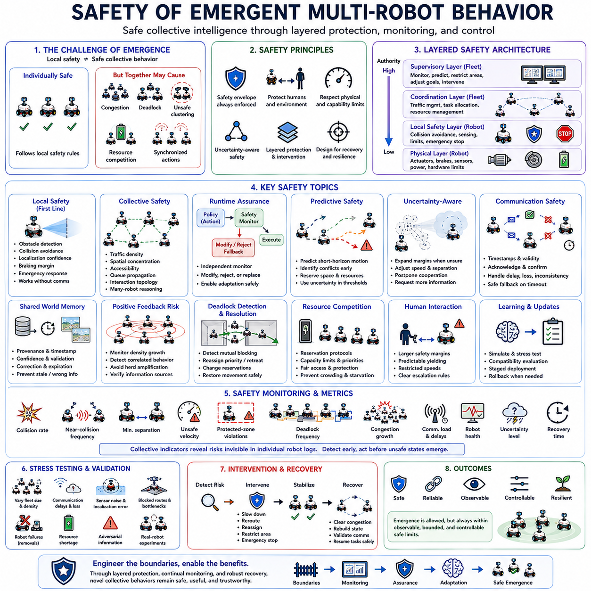{width="7.268055555555556in" height="7.268055555555556in"}

Safety in emergent multi-robot behavior concerns maintaining acceptable risk when collective patterns arise from interactions among autonomous robots rather than from explicitly scripted coordination. A robot may individually satisfy its local safety rules while the fleet still develops congestion, deadlock, unsafe clustering, resource competition, or synchronized actions. Safety must therefore be evaluated at both the individual and collective levels.

Emergence creates a distinctive safety challenge because system-level behavior cannot always be predicted directly from the policies of individual robots. Local collision avoidance, task selection, communication, and navigation decisions interact repeatedly and create feedback loops. Small variations in timing, localization, communication, or environmental conditions may propagate across the fleet and generate collective states that were not encountered during isolated robot testing.

A fundamental design principle is to separate safety constraints from performance optimization. Learned policies and emergent coordination may optimize throughput, coverage, task completion, energy consumption, or cooperation, but these objectives should operate inside a protected safety envelope. Collision limits, protected areas, velocity restrictions, emergency stopping, human separation requirements, and hardware constraints must remain enforceable regardless of collective incentives.

Local safety remains the first defensive layer. Each robot should maintain collision avoidance, obstacle detection, localization confidence, braking margins, actuator limits, and emergency responses independently of fleet-level coordination. This prevents a communication failure or incorrect collective decision from immediately removing basic physical protection. Local safety should remain functional even when shared maps, task servers, teammates, or communication networks become unavailable.

Collective safety extends beyond pairwise collision avoidance. Several individually safe trajectories may jointly create a blocked intersection, trap another robot, overload a narrow corridor, or prevent access to an emergency route. Fleet-level safety must therefore consider traffic density, queue propagation, spatial concentration, resource contention, accessibility, and interaction topology. Safe collective behavior requires reasoning about configurations involving many agents simultaneously.

Safety constraints should be hierarchical. Hard constraints define behaviors that must never be violated, while softer constraints can regulate efficiency and coordination. A robot may reroute, wait, surrender a task, or accept lower throughput to preserve a hard safety requirement. This hierarchy prevents optimization algorithms from trading critical safety against small improvements in mission reward or fleet productivity.

Runtime assurance provides a practical mechanism for supervising adaptive or learned behavior. A high-performance policy can propose actions while an independent safety monitor checks whether those actions remain inside permitted operating conditions. If risk becomes unacceptable, the monitor can modify, reject, or replace the proposed action with a verified fallback behavior. This architecture allows adaptation without giving unrestricted authority to learned policies.

Safety filters can operate on trajectories, velocities, task assignments, resource access, and communication decisions. Before execution, proposed actions can be checked against collision risk, minimum separation, restricted zones, dynamic obstacles, robot capabilities, and predicted teammate motion. Filters should consider not only the immediate state but also reachable future states, because a currently safe action may lead into a configuration from which collision or deadlock cannot later be avoided.

Predictive safety becomes increasingly important as fleet density grows. Purely reactive collision avoidance may respond too late when several robots converge on the same narrow region. Predicting short-horizon trajectories, intentions, resource requests, and traffic evolution allows conflicts to be identified before physical separation becomes critical. Prediction does not need to be perfect, but uncertainty should explicitly influence safety margins and intervention thresholds.

Uncertainty-aware safety is necessary because robots never possess complete knowledge of the collective state. Sensor noise, localization error, delayed communication, incomplete maps, uncertain intentions, and changing environments affect risk estimates. Safety margins should therefore expand when confidence decreases. Robots can reduce speed, increase separation, postpone cooperative actions, or request additional observations when uncertainty exceeds acceptable limits.

Communication itself can become a safety dependency. Robots may exchange intentions, reservations, hazards, or emergency states, but messages can be delayed, lost, duplicated, or inconsistent. Safety-critical coordination should therefore avoid assuming perfect connectivity. Messages require timestamps, validity periods, confidence, and appropriate acknowledgment mechanisms, while robots need safe fallback behavior when expected communication does not arrive.

Shared world memory introduces another safety concern because incorrect information can persist beyond the event that created it. A stale obstacle location, outdated free-space estimate, incorrect semantic label, or obsolete traffic state may influence many future robots. Safety-related shared information should therefore include provenance, timestamps, confidence, validation status, and mechanisms for correction or expiration so that collective memory does not become a persistent source of risk.

Positive feedback can transform small safety problems into fleet-wide hazards. If several robots follow the same incorrect route recommendation or respond identically to misleading information, concentration can rapidly increase. Shared learning and synchronized policies can amplify correlated errors. Safety mechanisms should therefore monitor not only individual anomalies but also correlated behavior, rapidly increasing density, synchronized decisions, and abnormal propagation of information.

Diversity can improve safety by reducing correlated failure. Robots using different sensing modalities, routes, capabilities, or decision strategies may not fail in exactly the same way under the same disturbance. However, heterogeneous fleets also introduce different braking distances, speeds, dimensions, payloads, and mobility constraints. Safety reasoning must represent these embodiment differences rather than applying identical assumptions to every platform.

Deadlock is usually considered an efficiency problem, but it can become a safety problem when robots block evacuation paths, critical resources, human movement, or emergency access. Deadlock detection should identify persistent mutual blocking and trigger controlled resolution procedures. Priority reassignment, coordinated retreat, temporary exclusion zones, reservation changes, or supervisory intervention can restore movement without allowing robots to improvise unsafe escape maneuvers.

Resource competition can also create safety hazards. Charging stations, elevators, narrow passages, tools, communication channels, and computing resources may become overloaded when many robots independently request them. Reservation protocols, capacity limits, priority classes, and fairness mechanisms can prevent unsafe crowding or starvation. Critical robots may require protected access to resources necessary for maintaining safe operation.

Human interaction requires particularly conservative treatment because people may behave unpredictably and may not understand emergent robot conventions. A traffic pattern that works efficiently among robots may be confusing or unsafe when a person enters the shared space. Human-aware navigation should preserve larger safety margins, understandable yielding behavior, predictable motion, restricted speeds, and clear escalation procedures in areas where robots and people interact.

Learning systems require additional safeguards because policy updates can alter collective dynamics. A new policy may improve individual performance while creating unexpected interactions with existing robots. Updates should therefore pass simulation, stress testing, compatibility evaluation, staged deployment, and monitored real-world validation. Rollback mechanisms should remain available when fleet-level behavior deviates from expected safety characteristics.

Simulation provides an important environment for discovering dangerous emergence before deployment. Large numbers of robots can be tested under different densities, layouts, communication delays, failures, sensor errors, and task loads. Adversarial scenarios can deliberately create bottlenecks, conflicting objectives, unavailable resources, or misleading information. The objective is to expose interaction failures that conventional nominal testing may never encounter.

Simulation alone is insufficient because physical systems introduce effects that models may not reproduce accurately. Wheel slip, actuator delay, sensor interference, wireless congestion, mechanical variation, human behavior, and environmental uncertainty can alter collective dynamics. Real-robot experiments should therefore progressively increase fleet size and operational complexity while retaining monitoring, emergency stopping, restricted test zones, and controlled fallback procedures.

Safety evaluation should include both common events and rare collective failures. Collision rate, near-collision frequency, minimum separation, emergency intervention, unsafe velocity, protected-zone violation, deadlock frequency, congestion growth, and recovery time provide important indicators. Distributional statistics and worst-case outcomes are necessary because high average performance can conceal rare events with unacceptable consequences.

Scalability must be included in safety validation. A policy that remains safe with five robots may develop unstable traffic, communication overload, or correlated actions with fifty robots. Interaction opportunities grow rapidly with fleet size, and new collective patterns can appear beyond particular density thresholds. Testing should therefore vary robot number, spatial density, task intensity, and resource contention rather than extrapolating from small demonstrations.

Fault injection can reveal whether safety survives realistic disturbances. Robots can be intentionally removed, communication degraded, localization perturbed, sensors obscured, routes blocked, or resources made unavailable. The resulting fleet behavior should remain bounded and recover toward a safe operating state. Graceful degradation is preferable to architectures in which one failure triggers cascading loss of coordination across many agents.

Observability is essential for detecting emerging risk. Fleet monitoring should track robot health, traffic density, task concentration, communication load, resource pressure, uncertainty, near conflicts, and unusual synchronization. Collective indicators can reveal hazards that are invisible in individual robot logs. Detection should occur early enough for intervention before a developing pattern crosses from inefficient behavior into unsafe behavior.

Safety intervention should operate through multiple levels of authority. Local controllers can prevent immediate collisions, fleet coordination can reroute traffic or redistribute tasks, and supervisory systems can restrict regions or reduce operational intensity. Severe conditions may require emergency stopping or transition to predefined fallback modes. Layered intervention prevents every disturbance from requiring centralized control while preserving strong authority for critical situations.

Recovery is part of safety rather than merely a post-failure function. After an intervention, robots must determine how to resume tasks without immediately recreating the hazardous configuration. Recovery may require clearing congested areas, rebuilding shared state, validating communication, reassigning tasks, or gradually restoring fleet activity. A safe system should demonstrate both hazard containment and controlled return to productive operation.

Ultimately, safety of emergent multi-robot behavior requires engineering the boundaries within which collective intelligence is allowed to evolve. Emergence does not need to be eliminated, because adaptive coordination can provide substantial benefits. Instead, local protection, collective monitoring, predictive reasoning, uncertainty management, runtime assurance, layered intervention, stress testing, and recovery mechanisms should ensure that novel collective patterns remain observable, bounded, controllable, and safe.

## 08.13. Emergent Behavior Experiment [w/Code]

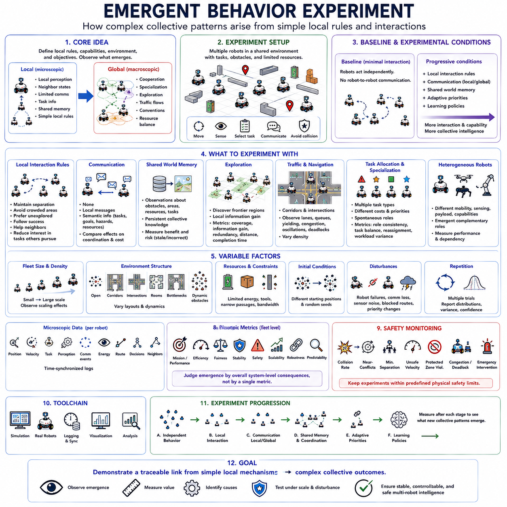{width="7.268055555555556in" height="7.268055555555556in"}

An emergent behavior experiment investigates how complex fleet-level patterns arise from simple local rules, decentralized decisions, and repeated interactions among multiple robots. Rather than programming the desired global behavior directly, the experiment defines individual capabilities, interaction mechanisms, environmental constraints, and mission objectives, then observes whether coordinated structures such as cooperation, specialization, exploration patterns, traffic flows, or conventions emerge.

The central experimental principle is to separate local rules from global outcomes. Each robot receives only the information and decision mechanisms available at its operational level, such as local perception, neighboring robot states, limited communication, task information, and shared memory. Researchers then observe whether these local processes generate measurable collective organization without embedding the expected fleet-level solution directly into the controller.

A useful baseline experiment begins with multiple identical robots operating in a shared environment containing distributed targets, obstacles, narrow passages, and limited resources. Robots can move, detect nearby objects and teammates, select tasks, and exchange restricted information. No central controller specifies exact routes or roles. This configuration provides a controlled setting in which spontaneous coordination can be distinguished from explicitly commanded behavior.

The experiment should establish a baseline in which robots operate with minimal interaction. Each robot may independently select the nearest target or unexplored region while avoiding collisions. Measurements from this condition reveal what the fleet can achieve through individual autonomy alone. Later experimental conditions can introduce communication, shared memory, local cooperation, adaptive priorities, or learning to determine how interaction changes collective behavior.

Local interaction rules can then be introduced systematically. Robots may maintain separation, avoid crowded areas, prefer unexplored regions, follow successful routes, assist nearby teammates, or reduce interest in tasks already pursued by others. These rules should remain simple and local. The experiment examines whether repeated application produces global structures such as spatial dispersion, task differentiation, lane formation, cooperative clusters, or balanced resource utilization.

Communication provides another experimental variable. One condition may prohibit robot-to-robot communication, another may allow only local messages, and another may provide semantic information such as task completion, intended destinations, hazards, or resource availability. Comparing these conditions reveals how communication affects coordination, redundancy, traffic, and information propagation while also identifying when additional communication creates unnecessary overhead.

Shared world memory can be introduced to study how persistent collective knowledge changes emergence. Robots may contribute observations about obstacles, traversability, explored regions, congestion, resources, or task states to a common representation. Subsequent robots can use this information without independently rediscovering it. The experiment can measure whether shared memory accelerates coordination or creates new risks when information becomes stale, incomplete, or incorrect.

Exploration experiments provide a clear demonstration of emergence. Robots can begin from nearby initial positions in a partially unknown environment and independently select frontier regions according to local information gain and travel cost. Without explicit territory assignment, successful interaction rules may cause robots to spread across different regions. Coverage ratio, information gain, redundant exploration, travel distance, and completion time quantify the resulting collective exploration pattern.

Traffic experiments reveal another class of emergent behavior. Multiple robots can repeatedly travel between distributed task locations through shared corridors and intersections. At low density they may move independently, while higher density creates repeated encounters. Researchers can observe whether directional lanes, queues, yielding conventions, congestion, oscillations, or deadlocks emerge as robot density increases and local navigation policies interact.

Task allocation experiments can investigate spontaneous specialization. Robots receive multiple task types with different locations, costs, priorities, and capability requirements. Even when robots initially have similar policies, differences in position, energy, experience, or local workload may cause persistent behavioral roles to develop. Role consistency, task distribution, reassignment frequency, workload variance, and mission completion reveal whether useful specialization has emerged.

Heterogeneous robots make the experiment more representative of Physical AI fleets. AMRs, UAVs, quadrupeds, or manipulators can possess different mobility, sensing, payload, and interaction capabilities. Instead of assigning every role beforehand, the system can allow local task selection to reflect capability and context. Researchers can then examine whether complementary roles emerge naturally and whether specialization improves performance or creates dependency on particular platforms.

The experiment should vary fleet size because emergence often changes with scale. Conditions might progress from a small group to increasingly dense fleets while preserving comparable environmental objectives. A coordination strategy that appears successful with a few robots may generate congestion or communication overload at larger scales. Throughput, coverage, interaction frequency, communication cost, and resource competition reveal how collective behavior changes as population increases.

Environmental structure should also be varied systematically. Open spaces, narrow corridors, intersections, distributed rooms, bottlenecks, dynamic obstacles, and limited resources create different interaction opportunities. If the same collective behavior appears across multiple layouts, it provides stronger evidence that the pattern originates from robot interaction rather than from one specific geometry. Environment diversity therefore improves the validity of conclusions about emergence.

Repeated trials are essential because emergent patterns may depend on initial positions, random choices, communication timing, and small disturbances. Each experimental condition should be executed multiple times using different initial configurations and random seeds. Researchers should report distributions, variance, confidence intervals, and unusual outcomes rather than relying only on average performance, because rare collective failures may be operationally important.

Microscopic data should be recorded for every robot. Useful observations include position, velocity, selected task, local perception, communication events, energy state, planned route, policy decisions, and nearby interactions. Time synchronization allows these individual histories to be reconstructed accurately. The resulting logs provide evidence about which local actions preceded the formation, stabilization, or disappearance of a global pattern.

Macroscopic measurements describe the resulting fleet behavior. Spatial density, clustering, coverage, traffic throughput, queue length, task balance, resource utilization, communication load, cooperation frequency, and mission completion can be calculated from the combined data. Comparing microscopic actions with macroscopic changes helps identify how repeated local interactions transform into organized system-level behavior.

Information-theoretic and statistical analysis can provide additional evidence of emergence. Entropy can measure diversity or organization in robot states, while mutual information can reveal dependencies among agents or between local actions and global patterns. Correlation analysis can detect alignment in velocity, task choice, or communication activity. These measures help quantify organization that may be difficult to characterize through visual observation alone.

Causal experiments are necessary to determine why a pattern emerged. After observing a behavior, researchers can remove communication, disable shared memory, alter interaction rules, modify rewards, or restrict particular information channels. If the collective pattern weakens or disappears, the intervention provides evidence about the mechanisms that produced it. Ablation therefore converts observation of emergence into a more rigorous explanation of its causes.

Beneficial and undesirable emergence should be investigated together. An exploration policy may improve coverage while increasing communication cost, or traffic conventions may improve throughput while creating unfair waiting times. Experiments should therefore measure mission performance, efficiency, fairness, stability, and safety simultaneously. Emergence should be judged by its complete system-level consequences rather than by a single favorable metric.

Disturbance experiments evaluate whether emergent organization is robust. Researchers can remove robots, degrade communication, introduce sensor uncertainty, block previously useful routes, change task priorities, or make resources unavailable. The fleet should be observed as it responds and reorganizes. Recovery time, performance degradation, task redistribution, residual coverage, and new collective patterns indicate whether emergence contributes to resilience or fragility.

Safety monitoring must remain active throughout the experiment. Collision rate, near-conflict frequency, minimum separation, unsafe velocity, protected-zone violations, congestion growth, deadlock, and emergency intervention should be recorded independently of mission performance. Experimental exploration of emergence should occur inside predefined physical safety limits so that discovering novel collective behavior does not require accepting uncontrolled operational risk.

Simulation is particularly useful during early experimentation because hundreds or thousands of trials can be performed across different fleet sizes and environmental conditions. Parameters can be varied systematically, and rare interaction patterns can be searched efficiently. Simulation also enables deliberate stress conditions that would be expensive or unsafe to reproduce immediately with physical robots, providing a controlled environment for hypothesis generation.

Physical robot experiments are required to determine whether the observed emergence survives real-world effects. Communication interference, localization error, actuator variation, wheel slip, sensing limitations, timing differences, and environmental uncertainty can substantially alter interaction dynamics. Real-world testing should therefore begin with small fleets and controlled environments before progressively increasing robot number, density, autonomy, and task complexity.

A complete experiment can be organized as a progression from independent behavior to increasingly connected collective intelligence. Robots first operate independently, then gain local interaction, communication, shared memory, adaptive coordination, and potentially learned policies. Measurements after each stage reveal which capabilities create new global patterns and whether those patterns improve performance, scalability, robustness, predictability, and safety.

Ultimately, an emergent behavior experiment should demonstrate a traceable relationship between simple local mechanisms and complex collective outcomes. The objective is not merely to produce visually interesting group behavior, but to identify how emergence forms, measure whether it provides operational value, determine which interactions cause it, test whether it survives scale and disturbance, and establish whether the resulting multi-robot intelligence remains stable, controllable, and safe.
