**Volume 09. Multi Robot and Swarm Physical AI**

# Chapter 09. Fleet Scale Deployment

## 09.01. From Prototype to Fleet Scale

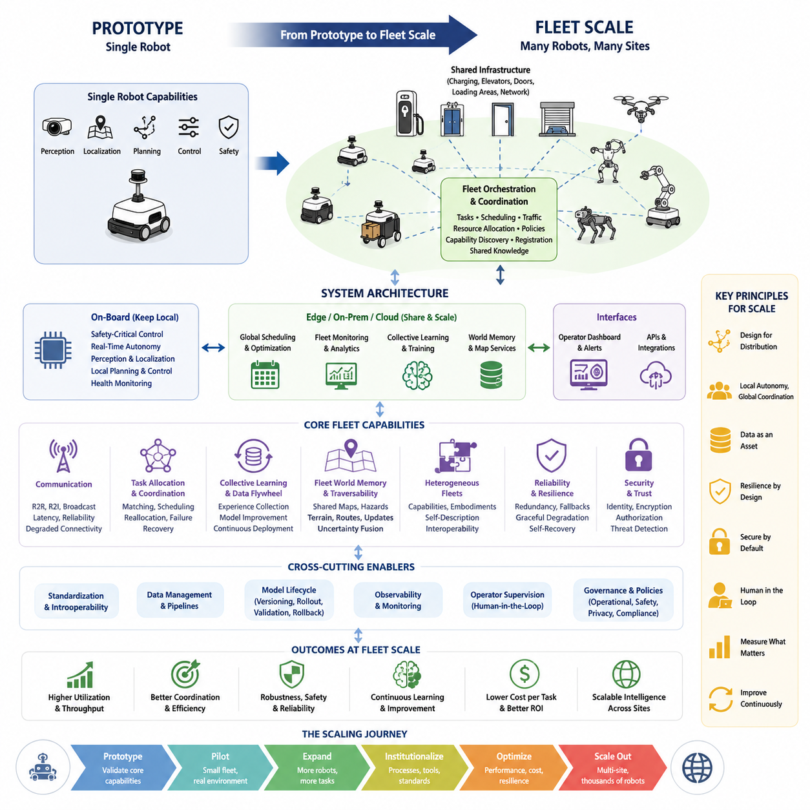{width="7.268055555555556in" height="7.268055555555556in"}

Moving from a prototype to fleet scale changes the nature of a Physical AI system. A prototype demonstrates that one robot can perceive, decide, and act under controlled conditions, while a fleet must sustain those capabilities across many robots, locations, missions, operators, and environmental variations. Scaling therefore becomes a systems problem involving coordination, infrastructure, reliability, lifecycle management, and collective intelligence.

A successful prototype often depends on carefully configured hardware, manually tuned parameters, stable networks, known maps, and expert supervision. These assumptions become increasingly difficult to preserve as deployment expands. Fleet-scale engineering must replace implicit assumptions with explicit interfaces, automated configuration, standardized deployment procedures, health monitoring, recovery mechanisms, and measurable operational guarantees.

The first major transition is from robot-centric architecture to fleet-centric architecture. Each robot still requires local perception, localization, planning, control, and safety functions, but these components must operate within a larger coordination framework. Fleet orchestration introduces shared task queues, scheduling, traffic management, resource allocation, robot registration, capability discovery, shared knowledge, and operational policies that connect individual autonomy to system-wide objectives.

Fleet scale also requires a clear separation between functions that must remain local and functions that benefit from shared computation. Safety-critical control and latency-sensitive autonomy normally remain close to the robot, while global scheduling, collective learning, historical analysis, and large-scale optimization can operate through edge, on-premise, or cloud infrastructure. The resulting architecture is distributed rather than simply centralized or decentralized.

Standardization becomes essential because manual configuration grows poorly with fleet size. Robots require persistent identities, machine-readable capability descriptions, software and model versions, sensor configurations, operational permissions, and deployment states. These descriptions allow orchestration systems to determine which robots can perform particular tasks and enable heterogeneous robots to participate in coordinated missions without requiring custom integration for every interaction.

Fleet deployment transforms communication from a convenient interface into critical infrastructure. Robots must exchange state, task progress, intent, map information, alerts, and selected knowledge while operating under bandwidth, latency, and connectivity constraints. Communication policies therefore need priorities and graceful degradation. A temporary network failure should reduce coordination quality where necessary without automatically eliminating every robot\'s ability to operate safely.

Data management undergoes a similar transition. One prototype may generate logs that engineers inspect manually, whereas hundreds of robots continuously produce sensor streams, trajectories, failures, interventions, task outcomes, and model-performance records. Fleet-scale Physical AI requires structured pipelines that collect valuable experience, filter redundant data, identify unusual events, preserve provenance, and transform operational experience into datasets suitable for analysis and learning.

This operational data creates the foundation for a fleet data flywheel. Difficult situations encountered by deployed robots can be detected, collected, analyzed, labeled or automatically processed, and incorporated into improved models or policies. Validated improvements can then be distributed back to the fleet. As deployment grows, the fleet therefore becomes not only a collection of machines but also a distributed mechanism for acquiring physical-world experience.

Model deployment must consequently become a controlled lifecycle rather than a manual installation process. Perception models, world models, planning policies, learned skills, and configuration parameters require versioning, compatibility checks, staged rollout, validation, rollback, and auditability. Over-the-air deployment can accelerate improvement, but uncontrolled updates may simultaneously introduce failures across many robots, making deployment governance a core element of fleet reliability.

Testing must expand beyond individual robot performance. A policy that performs correctly on one robot may create congestion, resource contention, communication overload, or unstable interactions when executed by hundreds of agents. Fleet validation therefore examines system-level properties such as throughput, coordination efficiency, traffic density, task completion, resource utilization, communication load, recovery behavior, and the consequences of simultaneous or correlated failures.

Reliability also changes meaning with scale. Individual component failures become statistically normal rather than exceptional events when many robots operate continuously. Fleet systems must expect unavailable robots, degraded sensors, depleted batteries, communication interruptions, localization failures, blocked routes, and software faults. Failure isolation, dynamic task reallocation, redundant capabilities, safe fallback behaviors, and graceful degradation allow the larger system to continue operating despite local problems.

Observability is therefore fundamental to fleet operations. Operators need visibility into robot health, mission status, localization confidence, battery condition, network quality, safety events, AI model performance, and fleet-level bottlenecks. Monitoring should reveal not only whether hardware is functioning but also whether learned intelligence is behaving as expected, because model drift or environmental change can reduce performance without producing conventional hardware alarms.

Human supervision must scale differently from robot population. A fleet of hundreds of robots cannot depend on one operator continuously teleoperating or inspecting each machine. Effective fleet systems use autonomy to manage normal operations while directing human attention toward exceptions, uncertain situations, safety events, and decisions requiring authority or contextual judgment. Operator interfaces consequently evolve from robot control panels toward supervisory fleet intelligence systems.

Physical infrastructure becomes part of the intelligence architecture as well. Charging stations, elevators, doors, loading areas, work cells, communication access points, and restricted zones are shared resources whose availability influences planning. Fleet-scale deployment therefore connects robot task allocation with traffic and resource management, preventing individually reasonable decisions from producing globally inefficient congestion, deadlock, or competition for limited infrastructure.

Security and trust become increasingly important because every additional robot, service, interface, and update channel enlarges the attack surface. Fleet systems require authenticated robot identities, protected communication, controlled software distribution, authorization policies, secure logging, and mechanisms for isolating suspicious or compromised nodes. Trust must extend across robots and infrastructure without assuming that every participant or message is automatically valid.

Scaling also exposes environmental diversity that prototypes rarely capture. Different sites contain different layouts, surfaces, lighting, traffic patterns, workflows, regulations, and human behaviors. Fleet architecture must therefore distinguish globally reusable intelligence from site-specific knowledge. Shared models and common interfaces can provide a stable foundation, while local maps, operational policies, calibration data, and adaptation mechanisms handle deployment-specific conditions.

The transition from tens to hundreds or thousands of robots ultimately requires hierarchical organization. Individual robots manage immediate physical interaction, local groups coordinate shared spaces or missions, site-level systems optimize operations, and higher-level services aggregate knowledge across sites. This hierarchy limits communication and computational complexity while allowing information and learned experience to propagate at appropriate spatial and temporal scales.

Fleet economics must be considered alongside technical performance. A sophisticated robot fleet provides limited value if deployment, maintenance, networking, supervision, computation, or downtime costs increase faster than operational benefit. Important measures therefore extend beyond autonomy accuracy to include utilization, mission throughput, intervention frequency, energy efficiency, mean time between failures, recovery time, software maintenance effort, and total cost per completed task.

The deepest change from prototype to fleet scale is that intelligence becomes a property of the complete operational system rather than only of individual robots. Local autonomy remains essential, but fleet orchestration, shared memory, collective learning, heterogeneous coordination, communication, infrastructure, and human supervision determine how effectively that autonomy produces collective outcomes. This transition connects earlier multi-robot capabilities directly to fleet-scale deployment.

A mature fleet therefore should not be understood as a prototype multiplied many times. It is a distributed Physical AI system whose robots continuously interact with one another, shared infrastructure, human operators, and accumulated operational knowledge. Fleet scale is achieved when adding robots expands useful capability without proportionally increasing integration effort, supervision burden, instability, or operational risk, enabling collective intelligence to remain manageable as deployment grows.

프로토타입(Prototype)에서 플릿 규모(Fleet Scale)로 전환한다는 것은 피지컬 AI(Physical AI) 시스템의 본질 자체가 변화한다는 의미이다. 프로토타입(Prototype)은 하나의 로봇이 통제된 조건에서 인지(Perception), 의사결정(Decision), 행동(Action)을 수행할 수 있음을 입증하지만, 플릿(Fleet)은 여러 로봇, 장소, 임무, 운영자, 환경 변화에 걸쳐 이러한 능력을 지속적으로 유지해야 한다. 따라서 확장(Scaling)은 조정(Coordination), 인프라(Infrastructure), 신뢰성(Reliability), 수명주기 관리(Lifecycle Management), 집단지능(Collective Intelligence)을 포함하는 시스템 문제(Systems Problem)가 된다.

성공적인 프로토타입(Prototype)은 세심하게 구성된 하드웨어(Hardware), 수동으로 조정된 매개변수(Parameters), 안정적인 네트워크(Network), 알려진 지도(Map), 전문가의 감독(Expert Supervision)에 의존하는 경우가 많다. 배포 규모가 확대되면 이러한 전제를 유지하기가 점점 어려워진다. 플릿 규모 엔지니어링(Fleet-Scale Engineering)은 암묵적인 전제를 명시적인 인터페이스(Interface), 자동화된 구성(Automated Configuration), 표준화된 배포 절차(Deployment Procedure), 상태 모니터링(Health Monitoring), 복구 메커니즘(Recovery Mechanism), 측정 가능한 운영 보장(Operational Guarantee)으로 전환해야 한다.

첫 번째 주요 전환은 로봇 중심 아키텍처(Robot-Centric Architecture)에서 플릿 중심 아키텍처(Fleet-Centric Architecture)로의 변화이다. 각 로봇에는 여전히 로컬 인지(Local Perception), 위치추정(Localization), 계획(Planning), 제어(Control), 안전(Safety) 기능이 필요하지만, 이러한 구성요소는 더 큰 조정 프레임워크(Coordination Framework) 안에서 동작해야 한다. 플릿 오케스트레이션(Fleet Orchestration)은 공유 작업 대기열(Shared Task Queue), 스케줄링(Scheduling), 교통 관리(Traffic Management), 자원 할당(Resource Allocation), 로봇 등록(Robot Registration), 역량 탐색(Capability Discovery), 공유 지식(Shared Knowledge), 운영 정책(Operational Policy)을 통해 개별 자율성(Individual Autonomy)을 시스템 전체 목표와 연결한다.

플릿 규모(Fleet Scale)에서는 로컬(Local)에 유지해야 하는 기능과 공유 컴퓨팅(Shared Computing)을 활용할 수 있는 기능을 명확히 분리해야 한다. 안전 중요 제어(Safety-Critical Control)와 지연시간에 민감한 자율 기능(Latency-Sensitive Autonomy)은 일반적으로 로봇 가까이에 유지되는 반면, 전역 스케줄링(Global Scheduling), 집단학습(Collective Learning), 이력 분석(Historical Analysis), 대규모 최적화(Large-Scale Optimization)는 엣지(Edge), 온프레미스(On-Premise), 클라우드(Cloud) 인프라를 통해 수행할 수 있다. 따라서 전체 아키텍처는 단순한 중앙집중형이나 분산형이 아니라 분산 아키텍처(Distributed Architecture)로 발전한다.

플릿 규모가 증가할수록 수동 구성(Manual Configuration)은 효율적으로 확장되지 않기 때문에 표준화(Standardization)가 필수적이다. 로봇에는 지속적인 식별자(Persistent Identity), 기계 판독 가능한 역량 설명(Capability Description), 소프트웨어 및 모델 버전(Software and Model Version), 센서 구성(Sensor Configuration), 운영 권한(Operational Permission), 배포 상태(Deployment State)가 필요하다. 이를 통해 오케스트레이션 시스템(Orchestration System)은 특정 작업을 수행할 수 있는 로봇을 판단하고, 이종 로봇(Heterogeneous Robots)이 매번 별도의 맞춤형 통합 없이 협력 임무에 참여하도록 할 수 있다.

플릿 배포(Fleet Deployment)에서 통신(Communication)은 편리한 인터페이스를 넘어 핵심 인프라(Critical Infrastructure)가 된다. 로봇들은 대역폭(Bandwidth), 지연시간(Latency), 연결성(Connectivity)의 제약 아래 상태(State), 작업 진행 상황(Task Progress), 의도(Intent), 지도 정보(Map Information), 경고(Alert), 선택된 지식(Knowledge)을 교환해야 한다. 따라서 통신 정책(Communication Policy)은 우선순위와 점진적 성능 저하(Graceful Degradation)를 지원해야 한다. 일시적인 네트워크 장애가 발생하더라도 모든 로봇의 안전한 운영 능력이 즉시 사라지는 것이 아니라 필요한 범위에서 조정 품질만 감소하도록 설계해야 한다.

데이터 관리(Data Management) 역시 비슷한 전환을 겪는다. 하나의 프로토타입은 엔지니어가 수동으로 분석할 수 있는 로그(Log)를 생성하지만, 수백 대의 로봇은 센서 스트림(Sensor Stream), 궤적(Trajectory), 장애(Failure), 인간 개입(Intervention), 작업 결과(Task Outcome), 모델 성능 기록(Model Performance Record)을 지속적으로 생성한다. 플릿 규모 피지컬 AI(Fleet-Scale Physical AI)는 가치 있는 경험을 수집하고 중복 데이터를 제거하며, 비정상 사건을 식별하고 데이터 출처(Provenance)를 보존하여 운영 경험을 분석과 학습에 적합한 데이터셋(Dataset)으로 변환하는 구조화된 파이프라인(Structured Pipeline)을 필요로 한다.

이러한 운영 데이터(Operational Data)는 플릿 데이터 플라이휠(Fleet Data Flywheel)의 기반이 된다. 배포된 로봇이 경험한 어려운 상황을 탐지하고 수집한 뒤 분석하고, 라벨링(Labeling)하거나 자동 처리하여 개선된 모델(Model) 또는 정책(Policy)에 반영할 수 있다. 검증된 개선 결과는 다시 플릿 전체에 배포된다. 따라서 배포 규모가 증가할수록 플릿은 단순한 기계들의 집합이 아니라 물리 세계 경험(Physical-World Experience)을 분산된 형태로 획득하는 학습 메커니즘(Learning Mechanism)으로 발전한다.

따라서 모델 배포(Model Deployment)는 수동 설치 과정이 아니라 통제된 수명주기(Controlled Lifecycle)로 전환되어야 한다. 인지 모델(Perception Model), 월드 모델(World Model), 계획 정책(Planning Policy), 학습된 기술(Learned Skill), 구성 매개변수(Configuration Parameter)는 버전 관리(Versioning), 호환성 검사(Compatibility Check), 단계적 배포(Staged Rollout), 검증(Validation), 롤백(Rollback), 감사 가능성(Auditability)을 갖추어야 한다. 무선 업데이트(Over-the-Air Deployment)는 개선 속도를 높이지만 통제되지 않은 업데이트는 동시에 다수의 로봇에 장애를 발생시킬 수 있으므로 배포 거버넌스(Deployment Governance)가 플릿 신뢰성(Fleet Reliability)의 핵심 요소가 된다.

시험과 검증(Testing and Validation)도 개별 로봇 성능을 넘어 확장되어야 한다. 하나의 로봇에서 정상적으로 작동하는 정책(Policy)이 수백 개 에이전트(Agent)가 동시에 실행할 경우 혼잡(Congestion), 자원 경합(Resource Contention), 통신 과부하(Communication Overload), 불안정한 상호작용(Unstable Interaction)을 발생시킬 수 있다. 따라서 플릿 검증(Fleet Validation)은 처리량(Throughput), 조정 효율성(Coordination Efficiency), 교통 밀도(Traffic Density), 작업 완료(Task Completion), 자원 활용률(Resource Utilization), 통신 부하(Communication Load), 복구 행동(Recovery Behavior), 동시 또는 상관 장애(Correlated Failure)의 영향을 시스템 수준에서 평가해야 한다.

규모가 커지면 신뢰성(Reliability)의 의미도 변화한다. 많은 로봇이 지속적으로 운영되는 환경에서는 개별 구성요소의 장애가 예외적인 사건이 아니라 통계적으로 정상적인 사건이 된다. 플릿 시스템(Fleet System)은 로봇 사용 불가, 센서 성능 저하, 배터리 부족, 통신 단절, 위치추정 실패, 경로 차단, 소프트웨어 장애 등을 예상해야 한다. 장애 격리(Failure Isolation), 동적 작업 재할당(Dynamic Task Reallocation), 중복 역량(Redundant Capability), 안전한 폴백 행동(Safe Fallback Behavior), 점진적 성능 저하(Graceful Degradation)를 통해 국소적인 문제가 발생해도 전체 시스템이 계속 운영될 수 있어야 한다.

따라서 관측 가능성(Observability)은 플릿 운영(Fleet Operations)의 기본 요소가 된다. 운영자는 로봇 상태(Robot Health), 임무 상태(Mission Status), 위치추정 신뢰도(Localization Confidence), 배터리 상태(Battery Condition), 네트워크 품질(Network Quality), 안전 이벤트(Safety Event), AI 모델 성능(AI Model Performance), 플릿 수준 병목현상(Fleet-Level Bottleneck)을 파악할 수 있어야 한다. 특히 모델 드리프트(Model Drift)나 환경 변화(Environmental Change)는 일반적인 하드웨어 경고 없이 성능을 저하시킬 수 있으므로 모니터링은 하드웨어 정상 여부뿐 아니라 학습된 지능이 예상대로 작동하는지도 평가해야 한다.

인간 감독(Human Supervision)은 로봇 개체 수와 다른 방식으로 확장되어야 한다. 수백 대의 로봇으로 구성된 플릿에서 운영자가 모든 로봇을 지속적으로 원격조종(Teleoperation)하거나 개별 점검하는 방식은 현실적이지 않다. 효과적인 플릿 시스템은 정상 운영을 자율성(Autonomy)에 맡기면서 예외 상황(Exception), 불확실한 상황(Uncertain Situation), 안전 이벤트(Safety Event), 권한이나 맥락적 판단이 필요한 의사결정에 인간의 주의를 집중시킨다. 이에 따라 운영자 인터페이스(Operator Interface)는 개별 로봇 제어 패널에서 감독형 플릿 지능 시스템(Supervisory Fleet Intelligence System)으로 발전한다.

물리적 인프라(Physical Infrastructure) 또한 지능 아키텍처(Intelligence Architecture)의 일부가 된다. 충전소(Charging Station), 엘리베이터(Elevator), 출입문(Door), 적재 구역(Loading Area), 작업 셀(Work Cell), 통신 액세스 포인트(Communication Access Point), 제한 구역(Restricted Zone)은 계획에 영향을 미치는 공유 자원(Shared Resource)이다. 따라서 플릿 규모 배포는 로봇 작업 할당(Task Allocation)을 교통 및 자원 관리(Traffic and Resource Management)와 연결하여 개별적으로는 합리적인 결정들이 전체적으로 혼잡(Congestion), 교착상태(Deadlock), 제한된 인프라에 대한 경쟁을 발생시키는 것을 방지해야 한다.

보안(Security)과 신뢰(Trust)도 더욱 중요해진다. 로봇, 서비스(Service), 인터페이스(Interface), 업데이트 채널(Update Channel)이 증가할수록 공격 표면(Attack Surface)이 확대되기 때문이다. 플릿 시스템은 인증된 로봇 신원(Authenticated Robot Identity), 보호된 통신(Protected Communication), 통제된 소프트웨어 배포(Controlled Software Distribution), 권한 정책(Authorization Policy), 보안 로그(Secure Logging), 의심되거나 침해된 노드를 격리하는 메커니즘(Isolation Mechanism)을 필요로 한다. 모든 참여자와 메시지를 자동으로 신뢰하지 않으면서 로봇과 인프라 전반에 신뢰 체계(Trust Framework)를 구축해야 한다.

규모 확장은 프로토타입이 충분히 경험하기 어려운 환경 다양성(Environmental Diversity)을 드러낸다. 서로 다른 사이트(Site)는 배치(Layout), 지면(Surface), 조명(Lighting), 교통 패턴(Traffic Pattern), 작업 흐름(Workflow), 규정(Regulation), 인간 행동(Human Behavior)이 서로 다르다. 따라서 플릿 아키텍처는 전역적으로 재사용할 수 있는 지능(Globally Reusable Intelligence)과 사이트별 지식(Site-Specific Knowledge)을 구분해야 한다. 공유 모델(Shared Model)과 공통 인터페이스(Common Interface)는 안정적인 기반을 제공하고, 로컬 지도(Local Map), 운영 정책(Operational Policy), 보정 데이터(Calibration Data), 적응 메커니즘(Adaptation Mechanism)은 각 배포 환경의 특성을 처리한다.

수십 대에서 수백 대 또는 수천 대의 로봇으로 전환하려면 궁극적으로 계층적 조직(Hierarchical Organization)이 필요하다. 개별 로봇은 즉각적인 물리적 상호작용을 처리하고, 로컬 그룹(Local Group)은 공유 공간이나 임무를 조정하며, 사이트 수준 시스템(Site-Level System)은 운영을 최적화하고, 상위 수준 서비스(Higher-Level Service)는 여러 사이트의 지식을 통합한다. 이러한 계층 구조는 통신 및 계산 복잡도(Computational Complexity)를 제한하면서 정보와 학습 경험이 적절한 공간적·시간적 규모에서 전파되도록 한다.

플릿 경제성(Fleet Economics)은 기술적 성능과 함께 고려되어야 한다. 정교한 로봇 플릿이라도 배포, 유지보수(Maintenance), 네트워킹(Networking), 감독(Supervision), 컴퓨팅(Computing), 가동 중단(Downtime) 비용이 운영상의 이익보다 빠르게 증가한다면 가치가 제한된다. 따라서 중요한 지표는 자율성 정확도뿐 아니라 활용률(Utilization), 임무 처리량(Mission Throughput), 개입 빈도(Intervention Frequency), 에너지 효율(Energy Efficiency), 평균 고장 간격(Mean Time Between Failures), 복구 시간(Recovery Time), 소프트웨어 유지보수 노력(Software Maintenance Effort), 완료 작업당 총비용(Total Cost per Completed Task)까지 포함한다.

프로토타입(Prototype)에서 플릿 규모(Fleet Scale)로 전환할 때 발생하는 가장 근본적인 변화는 지능(Intelligence)이 개별 로봇만의 속성이 아니라 전체 운영 시스템(Operational System)의 속성이 된다는 것이다. 로컬 자율성(Local Autonomy)은 여전히 필수적이지만, 플릿 오케스트레이션(Fleet Orchestration), 공유 메모리(Shared Memory), 집단학습(Collective Learning), 이종 로봇 조정(Heterogeneous Coordination), 통신(Communication), 인프라(Infrastructure), 인간 감독(Human Supervision)이 개별 자율성이 얼마나 효과적으로 집단적 결과(Collective Outcome)를 만들어내는지를 결정한다.

따라서 성숙한 플릿(Mature Fleet)은 하나의 프로토타입을 단순히 여러 대로 복제한 것으로 이해해서는 안 된다. 그것은 로봇들이 서로 상호작용하고, 공유 인프라(Shared Infrastructure), 인간 운영자(Human Operator), 축적된 운영 지식(Operational Knowledge)과 지속적으로 연결되는 분산형 피지컬 AI 시스템(Distributed Physical AI System)이다. 로봇을 추가할 때 통합 노력, 감독 부담, 불안정성, 운영 위험이 비례하여 증가하지 않으면서 유용한 능력이 확장될 때 진정한 플릿 규모(Fleet Scale)가 달성되며, 이를 통해 배포 규모가 증가하더라도 집단지능(Collective Intelligence)을 관리 가능한 형태로 유지할 수 있다.

## 09.02. Fleet Architecture and Orchestration

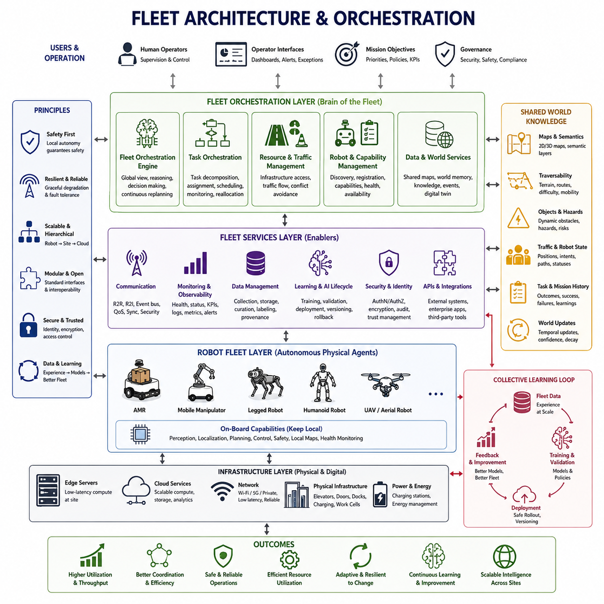{width="7.268055555555556in" height="7.268055555555556in"}

Fleet architecture defines how multiple physical robots, computing resources, communication services, shared knowledge, and human operators are organized into a coherent operational system. Unlike a single-robot architecture, it must coordinate autonomous agents that act locally while contributing to global objectives. The architecture therefore connects robot-level autonomy with fleet-level intelligence, shared infrastructure, and operational governance.

At the lowest level, each robot remains an autonomous physical agent with its own perception, localization, planning, control, and safety functions. These capabilities must continue operating even when higher-level services become temporarily unavailable. Fleet architecture should therefore preserve sufficient local autonomy for safe execution while allowing robots to receive missions, exchange information, and participate in coordinated behavior when connectivity is available.

Above individual robots, the orchestration layer manages relationships between robots, tasks, resources, and operational objectives. It maintains a fleet-wide view of available agents and determines how work should be distributed according to capabilities, locations, priorities, deadlines, energy states, and environmental conditions. Orchestration converts high-level operational demand into coordinated actions that can be executed by individual robots or robot teams.

Fleet orchestration is broader than simple task dispatching. A dispatcher may assign a mission to a robot, while an orchestrator considers dependencies among tasks, shared infrastructure, traffic conditions, robot capabilities, resource conflicts, safety constraints, and changing operational priorities. It continuously connects mission planning with execution feedback so that assignments can be revised when robots fail, environments change, or higher-priority work appears.

A scalable architecture usually separates responsibilities across robot, site, and higher-level computing layers. Robots handle immediate sensing, motion, local planning, and safety. Site-level edge or on-premise systems can manage traffic, shared maps, task coordination, fleet monitoring, and operational data. Higher-level services may aggregate experience across sites, support large-scale analytics, manage models, and coordinate learning without becoming mandatory for every real-time action.

Robot identity and capability representation provide the foundation for orchestration. Every robot must be uniquely identifiable and associated with information describing its embodiment, sensors, payload, mobility, manipulation ability, software configuration, operational state, and available skills. This machine-readable self-description enables the orchestration layer to reason about which robots are suitable for particular tasks rather than treating every fleet member as interchangeable.

Heterogeneous fleets make this capability-aware architecture especially important. An AMR may transport material, a mobile manipulator may perform handling operations, a quadruped may traverse difficult terrain, and a UAV may provide aerial observation. Orchestration must represent these differences while maintaining common abstractions for tasks, status, communication, and knowledge exchange, allowing specialized embodiments to operate as parts of a unified physical system.

Task orchestration connects mission objectives to executable robot activities. Complex missions can be decomposed into tasks with spatial, temporal, resource, and capability requirements. The system then matches tasks with appropriate robots, schedules their execution, monitors progress, and reallocates unfinished work when conditions change. This creates a continuous cycle of assignment, execution, observation, evaluation, and replanning rather than a one-time scheduling decision.

Traffic and resource management form another architectural layer because robots frequently compete for shared physical infrastructure. Corridors, intersections, elevators, charging stations, loading zones, doors, work cells, and docking locations may become bottlenecks. Fleet orchestration must coordinate access to these resources so that individually valid robot plans do not produce congestion, deadlock, starvation, or unsafe interactions at the system level.

Communication connects these distributed architectural components but should not become a hidden assumption of perfect connectivity. Robots may communicate with infrastructure, central services, and one another through networks with variable bandwidth, latency, and reliability. Fleet architecture therefore requires explicit communication priorities, synchronization policies, event-driven updates, caching, and degraded operating modes that preserve essential behavior when information becomes delayed or temporarily unavailable.

Shared world knowledge provides a common informational foundation for coordinated decisions. Robots can contribute observations about maps, obstacles, hazards, routes, traversability, traffic, task outcomes, and environmental changes to fleet world memory. The orchestration layer can use this shared knowledge to make decisions that exceed the experience of any individual robot, such as avoiding a recently blocked route discovered by another fleet member.

Collective learning extends this architecture from coordination toward accumulated intelligence. Operational experiences from many robots can be collected and transformed into datasets for improving perception, prediction, planning, task allocation, or learned skills. Updated models and policies can then be validated and redistributed to appropriate robots. The architecture consequently supports a feedback loop in which deployment generates experience and experience improves future fleet behavior.

Observability is necessary because orchestration cannot manage what it cannot reliably observe. Fleet services should track robot availability, mission progress, localization confidence, battery state, communication quality, resource utilization, safety events, failures, and relevant AI performance indicators. These observations support both automated decisions and human supervision, allowing abnormal behavior or emerging system-level bottlenecks to be detected before they propagate through the fleet.

Resilience must be designed into the architecture rather than added after deployment. Failure of one robot, network link, computing node, or shared service should not unnecessarily disable unrelated fleet operations. Redundant services, distributed state, timeout policies, task reassignment, safe local fallback, and graceful degradation allow the system to preserve useful capability under partial failure while preventing corrupted or uncertain information from spreading uncontrolled.

Human operators remain part of the orchestration architecture, but their role shifts from continuously controlling individual robots toward supervising the collective system. Operator interfaces should expose fleet status, mission priorities, exceptions, safety events, unresolved conflicts, and decisions requiring authorization. Effective orchestration filters routine autonomous activity and directs human attention toward situations where contextual judgment, responsibility, or intervention provides the greatest value.

Security and trust span every architectural layer because robots exchange commands, state, maps, software, models, and operational knowledge. Identity authentication, authorization, encrypted communication, software integrity, audit trails, and controlled access to fleet services are necessary to prevent unauthorized participants from influencing physical behavior. Trust management becomes particularly important when robots dynamically join, leave, or interact across sites and organizational boundaries.

As fleet size grows, orchestration often becomes hierarchical rather than globally centralized. Individual robots manage immediate behavior, local groups coordinate nearby interactions, site-level systems optimize shared operations, and higher-level services manage cross-site knowledge and policies. Hierarchy reduces communication and computational complexity while limiting the amount of global state that must be processed for every local decision.

The central objective of fleet architecture is therefore not to place all intelligence in one central computer. It is to distribute intelligence according to latency, safety, information scope, computational demand, and operational responsibility. Local autonomy provides responsiveness and resilience, while fleet orchestration provides coordination, shared context, resource optimization, and collective objectives. Their interaction creates scalable multi-robot Physical AI.

A mature fleet architecture ultimately functions as an intelligence management structure for physical agents. It connects individual autonomy, heterogeneous capabilities, shared world memory, collective learning, communication, infrastructure, safety, and human supervision through coordinated orchestration. When these layers are properly separated yet continuously connected, additional robots can increase collective capability without producing proportional growth in complexity or operational burden.

플릿 아키텍처(Fleet Architecture)는 여러 물리적 로봇(Physical Robot), 컴퓨팅 자원(Computing Resource), 통신 서비스(Communication Service), 공유 지식(Shared Knowledge), 인간 운영자(Human Operator)를 하나의 일관된 운영 시스템(Operational System)으로 구성하는 방법을 정의한다. 단일 로봇 아키텍처(Single-Robot Architecture)와 달리, 로컬에서 행동하는 자율 에이전트(Autonomous Agent)들이 전역 목표(Global Objective)에 기여하도록 조정해야 한다. 따라서 이 아키텍처는 로봇 수준 자율성(Robot-Level Autonomy)을 플릿 수준 지능(Fleet-Level Intelligence), 공유 인프라(Shared Infrastructure), 운영 거버넌스(Operational Governance)와 연결한다.

가장 낮은 수준에서 각 로봇은 자체적인 인지(Perception), 위치추정(Localization), 계획(Planning), 제어(Control), 안전(Safety) 기능을 갖춘 자율적인 물리 에이전트(Physical Agent)로 유지된다. 이러한 기능은 상위 수준 서비스(Higher-Level Service)가 일시적으로 사용할 수 없는 상황에서도 계속 작동해야 한다. 따라서 플릿 아키텍처는 안전한 실행을 위한 충분한 로컬 자율성(Local Autonomy)을 보존하면서 연결이 가능한 경우 로봇이 임무를 수신하고 정보를 교환하며 조정된 행동(Coordinated Behavior)에 참여할 수 있도록 해야 한다.

개별 로봇의 상위에는 로봇, 작업(Task), 자원(Resource), 운영 목표(Operational Objective) 사이의 관계를 관리하는 오케스트레이션 계층(Orchestration Layer)이 존재한다. 이 계층은 사용 가능한 에이전트에 대한 플릿 전체 관점(Fleet-Wide View)을 유지하고 역량(Capability), 위치(Location), 우선순위(Priority), 마감시간(Deadline), 에너지 상태(Energy State), 환경 조건(Environmental Condition)에 따라 작업을 분배한다. 오케스트레이션(Orchestration)은 상위 수준의 운영 요구를 개별 로봇 또는 로봇 팀이 실행할 수 있는 조정된 행동으로 변환한다.

플릿 오케스트레이션(Fleet Orchestration)은 단순한 작업 디스패칭(Task Dispatching)보다 넓은 개념이다. 디스패처(Dispatcher)는 로봇에 임무를 할당할 수 있지만, 오케스트레이터(Orchestrator)는 작업 간 의존성(Task Dependency), 공유 인프라, 교통 상황(Traffic Condition), 로봇 역량, 자원 충돌(Resource Conflict), 안전 제약(Safety Constraint), 변화하는 운영 우선순위를 함께 고려한다. 또한 임무 계획(Mission Planning)을 실행 피드백(Execution Feedback)과 지속적으로 연결하여 로봇 장애, 환경 변화, 높은 우선순위의 작업 발생 시 할당을 수정할 수 있도록 한다.

확장 가능한 아키텍처(Scalable Architecture)는 일반적으로 로봇, 사이트(Site), 상위 수준 컴퓨팅 계층 사이에서 책임을 분리한다. 로봇은 즉각적인 센싱(Sensing), 이동(Motion), 로컬 계획(Local Planning), 안전을 처리한다. 사이트 수준 엣지(Edge) 또는 온프레미스(On-Premise) 시스템은 교통, 공유 지도(Shared Map), 작업 조정(Task Coordination), 플릿 모니터링(Fleet Monitoring), 운영 데이터(Operational Data)를 관리할 수 있다. 상위 수준 서비스는 모든 실시간 행동에 필수적인 요소가 되지 않으면서 사이트 간 경험을 통합하고 대규모 분석(Large-Scale Analytics), 모델 관리(Model Management), 학습 조정(Learning Coordination)을 지원할 수 있다.

로봇 신원(Robot Identity)과 역량 표현(Capability Representation)은 오케스트레이션의 기반을 제공한다. 모든 로봇은 고유하게 식별되어야 하며 형태와 구조(Embodiment), 센서(Sensor), 페이로드(Payload), 이동성(Mobility), 조작 능력(Manipulation Ability), 소프트웨어 구성(Software Configuration), 운영 상태(Operational State), 사용 가능한 기술(Available Skill)을 설명하는 정보와 연결되어야 한다. 이러한 기계 판독 가능한 자기 설명(Machine-Readable Self-Description)을 통해 오케스트레이션 계층은 모든 플릿 구성원을 동일하게 취급하지 않고 특정 작업에 적합한 로봇을 판단할 수 있다.

이종 플릿(Heterogeneous Fleet)에서는 이러한 역량 인식 아키텍처(Capability-Aware Architecture)가 특히 중요하다. 자율이동로봇(AMR)은 물자를 운송하고, 모바일 매니퓰레이터(Mobile Manipulator)는 취급 작업을 수행하며, 4족 로봇(Quadruped)은 험난한 지형을 이동하고, 무인항공기(UAV)는 공중 관측을 제공할 수 있다. 오케스트레이션은 이러한 차이를 표현하는 동시에 작업, 상태, 통신, 지식 교환을 위한 공통 추상화(Common Abstraction)를 유지하여 특화된 형태의 로봇들이 통합된 물리 시스템(Unified Physical System)의 일부로 작동하도록 해야 한다.

작업 오케스트레이션(Task Orchestration)은 임무 목표(Mission Objective)를 실행 가능한 로봇 활동과 연결한다. 복잡한 임무는 공간적(Spatial), 시간적(Temporal), 자원(Resource), 역량(Capability) 요구사항을 갖는 작업으로 분해할 수 있다. 시스템은 이러한 작업을 적합한 로봇과 매칭하고 실행 일정을 수립하며 진행 상황을 모니터링하고 조건이 변화하면 완료되지 않은 작업을 재할당한다. 이를 통해 일회성 스케줄링 결정이 아니라 할당(Assignment), 실행(Execution), 관찰(Observation), 평가(Evaluation), 재계획(Replanning)이 반복되는 지속적인 순환 구조가 형성된다.

로봇들이 공유 물리 인프라(Shared Physical Infrastructure)를 놓고 경쟁하는 경우가 많기 때문에 교통 및 자원 관리(Traffic and Resource Management) 역시 또 하나의 아키텍처 계층을 구성한다. 복도(Corridor), 교차로(Intersection), 엘리베이터(Elevator), 충전소(Charging Station), 적재 구역(Loading Zone), 출입문(Door), 작업 셀(Work Cell), 도킹 위치(Docking Location)는 병목지점(Bottleneck)이 될 수 있다. 플릿 오케스트레이션은 이러한 자원에 대한 접근을 조정하여 개별적으로 유효한 로봇 계획이 시스템 수준에서 혼잡(Congestion), 교착상태(Deadlock), 기아상태(Starvation), 불안전한 상호작용(Unsafe Interaction)을 발생시키지 않도록 해야 한다.

통신(Communication)은 이러한 분산 아키텍처 구성요소를 연결하지만 완벽한 연결성(Perfect Connectivity)을 숨겨진 전제로 삼아서는 안 된다. 로봇은 다양한 대역폭(Bandwidth), 지연시간(Latency), 신뢰성(Reliability)을 갖는 네트워크를 통해 인프라, 중앙 서비스(Central Service), 다른 로봇과 통신할 수 있다. 따라서 플릿 아키텍처에는 명시적인 통신 우선순위(Communication Priority), 동기화 정책(Synchronization Policy), 이벤트 기반 업데이트(Event-Driven Update), 캐싱(Caching), 성능 저하 운영 모드(Degraded Operating Mode)가 필요하며, 정보가 지연되거나 일시적으로 사용할 수 없는 상황에서도 필수 행동을 유지해야 한다.

공유 월드 지식(Shared World Knowledge)은 조정된 의사결정을 위한 공통 정보 기반(Common Information Foundation)을 제공한다. 로봇은 지도, 장애물(Obstacle), 위험요소(Hazard), 경로(Route), 주행가능성(Traversability), 교통, 작업 결과(Task Outcome), 환경 변화(Environmental Change)에 관한 관측 정보를 플릿 월드 메모리(Fleet World Memory)에 제공할 수 있다. 오케스트레이션 계층은 이러한 공유 지식을 이용하여 다른 플릿 구성원이 최근 발견한 차단 경로를 회피하는 것처럼 개별 로봇의 경험 범위를 넘어서는 결정을 내릴 수 있다.

집단학습(Collective Learning)은 이러한 아키텍처를 조정(Coordination)에서 축적 지능(Accumulated Intelligence)의 영역으로 확장한다. 여러 로봇의 운영 경험(Operational Experience)을 수집하여 인지, 예측(Prediction), 계획, 작업 할당(Task Allocation), 학습된 기술(Learned Skill)을 개선하기 위한 데이터셋(Dataset)으로 변환할 수 있다. 개선된 모델과 정책은 검증된 후 적절한 로봇에 다시 배포된다. 이에 따라 아키텍처는 배포(Deployment)가 경험을 생성하고 경험이 미래의 플릿 행동을 개선하는 피드백 루프(Feedback Loop)를 지원한다.

오케스트레이션은 신뢰성 있게 관찰할 수 없는 대상을 효과적으로 관리할 수 없기 때문에 관측 가능성(Observability)이 필요하다. 플릿 서비스(Fleet Service)는 로봇 가용성(Robot Availability), 임무 진행 상황(Mission Progress), 위치추정 신뢰도(Localization Confidence), 배터리 상태(Battery State), 통신 품질(Communication Quality), 자원 활용률(Resource Utilization), 안전 이벤트(Safety Event), 장애(Failure), 관련 AI 성능 지표(AI Performance Indicator)를 추적해야 한다. 이러한 관측 정보는 자동화된 의사결정과 인간 감독(Human Supervision)을 모두 지원하여 비정상 행동이나 시스템 수준의 병목현상을 조기에 탐지할 수 있도록 한다.

회복탄력성(Resilience)은 배포 이후 추가되는 기능이 아니라 아키텍처 자체에 설계되어야 한다. 하나의 로봇, 네트워크 링크(Network Link), 컴퓨팅 노드(Computing Node), 공유 서비스의 장애가 관련 없는 플릿 운영까지 불필요하게 중단시켜서는 안 된다. 중복 서비스(Redundant Service), 분산 상태(Distributed State), 타임아웃 정책(Timeout Policy), 작업 재할당(Task Reassignment), 안전한 로컬 폴백(Safe Local Fallback), 점진적 성능 저하(Graceful Degradation)를 통해 부분 장애 상황에서도 유용한 기능을 유지하면서 손상되거나 불확실한 정보가 통제되지 않은 상태로 확산되는 것을 방지해야 한다.

인간 운영자(Human Operator)는 여전히 오케스트레이션 아키텍처의 일부이지만 그 역할은 개별 로봇을 지속적으로 제어하는 것에서 집단 시스템(Collective System)을 감독하는 방향으로 변화한다. 운영자 인터페이스(Operator Interface)는 플릿 상태(Fleet Status), 임무 우선순위(Mission Priority), 예외 상황(Exception), 안전 이벤트, 해결되지 않은 충돌(Unresolved Conflict), 승인이 필요한 의사결정을 제공해야 한다. 효과적인 오케스트레이션은 일상적인 자율 활동을 필터링하고 상황적 판단(Contextual Judgment), 책임(Responsibility), 개입(Intervention)이 가장 큰 가치를 제공하는 상황에 인간의 주의를 집중시킨다.

로봇은 명령(Command), 상태(State), 지도(Map), 소프트웨어(Software), 모델(Model), 운영 지식(Operational Knowledge)을 교환하기 때문에 보안(Security)과 신뢰(Trust)는 모든 아키텍처 계층에 걸쳐 적용된다. 신원 인증(Identity Authentication), 권한 부여(Authorization), 암호화 통신(Encrypted Communication), 소프트웨어 무결성(Software Integrity), 감사 추적(Audit Trail), 플릿 서비스에 대한 통제된 접근(Controlled Access)은 승인되지 않은 참여자가 물리적 행동에 영향을 미치는 것을 방지하는 데 필요하다. 로봇이 동적으로 참여하거나 이탈하고 여러 사이트와 조직 경계를 넘어 상호작용할 경우 신뢰 관리(Trust Management)는 더욱 중요해진다.

플릿 규모가 증가하면 오케스트레이션은 전역 중앙집중형(Global Centralized)보다는 계층형(Hierarchical)으로 발전하는 경우가 많다. 개별 로봇은 즉각적인 행동을 관리하고, 로컬 그룹(Local Group)은 주변의 상호작용을 조정하며, 사이트 수준 시스템(Site-Level System)은 공유 운영을 최적화하고, 상위 수준 서비스(Higher-Level Service)는 사이트 간 지식과 정책을 관리한다. 이러한 계층 구조(Hierarchy)는 통신 및 계산 복잡도(Computational Complexity)를 줄이는 동시에 모든 로컬 의사결정에서 처리해야 하는 전역 상태(Global State)의 양을 제한한다.

따라서 플릿 아키텍처(Fleet Architecture)의 핵심 목표는 모든 지능(Intelligence)을 하나의 중앙 컴퓨터(Central Computer)에 배치하는 것이 아니다. 지연시간(Latency), 안전(Safety), 정보 범위(Information Scope), 계산 요구량(Computational Demand), 운영 책임(Operational Responsibility)에 따라 지능을 적절하게 분산하는 것이 핵심이다. 로컬 자율성(Local Autonomy)은 즉각적인 대응성과 회복탄력성을 제공하고, 플릿 오케스트레이션은 조정, 공유 맥락(Shared Context), 자원 최적화(Resource Optimization), 집단 목표(Collective Objective)를 제공한다. 이들의 상호작용을 통해 확장 가능한 멀티로봇 피지컬 AI(Multi-Robot Physical AI)가 형성된다.

성숙한 플릿 아키텍처(Mature Fleet Architecture)는 궁극적으로 물리 에이전트(Physical Agent)를 위한 지능 관리 구조(Intelligence Management Structure)로 기능한다. 이는 개별 자율성(Individual Autonomy), 이종 역량(Heterogeneous Capability), 공유 월드 메모리(Shared World Memory), 집단학습(Collective Learning), 통신(Communication), 인프라(Infrastructure), 안전(Safety), 인간 감독(Human Supervision)을 조정된 오케스트레이션(Coordinated Orchestration)을 통해 연결한다. 이러한 계층들이 명확하게 분리되면서도 지속적으로 연결될 때 로봇의 추가가 복잡성이나 운영 부담의 비례적 증가 없이 집단적 역량(Collective Capability)을 확대할 수 있다.

## 09.03. Robot Identity Registration and Capabilities

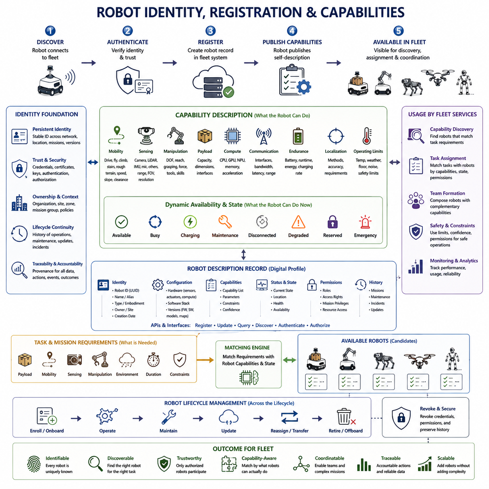{width="7.268055555555556in" height="7.268055555555556in"}

In a fleet-scale Physical AI system, every robot must exist as more than a physical machine connected to a network. It requires a persistent digital identity that allows fleet services to recognize what the robot is, where it belongs, what configuration it carries, and whether it can be trusted. Robot identity forms the reference point connecting hardware, software, operational history, permissions, capabilities, tasks, and shared fleet knowledge.

A robot identity should remain stable even when network addresses, locations, software versions, or assigned missions change. Temporary communication identifiers are useful for connectivity, but they should not define the robot itself. A persistent identity allows observations, maintenance records, failures, learned experience, task outcomes, and configuration changes to remain associated with the correct physical agent throughout its operational lifecycle.

Registration is the process through which a robot becomes a recognized participant in the fleet. During registration, the orchestration system creates or verifies the robot identity and associates it with essential metadata such as robot type, embodiment, ownership, hardware configuration, software stack, sensors, actuators, communication interfaces, and operational domain. Successful registration establishes the robot as a manageable entity within the fleet architecture.

Registration should also establish trust rather than merely record a name in a database. The system must determine whether the connecting robot is an authorized device and whether its identity can be authenticated. Credentials, certificates, cryptographic keys, or equivalent mechanisms can bind the digital identity to the physical platform. This prevents an unknown or impersonated agent from joining the fleet and receiving commands or contributing untrusted information.

After registration, the fleet needs an accurate representation of robot capabilities. Capability describes what a robot can potentially perform rather than only what type of robot it is. Two robots with similar physical appearances may have different sensors, payload limits, software modules, manipulation tools, mobility performance, or learned skills. Fleet orchestration therefore requires capability descriptions that are explicit enough to support automated reasoning and task assignment.

Capability representation can include mobility, sensing, manipulation, payload, computation, communication, endurance, localization, and environmental operating limits. An AMR may advertise load capacity and navigation ability, while a quadruped may describe stair climbing or rough-terrain mobility. A mobile manipulator may additionally expose reach, grasping, tool-use, and manipulation skills. These properties form a machine-readable description of what each fleet member can contribute.

Physical capabilities should be distinguished from software and AI capabilities. A robot may possess cameras and manipulators physically but lack the currently deployed model or skill required for a particular mission. Conversely, a software capability may become available after a validated model update without changing hardware. Capability management must therefore represent the combination of embodiment, hardware resources, software functions, learned models, and operational permissions.

Capabilities are not necessarily static throughout the robot lifecycle. Battery condition, sensor degradation, payload state, attached tools, software updates, environmental conditions, or failures can change what a robot can safely perform. Fleet services should distinguish relatively persistent capabilities from dynamic availability. A robot capable of carrying a heavy load in principle may temporarily become unsuitable because of low energy, a degraded sensor, or an occupied payload interface.

Capability discovery allows orchestration services to find robots that satisfy mission requirements without depending on manually maintained lists. A task can specify required properties such as payload capacity, sensor modality, mobility class, manipulation skill, localization method, endurance, or operating environment. The fleet can then query registered robot descriptions and identify candidates whose current capabilities and states satisfy those constraints.

This approach becomes essential in heterogeneous fleets containing AMRs, mobile manipulators, humanoids, quadrupeds, UAVs, and other specialized embodiments. Instead of encoding a separate orchestration workflow for every robot category, the system can reason through common capability abstractions. Robot-specific details remain available when necessary, while shared representations allow different embodiments to participate in common task allocation, coordination, and mission planning processes.

Capability representation also supports team formation. Some missions cannot be completed by one robot even though no individual robot is defective or insufficiently intelligent. A transportation robot, inspection robot, manipulator, and aerial observer may provide complementary capabilities. Orchestration can compose a team by comparing mission requirements with the combined capabilities of multiple robots, transforming capability discovery into collective capability planning.

Registration should connect identity and capabilities with operational state. The fleet needs to know whether a robot is available, busy, charging, undergoing maintenance, disconnected, degraded, reserved, or in an emergency condition. Capability alone does not imply availability. Task assignment therefore depends on the intersection of what a robot can do, what it is currently permitted to do, and whether its present state allows the task to be executed.

Location and site membership provide additional context for identity management. A robot may belong to a particular facility, operational zone, organization, or mission group while still retaining a globally unique identity. Site-level registration can associate the robot with local maps, infrastructure, policies, communication services, and resource permissions. This enables cross-site architectures to preserve global identity while applying local operational context.

Version information is another important part of the robot description. Hardware revisions, firmware, middleware, autonomy software, AI models, map versions, and configuration packages can influence compatibility and behavior. Fleet management should know which combinations are deployed on each robot so that tasks, updates, diagnostics, and safety policies can account for configuration differences rather than assuming that nominally identical robots behave identically.

A capability model should also describe constraints and confidence rather than only positive functions. Payload limits, maximum slopes, minimum passage widths, weather restrictions, sensor ranges, localization requirements, uncertainty, and safety restrictions influence whether a capability can actually be used. Representing these boundaries prevents orchestration from interpreting a capability label as an unconditional guarantee that a robot can execute every related task.

Robot self-description can reduce integration effort by allowing a newly connected agent to publish standardized information about itself. Fleet services can inspect identity, embodiment, interfaces, available skills, constraints, and current status instead of requiring extensive manual configuration. This becomes increasingly valuable as fleet size and heterogeneity grow because integration complexity otherwise increases with every robot type and software combination.

Identity also anchors accountability and traceability. When a robot produces an observation, modifies shared world memory, reports a hazard, completes a mission, or experiences a failure, the fleet should know which physical agent generated that information and under which configuration. Provenance allows operators and learning systems to evaluate reliability, investigate incidents, compare robot performance, and prevent uncertain information from becoming anonymous fleet knowledge.

The same principle applies to authorization. Being registered does not mean that every robot should access every mission, map, resource, or service. Identity can be associated with roles, permissions, site policies, and mission-specific privileges. A robot may be technically capable of entering an area or operating equipment but remain unauthorized to do so. Orchestration must therefore consider capability and permission as related but distinct conditions.

Robot lifecycle management extends identity from initial enrollment through operation, maintenance, reassignment, and eventual retirement. When hardware is repaired, sensors are replaced, software is upgraded, or a robot moves between sites, its identity record and capability description should evolve without losing historical continuity. When the platform is retired, credentials and permissions must be revoked while operational history remains available for analysis and fleet learning.

At fleet scale, robot identity, registration, and capability representation collectively create a machine-readable model of the available physical workforce. They allow orchestration to answer three fundamental questions: which robot is participating, whether that robot is trusted and available, and what it can safely contribute. These mechanisms transform a collection of connected machines into identifiable, discoverable, manageable, and coordinatable Physical AI agents.

A mature system therefore treats identity and capabilities as dynamic foundations of fleet intelligence rather than administrative metadata. Persistent identity provides continuity and trust, registration establishes membership and context, and capability models expose the functional potential and constraints of each agent. Together they enable capability-aware task allocation, heterogeneous coordination, secure operations, traceable knowledge sharing, and scalable fleet orchestration.

플릿 규모 피지컬 AI(Fleet-Scale Physical AI) 시스템에서 모든 로봇은 단순히 네트워크에 연결된 물리적 기계(Physical Machine) 이상의 존재로 정의되어야 한다. 플릿 서비스(Fleet Service)가 해당 로봇이 무엇인지, 어디에 속하는지, 어떤 구성을 가지고 있는지, 신뢰할 수 있는지를 인식할 수 있도록 지속적인 디지털 신원(Persistent Digital Identity)이 필요하다. 로봇 신원(Robot Identity)은 하드웨어, 소프트웨어, 운영 이력, 권한, 역량(Capability), 작업(Task), 공유 플릿 지식(Shared Fleet Knowledge)을 연결하는 기준점이 된다.

로봇 신원(Robot Identity)은 네트워크 주소(Network Address), 위치(Location), 소프트웨어 버전(Software Version), 할당된 임무(Assigned Mission)가 변경되더라도 안정적으로 유지되어야 한다. 임시 통신 식별자(Temporary Communication Identifier)는 연결에 유용하지만 로봇 자체를 정의해서는 안 된다. 지속적 신원(Persistent Identity)을 통해 관측 정보, 유지보수 기록, 장애, 학습 경험, 작업 결과, 구성 변경을 로봇의 전체 운영 수명주기(Operational Lifecycle)에 걸쳐 올바른 물리 에이전트(Physical Agent)와 연결할 수 있다.

등록(Registration)은 로봇이 플릿(Fleet)의 공식적인 구성원으로 인식되는 과정이다. 등록 과정에서 오케스트레이션 시스템(Orchestration System)은 로봇 신원을 생성하거나 검증하고 로봇 유형(Robot Type), 형태와 구조(Embodiment), 소유권(Ownership), 하드웨어 구성(Hardware Configuration), 소프트웨어 스택(Software Stack), 센서(Sensor), 액추에이터(Actuator), 통신 인터페이스(Communication Interface), 운영 영역(Operational Domain)과 같은 필수 메타데이터(Metadata)를 연결한다. 성공적인 등록은 로봇을 플릿 아키텍처(Fleet Architecture) 내부에서 관리 가능한 개체(Manageable Entity)로 확립한다.

등록(Registration)은 단순히 데이터베이스(Database)에 이름을 기록하는 것이 아니라 신뢰(Trust)를 확립해야 한다. 시스템은 접속하는 로봇이 승인된 장치(Authorized Device)인지, 그리고 그 신원을 인증(Authentication)할 수 있는지를 판단해야 한다. 자격증명(Credential), 인증서(Certificate), 암호화 키(Cryptographic Key) 또는 이에 상응하는 메커니즘을 통해 디지털 신원(Digital Identity)을 물리 플랫폼(Physical Platform)에 결합할 수 있다. 이를 통해 알려지지 않았거나 다른 로봇을 사칭한 에이전트가 플릿에 참여하여 명령을 수신하거나 신뢰할 수 없는 정보를 제공하는 것을 방지한다.

등록 이후 플릿은 로봇 역량(Robot Capability)을 정확하게 표현할 수 있어야 한다. 역량(Capability)은 단순히 어떤 종류의 로봇인가가 아니라 해당 로봇이 잠재적으로 무엇을 수행할 수 있는지를 의미한다. 물리적 외형이 유사한 두 로봇이라도 센서, 페이로드 한계(Payload Limit), 소프트웨어 모듈(Software Module), 조작 도구(Manipulation Tool), 이동 성능(Mobility Performance), 학습된 기술(Learned Skill)이 다를 수 있다. 따라서 플릿 오케스트레이션(Fleet Orchestration)은 자동화된 추론(Automated Reasoning)과 작업 할당(Task Assignment)을 지원할 수 있을 만큼 명확한 역량 설명(Capability Description)을 필요로 한다.

역량 표현(Capability Representation)에는 이동성(Mobility), 센싱(Sensing), 조작(Manipulation), 페이로드(Payload), 컴퓨팅(Computing), 통신(Communication), 지속 운용 능력(Endurance), 위치추정(Localization), 환경 운영 한계(Environmental Operating Limit) 등이 포함될 수 있다. 자율이동로봇(AMR)은 적재 용량과 주행 능력을 제공하고, 4족 로봇(Quadruped)은 계단 이동이나 험지 주행 능력을 표현할 수 있다. 모바일 매니퓰레이터(Mobile Manipulator)는 추가적으로 도달 범위(Reach), 파지(Grasping), 도구 사용(Tool Use), 조작 기술(Manipulation Skill)을 제공할 수 있다. 이러한 속성은 각 플릿 구성원이 무엇을 기여할 수 있는지를 나타내는 기계 판독 가능한 설명(Machine-Readable Description)을 형성한다.

물리적 역량(Physical Capability)은 소프트웨어 및 AI 역량(Software and AI Capability)과 구분되어야 한다. 로봇이 카메라와 매니퓰레이터를 물리적으로 갖추고 있더라도 특정 임무에 필요한 모델(Model)이나 기술(Skill)이 현재 배포되어 있지 않을 수 있다. 반대로 하드웨어를 변경하지 않고도 검증된 모델 업데이트(Model Update)를 통해 새로운 소프트웨어 역량이 제공될 수 있다. 따라서 역량 관리(Capability Management)는 형태와 구조, 하드웨어 자원, 소프트웨어 기능, 학습 모델(Learned Model), 운영 권한(Operational Permission)의 조합을 표현해야 한다.

역량(Capability)은 로봇의 수명주기 전체에서 반드시 고정되어 있는 것은 아니다. 배터리 상태(Battery Condition), 센서 성능 저하(Sensor Degradation), 페이로드 상태(Payload State), 장착 도구(Attached Tool), 소프트웨어 업데이트, 환경 조건(Environmental Condition), 장애(Failure)에 따라 로봇이 안전하게 수행할 수 있는 작업이 달라질 수 있다. 플릿 서비스는 비교적 지속적인 역량(Persistent Capability)과 동적인 가용성(Dynamic Availability)을 구분해야 한다. 원칙적으로 무거운 화물을 운반할 수 있는 로봇이라도 에너지 부족, 센서 성능 저하, 페이로드 인터페이스 사용 중 등의 이유로 일시적으로 해당 작업에 부적합할 수 있다.

역량 탐색(Capability Discovery)은 수동으로 관리되는 로봇 목록에 의존하지 않고 오케스트레이션 서비스가 임무 요구사항(Mission Requirement)을 충족하는 로봇을 찾을 수 있도록 한다. 작업은 페이로드 용량, 센서 모달리티(Sensor Modality), 이동성 등급(Mobility Class), 조작 기술, 위치추정 방식(Localization Method), 지속 운용 능력, 운영 환경 등의 필수 속성을 지정할 수 있다. 플릿은 등록된 로봇 설명을 검색하여 현재 역량과 상태가 이러한 제약조건을 만족하는 후보 로봇을 식별할 수 있다.

이러한 접근 방식은 자율이동로봇(AMR), 모바일 매니퓰레이터(Mobile Manipulator), 휴머노이드(Humanoid), 4족 로봇(Quadruped), 무인항공기(UAV), 기타 특수 형태의 로봇으로 구성된 이종 플릿(Heterogeneous Fleet)에서 특히 중요하다. 각 로봇 유형마다 별도의 오케스트레이션 작업 흐름(Orchestration Workflow)을 구현하는 대신 공통 역량 추상화(Common Capability Abstraction)를 통해 시스템이 추론할 수 있다. 필요한 경우 로봇별 세부정보를 유지하면서 공유 표현(Shared Representation)을 통해 서로 다른 형태의 로봇들이 공통 작업 할당, 조정(Coordination), 임무 계획(Mission Planning)에 참여할 수 있다.

역량 표현(Capability Representation)은 팀 구성(Team Formation)도 지원한다. 일부 임무는 개별 로봇에 장애가 있거나 지능이 부족하지 않더라도 하나의 로봇만으로 완료할 수 없다. 운송 로봇(Transportation Robot), 검사 로봇(Inspection Robot), 매니퓰레이터(Manipulator), 공중 관측 로봇(Aerial Observer)이 상호보완적인 역량(Complementary Capability)을 제공할 수 있다. 오케스트레이션은 임무 요구사항을 여러 로봇의 결합된 역량(Combined Capability)과 비교하여 팀을 구성함으로써 역량 탐색을 집단 역량 계획(Collective Capability Planning)으로 확장할 수 있다.

등록(Registration)은 신원과 역량을 운영 상태(Operational State)와 연결해야 한다. 플릿은 로봇이 사용 가능(Available), 작업 중(Busy), 충전 중(Charging), 유지보수 중(Under Maintenance), 연결 해제(Disconnected), 성능 저하(Degraded), 예약됨(Reserved), 비상 상태(Emergency Condition) 중 어느 상태인지 알아야 한다. 역량을 가지고 있다는 사실 자체가 가용성을 의미하지는 않는다. 따라서 작업 할당은 로봇이 무엇을 할 수 있는지, 현재 무엇을 수행하도록 허용되어 있는지, 현재 상태에서 해당 작업을 실행할 수 있는지의 교집합에 의해 결정된다.

위치(Location)와 사이트 소속(Site Membership)은 신원 관리(Identity Management)에 추가적인 맥락(Context)을 제공한다. 로봇은 전역적으로 고유한 신원(Globally Unique Identity)을 유지하면서 특정 시설(Facility), 운영 구역(Operational Zone), 조직(Organization), 임무 그룹(Mission Group)에 속할 수 있다. 사이트 수준 등록(Site-Level Registration)은 로봇을 로컬 지도(Local Map), 인프라, 정책(Policy), 통신 서비스, 자원 권한(Resource Permission)과 연결할 수 있다. 이를 통해 사이트 간 아키텍처(Cross-Site Architecture)는 전역 신원을 유지하면서 로컬 운영 맥락(Local Operational Context)을 적용할 수 있다.

버전 정보(Version Information) 역시 로봇 설명(Robot Description)의 중요한 요소이다. 하드웨어 리비전(Hardware Revision), 펌웨어(Firmware), 미들웨어(Middleware), 자율주행 소프트웨어(Autonomy Software), AI 모델, 지도 버전(Map Version), 구성 패키지(Configuration Package)는 호환성(Compatibility)과 행동에 영향을 줄 수 있다. 플릿 관리는 각 로봇에 어떤 조합이 배포되어 있는지 파악하여 명목상 동일한 로봇이 동일하게 행동한다고 가정하지 않고 작업, 업데이트, 진단(Diagnostics), 안전 정책(Safety Policy)에 구성 차이를 반영해야 한다.

역량 모델(Capability Model)은 긍정적인 기능뿐만 아니라 제약조건(Constraint)과 신뢰도(Confidence)도 표현해야 한다. 페이로드 한계, 최대 경사(Maximum Slope), 최소 통로 폭(Minimum Passage Width), 기상 제한(Weather Restriction), 센서 범위(Sensor Range), 위치추정 요구사항, 불확실성(Uncertainty), 안전 제한(Safety Restriction)은 실제로 해당 역량을 사용할 수 있는지를 결정한다. 이러한 경계를 표현함으로써 오케스트레이션이 단순한 역량 라벨(Capability Label)을 로봇이 관련된 모든 작업을 무조건 수행할 수 있다는 보장으로 잘못 해석하는 것을 방지할 수 있다.

로봇 자기 설명(Robot Self-Description)을 활용하면 새롭게 연결된 에이전트가 자신에 대한 표준화된 정보(Standardized Information)를 제공하여 통합 노력(Integration Effort)을 줄일 수 있다. 플릿 서비스는 광범위한 수동 구성 없이 신원, 형태와 구조, 인터페이스, 사용 가능한 기술, 제약조건, 현재 상태를 확인할 수 있다. 이러한 기능은 플릿 규모와 이질성(Heterogeneity)이 증가할수록 더욱 중요해지는데, 그렇지 않으면 새로운 로봇 유형과 소프트웨어 조합이 추가될 때마다 통합 복잡도(Integration Complexity)가 증가하기 때문이다.

신원(Identity)은 책임성(Accountability)과 추적 가능성(Traceability)의 기준점 역할도 한다. 로봇이 관측 정보를 생성하거나 공유 월드 메모리(Shared World Memory)를 수정하고, 위험요소를 보고하거나 임무를 완료하고, 장애를 경험하는 경우 플릿은 어떤 물리 에이전트가 어떤 구성 상태에서 해당 정보를 생성했는지를 알아야 한다. 데이터 출처(Provenance)를 통해 운영자와 학습 시스템은 신뢰성을 평가하고 사고를 조사하며 로봇 성능을 비교하고 불확실한 정보가 출처를 알 수 없는 플릿 지식으로 전환되는 것을 방지할 수 있다.

동일한 원칙은 권한 부여(Authorization)에도 적용된다. 등록되어 있다는 것이 모든 로봇이 모든 임무, 지도, 자원, 서비스에 접근할 수 있음을 의미하지는 않는다. 신원은 역할(Role), 권한(Permission), 사이트 정책(Site Policy), 임무별 특권(Mission-Specific Privilege)과 연결될 수 있다. 로봇이 특정 구역에 진입하거나 장비를 작동시킬 수 있는 기술적 역량을 갖추고 있더라도 그렇게 할 권한이 없을 수 있다. 따라서 오케스트레이션은 역량과 권한을 서로 관련되어 있지만 구별되는 조건으로 고려해야 한다.

로봇 수명주기 관리(Robot Lifecycle Management)는 초기 등록(Initial Enrollment)부터 운영(Operation), 유지보수(Maintenance), 재할당(Reassignment), 최종 폐기(Retirement)에 이르기까지 신원 관리를 확장한다. 하드웨어가 수리되고 센서가 교체되거나 소프트웨어가 업그레이드되고 로봇이 사이트 사이를 이동하는 경우에도 신원 기록과 역량 설명은 과거의 연속성(Historical Continuity)을 잃지 않으면서 변화해야 한다. 플랫폼이 폐기되면 자격증명과 권한은 철회되어야 하지만 운영 이력은 분석과 플릿 학습(Fleet Learning)을 위해 유지되어야 한다.

플릿 규모(Fleet Scale)에서 로봇 신원(Robot Identity), 등록(Registration), 역량 표현(Capability Representation)은 함께 사용 가능한 물리적 작업 집단(Physical Workforce)에 대한 기계 판독 가능한 모델(Machine-Readable Model)을 형성한다. 이를 통해 오케스트레이션은 어떤 로봇이 참여하고 있는지, 해당 로봇이 신뢰할 수 있고 사용 가능한지, 그리고 무엇을 안전하게 기여할 수 있는지라는 세 가지 근본적인 질문에 답할 수 있다. 이러한 메커니즘은 단순히 연결된 기계들의 집합을 식별 가능하고(Identifiable), 탐색 가능하며(Discoverable), 관리 가능하고(Manageable), 조정 가능한(Coordinatable) 피지컬 AI 에이전트(Physical AI Agent)로 전환한다.

따라서 성숙한 시스템(Mature System)은 신원과 역량을 단순한 관리용 메타데이터(Administrative Metadata)가 아니라 플릿 지능(Fleet Intelligence)의 동적인 기반(Dynamic Foundation)으로 취급한다. 지속적 신원(Persistent Identity)은 연속성과 신뢰를 제공하고, 등록은 구성원 자격(Membership)과 맥락을 확립하며, 역량 모델은 각 에이전트의 기능적 잠재력(Functional Potential)과 제약조건을 표현한다. 이들이 결합되면 역량 인식 작업 할당(Capability-Aware Task Allocation), 이종 로봇 조정(Heterogeneous Coordination), 안전한 운영(Secure Operations), 추적 가능한 지식 공유(Traceable Knowledge Sharing), 확장 가능한 플릿 오케스트레이션(Scalable Fleet Orchestration)이 가능해진다.

## 09.04. Fleet Task Dispatching and Scheduling

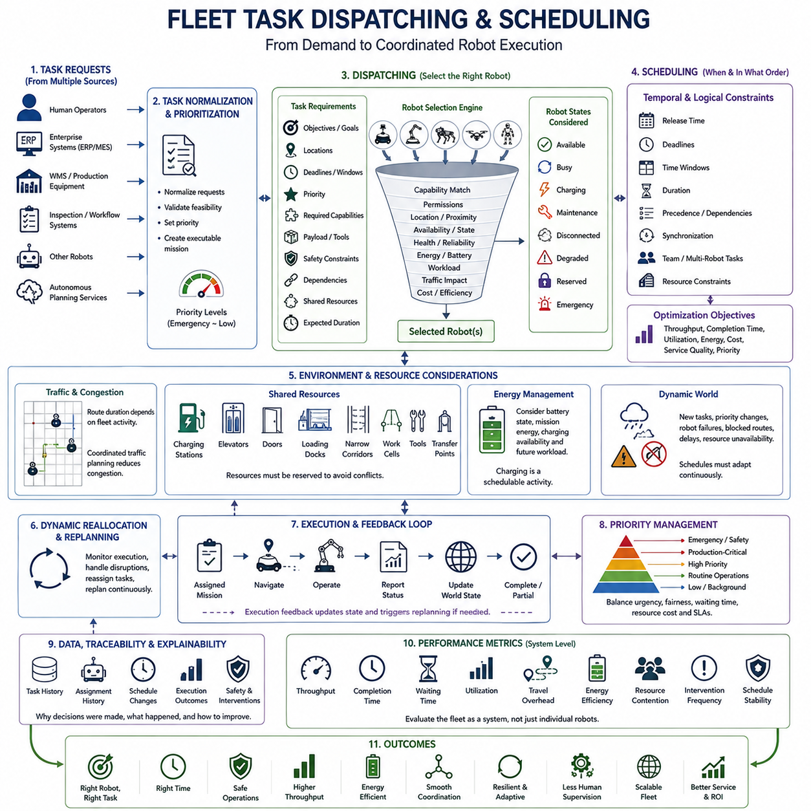{width="7.268055555555556in" height="7.268055555555556in"}

Fleet task dispatching and scheduling transform operational demand into coordinated robot activity across a shared physical environment. Dispatching determines which robot should receive a task, while scheduling determines when and in what sequence tasks should be executed. At fleet scale, these functions must continuously balance mission priorities, robot capabilities, spatial constraints, resource availability, energy, traffic, and changing operational conditions.

A task represents more than a destination or simple command. It can include objectives, locations, deadlines, priorities, required capabilities, expected duration, dependencies, safety constraints, payload requirements, and shared-resource needs. Representing tasks in a structured form allows the fleet orchestration system to compare operational requirements with robot capabilities and current state rather than relying on manually predefined robot-to-task relationships.

Task requests may originate from human operators, enterprise systems, production equipment, warehouse management systems, inspection workflows, other robots, or autonomous planning services. The dispatcher acts as an interface between these sources and the physical fleet. It normalizes incoming requests, evaluates their feasibility and priority, and converts accepted requests into executable missions that can be assigned to appropriate robots.

Robot selection requires both capability matching and state awareness. A robot may possess the required mobility, payload, sensing, or manipulation capability but still be unavailable because it is charging, occupied, under maintenance, disconnected, or operating in another zone. Dispatching therefore evaluates the intersection of task requirements, robot capabilities, permissions, location, health, workload, energy, and current operational availability.

Distance alone is rarely sufficient for selecting the best robot. A nearby robot may have insufficient battery energy, be carrying another payload, require maintenance, or create traffic congestion if assigned. A more distant robot may complete the mission more efficiently when future tasks and resource usage are considered. Fleet dispatching therefore evaluates expected system-level cost rather than simply choosing the geographically closest available agent.

Scheduling introduces the temporal dimension of fleet coordination. Tasks can have release times, deadlines, execution windows, durations, precedence relationships, or synchronization requirements. Some missions must occur sequentially, while others can execute concurrently. The scheduler organizes these constraints into feasible execution plans while attempting to optimize objectives such as throughput, completion time, utilization, energy consumption, service quality, or operational priority.

Task dependencies become particularly important for complex Physical AI missions. A robot may first deliver a component before a manipulator can assemble it, or an inspection robot may need to verify an area before another robot enters. Scheduling must represent these precedence relationships so that individually valid tasks are executed in a globally meaningful sequence. The fleet therefore coordinates workflows rather than isolated robot movements.

Heterogeneous fleets add capability-dependent scheduling constraints. An AMR, mobile manipulator, quadruped, humanoid, and UAV may each perform different portions of a mission. Some tasks require one specific embodiment, while others can be completed by several robot classes with different costs or performance. Scheduling must account for these alternatives and may compose complementary robots into temporary teams when no individual agent satisfies the complete mission requirement.

Multi-robot tasks require synchronization as well as assignment. Cooperative transportation, coordinated inspection, handover, collaborative manipulation, or ground-air missions may require several robots to arrive within compatible time windows. Scheduling must consider the readiness and travel time of every participating agent so that one robot does not remain idle for long periods while waiting for another member of the team.

Physical resources also constrain task schedules. Charging stations, elevators, doors, loading docks, narrow corridors, work cells, tools, and transfer points may be shared among many robots. A task schedule that ignores these resources can appear feasible while producing conflicts during execution. Fleet scheduling therefore needs to coordinate robot availability with infrastructure reservations and traffic plans to produce physically executable schedules.

Traffic management and scheduling are strongly coupled because travel time depends on fleet activity. When many robots share the same environment, congestion can make nominal route duration inaccurate. Dispatching decisions can themselves create traffic concentrations by sending multiple robots toward the same area. Effective fleet orchestration therefore exchanges information between task scheduling and traffic management so that estimated costs reflect expected physical interactions.

Energy management introduces another scheduling dimension. Robots must complete missions without violating safe energy reserves, while unnecessary charging can reduce utilization and throughput. The scheduler can incorporate battery state, predicted mission energy, charging availability, and future workload when assigning tasks. Charging then becomes a schedulable fleet activity rather than an isolated behavior triggered only when a robot reaches a low battery threshold.

Static schedules quickly become obsolete in dynamic physical environments. Tasks may arrive unexpectedly, priorities may change, robots may fail, routes may become blocked, operations may take longer than expected, or shared resources may become unavailable. Fleet scheduling must therefore operate as a continuous process that observes execution and updates plans rather than calculating a complete schedule once and assuming that reality will follow it.

Dynamic reallocation is the mechanism for responding to these changes. When a robot becomes unavailable, unfinished or pending tasks can be returned to the scheduling system and assigned to other qualified agents. Reallocation should consider the cost of interruption, task progress, payload state, dependencies, and recovery requirements. In some cases, completing a partially executed task may require another robot to recover an object or resume from a known physical state.

Priority management determines how competing operational demands are resolved. Emergency tasks, safety-related missions, production-critical requests, routine transport, maintenance activities, and low-priority background work may coexist within the same fleet. Scheduling policies can combine fixed priority classes with deadlines, waiting time, resource costs, or service-level objectives so that urgent work is handled rapidly without indefinitely starving lower-priority tasks.

Centralized scheduling provides a global view of robots and tasks and can optimize across the entire fleet, but computational complexity and communication dependence increase with scale. Distributed scheduling allows robots or local groups to negotiate assignments using local information, improving resilience and scalability. Many practical fleets use hybrid architectures in which global services define objectives and constraints while local agents resolve immediate execution details.

Optimization-based scheduling can formulate task allocation as a constrained assignment, routing, or scheduling problem. Objectives may minimize travel distance, makespan, energy consumption, lateness, congestion, or operating cost while satisfying capability and resource constraints. Exact optimization may become expensive for large dynamic fleets, so practical systems often combine optimization with heuristics, auctions, priority rules, rolling horizons, or learning-based estimators.

Rolling-horizon scheduling is especially suitable for fleet operations because only the near future needs to be committed in detail. The scheduler repeatedly considers current fleet state and a window of upcoming tasks, produces assignments, observes execution, and solves the problem again as new information arrives. This approach balances global planning with responsiveness and reduces dependence on uncertain long-term predictions about the physical environment.

Dispatching decisions should also preserve explainability and traceability. Operators may need to understand why a particular robot was selected, why a mission was delayed, or why another task was given higher priority. Recording task requirements, candidate robots, constraints, estimated costs, assignments, schedule changes, and execution outcomes provides an operational history that supports debugging, safety investigation, performance analysis, and future learning.

Fleet performance must be evaluated at the system level rather than solely by individual robot utilization. Keeping every robot continuously busy can actually reduce throughput if it creates congestion or eliminates spare capacity for urgent tasks. Useful scheduling metrics include task completion time, throughput, lateness, waiting time, utilization, travel overhead, energy efficiency, resource contention, intervention frequency, and the stability of schedules under disruption.

At fleet scale, task dispatching and scheduling become a continuous closed-loop decision process connecting demand, robot capabilities, world state, traffic, resources, energy, and execution feedback. The objective is not merely to keep robots moving but to ensure that the right physical agent performs the right task at the right time under appropriate constraints. This coordination converts individual robot autonomy into productive fleet-level behavior.

A mature scheduling architecture therefore combines capability-aware assignment, temporal planning, resource reservation, traffic coordination, energy management, dynamic replanning, and operational priorities within fleet orchestration. As robot populations grow, these mechanisms allow work to be distributed without proportional growth in human supervision, while preserving safety, resilience, efficiency, and adaptability across heterogeneous Physical AI fleets.

플릿 작업 디스패칭(Fleet Task Dispatching)과 스케줄링(Scheduling)은 운영 요구(Operational Demand)를 공유된 물리 환경(Shared Physical Environment)에서 조정된 로봇 활동(Coordinated Robot Activity)으로 변환한다. 디스패칭은 어떤 로봇이 작업(Task)을 받아야 하는지를 결정하고, 스케줄링은 작업을 언제 어떤 순서로 실행해야 하는지를 결정한다. 플릿 규모(Fleet Scale)에서는 임무 우선순위(Mission Priority), 로봇 역량(Robot Capability), 공간적 제약(Spatial Constraint), 자원 가용성(Resource Availability), 에너지(Energy), 교통(Traffic), 변화하는 운영 조건을 지속적으로 균형 있게 고려해야 한다.

작업(Task)은 단순한 목적지(Destination)나 명령(Command) 이상의 정보를 나타낸다. 작업에는 목표(Objective), 위치(Location), 마감시간(Deadline), 우선순위(Priority), 요구 역량(Required Capability), 예상 소요시간(Expected Duration), 의존관계(Dependency), 안전 제약(Safety Constraint), 페이로드 요구사항(Payload Requirement), 공유 자원 요구사항(Shared-Resource Requirement)이 포함될 수 있다. 작업을 구조화된 형태(Structured Form)로 표현하면 플릿 오케스트레이션 시스템(Fleet Orchestration System)이 수동으로 정의된 로봇-작업 관계에 의존하지 않고 운영 요구사항과 로봇 역량 및 현재 상태를 비교할 수 있다.

작업 요청(Task Request)은 인간 운영자(Human Operator), 기업 시스템(Enterprise System), 생산 설비(Production Equipment), 창고관리시스템(Warehouse Management System), 검사 워크플로(Inspection Workflow), 다른 로봇, 자율 계획 서비스(Autonomous Planning Service) 등 다양한 출처에서 발생할 수 있다. 디스패처(Dispatcher)는 이러한 요청 출처와 물리적 플릿(Physical Fleet) 사이의 인터페이스 역할을 한다. 들어오는 요청을 표준화하고 실행 가능성과 우선순위를 평가한 후 승인된 요청을 적절한 로봇에 할당할 수 있는 실행 가능한 임무(Executable Mission)로 변환한다.

로봇 선택(Robot Selection)에는 역량 매칭(Capability Matching)과 상태 인식(State Awareness)이 모두 필요하다. 로봇이 요구되는 이동성(Mobility), 페이로드(Payload), 센싱(Sensing), 조작(Manipulation) 역량을 보유하고 있더라도 충전 중이거나, 다른 작업을 수행 중이거나, 유지보수 중이거나, 연결이 끊겼거나, 다른 구역에서 작업 중이면 사용할 수 없을 수 있다. 따라서 디스패칭은 작업 요구사항, 로봇 역량, 권한(Permission), 위치, 상태(Health), 작업 부하(Workload), 에너지, 현재 운영 가용성(Operational Availability)의 교집합을 평가한다.

거리(Distance)만으로 최적의 로봇을 선택하기에는 충분하지 않은 경우가 많다. 가까운 로봇이라도 배터리 에너지가 부족하거나, 다른 페이로드를 운반 중이거나, 유지보수가 필요하거나, 해당 로봇을 할당함으로써 교통 혼잡(Traffic Congestion)이 발생할 수 있다. 반대로 더 멀리 있는 로봇이라도 향후 작업과 자원 사용까지 고려하면 임무를 더 효율적으로 완료할 수 있다. 따라서 플릿 디스패칭은 단순히 지리적으로 가장 가까운 가용 에이전트를 선택하는 것이 아니라 예상되는 시스템 수준 비용(System-Level Cost)을 평가해야 한다.

스케줄링(Scheduling)은 플릿 조정(Fleet Coordination)에 시간적 차원(Temporal Dimension)을 추가한다. 작업에는 릴리스 시간(Release Time), 마감시간, 실행 시간창(Execution Window), 작업시간(Duration), 선후관계(Precedence Relationship), 동기화 요구사항(Synchronization Requirement)이 존재할 수 있다. 일부 임무는 순차적으로 수행되어야 하고 다른 임무는 동시에 수행할 수 있다. 스케줄러(Scheduler)는 이러한 제약조건을 실행 가능한 계획으로 구성하면서 처리량(Throughput), 완료 시간(Completion Time), 활용률(Utilization), 에너지 소비(Energy Consumption), 서비스 품질(Service Quality), 운영 우선순위 등의 목표를 최적화한다.

복잡한 피지컬 AI(Physical AI) 임무에서는 작업 의존관계(Task Dependency)가 특히 중요하다. 매니퓰레이터(Manipulator)가 부품을 조립하기 전에 로봇이 먼저 해당 부품을 전달해야 할 수 있으며, 다른 로봇이 특정 구역에 진입하기 전에 검사 로봇(Inspection Robot)이 그 영역을 확인해야 할 수도 있다. 스케줄링은 이러한 선후관계를 표현하여 개별적으로 유효한 작업들이 전역적으로 의미 있는 순서(Global Meaningful Sequence)로 실행되도록 해야 한다. 따라서 플릿은 서로 독립된 로봇 움직임이 아니라 전체 작업 흐름(Workflow)을 조정한다.

이종 플릿(Heterogeneous Fleet)은 역량 의존적 스케줄링 제약(Capability-Dependent Scheduling Constraint)을 추가한다. 자율이동로봇(AMR), 모바일 매니퓰레이터(Mobile Manipulator), 4족 로봇(Quadruped), 휴머노이드(Humanoid), 무인항공기(UAV)는 각각 임무의 서로 다른 부분을 수행할 수 있다. 일부 작업에는 특정 형태(Embodiment)의 로봇이 필요하지만 다른 작업은 비용이나 성능이 서로 다른 여러 종류의 로봇이 수행할 수 있다. 스케줄링은 이러한 대안을 고려하고 개별 에이전트가 전체 임무 요구사항을 충족하지 못하는 경우 상호보완적인 로봇들을 임시 팀(Temporary Team)으로 구성할 수 있어야 한다.

멀티로봇 작업(Multi-Robot Task)은 할당뿐만 아니라 동기화(Synchronization)도 필요하다. 협력 운송(Cooperative Transportation), 조정된 검사(Coordinated Inspection), 인계(Handover), 협력 조작(Collaborative Manipulation), 지상-공중 임무(Ground-Air Mission)는 여러 로봇이 서로 호환되는 시간창 내에 도착해야 할 수 있다. 스케줄링은 참여하는 모든 에이전트의 준비 상태(Readiness)와 이동시간(Travel Time)을 고려하여 하나의 로봇이 다른 팀 구성원을 장시간 기다리면서 유휴 상태(Idle State)가 되지 않도록 해야 한다.

물리적 자원(Physical Resource)도 작업 스케줄을 제한한다. 충전소(Charging Station), 엘리베이터(Elevator), 출입문(Door), 적재 도크(Loading Dock), 좁은 통로(Narrow Corridor), 작업 셀(Work Cell), 도구(Tool), 전달 지점(Transfer Point)은 여러 로봇이 공유할 수 있다. 이러한 자원을 고려하지 않는 작업 스케줄은 계산상 실행 가능해 보이지만 실제 실행 과정에서는 충돌을 발생시킬 수 있다. 따라서 플릿 스케줄링은 로봇 가용성을 인프라 예약(Infrastructure Reservation) 및 교통 계획(Traffic Plan)과 조정하여 물리적으로 실행 가능한 스케줄을 생성해야 한다.

교통 관리(Traffic Management)와 스케줄링은 이동시간이 플릿 활동에 따라 변화하기 때문에 강하게 결합되어 있다. 많은 로봇이 동일한 환경을 공유하면 혼잡으로 인해 명목상 경로 이동시간(Nominal Route Duration)이 부정확해질 수 있다. 디스패칭 결정 자체가 여러 로봇을 동일한 구역으로 보내 교통 집중(Traffic Concentration)을 만들 수도 있다. 따라서 효과적인 플릿 오케스트레이션은 작업 스케줄링과 교통 관리 사이에서 정보를 교환하여 예상 비용이 실제 물리적 상호작용을 반영하도록 해야 한다.

에너지 관리(Energy Management)는 또 다른 스케줄링 차원을 추가한다. 로봇은 안전한 에너지 예비량(Safe Energy Reserve)을 침해하지 않고 임무를 완료해야 하며, 불필요한 충전은 활용률과 처리량을 감소시킬 수 있다. 스케줄러는 작업을 할당할 때 배터리 상태(Battery State), 예상 임무 에너지(Predicted Mission Energy), 충전 시설 가용성(Charging Availability), 향후 작업 부하(Future Workload)를 고려할 수 있다. 이에 따라 충전은 배터리가 낮아졌을 때만 수행하는 독립적인 행동이 아니라 스케줄링 가능한 플릿 활동(Schedulable Fleet Activity)이 된다.

동적인 물리 환경(Dynamic Physical Environment)에서는 정적 스케줄(Static Schedule)이 빠르게 현실과 맞지 않게 된다. 새로운 작업이 예상하지 못한 시점에 발생하거나, 우선순위가 변경되거나, 로봇이 고장 나거나, 경로가 차단되거나, 작업이 예상보다 오래 걸리거나, 공유 자원을 사용할 수 없게 될 수 있다. 따라서 플릿 스케줄링은 한 번 전체 계획을 계산하고 현실이 그대로 따를 것이라고 가정하는 것이 아니라 실행 상태를 관찰하고 계획을 지속적으로 갱신하는 과정으로 동작해야 한다.

동적 재할당(Dynamic Reallocation)은 이러한 변화에 대응하는 메커니즘이다. 로봇을 사용할 수 없게 되면 완료되지 않았거나 대기 중인 작업을 스케줄링 시스템으로 반환하여 다른 적격 에이전트(Qualified Agent)에 할당할 수 있다. 재할당에서는 작업 중단 비용(Interruption Cost), 진행 상태(Task Progress), 페이로드 상태, 의존관계, 복구 요구사항(Recovery Requirement)을 고려해야 한다. 일부 경우 부분적으로 수행된 작업을 완료하기 위해 다른 로봇이 물체를 회수하거나 알려진 물리적 상태(Physical State)에서 작업을 이어받아야 할 수 있다.

우선순위 관리(Priority Management)는 서로 경쟁하는 운영 요구를 어떻게 해결할 것인지를 결정한다. 비상 작업(Emergency Task), 안전 관련 임무(Safety-Related Mission), 생산 중요 요청(Production-Critical Request), 일반 운송(Routine Transport), 유지보수 활동(Maintenance Activity), 낮은 우선순위의 백그라운드 작업(Background Work)이 동일한 플릿에 동시에 존재할 수 있다. 스케줄링 정책은 고정 우선순위 등급(Fixed Priority Class)을 마감시간, 대기시간(Waiting Time), 자원 비용(Resource Cost), 서비스 수준 목표(Service-Level Objective)와 결합하여 긴급 작업을 빠르게 처리하면서 낮은 우선순위 작업이 무기한 지연되는 것을 방지할 수 있다.

중앙집중형 스케줄링(Centralized Scheduling)은 로봇과 작업에 대한 전역 관점(Global View)을 제공하고 전체 플릿을 대상으로 최적화할 수 있지만 규모가 증가할수록 계산 복잡도(Computational Complexity)와 통신 의존성(Communication Dependency)이 증가한다. 분산형 스케줄링(Distributed Scheduling)은 로봇이나 로컬 그룹이 로컬 정보를 이용해 작업 할당을 협상하도록 하여 회복탄력성(Resilience)과 확장성(Scalability)을 향상시킨다. 실제 플릿에서는 전역 서비스가 목표와 제약조건을 정의하고 로컬 에이전트가 즉각적인 실행 세부사항을 해결하는 하이브리드 아키텍처(Hybrid Architecture)가 많이 활용된다.

최적화 기반 스케줄링(Optimization-Based Scheduling)은 작업 할당을 제약조건이 있는 할당(Constrained Assignment), 경로계획(Routing), 스케줄링 문제로 공식화할 수 있다. 목표는 역량과 자원 제약을 만족하면서 이동거리(Travel Distance), 총 완료시간(Makespan), 에너지 소비, 지연(Lateness), 혼잡, 운영 비용(Operating Cost)을 최소화하는 것이 될 수 있다. 정확한 최적화(Exact Optimization)는 대규모 동적 플릿에서 계산 비용이 커질 수 있으므로 실제 시스템에서는 최적화를 휴리스틱(Heuristic), 경매(Auction), 우선순위 규칙(Priority Rule), 롤링 호라이즌(Rolling Horizon), 학습 기반 추정기(Learning-Based Estimator)와 결합하는 경우가 많다.

롤링 호라이즌 스케줄링(Rolling-Horizon Scheduling)은 가까운 미래에 대해서만 상세한 결정을 확정하면 되기 때문에 플릿 운영에 특히 적합하다. 스케줄러는 현재 플릿 상태와 일정 시간 범위의 예정 작업을 반복적으로 고려하여 할당을 생성하고, 실행 결과를 관찰한 후 새로운 정보가 들어오면 다시 문제를 해결한다. 이러한 방식은 전역 계획(Global Planning)과 즉각적인 대응성(Responsiveness)의 균형을 제공하고 물리 환경의 불확실한 장기 예측에 대한 의존성을 감소시킨다.

디스패칭 결정(Dispatching Decision)은 설명 가능성(Explainability)과 추적 가능성(Traceability)도 보존해야 한다. 운영자는 특정 로봇이 선택된 이유, 임무가 지연된 이유, 다른 작업에 더 높은 우선순위가 부여된 이유를 이해해야 할 수 있다. 작업 요구사항, 후보 로봇(Candidate Robot), 제약조건, 예상 비용, 할당 결과, 스케줄 변경, 실행 결과를 기록하면 디버깅(Debugging), 안전 조사(Safety Investigation), 성능 분석(Performance Analysis), 향후 학습을 지원하는 운영 이력(Operational History)을 구축할 수 있다.

플릿 성능(Fleet Performance)은 개별 로봇의 활용률만이 아니라 시스템 수준(System Level)에서 평가해야 한다. 모든 로봇을 지속적으로 바쁘게 유지하면 혼잡을 증가시키거나 긴급 작업을 위한 여유 용량(Spare Capacity)을 제거하여 오히려 처리량을 감소시킬 수 있다. 유용한 스케줄링 지표에는 작업 완료시간(Task Completion Time), 처리량, 지연, 대기시간, 활용률, 이동 오버헤드(Travel Overhead), 에너지 효율(Energy Efficiency), 자원 경합(Resource Contention), 개입 빈도(Intervention Frequency), 장애 상황에서의 스케줄 안정성(Schedule Stability)이 포함된다.

플릿 규모에서 작업 디스패칭과 스케줄링은 운영 요구(Demand), 로봇 역량, 월드 상태(World State), 교통, 자원, 에너지, 실행 피드백(Execution Feedback)을 연결하는 지속적인 폐루프 의사결정 과정(Closed-Loop Decision Process)이 된다. 목표는 단순히 로봇을 계속 움직이게 만드는 것이 아니라 적절한 물리 에이전트가 적절한 제약조건 아래 적절한 시점에 적절한 작업을 수행하도록 만드는 것이다. 이러한 조정을 통해 개별 로봇의 자율성(Individual Robot Autonomy)이 생산적인 플릿 수준 행동(Fleet-Level Behavior)으로 전환된다.

따라서 성숙한 스케줄링 아키텍처(Mature Scheduling Architecture)는 역량 인식 할당(Capability-Aware Assignment), 시간 계획(Temporal Planning), 자원 예약(Resource Reservation), 교통 조정(Traffic Coordination), 에너지 관리, 동적 재계획(Dynamic Replanning), 운영 우선순위를 플릿 오케스트레이션 내부에서 통합한다. 로봇 개체 수가 증가하더라도 이러한 메커니즘을 통해 인간 감독(Human Supervision)이 비례적으로 증가하지 않으면서 작업을 분배할 수 있으며, 동시에 이종 피지컬 AI 플릿(Heterogeneous Physical AI Fleet)의 안전성(Safety), 회복탄력성, 효율성(Efficiency), 적응성(Adaptability)을 유지할 수 있다.

## 09.05. Traffic Resource and Site Management

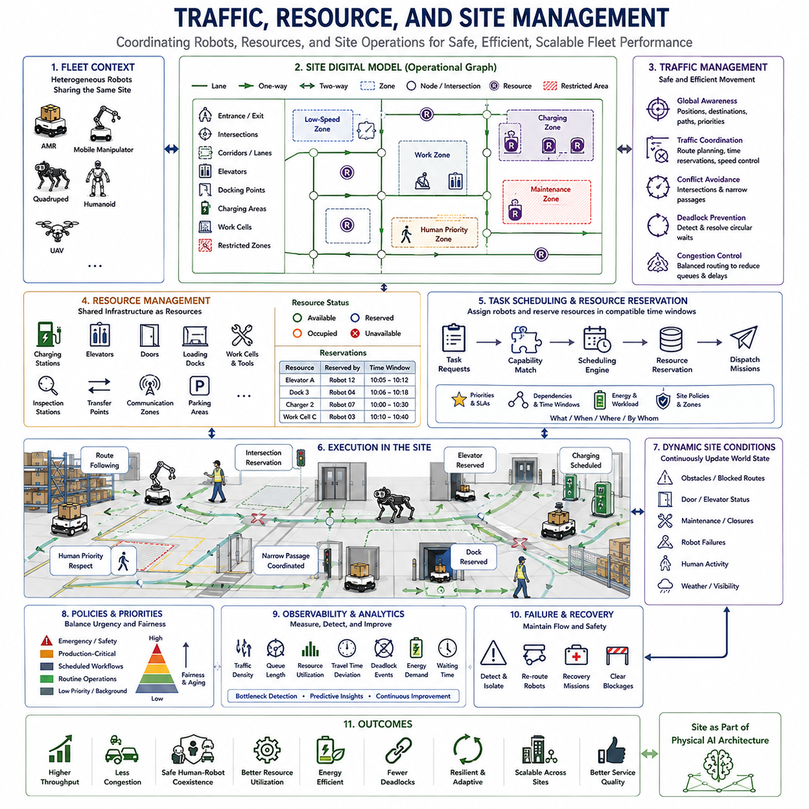{width="7.268055555555556in" height="7.268055555555556in"}

Traffic, resource, and site management govern how a robot fleet shares physical space and operational infrastructure without creating congestion, deadlock, unsafe interactions, or excessive waiting. As fleet size grows, navigation can no longer be treated only as an individual robot problem. Each robot's movement affects other robots, shared resources, human workflows, and overall site productivity, making coordinated management essential for fleet-scale Physical AI.

Traffic management coordinates the movement of multiple robots through shared environments such as warehouses, factories, hospitals, campuses, logistics centers, and outdoor facilities. A route that is geometrically valid for one robot may become inefficient or temporarily unusable when many robots occupy the same corridors and intersections. Fleet traffic management therefore reasons about both spatial connectivity and the changing distribution of traffic over time.

The site can be represented as a structured operational graph containing lanes, intersections, zones, entrances, exits, docking points, elevators, charging areas, work cells, and restricted regions. Graph elements may contain direction, width, speed, capacity, robot-type restrictions, safety rules, or priority information. This representation converts physical infrastructure into resources that fleet orchestration can reason about during routing, scheduling, and task execution.

Traffic coordination begins with awareness of robot positions, destinations, planned paths, priorities, and expected arrival times. Instead of allowing every robot to independently choose its shortest route, the fleet can evaluate how proposed paths interact. Alternative routes, temporal reservations, speed adjustments, waiting locations, or priority rules can then distribute traffic more efficiently and reduce conflicts before robots physically encounter one another.

Intersections and narrow passages are particularly important because they create mutual exclusion constraints. Two robots may individually have valid trajectories but be unable to safely occupy the same constrained space simultaneously. Reservation mechanisms can grant temporary access to specific robots according to arrival time, priority, mission urgency, or scheduling policy. Once the resource is released, another robot can proceed without requiring direct negotiation at the physical conflict point.

Deadlock occurs when multiple robots wait for resources held or required by one another and none can continue. Physical deadlock may involve corridors, intersections, docking locations, or robots blocking each other's escape paths. Fleet management should detect potential circular dependencies before they become immobilizing situations and use route changes, reservation ordering, priority rules, or controlled retreat behaviors to preserve system-wide flow.

Congestion differs from deadlock because robots may still move while overall throughput deteriorates. Sending many robots through the shortest corridor can increase waiting time and reduce productivity even though every route is technically feasible. Traffic-aware routing therefore considers expected density, queue length, travel time, and future reservations. A slightly longer route can produce lower total mission time when it avoids heavily utilized parts of the site.

Resource management extends these principles beyond pathways. Charging stations, elevators, automatic doors, loading docks, work cells, tools, inspection stations, transfer points, and communication-constrained areas may all be shared resources. Fleet orchestration must know their availability, capacity, operating rules, and current reservations so that task plans reflect the actual physical infrastructure required to execute them.

Resource reservation links task scheduling with physical execution. A mission requiring an elevator and a loading dock should not be dispatched solely because a robot is available. The scheduler may need to reserve those resources in compatible time windows before committing the mission. Coordinating robot assignment, travel, and resource access reduces situations in which robots arrive at unavailable infrastructure and remain idle while blocking surrounding traffic.

Charging infrastructure requires special treatment because energy management directly affects fleet availability. Multiple robots may request charging at similar times, creating queues that reduce operational capacity. Site management can coordinate charging based on battery state, predicted workload, mission priority, charging duration, and station availability. Charging then becomes an actively scheduled resource interaction rather than a purely local low-battery response.

Different robot embodiments impose different site constraints. An AMR may require a minimum corridor width and smooth floor, while a mobile manipulator may need additional clearance around work cells. A quadruped may traverse stairs or rough terrain that wheeled robots cannot use, and a UAV may operate through three-dimensional airspace. Site representations should therefore encode traversability and resource compatibility according to robot capabilities rather than assuming one universal navigation model.

Site management also defines operational zones and behavioral policies. Areas may be designated for normal travel, low-speed operation, human priority, one-way traffic, temporary exclusion, hazardous work, charging, maintenance, or emergency access. Robots can modify planning and control behavior according to these zone semantics. This allows operational rules to be represented explicitly within fleet intelligence instead of being embedded separately inside every robot.

Human activity must be incorporated because many Physical AI fleets operate in shared human-robot environments. Pedestrian flows, forklifts, manually operated equipment, temporary work areas, and emergency routes can alter traffic conditions dynamically. Fleet management should preserve safety margins and avoid optimizing robot throughput at the expense of human accessibility. Human-priority regions may require lower speeds, increased spacing, or temporary suspension of robot traffic.

Dynamic site conditions require continuous updates to the operational world state. Doors can become unavailable, corridors may be blocked, work cells can enter maintenance, elevators may fail, or temporary obstacles may appear. Robots and infrastructure services should contribute observations so that the fleet can update resource status and traversability. Plans dependent on invalidated resources can then be rerouted, delayed, or reassigned before failures propagate.

Traffic management and task scheduling must therefore operate as coupled processes. Scheduling determines where robots need to travel and when, while traffic conditions influence how long those movements will take. If these functions are separated completely, task plans may repeatedly create congestion that traffic control must resolve afterward. Integrated orchestration uses predicted traffic and resource occupancy when estimating assignment costs and scheduling missions.

Hierarchical site management can improve scalability for large facilities or multi-site deployments. Local controllers may coordinate individual intersections, zones, or resources, while site-level services manage broader traffic flow and mission priorities. Higher-level fleet services can coordinate policies and performance across facilities without processing every local movement. This limits computational complexity while preserving appropriate global coordination.

Priority policies are necessary when several robots compete for the same space or resource. Emergency missions, safety operations, production-critical transport, scheduled workflows, and routine tasks may require different access priorities. However, permanently favoring high-priority traffic can starve other robots. Fairness mechanisms, waiting-time limits, aging policies, and service-level objectives can balance urgency with long-term operational stability.

Failure handling must consider the physical consequences of a disabled robot. A failed robot located in a parking area may have little fleet impact, while the same failure inside a narrow corridor can block an entire traffic region. Site management should identify affected routes and resources, establish exclusion areas when necessary, reroute other robots, and coordinate recovery missions. Physical location therefore determines the system-level severity of many robot failures.

Observability provides the information required to manage these interactions. Fleet systems can monitor traffic density, queue lengths, resource utilization, blocked routes, reservation conflicts, charging demand, travel-time deviations, and robot waiting periods. These measurements reveal persistent bottlenecks that may not be visible from individual robot logs and can guide changes to routing policies, task scheduling, infrastructure layout, or operational procedures.

Historical site data can also support predictive management. Repeated observations may reveal that particular corridors become congested during shift changes or that charging demand peaks at predictable times. Fleet services can incorporate these patterns into future scheduling and routing decisions. Management then progresses from reacting to current congestion toward anticipating resource demand and shaping robot behavior before bottlenecks emerge.

Digital representations of site resources can further connect Physical AI with facility operations. Elevators, doors, charging systems, work cells, and other infrastructure can expose status and control interfaces that orchestration services use during planning. This creates a coordinated environment in which robots do not merely navigate around infrastructure but interact with it as part of an integrated physical-digital operational system.

Effective traffic and resource management should optimize fleet-level outcomes rather than maximizing the speed of each individual robot. Useful measures include mission throughput, average travel time, congestion, resource utilization, queue duration, energy efficiency, deadlock frequency, safety events, and recovery time. Sometimes slowing or delaying one robot improves total system performance by preventing interference with many other missions.

At fleet scale, the site itself effectively becomes part of the Physical AI architecture. Paths, zones, infrastructure, energy resources, traffic rules, humans, and environmental changes provide constraints and opportunities that shape collective robot behavior. Traffic, resource, and site management transform these elements into shared operational knowledge that fleet orchestration can use for coordinated decision making.

A mature system therefore coordinates robot movement, shared-resource access, task schedules, site policies, dynamic world updates, and infrastructure state within a continuous closed loop. By managing the physical environment as a shared system rather than a collection of independent routes, fleet-scale Physical AI can achieve higher throughput, safer interactions, better resource utilization, graceful recovery, and scalable operation across increasingly complex sites.

교통, 자원 및 사이트 관리(Traffic, Resource, and Site Management)는 로봇 플릿(Robot Fleet)이 혼잡(Congestion), 교착상태(Deadlock), 불안전한 상호작용(Unsafe Interaction), 과도한 대기 없이 물리적 공간과 운영 인프라(Operational Infrastructure)를 공유하도록 관리한다. 플릿 규모가 증가하면 내비게이션(Navigation)을 더 이상 개별 로봇만의 문제로 볼 수 없다. 각 로봇의 이동은 다른 로봇, 공유 자원(Shared Resource), 인간의 작업 흐름(Human Workflow), 사이트 전체 생산성(Site Productivity)에 영향을 미치므로 플릿 규모 피지컬 AI(Fleet-Scale Physical AI)에서는 조정된 관리(Coordinated Management)가 필수적이다.

교통 관리(Traffic Management)는 창고(Warehouse), 공장(Factory), 병원(Hospital), 캠퍼스(Campus), 물류센터(Logistics Center), 야외 시설(Outdoor Facility)과 같은 공유 환경에서 여러 로봇의 이동을 조정한다. 하나의 로봇에는 기하학적으로 유효한 경로(Route)라도 많은 로봇이 동일한 복도와 교차로를 점유하면 비효율적이거나 일시적으로 사용할 수 없게 될 수 있다. 따라서 플릿 교통 관리(Fleet Traffic Management)는 공간적 연결성(Spatial Connectivity)뿐만 아니라 시간에 따라 변화하는 교통 분포(Traffic Distribution)도 함께 고려한다.

사이트(Site)는 차선(Lane), 교차로(Intersection), 구역(Zone), 입구(Entrance), 출구(Exit), 도킹 지점(Docking Point), 엘리베이터(Elevator), 충전 구역(Charging Area), 작업 셀(Work Cell), 제한 구역(Restricted Region)을 포함하는 구조화된 운영 그래프(Structured Operational Graph)로 표현할 수 있다. 그래프 요소에는 방향(Direction), 폭(Width), 속도(Speed), 수용량(Capacity), 로봇 유형 제한(Robot-Type Restriction), 안전 규칙(Safety Rule), 우선순위(Priority) 정보가 포함될 수 있다. 이러한 표현은 물리적 인프라를 플릿 오케스트레이션(Fleet Orchestration)이 경로계획(Routing), 스케줄링(Scheduling), 작업 실행(Task Execution) 과정에서 추론할 수 있는 자원으로 변환한다.

교통 조정(Traffic Coordination)은 로봇의 위치(Position), 목적지(Destination), 계획된 경로(Planned Path), 우선순위, 예상 도착시간(Expected Arrival Time)에 대한 인식에서 시작한다. 모든 로봇이 독립적으로 최단 경로(Shortest Route)를 선택하도록 하는 대신 플릿은 제안된 경로들이 서로 어떻게 상호작용하는지를 평가할 수 있다. 이후 대체 경로(Alternative Route), 시간적 예약(Temporal Reservation), 속도 조정(Speed Adjustment), 대기 위치(Waiting Location), 우선순위 규칙(Priority Rule)을 활용하여 교통을 더욱 효율적으로 분산하고 로봇들이 물리적으로 마주치기 전에 충돌을 줄일 수 있다.

교차로(Intersection)와 좁은 통로(Narrow Passage)는 상호배제 제약(Mutual Exclusion Constraint)을 발생시키기 때문에 특히 중요하다. 두 로봇이 각각 유효한 궤적(Trajectory)을 가지고 있더라도 제한된 공간을 동시에 안전하게 점유하지 못할 수 있다. 예약 메커니즘(Reservation Mechanism)은 도착시간, 우선순위, 임무 긴급성(Mission Urgency), 스케줄링 정책(Scheduling Policy)에 따라 특정 로봇에 일시적인 접근 권한을 부여할 수 있다. 해당 자원이 해제되면 다른 로봇이 물리적인 충돌 지점에서 직접 협상하지 않고도 이동을 계속할 수 있다.

교착상태(Deadlock)는 여러 로봇이 서로가 점유하거나 필요로 하는 자원을 기다리면서 어느 로봇도 계속 이동할 수 없을 때 발생한다. 물리적 교착상태(Physical Deadlock)는 복도, 교차로, 도킹 위치 또는 서로의 탈출 경로를 막고 있는 로봇들과 관련될 수 있다. 플릿 관리는 이러한 순환 의존관계(Circular Dependency)가 로봇들을 움직일 수 없는 상태로 만들기 전에 탐지하고, 경로 변경(Route Change), 예약 순서(Reservation Ordering), 우선순위 규칙 또는 통제된 후퇴 행동(Controlled Retreat Behavior)을 통해 시스템 전체의 흐름(System-Wide Flow)을 유지해야 한다.

혼잡(Congestion)은 로봇이 계속 이동할 수 있음에도 전체 처리량(Throughput)이 감소한다는 점에서 교착상태와 다르다. 많은 로봇을 최단 복도로 보내면 모든 경로가 기술적으로 실행 가능하더라도 대기시간(Waiting Time)이 증가하고 생산성이 감소할 수 있다. 따라서 교통 인식 경로계획(Traffic-Aware Routing)은 예상 밀도(Expected Density), 대기열 길이(Queue Length), 이동시간(Travel Time), 향후 예약(Future Reservation)을 고려한다. 약간 더 긴 경로라도 사용률이 높은 사이트 영역을 회피하면 전체 임무시간(Total Mission Time)을 줄일 수 있다.

자원 관리(Resource Management)는 이러한 원칙을 이동 경로 이외의 영역으로 확장한다. 충전소(Charging Station), 엘리베이터, 자동문(Automatic Door), 적재 도크(Loading Dock), 작업 셀, 도구(Tool), 검사 스테이션(Inspection Station), 전달 지점(Transfer Point), 통신 제약 구역(Communication-Constrained Area)은 모두 공유 자원이 될 수 있다. 플릿 오케스트레이션은 이러한 자원의 가용성(Availability), 수용량, 운영 규칙(Operating Rule), 현재 예약(Current Reservation)을 파악하여 작업 계획(Task Plan)이 실제 실행에 필요한 물리적 인프라를 반영하도록 해야 한다.

자원 예약(Resource Reservation)은 작업 스케줄링(Task Scheduling)을 물리적 실행(Physical Execution)과 연결한다. 엘리베이터와 적재 도크가 필요한 임무는 단순히 로봇이 사용 가능하다는 이유만으로 디스패칭(Dispatching)되어서는 안 된다. 스케줄러(Scheduler)는 임무를 확정하기 전에 이러한 자원을 서로 호환되는 시간창(Time Window)에 예약해야 할 수 있다. 로봇 할당(Robot Assignment), 이동, 자원 접근(Resource Access)을 조정하면 로봇이 사용할 수 없는 인프라에 도착하여 주변 교통을 방해하면서 대기하는 상황을 줄일 수 있다.

충전 인프라(Charging Infrastructure)는 에너지 관리(Energy Management)가 플릿 가용성(Fleet Availability)에 직접적인 영향을 미치기 때문에 특별한 관리가 필요하다. 여러 로봇이 비슷한 시간에 충전을 요청하면 운영 용량(Operational Capacity)을 감소시키는 대기열이 발생할 수 있다. 사이트 관리는 배터리 상태(Battery State), 예상 작업 부하(Predicted Workload), 임무 우선순위, 충전시간(Charging Duration), 충전소 가용성(Station Availability)을 기반으로 충전을 조정할 수 있다. 이에 따라 충전은 단순한 로컬 저전압 대응(Local Low-Battery Response)이 아니라 능동적으로 스케줄링되는 자원 상호작용(Scheduled Resource Interaction)이 된다.

서로 다른 로봇 형태(Robot Embodiment)는 서로 다른 사이트 제약조건(Site Constraint)을 가진다. 자율이동로봇(AMR)은 최소 통로 폭(Minimum Corridor Width)과 평탄한 바닥을 필요로 할 수 있고, 모바일 매니퓰레이터(Mobile Manipulator)는 작업 셀 주변에 추가적인 여유 공간(Clearance)이 필요할 수 있다. 4족 로봇(Quadruped)은 바퀴형 로봇이 이동할 수 없는 계단이나 험지(Rough Terrain)를 이동할 수 있으며, 무인항공기(UAV)는 3차원 공역(Three-Dimensional Airspace)을 통해 운용될 수 있다. 따라서 사이트 표현(Site Representation)은 하나의 범용 내비게이션 모델을 가정하지 않고 로봇 역량에 따른 주행가능성(Traversability)과 자원 호환성(Resource Compatibility)을 표현해야 한다.

사이트 관리(Site Management)는 운영 구역(Operational Zone)과 행동 정책(Behavioral Policy)도 정의한다. 영역은 일반 이동(Normal Travel), 저속 운행(Low-Speed Operation), 인간 우선(Human Priority), 일방통행(One-Way Traffic), 임시 출입 제한(Temporary Exclusion), 위험 작업(Hazardous Work), 충전, 유지보수(Maintenance), 비상 접근(Emergency Access) 등으로 지정될 수 있다. 로봇은 이러한 구역 의미론(Zone Semantics)에 따라 계획과 제어 행동을 변경할 수 있다. 이를 통해 운영 규칙을 모든 로봇 내부에 개별적으로 삽입하는 대신 플릿 지능(Fleet Intelligence) 안에서 명시적으로 표현할 수 있다.

많은 피지컬 AI 플릿(Physical AI Fleet)이 인간과 로봇이 공유하는 환경에서 운영되므로 인간 활동(Human Activity)도 고려해야 한다. 보행자 흐름(Pedestrian Flow), 지게차(Forklift), 수동 운용 장비(Manually Operated Equipment), 임시 작업 구역(Temporary Work Area), 비상 경로(Emergency Route)는 교통 상황을 동적으로 변화시킬 수 있다. 플릿 관리는 인간 접근성(Human Accessibility)을 희생하면서 로봇 처리량을 최적화해서는 안 되며 안전 여유(Safety Margin)를 유지해야 한다. 인간 우선 구역(Human-Priority Region)에서는 더 낮은 속도, 더 넓은 간격 또는 일시적인 로봇 교통 중단이 필요할 수 있다.

동적인 사이트 조건(Dynamic Site Condition)을 처리하려면 운영 월드 상태(Operational World State)를 지속적으로 갱신해야 한다. 출입문을 사용할 수 없게 되거나, 복도가 차단되거나, 작업 셀이 유지보수 상태에 들어가거나, 엘리베이터가 고장 나거나, 임시 장애물(Temporary Obstacle)이 나타날 수 있다. 로봇과 인프라 서비스(Infrastructure Service)는 관측 정보를 제공하여 플릿이 자원 상태(Resource Status)와 주행가능성을 갱신하도록 해야 한다. 무효화된 자원에 의존하는 계획은 장애가 확산되기 전에 재경로 설정(Rerouting), 지연(Delay), 재할당(Reassignment)할 수 있다.

따라서 교통 관리(Traffic Management)와 작업 스케줄링(Task Scheduling)은 서로 결합된 과정(Coupled Process)으로 작동해야 한다. 스케줄링은 로봇이 어디로 언제 이동해야 하는지를 결정하고, 교통 상황은 해당 이동에 필요한 시간을 결정한다. 두 기능이 완전히 분리되면 작업 계획이 반복적으로 혼잡을 발생시키고 교통 제어(Traffic Control)가 사후에 이를 해결해야 하는 상황이 발생할 수 있다. 통합 오케스트레이션(Integrated Orchestration)은 할당 비용(Assignment Cost)을 추정하고 임무를 스케줄링할 때 예상 교통량과 자원 점유(Resource Occupancy)를 활용한다.

계층적 사이트 관리(Hierarchical Site Management)는 대규모 시설이나 다중 사이트 배포(Multi-Site Deployment)의 확장성을 향상시킬 수 있다. 로컬 컨트롤러(Local Controller)는 개별 교차로, 구역, 자원을 조정하고 사이트 수준 서비스(Site-Level Service)는 더 넓은 교통 흐름과 임무 우선순위를 관리할 수 있다. 상위 수준 플릿 서비스(Higher-Level Fleet Service)는 모든 로컬 이동을 직접 처리하지 않으면서 시설 간 정책과 성능을 조정할 수 있다. 이를 통해 적절한 전역 조정(Global Coordination)을 유지하면서 계산 복잡도(Computational Complexity)를 제한할 수 있다.

여러 로봇이 동일한 공간이나 자원을 경쟁할 경우 우선순위 정책(Priority Policy)이 필요하다. 비상 임무(Emergency Mission), 안전 작업(Safety Operation), 생산 중요 운송(Production-Critical Transport), 예정된 워크플로(Scheduled Workflow), 일반 작업(Routine Task)은 서로 다른 접근 우선순위를 요구할 수 있다. 그러나 높은 우선순위의 교통을 지속적으로 우대하면 다른 로봇이 기아상태(Starvation)에 빠질 수 있다. 공정성 메커니즘(Fairness Mechanism), 대기시간 제한(Waiting-Time Limit), 에이징 정책(Aging Policy), 서비스 수준 목표(Service-Level Objective)를 통해 긴급성과 장기적인 운영 안정성(Operational Stability)의 균형을 유지할 수 있다.

장애 처리(Failure Handling)는 고장 난 로봇이 물리적으로 미치는 영향까지 고려해야 한다. 주차 구역에서 고장 난 로봇은 플릿에 거의 영향을 주지 않을 수 있지만 동일한 장애가 좁은 복도에서 발생하면 전체 교통 구역을 차단할 수 있다. 사이트 관리는 영향을 받는 경로와 자원을 식별하고 필요한 경우 출입 제한 구역(Exclusion Area)을 설정하며, 다른 로봇의 경로를 변경하고 복구 임무(Recovery Mission)를 조정해야 한다. 따라서 물리적 위치는 많은 로봇 장애가 시스템 수준에서 얼마나 심각한지를 결정한다.

관측 가능성(Observability)은 이러한 상호작용을 관리하는 데 필요한 정보를 제공한다. 플릿 시스템은 교통 밀도(Traffic Density), 대기열 길이, 자원 활용률(Resource Utilization), 차단된 경로(Blocked Route), 예약 충돌(Reservation Conflict), 충전 수요(Charging Demand), 이동시간 편차(Travel-Time Deviation), 로봇 대기시간을 모니터링할 수 있다. 이러한 측정값은 개별 로봇 로그에서는 발견하기 어려운 지속적인 병목현상(Persistent Bottleneck)을 보여주며 경로 정책(Routing Policy), 작업 스케줄링, 인프라 배치(Infrastructure Layout), 운영 절차(Operational Procedure)를 개선하는 데 활용될 수 있다.

과거 사이트 데이터(Historical Site Data)는 예측 관리(Predictive Management)에도 활용될 수 있다. 반복적인 관측을 통해 특정 복도가 교대시간(Shift Change)에 혼잡해지거나 특정 시간대에 충전 수요가 최고점에 도달한다는 패턴을 발견할 수 있다. 플릿 서비스는 이러한 패턴을 향후 스케줄링과 경로계획 결정에 반영할 수 있다. 이를 통해 관리는 현재의 혼잡에 대응하는 단계에서 자원 수요(Resource Demand)를 예측하고 병목현상이 발생하기 전에 로봇 행동을 조정하는 단계로 발전한다.

사이트 자원의 디지털 표현(Digital Representation)은 피지컬 AI를 시설 운영(Facility Operations)과 더욱 긴밀하게 연결할 수 있다. 엘리베이터, 출입문, 충전 시스템, 작업 셀 및 기타 인프라는 계획 과정에서 오케스트레이션 서비스가 사용할 수 있는 상태(Status) 및 제어 인터페이스(Control Interface)를 제공할 수 있다. 이를 통해 로봇이 단순히 인프라 주변을 이동하는 것이 아니라 통합된 물리-디지털 운영 시스템(Physical-Digital Operational System)의 일부로 인프라와 상호작용하는 조정된 환경(Coordinated Environment)이 형성된다.

효과적인 교통 및 자원 관리(Traffic and Resource Management)는 개별 로봇의 속도를 최대화하는 것이 아니라 플릿 수준 결과(Fleet-Level Outcome)를 최적화해야 한다. 유용한 측정지표에는 임무 처리량(Mission Throughput), 평균 이동시간(Average Travel Time), 혼잡, 자원 활용률, 대기열 지속시간(Queue Duration), 에너지 효율(Energy Efficiency), 교착상태 발생 빈도(Deadlock Frequency), 안전 이벤트(Safety Event), 복구 시간(Recovery Time)이 포함된다. 때로는 하나의 로봇을 감속하거나 지연시키는 것이 여러 다른 임무와의 간섭을 방지하여 전체 시스템 성능을 향상시킬 수 있다.

플릿 규모(Fleet Scale)에서는 사이트 자체가 실질적으로 피지컬 AI 아키텍처(Physical AI Architecture)의 일부가 된다. 경로(Path), 구역(Zone), 인프라(Infrastructure), 에너지 자원(Energy Resource), 교통 규칙(Traffic Rule), 인간(Human), 환경 변화(Environmental Change)는 집단적 로봇 행동(Collective Robot Behavior)을 형성하는 제약조건과 기회를 제공한다. 교통, 자원 및 사이트 관리는 이러한 요소들을 플릿 오케스트레이션이 조정된 의사결정(Coordinated Decision Making)에 사용할 수 있는 공유 운영 지식(Shared Operational Knowledge)으로 변환한다.

따라서 성숙한 시스템(Mature System)은 로봇 이동(Robot Movement), 공유 자원 접근(Shared-Resource Access), 작업 스케줄(Task Schedule), 사이트 정책(Site Policy), 동적 월드 업데이트(Dynamic World Update), 인프라 상태(Infrastructure State)를 지속적인 폐루프(Continuous Closed Loop) 안에서 조정한다. 물리 환경을 독립적인 경로들의 집합이 아니라 하나의 공유 시스템(Shared System)으로 관리함으로써 플릿 규모 피지컬 AI는 더 높은 처리량, 더욱 안전한 상호작용, 향상된 자원 활용, 점진적인 복구(Graceful Recovery), 그리고 점점 복잡해지는 사이트 전반에서 확장 가능한 운영(Scalable Operation)을 달성할 수 있다.

## 09.06. Edge On Premise and Cloud Fleet AI

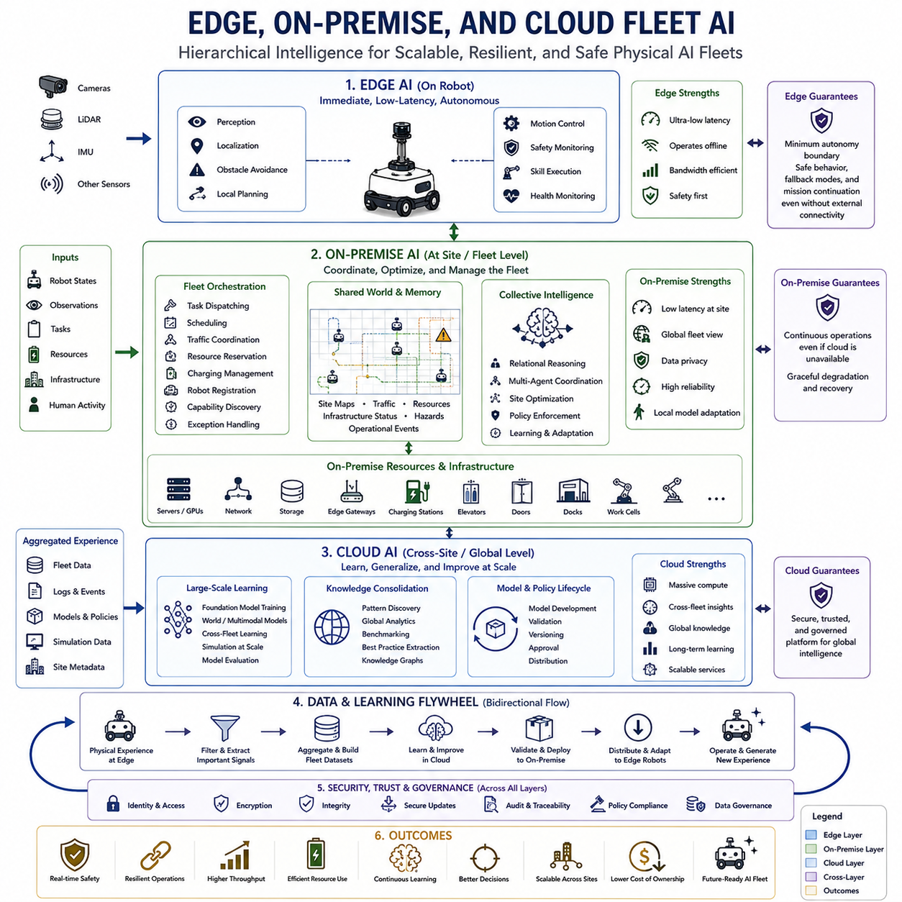{width="7.268055555555556in" height="7.268055555555556in"}

Edge, on-premise, and cloud fleet AI form a hierarchical computing architecture that distributes intelligence according to latency, safety, information scope, computational demand, and operational responsibility. Rather than placing all intelligence in one location, fleet-scale Physical AI assigns different functions to the computing layer where they can operate most effectively while maintaining continuous information flow across the complete system.

Edge AI resides directly on the robot or within computing hardware tightly coupled to the physical platform. It handles functions that require immediate interaction with the environment, including perception, localization, obstacle avoidance, local planning, motion control, safety monitoring, and execution of learned skills. Because these functions affect physical behavior in real time, they must remain available even when external communication becomes slow or unavailable.

The primary strength of Edge AI is low-latency autonomous decision making. Sensor observations can be processed close to where they are generated, allowing robots to react rapidly to people, obstacles, terrain changes, manipulation errors, and unexpected events. Local processing also reduces the need to continuously transmit high-bandwidth sensor streams, preserving network capacity and allowing essential autonomy to continue during intermittent connectivity.

Edge intelligence should therefore provide a minimum operational autonomy boundary. A robot may lose access to fleet services or cloud resources but should still maintain safety, stabilize its current behavior, complete appropriate local actions, or transition into a defined fallback state. Higher-level infrastructure can improve performance and coordination, but fundamental physical safety should not depend on uninterrupted remote computation or communication.

On-premise AI operates at the facility or fleet level and connects multiple robots within a shared operational environment. It can maintain fleet state, shared world memory, traffic information, resource availability, task queues, robot capabilities, and site policies. This broader information scope allows on-premise systems to make decisions that individual robots cannot make from local observations alone, forming the operational intelligence layer of the fleet.

Fleet orchestration is a natural responsibility of on-premise AI. Task dispatching, scheduling, traffic coordination, resource reservation, charging management, robot registration, capability discovery, and exception handling require information from many agents and infrastructure services. Locating these functions within the site provides a balance between global fleet awareness and sufficiently low latency for operational coordination.

On-premise computing also supports shared world modeling. Observations from multiple robots can be fused into site-level maps, traversability information, traffic conditions, infrastructure states, hazards, and operational events. When one robot discovers a blocked corridor or unavailable resource, the updated knowledge can influence other robots. Individual perception is thereby transformed into fleet-level situational awareness and shared operational memory.

Collective intelligence emerges when on-premise AI does more than coordinate independent robots. The system can analyze relationships among agents, tasks, resources, infrastructure, and environmental conditions to optimize collective outcomes. Temporal intelligence from shared world models can be combined with relational reasoning, scheduling, and fleet policies so that the behavior of the group reflects information unavailable to any single robot.

On-premise AI can also provide local learning and adaptation when operational requirements demand rapid improvement without continuously transferring sensitive or high-volume data outside the facility. Fleet experience can be aggregated, filtered, evaluated, and used for selected model adaptation, policy optimization, or site-specific learning. This makes on-premise infrastructure both an inference and an intelligence-management environment rather than merely a communication gateway.

Cloud AI operates across a broader temporal and organizational scope. It can aggregate experience from multiple fleets, facilities, regions, or robot generations and provide computational resources that are impractical to maintain on every site. Large-scale training, foundation model development, global analytics, simulation, model evaluation, knowledge consolidation, and cross-site benchmarking are natural candidates for cloud-level computation.

The cloud is particularly valuable for learning from distributed fleet experience. Individual sites encounter different layouts, objects, workflows, failures, and edge cases. When appropriate data or learned representations are aggregated across sites, cloud systems can identify patterns that are invisible locally. These patterns can support more general models and policies that capture knowledge accumulated from a much larger population of physical agents.

Foundation models can provide an important bridge between cloud-scale learning and fleet intelligence. Large multimodal, world, or robot foundation models can be trained or improved using broad datasets and subsequently adapted for specific sites or robot embodiments. The cloud therefore supplies generalized semantic and reasoning intelligence, while on-premise and edge layers contextualize that intelligence according to local operations and immediate physical conditions.

The relationship among the three layers should be bidirectional rather than a simple top-down command hierarchy. Robots generate physical-world experience at the edge. On-premise systems aggregate that experience into fleet context, operational knowledge, and selected learning signals. Cloud systems consolidate knowledge across fleets and generate improved models, policies, or representations that can be validated and distributed back toward sites and robots.

This creates a hierarchical data and learning flywheel. Edge systems produce observations, trajectories, interventions, failures, and task outcomes. On-premise systems filter redundant information, identify important events, preserve provenance, and construct fleet-level datasets. Cloud systems can use selected aggregated data for large-scale learning, after which validated improvements return through controlled deployment pipelines to on-premise systems and eventually to appropriate robots.

Not every piece of data should travel through every layer. Raw cameras, LiDAR streams, and high-frequency control data may be too large, sensitive, or latency-critical for continuous cloud transmission. Edge systems can extract features, events, or compressed representations, while on-premise systems determine what information has broader learning value. Hierarchical filtering reduces bandwidth consumption and helps preserve operational privacy and data governance.

Model lifecycle management must span all three computing levels. Models can be developed or trained in cloud infrastructure, validated against fleet datasets, staged within on-premise environments, and deployed to selected edge robots. Performance can then be monitored during real operation. If degradation or unexpected behavior appears, deployment can be stopped or rolled back before an unsuitable model propagates across the entire fleet.

Different AI functions naturally map to different layers. Immediate perception and control belong primarily to the edge; fleet coordination, shared memory, relational reasoning, and site optimization fit naturally on-premise; large-scale semantic learning, foundation model training, and cross-fleet knowledge consolidation fit the cloud. These boundaries are not absolute, but they provide a practical architecture for deciding where computation and intelligence should reside.

Resilience requires that higher layers enhance lower layers without becoming single points of operational failure. Loss of cloud connectivity should not stop normal site operation, and temporary loss of on-premise coordination should not cause robots to become physically unsafe. Each layer should define degraded operating modes, cached knowledge, recovery procedures, and synchronization mechanisms that allow the system to reconnect and reconcile state after communication is restored.

Security and trust must extend across the complete hierarchy. Robot identities, site services, cloud services, software packages, AI models, and data transfers require authentication, authorization, integrity protection, and traceability. Because model updates can directly alter physical behavior, deployment pipelines should verify the origin, version, approval state, and compatibility of intelligence before it is allowed to influence robots operating in the physical world.

The architecture must also account for heterogeneous hardware and operational environments. Some robots may possess powerful onboard accelerators, while others depend more heavily on site computing. Some facilities may have substantial GPU infrastructure, while remote deployments may operate with limited connectivity and computation. Fleet AI should therefore describe service requirements and capabilities explicitly rather than assuming identical resources across every robot and site.

Observability across layers allows operators to understand both physical operations and intelligence performance. Edge telemetry reveals robot health and local AI behavior, on-premise monitoring exposes fleet coordination and site-level bottlenecks, and cloud analytics reveal longer-term patterns across deployments. Connecting these perspectives creates an intelligence management system capable of tracing outcomes from individual actions to fleet-wide and cross-fleet behavior.

The deepest architectural distinction is therefore one of intelligence scope. Edge AI provides embodied and immediate physical intelligence. On-premise AI transforms multiple autonomous robots into coordinated fleet intelligence through shared context, relationships, memory, and operational optimization. Cloud AI extends this further by consolidating experience across fleets and producing generalized intelligence that can benefit a broader population of physical systems.

A mature Physical AI architecture consequently operates as a continuous hierarchy of Edge Intelligence, Collective Fleet Intelligence, and Foundation Collective Intelligence. Physical experience originates in robots, becomes coordinated knowledge at the site, and can become generalized knowledge across fleets. Improved intelligence then flows back toward the physical world, creating a scalable closed loop in which individual autonomy, collective coordination, and large-scale learning continuously reinforce one another.

엣지(Edge), 온프레미스(On-Premise), 클라우드 플릿 AI(Cloud Fleet AI)는 지연시간(Latency), 안전(Safety), 정보 범위(Information Scope), 계산 요구량(Computational Demand), 운영 책임(Operational Responsibility)에 따라 지능(Intelligence)을 분산하는 계층형 컴퓨팅 아키텍처(Hierarchical Computing Architecture)를 형성한다. 모든 지능을 하나의 위치에 배치하는 대신, 플릿 규모 피지컬 AI(Fleet-Scale Physical AI)는 각 기능을 가장 효과적으로 수행할 수 있는 컴퓨팅 계층에 할당하면서 전체 시스템에 걸쳐 지속적인 정보 흐름(Information Flow)을 유지한다.

엣지 AI(Edge AI)는 로봇에 직접 탑재되거나 물리 플랫폼(Physical Platform)과 긴밀하게 결합된 컴퓨팅 하드웨어(Computing Hardware)에서 동작한다. 엣지 AI는 인지(Perception), 위치추정(Localization), 장애물 회피(Obstacle Avoidance), 로컬 계획(Local Planning), 모션 제어(Motion Control), 안전 모니터링(Safety Monitoring), 학습된 기술(Learned Skill)의 실행과 같이 환경과 즉각적으로 상호작용해야 하는 기능을 처리한다. 이러한 기능은 실시간으로 물리적 행동에 영향을 미치기 때문에 외부 통신이 느려지거나 사용할 수 없는 상황에서도 계속 동작해야 한다.

엣지 AI의 핵심 강점은 낮은 지연시간의 자율적 의사결정(Low-Latency Autonomous Decision Making)이다. 센서 관측(Sensor Observation)을 데이터가 생성되는 위치 가까이에서 처리함으로써 로봇은 사람, 장애물, 지형 변화(Terrain Change), 조작 오류(Manipulation Error), 예상하지 못한 사건에 빠르게 대응할 수 있다. 로컬 처리(Local Processing)는 고대역폭 센서 스트림(High-Bandwidth Sensor Stream)을 지속적으로 전송할 필요성도 줄여 네트워크 용량(Network Capacity)을 보존하고 간헐적인 연결 상태에서도 필수적인 자율성(Autonomy)을 유지할 수 있게 한다.

따라서 엣지 지능(Edge Intelligence)은 최소 운영 자율성 경계(Minimum Operational Autonomy Boundary)를 제공해야 한다. 로봇이 플릿 서비스(Fleet Service)나 클라우드 자원(Cloud Resource)에 대한 접근을 잃더라도 안전을 유지하고 현재 행동을 안정화하며, 적절한 로컬 작업을 완료하거나 정의된 폴백 상태(Fallback State)로 전환할 수 있어야 한다. 상위 수준 인프라는 성능과 조정을 향상시킬 수 있지만 기본적인 물리적 안전(Physical Safety)이 중단 없는 원격 계산이나 통신에 의존해서는 안 된다.

온프레미스 AI(On-Premise AI)는 시설(Facility) 또는 플릿 수준에서 동작하며 공유된 운영 환경 안에서 여러 로봇을 연결한다. 온프레미스 AI는 플릿 상태(Fleet State), 공유 월드 메모리(Shared World Memory), 교통 정보(Traffic Information), 자원 가용성(Resource Availability), 작업 대기열(Task Queue), 로봇 역량(Robot Capability), 사이트 정책(Site Policy)을 유지할 수 있다. 이러한 넓은 정보 범위를 통해 온프레미스 시스템은 개별 로봇이 로컬 관측만으로는 내릴 수 없는 의사결정을 수행하며 플릿의 운영 지능 계층(Operational Intelligence Layer)을 형성한다.

플릿 오케스트레이션(Fleet Orchestration)은 온프레미스 AI가 담당하기에 적합한 핵심 기능이다. 작업 디스패칭(Task Dispatching), 스케줄링(Scheduling), 교통 조정(Traffic Coordination), 자원 예약(Resource Reservation), 충전 관리(Charging Management), 로봇 등록(Robot Registration), 역량 탐색(Capability Discovery), 예외 처리(Exception Handling)는 여러 에이전트와 인프라 서비스의 정보를 필요로 한다. 이러한 기능을 사이트 내부에 배치하면 전역 플릿 인식(Global Fleet Awareness)과 운영 조정에 필요한 충분히 낮은 지연시간 사이의 균형을 확보할 수 있다.

온프레미스 컴퓨팅(On-Premise Computing)은 공유 월드 모델링(Shared World Modeling)도 지원한다. 여러 로봇의 관측을 융합하여 사이트 수준 지도(Site-Level Map), 주행가능성 정보(Traversability Information), 교통 상태(Traffic Condition), 인프라 상태(Infrastructure State), 위험요소(Hazard), 운영 이벤트(Operational Event)를 구축할 수 있다. 하나의 로봇이 차단된 복도나 사용할 수 없는 자원을 발견하면 갱신된 지식이 다른 로봇의 행동에 영향을 줄 수 있다. 이를 통해 개별 인지(Individual Perception)는 플릿 수준 상황 인식(Fleet-Level Situational Awareness)과 공유 운영 메모리(Shared Operational Memory)로 전환된다.

집단지능(Collective Intelligence)은 온프레미스 AI가 단순히 독립적인 로봇을 조정하는 수준을 넘어설 때 나타난다. 시스템은 에이전트, 작업, 자원, 인프라, 환경 조건 사이의 관계를 분석하여 집단적 결과(Collective Outcome)를 최적화할 수 있다. 공유 월드 모델(Shared World Model)의 시간 지능(Temporal Intelligence)을 관계형 추론(Relational Reasoning), 스케줄링, 플릿 정책(Fleet Policy)과 결합하면 개별 로봇이 단독으로 확보할 수 없는 정보를 기반으로 집단 전체의 행동을 결정할 수 있다.

온프레미스 AI는 민감하거나 대용량인 데이터를 지속적으로 시설 외부로 전송하지 않으면서 빠른 개선이 필요한 경우 로컬 학습(Local Learning)과 적응(Adaptation)을 지원할 수도 있다. 플릿 경험(Fleet Experience)을 집계하고 필터링하며 평가하여 선택적인 모델 적응(Model Adaptation), 정책 최적화(Policy Optimization), 사이트별 학습(Site-Specific Learning)에 활용할 수 있다. 이에 따라 온프레미스 인프라는 단순한 통신 게이트웨이(Communication Gateway)가 아니라 추론(Inference)과 지능 관리(Intelligence Management)를 함께 수행하는 환경이 된다.

클라우드 AI(Cloud AI)는 더 넓은 시간적·조직적 범위(Temporal and Organizational Scope)에서 동작한다. 여러 플릿, 시설, 지역 또는 로봇 세대(Robot Generation)의 경험을 통합하고 각 사이트에서 유지하기 어려운 대규모 컴퓨팅 자원을 제공할 수 있다. 대규모 학습(Large-Scale Training), 파운데이션 모델 개발(Foundation Model Development), 전역 분석(Global Analytics), 시뮬레이션(Simulation), 모델 평가(Model Evaluation), 지식 통합(Knowledge Consolidation), 사이트 간 벤치마킹(Cross-Site Benchmarking)은 클라우드 수준 계산에 적합한 기능이다.

클라우드는 분산된 플릿 경험(Distributed Fleet Experience)으로부터 학습하는 데 특히 가치가 있다. 개별 사이트는 서로 다른 배치(Layout), 객체(Object), 작업 흐름(Workflow), 장애(Failure), 엣지 케이스(Edge Case)를 경험한다. 적절한 데이터나 학습된 표현(Learned Representation)을 사이트 간에 통합하면 클라우드 시스템은 로컬 수준에서는 발견하기 어려운 패턴을 식별할 수 있다. 이러한 패턴은 훨씬 더 많은 물리 에이전트 집단에서 축적된 지식을 반영하는 일반화된 모델과 정책(Generalized Model and Policy)을 구축하는 데 활용될 수 있다.

파운데이션 모델(Foundation Model)은 클라우드 규모 학습(Cloud-Scale Learning)과 플릿 지능(Fleet Intelligence)을 연결하는 중요한 가교 역할을 할 수 있다. 대규모 멀티모달 파운데이션 모델(Multimodal Foundation Model), 월드 파운데이션 모델(World Foundation Model), 로봇 파운데이션 모델(Robot Foundation Model)은 광범위한 데이터셋을 이용해 학습 또는 개선한 후 특정 사이트나 로봇 형태(Embodiment)에 맞게 적응시킬 수 있다. 따라서 클라우드는 일반화된 의미 지능(Semantic Intelligence)과 추론 지능(Reasoning Intelligence)을 제공하고, 온프레미스와 엣지 계층은 이를 로컬 운영과 즉각적인 물리적 조건에 맞게 맥락화(Contextualization)한다.

세 계층 사이의 관계는 단순한 하향식 명령 계층(Top-Down Command Hierarchy)이 아니라 양방향(Bidirectional)이어야 한다. 로봇은 엣지에서 물리 세계 경험(Physical-World Experience)을 생성한다. 온프레미스 시스템은 이러한 경험을 플릿 맥락(Fleet Context), 운영 지식(Operational Knowledge), 선택된 학습 신호(Learning Signal)로 통합한다. 클라우드 시스템은 여러 플릿의 지식을 통합하여 개선된 모델, 정책 또는 표현을 생성하고, 이를 검증한 후 다시 사이트와 로봇 방향으로 배포할 수 있다.

이를 통해 계층형 데이터 및 학습 플라이휠(Hierarchical Data and Learning Flywheel)이 형성된다. 엣지 시스템은 관측, 궤적(Trajectory), 인간 개입(Intervention), 장애, 작업 결과(Task Outcome)를 생성한다. 온프레미스 시스템은 중복 정보를 필터링하고 중요한 이벤트를 식별하며 데이터 출처(Provenance)를 보존하고 플릿 수준 데이터셋(Fleet-Level Dataset)을 구축한다. 클라우드 시스템은 선택적으로 통합된 데이터를 대규모 학습에 활용하며, 검증된 개선 결과는 통제된 배포 파이프라인(Controlled Deployment Pipeline)을 통해 온프레미스 시스템과 적절한 로봇으로 다시 전달된다.

모든 데이터가 모든 계층을 통과해야 하는 것은 아니다. 원시 카메라 데이터(Raw Camera Data), 라이다 스트림(LiDAR Stream), 고주파 제어 데이터(High-Frequency Control Data)는 지속적인 클라우드 전송에 비해 지나치게 크거나 민감하거나 지연시간에 민감할 수 있다. 엣지 시스템은 특징(Feature), 이벤트(Event), 압축된 표현(Compressed Representation)을 추출할 수 있고, 온프레미스 시스템은 어떤 정보가 더 넓은 학습 가치를 가지는지 결정할 수 있다. 이러한 계층적 필터링(Hierarchical Filtering)은 대역폭 사용량을 줄이고 운영 프라이버시(Operational Privacy)와 데이터 거버넌스(Data Governance)를 유지하는 데 도움이 된다.

모델 수명주기 관리(Model Lifecycle Management)는 세 가지 컴퓨팅 계층 전체에 걸쳐 이루어져야 한다. 모델은 클라우드 인프라에서 개발하거나 학습하고 플릿 데이터셋을 이용해 검증한 뒤 온프레미스 환경에서 단계적으로 적용하고 선택된 엣지 로봇에 배포할 수 있다. 이후 실제 운영에서 성능을 모니터링한다. 성능 저하나 예상하지 못한 행동이 나타나면 부적절한 모델이 전체 플릿으로 확산되기 전에 배포를 중단하거나 롤백(Rollback)할 수 있어야 한다.

서로 다른 AI 기능은 자연스럽게 서로 다른 계층에 대응한다. 즉각적인 인지와 제어는 주로 엣지에 속하고, 플릿 조정, 공유 메모리, 관계형 추론, 사이트 최적화(Site Optimization)는 온프레미스에 적합하며, 대규모 의미 학습(Semantic Learning), 파운데이션 모델 학습, 플릿 간 지식 통합(Cross-Fleet Knowledge Consolidation)은 클라우드에 적합하다. 이러한 경계가 절대적인 것은 아니지만 계산과 지능을 어디에 배치할지를 결정하는 실용적인 아키텍처 기준을 제공한다.

회복탄력성(Resilience)을 확보하려면 상위 계층이 하위 계층을 강화하되 단일 장애점(Single Point of Failure)이 되어서는 안 된다. 클라우드 연결이 끊겨도 정상적인 사이트 운영이 중단되어서는 안 되며, 온프레미스 조정 기능이 일시적으로 상실되어도 로봇이 물리적으로 불안전한 상태에 빠져서는 안 된다. 각 계층은 성능 저하 운영 모드(Degraded Operating Mode), 캐시된 지식(Cached Knowledge), 복구 절차(Recovery Procedure), 동기화 메커니즘(Synchronization Mechanism)을 정의하여 통신이 복구된 후 시스템이 다시 연결되고 상태를 일치시킬 수 있도록 해야 한다.

보안(Security)과 신뢰(Trust)는 전체 계층 구조에 걸쳐 적용되어야 한다. 로봇 신원(Robot Identity), 사이트 서비스(Site Service), 클라우드 서비스, 소프트웨어 패키지(Software Package), AI 모델, 데이터 전송(Data Transfer)은 인증(Authentication), 권한 부여(Authorization), 무결성 보호(Integrity Protection), 추적 가능성(Traceability)을 필요로 한다. 모델 업데이트는 물리적 행동을 직접 변화시킬 수 있으므로 배포 파이프라인은 지능이 실제 세계에서 작동하는 로봇에 영향을 미치기 전에 출처(Origin), 버전(Version), 승인 상태(Approval State), 호환성(Compatibility)을 검증해야 한다.

이 아키텍처는 이종 하드웨어(Heterogeneous Hardware)와 다양한 운영 환경도 고려해야 한다. 일부 로봇은 강력한 온보드 가속기(Onboard Accelerator)를 갖출 수 있지만 다른 로봇은 사이트 컴퓨팅(Site Computing)에 더 많이 의존할 수 있다. 일부 시설은 상당한 GPU 인프라를 보유하지만 원격 배포(Remote Deployment)는 제한된 연결성과 계산 자원으로 운영될 수 있다. 따라서 플릿 AI는 모든 로봇과 사이트가 동일한 자원을 보유한다고 가정하지 않고 서비스 요구사항(Service Requirement)과 역량(Capability)을 명시적으로 표현해야 한다.

계층 간 관측 가능성(Cross-Layer Observability)은 운영자가 물리적 운영과 지능 성능(Intelligence Performance)을 함께 이해할 수 있도록 한다. 엣지 텔레메트리(Edge Telemetry)는 로봇 상태와 로컬 AI 행동을 보여주고, 온프레미스 모니터링(On-Premise Monitoring)은 플릿 조정과 사이트 수준 병목현상을 보여주며, 클라우드 분석(Cloud Analytics)은 여러 배포 환경에서 나타나는 장기적인 패턴을 보여준다. 이러한 관점을 연결하면 개별 행동부터 플릿 전체 및 플릿 간 행동까지 결과를 추적할 수 있는 지능 관리 시스템(Intelligence Management System)을 구축할 수 있다.

따라서 가장 근본적인 아키텍처상의 차이는 지능 범위(Intelligence Scope)에 있다. 엣지 AI는 체화된 즉각적 물리 지능(Embodied and Immediate Physical Intelligence)을 제공한다. 온프레미스 AI는 공유 맥락(Shared Context), 관계(Relationship), 메모리(Memory), 운영 최적화(Operational Optimization)를 통해 여러 자율 로봇을 조정된 플릿 지능(Coordinated Fleet Intelligence)으로 전환한다. 클라우드 AI는 여러 플릿의 경험을 통합하고 더 넓은 물리 시스템 집단에 활용할 수 있는 일반화된 지능(Generalized Intelligence)을 생성함으로써 이를 한 단계 더 확장한다.

따라서 성숙한 피지컬 AI 아키텍처(Mature Physical AI Architecture)는 엣지 지능(Edge Intelligence), 집단 플릿 지능(Collective Fleet Intelligence), 파운데이션 집단지능(Foundation Collective Intelligence)의 연속적인 계층 구조로 동작한다. 물리적 경험은 로봇에서 시작하여 사이트에서 조정된 지식(Coordinated Knowledge)이 되고, 여러 플릿을 거치면서 일반화된 지식(Generalized Knowledge)으로 발전할 수 있다. 개선된 지능은 다시 물리 세계 방향으로 전달되며, 이를 통해 개별 자율성(Individual Autonomy), 집단 조정(Collective Coordination), 대규모 학습(Large-Scale Learning)이 지속적으로 서로를 강화하는 확장 가능한 폐루프(Scalable Closed Loop)가 형성된다.

## 09.07. Fleet Data and Model Distribution

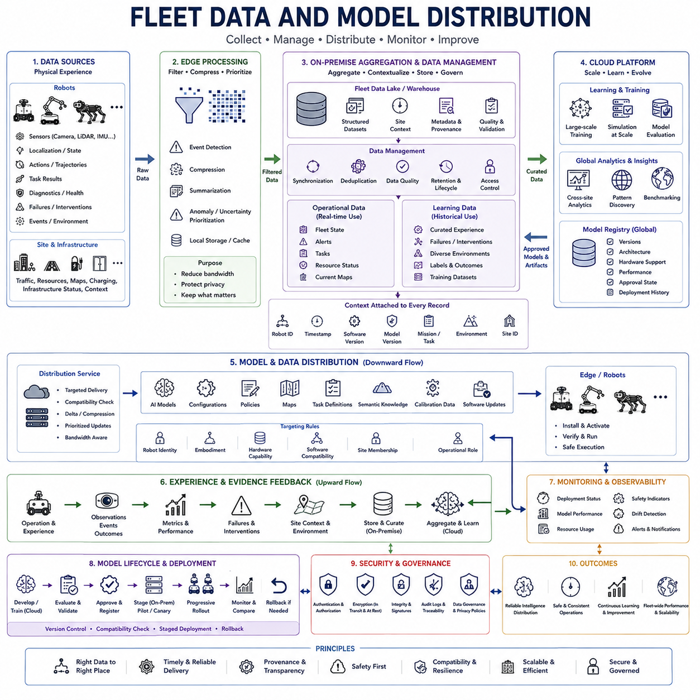{width="7.268055555555556in" height="7.268055555555556in"}

Fleet data and model distribution provides the information infrastructure that allows knowledge, software intelligence, and operational experience to move reliably across robots, sites, on-premise systems, and cloud platforms. At fleet scale, intelligence is not contained within one robot. It must be collected, organized, validated, distributed, monitored, and updated across many physical agents while preserving safety, compatibility, provenance, and operational continuity.

Fleet data originates from many heterogeneous sources. Robots generate sensor observations, localization states, trajectories, actions, task results, diagnostic signals, failures, interventions, and environmental events. Site infrastructure contributes traffic states, resource usage, maps, charging information, and operational context. Together, these streams form a distributed record of how the physical fleet perceives, decides, acts, and interacts with its environment.

Not all generated data should be transmitted or stored with equal priority. Raw video, LiDAR, audio, telemetry, and high-frequency control signals can create enormous data volumes. Edge systems can therefore filter, summarize, compress, or selectively retain information according to operational value. Important events, unusual conditions, failures, uncertainty, human interventions, and novel observations may receive higher priority than repetitive normal operation.

On-premise systems provide a natural aggregation point for fleet data. Information from multiple robots can be synchronized with site context and transformed into structured operational datasets. Robot identity, timestamps, software versions, model versions, task information, environmental conditions, and outcome labels can be attached as metadata. This context makes collected data more useful for debugging, analytics, evaluation, learning, and future model improvement.

Data provenance is essential because fleet learning depends on knowing where information came from. An observation should be traceable to the robot, sensor configuration, site, mission, software state, and model that generated it. Without provenance, failures and improvements become difficult to explain. Reliable provenance also allows learning pipelines to identify corrupted, outdated, duplicated, or low-confidence data before it influences future models.

Fleet data management should separate operational data from learning data while allowing controlled relationships between them. Operational systems require current states, alerts, task information, and resource status for immediate decisions. Learning systems require curated historical experience, representative failures, interventions, and diverse environmental examples. Separating these purposes prevents training workloads from interfering with real-time fleet operation while preserving useful connections between execution and learning.

Data distribution is also necessary in the opposite direction. Robots require maps, configurations, policies, task definitions, semantic knowledge, calibration information, and AI models produced elsewhere in the system. Distribution services must deliver the correct information to the correct robots according to identity, embodiment, hardware capability, software compatibility, site membership, and operational role rather than broadcasting every artifact indiscriminately to the entire fleet.

Model distribution is more sensitive than ordinary data transfer because a new model can directly alter physical behavior. Perception models can change what a robot detects, planning models can influence route selection, and learned control policies can modify physical actions. Fleet model deployment must therefore be treated as a governed lifecycle involving validation, approval, version control, compatibility checks, staged rollout, monitoring, and rollback.

A model registry can provide a controlled source of truth for deployable intelligence. Each model can be associated with a unique identifier, version, architecture, training information, supported hardware, required software dependencies, intended robot classes, evaluation results, approval state, and deployment history. Fleet services can then determine which model is authorized and technically compatible with each physical agent before installation.

Model packaging should include more than learned parameters. Preprocessing logic, normalization values, tokenizers, configuration files, runtime dependencies, calibration assumptions, execution requirements, and postprocessing behavior may all influence model output. Treating these elements as a consistent deployment artifact reduces situations in which identical model weights produce different behavior because surrounding software or configuration differs across robots.

Version management enables a heterogeneous fleet to operate safely during gradual upgrades. It may be impractical or undesirable to update every robot simultaneously. Different robot groups can temporarily operate with different model versions while fleet services track compatibility and performance. Explicit version awareness allows orchestration, diagnostics, and data analysis to interpret behavior correctly during transitions instead of assuming uniform intelligence across the fleet.

Staged deployment reduces the risk of fleet-wide model failures. A new model can first be tested in simulation or offline evaluation, then deployed to a limited number of robots or a controlled site. Performance and safety indicators can be compared with the previous version before expanding deployment. Canary deployment, pilot groups, and progressive rollout transform model updates from one large fleet-wide event into a controlled evidence-driven process.

Rollback capability is equally important. A model may pass offline evaluation yet behave unexpectedly when exposed to real environments, unusual objects, network conditions, or interactions with other robots. Fleet infrastructure should preserve known-good model versions and allow rapid restoration when degradation is detected. Rollback converts model deployment from an irreversible change into a manageable operational process with explicit recovery paths.

Distribution mechanisms must account for limited bandwidth and intermittent connectivity. Large models or map packages may require substantial transfer time, particularly for remote robots. Delta updates, compression, local caching, peer-assisted distribution, scheduled transfer windows, and on-premise mirrors can reduce network load. Updates can also be prioritized so that safety-critical patches are delivered before less urgent analytics or learning artifacts.

Edge, on-premise, and cloud layers play different roles in this distribution architecture. Edge systems consume operational models and generate physical experience. On-premise systems can cache approved models, coordinate site deployment, collect performance evidence, and maintain local datasets. Cloud systems can manage global registries, large-scale training, cross-site evaluation, and generalized model releases, creating a hierarchical path for intelligence movement.

The flow should remain bidirectional. Models and policies move downward from development environments toward sites and robots, while observations, evaluation metrics, failures, interventions, and task outcomes move upward. This creates a fleet learning loop in which deployed intelligence generates evidence about its own performance. Operational experience can therefore influence which models are retained, improved, specialized, or replaced in future releases.

Site-specific adaptation introduces an additional distribution challenge. A globally trained model may provide broad capabilities but require adaptation to local layouts, objects, terminology, workflows, or environmental conditions. On-premise systems can maintain site-specific adapters, configurations, maps, or policies while preserving a shared foundation model. Distribution then becomes compositional, combining globally reusable intelligence with locally specialized knowledge.

Heterogeneous robots may require different variants of the same intelligence. A vision model optimized for one accelerator may not execute efficiently on another platform, while different sensor configurations may require separate preprocessing or calibration. Fleet distribution should therefore map logical capabilities to compatible deployment artifacts. The objective is consistent functional behavior rather than forcing identical binary packages onto every robot.

Security must protect both data and models throughout their lifecycle. Encryption can protect transfers, while authentication and authorization determine which robots and services may access particular artifacts. Digital signatures, integrity checks, secure boot chains, and trusted update mechanisms can prevent unauthorized or corrupted models from reaching physical systems. These protections are especially important because compromised intelligence can translate directly into unsafe physical behavior.

Governance determines which data may leave a site and which models may influence operational robots. Privacy requirements, intellectual property, customer restrictions, safety certification, and organizational policies can limit data movement or model deployment. Fleet infrastructure should encode these rules into distribution pipelines so that governance becomes an enforceable system property rather than a manual process dependent on individual operators.

Observability is required after distribution because successful file transfer does not guarantee successful intelligence deployment. Fleet systems should monitor installation status, active model versions, inference performance, resource consumption, error rates, safety indicators, and task outcomes. Comparing these signals across robot groups helps detect regressions and reveals whether an updated model actually improves physical operations under real deployment conditions.

Model performance monitoring can also identify distribution drift across the fleet. Robots operating in different sites may encounter different environments, causing the same model to perform unevenly. Fleet analytics can compare performance by site, robot class, environment, task, and model version. This evidence can trigger retraining, local adaptation, additional data collection, or selective rollback rather than treating fleet performance as a single global average.

Efficient data and model distribution ultimately creates a continuous intelligence supply chain. Physical experience is generated at the edge, curated and contextualized within the fleet, aggregated for learning, transformed into improved models, validated, and redistributed to physical agents. Each deployment then generates new evidence, closing the loop between real-world operation and model development while maintaining traceability throughout the process.

A mature fleet therefore treats data and models as governed, versioned, distributed assets rather than files copied between computers. Reliable provenance, hierarchical storage, selective data movement, model registries, compatibility management, staged deployment, rollback, security, monitoring, and site adaptation together allow intelligence to evolve safely across large robot populations. This infrastructure enables collective experience to become continuously improving fleet-scale Physical AI.

플릿 데이터 및 모델 배포(Fleet Data and Model Distribution)는 로봇, 사이트(Site), 온프레미스 시스템(On-Premise System), 클라우드 플랫폼(Cloud Platform) 사이에서 지식(Knowledge), 소프트웨어 지능(Software Intelligence), 운영 경험(Operational Experience)이 신뢰성 있게 이동할 수 있도록 하는 정보 인프라(Information Infrastructure)를 제공한다. 플릿 규모(Fleet Scale)에서 지능(Intelligence)은 하나의 로봇 내부에만 존재하지 않는다. 안전(Safety), 호환성(Compatibility), 데이터 출처(Provenance), 운영 연속성(Operational Continuity)을 유지하면서 여러 물리 에이전트(Physical Agent)에 걸쳐 수집, 구성, 검증, 배포, 모니터링, 업데이트되어야 한다.

플릿 데이터(Fleet Data)는 다양한 이종 소스(Heterogeneous Source)에서 생성된다. 로봇은 센서 관측(Sensor Observation), 위치추정 상태(Localization State), 궤적(Trajectory), 행동(Action), 작업 결과(Task Result), 진단 신호(Diagnostic Signal), 장애(Failure), 인간 개입(Intervention), 환경 이벤트(Environmental Event)를 생성한다. 사이트 인프라(Site Infrastructure)는 교통 상태(Traffic State), 자원 사용(Resource Usage), 지도(Map), 충전 정보(Charging Information), 운영 맥락(Operational Context)을 제공한다. 이러한 데이터 스트림(Data Stream)은 물리적 플릿이 환경을 어떻게 인지하고, 결정하고, 행동하고, 상호작용하는지를 나타내는 분산 기록(Distributed Record)을 형성한다.

생성되는 모든 데이터를 동일한 우선순위로 전송하거나 저장할 필요는 없다. 원시 비디오(Raw Video), 라이다(LiDAR), 오디오(Audio), 텔레메트리(Telemetry), 고주파 제어 신호(High-Frequency Control Signal)는 막대한 데이터 용량을 발생시킬 수 있다. 따라서 엣지 시스템(Edge System)은 운영 가치(Operational Value)에 따라 정보를 필터링, 요약, 압축하거나 선택적으로 보존할 수 있다. 중요한 이벤트, 비정상적인 조건(Unusual Condition), 장애, 불확실성(Uncertainty), 인간 개입, 새로운 관측(Novel Observation)은 반복적인 정상 운영보다 높은 우선순위를 가질 수 있다.

온프레미스 시스템(On-Premise System)은 플릿 데이터를 집계하기 위한 자연스러운 중심점(Aggregation Point)을 제공한다. 여러 로봇의 정보를 사이트 맥락(Site Context)과 동기화하여 구조화된 운영 데이터셋(Structured Operational Dataset)으로 변환할 수 있다. 로봇 신원(Robot Identity), 타임스탬프(Timestamp), 소프트웨어 버전(Software Version), 모델 버전(Model Version), 작업 정보(Task Information), 환경 조건(Environmental Condition), 결과 라벨(Outcome Label)을 메타데이터(Metadata)로 연결할 수 있다. 이러한 맥락은 수집된 데이터를 디버깅(Debugging), 분석(Analytics), 평가(Evaluation), 학습(Learning), 향후 모델 개선(Model Improvement)에 더욱 유용하게 만든다.

데이터 출처(Provenance)는 플릿 학습(Fleet Learning)이 정보가 어디에서 생성되었는지를 알아야 하기 때문에 필수적이다. 관측 정보는 이를 생성한 로봇, 센서 구성(Sensor Configuration), 사이트, 임무(Mission), 소프트웨어 상태(Software State), 모델(Model)까지 추적할 수 있어야 한다. 데이터 출처가 없다면 장애와 개선 결과를 설명하기 어려워진다. 신뢰성 있는 데이터 출처 관리는 손상되거나 오래되었거나 중복되었거나 신뢰도가 낮은 데이터를 학습 파이프라인(Learning Pipeline)이 미래 모델에 영향을 미치기 전에 식별할 수 있도록 한다.

플릿 데이터 관리(Fleet Data Management)는 운영 데이터(Operational Data)와 학습 데이터(Learning Data)를 구분하면서 두 데이터 사이에 통제된 관계를 유지해야 한다. 운영 시스템은 즉각적인 의사결정을 위해 현재 상태(Current State), 경고(Alert), 작업 정보, 자원 상태(Resource Status)를 필요로 한다. 학습 시스템은 정제된 과거 경험(Curated Historical Experience), 대표적인 장애 사례, 인간 개입, 다양한 환경 사례를 필요로 한다. 이러한 목적을 분리하면 학습 작업 부하(Training Workload)가 실시간 플릿 운영(Real-Time Fleet Operation)을 방해하는 것을 방지하면서 실행과 학습 사이의 유용한 연결을 유지할 수 있다.

데이터 배포(Data Distribution)는 반대 방향으로도 필요하다. 로봇은 시스템의 다른 위치에서 생성된 지도, 구성(Configuration), 정책(Policy), 작업 정의(Task Definition), 의미 지식(Semantic Knowledge), 보정 정보(Calibration Information), AI 모델을 필요로 한다. 배포 서비스(Distribution Service)는 모든 아티팩트(Artifact)를 전체 플릿에 무차별적으로 전송하는 대신 로봇 신원, 형태와 구조(Embodiment), 하드웨어 역량(Hardware Capability), 소프트웨어 호환성(Software Compatibility), 사이트 소속(Site Membership), 운영 역할(Operational Role)에 따라 올바른 정보를 올바른 로봇에 전달해야 한다.

모델 배포(Model Distribution)는 새로운 모델이 물리적 행동을 직접 변화시킬 수 있기 때문에 일반적인 데이터 전송보다 더욱 신중하게 관리해야 한다. 인지 모델(Perception Model)은 로봇이 무엇을 탐지하는지를 변화시킬 수 있고, 계획 모델(Planning Model)은 경로 선택에 영향을 미치며, 학습된 제어 정책(Learned Control Policy)은 물리적 행동을 변경할 수 있다. 따라서 플릿 모델 배포는 검증(Validation), 승인(Approval), 버전 관리(Version Control), 호환성 검사(Compatibility Check), 단계적 배포(Staged Rollout), 모니터링(Monitoring), 롤백(Rollback)을 포함하는 통제된 수명주기(Governed Lifecycle)로 관리해야 한다.

모델 레지스트리(Model Registry)는 배포 가능한 지능(Deployable Intelligence)에 대한 통제된 단일 기준 정보원(Source of Truth)을 제공할 수 있다. 각 모델은 고유 식별자(Unique Identifier), 버전, 아키텍처(Architecture), 학습 정보(Training Information), 지원 하드웨어(Supported Hardware), 필요한 소프트웨어 의존성(Software Dependency), 대상 로봇 유형(Intended Robot Class), 평가 결과(Evaluation Result), 승인 상태(Approval State), 배포 이력(Deployment History)과 연결될 수 있다. 이를 통해 플릿 서비스는 설치 전에 각 물리 에이전트에 어떤 모델이 승인되어 있고 기술적으로 호환되는지를 판단할 수 있다.

모델 패키징(Model Packaging)은 학습된 매개변수(Learned Parameter) 이상의 요소를 포함해야 한다. 전처리 로직(Preprocessing Logic), 정규화 값(Normalization Value), 토크나이저(Tokenizer), 구성 파일(Configuration File), 런타임 의존성(Runtime Dependency), 보정 가정(Calibration Assumption), 실행 요구사항(Execution Requirement), 후처리 동작(Postprocessing Behavior)은 모두 모델 출력에 영향을 줄 수 있다. 이러한 요소들을 일관된 배포 아티팩트(Deployment Artifact)로 관리하면 동일한 모델 가중치(Model Weight)가 로봇별 주변 소프트웨어나 구성 차이로 인해 서로 다른 행동을 생성하는 상황을 줄일 수 있다.

버전 관리(Version Management)는 점진적인 업그레이드(Gradual Upgrade) 과정에서도 이종 플릿(Heterogeneous Fleet)이 안전하게 운영될 수 있도록 한다. 모든 로봇을 동시에 업데이트하는 것은 현실적이지 않거나 바람직하지 않을 수 있다. 서로 다른 로봇 그룹이 일시적으로 서로 다른 모델 버전을 사용하면서 플릿 서비스가 호환성과 성능을 추적할 수 있다. 명시적인 버전 인식(Version Awareness)을 통해 오케스트레이션(Orchestration), 진단(Diagnostics), 데이터 분석(Data Analysis)은 전환 기간 동안 전체 플릿이 동일한 지능을 사용한다고 가정하지 않고 행동을 올바르게 해석할 수 있다.

단계적 배포(Staged Deployment)는 플릿 전체의 모델 장애 위험을 감소시킨다. 새로운 모델은 먼저 시뮬레이션(Simulation)이나 오프라인 평가(Offline Evaluation)에서 시험한 후 제한된 수의 로봇 또는 통제된 사이트에 배포할 수 있다. 배포 범위를 확대하기 전에 성능과 안전 지표(Safety Indicator)를 이전 버전과 비교할 수 있다. 카나리 배포(Canary Deployment), 파일럿 그룹(Pilot Group), 점진적 롤아웃(Progressive Rollout)은 모델 업데이트를 하나의 대규모 플릿 전체 이벤트가 아니라 통제된 증거 기반 프로세스(Evidence-Driven Process)로 전환한다.

롤백 기능(Rollback Capability)도 마찬가지로 중요하다. 모델이 오프라인 평가를 통과했더라도 실제 환경, 비정상적인 객체, 네트워크 조건 또는 다른 로봇과의 상호작용에서 예상하지 못한 행동을 보일 수 있다. 플릿 인프라는 검증된 정상 모델 버전(Known-Good Model Version)을 보존하고 성능 저하가 탐지되면 신속하게 복원할 수 있어야 한다. 롤백은 모델 배포를 되돌릴 수 없는 변경이 아니라 명확한 복구 경로(Recovery Path)를 갖는 관리 가능한 운영 프로세스로 전환한다.

배포 메커니즘(Distribution Mechanism)은 제한된 대역폭(Bandwidth)과 간헐적인 연결성(Intermittent Connectivity)을 고려해야 한다. 대형 모델이나 지도 패키지(Map Package)는 특히 원격 로봇(Remote Robot)에서 상당한 전송시간을 필요로 할 수 있다. 델타 업데이트(Delta Update), 압축(Compression), 로컬 캐싱(Local Caching), 피어 지원 배포(Peer-Assisted Distribution), 예약된 전송 시간창(Scheduled Transfer Window), 온프레미스 미러(On-Premise Mirror)를 활용하여 네트워크 부하(Network Load)를 줄일 수 있다. 또한 안전 중요 패치(Safety-Critical Patch)가 덜 긴급한 분석 또는 학습 아티팩트보다 먼저 전달되도록 업데이트 우선순위를 지정할 수 있다.

엣지(Edge), 온프레미스(On-Premise), 클라우드(Cloud) 계층은 이러한 배포 아키텍처(Distribution Architecture)에서 서로 다른 역할을 수행한다. 엣지 시스템은 운영 모델(Operational Model)을 사용하고 물리적 경험(Physical Experience)을 생성한다. 온프레미스 시스템은 승인된 모델을 캐싱하고 사이트 배포를 조정하며 성능 증거(Performance Evidence)를 수집하고 로컬 데이터셋(Local Dataset)을 유지할 수 있다. 클라우드 시스템은 전역 레지스트리(Global Registry), 대규모 학습(Large-Scale Training), 사이트 간 평가(Cross-Site Evaluation), 일반화된 모델 릴리스(Generalized Model Release)를 관리하여 지능 이동을 위한 계층적 경로(Hierarchical Path)를 형성한다.

정보 흐름은 양방향(Bidirectional)으로 유지되어야 한다. 모델과 정책은 개발 환경(Development Environment)에서 사이트와 로봇 방향으로 하향 이동하고, 관측 정보, 평가 지표(Evaluation Metric), 장애, 인간 개입, 작업 결과는 상향 이동한다. 이를 통해 배포된 지능이 자신의 성능에 대한 증거를 생성하는 플릿 학습 루프(Fleet Learning Loop)가 형성된다. 따라서 운영 경험은 향후 릴리스에서 어떤 모델을 유지하고, 개선하고, 특화하거나 교체할지를 결정하는 데 영향을 줄 수 있다.

사이트별 적응(Site-Specific Adaptation)은 추가적인 배포 과제를 발생시킨다. 전역적으로 학습된 모델(Globally Trained Model)은 광범위한 역량을 제공할 수 있지만 로컬 배치(Layout), 객체(Object), 용어(Terminology), 작업 흐름(Workflow), 환경 조건에 맞는 적응이 필요할 수 있다. 온프레미스 시스템은 공유 파운데이션 모델(Shared Foundation Model)을 유지하면서 사이트별 어댑터(Site-Specific Adapter), 구성, 지도, 정책을 관리할 수 있다. 이에 따라 배포는 전역적으로 재사용 가능한 지능(Globally Reusable Intelligence)과 로컬 특화 지식(Locally Specialized Knowledge)을 결합하는 구성적 방식(Compositional Distribution)으로 발전한다.

이종 로봇(Heterogeneous Robot)은 동일한 지능에 대해서도 서로 다른 변형(Variant)을 필요로 할 수 있다. 하나의 가속기(Accelerator)에 최적화된 비전 모델(Vision Model)이 다른 플랫폼에서는 효율적으로 실행되지 않을 수 있으며, 서로 다른 센서 구성에는 별도의 전처리나 보정이 필요할 수 있다. 따라서 플릿 배포는 논리적 역량(Logical Capability)을 호환 가능한 배포 아티팩트와 매핑해야 한다. 목표는 모든 로봇에 동일한 바이너리 패키지(Binary Package)를 강제로 적용하는 것이 아니라 일관된 기능적 행동(Consistent Functional Behavior)을 제공하는 것이다.

보안(Security)은 데이터와 모델의 전체 수명주기(Lifecycle)를 보호해야 한다. 암호화(Encryption)는 전송 데이터를 보호할 수 있으며 인증(Authentication)과 권한 부여(Authorization)는 특정 아티팩트에 접근할 수 있는 로봇과 서비스를 결정한다. 디지털 서명(Digital Signature), 무결성 검사(Integrity Check), 보안 부팅 체인(Secure Boot Chain), 신뢰할 수 있는 업데이트 메커니즘(Trusted Update Mechanism)은 승인되지 않았거나 손상된 모델이 물리 시스템에 도달하는 것을 방지할 수 있다. 손상된 지능은 직접적으로 불안전한 물리 행동으로 이어질 수 있기 때문에 이러한 보호는 특히 중요하다.

거버넌스(Governance)는 어떤 데이터가 사이트 외부로 이동할 수 있고 어떤 모델이 운영 로봇에 영향을 미칠 수 있는지를 결정한다. 개인정보 보호(Privacy Requirement), 지식재산권(Intellectual Property), 고객 제한(Customer Restriction), 안전 인증(Safety Certification), 조직 정책(Organizational Policy)은 데이터 이동이나 모델 배포를 제한할 수 있다. 플릿 인프라는 이러한 규칙을 배포 파이프라인에 반영하여 거버넌스가 개별 운영자의 수동 작업에 의존하는 것이 아니라 강제 가능한 시스템 속성(Enforceable System Property)이 되도록 해야 한다.

성공적인 파일 전송이 성공적인 지능 배포를 보장하는 것은 아니므로 배포 이후에도 관측 가능성(Observability)이 필요하다. 플릿 시스템은 설치 상태(Installation Status), 활성 모델 버전(Active Model Version), 추론 성능(Inference Performance), 자원 소비(Resource Consumption), 오류율(Error Rate), 안전 지표, 작업 결과를 모니터링해야 한다. 이러한 신호를 로봇 그룹 간에 비교하면 성능 회귀(Regression)를 탐지하고 업데이트된 모델이 실제 배포 환경에서 물리적 운영을 실질적으로 개선하는지를 판단할 수 있다.

모델 성능 모니터링(Model Performance Monitoring)은 플릿 전체에서 발생하는 분포 드리프트(Distribution Drift)도 식별할 수 있다. 서로 다른 사이트에서 운영되는 로봇은 서로 다른 환경을 경험하기 때문에 동일한 모델이라도 성능이 불균일할 수 있다. 플릿 분석(Fleet Analytics)은 사이트, 로봇 유형, 환경, 작업, 모델 버전에 따라 성능을 비교할 수 있다. 이러한 증거를 기반으로 전체 플릿 성능을 하나의 전역 평균(Global Average)으로 처리하는 대신 재학습(Retraining), 로컬 적응(Local Adaptation), 추가 데이터 수집(Additional Data Collection), 선택적 롤백(Selective Rollback)을 실행할 수 있다.

효율적인 데이터 및 모델 배포(Data and Model Distribution)는 궁극적으로 지속적인 지능 공급망(Continuous Intelligence Supply Chain)을 형성한다. 물리적 경험은 엣지에서 생성되고 플릿 내부에서 정제되고 맥락화(Contextualization)되며, 학습을 위해 통합되고 개선된 모델로 변환된 후 검증을 거쳐 다시 물리 에이전트에 배포된다. 각각의 배포는 새로운 증거를 생성하여 실제 세계 운영(Real-World Operation)과 모델 개발(Model Development) 사이의 루프를 닫으며, 전체 과정에서 추적 가능성을 유지한다.

따라서 성숙한 플릿(Mature Fleet)은 데이터와 모델을 단순히 컴퓨터 사이에서 복사되는 파일이 아니라 거버넌스되고(Governed), 버전 관리되며(Versioned), 분산된 자산(Distributed Asset)으로 취급한다. 신뢰성 있는 데이터 출처, 계층형 저장(Hierarchical Storage), 선택적 데이터 이동(Selective Data Movement), 모델 레지스트리, 호환성 관리(Compatibility Management), 단계적 배포, 롤백, 보안, 모니터링, 사이트 적응이 결합되면 대규모 로봇 집단에서 지능을 안전하게 진화시킬 수 있다. 이러한 인프라는 집단 경험(Collective Experience)을 지속적으로 개선되는 플릿 규모 피지컬 AI(Fleet-Scale Physical AI)로 전환한다.

## 09.08. Fleet Health and AI Performance Monitoring

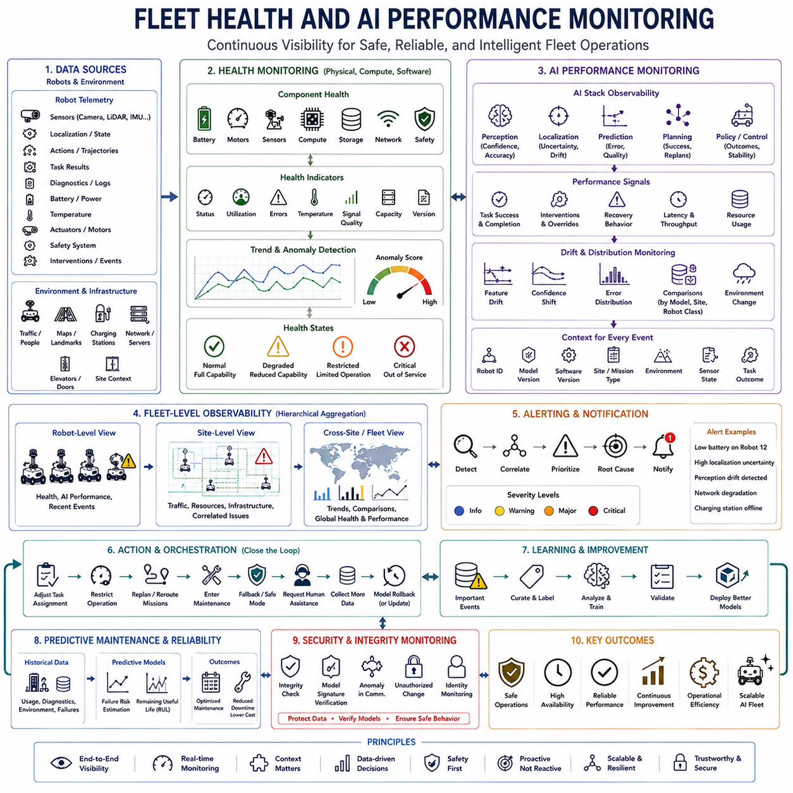{width="7.268055555555556in" height="7.268055555555556in"}

Fleet health and AI performance monitoring provides continuous visibility into whether a fleet is physically operational, computationally healthy, and intelligently effective. Traditional monitoring focuses mainly on hardware faults and software availability, but fleet-scale Physical AI must also observe the quality of perception, localization, prediction, planning, and decision making. A robot can remain online while its intelligence gradually becomes unreliable.

Fleet health begins with the physical condition of each robot. Battery state, temperature, motor current, actuator status, sensor availability, compute utilization, storage capacity, network quality, and safety-system state provide fundamental indicators of operational readiness. These signals should be interpreted together rather than independently because combinations of small degradations may reveal an emerging failure before any individual threshold is exceeded.

Health monitoring should distinguish availability from capability. A robot may be powered, connected, and technically available while a degraded camera, LiDAR, manipulator, localization subsystem, or battery limits the missions it can safely perform. Fleet services therefore need to translate component health into operational capability, allowing orchestration to determine whether a robot should continue normally, accept restricted tasks, enter maintenance, or be removed from service.

Diagnostic information becomes more valuable when combined with historical trends. Increasing motor current, declining battery capacity, repeated localization resets, rising compute temperature, or growing communication loss may indicate deterioration that is not visible from a single measurement. Time-series analysis allows the fleet to move from reactive fault reporting toward condition-based maintenance and early detection of components likely to fail.

Fleet-level health cannot be understood only by examining robots individually. Shared infrastructure such as wireless networks, charging stations, localization references, elevators, servers, and on-premise computing may affect many robots simultaneously. When several robots exhibit similar symptoms, monitoring should identify correlated failures and common dependencies rather than incorrectly treating each event as an independent robot problem.

AI performance monitoring extends observability from machine health to intelligence health. Perception confidence, localization uncertainty, prediction error, planning success, intervention frequency, task completion, recovery behavior, and policy outcomes can provide evidence about whether learned systems continue to operate as expected. This is essential because AI degradation often appears as reduced decision quality rather than an explicit software failure.

Perception monitoring should examine more than inference availability. A vision model may continue producing outputs while detection accuracy deteriorates because of lighting, weather, sensor contamination, new object types, camera movement, or environmental change. Confidence distributions, detection consistency, disagreement among sensors, missed-event indicators, and downstream task failures can provide indirect signals that perception performance has moved outside its validated operating conditions.

Localization performance can similarly degrade without producing an immediate system fault. Increasing pose uncertainty, frequent relocalization, map mismatch, abnormal correction magnitude, or disagreement between localization sources may indicate environmental or sensor changes. Monitoring these patterns allows fleet systems to restrict speed, change localization methods, request assistance, or avoid assigning precision-critical missions until confidence is restored.

Planning and control performance should be evaluated through operational outcomes. Excessive replanning, oscillatory paths, repeated obstacle avoidance, unusually long routes, emergency stops, control saturation, or growing task duration can indicate that the autonomy stack is struggling. These behaviors may arise from individual component problems or interactions between models, traffic conditions, site changes, and other robots.

World models and predictive components require monitoring of prediction quality over time. The system can compare predicted state transitions, object motion, traversability, or task outcomes with what subsequently occurs. Persistent prediction errors may indicate model drift or a changing environment. Prediction monitoring therefore provides a feedback mechanism for determining whether internal models still represent the physical world sufficiently well for reliable decision making.

Model drift occurs when operational data differs meaningfully from the distributions represented during development and validation. New layouts, objects, human behaviors, weather, payloads, workflows, or robot configurations may create conditions outside previous experience. Drift detection can compare features, confidence patterns, outcomes, and error distributions across time, sites, robot classes, and model versions to identify where adaptation may be necessary.

Monitoring should preserve the context surrounding every AI outcome. Robot identity, model version, software configuration, sensor state, site, mission type, environmental conditions, and task result help explain why performance changed. Without this context, fleet-wide averages can conceal important differences. A model may perform well globally while failing systematically on one robot class, site, environmental condition, or operational workflow.

Fleet monitoring therefore requires aggregation at multiple levels. Robot-level views reveal local health and behavior, site-level views expose traffic congestion, shared-resource failures, infrastructure problems, and correlated AI degradation, while cross-site views reveal longer-term patterns across deployments. Hierarchical observability prevents operators from being overwhelmed by raw telemetry while preserving the ability to investigate individual events when necessary.

Alerting should prioritize operational significance rather than simply reporting every threshold violation. Large fleets can generate enormous numbers of warnings, producing alert fatigue and hiding important events. Monitoring systems should correlate related signals, suppress redundant notifications, classify severity, and identify likely root causes. A single actionable incident representing a shared network failure is more useful than hundreds of separate robot connectivity alarms.

Anomaly detection can identify behavior that does not match established operational patterns even when predefined thresholds are not crossed. Unexpected energy consumption, unusual route duration, repeated task retries, abnormal sensor statistics, or uncommon combinations of system states may indicate emerging problems. Anomaly scores can guide investigation, but they should be accompanied by context and evidence rather than treated automatically as proof of failure.

Human intervention provides an especially valuable AI performance signal. Teleoperation requests, manual recoveries, emergency overrides, rejected plans, and operator corrections identify situations where autonomy could not complete the intended behavior independently. Tracking intervention frequency and cause helps distinguish ordinary operational complexity from systematic weaknesses and creates high-value examples for subsequent evaluation, learning, and model improvement.

Task outcomes provide another system-level measure of intelligence quality. Successful perception or planning metrics are insufficient if missions repeatedly fail, take too long, consume excessive energy, or require human assistance. Fleet monitoring should connect component-level AI indicators with mission completion, throughput, lateness, resource utilization, safety events, and intervention rates so that technical performance remains linked to operational value.

Comparisons between model versions are essential during staged deployment. Pilot robots running a new model can be compared with a control group operating a known-good version under similar conditions. Differences in task success, inference latency, resource consumption, interventions, safety indicators, and recovery behavior provide evidence for expanding, pausing, or reversing deployment. Monitoring thereby becomes part of model lifecycle governance.

Health scores can summarize complex information, but they should not hide underlying causes. A fleet may maintain robot, subsystem, mission, or AI health indicators that combine multiple measurements into interpretable states such as normal, degraded, restricted, or critical. These summaries help orchestration make rapid decisions while detailed telemetry and provenance remain available for diagnostics, maintenance, and engineering analysis.

Monitoring should feed directly into fleet orchestration rather than remain a passive dashboard function. A degraded robot can receive fewer or less demanding tasks, an uncertain localization system can trigger route restrictions, and a failing charging station can be removed from resource scheduling. AI degradation may initiate fallback policies, human review, additional data collection, model rollback, or reassignment to robots with more reliable capabilities.

Predictive maintenance extends this closed loop by estimating future health rather than only current condition. Historical fleet data can reveal relationships between usage, environmental exposure, diagnostic trends, and component failure. Remaining useful life or failure-risk estimates can then influence maintenance schedules and task allocation, reducing unexpected downtime while avoiding unnecessary preventive replacement of healthy components.

Security monitoring should also be integrated with operational health. Unexpected software versions, unusual communication patterns, unauthorized configuration changes, invalid model signatures, or inconsistent robot identities may indicate security problems rather than ordinary equipment faults. Because cyber events can alter physical behavior, fleet observability must connect security state with robot health, model integrity, and operational anomalies.

Long-term monitoring transforms fleet operation into a source of engineering knowledge. Repeated failures, intervention clusters, performance differences, maintenance histories, and site-specific anomalies reveal where hardware, software, models, infrastructure, or operating procedures should improve. Monitoring data therefore supports not only immediate operations but also system redesign, dataset construction, model retraining, and future fleet planning.

The objective is not to collect every possible metric but to establish evidence that the fleet remains safe, available, capable, and intelligent. Effective observability connects physical health, computational health, AI performance, mission outcomes, environmental context, and human intervention into a coherent operational picture. This allows operators and automated services to recognize degradation before it becomes a fleet-wide operational problem.

A mature fleet health and AI performance monitoring system therefore forms a continuous sense-evaluate-act loop around the intelligence itself. Robots and infrastructure generate evidence, fleet services detect degradation and drift, orchestration adjusts operations, and learning systems use important events for improvement. Monitoring becomes the mechanism through which fleet-scale Physical AI measures, protects, and continuously improves its real-world intelligence.

플릿 상태 및 AI 성능 모니터링(Fleet Health and AI Performance Monitoring)은 플릿이 물리적으로 정상 운영되고 있는지, 컴퓨팅 시스템이 건전한지, 그리고 지능적으로 효과적으로 작동하는지를 지속적으로 파악할 수 있는 가시성(Visibility)을 제공한다. 기존 모니터링은 주로 하드웨어 장애와 소프트웨어 가용성(Software Availability)에 집중하지만, 플릿 규모 피지컬 AI(Fleet-Scale Physical AI)는 인지(Perception), 위치추정(Localization), 예측(Prediction), 계획(Planning), 의사결정(Decision Making)의 품질까지 관찰해야 한다. 로봇이 온라인 상태를 유지하면서도 지능의 신뢰성이 점진적으로 저하될 수 있기 때문이다.

플릿 상태(Fleet Health)는 각 로봇의 물리적 상태(Physical Condition)에서 시작된다. 배터리 상태(Battery State), 온도(Temperature), 모터 전류(Motor Current), 액추에이터 상태(Actuator Status), 센서 가용성(Sensor Availability), 컴퓨팅 사용률(Compute Utilization), 저장공간(Storage Capacity), 네트워크 품질(Network Quality), 안전 시스템 상태(Safety-System State)는 운영 준비도(Operational Readiness)를 나타내는 기본적인 지표를 제공한다. 개별 임계값을 초과하지 않더라도 여러 작은 성능 저하가 결합되어 새로운 장애를 나타낼 수 있으므로 이러한 신호는 독립적이 아니라 함께 해석해야 한다.

상태 모니터링(Health Monitoring)은 가용성(Availability)과 역량(Capability)을 구분해야 한다. 로봇이 전원이 켜져 있고 연결되어 있어 기술적으로 사용 가능한 상태라도 카메라, 라이다(LiDAR), 매니퓰레이터(Manipulator), 위치추정 서브시스템(Localization Subsystem), 배터리의 성능 저하로 인해 안전하게 수행할 수 있는 임무가 제한될 수 있다. 따라서 플릿 서비스(Fleet Service)는 구성요소 상태(Component Health)를 운영 역량(Operational Capability)으로 변환하여 로봇이 정상 운영을 계속할지, 제한된 작업만 수행할지, 유지보수(Maintenance)에 들어갈지, 서비스에서 제외될지를 오케스트레이션(Orchestration)이 결정할 수 있도록 해야 한다.

진단 정보(Diagnostic Information)는 과거 추세(Historical Trend)와 결합할 때 더욱 가치가 높아진다. 증가하는 모터 전류, 감소하는 배터리 용량(Battery Capacity), 반복되는 위치추정 초기화(Localization Reset), 상승하는 컴퓨팅 온도, 증가하는 통신 손실(Communication Loss)은 단일 측정에서는 나타나지 않는 성능 저하를 의미할 수 있다. 시계열 분석(Time-Series Analysis)을 통해 플릿은 사후 대응적인 장애 보고(Reactive Fault Reporting)에서 상태 기반 유지보수(Condition-Based Maintenance)와 장애 가능성이 높은 구성요소의 조기 탐지(Early Detection)로 발전할 수 있다.

플릿 수준 상태(Fleet-Level Health)는 개별 로봇만 조사해서는 완전히 이해할 수 없다. 무선 네트워크(Wireless Network), 충전소(Charging Station), 위치추정 기준(Localization Reference), 엘리베이터(Elevator), 서버(Server), 온프레미스 컴퓨팅(On-Premise Computing)과 같은 공유 인프라(Shared Infrastructure)는 여러 로봇에 동시에 영향을 미칠 수 있다. 여러 로봇에서 유사한 증상이 나타나는 경우 모니터링은 각 이벤트를 독립적인 로봇 문제로 잘못 처리하지 않고 상관관계가 있는 장애(Correlated Failure)와 공통 의존성(Common Dependency)을 식별해야 한다.

AI 성능 모니터링(AI Performance Monitoring)은 관측 가능성(Observability)을 기계 상태(Machine Health)에서 지능 상태(Intelligence Health)까지 확장한다. 인지 신뢰도(Perception Confidence), 위치추정 불확실성(Localization Uncertainty), 예측 오류(Prediction Error), 계획 성공률(Planning Success), 인간 개입 빈도(Intervention Frequency), 작업 완료(Task Completion), 복구 행동(Recovery Behavior), 정책 결과(Policy Outcome)는 학습 시스템이 예상대로 계속 작동하는지를 보여주는 증거가 될 수 있다. AI 성능 저하는 명시적인 소프트웨어 장애보다 의사결정 품질의 저하로 나타나는 경우가 많기 때문에 이러한 모니터링이 필수적이다.

인지 모니터링(Perception Monitoring)은 단순히 추론(Inference)이 실행되는지만 확인해서는 안 된다. 비전 모델(Vision Model)은 계속 출력을 생성하면서도 조명, 날씨, 센서 오염(Sensor Contamination), 새로운 객체 유형, 카메라 이동, 환경 변화로 인해 탐지 정확도(Detection Accuracy)가 저하될 수 있다. 신뢰도 분포(Confidence Distribution), 탐지 일관성(Detection Consistency), 센서 간 불일치(Sensor Disagreement), 누락 이벤트 지표(Missed-Event Indicator), 다운스트림 작업 장애(Downstream Task Failure)는 인지 성능이 검증된 운영 조건(Validated Operating Condition)을 벗어났다는 간접적인 신호를 제공할 수 있다.

위치추정 성능(Localization Performance) 역시 즉각적인 시스템 장애를 발생시키지 않으면서 저하될 수 있다. 증가하는 자세 불확실성(Pose Uncertainty), 빈번한 재위치추정(Relocalization), 지도 불일치(Map Mismatch), 비정상적인 보정량(Abnormal Correction Magnitude), 위치추정 소스 간 불일치는 환경 또는 센서 변화의 징후일 수 있다. 이러한 패턴을 모니터링하면 신뢰도가 회복될 때까지 플릿 시스템이 속도를 제한하고, 위치추정 방식을 변경하고, 지원을 요청하거나, 높은 정밀도가 요구되는 임무(Precision-Critical Mission)의 할당을 피할 수 있다.

계획 및 제어 성능(Planning and Control Performance)은 운영 결과(Operational Outcome)를 통해 평가해야 한다. 과도한 재계획(Replanning), 진동하는 경로(Oscillatory Path), 반복적인 장애물 회피, 비정상적으로 긴 경로, 비상 정지(Emergency Stop), 제어 포화(Control Saturation), 증가하는 작업시간(Task Duration)은 자율 시스템(Autonomy Stack)이 어려움을 겪고 있다는 신호일 수 있다. 이러한 행동은 개별 구성요소의 문제뿐만 아니라 모델, 교통 조건, 사이트 변화, 다른 로봇 사이의 상호작용으로 인해 발생할 수도 있다.

월드 모델(World Model)과 예측 구성요소(Predictive Component)는 시간에 따른 예측 품질(Prediction Quality)의 모니터링이 필요하다. 시스템은 예측된 상태 전이(State Transition), 객체 움직임(Object Motion), 주행가능성(Traversability), 작업 결과를 이후 실제로 발생한 결과와 비교할 수 있다. 지속적인 예측 오류는 모델 드리프트(Model Drift) 또는 변화하는 환경을 의미할 수 있다. 따라서 예측 모니터링(Prediction Monitoring)은 내부 모델(Internal Model)이 신뢰성 있는 의사결정에 충분할 정도로 물리 세계를 계속 표현하고 있는지를 판단하는 피드백 메커니즘(Feedback Mechanism)을 제공한다.

모델 드리프트(Model Drift)는 운영 데이터(Operational Data)가 개발 및 검증 과정에서 사용된 데이터 분포(Data Distribution)와 의미 있게 달라질 때 발생한다. 새로운 배치(Layout), 객체(Object), 인간 행동(Human Behavior), 날씨, 페이로드(Payload), 작업 흐름(Workflow), 로봇 구성(Robot Configuration)은 기존 경험의 범위를 벗어난 조건을 만들 수 있다. 드리프트 탐지(Drift Detection)는 시간, 사이트, 로봇 유형, 모델 버전에 따른 특징(Feature), 신뢰도 패턴, 결과, 오류 분포(Error Distribution)를 비교하여 어느 영역에서 적응(Adaptation)이 필요한지를 식별할 수 있다.

모니터링은 모든 AI 결과를 둘러싼 맥락(Context)을 보존해야 한다. 로봇 신원(Robot Identity), 모델 버전(Model Version), 소프트웨어 구성(Software Configuration), 센서 상태(Sensor State), 사이트(Site), 임무 유형(Mission Type), 환경 조건(Environmental Condition), 작업 결과(Task Result)는 성능이 변화한 이유를 설명하는 데 도움이 된다. 이러한 맥락이 없으면 플릿 전체 평균(Fleet-Wide Average)이 중요한 차이를 숨길 수 있다. 모델이 전역적으로는 우수한 성능을 보이면서도 특정 로봇 유형, 사이트, 환경 조건 또는 운영 작업 흐름에서 체계적으로 실패할 수 있다.

따라서 플릿 모니터링(Fleet Monitoring)은 여러 수준에서의 집계(Aggregation)를 필요로 한다. 로봇 수준 관점(Robot-Level View)은 로컬 상태와 행동을 보여주고, 사이트 수준 관점(Site-Level View)은 교통 혼잡(Traffic Congestion), 공유 자원 장애(Shared-Resource Failure), 인프라 문제(Infrastructure Problem), 상관관계가 있는 AI 성능 저하를 보여주며, 사이트 간 관점(Cross-Site View)은 여러 배포 환경에서 장기적인 패턴을 보여준다. 계층형 관측 가능성(Hierarchical Observability)은 운영자가 원시 텔레메트리(Raw Telemetry)에 압도되지 않도록 하면서도 필요할 때 개별 이벤트를 조사할 수 있는 능력을 유지한다.

경고(Alerting)는 단순히 모든 임계값 위반을 보고하는 것이 아니라 운영 중요도(Operational Significance)에 따라 우선순위를 정해야 한다. 대규모 플릿은 막대한 수의 경고를 생성하여 경고 피로(Alert Fatigue)를 유발하고 중요한 이벤트를 숨길 수 있다. 모니터링 시스템은 관련 신호를 서로 연결하고 중복 알림을 억제하며 심각도(Severity)를 분류하고 가능한 근본 원인(Root Cause)을 식별해야 한다. 공유 네트워크 장애를 나타내는 하나의 실행 가능한 사고(Actionable Incident)가 수백 개의 개별 로봇 연결 경고보다 유용하다.

이상 탐지(Anomaly Detection)는 사전에 정의된 임계값을 넘지 않더라도 기존 운영 패턴과 일치하지 않는 행동을 식별할 수 있다. 예상하지 못한 에너지 소비(Energy Consumption), 비정상적인 경로 소요시간(Route Duration), 반복되는 작업 재시도(Task Retry), 비정상적인 센서 통계(Sensor Statistics), 흔하지 않은 시스템 상태 조합은 새롭게 발생하는 문제를 나타낼 수 있다. 이상 점수(Anomaly Score)는 조사 방향을 결정하는 데 활용할 수 있지만 자동적으로 장애의 증거로 간주하기보다는 맥락과 증거를 함께 제공해야 한다.

인간 개입(Human Intervention)은 특히 가치 있는 AI 성능 신호를 제공한다. 원격조작 요청(Teleoperation Request), 수동 복구(Manual Recovery), 비상 오버라이드(Emergency Override), 거부된 계획(Rejected Plan), 운영자 수정(Operator Correction)은 자율 시스템이 의도한 행동을 독립적으로 완료하지 못했던 상황을 나타낸다. 개입 빈도와 원인을 추적하면 일반적인 운영 복잡성과 체계적인 약점을 구분할 수 있으며 이후 평가, 학습, 모델 개선에 활용할 수 있는 가치 높은 사례(High-Value Example)를 생성할 수 있다.

작업 결과(Task Outcome)는 지능 품질(Intelligence Quality)을 나타내는 또 다른 시스템 수준 지표를 제공한다. 인지나 계획 지표가 성공적이더라도 임무가 반복적으로 실패하거나, 지나치게 오래 걸리거나, 과도한 에너지를 소비하거나, 인간 지원이 필요하다면 충분하지 않다. 플릿 모니터링은 구성요소 수준의 AI 지표를 임무 완료(Mission Completion), 처리량(Throughput), 지연(Lateness), 자원 활용률(Resource Utilization), 안전 이벤트(Safety Event), 인간 개입률(Intervention Rate)과 연결하여 기술적 성능이 운영 가치(Operational Value)와 연계되도록 해야 한다.

모델 버전 간 비교(Model Version Comparison)는 단계적 배포(Staged Deployment) 과정에서 필수적이다. 새로운 모델을 사용하는 파일럿 로봇(Pilot Robot)은 유사한 조건에서 검증된 정상 버전(Known-Good Version)을 사용하는 대조군(Control Group)과 비교할 수 있다. 작업 성공률, 추론 지연시간(Inference Latency), 자원 소비, 인간 개입, 안전 지표, 복구 행동의 차이는 배포를 확대하거나 일시 중단하거나 되돌릴지를 결정하는 증거를 제공한다. 따라서 모니터링은 모델 수명주기 거버넌스(Model Lifecycle Governance)의 일부가 된다.

상태 점수(Health Score)는 복잡한 정보를 요약할 수 있지만 근본적인 원인을 숨겨서는 안 된다. 플릿은 여러 측정값을 정상(Normal), 성능 저하(Degraded), 제한(Restricted), 심각(Critical)과 같은 해석 가능한 상태로 결합한 로봇, 서브시스템(Subsystem), 임무 또는 AI 상태 지표를 유지할 수 있다. 이러한 요약은 오케스트레이션이 빠른 결정을 내리도록 지원하면서도 상세 텔레메트리와 데이터 출처는 진단, 유지보수, 엔지니어링 분석(Engineering Analysis)을 위해 계속 사용할 수 있어야 한다.

모니터링은 수동적인 대시보드(Dashboard) 기능에 머물지 않고 플릿 오케스트레이션과 직접 연결되어야 한다. 성능이 저하된 로봇에는 더 적거나 덜 어려운 작업을 할당할 수 있고, 불확실한 위치추정 시스템은 경로 제한(Route Restriction)을 유발할 수 있으며, 장애가 발생한 충전소는 자원 스케줄링(Resource Scheduling)에서 제외할 수 있다. AI 성능 저하는 폴백 정책(Fallback Policy), 인간 검토(Human Review), 추가 데이터 수집, 모델 롤백(Model Rollback), 더 신뢰할 수 있는 역량을 가진 로봇으로의 재할당(Reassignment)을 시작하게 할 수 있다.

예측 유지보수(Predictive Maintenance)는 현재 상태뿐만 아니라 미래의 상태를 추정함으로써 이러한 폐루프(Closed Loop)를 확장한다. 과거 플릿 데이터는 사용량(Usage), 환경 노출(Environmental Exposure), 진단 추세(Diagnostic Trend), 구성요소 장애 사이의 관계를 보여줄 수 있다. 잔여 유효 수명(Remaining Useful Life)이나 장애 위험(Failure Risk) 추정치를 유지보수 일정(Maintenance Schedule)과 작업 할당에 반영하면 정상 구성요소를 불필요하게 예방 교체하지 않으면서 예상하지 못한 가동 중단(Downtime)을 줄일 수 있다.

보안 모니터링(Security Monitoring)도 운영 상태와 통합되어야 한다. 예상하지 못한 소프트웨어 버전, 비정상적인 통신 패턴(Communication Pattern), 승인되지 않은 구성 변경(Configuration Change), 유효하지 않은 모델 서명(Model Signature), 일관되지 않은 로봇 신원은 일반적인 장비 장애가 아니라 보안 문제를 나타낼 수 있다. 사이버 이벤트(Cyber Event)는 물리적 행동을 변경할 수 있으므로 플릿 관측 가능성은 보안 상태(Security State)를 로봇 상태, 모델 무결성(Model Integrity), 운영 이상(Operational Anomaly)과 연결해야 한다.

장기적인 모니터링(Long-Term Monitoring)은 플릿 운영을 엔지니어링 지식(Engineering Knowledge)의 원천으로 전환한다. 반복적인 장애, 인간 개입의 집중(Intervention Cluster), 성능 차이, 유지보수 이력(Maintenance History), 사이트별 이상(Site-Specific Anomaly)은 하드웨어, 소프트웨어, 모델, 인프라 또는 운영 절차에서 개선해야 할 부분을 보여준다. 따라서 모니터링 데이터는 즉각적인 운영뿐만 아니라 시스템 재설계(System Redesign), 데이터셋 구축(Dataset Construction), 모델 재학습(Model Retraining), 향후 플릿 계획(Future Fleet Planning)을 지원한다.

목표는 가능한 모든 지표를 수집하는 것이 아니라 플릿이 안전하고(Safe), 가용하며(Available), 역량을 유지하고(Capable), 지능적으로 작동하고(Intelligent) 있다는 증거를 확보하는 것이다. 효과적인 관측 가능성은 물리적 상태(Physical Health), 컴퓨팅 상태(Computational Health), AI 성능, 임무 결과, 환경 맥락, 인간 개입을 일관된 운영 상황(Coherent Operational Picture)으로 연결한다. 이를 통해 운영자와 자동화 서비스는 성능 저하가 플릿 전체의 운영 문제로 확대되기 전에 이를 인식할 수 있다.

따라서 성숙한 플릿 상태 및 AI 성능 모니터링 시스템(Mature Fleet Health and AI Performance Monitoring System)은 지능 자체를 둘러싼 지속적인 감지-평가-행동 루프(Sense-Evaluate-Act Loop)를 형성한다. 로봇과 인프라는 증거(Evidence)를 생성하고, 플릿 서비스는 성능 저하와 드리프트(Drift)를 탐지하며, 오케스트레이션은 운영을 조정하고, 학습 시스템은 중요한 이벤트를 개선에 활용한다. 이를 통해 모니터링은 플릿 규모 피지컬 AI가 실제 세계의 지능(Real-World Intelligence)을 측정하고 보호하며 지속적으로 개선하는 핵심 메커니즘이 된다.

## 09.09. OTA and Continuous Model Deployment

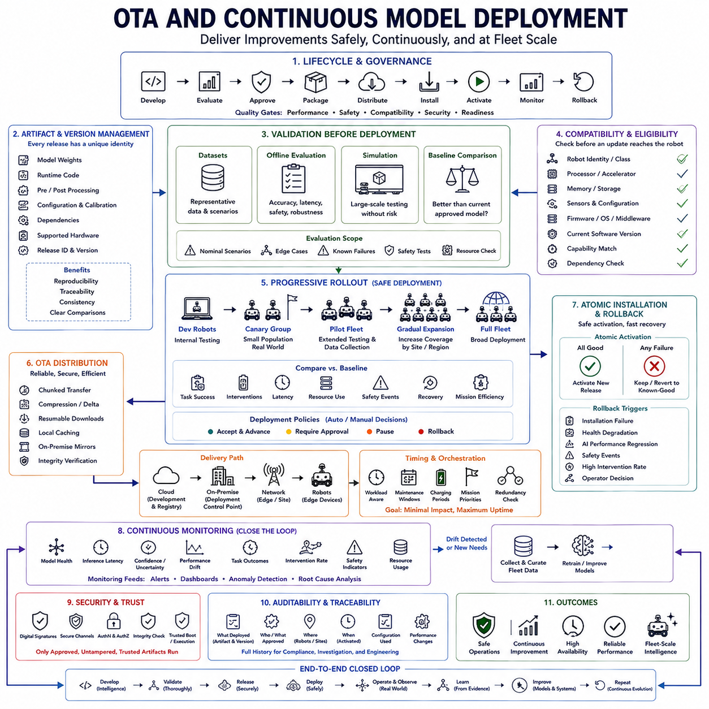{width="7.268055555555556in" height="7.268055555555556in"}

Over-the-air updates and continuous model deployment allow a robot fleet to improve software intelligence without requiring manual access to every physical machine. At fleet scale, updating autonomy software, AI models, configurations, maps, and policies becomes a continuous operational capability rather than an occasional maintenance procedure. The deployment system must deliver improvements while preserving safety, compatibility, traceability, availability, and controlled recovery.

OTA deployment begins with a clearly defined software and model lifecycle. An artifact should move through development, evaluation, approval, packaging, distribution, installation, activation, monitoring, and possible rollback. Treating these stages as one managed pipeline prevents experimental intelligence from moving directly into operational robots and establishes explicit gates where technical performance, safety requirements, dependencies, and deployment readiness can be verified.

AI model updates require stronger governance than ordinary application updates because models can change physical behavior without changing conventional program logic. A new perception model may alter object recognition, a planning model may select different trajectories, and a learned policy may generate different actions. Model deployment must therefore evaluate behavioral consequences in addition to confirming that files were transferred and software processes started correctly.

Every deployable artifact should have a unique identity and version. Model weights, runtime code, preprocessing, postprocessing, configuration, calibration parameters, dependencies, and supported hardware should be associated with the same release definition. This prevents ambiguous deployments in which two robots appear to use the same model while actually executing different surrounding configurations that produce different physical behavior.

Compatibility checks should occur before an update reaches a robot. The deployment service can compare requirements with robot identity, processor architecture, accelerator type, memory, sensor configuration, firmware, middleware, operating system, and existing software versions. A technically valid model may still be unsuitable for a particular embodiment or compute platform, so deployment eligibility should be determined from explicit capability and dependency information.

Packaging creates a reproducible unit that can be transported across fleet infrastructure. Containers, signed model bundles, immutable packages, or equivalent mechanisms can preserve the relationship among models and their runtime requirements. Reproducibility is important because validation results are meaningful only when the artifact evaluated before deployment is functionally equivalent to the artifact eventually activated on operational robots.

Before deployment, candidate models should pass offline validation using representative datasets, recorded fleet experience, simulation, and relevant safety tests. Evaluation should include expected operating conditions as well as difficult scenarios, known failures, and important edge cases. A candidate should be compared with the currently approved model so that deployment decisions reflect measurable improvement rather than simply assuming that a newer version is better.

Simulation provides an additional barrier between model development and the physical fleet. Large numbers of scenarios can be evaluated without exposing robots, people, or infrastructure to unnecessary risk. Simulation cannot reproduce every real-world condition, but it can reveal obvious regressions, unstable behaviors, excessive resource requirements, and interactions that should be corrected before a model is allowed to progress toward physical deployment.

Continuous deployment should use progressive rollout rather than updating the entire fleet simultaneously. A candidate can first be activated on development robots, then a small canary group, followed by a pilot fleet and progressively larger populations. Evidence collected at each stage determines whether rollout should continue. This limits the number of robots exposed to unexpected behavior and creates opportunities to detect problems before they become fleet-wide.

Canary deployment is particularly useful because it allows direct comparison between a new model and a known-good baseline under real operating conditions. Task success, intervention rate, inference latency, resource consumption, safety events, recovery behavior, and mission efficiency can be compared between groups. The purpose is not merely to confirm that the new model runs, but to determine whether it produces better operational intelligence.

Deployment policies can define acceptance criteria before rollout begins. Thresholds for task success, latency, uncertainty, intervention frequency, safety events, energy use, or other operational metrics can determine whether an update advances automatically, requires human approval, pauses, or rolls back. Predefined criteria reduce subjective decisions during incidents and make continuous deployment more consistent across different sites and robot populations.

OTA transfer mechanisms must tolerate unreliable networks and large artifacts. Models, maps, and software packages can require substantial bandwidth, particularly across geographically distributed fleets. Chunked transfer, compression, delta updates, resumable downloads, local caching, and on-premise mirrors can reduce transmission cost. Robots should verify completeness and integrity before activation so that interrupted transfers cannot create partially installed operational states.

On-premise infrastructure can act as a deployment control point between cloud development environments and edge robots. Approved releases can be replicated to the site, cached locally, and distributed according to site schedules and operational conditions. This reduces dependence on continuous cloud connectivity and allows local policies to determine when robots can safely leave service, install updates, restart components, and return to operation.

Deployment timing should consider fleet workload. Updating many robots during peak operations can reduce available capacity even when the update itself is technically safe. Fleet orchestration can coordinate update windows with task schedules, charging periods, maintenance intervals, robot redundancy, and mission priorities. OTA deployment then becomes a schedulable fleet activity integrated with operations rather than an independent IT process.

Atomic activation helps prevent inconsistent software states. An update should either become fully active as an approved release or leave the previous working configuration intact. If installation fails, dependencies cannot be satisfied, or startup validation does not succeed, the robot should remain on or return to a known-good state. This principle is especially important for robots whose software directly controls movement and interaction with the environment.

Rollback must be designed before deployment rather than added after a failure occurs. Robots or on-premise services should preserve validated previous versions and the information required to restore them quickly. Rollback may be triggered by installation failure, health degradation, AI performance regression, safety events, excessive interventions, or operator decisions. Recovery speed becomes an important property of the deployment architecture.

Not every problem requires fleet-wide rollback. Monitoring may reveal that a model performs poorly only on a specific robot class, sensor configuration, site, or environmental condition. Deployment services can selectively halt or reverse the update for affected populations while allowing successful deployments to continue elsewhere. This requires precise tracking of robot identity, configuration, model version, site context, and observed performance.

Continuous monitoring closes the deployment loop. After activation, the fleet should observe model health, inference latency, resource consumption, confidence, drift, task outcomes, interventions, and safety indicators. Deployment is not complete when installation succeeds; it is complete only when sufficient operational evidence demonstrates that the updated intelligence performs acceptably in the physical environment for which it was released.

Model drift can also initiate a new deployment cycle. When monitoring detects that operational environments have changed or that model performance is degrading, relevant fleet data can be collected and curated for evaluation or retraining. Improved models then return through the same validation and deployment pipeline. Continuous model deployment therefore connects fleet observability directly with continuous learning and adaptation.

Security is fundamental because OTA infrastructure provides a pathway capable of changing robot behavior remotely. Packages should be authenticated, integrity-protected, and distributed only through trusted services. Digital signatures, secure channels, authorization policies, certificate management, and protected boot or execution mechanisms can ensure that robots activate only approved artifacts and reject unauthorized, corrupted, or substituted software intelligence.

Auditability provides accountability across the complete update process. Fleet operators should be able to determine which artifact was deployed, who or what approved it, which robots received it, when activation occurred, what configuration was used, and how performance changed afterward. This history supports incident investigation, regulatory evidence, engineering analysis, reproducibility, and comparison between successive generations of fleet intelligence.

Continuous deployment must also respect site-specific governance. A model approved globally may still require local authorization because of customer policies, certification boundaries, operating conditions, or infrastructure differences. Sites can define deployment windows, eligible robot groups, required evaluation procedures, and approval authorities while still participating in a common fleet-wide model lifecycle and distribution architecture.

At larger scale, deployment becomes hierarchical. Cloud systems can maintain global model registries and validated releases, on-premise systems can enforce site policies and coordinate rollout, and edge robots can perform final compatibility and integrity checks before activation. Operational evidence flows in the opposite direction, allowing each layer to determine whether intelligence remains suitable at robot, site, and cross-fleet levels.

The central objective of OTA and continuous model deployment is not maximum update frequency but controlled intelligence evolution. A fleet should improve rapidly enough to benefit from new data and models while remaining conservative enough to protect physical operations. Versioning, validation, progressive rollout, monitoring, rollback, security, and governance create the safeguards required to reconcile continuous learning with dependable robotic operation.

A mature deployment architecture ultimately creates a closed lifecycle of develop, validate, release, deploy, observe, learn, and improve. Cloud-scale learning can generate generalized intelligence, on-premise systems can validate and contextualize deployment for fleet operations, and edge robots can execute approved intelligence while producing new real-world evidence. This loop enables fleet-scale Physical AI to evolve continuously without sacrificing operational safety, resilience, or trust.

무선 업데이트(Over-the-Air Update)와 지속적 모델 배포(Continuous Model Deployment)는 모든 물리적 로봇에 사람이 직접 접근하지 않고도 로봇 플릿(Robot Fleet)의 소프트웨어 지능(Software Intelligence)을 개선할 수 있도록 한다. 플릿 규모(Fleet Scale)에서는 자율 시스템 소프트웨어(Autonomy Software), AI 모델, 구성(Configuration), 지도(Map), 정책(Policy)의 업데이트가 간헐적인 유지보수 절차가 아니라 지속적인 운영 역량(Continuous Operational Capability)이 된다. 배포 시스템(Deployment System)은 안전(Safety), 호환성(Compatibility), 추적 가능성(Traceability), 가용성(Availability), 통제된 복구(Controlled Recovery)를 유지하면서 개선된 지능을 전달해야 한다.

OTA 배포(OTA Deployment)는 명확하게 정의된 소프트웨어 및 모델 수명주기(Software and Model Lifecycle)에서 시작한다. 하나의 아티팩트(Artifact)는 개발(Development), 평가(Evaluation), 승인(Approval), 패키징(Packaging), 배포(Distribution), 설치(Installation), 활성화(Activation), 모니터링(Monitoring), 필요한 경우 롤백(Rollback)의 과정을 거쳐야 한다. 이러한 단계를 하나의 관리형 파이프라인(Managed Pipeline)으로 취급하면 실험적인 지능이 운영 로봇으로 직접 이동하는 것을 방지하고 기술 성능, 안전 요구사항, 의존성(Dependency), 배포 준비도(Deployment Readiness)를 검증하는 명확한 게이트(Gate)를 설정할 수 있다.

AI 모델 업데이트(AI Model Update)는 일반적인 애플리케이션 업데이트보다 강력한 거버넌스(Governance)가 필요하다. 모델은 기존 프로그램 로직을 변경하지 않더라도 물리적 행동을 변화시킬 수 있기 때문이다. 새로운 인지 모델(Perception Model)은 객체 인식을 변경할 수 있고, 계획 모델(Planning Model)은 다른 궤적(Trajectory)을 선택할 수 있으며, 학습된 정책(Learned Policy)은 서로 다른 행동을 생성할 수 있다. 따라서 모델 배포는 단순히 파일이 전송되고 소프트웨어 프로세스가 정상적으로 시작되었는지를 확인하는 것뿐만 아니라 행동적 결과(Behavioral Consequence)까지 평가해야 한다.

배포 가능한 모든 아티팩트에는 고유한 신원(Unique Identity)과 버전(Version)이 있어야 한다. 모델 가중치(Model Weight), 런타임 코드(Runtime Code), 전처리(Preprocessing), 후처리(Postprocessing), 구성, 보정 매개변수(Calibration Parameter), 의존성, 지원 하드웨어(Supported Hardware)는 동일한 릴리스 정의(Release Definition)에 연결되어야 한다. 이를 통해 두 로봇이 동일한 모델을 사용하는 것처럼 보이지만 실제로는 서로 다른 주변 구성으로 인해 서로 다른 물리적 행동을 생성하는 모호한 배포(Ambiguous Deployment)를 방지할 수 있다.

호환성 검사(Compatibility Check)는 업데이트가 로봇에 도달하기 전에 수행되어야 한다. 배포 서비스(Deployment Service)는 요구사항을 로봇 신원(Robot Identity), 프로세서 아키텍처(Processor Architecture), 가속기 유형(Accelerator Type), 메모리(Memory), 센서 구성(Sensor Configuration), 펌웨어(Firmware), 미들웨어(Middleware), 운영체제(Operating System), 기존 소프트웨어 버전과 비교할 수 있다. 기술적으로 유효한 모델이라도 특정 형태(Embodiment)나 컴퓨팅 플랫폼에 적합하지 않을 수 있으므로 배포 적격성(Deployment Eligibility)은 명시적인 역량(Capability)과 의존성 정보를 기반으로 결정해야 한다.

패키징(Packaging)은 플릿 인프라(Fleet Infrastructure)를 통해 전달할 수 있는 재현 가능한 단위(Reproducible Unit)를 생성한다. 컨테이너(Container), 서명된 모델 번들(Signed Model Bundle), 불변 패키지(Immutable Package) 또는 이에 상응하는 메커니즘을 통해 모델과 런타임 요구사항(Runtime Requirement)의 관계를 유지할 수 있다. 배포 전에 평가된 아티팩트와 실제 운영 로봇에서 활성화되는 아티팩트가 기능적으로 동일해야만 검증 결과가 의미를 가지므로 재현성(Reproducibility)은 매우 중요하다.

배포 전에 후보 모델(Candidate Model)은 대표 데이터셋(Representative Dataset), 기록된 플릿 경험(Recorded Fleet Experience), 시뮬레이션(Simulation), 관련 안전 시험(Safety Test)을 이용한 오프라인 검증(Offline Validation)을 통과해야 한다. 평가는 예상되는 운영 조건뿐만 아니라 어려운 시나리오, 알려진 장애 사례(Known Failure), 중요한 엣지 케이스(Edge Case)를 포함해야 한다. 새로운 버전이라는 이유만으로 더 우수하다고 가정하지 않고 측정 가능한 개선(Measurable Improvement)을 기반으로 배포를 결정할 수 있도록 후보 모델을 현재 승인된 모델(Currently Approved Model)과 비교해야 한다.

시뮬레이션(Simulation)은 모델 개발과 물리적 플릿 사이에 추가적인 안전 장벽(Safety Barrier)을 제공한다. 로봇, 사람, 인프라를 불필요한 위험에 노출하지 않으면서 많은 시나리오를 평가할 수 있다. 시뮬레이션이 모든 실제 환경 조건을 완벽하게 재현할 수는 없지만 명백한 성능 회귀(Regression), 불안정한 행동(Unstable Behavior), 과도한 자원 요구사항(Resource Requirement), 상호작용 문제를 발견하여 모델이 물리적 배포 단계로 진행하기 전에 수정할 수 있다.

지속적 배포(Continuous Deployment)는 전체 플릿을 동시에 업데이트하는 대신 점진적 롤아웃(Progressive Rollout)을 사용해야 한다. 후보 모델은 먼저 개발용 로봇(Development Robot)에서 활성화하고, 이후 소규모 카나리 그룹(Canary Group), 파일럿 플릿(Pilot Fleet), 점진적으로 더 큰 로봇 집단으로 확대할 수 있다. 각 단계에서 수집된 증거(Evidence)를 기반으로 롤아웃을 계속할지를 결정한다. 이를 통해 예상하지 못한 행동에 노출되는 로봇 수를 제한하고 문제가 플릿 전체로 확산되기 전에 탐지할 수 있다.

카나리 배포(Canary Deployment)는 실제 운영 조건에서 새로운 모델과 검증된 정상 기준 모델(Known-Good Baseline)을 직접 비교할 수 있기 때문에 특히 유용하다. 작업 성공률(Task Success), 인간 개입률(Intervention Rate), 추론 지연시간(Inference Latency), 자원 소비(Resource Consumption), 안전 이벤트(Safety Event), 복구 행동(Recovery Behavior), 임무 효율(Mission Efficiency)을 그룹 간에 비교할 수 있다. 목적은 단순히 새로운 모델이 실행되는지를 확인하는 것이 아니라 실제로 더 우수한 운영 지능(Operational Intelligence)을 제공하는지를 판단하는 것이다.

배포 정책(Deployment Policy)은 롤아웃이 시작되기 전에 승인 기준(Acceptance Criteria)을 정의할 수 있다. 작업 성공률, 지연시간(Latency), 불확실성(Uncertainty), 인간 개입 빈도, 안전 이벤트, 에너지 사용량(Energy Use) 또는 기타 운영 지표에 대한 임계값을 이용하여 업데이트를 자동으로 다음 단계로 진행할지, 인간 승인을 요구할지, 일시 중지할지, 롤백할지를 결정할 수 있다. 사전에 정의된 기준은 사고 발생 시 주관적인 판단을 줄이고 여러 사이트와 로봇 집단에서 지속적 배포의 일관성을 향상시킨다.

OTA 전송 메커니즘(OTA Transfer Mechanism)은 불안정한 네트워크와 대규모 아티팩트를 처리할 수 있어야 한다. 모델, 지도, 소프트웨어 패키지는 특히 지리적으로 분산된 플릿(Geographically Distributed Fleet)에서 상당한 대역폭을 요구할 수 있다. 청크 단위 전송(Chunked Transfer), 압축(Compression), 델타 업데이트(Delta Update), 재개 가능한 다운로드(Resumable Download), 로컬 캐싱(Local Caching), 온프레미스 미러(On-Premise Mirror)를 통해 전송 비용을 줄일 수 있다. 로봇은 활성화 전에 완전성과 무결성(Integrity)을 검증하여 중단된 전송으로 인해 부분적으로 설치된 운영 상태가 발생하지 않도록 해야 한다.

온프레미스 인프라(On-Premise Infrastructure)는 클라우드 개발 환경(Cloud Development Environment)과 엣지 로봇(Edge Robot) 사이에서 배포 제어 지점(Deployment Control Point) 역할을 할 수 있다. 승인된 릴리스(Approved Release)를 사이트로 복제하고 로컬에 캐싱한 후 사이트 일정과 운영 조건에 따라 배포할 수 있다. 이를 통해 지속적인 클라우드 연결에 대한 의존성을 줄이고 로봇이 언제 안전하게 운영에서 빠져나와 업데이트를 설치하고 구성요소를 재시작한 후 다시 운영에 복귀할지를 로컬 정책(Local Policy)에 따라 결정할 수 있다.

배포 시점(Deployment Timing)은 플릿 작업 부하(Fleet Workload)를 고려해야 한다. 기술적으로 안전한 업데이트라도 운영이 가장 바쁜 시간에 많은 로봇을 동시에 업데이트하면 가용 운영 용량(Available Capacity)이 감소할 수 있다. 플릿 오케스트레이션(Fleet Orchestration)은 업데이트 시간창(Update Window)을 작업 스케줄(Task Schedule), 충전 시간(Charging Period), 유지보수 주기(Maintenance Interval), 로봇 여유 용량(Robot Redundancy), 임무 우선순위(Mission Priority)와 조정할 수 있다. 이를 통해 OTA 배포는 독립적인 IT 프로세스가 아니라 운영과 통합된 스케줄링 가능한 플릿 활동(Schedulable Fleet Activity)이 된다.

원자적 활성화(Atomic Activation)는 일관되지 않은 소프트웨어 상태(Inconsistent Software State)를 방지하는 데 도움이 된다. 업데이트는 승인된 릴리스로 완전히 활성화되거나 기존의 정상 작동 구성(Working Configuration)을 그대로 유지해야 한다. 설치가 실패하거나 의존성을 충족할 수 없거나 시작 검증(Startup Validation)이 성공하지 못하면 로봇은 검증된 정상 상태(Known-Good State)를 유지하거나 그 상태로 복귀해야 한다. 이러한 원칙은 소프트웨어가 이동과 환경 상호작용을 직접 제어하는 로봇에서 특히 중요하다.

롤백(Rollback)은 장애가 발생한 이후 추가하는 기능이 아니라 배포 전에 설계되어야 한다. 로봇 또는 온프레미스 서비스는 검증된 이전 버전(Validated Previous Version)과 이를 신속하게 복원하는 데 필요한 정보를 보존해야 한다. 롤백은 설치 실패, 상태 저하(Health Degradation), AI 성능 회귀(AI Performance Regression), 안전 이벤트, 과도한 인간 개입 또는 운영자의 결정으로 시작될 수 있다. 복구 속도(Recovery Speed)는 배포 아키텍처(Deployment Architecture)의 중요한 특성이 된다.

모든 문제가 플릿 전체 롤백(Fleet-Wide Rollback)을 요구하는 것은 아니다. 모니터링 결과 특정 로봇 유형(Robot Class), 센서 구성, 사이트 또는 환경 조건에서만 모델 성능이 저하되는 것으로 나타날 수 있다. 배포 서비스는 문제가 발생한 로봇 집단에 대해서만 선택적으로 업데이트를 중단하거나 되돌리고 다른 환경에서 성공적으로 작동하는 배포는 유지할 수 있다. 이를 위해서는 로봇 신원, 구성, 모델 버전, 사이트 맥락(Site Context), 관측된 성능(Observed Performance)을 정확하게 추적해야 한다.

지속적 모니터링(Continuous Monitoring)은 배포 루프(Deployment Loop)를 완성한다. 활성화 이후 플릿은 모델 상태(Model Health), 추론 지연시간, 자원 소비, 신뢰도(Confidence), 드리프트(Drift), 작업 결과(Task Outcome), 인간 개입, 안전 지표(Safety Indicator)를 관찰해야 한다. 설치가 성공했다고 해서 배포가 완료되는 것은 아니다. 업데이트된 지능이 배포 대상 물리 환경에서 적절하게 작동한다는 충분한 운영 증거(Operational Evidence)가 확보되어야 배포가 완료되었다고 볼 수 있다.

모델 드리프트(Model Drift)는 새로운 배포 주기(Deployment Cycle)를 시작하게 할 수도 있다. 운영 환경이 변화했거나 모델 성능이 저하되고 있다는 사실을 모니터링이 탐지하면 관련 플릿 데이터를 수집하고 정제하여 평가 또는 재학습(Retraining)에 사용할 수 있다. 개선된 모델은 다시 동일한 검증 및 배포 파이프라인을 거쳐 현장으로 돌아온다. 따라서 지속적 모델 배포는 플릿 관측 가능성(Fleet Observability)을 지속적 학습(Continuous Learning) 및 적응(Adaptation)과 직접 연결한다.

보안(Security)은 OTA 인프라가 원격으로 로봇 행동을 변경할 수 있는 경로를 제공하기 때문에 핵심적인 요소이다. 패키지는 인증(Authentication)되고 무결성이 보호되어야 하며 신뢰할 수 있는 서비스(Trusted Service)를 통해서만 배포되어야 한다. 디지털 서명(Digital Signature), 보안 통신 채널(Secure Channel), 권한 정책(Authorization Policy), 인증서 관리(Certificate Management), 보호된 부팅 또는 실행 메커니즘(Protected Boot or Execution Mechanism)을 통해 로봇이 승인된 아티팩트만 활성화하고 승인되지 않았거나 손상 또는 대체된 소프트웨어 지능을 거부하도록 할 수 있다.

감사 가능성(Auditability)은 전체 업데이트 과정에 대한 책임성(Accountability)을 제공한다. 플릿 운영자는 어떤 아티팩트가 배포되었는지, 누가 또는 어떤 시스템이 이를 승인했는지, 어떤 로봇이 이를 수신했는지, 언제 활성화되었는지, 어떤 구성이 사용되었는지, 이후 성능이 어떻게 변화했는지를 확인할 수 있어야 한다. 이러한 이력은 사고 조사(Incident Investigation), 규제 증빙(Regulatory Evidence), 엔지니어링 분석(Engineering Analysis), 재현성(Reproducibility), 연속적인 플릿 지능 세대 간 비교를 지원한다.

지속적 배포는 사이트별 거버넌스(Site-Specific Governance)도 준수해야 한다. 전역적으로 승인된 모델(Globally Approved Model)이라도 고객 정책(Customer Policy), 인증 범위(Certification Boundary), 운영 조건, 인프라 차이로 인해 로컬 승인이 추가로 필요할 수 있다. 각 사이트는 공통 플릿 모델 수명주기(Fleet-Wide Model Lifecycle)와 배포 아키텍처에 참여하면서도 배포 시간창, 대상 로봇 그룹(Eligible Robot Group), 필요한 평가 절차(Evaluation Procedure), 승인 권한(Approval Authority)을 자체적으로 정의할 수 있다.

규모가 증가하면 배포는 계층형(Hierarchical) 구조로 발전한다. 클라우드 시스템(Cloud System)은 전역 모델 레지스트리(Global Model Registry)와 검증된 릴리스를 관리하고, 온프레미스 시스템은 사이트 정책을 적용하면서 롤아웃을 조정하며, 엣지 로봇은 활성화 전에 최종 호환성 및 무결성 검사를 수행할 수 있다. 운영 증거는 반대 방향으로 이동하여 각 계층이 로봇, 사이트, 플릿 간 수준에서 지능이 계속 적합한지를 판단할 수 있도록 한다.

OTA 및 지속적 모델 배포의 핵심 목표는 업데이트 빈도(Update Frequency)를 최대화하는 것이 아니라 지능의 통제된 진화(Controlled Intelligence Evolution)를 구현하는 것이다. 플릿은 새로운 데이터와 모델의 이점을 얻을 수 있을 만큼 빠르게 개선되어야 하지만 물리적 운영을 보호할 수 있을 만큼 보수적으로 관리되어야 한다. 버전 관리(Versioning), 검증, 점진적 롤아웃, 모니터링, 롤백, 보안, 거버넌스는 지속적 학습과 신뢰할 수 있는 로봇 운영(Dependable Robotic Operation)을 조화시키는 데 필요한 보호장치(Safeguard)를 형성한다.

성숙한 배포 아키텍처(Mature Deployment Architecture)는 궁극적으로 개발(Develop), 검증(Validate), 릴리스(Release), 배포(Deploy), 관찰(Observe), 학습(Learn), 개선(Improve)의 폐쇄형 수명주기(Closed Lifecycle)를 형성한다. 클라우드 규모 학습(Cloud-Scale Learning)은 일반화된 지능(Generalized Intelligence)을 생성하고, 온프레미스 시스템은 플릿 운영에 맞게 배포를 검증하고 맥락화(Contextualize)하며, 엣지 로봇은 승인된 지능을 실행하면서 새로운 실제 세계 증거(Real-World Evidence)를 생성한다. 이러한 루프를 통해 플릿 규모 피지컬 AI(Fleet-Scale Physical AI)는 운영 안전성(Operational Safety), 회복탄력성(Resilience), 신뢰(Trust)를 희생하지 않으면서 지속적으로 진화할 수 있다.

## 09.10. Fleet Safety and Runtime Assurance

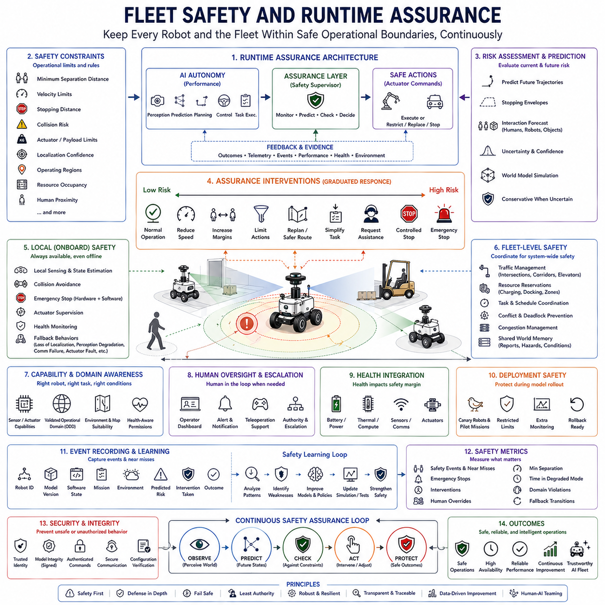{width="7.268055555555556in" height="7.268055555555556in"}

Fleet safety and runtime assurance provide the mechanisms that keep multi-robot systems within acceptable operational boundaries while autonomy, learning, and fleet coordination continuously make decisions. Safety cannot be treated only as a property verified before deployment. Fleet-scale Physical AI operates in dynamic environments, so safety must also be observed, evaluated, and enforced continuously while robots interact with people, infrastructure, resources, and one another.

Runtime assurance separates performance-oriented autonomy from mechanisms responsible for preserving critical safety constraints. AI models may optimize perception, prediction, planning, manipulation, or task execution, but an independent assurance layer can supervise their outputs. When proposed behavior remains within validated limits it proceeds normally; when confidence or safety conditions deteriorate, the assurance system can restrict, replace, or terminate the action.

This architecture is important because learned systems cannot be assumed to behave correctly in every possible environment. Training and validation cover representative conditions, but physical operation inevitably introduces unfamiliar objects, unusual interactions, sensor degradation, environmental changes, and combinations of events not represented in development data. Runtime assurance provides a protective boundary between uncertain intelligence and irreversible physical consequences.

Safety constraints should be expressed in operational terms that can be evaluated during execution. Examples include minimum separation distances, velocity limits, stopping distance, collision risk, actuator limits, payload restrictions, localization confidence, allowed operating regions, resource occupancy, and human proximity. Different robot classes and missions may require different constraints, so fleet safety policies must account for embodiment, capability, task, and environment.

A safety monitor continuously compares observed and predicted system states with these constraints. Current robot motion alone is insufficient because dangerous situations often emerge before a violation actually occurs. Predictive monitoring can estimate future trajectories, stopping envelopes, interactions, and resource conflicts, allowing the system to intervene while sufficient time and physical space remain for a controlled response.

World models can strengthen runtime assurance by predicting how the environment may evolve under alternative robot actions. The system can evaluate whether pedestrians, vehicles, other robots, movable objects, or changing terrain could create future hazards. Because predictions contain uncertainty, assurance decisions should consider both expected outcomes and confidence, becoming more conservative when the internal representation of the future becomes unreliable.

Safety responsibility exists at both robot and fleet levels. Edge safety protects an individual robot through local sensing, emergency stopping, collision avoidance, actuator supervision, and immediate fallback behavior. Fleet-level safety addresses interactions that cannot be understood locally, including traffic conflicts, shared-resource occupancy, coordinated missions, congestion, deadlocks, and dependencies among multiple robots and site infrastructure.

Local safety must remain available even when fleet communication fails. A robot should never require continuous access to an on-premise server or cloud service to avoid an immediate collision or enter a safe state. Communication with higher layers can improve anticipation and coordination, but the minimum safety envelope should remain enforceable by onboard systems capable of operating independently during network degradation or disconnection.

Fleet coordination can provide a broader preventive safety envelope. Traffic management can reserve intersections, narrow corridors, elevators, charging areas, docking stations, or restricted zones before robots enter them. Scheduling and orchestration can prevent unsafe combinations of tasks, payloads, or robot capabilities. Safety is thereby addressed before local collision avoidance must react to an already developing conflict.

Runtime assurance should support graduated intervention rather than only normal operation or emergency stopping. When risk begins to increase, the system may first reduce speed, enlarge separation margins, limit available actions, select a safer route, request replanning, or reduce task complexity. If uncertainty or risk continues to rise, it can transition toward controlled stopping, human assistance, mission suspension, or emergency procedures.

Fallback behavior must be explicitly designed for different failure conditions. Loss of localization may require reduced motion or stopping, degraded perception may require larger safety margins, communication failure may prohibit coordinated maneuvers, and actuator anomalies may require controlled shutdown. A generic emergency stop is essential but insufficient because some environments require the robot to move to a safer location before becoming stationary.

Safety supervisors should also monitor AI confidence and health. A model may continue producing technically valid outputs even when operating outside its validated distribution. Increasing uncertainty, sensor disagreement, prediction error, repeated replanning, unusual intervention frequency, or model drift can indicate that autonomy should no longer receive unrestricted authority. Intelligence health therefore becomes part of the runtime safety state.

Human oversight remains important for situations where automated assurance cannot confidently determine an appropriate response. Operators may authorize recovery, modify mission constraints, teleoperate a robot, or remove a robot from service. Human intervention should be structured through defined authority and escalation procedures so that urgent decisions do not depend on improvised communication or unclear responsibility.

Fleet safety also requires capability-aware task assignment. A robot should not receive a mission merely because it is available. Its sensors, actuators, payload capacity, localization performance, software configuration, current health, and validated operational domain must satisfy the mission requirements. Capability matching prevents unsafe assignments before execution begins and connects fleet orchestration directly with runtime assurance.

Operational design domains define the conditions within which particular autonomous capabilities have been validated. These conditions may include terrain, lighting, weather, speed, payload, human density, map quality, communication availability, or infrastructure support. Runtime monitoring can determine whether a robot remains inside its permitted domain and initiate restrictions or fallback behavior when environmental conditions move beyond validated assumptions.

Heterogeneous fleets make these boundaries especially important. Different robot platforms may have different stopping distances, sensor coverage, maneuverability, compute capacity, payloads, and safety certifications. Fleet-level policies should therefore express common safety objectives while allowing platform-specific enforcement. Uniform operational commands should not imply identical physical safety characteristics across every robot in the fleet.

Shared world memory can distribute safety-relevant knowledge among robots. A robot detecting a blocked route, slippery surface, damaged infrastructure, unexpected crowd, or localization anomaly can report the event to the fleet. On-premise systems can validate and propagate this information so that other robots modify routes or operating constraints before independently encountering the same hazard.

Runtime assurance should integrate with fleet health monitoring. Battery degradation, overheating, sensor faults, communication instability, compute overload, or actuator deterioration can reduce the safety margin available to a robot. Health information can dynamically change operational permissions, allowing the fleet to reduce speed, restrict tasks, schedule maintenance, or remove a robot from active service before degradation produces a hazardous event.

Model deployment introduces another safety boundary. A newly deployed model should not automatically receive the same operational authority as a validated production model. Canary robots, restricted missions, conservative operating limits, and additional monitoring can be used while evidence accumulates. Runtime assurance therefore provides protection during continuous model deployment by limiting the physical consequences of unexpected model behavior.

Safety events and near misses should be recorded with sufficient context for later analysis. Robot identity, model version, software state, sensor condition, mission, environment, predicted risk, assurance intervention, and final outcome provide evidence for understanding why the event occurred. Near misses are particularly valuable because they expose weaknesses without requiring an actual collision or injury to reveal them.

This evidence creates a safety learning loop. Repeated interventions can reveal overly aggressive planners, weak perception conditions, problematic traffic layouts, insufficient safety margins, or unsuitable task assignments. Engineering teams can use these patterns to improve models, policies, infrastructure, simulation scenarios, and validation datasets. Runtime assurance thus protects current operation while generating knowledge that improves future safety.

Safety metrics should measure more than the number of accidents. Emergency stops, near misses, safety interventions, time spent in degraded mode, human overrides, minimum separation, localization-related restrictions, and repeated fallback transitions provide earlier indicators of risk. A fleet with no collisions but rapidly increasing emergency interventions may already be experiencing significant deterioration in operational safety.

Security and safety are closely connected because unauthorized software, corrupted models, false identities, or manipulated communication can change physical behavior. Runtime assurance should therefore incorporate trusted robot identity, model integrity, authenticated commands, and configuration verification. A behavior that appears physically plausible may still need to be rejected if it originates from an unauthorized or unverified source.

Assurance decisions should remain traceable and explainable to operators and engineers. When a robot slows, stops, rejects a task, or enters fallback mode, the system should preserve the triggering condition and applicable safety policy. This supports rapid recovery during operations and provides evidence for certification, incident investigation, engineering improvement, and comparison of safety behavior across fleet generations.

The goal of fleet safety is not to eliminate autonomy whenever uncertainty appears. Excessively conservative systems can become operationally unusable and may create new problems through unnecessary stops or congestion. Runtime assurance should instead manage authority according to risk, confidence, and context, allowing high-performance autonomy when evidence supports it and progressively constraining behavior as uncertainty increases.

A mature architecture therefore combines preventive fleet coordination, onboard safety mechanisms, predictive monitoring, operational design domains, health-aware constraints, graduated intervention, fallback behavior, human escalation, and continuous safety learning. These mechanisms form a layered safety envelope around AI-driven autonomy, ensuring that no single model, communication service, or coordination component becomes the sole protection against physical hazards.

Fleet safety and runtime assurance ultimately create a continuous observe-predict-check-act-protect loop. Robots observe the physical world, predictive systems estimate future states, assurance mechanisms check proposed behavior against safety boundaries, and supervisory layers adjust authority when risk changes. Operational evidence then feeds monitoring, validation, and learning, allowing fleet-scale Physical AI to increase capability while preserving dependable real-world operation.

플릿 안전 및 런타임 보증(Fleet Safety and Runtime Assurance)은 자율성(Autonomy), 학습(Learning), 플릿 조정(Fleet Coordination)이 지속적으로 의사결정을 수행하는 동안 다중 로봇 시스템(Multi-Robot System)이 허용 가능한 운영 경계(Acceptable Operational Boundary) 안에 머물도록 하는 메커니즘을 제공한다. 안전(Safety)은 배포 전에 한 번 검증되는 속성으로만 취급할 수 없다. 플릿 규모 피지컬 AI(Fleet-Scale Physical AI)는 동적 환경(Dynamic Environment)에서 운영되므로 로봇이 사람, 인프라, 자원, 다른 로봇과 상호작용하는 동안 안전을 지속적으로 관찰하고 평가하며 강제해야 한다.

런타임 보증(Runtime Assurance)은 성능 중심 자율성(Performance-Oriented Autonomy)과 핵심 안전 제약(Critical Safety Constraint)을 유지하는 메커니즘을 분리한다. AI 모델은 인지(Perception), 예측(Prediction), 계획(Planning), 조작(Manipulation), 작업 실행(Task Execution)을 최적화할 수 있지만 독립적인 보증 계층(Assurance Layer)이 그 출력을 감독할 수 있다. 제안된 행동이 검증된 한계 내에 있으면 정상적으로 진행하고, 신뢰도(Confidence)나 안전 조건이 저하되면 보증 시스템은 해당 행동을 제한하거나 대체하거나 종료할 수 있다.

이러한 아키텍처는 학습 시스템(Learned System)이 가능한 모든 환경에서 올바르게 행동한다고 가정할 수 없기 때문에 중요하다. 학습 및 검증(Training and Validation)은 대표적인 조건을 포함하지만 실제 물리적 운영에서는 익숙하지 않은 객체, 비정상적인 상호작용, 센서 성능 저하(Sensor Degradation), 환경 변화, 개발 데이터에 포함되지 않았던 사건들의 조합이 필연적으로 발생한다. 런타임 보증은 불확실한 지능(Uncertain Intelligence)과 되돌리기 어려운 물리적 결과(Irreversible Physical Consequence) 사이에 보호 경계(Protective Boundary)를 제공한다.

안전 제약(Safety Constraint)은 실행 중 평가할 수 있는 운영 조건으로 표현되어야 한다. 최소 분리 거리(Minimum Separation Distance), 속도 제한(Velocity Limit), 정지 거리(Stopping Distance), 충돌 위험(Collision Risk), 액추에이터 한계(Actuator Limit), 페이로드 제한(Payload Restriction), 위치추정 신뢰도(Localization Confidence), 허용 운영 구역(Allowed Operating Region), 자원 점유(Resource Occupancy), 인간 근접도(Human Proximity) 등이 이에 해당한다. 서로 다른 로봇 유형과 임무는 서로 다른 제약을 요구할 수 있으므로 플릿 안전 정책(Fleet Safety Policy)은 형태(Embodiment), 역량(Capability), 작업(Task), 환경(Environment)을 고려해야 한다.

안전 모니터(Safety Monitor)는 관측되고 예측된 시스템 상태를 이러한 제약조건과 지속적으로 비교한다. 현재 로봇의 움직임만 확인하는 것으로는 충분하지 않다. 위험한 상황은 실제 위반이 발생하기 전에 형성되는 경우가 많기 때문이다. 예측 모니터링(Predictive Monitoring)은 미래 궤적(Future Trajectory), 정지 영역(Stopping Envelope), 상호작용(Interaction), 자원 충돌(Resource Conflict)을 추정하여 통제된 대응에 필요한 충분한 시간과 물리적 공간이 남아 있을 때 시스템이 개입할 수 있도록 한다.

월드 모델(World Model)은 대안적인 로봇 행동에 따라 환경이 어떻게 변화할지를 예측함으로써 런타임 보증을 강화할 수 있다. 시스템은 보행자, 차량, 다른 로봇, 이동 가능한 객체, 변화하는 지형이 미래의 위험을 발생시킬 가능성을 평가할 수 있다. 예측에는 불확실성(Uncertainty)이 포함되므로 보증 의사결정은 예상 결과뿐만 아니라 신뢰도도 고려해야 하며, 미래에 대한 내부 표현(Internal Representation)의 신뢰성이 낮아질수록 더욱 보수적인 결정을 내려야 한다.

안전 책임(Safety Responsibility)은 로봇 수준과 플릿 수준 모두에 존재한다. 엣지 안전(Edge Safety)은 로컬 센싱(Local Sensing), 비상 정지(Emergency Stop), 충돌 회피(Collision Avoidance), 액추에이터 감독(Actuator Supervision), 즉각적인 폴백 행동(Fallback Behavior)을 통해 개별 로봇을 보호한다. 플릿 수준 안전(Fleet-Level Safety)은 교통 충돌(Traffic Conflict), 공유 자원 점유, 조정된 임무(Coordinated Mission), 혼잡(Congestion), 교착상태(Deadlock), 여러 로봇과 사이트 인프라 간 의존성처럼 로컬 수준에서만 이해할 수 없는 상호작용을 다룬다.

플릿 통신(Fleet Communication)이 실패하더라도 로컬 안전(Local Safety)은 계속 유지되어야 한다. 로봇은 즉각적인 충돌을 피하거나 안전 상태(Safe State)에 진입하기 위해 온프레미스 서버(On-Premise Server)나 클라우드 서비스(Cloud Service)에 지속적으로 접근해야 해서는 안 된다. 상위 계층과의 통신은 예측과 조정을 향상시킬 수 있지만 최소 안전 영역(Minimum Safety Envelope)은 네트워크 성능 저하나 연결 중단 상황에서도 독립적으로 동작할 수 있는 온보드 시스템(Onboard System)에 의해 유지되어야 한다.

플릿 조정(Fleet Coordination)은 더 광범위한 예방적 안전 영역(Preventive Safety Envelope)을 제공할 수 있다. 교통 관리(Traffic Management)는 로봇이 진입하기 전에 교차로, 좁은 통로, 엘리베이터, 충전 구역, 도킹 스테이션(Docking Station), 제한 구역(Restricted Zone)을 예약할 수 있다. 스케줄링(Scheduling)과 오케스트레이션(Orchestration)은 안전하지 않은 작업, 페이로드 또는 로봇 역량의 조합을 사전에 방지할 수 있다. 이를 통해 로컬 충돌 회피가 이미 발생하고 있는 충돌에 대응해야 하기 전에 안전 문제를 예방할 수 있다.

런타임 보증은 정상 운영과 비상 정지라는 두 가지 상태만 사용하는 것이 아니라 단계적 개입(Graduated Intervention)을 지원해야 한다. 위험이 증가하기 시작하면 시스템은 먼저 속도를 줄이고, 분리 여유(Separation Margin)를 확대하며, 사용 가능한 행동을 제한하고, 더 안전한 경로를 선택하거나 재계획(Replanning)을 요청하고, 작업 복잡도(Task Complexity)를 낮출 수 있다. 불확실성이나 위험이 계속 증가하면 통제된 정지(Controlled Stop), 인간 지원(Human Assistance), 임무 중단(Mission Suspension), 비상 절차(Emergency Procedure)로 전환할 수 있다.

폴백 행동(Fallback Behavior)은 서로 다른 장애 조건에 맞게 명시적으로 설계되어야 한다. 위치추정 상실(Loss of Localization)은 이동 감소나 정지를 요구할 수 있고, 인지 성능 저하(Degraded Perception)는 더 큰 안전 여유를 요구할 수 있으며, 통신 장애(Communication Failure)는 협력 기동(Coordinated Maneuver)을 제한할 수 있고, 액추에이터 이상(Actuator Anomaly)은 통제된 종료(Controlled Shutdown)를 요구할 수 있다. 일반적인 비상 정지는 필수적이지만 일부 환경에서는 정지하기 전에 로봇이 더 안전한 위치로 이동해야 하므로 그것만으로는 충분하지 않다.

안전 감독기(Safety Supervisor)는 AI 신뢰도와 상태(AI Confidence and Health)도 모니터링해야 한다. 모델은 검증된 데이터 분포(Validated Distribution)를 벗어난 상태에서도 기술적으로 유효한 출력을 계속 생성할 수 있다. 증가하는 불확실성, 센서 간 불일치(Sensor Disagreement), 예측 오류(Prediction Error), 반복적인 재계획, 비정상적인 인간 개입 빈도, 모델 드리프트(Model Drift)는 자율 시스템에 더 이상 제한 없는 권한(Unrestricted Authority)을 부여해서는 안 된다는 신호가 될 수 있다. 따라서 지능 상태(Intelligence Health)는 런타임 안전 상태(Runtime Safety State)의 일부가 된다.

자동화된 보증 시스템이 적절한 대응을 확신 있게 결정할 수 없는 상황에서는 인간 감독(Human Oversight)이 여전히 중요하다. 운영자는 복구(Recovery)를 승인하고, 임무 제약(Mission Constraint)을 변경하며, 로봇을 원격조작(Teleoperation)하거나 서비스에서 제외할 수 있다. 인간 개입은 긴급한 의사결정이 즉흥적인 의사소통이나 불명확한 책임에 의존하지 않도록 정의된 권한(Defined Authority)과 에스컬레이션 절차(Escalation Procedure)를 통해 구조화되어야 한다.

플릿 안전은 역량 인식 작업 할당(Capability-Aware Task Assignment)도 필요로 한다. 로봇은 단순히 사용 가능하다는 이유만으로 임무를 할당받아서는 안 된다. 센서, 액추에이터, 페이로드 용량(Payload Capacity), 위치추정 성능(Localization Performance), 소프트웨어 구성(Software Configuration), 현재 상태(Current Health), 검증된 운영 영역(Validated Operational Domain)이 임무 요구사항을 충족해야 한다. 역량 매칭(Capability Matching)은 실행 전에 안전하지 않은 작업 할당을 방지하고 플릿 오케스트레이션을 런타임 보증과 직접 연결한다.

운영 설계 영역(Operational Design Domain)은 특정 자율 역량이 검증된 조건을 정의한다. 이러한 조건에는 지형(Terrain), 조명(Lighting), 날씨(Weather), 속도, 페이로드, 인간 밀도(Human Density), 지도 품질(Map Quality), 통신 가용성(Communication Availability), 인프라 지원(Infrastructure Support)이 포함될 수 있다. 런타임 모니터링은 로봇이 허용된 영역 안에 계속 존재하는지를 판단하고 환경 조건이 검증된 가정(Validated Assumption)을 벗어날 경우 제한이나 폴백 행동을 시작할 수 있다.

이종 플릿(Heterogeneous Fleet)에서는 이러한 경계가 특히 중요하다. 서로 다른 로봇 플랫폼은 정지 거리, 센서 커버리지(Sensor Coverage), 기동성(Maneuverability), 컴퓨팅 용량(Compute Capacity), 페이로드, 안전 인증(Safety Certification)이 서로 다를 수 있다. 따라서 플릿 수준 정책은 공통된 안전 목표(Common Safety Objective)를 표현하면서 플랫폼별 안전 강제(Platform-Specific Enforcement)를 허용해야 한다. 동일한 운영 명령이 플릿의 모든 로봇에서 동일한 물리적 안전 특성을 의미해서는 안 된다.

공유 월드 메모리(Shared World Memory)는 로봇 사이에서 안전 관련 지식(Safety-Relevant Knowledge)을 공유할 수 있다. 하나의 로봇이 차단된 경로(Blocked Route), 미끄러운 노면(Slippery Surface), 손상된 인프라(Damaged Infrastructure), 예상하지 못한 군중(Unexpected Crowd), 위치추정 이상(Localization Anomaly)을 탐지하면 해당 이벤트를 플릿에 보고할 수 있다. 온프레미스 시스템은 이러한 정보를 검증하고 전파하여 다른 로봇들이 동일한 위험에 직접 마주치기 전에 경로나 운영 제약을 변경하도록 할 수 있다.

런타임 보증은 플릿 상태 모니터링(Fleet Health Monitoring)과 통합되어야 한다. 배터리 성능 저하(Battery Degradation), 과열(Overheating), 센서 장애(Sensor Fault), 통신 불안정(Communication Instability), 컴퓨팅 과부하(Compute Overload), 액추에이터 열화(Actuator Deterioration)는 로봇이 확보할 수 있는 안전 여유(Safety Margin)를 감소시킬 수 있다. 상태 정보를 이용하여 운영 권한(Operational Permission)을 동적으로 변경하고, 속도를 낮추고, 작업을 제한하고, 유지보수를 예약하거나 위험한 상황이 발생하기 전에 로봇을 서비스에서 제외할 수 있다.

모델 배포(Model Deployment)는 또 하나의 안전 경계(Safety Boundary)를 형성한다. 새롭게 배포된 모델에 검증된 운영 모델(Validated Production Model)과 동일한 운영 권한을 즉시 부여해서는 안 된다. 카나리 로봇(Canary Robot), 제한된 임무(Restricted Mission), 보수적인 운영 한계(Conservative Operating Limit), 추가 모니터링을 사용하면서 증거를 축적할 수 있다. 따라서 런타임 보증은 예상하지 못한 모델 행동의 물리적 결과를 제한함으로써 지속적 모델 배포(Continuous Model Deployment) 과정에서도 보호 기능을 제공한다.

안전 이벤트(Safety Event)와 니어미스(Near Miss)는 이후 분석에 충분한 맥락과 함께 기록되어야 한다. 로봇 신원(Robot Identity), 모델 버전(Model Version), 소프트웨어 상태(Software State), 센서 상태(Sensor Condition), 임무(Mission), 환경(Environment), 예측 위험(Predicted Risk), 보증 개입(Assurance Intervention), 최종 결과(Final Outcome)는 사건이 발생한 이유를 이해하기 위한 증거를 제공한다. 니어미스는 실제 충돌이나 부상이 발생하지 않고도 시스템의 약점을 드러내기 때문에 특히 가치가 높다.

이러한 증거는 안전 학습 루프(Safety Learning Loop)를 형성한다. 반복적인 개입은 지나치게 공격적인 계획기(Aggressive Planner), 취약한 인지 조건(Weak Perception Condition), 문제가 있는 교통 배치(Traffic Layout), 불충분한 안전 여유, 부적절한 작업 할당을 드러낼 수 있다. 엔지니어링 팀은 이러한 패턴을 이용해 모델, 정책, 인프라, 시뮬레이션 시나리오(Simulation Scenario), 검증 데이터셋(Validation Dataset)을 개선할 수 있다. 따라서 런타임 보증은 현재 운영을 보호하는 동시에 미래의 안전성을 향상시키는 지식을 생성한다.

안전 지표(Safety Metric)는 사고 발생 횟수만 측정해서는 안 된다. 비상 정지, 니어미스, 안전 개입(Safety Intervention), 성능 저하 모드(Degraded Mode)에서의 운영 시간, 인간 오버라이드(Human Override), 최소 분리 거리, 위치추정 관련 제한, 반복적인 폴백 전환(Fallback Transition)은 위험을 더 조기에 보여주는 지표가 될 수 있다. 충돌이 전혀 발생하지 않았더라도 비상 개입이 빠르게 증가하는 플릿은 이미 운영 안전성이 상당히 저하되고 있을 수 있다.

승인되지 않은 소프트웨어, 손상된 모델(Corrupted Model), 허위 신원(False Identity), 조작된 통신(Manipulated Communication)은 물리적 행동을 변화시킬 수 있으므로 보안(Security)과 안전은 밀접하게 연결되어 있다. 따라서 런타임 보증은 신뢰할 수 있는 로봇 신원(Trusted Robot Identity), 모델 무결성(Model Integrity), 인증된 명령(Authenticated Command), 구성 검증(Configuration Verification)을 포함해야 한다. 물리적으로 타당해 보이는 행동이라도 승인되지 않았거나 검증되지 않은 소스에서 생성된 경우 거부해야 할 수 있다.

보증 의사결정(Assurance Decision)은 운영자와 엔지니어가 추적하고 설명할 수 있어야 한다. 로봇이 감속하거나, 정지하거나, 작업을 거부하거나, 폴백 모드로 전환할 때 시스템은 해당 행동을 유발한 조건(Triggering Condition)과 적용된 안전 정책을 보존해야 한다. 이는 운영 중 신속한 복구를 지원하며 안전 인증, 사고 조사(Incident Investigation), 엔지니어링 개선, 플릿 세대(Fleet Generation) 간 안전 행동 비교를 위한 증거를 제공한다.

플릿 안전의 목표는 불확실성이 나타날 때마다 자율성을 제거하는 것이 아니다. 지나치게 보수적인 시스템은 운영상 사용할 수 없게 될 수 있으며 불필요한 정지나 혼잡을 통해 새로운 문제를 만들 수도 있다. 대신 런타임 보증은 위험(Risk), 신뢰도, 맥락에 따라 권한(Authority)을 관리해야 한다. 충분한 증거가 존재할 때는 고성능 자율성(High-Performance Autonomy)을 허용하고 불확실성이 증가함에 따라 행동을 점진적으로 제한해야 한다.

따라서 성숙한 아키텍처(Mature Architecture)는 예방적 플릿 조정(Preventive Fleet Coordination), 온보드 안전 메커니즘(Onboard Safety Mechanism), 예측 모니터링, 운영 설계 영역, 상태 인식 제약(Health-Aware Constraint), 단계적 개입, 폴백 행동, 인간 에스컬레이션(Human Escalation), 지속적 안전 학습(Continuous Safety Learning)을 결합한다. 이러한 메커니즘은 AI 기반 자율성(AI-Driven Autonomy)을 둘러싼 계층형 안전 영역(Layered Safety Envelope)을 형성하여 단일 모델, 통신 서비스 또는 조정 구성요소가 물리적 위험에 대한 유일한 보호 수단이 되지 않도록 한다.

궁극적으로 플릿 안전 및 런타임 보증은 지속적인 관찰-예측-검사-행동-보호 루프(Observe-Predict-Check-Act-Protect Loop)를 형성한다. 로봇은 물리 세계를 관찰하고, 예측 시스템은 미래 상태를 추정하며, 보증 메커니즘은 제안된 행동을 안전 경계(Safety Boundary)와 비교하고, 감독 계층(Supervisory Layer)은 위험 변화에 따라 권한을 조정한다. 이후 운영 증거는 다시 모니터링, 검증, 학습으로 전달되며, 이를 통해 플릿 규모 피지컬 AI는 신뢰할 수 있는 실제 세계 운영(Dependable Real-World Operation)을 유지하면서 지속적으로 역량을 향상시킬 수 있다.

## 09.11. Cybersecurity and Trust between Robots

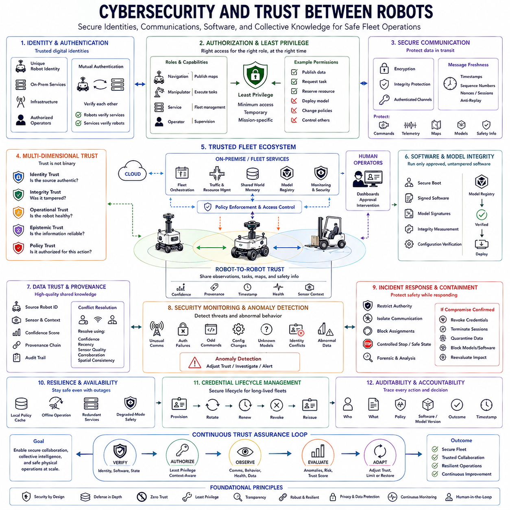{width="7.268055555555556in" height="7.268055555555556in"}

Cybersecurity and trust between robots become fundamental when autonomous machines exchange commands, observations, maps, models, task states, and safety information as members of a fleet. A compromised robot is not only an isolated endpoint; it can influence shared decisions and physical behavior across the system. Fleet security must therefore protect communication, identity, software integrity, operational authority, and collective knowledge.

Trust begins with reliable robot identity. Every robot, on-premise service, infrastructure component, and authorized operator should possess a verifiable digital identity that cannot be easily copied or impersonated. Identity establishes the foundation for authentication, authorization, accountability, and secure coordination, allowing fleet services to determine which physical or digital entity produced a command, observation, model update, or operational request.

Authentication verifies that an entity is genuinely who it claims to be before communication or control privileges are granted. Mutual authentication is particularly important in robot fleets because trust must operate in both directions. Robots should verify fleet services before accepting commands or updates, while fleet infrastructure should verify robots before accepting telemetry, map changes, task results, or safety information into shared operational state.

Authentication alone does not provide permission to perform every action. Authorization determines which resources and operations an authenticated entity may access according to its role, capabilities, site, mission, and current security state. A navigation robot may publish traversability information but should not automatically receive permission to modify safety policies, deploy models, control another robot, or change infrastructure configurations.

Least-privilege access reduces the consequences of compromised credentials or software. Robots and services should receive only the permissions required for their assigned functions and only for the necessary duration. Mission-specific or temporary authorization can further restrict authority. This limits lateral movement through fleet infrastructure and prevents a compromised component from automatically obtaining control over unrelated robots, resources, or administrative services.

Secure communication protects information while it moves between robots and fleet infrastructure. Encryption provides confidentiality, while integrity protection detects modification and authenticated channels establish trustworthy communication endpoints. These mechanisms are important for commands, telemetry, maps, credentials, safety events, model artifacts, and coordination messages because manipulated information can produce incorrect decisions even when individual robots remain technically healthy.

Message freshness is also important in physical systems. A previously valid command or reservation may become dangerous if replayed later. Timestamps, sequence numbers, nonces, session state, or equivalent mechanisms can help detect replayed or duplicated messages. Fleet security must therefore determine not only whether information came from a trusted source, but also whether it is current and belongs to the correct operational context.

Trust between robots should not mean unconditional acceptance of information from an authenticated peer. A robot can be authenticated while its sensors are faulty, its software is degraded, or its behavior has become compromised. Shared observations should therefore carry confidence, provenance, timestamp, sensor context, and robot health information so receiving systems can evaluate how strongly the information should influence collective decisions.

Data provenance provides traceability for shared fleet knowledge. When a robot reports an obstacle, hazard, map update, localization correction, or task result, the system should preserve where the information originated and how it was processed. Provenance enables conflicting reports to be investigated and allows unreliable information to be isolated without discarding the entire shared world model or fleet memory.

Trust can therefore be considered multidimensional rather than binary. Identity trust answers whether the source is authentic, integrity trust asks whether information was modified, operational trust reflects whether the robot is healthy, and epistemic trust concerns whether an observation is sufficiently reliable. Policy trust determines whether an entity is authorized to influence a particular decision. These dimensions together create a richer basis for machine-to-machine cooperation.

Conflicting observations are inevitable in heterogeneous fleets. Two robots may report different states because they use different sensors, viewpoints, models, or timestamps. Fleet systems should resolve disagreement using confidence, recency, sensor quality, provenance, spatial consistency, and corroboration from other sources. Secure collective intelligence depends on evidence-based fusion rather than assuming that every authenticated observation is equally correct.

Software integrity is another core trust requirement. A robot with valid credentials cannot be considered trustworthy if unauthorized software or a corrupted AI model is executing on it. Secure boot, signed software, model signatures, integrity measurements, protected update mechanisms, and configuration verification can establish evidence that the robot is operating an approved software stack before it receives sensitive fleet privileges.

Model integrity is especially significant because AI models directly influence perception, prediction, planning, and action. Fleet services should verify model identity, version, signature, approval status, and compatibility before trusting model-generated outputs. OTA deployment and model registries should therefore participate in the security architecture so that unauthorized or substituted intelligence cannot silently propagate through the fleet.

Hardware-rooted trust can strengthen identity and integrity protection. Trusted hardware, secure elements, platform security modules, or equivalent mechanisms can protect cryptographic keys and provide evidence about the software state of a device. Such mechanisms make it more difficult for an attacker who compromises application software to impersonate another robot or permanently replace trusted system components.

Credential lifecycle management is necessary because fleets operate for long periods and robot populations change. Credentials must be securely provisioned, rotated, renewed, revoked, and replaced when robots are serviced, transferred, compromised, or retired. A lost robot or decommissioned controller should not retain indefinite access to fleet services simply because its original identity credentials were once valid.

Network architecture should limit the ability of an intrusion to spread. Segmentation can separate safety-critical control, robot operations, maintenance, development, guest systems, and external services. Firewalls, service boundaries, policy enforcement, and restricted communication paths can reduce unnecessary connectivity. The objective is to preserve required collaboration while preventing fleet connectivity from becoming unrestricted attack connectivity.

Zero-trust principles are useful for distributed robotic systems because physical location or network membership alone should not establish trust. Every important request can be evaluated using identity, authorization, device state, software integrity, context, and policy. A robot connected to the internal fleet network should not automatically be trusted simply because it appears to be operating inside the facility.

Cybersecurity monitoring should be integrated with fleet observability. Unexpected communication patterns, repeated authentication failures, unusual command sequences, configuration changes, unknown model versions, identity conflicts, or abnormal data publication can indicate compromise. Combining these signals with physical behavior and robot health helps distinguish cybersecurity incidents from ordinary mechanical, network, or AI-performance failures.

Anomaly detection can provide additional protection when attacks do not match known signatures. A robot that suddenly communicates with unusual services, publishes impossible locations, requests excessive privileges, or issues atypical resource reservations may require investigation. Behavioral anomalies should modify trust cautiously, however, because unusual activity can also result from legitimate missions, failures, maintenance, or changing operating conditions.

Security incidents require containment strategies that preserve physical safety. Immediately disconnecting a suspected robot may be inappropriate if it is carrying a load or moving near people. The fleet may first restrict authority, isolate communication, prevent new task assignments, command a controlled stop, or move the robot into a safe recovery state. Cyber response must therefore be coordinated with runtime assurance and physical safety mechanisms.

Trust revocation should propagate rapidly when compromise is confirmed. Credentials can be revoked, sessions terminated, commands rejected, shared information quarantined, and affected models or software versions blocked. Other robots may need to reconsider knowledge received from the compromised source. Fleet security consequently extends beyond isolating the device to evaluating how its previous contributions may have influenced collective state.

Resilience requires continued operation when parts of the trust infrastructure become unavailable. Robots should retain enough locally validated policy and credential information to maintain safe behavior during temporary connectivity loss. On-premise services can cache necessary trust data so cloud disconnection does not disable local operations. Security architecture should avoid replacing one cyber risk with a centralized availability dependency.

Human operators also participate in the fleet trust model. Administrative access, teleoperation, model approval, maintenance, and emergency control may provide powerful authority over physical systems. Strong authentication, role separation, limited privileges, session auditing, and approval workflows reduce the risk of accidental misuse or compromised accounts while preserving the ability of authorized personnel to intervene when necessary.

Auditability creates accountability across robot-to-robot and robot-to-infrastructure interactions. Security records should identify who communicated, what action was requested, which policy authorized it, what software and model versions were active, and what result followed. This history supports incident investigation, compliance, debugging, forensic analysis, and improvement of future security policies without relying only on transient network logs.

Cybersecurity must also protect collective learning. Poisoned observations, manipulated task outcomes, or malicious training examples can influence future models even if they do not immediately alter robot behavior. Data pipelines should preserve provenance, validate contributions, identify suspicious patterns, and separate questionable data before it enters training or adaptation processes. Trust therefore extends from runtime operation into the fleet learning lifecycle.

A mature fleet treats trust as dynamic evidence rather than a permanent label. Robot identity, software integrity, health, behavior, communication history, operational context, and information quality can continuously influence the authority granted to each participant. Trust can increase, decrease, or be restricted as conditions change, allowing the fleet to cooperate efficiently without assuming that every connected component remains trustworthy forever.

Ultimately, cybersecurity and robot trust form a continuous verify-authorize-observe-evaluate-adapt loop. Identities and software are verified, permissions constrain actions, communications and behavior are monitored, anomalies modify trust, and compromised components are contained while safe operation is preserved. This layered approach allows fleet-scale Physical AI to share knowledge and coordinate actions without allowing connectivity itself to become an uncontrolled source of physical risk.

로봇 간 사이버보안 및 신뢰(Cybersecurity and Trust between Robots)는 자율 기계(Autonomous Machine)들이 플릿(Fleet)의 구성원으로서 명령(Command), 관측(Observation), 지도(Map), 모델(Model), 작업 상태(Task State), 안전 정보(Safety Information)를 교환할 때 핵심적인 기반이 된다. 침해된 로봇(Compromised Robot)은 단순히 고립된 하나의 엔드포인트(Endpoint)가 아니라 시스템 전체의 공유 의사결정(Shared Decision Making)과 물리적 행동(Physical Behavior)에 영향을 줄 수 있다. 따라서 플릿 보안(Fleet Security)은 통신, 신원(Identity), 소프트웨어 무결성(Software Integrity), 운영 권한(Operational Authority), 집단 지식(Collective Knowledge)을 보호해야 한다.

신뢰(Trust)는 신뢰할 수 있는 로봇 신원(Reliable Robot Identity)에서 시작된다. 모든 로봇, 온프레미스 서비스(On-Premise Service), 인프라 구성요소(Infrastructure Component), 승인된 운영자(Authorized Operator)는 쉽게 복제되거나 위장될 수 없는 검증 가능한 디지털 신원(Verifiable Digital Identity)을 보유해야 한다. 신원은 인증(Authentication), 권한 부여(Authorization), 책임성(Accountability), 안전한 조정(Secure Coordination)의 기반을 형성하며, 플릿 서비스가 어떤 물리적 또는 디지털 개체가 명령, 관측, 모델 업데이트 또는 운영 요청을 생성했는지를 판단할 수 있도록 한다.

인증(Authentication)은 통신 또는 제어 권한(Control Privilege)을 부여하기 전에 개체가 자신이 주장하는 실제 개체인지 검증한다. 상호 인증(Mutual Authentication)은 신뢰가 양방향으로 작동해야 하는 로봇 플릿에서 특히 중요하다. 로봇은 명령이나 업데이트를 수락하기 전에 플릿 서비스를 검증해야 하며, 플릿 인프라는 텔레메트리(Telemetry), 지도 변경(Map Change), 작업 결과, 안전 정보를 공유 운영 상태(Shared Operational State)에 반영하기 전에 해당 로봇을 검증해야 한다.

인증만으로 모든 행동을 수행할 권한이 부여되는 것은 아니다. 권한 부여(Authorization)는 인증된 개체가 역할(Role), 역량(Capability), 사이트(Site), 임무(Mission), 현재 보안 상태(Security State)에 따라 어떤 자원과 작업에 접근할 수 있는지를 결정한다. 예를 들어 내비게이션 로봇(Navigation Robot)은 주행가능성 정보(Traversability Information)를 게시할 수 있지만 안전 정책을 변경하거나 모델을 배포하거나 다른 로봇을 제어하거나 인프라 구성을 변경할 권한까지 자동으로 부여받아서는 안 된다.

최소 권한 접근(Least-Privilege Access)은 자격 증명(Credential)이나 소프트웨어가 침해되었을 때 발생할 수 있는 피해를 줄인다. 로봇과 서비스에는 할당된 기능을 수행하는 데 필요한 권한만 필요한 기간 동안 부여해야 한다. 임무별 또는 임시 권한 부여(Mission-Specific or Temporary Authorization)를 통해 권한을 더욱 제한할 수 있다. 이를 통해 플릿 인프라 내부에서의 횡적 이동(Lateral Movement)을 제한하고 침해된 구성요소가 관련 없는 로봇, 자원 또는 관리 서비스에 자동으로 접근하는 것을 방지할 수 있다.

보안 통신(Secure Communication)은 로봇과 플릿 인프라 사이에서 이동하는 정보를 보호한다. 암호화(Encryption)는 기밀성(Confidentiality)을 제공하고, 무결성 보호(Integrity Protection)는 데이터 변경을 탐지하며, 인증된 채널(Authenticated Channel)은 신뢰할 수 있는 통신 종단점(Communication Endpoint)을 확립한다. 이러한 메커니즘은 명령, 텔레메트리, 지도, 자격 증명, 안전 이벤트, 모델 아티팩트(Model Artifact), 조정 메시지(Coordination Message)를 보호하는 데 중요하다. 조작된 정보는 개별 로봇이 기술적으로 정상인 상태에서도 잘못된 의사결정을 발생시킬 수 있기 때문이다.

메시지 최신성(Message Freshness)도 물리 시스템에서는 중요하다. 이전에는 유효했던 명령이나 예약(Reservation)이라도 나중에 재전송되면 위험할 수 있다. 타임스탬프(Timestamp), 시퀀스 번호(Sequence Number), 논스(Nonce), 세션 상태(Session State) 또는 이에 상응하는 메커니즘을 사용하여 재생되거나 중복된 메시지를 탐지할 수 있다. 따라서 플릿 보안은 정보가 신뢰할 수 있는 소스에서 왔는지만 판단하는 것이 아니라 해당 정보가 최신이며 올바른 운영 맥락(Operational Context)에 속하는지도 확인해야 한다.

로봇 간 신뢰는 인증된 피어(Authenticated Peer)가 제공하는 정보를 무조건 수용하는 것을 의미해서는 안 된다. 로봇은 인증된 상태에서도 센서에 장애가 있거나 소프트웨어 성능이 저하되거나 행동이 침해된 상태일 수 있다. 따라서 공유 관측(Shared Observation)에는 신뢰도(Confidence), 데이터 출처(Provenance), 타임스탬프, 센서 맥락(Sensor Context), 로봇 상태(Robot Health)가 함께 포함되어야 하며, 이를 통해 정보를 수신하는 시스템은 해당 정보가 집단 의사결정에 어느 정도 영향을 주어야 하는지를 평가할 수 있다.

데이터 출처(Provenance)는 공유 플릿 지식(Shared Fleet Knowledge)에 대한 추적 가능성(Traceability)을 제공한다. 로봇이 장애물, 위험요소(Hazard), 지도 업데이트, 위치추정 보정(Localization Correction), 작업 결과를 보고하면 시스템은 해당 정보가 어디에서 생성되었으며 어떻게 처리되었는지를 보존해야 한다. 데이터 출처를 이용하면 서로 충돌하는 보고를 조사할 수 있으며, 전체 공유 월드 모델(Shared World Model)이나 플릿 메모리(Fleet Memory)를 폐기하지 않고도 신뢰할 수 없는 정보를 격리할 수 있다.

따라서 신뢰는 이진적(Binary) 개념이 아니라 다차원적(Multidimensional) 개념으로 볼 수 있다. 신원 신뢰(Identity Trust)는 정보원이 진짜인지 판단하고, 무결성 신뢰(Integrity Trust)는 정보가 변경되었는지를 판단하며, 운영 신뢰(Operational Trust)는 로봇이 정상적인 상태인지를 반영한다. 인식론적 신뢰(Epistemic Trust)는 관측 정보가 충분히 신뢰할 수 있는지를 다루고, 정책 신뢰(Policy Trust)는 특정 개체가 특정 의사결정에 영향을 줄 권한이 있는지를 결정한다. 이러한 차원이 결합되어 기계 간 협력(Machine-to-Machine Cooperation)을 위한 더욱 풍부한 신뢰 기반을 형성한다.

이종 플릿(Heterogeneous Fleet)에서는 서로 충돌하는 관측이 불가피하다. 두 로봇이 서로 다른 센서, 시점(Viewpoint), 모델 또는 타임스탬프를 사용하기 때문에 동일한 상태를 다르게 보고할 수 있다. 플릿 시스템은 신뢰도, 최신성(Recency), 센서 품질(Sensor Quality), 데이터 출처, 공간적 일관성(Spatial Consistency), 다른 정보원의 교차 확인(Corroboration)을 활용하여 이러한 불일치를 해결해야 한다. 안전한 집단지능(Secure Collective Intelligence)은 인증된 모든 관측이 동일하게 정확하다고 가정하는 것이 아니라 증거 기반 융합(Evidence-Based Fusion)에 의존한다.

소프트웨어 무결성(Software Integrity)은 또 다른 핵심 신뢰 요구사항이다. 유효한 자격 증명을 가진 로봇이라도 승인되지 않은 소프트웨어나 손상된 AI 모델(Corrupted AI Model)을 실행하고 있다면 신뢰할 수 있다고 볼 수 없다. 보안 부팅(Secure Boot), 서명된 소프트웨어(Signed Software), 모델 서명(Model Signature), 무결성 측정(Integrity Measurement), 보호된 업데이트 메커니즘(Protected Update Mechanism), 구성 검증(Configuration Verification)을 통해 민감한 플릿 권한을 부여하기 전에 로봇이 승인된 소프트웨어 스택(Approved Software Stack)을 실행하고 있다는 증거를 확보할 수 있다.

모델 무결성(Model Integrity)은 AI 모델이 인지(Perception), 예측(Prediction), 계획(Planning), 행동(Action)에 직접 영향을 미치기 때문에 특히 중요하다. 플릿 서비스는 모델이 생성한 출력을 신뢰하기 전에 모델 신원(Model Identity), 버전(Version), 서명(Signature), 승인 상태(Approval Status), 호환성(Compatibility)을 검증해야 한다. 따라서 OTA 배포(OTA Deployment)와 모델 레지스트리(Model Registry)는 승인되지 않았거나 대체된 지능이 플릿 전체로 조용히 확산되지 않도록 보안 아키텍처(Security Architecture)에 포함되어야 한다.

하드웨어 기반 신뢰(Hardware-Rooted Trust)는 신원과 무결성 보호를 더욱 강화할 수 있다. 신뢰 하드웨어(Trusted Hardware), 보안 요소(Secure Element), 플랫폼 보안 모듈(Platform Security Module) 또는 이에 상응하는 메커니즘은 암호화 키(Cryptographic Key)를 보호하고 장치의 소프트웨어 상태에 대한 증거를 제공할 수 있다. 이러한 메커니즘은 공격자가 애플리케이션 소프트웨어를 침해하더라도 다른 로봇으로 위장하거나 신뢰된 시스템 구성요소를 영구적으로 대체하는 것을 어렵게 만든다.

플릿은 장기간 운영되고 로봇 구성도 변화하므로 자격 증명 수명주기 관리(Credential Lifecycle Management)가 필요하다. 자격 증명은 로봇의 정비(Service), 이전(Transfer), 침해(Compromise), 폐기(Retirement)에 따라 안전하게 프로비저닝(Provisioning), 순환(Rotation), 갱신(Renewal), 폐기(Revocation), 교체(Replacement)되어야 한다. 분실된 로봇이나 폐기된 컨트롤러(Decommissioned Controller)가 과거에 유효한 신원 자격 증명을 가지고 있었다는 이유만으로 플릿 서비스에 무기한 접근할 수 있어서는 안 된다.

네트워크 아키텍처(Network Architecture)는 침입(Intrusion)이 확산되는 능력을 제한해야 한다. 네트워크 분할(Segmentation)을 통해 안전 중요 제어(Safety-Critical Control), 로봇 운영(Robot Operations), 유지보수(Maintenance), 개발(Development), 게스트 시스템(Guest System), 외부 서비스(External Service)를 분리할 수 있다. 방화벽(Firewall), 서비스 경계(Service Boundary), 정책 집행(Policy Enforcement), 제한된 통신 경로(Restricted Communication Path)를 통해 불필요한 연결성을 줄일 수 있다. 목표는 필요한 협력을 유지하면서 플릿 연결성(Fleet Connectivity)이 무제한적인 공격 연결성(Attack Connectivity)으로 변하는 것을 방지하는 것이다.

제로 트러스트(Zero Trust) 원칙은 물리적 위치나 네트워크 소속만으로 신뢰를 확립해서는 안 되기 때문에 분산 로봇 시스템(Distributed Robotic System)에 유용하다. 중요한 요청은 신원, 권한, 장치 상태(Device State), 소프트웨어 무결성, 맥락, 정책을 이용해 각각 평가할 수 있다. 로봇이 시설 내부의 플릿 네트워크에 연결되어 있다는 이유만으로 자동으로 신뢰되어서는 안 된다.

사이버보안 모니터링(Cybersecurity Monitoring)은 플릿 관측 가능성(Fleet Observability)과 통합되어야 한다. 예상하지 못한 통신 패턴, 반복되는 인증 실패(Authentication Failure), 비정상적인 명령 순서(Command Sequence), 구성 변경, 알 수 없는 모델 버전(Unknown Model Version), 신원 충돌(Identity Conflict), 비정상적인 데이터 게시(Data Publication)는 침해의 징후일 수 있다. 이러한 신호를 물리적 행동 및 로봇 상태와 결합하면 사이버보안 사고를 일반적인 기계, 네트워크 또는 AI 성능 장애와 구분하는 데 도움이 된다.

이상 탐지(Anomaly Detection)는 공격이 알려진 시그니처(Known Signature)와 일치하지 않는 경우 추가적인 보호를 제공할 수 있다. 로봇이 갑자기 비정상적인 서비스와 통신하거나, 불가능한 위치를 게시하거나, 과도한 권한을 요청하거나, 비정상적인 자원 예약을 생성하면 조사가 필요할 수 있다. 그러나 비정상적인 활동은 정상적인 임무, 장애, 유지보수 또는 변화된 운영 조건에서도 발생할 수 있으므로 행동 이상(Behavioral Anomaly)은 신뢰도를 신중하게 조정하는 데 사용해야 한다.

보안 사고(Security Incident)에 대응할 때는 물리적 안전을 유지할 수 있는 격리 전략(Containment Strategy)이 필요하다. 의심되는 로봇이 화물을 운반하거나 사람 근처에서 이동하고 있다면 즉시 네트워크 연결을 차단하는 것이 적절하지 않을 수 있다. 플릿은 먼저 권한을 제한하고, 통신을 격리하고, 새로운 작업 할당을 방지하고, 통제된 정지(Controlled Stop)를 명령하거나 로봇을 안전 복구 상태(Safe Recovery State)로 이동시킬 수 있다. 따라서 사이버 대응(Cyber Response)은 런타임 보증(Runtime Assurance) 및 물리적 안전 메커니즘과 조정되어야 한다.

침해가 확인되면 신뢰 철회(Trust Revocation)는 신속하게 전파되어야 한다. 자격 증명을 폐기하고, 세션(Session)을 종료하며, 명령을 거부하고, 공유 정보를 격리(Quarantine)하며, 영향을 받은 모델이나 소프트웨어 버전을 차단할 수 있다. 다른 로봇은 침해된 정보원으로부터 이전에 전달받은 지식을 다시 평가해야 할 수도 있다. 따라서 플릿 보안은 단순히 해당 장치를 격리하는 것을 넘어 과거의 정보 제공이 집단 상태(Collective State)에 어떠한 영향을 주었는지를 평가하는 것까지 포함한다.

회복탄력성(Resilience)을 확보하려면 신뢰 인프라(Trust Infrastructure)의 일부를 사용할 수 없는 상황에서도 운영을 지속할 수 있어야 한다. 로봇은 일시적인 연결 중단 동안 안전한 행동을 유지할 수 있도록 충분한 로컬 검증 정책(Local Validated Policy)과 자격 증명 정보를 보유해야 한다. 온프레미스 서비스는 필요한 신뢰 데이터를 캐싱(Caching)하여 클라우드 연결이 끊어져도 로컬 운영이 중단되지 않도록 할 수 있다. 보안 아키텍처가 하나의 사이버 위험을 중앙집중형 가용성 의존성(Centralized Availability Dependency)으로 대체해서는 안 된다.

인간 운영자(Human Operator)도 플릿 신뢰 모델(Fleet Trust Model)에 참여한다. 관리 접근(Admin Access), 원격조작(Teleoperation), 모델 승인(Model Approval), 유지보수, 비상 제어(Emergency Control)는 물리 시스템에 강력한 권한을 제공할 수 있다. 강력한 인증, 역할 분리(Role Separation), 제한된 권한, 세션 감사(Session Auditing), 승인 워크플로(Approval Workflow)를 통해 우발적인 오용이나 계정 침해의 위험을 줄이면서 승인된 인력이 필요할 때 개입할 수 있는 능력을 유지해야 한다.

감사 가능성(Auditability)은 로봇 간 및 로봇-인프라 간 상호작용에 책임성(Accountability)을 부여한다. 보안 기록(Security Record)은 누가 통신했는지, 어떤 행동을 요청했는지, 어떤 정책이 이를 승인했는지, 당시 어떤 소프트웨어와 모델 버전이 활성화되어 있었는지, 그리고 어떤 결과가 발생했는지를 식별할 수 있어야 한다. 이러한 이력은 일시적인 네트워크 로그에만 의존하지 않고 사고 조사(Incident Investigation), 규정 준수(Compliance), 디버깅(Debugging), 포렌식 분석(Forensic Analysis), 향후 보안 정책 개선을 지원한다.

사이버보안은 집단 학습(Collective Learning)도 보호해야 한다. 오염된 관측(Poisoned Observation), 조작된 작업 결과(Manipulated Task Outcome), 악의적인 학습 사례(Malicious Training Example)는 즉시 로봇 행동을 변화시키지 않더라도 미래 모델에 영향을 줄 수 있다. 데이터 파이프라인(Data Pipeline)은 출처를 보존하고, 데이터 기여(Contribution)를 검증하고, 의심스러운 패턴을 식별하며, 의심스러운 데이터가 학습 또는 적응 프로세스에 들어가기 전에 분리해야 한다. 따라서 신뢰는 런타임 운영에서 플릿 학습 수명주기(Fleet Learning Lifecycle)까지 확장된다.

성숙한 플릿(Mature Fleet)은 신뢰를 영구적인 라벨(Permanent Label)이 아니라 동적으로 변화하는 증거(Dynamic Evidence)로 취급한다. 로봇 신원, 소프트웨어 무결성, 상태(Health), 행동(Behavior), 통신 이력(Communication History), 운영 맥락, 정보 품질(Information Quality)은 각 참여자에게 부여되는 권한에 지속적으로 영향을 줄 수 있다. 조건 변화에 따라 신뢰 수준을 높이거나 낮추거나 제한할 수 있으므로 모든 연결된 구성요소가 영원히 신뢰할 수 있다고 가정하지 않으면서도 플릿이 효율적으로 협력할 수 있다.

궁극적으로 사이버보안과 로봇 신뢰는 지속적인 검증-권한부여-관찰-평가-적응 루프(Verify-Authorize-Observe-Evaluate-Adapt Loop)를 형성한다. 신원과 소프트웨어를 검증하고, 권한을 통해 행동을 제한하며, 통신과 행동을 모니터링하고, 이상 징후에 따라 신뢰를 조정하며, 침해된 구성요소를 격리하면서 안전한 운영을 유지한다. 이러한 계층형 접근(Layered Approach)을 통해 플릿 규모 피지컬 AI(Fleet-Scale Physical AI)는 연결성 자체가 통제되지 않은 물리적 위험의 원인이 되지 않도록 하면서 지식을 공유하고 행동을 조정할 수 있다.

## 09.12. Failure Isolation and Graceful Degradation

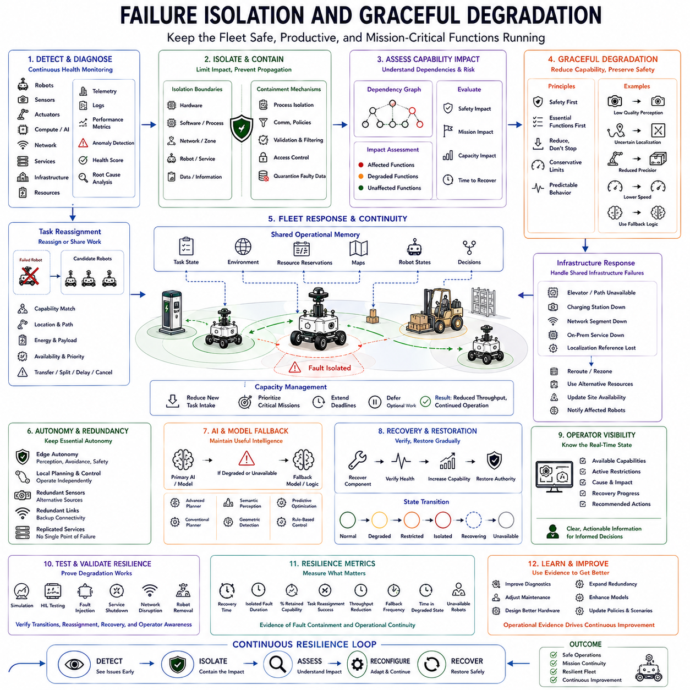{width="7.268055555555556in" height="7.268055555555556in"}

Failure isolation and graceful degradation allow a robot fleet to continue operating safely when individual robots, sensors, compute modules, networks, infrastructure services, or AI components become unreliable. Large fleets cannot assume that every component remains healthy at all times. Instead of treating any failure as a reason to stop the entire system, the architecture should contain faults, preserve essential functions, and reduce capability in a controlled and predictable manner.

Failure isolation begins with identifying the boundary of the problem. A malfunction may originate from a sensor, actuator, battery, compute process, AI model, communication link, robot, fleet service, or shared site resource. Monitoring and diagnostics should determine which component is affected and which dependent functions may also be compromised. Accurate isolation prevents a local failure from being incorrectly interpreted as a fleet-wide problem.

Fault containment limits the ability of one degraded component to influence otherwise healthy parts of the system. A faulty camera should not corrupt every perception source, and a malfunctioning robot should not continuously publish unreliable information into shared fleet memory. Software boundaries, process isolation, communication policies, validation mechanisms, and resource controls can prevent erroneous states from propagating through interconnected services and robots.

Dependencies must be understood because failures often propagate indirectly. Loss of a localization server may affect many robots, while failure of a charging station may gradually reduce fleet availability rather than immediately stopping operation. Dependency graphs can represent relationships among robots, infrastructure, software services, models, communication systems, and operational resources, helping fleet management estimate the potential impact of each failure.

Redundancy provides alternative sources of capability when primary components become unavailable. Multiple sensors may support localization or obstacle detection, redundant communication paths may preserve connectivity, and replicated fleet services may prevent a single server from becoming a critical failure point. Redundancy is most effective when alternative components do not share the same underlying failure mechanism or dependency.

Graceful degradation means that loss of one capability does not automatically result in complete loss of autonomy. A robot with reduced perception quality may continue at lower speed, a robot with uncertain localization may operate only within a restricted area, and a manipulator with degraded precision may perform transportation tasks while avoiding precision handling. Capability is progressively reduced according to the remaining evidence of safe operation.

Degradation policies should define which functions are essential and which can be temporarily sacrificed. Safety monitoring, emergency stopping, basic localization, and controlled motion may be mandatory for continued operation, while high-level optimization, semantic reasoning, or nonessential analytics may be suspended. Explicit prioritization allows limited computational, communication, or energy resources to be redirected toward functions required for safe mission continuity.

Runtime health information should continuously update the robot\'s available capability profile. A robot may normally advertise navigation, manipulation, inspection, and payload handling capabilities, but sensor or actuator degradation can temporarily invalidate some of them. Fleet orchestration should use the current capability state rather than the robot\'s nominal specification when determining whether it remains eligible for a task.

Task reassignment is a primary fleet-level response to robot failure. When one robot cannot complete its mission, orchestration can identify another robot with compatible capabilities, location, energy, payload capacity, and availability. The affected task may be transferred, divided, delayed, or canceled according to operational priority. This prevents a single robot failure from unnecessarily becoming a mission-level failure.

Mission continuity requires preserving task context during reassignment. The replacement robot may need information about completed steps, current object state, destination, environmental changes, resource reservations, and previous decisions. Shared operational memory allows work to resume from a meaningful checkpoint rather than restarting the entire mission, reducing recovery time and preventing duplicated or conflicting actions.

Fleet capacity should degrade progressively as robots become unavailable. If a fleet loses ten percent of its robots, the expected result should normally be reduced throughput rather than immediate operational collapse. Scheduling can lower task acceptance, extend deadlines, prioritize critical missions, and defer optional work. This converts hardware redundancy and fleet size into operational resilience rather than merely additional nominal capacity.

Shared infrastructure failures require different responses from individual robot failures. Loss of an elevator, charging station, network segment, positioning reference, or on-premise service may simultaneously affect many robots. Fleet management should identify the common dependency, update site availability, reroute tasks, reserve alternative resources, or reorganize operating zones instead of repeatedly diagnosing each affected robot as an independent fault.

Network degradation should be treated as a normal operating condition rather than an exceptional event. Robots may experience increased latency, packet loss, reduced bandwidth, or temporary disconnection. Essential local autonomy should continue without continuous fleet communication, while noncritical synchronization and data transfer can be delayed. Once connectivity returns, state reconciliation should restore consistency without assuming that remote information remained current.

Edge autonomy establishes the minimum independent operating capability required during communication or infrastructure failures. Robots should retain local perception, collision avoidance, motion safety, essential planning, and appropriate fallback behaviors. Higher-level services may improve coordination and optimization, but immediate physical safety and controlled stopping should remain possible without dependence on remote computation.

On-premise systems provide another resilience boundary. If cloud connectivity is lost, site-level fleet orchestration, shared world memory, traffic management, model caches, security policies, and essential analytics can continue locally. This allows a facility to maintain operations during external network outages and prevents cloud availability from becoming a direct requirement for every physical action performed by the fleet.

Cloud service failure should primarily affect functions that can tolerate longer disruption, such as global analytics, large-scale training, cross-site optimization, or new model distribution. Previously validated models and policies should remain available locally. Hierarchical architecture therefore supports graceful degradation by aligning the urgency of each function with the computing layer responsible for executing it.

AI component failure may be subtle because a model can continue producing outputs while its reliability deteriorates. Increasing uncertainty, distribution drift, prediction errors, sensor disagreement, or abnormal downstream behavior can indicate that an AI capability should be restricted. Runtime assurance can reduce the authority of the affected model, switch to an alternative model, or use deterministic fallback logic when appropriate.

Fallback models can provide simpler but more predictable behavior when advanced intelligence becomes unavailable. A learned planner may fall back to a conventional planner, semantic perception may be reduced to geometric obstacle detection, or predictive optimization may be replaced by conservative rule-based control. The fallback does not need to match normal performance; its purpose is to preserve sufficient safety and operational usefulness during degradation.

Degradation should be reversible when the underlying problem disappears. Temporary network loss, sensor contamination, overloaded computation, or unavailable infrastructure may recover without maintenance. The system should verify restored health before progressively returning capabilities and operational authority. Immediate restoration without validation could reintroduce unstable behavior, so recovery should be managed as carefully as degradation.

Recovery states should therefore be explicit. A component may transition among normal, degraded, restricted, isolated, recovering, and unavailable states according to health evidence. Defined transitions make system behavior predictable and allow orchestration, safety services, operators, and maintenance systems to interpret the same condition consistently. State histories also provide useful evidence for diagnosing intermittent failures.

Human operators need clear information about degraded operation. Instead of displaying only that a robot is online or offline, interfaces should explain which capabilities remain available, what restrictions are active, why degradation occurred, and whether automated recovery is underway. This enables operators to make informed decisions without requiring them to reconstruct failure dependencies from large volumes of raw telemetry.

Failure isolation must also consider cybersecurity. A robot exhibiting unusual behavior may be mechanically degraded, affected by software failure, or compromised by an attacker. When the cause is uncertain, the system can restrict communication and authority while maintaining physical safety. Security containment and operational fault isolation should therefore cooperate rather than independently issuing conflicting responses to the same robot.

Testing graceful degradation requires deliberate failure injection. Simulation, hardware-in-the-loop testing, controlled network disruption, sensor masking, service shutdown, resource exhaustion, and robot removal can reveal whether fallback mechanisms operate as intended. Testing should evaluate not only whether the system survives the failure but also whether transitions, task reassignment, recovery, and operator information remain coherent.

Fleet-level resilience metrics should measure the operational consequences of failure. Recovery time, isolated fault duration, percentage of retained capability, task reassignment success, throughput reduction, unavailable robot count, fallback frequency, and time spent in degraded states provide more useful evidence than simply counting component failures. These metrics show whether the architecture actually contains faults and maintains useful service.

Failure records should feed back into engineering and learning processes. Repeated sensor faults may motivate hardware redesign, recurring network failures may reveal infrastructure weaknesses, and frequent AI fallback may identify insufficient model coverage. Operational evidence can improve diagnostics, maintenance policies, simulation scenarios, redundancy planning, task allocation, and future robot architecture.

Graceful degradation is ultimately a capability-management problem. The system must continuously determine what remains trustworthy, what functions can still be executed, which constraints must become stricter, and which tasks should move elsewhere. Rather than asking whether a robot is simply healthy or failed, fleet intelligence should reason about degrees of capability and select the safest useful operating mode available.

A mature architecture therefore combines fault detection, dependency awareness, isolation, redundancy, dynamic capability profiles, task reassignment, fallback intelligence, hierarchical autonomy, controlled recovery, and human oversight. These mechanisms prevent local failures from unnecessarily propagating through the fleet and allow essential operations to continue with reduced performance when full functionality cannot be maintained.

Failure isolation and graceful degradation form a continuous detect-isolate-assess-reconfigure-recover loop. Monitoring detects abnormal conditions, isolation contains their influence, fleet intelligence evaluates remaining capabilities, orchestration reconfigures tasks and resources, and recovery restores functions after validation. This loop enables fleet-scale Physical AI to remain safe, resilient, and operational even when individual components inevitably fail.

장애 격리 및 점진적 성능 저하(Failure Isolation and Graceful Degradation)는 개별 로봇, 센서, 컴퓨팅 모듈(Compute Module), 네트워크, 인프라 서비스(Infrastructure Service), AI 구성요소가 신뢰할 수 없는 상태가 되더라도 로봇 플릿(Robot Fleet)이 안전하게 운영을 지속할 수 있도록 한다. 대규모 플릿은 모든 구성요소가 항상 정상 상태를 유지한다고 가정할 수 없다. 따라서 어떤 장애든 전체 시스템을 정지시키는 원인으로 처리하기보다는 장애를 제한하고 핵심 기능을 보존하면서 역량(Capability)을 통제되고 예측 가능한 방식으로 점진적으로 낮추도록 아키텍처를 설계해야 한다.

장애 격리(Failure Isolation)는 문제의 경계(Boundary)를 식별하는 것에서 시작한다. 오작동은 센서, 액추에이터(Actuator), 배터리, 컴퓨팅 프로세스(Compute Process), AI 모델, 통신 링크(Communication Link), 로봇, 플릿 서비스(Fleet Service), 공유 사이트 자원(Shared Site Resource)에서 발생할 수 있다. 모니터링과 진단(Diagnostics)은 어떤 구성요소가 영향을 받았는지와 이에 의존하는 어떤 기능이 함께 손상되었을 가능성이 있는지를 판단해야 한다. 정확한 격리는 로컬 장애(Local Failure)가 플릿 전체의 문제로 잘못 해석되는 것을 방지한다.

장애 봉쇄(Fault Containment)는 성능이 저하된 하나의 구성요소가 정상적인 다른 시스템 부분에 영향을 미치는 것을 제한한다. 고장 난 카메라가 모든 인지 소스(Perception Source)를 오염시켜서는 안 되며, 오작동하는 로봇이 신뢰할 수 없는 정보를 공유 플릿 메모리(Shared Fleet Memory)에 지속적으로 게시해서도 안 된다. 소프트웨어 경계(Software Boundary), 프로세스 격리(Process Isolation), 통신 정책(Communication Policy), 검증 메커니즘(Validation Mechanism), 자원 제어(Resource Control)를 통해 잘못된 상태가 상호 연결된 서비스와 로봇으로 전파되는 것을 방지할 수 있다.

장애는 간접적으로 전파되는 경우가 많으므로 의존성(Dependency)을 이해해야 한다. 위치추정 서버(Localization Server)의 손실은 여러 로봇에 영향을 줄 수 있으며, 충전소(Charging Station)의 장애는 즉시 운영을 중단시키기보다 플릿 가용성(Fleet Availability)을 점진적으로 감소시킬 수 있다. 의존성 그래프(Dependency Graph)는 로봇, 인프라, 소프트웨어 서비스, 모델, 통신 시스템, 운영 자원 사이의 관계를 표현하여 플릿 관리 시스템이 각 장애의 잠재적 영향을 추정하도록 지원한다.

중복성(Redundancy)은 주요 구성요소를 사용할 수 없을 때 대체 역량을 제공한다. 여러 센서가 위치추정이나 장애물 탐지(Obstacle Detection)를 지원할 수 있고, 중복 통신 경로(Redundant Communication Path)가 연결성을 유지할 수 있으며, 복제된 플릿 서비스(Replicated Fleet Service)는 단일 서버가 핵심 장애 지점(Critical Failure Point)이 되는 것을 방지할 수 있다. 중복성은 대체 구성요소가 동일한 근본 장애 메커니즘이나 의존성을 공유하지 않을 때 가장 효과적이다.

점진적 성능 저하(Graceful Degradation)는 하나의 역량이 손실되었다고 해서 전체 자율성(Autonomy)이 자동으로 상실되는 것을 의미하지 않도록 한다. 인지 품질(Perception Quality)이 저하된 로봇은 낮은 속도로 계속 운행할 수 있고, 위치추정이 불확실한 로봇은 제한된 영역에서만 운영할 수 있으며, 매니퓰레이터(Manipulator)의 정밀도가 저하된 로봇은 정밀 조작을 피하면서 운송 작업을 수행할 수 있다. 안전한 운영이 가능하다는 남아 있는 증거에 따라 역량을 단계적으로 감소시킨다.

성능 저하 정책(Degradation Policy)은 어떤 기능이 필수적이고 어떤 기능을 일시적으로 포기할 수 있는지를 정의해야 한다. 안전 모니터링(Safety Monitoring), 비상 정지(Emergency Stopping), 기본 위치추정(Basic Localization), 통제된 이동(Controlled Motion)은 운영 지속에 필수적일 수 있지만 고수준 최적화(High-Level Optimization), 의미론적 추론(Semantic Reasoning), 비필수 분석(Nonessential Analytics)은 중단할 수 있다. 명시적인 우선순위 설정을 통해 제한된 컴퓨팅, 통신 또는 에너지 자원을 안전한 임무 지속에 필요한 기능으로 재배치할 수 있다.

런타임 상태 정보(Runtime Health Information)는 로봇이 현재 사용할 수 있는 역량 프로파일(Capability Profile)을 지속적으로 갱신해야 한다. 로봇이 평상시 내비게이션(Navigation), 조작(Manipulation), 검사(Inspection), 페이로드 처리(Payload Handling) 역량을 제공하더라도 센서나 액추에이터의 성능 저하로 일부 기능이 일시적으로 무효화될 수 있다. 플릿 오케스트레이션(Fleet Orchestration)은 작업 적격성을 결정할 때 로봇의 명목상 사양(Nominal Specification)이 아니라 현재 역량 상태(Current Capability State)를 사용해야 한다.

작업 재할당(Task Reassignment)은 로봇 장애에 대응하는 대표적인 플릿 수준 방법이다. 한 로봇이 임무를 완료할 수 없게 되면 오케스트레이션은 호환 가능한 역량, 위치, 에너지, 페이로드 용량(Payload Capacity), 가용성을 가진 다른 로봇을 식별할 수 있다. 영향을 받은 작업은 운영 우선순위에 따라 이전(Transfer), 분할(Divide), 지연(Delay), 취소(Cancel)할 수 있다. 이를 통해 하나의 로봇 장애가 불필요하게 전체 임무 수준 장애(Mission-Level Failure)로 확대되는 것을 방지한다.

임무 연속성(Mission Continuity)을 유지하려면 작업 재할당 과정에서 작업 맥락(Task Context)을 보존해야 한다. 대체 로봇은 완료된 단계, 현재 객체 상태(Object State), 목적지(Destination), 환경 변화(Environmental Change), 자원 예약(Resource Reservation), 이전 의사결정에 대한 정보가 필요할 수 있다. 공유 운영 메모리(Shared Operational Memory)를 활용하면 전체 임무를 처음부터 다시 시작하는 대신 의미 있는 체크포인트(Checkpoint)에서 작업을 재개하여 복구 시간을 줄이고 중복되거나 충돌하는 행동을 방지할 수 있다.

로봇을 사용할 수 없게 될수록 플릿 용량(Fleet Capacity)은 점진적으로 감소해야 한다. 플릿에서 10%의 로봇을 사용할 수 없게 되었다면 일반적으로 전체 운영 붕괴가 아니라 처리량(Throughput)의 감소로 나타나야 한다. 스케줄링(Scheduling)은 작업 수락량을 낮추고, 마감시간을 연장하고, 중요 임무를 우선하며, 선택적인 작업을 연기할 수 있다. 이를 통해 하드웨어 중복성과 플릿 규모를 단순한 명목상 추가 용량이 아니라 운영 회복탄력성(Operational Resilience)으로 전환할 수 있다.

공유 인프라 장애(Shared Infrastructure Failure)는 개별 로봇 장애와 다른 대응을 필요로 한다. 엘리베이터, 충전소, 네트워크 세그먼트(Network Segment), 위치 기준(Positioning Reference), 온프레미스 서비스(On-Premise Service)의 손실은 여러 로봇에 동시에 영향을 줄 수 있다. 플릿 관리 시스템은 영향을 받은 각 로봇을 독립적인 장애로 반복 진단하는 대신 공통 의존성(Common Dependency)을 식별하고 사이트 가용성(Site Availability)을 갱신하며 작업 경로를 변경하고 대체 자원을 예약하거나 운영 구역을 재구성해야 한다.

네트워크 성능 저하(Network Degradation)는 예외적인 사건이 아니라 정상적인 운영 조건의 하나로 취급해야 한다. 로봇은 지연시간 증가(Increased Latency), 패킷 손실(Packet Loss), 대역폭 감소(Reduced Bandwidth), 일시적인 연결 중단(Temporary Disconnection)을 경험할 수 있다. 핵심 로컬 자율성(Local Autonomy)은 지속적인 플릿 통신 없이도 유지되어야 하며 비핵심 동기화(Noncritical Synchronization)와 데이터 전송은 지연할 수 있다. 연결이 복구되면 원격 정보가 계속 최신 상태였다고 가정하지 않고 상태 조정(State Reconciliation)을 통해 일관성을 복원해야 한다.

엣지 자율성(Edge Autonomy)은 통신 또는 인프라 장애 상황에서 필요한 최소한의 독립 운영 역량(Minimum Independent Operating Capability)을 제공한다. 로봇은 로컬 인지(Local Perception), 충돌 회피(Collision Avoidance), 이동 안전(Motion Safety), 필수 계획(Essential Planning), 적절한 폴백 행동(Fallback Behavior)을 유지해야 한다. 상위 서비스는 조정과 최적화를 향상시킬 수 있지만 즉각적인 물리적 안전과 통제된 정지는 원격 컴퓨팅(Remote Computing)에 의존하지 않고 가능해야 한다.

온프레미스 시스템(On-Premise System)은 또 다른 회복탄력성 경계(Resilience Boundary)를 제공한다. 클라우드 연결이 중단되어도 사이트 수준 플릿 오케스트레이션(Site-Level Fleet Orchestration), 공유 월드 메모리(Shared World Memory), 교통 관리(Traffic Management), 모델 캐시(Model Cache), 보안 정책(Security Policy), 필수 분석(Essential Analytics)은 로컬에서 계속 실행할 수 있다. 이를 통해 외부 네트워크 장애 중에도 시설 운영을 유지하고 클라우드 가용성이 플릿의 모든 물리적 행동에 직접적인 요구조건이 되는 것을 방지할 수 있다.

클라우드 서비스 장애(Cloud Service Failure)는 주로 전역 분석(Global Analytics), 대규모 학습(Large-Scale Training), 사이트 간 최적화(Cross-Site Optimization), 새로운 모델 배포(New Model Distribution)처럼 장시간 중단을 허용할 수 있는 기능에 영향을 주어야 한다. 이전에 검증된 모델과 정책은 로컬에서 계속 사용할 수 있어야 한다. 따라서 계층형 아키텍처(Hierarchical Architecture)는 각 기능의 긴급성과 이를 실행하는 컴퓨팅 계층을 정렬함으로써 점진적 성능 저하를 지원한다.

AI 구성요소 장애(AI Component Failure)는 모델이 계속 출력을 생성하면서도 신뢰성이 저하될 수 있기 때문에 감지하기 어려울 수 있다. 증가하는 불확실성(Uncertainty), 분포 드리프트(Distribution Drift), 예측 오류(Prediction Error), 센서 불일치(Sensor Disagreement), 비정상적인 다운스트림 행동(Abnormal Downstream Behavior)은 AI 역량을 제한해야 한다는 신호가 될 수 있다. 런타임 보증(Runtime Assurance)은 영향을 받은 모델의 권한(Authority)을 낮추거나 대체 모델로 전환하거나 적절한 경우 결정론적 폴백 로직(Deterministic Fallback Logic)을 사용할 수 있다.

폴백 모델(Fallback Model)은 고급 지능(Advanced Intelligence)을 사용할 수 없을 때 더 단순하지만 예측 가능한 행동을 제공할 수 있다. 학습 기반 계획기(Learned Planner)는 기존 계획기(Conventional Planner)로 전환할 수 있고, 의미론적 인지(Semantic Perception)는 기하학적 장애물 탐지(Geometric Obstacle Detection)로 축소할 수 있으며, 예측 최적화(Predictive Optimization)는 보수적인 규칙 기반 제어(Rule-Based Control)로 대체할 수 있다. 폴백은 정상 운영 성능과 동일할 필요가 없으며, 성능 저하 상태에서 충분한 안전성과 운영 유용성을 유지하는 것이 목적이다.

성능 저하는 근본적인 문제가 사라지면 되돌릴 수 있어야 한다. 일시적인 네트워크 손실, 센서 오염(Sensor Contamination), 컴퓨팅 과부하(Compute Overload), 사용 불가능한 인프라는 유지보수 없이도 복구될 수 있다. 시스템은 복구된 상태를 검증한 후 역량과 운영 권한을 점진적으로 복원해야 한다. 검증 없이 즉시 정상 상태로 복귀하면 불안정한 행동이 다시 발생할 수 있으므로 복구(Recovery)는 성능 저하만큼 신중하게 관리해야 한다.

따라서 복구 상태(Recovery State)는 명확하게 정의되어야 한다. 구성요소는 상태 증거(Health Evidence)에 따라 정상(Normal), 성능 저하(Degraded), 제한(Restricted), 격리(Isolated), 복구 중(Recovering), 사용 불가(Unavailable) 상태 사이를 전환할 수 있다. 정의된 상태 전환(State Transition)은 시스템의 행동을 예측 가능하게 하고 오케스트레이션, 안전 서비스, 운영자, 유지보수 시스템이 동일한 조건을 일관되게 해석하도록 한다. 상태 이력(State History)은 간헐적인 장애(Intermittent Failure)를 진단하는 데에도 유용한 증거를 제공한다.

인간 운영자(Human Operator)는 성능 저하 운영에 대한 명확한 정보를 제공받아야 한다. 인터페이스는 단순히 로봇이 온라인 또는 오프라인인지만 표시하는 것이 아니라 어떤 역량이 계속 사용 가능한지, 어떤 제한이 활성화되어 있는지, 왜 성능 저하가 발생했는지, 자동 복구(Automated Recovery)가 진행 중인지 설명해야 한다. 이를 통해 운영자는 대량의 원시 텔레메트리(Raw Telemetry)로부터 장애 의존성을 직접 재구성하지 않고도 정보에 기반한 결정을 내릴 수 있다.

장애 격리는 사이버보안(Cybersecurity)도 고려해야 한다. 비정상적인 행동을 보이는 로봇은 기계적으로 성능이 저하되었거나 소프트웨어 장애의 영향을 받았거나 공격자에 의해 침해(Compromise)되었을 수 있다. 원인이 불확실한 경우 시스템은 물리적 안전을 유지하면서 통신과 권한을 제한할 수 있다. 따라서 보안 격리(Security Containment)와 운영 장애 격리(Operational Fault Isolation)는 동일한 로봇에 대해 서로 충돌하는 대응을 독립적으로 수행하는 대신 협력해야 한다.

점진적 성능 저하를 시험하려면 의도적인 장애 주입(Failure Injection)이 필요하다. 시뮬레이션(Simulation), 하드웨어 인 더 루프 시험(Hardware-in-the-Loop Testing), 통제된 네트워크 중단(Controlled Network Disruption), 센서 마스킹(Sensor Masking), 서비스 종료(Service Shutdown), 자원 고갈(Resource Exhaustion), 로봇 제거(Robot Removal)를 통해 폴백 메커니즘이 의도대로 작동하는지를 확인할 수 있다. 시험은 시스템이 장애를 견디는지만 확인하는 것이 아니라 상태 전환, 작업 재할당, 복구, 운영자 정보가 일관되게 유지되는지도 평가해야 한다.

플릿 수준 회복탄력성 지표(Fleet-Level Resilience Metric)는 장애가 운영에 미치는 결과를 측정해야 한다. 복구 시간(Recovery Time), 격리된 장애 지속시간(Isolated Fault Duration), 유지된 역량 비율(Percentage of Retained Capability), 작업 재할당 성공률(Task Reassignment Success), 처리량 감소(Throughput Reduction), 사용 불가능한 로봇 수, 폴백 빈도(Fallback Frequency), 성능 저하 상태 유지시간은 단순히 구성요소 장애 수를 계산하는 것보다 유용한 증거를 제공한다. 이러한 지표는 아키텍처가 실제로 장애를 제한하고 유용한 서비스를 유지하는지를 보여준다.

장애 기록(Failure Record)은 엔지니어링 및 학습 프로세스로 다시 전달되어야 한다. 반복적인 센서 장애는 하드웨어 재설계(Hardware Redesign)의 필요성을 나타낼 수 있고, 반복되는 네트워크 장애는 인프라의 취약점을 보여줄 수 있으며, 빈번한 AI 폴백은 모델 커버리지(Model Coverage)가 부족하다는 것을 의미할 수 있다. 운영 증거(Operational Evidence)는 진단, 유지보수 정책(Maintenance Policy), 시뮬레이션 시나리오, 중복성 계획(Redundancy Planning), 작업 할당, 미래 로봇 아키텍처를 개선하는 데 활용할 수 있다.

점진적 성능 저하는 궁극적으로 역량 관리 문제(Capability-Management Problem)이다. 시스템은 무엇이 여전히 신뢰할 수 있는지, 어떤 기능을 계속 실행할 수 있는지, 어떤 제약을 강화해야 하는지, 어떤 작업을 다른 곳으로 이전해야 하는지를 지속적으로 판단해야 한다. 로봇이 단순히 정상인지 고장인지 판단하는 대신 플릿 지능(Fleet Intelligence)은 역량의 정도(Degrees of Capability)를 추론하고 현재 사용할 수 있는 가장 안전하면서도 유용한 운영 모드(Operating Mode)를 선택해야 한다.

따라서 성숙한 아키텍처(Mature Architecture)는 장애 탐지(Fault Detection), 의존성 인식(Dependency Awareness), 격리(Isolation), 중복성, 동적 역량 프로파일(Dynamic Capability Profile), 작업 재할당, 폴백 지능(Fallback Intelligence), 계층형 자율성(Hierarchical Autonomy), 통제된 복구(Controlled Recovery), 인간 감독(Human Oversight)을 결합한다. 이러한 메커니즘은 로컬 장애가 불필요하게 플릿 전체로 전파되는 것을 방지하며 전체 기능을 유지할 수 없는 상황에서도 성능을 낮춘 상태로 핵심 운영을 지속할 수 있도록 한다.

장애 격리 및 점진적 성능 저하는 지속적인 탐지-격리-평가-재구성-복구 루프(Detect-Isolate-Assess-Reconfigure-Recover Loop)를 형성한다. 모니터링은 비정상 상태를 탐지하고, 격리는 그 영향의 확산을 제한하며, 플릿 지능은 남아 있는 역량을 평가하고, 오케스트레이션은 작업과 자원을 재구성하며, 복구 단계에서는 검증 후 기능을 정상화한다. 이러한 루프를 통해 플릿 규모 피지컬 AI(Fleet-Scale Physical AI)는 개별 구성요소의 장애가 필연적으로 발생하는 상황에서도 안전성(Safety), 회복탄력성(Resilience), 운영 지속성(Operational Continuity)을 유지할 수 있다.

## 09.13. Human Supervision and Fleet Operations

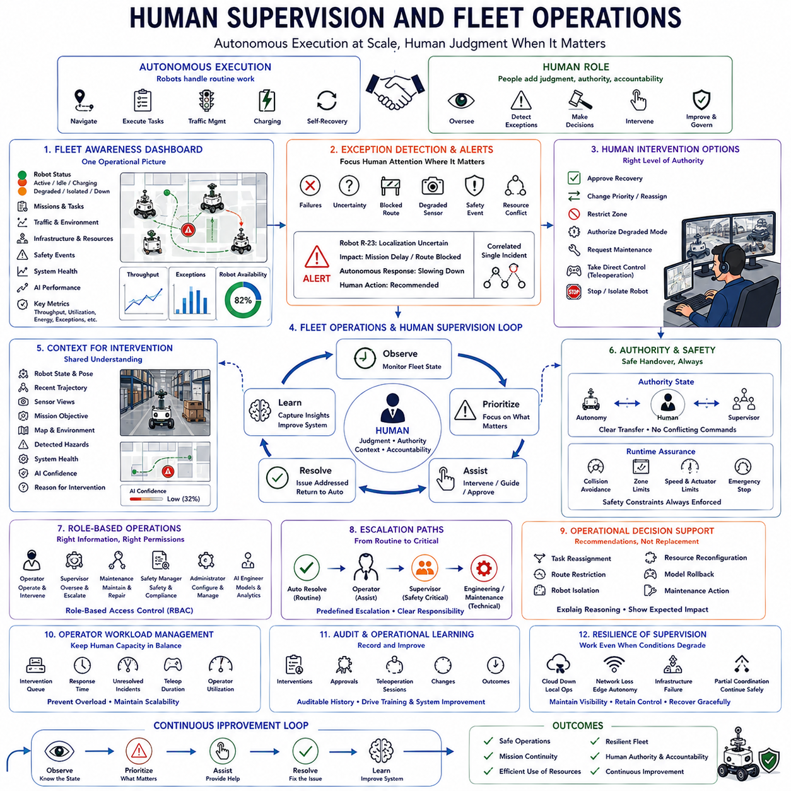{width="7.268055555555556in" height="7.268055555555556in"}

Human supervision remains a fundamental component of fleet-scale Physical AI even as robots gain greater autonomy. The objective is not to place a human operator inside every decision loop, but to position people where judgment, authority, contextual understanding, and accountability provide the greatest value. Effective fleet operations therefore combine autonomous execution with scalable human oversight, intervention, and operational governance.

As fleet size increases, direct one-to-one supervision becomes impractical. A single operator should be able to oversee many robots without continuously controlling their movements. Robots handle routine navigation, task execution, traffic interactions, charging, and recovery locally or through fleet orchestration, while operators concentrate on exceptions, ambiguous situations, safety events, operational priorities, and decisions that exceed autonomous authority.

Human-on-the-loop supervision differs from continuous human-in-the-loop control. In normal operation, autonomous systems execute approved missions while humans observe fleet status and intervene only when required. This approach preserves the scalability of autonomy while retaining human authority over unusual or high-consequence situations. The appropriate level of supervision can change dynamically according to mission risk, robot capability, environment, and AI confidence.

Fleet operations require a unified operational picture rather than separate interfaces for every robot. Operators should understand which robots are active, idle, charging, degraded, isolated, recovering, or unavailable, along with current missions, traffic conditions, resource usage, safety events, and infrastructure state. Aggregated views reduce cognitive load while allowing detailed inspection of individual robots when an abnormal condition requires investigation.

Exception-driven operations help operators focus attention where it is most valuable. Instead of presenting continuous streams of raw telemetry, the fleet system can identify conditions that require awareness or action, such as repeated task failures, uncertain localization, blocked routes, degraded sensors, unusual AI behavior, resource conflicts, or safety interventions. Prioritization prevents important incidents from being hidden among routine operational information.

Alerts should communicate meaning rather than merely report threshold violations. An effective alert explains what happened, which robot or service is affected, the likely operational impact, current autonomous response, and whether human action is required. Related events should be correlated into a single incident when possible. This reduces alert fatigue and allows operators to make decisions based on operational context rather than isolated technical symptoms.

Human intervention can occur at multiple levels of authority. An operator may approve a proposed recovery, modify task priority, reassign a mission, restrict an operating zone, authorize a degraded mode, request maintenance, or temporarily take direct control. The intervention mechanism should match the problem so that minor operational exceptions do not unnecessarily escalate into full teleoperation or complete fleet shutdown.

Teleoperation provides an important recovery capability when autonomy cannot safely resolve a local situation. A remote operator may guide a robot around an unusual obstacle, reposition it after localization failure, complete a difficult docking maneuver, or move it into a safe recovery area. Teleoperation should be treated as a controlled exception mechanism rather than the default operating mode for an autonomous fleet.

Scalable teleoperation requires careful allocation of operator attention. Multiple robots may request assistance simultaneously, so requests should be prioritized according to safety risk, mission importance, waiting time, environmental conditions, and availability of alternative recovery methods. Fleet orchestration can queue intervention requests and continue autonomous operations elsewhere while operators resolve the most important exceptions first.

Shared context is essential when control passes from autonomy to a human. The operator should receive robot pose, recent trajectory, sensor views, mission objective, relevant map information, detected hazards, system health, AI confidence, and the reason intervention was requested. Without this context, the operator must reconstruct the situation manually, increasing response time and the possibility of incorrect recovery actions.

Authority transfer between autonomous systems and humans should be explicit. The system must know whether autonomy, a fleet supervisor, or a human operator currently has control over a decision or robot motion. Clear handover protocols prevent conflicting commands and ambiguous responsibility. After human intervention, authority should return to autonomy only after appropriate conditions and system health have been verified.

Role-based operations become increasingly important as fleet complexity grows. Operators, supervisors, maintenance personnel, safety managers, system administrators, and AI engineers may require different information and permissions. Role-based access control ensures that each person can perform necessary functions without receiving unnecessary authority over safety policies, robot control, software configuration, model deployment, or security-sensitive operations.

Operational procedures should define escalation paths before incidents occur. Routine exceptions may be resolved automatically, more difficult cases may request an operator, safety-critical conditions may escalate to a supervisor, and technical failures may involve maintenance or engineering personnel. Predefined escalation reduces uncertainty during time-sensitive situations and ensures that responsibility follows the severity and type of operational problem.

Human supervision should incorporate runtime assurance rather than bypass it. Teleoperation and manually issued commands can still be checked against collision constraints, restricted zones, actuator limits, payload conditions, and emergency safety mechanisms. Human authority does not eliminate physical safety requirements. Safety supervisors should remain capable of rejecting or modifying commands that would create unacceptable risk.

Operators also require visibility into AI performance, not only mechanical health. Repeated replanning, increasing model uncertainty, perception disagreement, prediction errors, unusual trajectories, or frequent recovery requests may indicate that autonomy is becoming unreliable. Presenting these signals in operational terms helps humans determine whether a robot should continue, operate with restrictions, switch to fallback behavior, or be removed from service.

Fleet operations should distinguish individual robot problems from systemic conditions. If many robots begin reporting localization errors or network instability simultaneously, the operator should be shown a probable shared infrastructure issue rather than dozens of unrelated alarms. Fleet-level correlation allows humans to address root causes such as access points, localization references, elevators, servers, or congested traffic regions.

Operational decision support can help humans evaluate alternatives without replacing their authority. The fleet system may recommend task reassignment, route restrictions, maintenance actions, robot isolation, resource reconfiguration, or model rollback based on current evidence. Recommendations should include relevant reasoning and expected consequences so operators can understand why an action is proposed before approving high-impact changes.

Human workload itself should be monitored as an operational resource. A fleet may technically remain functional while generating more exceptions than available operators can resolve. Intervention queue length, response time, unresolved incidents, teleoperation duration, and operator utilization provide evidence of whether autonomy is truly scalable. Excessive supervision demand may reveal weaknesses in autonomy, infrastructure, interfaces, or operating procedures.

Automation should therefore aim to reduce unnecessary human attention rather than simply increase robot independence. Reliable self-recovery, task reassignment, traffic management, fault isolation, and graceful degradation allow many incidents to be handled without operator involvement. Humans can then concentrate on situations requiring contextual reasoning, responsibility, policy decisions, or responses to previously unseen circumstances.

Operational logs should preserve human decisions alongside autonomous actions. Intervention reason, operator identity, commands, approvals, configuration changes, teleoperation sessions, mission modifications, and final outcomes create an auditable history. These records support incident investigation, safety review, training, process improvement, and evaluation of whether human intervention improved or degraded the resulting operational outcome.

Human interventions also provide valuable learning signals. Situations repeatedly requiring teleoperation or manual correction identify gaps in perception, planning, manipulation, world modeling, or fleet coordination. These events can be prioritized for data collection, simulation reproduction, model evaluation, and retraining. Human supervision thereby becomes a source of structured evidence for improving future autonomous behavior.

Training operators is therefore more than teaching them how to drive robots remotely. They must understand fleet states, autonomy boundaries, safety procedures, degraded modes, recovery mechanisms, escalation rules, and the meaning of AI confidence or uncertainty. Effective training enables operators to supervise intelligent systems without needing to become experts in every internal algorithm or robot subsystem.

Site-specific operating policies should also be reflected in supervision tools. Different facilities may define different restricted zones, mission priorities, safety requirements, maintenance procedures, or human approval conditions. On-premise fleet management can enforce these local rules while maintaining common fleet architecture and interfaces, allowing standardized technology to operate within different organizational and physical environments.

Human supervision must remain effective during degraded communication or infrastructure failures. If cloud services become unavailable, local operators should retain access to essential fleet state and control through on-premise systems. If fleet coordination is partially unavailable, robots should maintain local safety while operators receive enough information to manage recovery. Supervision architecture therefore contributes directly to operational resilience.

As autonomy improves, the human role shifts from continuous control toward mission supervision, exception management, governance, and improvement. Success should not be measured only by the number of robots assigned to one operator, but by how rarely unnecessary intervention is required, how quickly meaningful exceptions are resolved, and how safely the fleet continues operating when unusual situations occur.

A mature human supervision architecture combines autonomous execution, fleet-level observability, exception prioritization, decision support, controlled teleoperation, explicit authority transfer, role-based permissions, escalation procedures, runtime safety, and operational learning. These elements allow human judgment to remain available without becoming a throughput bottleneck or a hidden dependency for routine autonomous behavior.

Human supervision and fleet operations ultimately form a continuous observe-prioritize-assist-resolve-learn loop. Autonomous robots perform routine work, fleet intelligence identifies exceptions, humans receive contextualized information when judgment is needed, interventions resolve difficult conditions, and operational evidence feeds future system improvement. This relationship enables fleet-scale Physical AI to combine machine autonomy with human authority, accountability, and adaptive operational knowledge.

인간 감독(Human Supervision)은 로봇이 더 높은 수준의 자율성(Autonomy)을 확보하더라도 플릿 규모 피지컬 AI(Fleet-Scale Physical AI)의 핵심 구성요소로 남는다. 목표는 모든 의사결정 루프(Decision Loop)에 인간 운영자를 배치하는 것이 아니라 판단(Judgment), 권한(Authority), 맥락 이해(Contextual Understanding), 책임성(Accountability)이 가장 큰 가치를 제공하는 위치에 사람을 배치하는 것이다. 따라서 효과적인 플릿 운영(Fleet Operations)은 자율 실행(Autonomous Execution)과 확장 가능한 인간 감독(Scalable Human Oversight), 개입(Intervention), 운영 거버넌스(Operational Governance)를 결합해야 한다.

플릿 규모가 증가하면 일대일 직접 감독(One-to-One Supervision)은 현실적으로 불가능해진다. 한 명의 운영자가 로봇의 움직임을 지속적으로 제어하지 않으면서도 다수의 로봇을 감독할 수 있어야 한다. 로봇은 일상적인 내비게이션(Navigation), 작업 실행(Task Execution), 교통 상호작용(Traffic Interaction), 충전(Charging), 복구(Recovery)를 로컬 또는 플릿 오케스트레이션(Fleet Orchestration)을 통해 처리하고, 운영자는 예외 상황(Exception), 모호한 상황(Ambiguous Situation), 안전 이벤트(Safety Event), 운영 우선순위(Operational Priority), 자율 권한을 넘어서는 의사결정에 집중해야 한다.

루프 외부 인간 감독(Human-on-the-Loop Supervision)은 지속적인 루프 내 인간 제어(Human-in-the-Loop Control)와 다르다. 정상 운영에서는 자율 시스템(Autonomous System)이 승인된 임무를 실행하고 인간은 플릿 상태를 관찰하면서 필요한 경우에만 개입한다. 이러한 접근은 자율성의 확장성(Scalability)을 유지하면서 비정상적이거나 중대한 결과를 초래할 수 있는 상황에 대한 인간의 권한을 보존한다. 적절한 감독 수준은 임무 위험(Mission Risk), 로봇 역량(Robot Capability), 환경(Environment), AI 신뢰도(AI Confidence)에 따라 동적으로 변경될 수 있다.

플릿 운영에는 로봇별로 분리된 인터페이스가 아니라 통합 운영 상황(Unified Operational Picture)이 필요하다. 운영자는 어떤 로봇이 활성(Active), 유휴(Idle), 충전 중(Charging), 성능 저하(Degraded), 격리(Isolated), 복구 중(Recovering), 사용 불가(Unavailable) 상태인지 파악할 수 있어야 하며, 현재 임무, 교통 상황, 자원 사용(Resource Usage), 안전 이벤트, 인프라 상태(Infrastructure State)도 함께 이해해야 한다. 집계된 관점(Aggregated View)은 인지 부하(Cognitive Load)를 줄이면서 비정상 상황을 조사해야 할 때 개별 로봇의 세부 정보를 확인할 수 있도록 한다.

예외 중심 운영(Exception-Driven Operations)은 운영자가 가장 가치 있는 곳에 주의를 집중하도록 한다. 플릿 시스템은 원시 텔레메트리(Raw Telemetry)를 지속적으로 표시하는 대신 반복적인 작업 실패(Task Failure), 불확실한 위치추정(Localization), 차단된 경로(Blocked Route), 성능이 저하된 센서(Degraded Sensor), 비정상적인 AI 행동, 자원 충돌(Resource Conflict), 안전 개입(Safety Intervention)처럼 인지 또는 조치가 필요한 조건을 식별할 수 있다. 우선순위 지정(Prioritization)은 중요한 사고가 일상적인 운영 정보 속에 묻히는 것을 방지한다.

경고(Alert)는 단순히 임계값 위반(Threshold Violation)을 보고하는 것이 아니라 의미를 전달해야 한다. 효과적인 경고는 무엇이 발생했는지, 어떤 로봇 또는 서비스가 영향을 받았는지, 예상되는 운영 영향(Operational Impact)이 무엇인지, 현재 어떤 자율 대응(Autonomous Response)이 진행 중인지, 인간의 조치가 필요한지를 설명한다. 가능하면 관련 이벤트를 하나의 사고(Incident)로 연계해야 한다. 이를 통해 경고 피로(Alert Fatigue)를 줄이고 운영자가 분리된 기술적 증상이 아니라 운영 맥락(Operational Context)을 기반으로 의사결정을 내릴 수 있다.

인간 개입(Human Intervention)은 여러 수준의 권한으로 이루어질 수 있다. 운영자는 제안된 복구를 승인하거나, 작업 우선순위(Task Priority)를 변경하거나, 임무를 재할당하거나, 운영 구역(Operating Zone)을 제한하거나, 성능 저하 모드(Degraded Mode)를 승인하거나, 유지보수(Maintenance)를 요청하거나, 일시적으로 직접 제어할 수 있다. 개입 메커니즘은 문제의 수준에 맞아야 하며 사소한 운영 예외가 불필요하게 완전한 원격조작(Full Teleoperation)이나 전체 플릿 정지로 확대되지 않도록 해야 한다.

원격조작(Teleoperation)은 자율 시스템이 로컬 상황을 안전하게 해결할 수 없을 때 중요한 복구 역량(Recovery Capability)을 제공한다. 원격 운영자는 비정상적인 장애물을 우회하도록 로봇을 안내하거나, 위치추정 실패 후 로봇의 위치를 재조정하거나, 어려운 도킹 기동(Docking Maneuver)을 완료하거나, 안전한 복구 구역(Safe Recovery Area)으로 이동시킬 수 있다. 원격조작은 자율 플릿의 기본 운영 모드가 아니라 통제된 예외 처리 메커니즘(Controlled Exception Mechanism)으로 취급해야 한다.

확장 가능한 원격조작(Scalable Teleoperation)을 위해서는 운영자의 주의를 신중하게 할당해야 한다. 여러 로봇이 동시에 지원을 요청할 수 있으므로 안전 위험(Safety Risk), 임무 중요도(Mission Importance), 대기시간(Waiting Time), 환경 조건, 대체 복구 방법의 가용성에 따라 요청의 우선순위를 정해야 한다. 플릿 오케스트레이션은 개입 요청을 대기열(Intervention Queue)로 관리하고 운영자가 가장 중요한 예외를 우선 해결하는 동안 다른 영역에서는 자율 운영을 계속할 수 있다.

자율 시스템에서 인간에게 제어권이 전달될 때 공유 맥락(Shared Context)이 필수적이다. 운영자는 로봇 자세(Robot Pose), 최근 궤적(Recent Trajectory), 센서 화면(Sensor View), 임무 목표(Mission Objective), 관련 지도 정보, 탐지된 위험요소(Detected Hazard), 시스템 상태(System Health), AI 신뢰도, 개입 요청 이유를 제공받아야 한다. 이러한 맥락이 없으면 운영자가 상황을 수동으로 재구성해야 하므로 대응 시간이 증가하고 잘못된 복구 행동을 수행할 가능성이 높아진다.

자율 시스템과 인간 사이의 권한 이전(Authority Transfer)은 명시적이어야 한다. 시스템은 자율 시스템, 플릿 감독기(Fleet Supervisor), 인간 운영자 중 누가 현재 특정 의사결정이나 로봇 움직임에 대한 제어권을 가지고 있는지 알아야 한다. 명확한 핸드오버 프로토콜(Handover Protocol)은 충돌하는 명령과 모호한 책임을 방지한다. 인간 개입 이후에는 적절한 조건과 시스템 상태가 검증된 후에만 제어 권한이 자율 시스템으로 반환되어야 한다.

역할 기반 운영(Role-Based Operations)은 플릿의 복잡성이 증가할수록 더욱 중요해진다. 운영자, 감독자(Supervisor), 유지보수 담당자(Maintenance Personnel), 안전 관리자(Safety Manager), 시스템 관리자(System Administrator), AI 엔지니어(AI Engineer)는 서로 다른 정보와 권한을 필요로 할 수 있다. 역할 기반 접근 제어(Role-Based Access Control)는 각 사람이 필요한 기능을 수행할 수 있도록 하면서 안전 정책, 로봇 제어, 소프트웨어 구성, 모델 배포(Model Deployment), 보안 중요 작업(Security-Sensitive Operation)에 대해 불필요한 권한을 부여하지 않도록 한다.

운영 절차(Operational Procedure)는 사고가 발생하기 전에 에스컬레이션 경로(Escalation Path)를 정의해야 한다. 일상적인 예외는 자동으로 해결할 수 있고, 더 어려운 문제는 운영자에게 지원을 요청할 수 있으며, 안전 중요 조건(Safety-Critical Condition)은 감독자에게 에스컬레이션하고, 기술적 장애는 유지보수 또는 엔지니어링 인력이 참여하도록 할 수 있다. 사전에 정의된 에스컬레이션은 시간에 민감한 상황에서 불확실성을 줄이고 운영 문제의 심각도와 유형에 따라 책임이 적절하게 전달되도록 한다.

인간 감독은 런타임 보증(Runtime Assurance)을 우회하는 것이 아니라 이를 포함해야 한다. 원격조작과 수동 명령(Manual Command)도 충돌 제약(Collision Constraint), 제한 구역(Restricted Zone), 액추에이터 한계(Actuator Limit), 페이로드 조건(Payload Condition), 비상 안전 메커니즘(Emergency Safety Mechanism)에 대해 검증될 수 있다. 인간에게 권한이 있다고 해서 물리적 안전 요구사항이 제거되는 것은 아니다. 안전 감독기(Safety Supervisor)는 허용할 수 없는 위험을 발생시키는 명령을 거부하거나 수정할 수 있어야 한다.

운영자는 기계적 상태(Mechanical Health)뿐만 아니라 AI 성능(AI Performance)에 대한 가시성도 확보해야 한다. 반복적인 재계획(Replanning), 증가하는 모델 불확실성(Model Uncertainty), 인지 불일치(Perception Disagreement), 예측 오류(Prediction Error), 비정상적인 궤적(Unusual Trajectory), 빈번한 복구 요청은 자율 시스템의 신뢰성이 낮아지고 있음을 나타낼 수 있다. 이러한 신호를 운영 관점에서 제시하면 인간은 로봇의 운영 지속, 제한 운영, 폴백 행동(Fallback Behavior) 전환 또는 서비스 제외 여부를 결정할 수 있다.

플릿 운영은 개별 로봇 문제와 시스템 전체 조건(Systemic Condition)을 구분해야 한다. 여러 로봇이 동시에 위치추정 오류나 네트워크 불안정(Network Instability)을 보고하기 시작한다면 운영자에게 수십 개의 독립적인 경고를 표시하기보다 공유 인프라 문제(Shared Infrastructure Issue)일 가능성을 보여주어야 한다. 플릿 수준 상관관계 분석(Fleet-Level Correlation)을 통해 인간은 액세스 포인트(Access Point), 위치추정 기준(Localization Reference), 엘리베이터, 서버 또는 혼잡한 교통 구역과 같은 근본 원인(Root Cause)을 해결할 수 있다.

운영 의사결정 지원(Operational Decision Support)은 인간의 권한을 대체하지 않으면서 대안을 평가하도록 지원할 수 있다. 플릿 시스템은 현재 증거를 기반으로 작업 재할당(Task Reassignment), 경로 제한(Route Restriction), 유지보수 조치, 로봇 격리(Robot Isolation), 자원 재구성(Resource Reconfiguration), 모델 롤백(Model Rollback)을 권고할 수 있다. 영향이 큰 변경을 승인하기 전에 운영자가 해당 조치가 제안된 이유를 이해할 수 있도록 권고에는 관련 근거와 예상 결과(Expected Consequence)가 포함되어야 한다.

인간의 작업 부하(Human Workload) 자체도 하나의 운영 자원(Operational Resource)으로 모니터링해야 한다. 플릿은 기술적으로 정상 운영을 유지하면서도 가용한 운영자가 해결할 수 있는 수준보다 더 많은 예외를 생성할 수 있다. 개입 대기열 길이(Intervention Queue Length), 응답시간(Response Time), 미해결 사고(Unresolved Incident), 원격조작 시간(Teleoperation Duration), 운영자 활용률(Operator Utilization)은 자율성이 실제로 확장 가능한지를 판단하는 증거가 된다. 과도한 감독 요구는 자율성, 인프라, 인터페이스 또는 운영 절차의 약점을 나타낼 수 있다.

따라서 자동화(Automation)는 단순히 로봇의 독립성을 높이는 것이 아니라 불필요한 인간의 주의(Unnecessary Human Attention)를 줄이는 것을 목표로 해야 한다. 신뢰할 수 있는 자가 복구(Self-Recovery), 작업 재할당, 교통 관리(Traffic Management), 장애 격리(Fault Isolation), 점진적 성능 저하(Graceful Degradation)를 통해 많은 사고를 운영자 개입 없이 처리할 수 있다. 인간은 맥락적 추론(Contextual Reasoning), 책임, 정책 결정 또는 이전에 경험하지 못한 상황에 대한 대응이 필요한 문제에 집중할 수 있다.

운영 로그(Operational Log)는 자율 행동과 함께 인간의 의사결정도 보존해야 한다. 개입 이유(Intervention Reason), 운영자 신원(Operator Identity), 명령, 승인, 구성 변경(Configuration Change), 원격조작 세션(Teleoperation Session), 임무 변경(Mission Modification), 최종 결과를 기록하면 감사 가능한 이력(Auditable History)을 구축할 수 있다. 이러한 기록은 사고 조사(Incident Investigation), 안전 검토(Safety Review), 교육, 프로세스 개선, 인간 개입이 실제 운영 결과를 개선했는지 또는 악화시켰는지를 평가하는 데 활용할 수 있다.

인간 개입은 또한 가치 있는 학습 신호(Learning Signal)를 제공한다. 원격조작이나 수동 수정이 반복적으로 필요한 상황은 인지, 계획, 조작, 월드 모델링(World Modeling), 플릿 조정(Fleet Coordination)의 공백을 나타낸다. 이러한 이벤트는 데이터 수집(Data Collection), 시뮬레이션 재현(Simulation Reproduction), 모델 평가(Model Evaluation), 재학습(Retraining)을 위한 우선순위가 높은 사례로 활용할 수 있다. 따라서 인간 감독은 미래의 자율 행동을 개선하기 위한 구조화된 증거(Structured Evidence)의 원천이 된다.

따라서 운영자 교육(Operator Training)은 단순히 로봇을 원격으로 운전하는 방법을 가르치는 것 이상이어야 한다. 운영자는 플릿 상태(Fleet State), 자율성 경계(Autonomy Boundary), 안전 절차(Safety Procedure), 성능 저하 모드, 복구 메커니즘(Recovery Mechanism), 에스컬레이션 규칙(Escalation Rule), AI 신뢰도 또는 불확실성의 의미를 이해해야 한다. 효과적인 교육은 운영자가 모든 내부 알고리즘이나 로봇 서브시스템의 전문가가 되지 않고도 지능형 시스템을 감독할 수 있도록 한다.

사이트별 운영 정책(Site-Specific Operating Policy)도 감독 도구에 반영되어야 한다. 서로 다른 시설은 제한 구역, 임무 우선순위, 안전 요구사항, 유지보수 절차 또는 인간 승인 조건을 서로 다르게 정의할 수 있다. 온프레미스 플릿 관리(On-Premise Fleet Management)는 공통 플릿 아키텍처와 인터페이스를 유지하면서 이러한 로컬 규칙(Local Rule)을 적용할 수 있으며, 이를 통해 표준화된 기술을 서로 다른 조직 및 물리적 환경에서 운영할 수 있다.

인간 감독은 통신이나 인프라가 성능 저하 상태에 있을 때에도 효과적으로 유지되어야 한다. 클라우드 서비스(Cloud Service)를 사용할 수 없게 되더라도 로컬 운영자는 온프레미스 시스템을 통해 필수적인 플릿 상태와 제어 기능에 접근할 수 있어야 한다. 플릿 조정 기능을 부분적으로 사용할 수 없는 경우에도 로봇은 로컬 안전(Local Safety)을 유지하고 운영자는 복구를 관리할 수 있는 충분한 정보를 제공받아야 한다. 따라서 감독 아키텍처(Supervision Architecture)는 운영 회복탄력성(Operational Resilience)에 직접 기여한다.

자율성이 향상될수록 인간의 역할은 지속적인 제어(Continuous Control)에서 임무 감독(Mission Supervision), 예외 관리(Exception Management), 거버넌스(Governance), 개선(Improvement)으로 이동한다. 성공 여부는 한 명의 운영자에게 얼마나 많은 로봇을 할당할 수 있는지만으로 평가해서는 안 된다. 불필요한 개입이 얼마나 드물게 발생하는지, 의미 있는 예외를 얼마나 신속하게 해결하는지, 비정상적인 상황이 발생했을 때 플릿이 얼마나 안전하게 운영을 지속하는지도 함께 평가해야 한다.

성숙한 인간 감독 아키텍처(Mature Human Supervision Architecture)는 자율 실행, 플릿 수준 관측 가능성(Fleet-Level Observability), 예외 우선순위 지정(Exception Prioritization), 의사결정 지원(Decision Support), 통제된 원격조작(Controlled Teleoperation), 명시적 권한 이전(Explicit Authority Transfer), 역할 기반 권한(Role-Based Permission), 에스컬레이션 절차, 런타임 안전(Runtime Safety), 운영 학습(Operational Learning)을 결합한다. 이러한 요소는 인간의 판단을 유지하면서 인간이 처리량 병목(Throughput Bottleneck)이나 일상적인 자율 행동을 위한 숨겨진 의존성(Hidden Dependency)이 되지 않도록 한다.

궁극적으로 인간 감독 및 플릿 운영(Human Supervision and Fleet Operations)은 지속적인 관찰-우선순위화-지원-해결-학습 루프(Observe-Prioritize-Assist-Resolve-Learn Loop)를 형성한다. 자율 로봇은 일상적인 작업을 수행하고, 플릿 지능(Fleet Intelligence)은 예외를 식별하며, 인간은 판단이 필요한 경우 맥락화된 정보(Contextualized Information)를 제공받고, 개입을 통해 어려운 상황을 해결하며, 운영 증거(Operational Evidence)는 향후 시스템 개선으로 다시 전달된다. 이러한 관계를 통해 플릿 규모 피지컬 AI는 기계 자율성(Machine Autonomy)과 인간의 권한(Human Authority), 책임성, 적응형 운영 지식(Adaptive Operational Knowledge)을 결합할 수 있다.

## 09.14. Scaling from Tens to Thousands of Robots

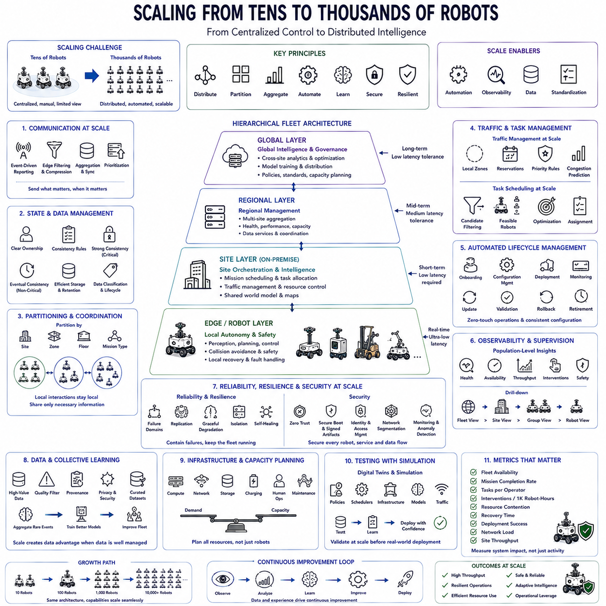{width="7.268055555555556in" height="7.268055555555556in"}

Scaling a robotic system from tens to thousands of robots is not simply a matter of adding more machines to an existing fleet manager. At small scale, centralized coordination, manual configuration, and direct operator attention may remain practical. At large scale, these assumptions become bottlenecks. Fleet architecture must evolve toward distributed control, hierarchical coordination, automated lifecycle management, and data-driven operations.

A fleet containing tens of robots can often maintain a relatively complete global view of every robot and task. As the population grows, continuously processing every state change at one central service becomes increasingly expensive and fragile. Large-scale architecture therefore separates immediate robot control, site-level coordination, regional management, and global intelligence according to latency, bandwidth, reliability, and decision scope.

Hierarchical orchestration provides a practical structure for this separation. Individual robots execute local autonomy, while site-level systems coordinate traffic, resources, missions, and shared world state. Higher layers aggregate operational information across sites and manage models, policies, analytics, and long-term optimization. This hierarchy prevents every local decision from requiring communication with a single global controller.

Decentralization does not mean eliminating centralized intelligence. Different decisions naturally belong at different levels. Collision avoidance and emergency behavior belong close to the robot, while site traffic and task allocation benefit from local fleet knowledge. Cross-site model learning, capacity planning, global performance analysis, and policy governance can operate at higher levels where longer decision latency is acceptable.

Communication architecture must also change with scale. If every robot continuously sends all raw sensor data to central infrastructure, bandwidth and storage requirements can grow faster than operational value. Edge filtering, event-driven reporting, local aggregation, compression, prioritization, and selective synchronization reduce unnecessary traffic while preserving information needed for coordination, monitoring, learning, and investigation.

State management becomes increasingly difficult as thousands of robots, tasks, maps, reservations, resources, and services change simultaneously. Large fleets require clear ownership of state and explicit consistency rules. Some information requires strong consistency, such as exclusive resource reservations, while other information can tolerate delayed synchronization. Treating every state update identically can create unnecessary communication and coordination overhead.

Fleet partitioning can limit the scope of coordination. Robots may be organized by site, building, floor, operational zone, mission type, or resource domain. Most interactions remain within a partition, while only necessary information crosses boundaries. Partitioning reduces computational complexity and failure propagation while allowing the overall system to maintain a broader operational view across many independently operating groups.

Traffic management illustrates the importance of limiting coordination scope. Planning trajectories for a small fleet may be manageable globally, but continuously solving interactions among thousands of robots can become computationally prohibitive. Local traffic zones, reservations, priority rules, congestion prediction, and hierarchical routing allow detailed coordination where robots interact physically while avoiding unnecessary global trajectory coupling.

Task scheduling faces a similar challenge. A centralized scheduler that evaluates every robot against every new task can become inefficient as both fleet size and mission volume grow. Candidate filtering can first identify robots with suitable location, capability, energy, payload, and availability. More sophisticated optimization can then operate on this smaller set, reducing search complexity without sacrificing operational quality.

Resource management must scale alongside robot count. Charging stations, elevators, doors, docks, work cells, network capacity, maintenance facilities, and human intervention resources can become shared bottlenecks. Increasing robot population without increasing or optimizing these resources may reduce rather than improve throughput. Fleet intelligence must therefore reason about infrastructure capacity as carefully as robot availability.

Large fleets require automated robot onboarding. Manually configuring identity, maps, permissions, software, models, capabilities, and operational policies for thousands of robots creates excessive administrative effort and inconsistent configurations. Registration workflows should establish robot identity, verify hardware and software state, assign site policies, download required artifacts, validate capabilities, and place the robot into service with minimal manual intervention.

Configuration management becomes a fleet-wide engineering discipline at scale. Robots may differ by hardware generation, sensor package, compute platform, payload module, operating environment, and software version. Configuration should be represented explicitly rather than embedded in informal procedures. Fleet services can then determine compatibility among missions, models, policies, maps, infrastructure, and individual robot capabilities.

Software and model deployment must avoid simultaneous fleet-wide risk. A defect deployed to thousands of robots can create a system-level failure even if the update process itself is technically successful. Staged deployment, canary groups, validation gates, health monitoring, automatic rollback, and version tracking allow changes to expand gradually as operational evidence demonstrates that they remain safe and effective.

Fleet observability must shift from robot-centric monitoring toward population-level understanding. Operators cannot inspect thousands of dashboards individually. Aggregated health, availability, throughput, intervention rates, AI performance, safety events, resource utilization, and failure patterns should reveal the condition of the overall system. Operators can then drill down from fleet anomalies to sites, robot groups, and individual machines.

Exception-driven supervision becomes essential as fleet size increases. Human attention should be directed toward situations that automation cannot confidently resolve rather than routine robot activity. Incidents can be grouped, correlated, prioritized, and routed to appropriate operators or specialists. The objective is for human workload to grow much more slowly than robot population, preserving operational scalability.

Failure domains should be deliberately constrained. A software service, network segment, map error, corrupted model, or infrastructure failure should not automatically affect the entire fleet. Site boundaries, service replication, network segmentation, independent safety functions, and controlled deployment groups reduce the number of robots exposed to a single failure. Large-scale resilience depends on limiting correlated failures rather than only improving individual component reliability.

Graceful degradation becomes more valuable as fleet size grows because partial failure is statistically inevitable. Some robots, services, or sites will frequently operate in degraded conditions even when the overall system remains healthy. Scheduling and orchestration should absorb these losses by reallocating tasks, reducing capacity, switching resources, or isolating affected regions while preserving essential operations elsewhere.

Data volume becomes another scaling constraint. Thousands of robots can generate enormous quantities of sensor streams, logs, trajectories, maps, events, and model diagnostics. Not all data deserves permanent storage. Data pipelines should classify information by operational value, safety relevance, rarity, learning potential, and retention requirements so that high-value evidence is preserved without turning raw fleet data into an uncontrolled storage burden.

Collective learning can benefit directly from scale when data is managed correctly. Thousands of robots expose the system to broader environments, objects, failures, and human interactions than a small fleet can encounter. Rare events from many robots can be aggregated into valuable training evidence. Fleet scale therefore creates a data advantage, but only if provenance, quality filtering, privacy, security, and dataset curation are systematically maintained.

Shared world knowledge must also scale selectively. It is unnecessary for every robot to know every event occurring across every site. Local obstacles and traffic conditions may remain site-specific, while learned semantic knowledge, failure patterns, model improvements, or generalized traversability concepts may be useful globally. Information should propagate according to spatial relevance, temporal relevance, confidence, and operational scope.

Cybersecurity becomes more difficult as the number of identities, communication relationships, software versions, and access paths increases. Automated credential management, zero-trust authorization, signed artifacts, secure boot, network segmentation, audit logging, anomaly detection, and rapid revocation become essential. Security processes that depend heavily on manual administration cannot reliably protect thousands of continuously connected physical agents.

Multi-site fleets introduce another level of complexity. Each facility may have different maps, infrastructure, workflows, regulations, network conditions, and robot populations. A scalable platform should preserve common interfaces, identity, deployment, monitoring, and learning mechanisms while allowing site-specific operational policies. Standardization should reduce engineering duplication without forcing every environment into identical operational assumptions.

Capacity planning should consider the complete system rather than robot quantity alone. Compute resources, storage, network bandwidth, charging capacity, maintenance staff, teleoperation capacity, infrastructure throughput, and model-serving resources must grow according to actual demand. Adding robots without understanding these dependencies can move the bottleneck from robot availability to supporting infrastructure.

Performance optimization should focus on useful work completed rather than maximum robot utilization. Driving every robot toward constant activity can create congestion, charging conflicts, resource contention, and reduced resilience. At large scale, strategic idle capacity can absorb demand peaks and failures. Fleet intelligence should optimize mission throughput, service quality, energy, safety, and resource balance across the complete operating system.

Operational metrics should therefore evolve with scale. Individual robot uptime remains useful, but fleet availability, mission completion rate, tasks per operator, interventions per thousand robot-hours, resource contention, recovery time, deployment success, network load, and site throughput provide a broader picture. Metrics should reveal whether additional robots create proportional operational value or merely additional complexity.

Simulation and digital twins become increasingly important before changes reach large fleets. Traffic policies, scheduler modifications, infrastructure layouts, software releases, and new AI models can be evaluated under representative fleet loads. Large-scale simulation allows engineers to discover congestion, cascading failures, resource shortages, and coordination bottlenecks that may not appear during testing with only a few physical robots.

Architecture should also support incremental growth. A system designed for thousands of robots should not require thousands of robots before it becomes useful. The same interfaces and control principles should operate with ten robots, while partitioning, replication, aggregation, and hierarchical coordination activate as scale increases. This reduces the need for disruptive architectural replacement during fleet expansion.

Scaling is ultimately an organizational challenge as well as a technical one. Deployment, maintenance, safety, cybersecurity, AI operations, infrastructure management, and incident response require standardized processes and clearly assigned responsibilities. Automation should remove repetitive administrative work, while governance ensures that rapid fleet growth does not produce uncontrolled variation in configuration, policy, or operational practice.

A mature large-scale fleet architecture combines distributed edge autonomy, on-premise site intelligence, hierarchical orchestration, partitioned coordination, automated lifecycle management, scalable observability, staged deployment, fault containment, collective learning, and global governance. Each layer handles decisions at an appropriate spatial and temporal scope while sharing only the information necessary for coordinated operation.

Scaling from tens to thousands of robots therefore represents a transition from managing individual machines to managing a distributed intelligent infrastructure. The central challenge is not simply increasing robot count, but ensuring that communication, computation, supervision, safety, learning, security, and operational complexity grow more slowly than fleet capability. When this principle is achieved, fleet scale becomes a source of resilience, data, collective intelligence, and operational leverage rather than an expanding coordination burden.

로봇 시스템을 수십 대에서 수천 대 규모로 확장(Scaling)하는 것은 기존 플릿 관리자(Fleet Manager)에 단순히 더 많은 로봇을 추가하는 문제가 아니다. 소규모에서는 중앙집중형 조정(Centralized Coordination), 수동 구성(Manual Configuration), 운영자의 직접적인 관리가 현실적일 수 있다. 그러나 대규모에서는 이러한 방식 자체가 병목(Bottleneck)이 된다. 따라서 플릿 아키텍처(Fleet Architecture)는 분산 제어(Distributed Control), 계층형 조정(Hierarchical Coordination), 자동화된 수명주기 관리(Automated Lifecycle Management), 데이터 기반 운영(Data-Driven Operations)으로 발전해야 한다.

수십 대 규모의 플릿은 모든 로봇과 작업에 대한 비교적 완전한 전역 상태(Global View)를 유지할 수 있다. 그러나 로봇 수가 증가하면 모든 상태 변화를 하나의 중앙 서비스에서 지속적으로 처리하는 방식은 비용이 증가하고 취약해진다. 따라서 대규모 아키텍처는 지연시간(Latency), 대역폭(Bandwidth), 신뢰성(Reliability), 의사결정 범위(Decision Scope)에 따라 즉각적인 로봇 제어, 사이트 수준 조정(Site-Level Coordination), 지역 관리(Regional Management), 전역 지능(Global Intelligence)을 분리한다.

계층형 오케스트레이션(Hierarchical Orchestration)은 이러한 분리를 위한 실용적인 구조를 제공한다. 개별 로봇은 로컬 자율성(Local Autonomy)을 실행하고, 사이트 수준 시스템은 교통, 자원, 임무, 공유 월드 상태(Shared World State)를 조정한다. 상위 계층은 여러 사이트의 운영 정보를 집계하고 모델, 정책, 분석(Analytics), 장기 최적화(Long-Term Optimization)를 관리한다. 이러한 계층 구조는 모든 로컬 의사결정이 하나의 전역 컨트롤러(Global Controller)와 통신해야 하는 상황을 방지한다.

분산화(Decentralization)가 중앙집중형 지능(Centralized Intelligence)을 제거하는 것을 의미하지는 않는다. 서로 다른 의사결정은 자연스럽게 서로 다른 계층에서 수행되어야 한다. 충돌 회피(Collision Avoidance)와 비상 행동(Emergency Behavior)은 로봇 가까이에서 처리되어야 하고, 사이트 교통과 작업 할당(Task Allocation)은 로컬 플릿 지식(Local Fleet Knowledge)을 활용하는 것이 효과적이다. 사이트 간 모델 학습, 용량 계획(Capacity Planning), 전역 성능 분석, 정책 거버넌스(Policy Governance)는 더 긴 의사결정 지연을 허용할 수 있는 상위 계층에서 수행할 수 있다.

통신 아키텍처(Communication Architecture)도 규모에 따라 변화해야 한다. 모든 로봇이 모든 원시 센서 데이터(Raw Sensor Data)를 중앙 인프라로 지속적으로 전송하면 대역폭과 저장공간 요구량이 운영 가치보다 빠르게 증가할 수 있다. 엣지 필터링(Edge Filtering), 이벤트 기반 보고(Event-Driven Reporting), 로컬 집계(Local Aggregation), 압축(Compression), 우선순위화(Prioritization), 선택적 동기화(Selective Synchronization)를 통해 불필요한 트래픽을 줄이면서 조정, 모니터링, 학습, 조사에 필요한 정보는 유지할 수 있다.

수천 대의 로봇, 작업, 지도, 예약(Reservation), 자원, 서비스의 상태가 동시에 변화하면 상태 관리(State Management)는 점점 어려워진다. 대규모 플릿은 상태에 대한 명확한 소유권(State Ownership)과 명시적인 일관성 규칙(Consistency Rule)을 필요로 한다. 독점적 자원 예약처럼 강한 일관성(Strong Consistency)이 필요한 정보가 있는 반면 지연된 동기화를 허용할 수 있는 정보도 있다. 모든 상태 업데이트를 동일하게 처리하면 불필요한 통신 및 조정 오버헤드(Overhead)가 발생할 수 있다.

플릿 분할(Fleet Partitioning)은 조정 범위를 제한할 수 있다. 로봇은 사이트, 건물, 층, 운영 구역(Operational Zone), 임무 유형(Mission Type), 자원 영역(Resource Domain)에 따라 구성될 수 있다. 대부분의 상호작용은 하나의 파티션(Partition) 내부에서 유지하고 필요한 정보만 경계를 넘어 전달한다. 분할을 통해 계산 복잡도(Computational Complexity)와 장애 전파(Failure Propagation)를 줄이면서 전체 시스템은 독립적으로 운영되는 여러 그룹에 대한 더 넓은 운영 상황을 유지할 수 있다.

교통 관리(Traffic Management)는 조정 범위를 제한하는 것이 왜 중요한지를 보여준다. 소규모 플릿의 궤적(Trajectory)을 전역적으로 계획하는 것은 가능할 수 있지만 수천 대 로봇 간의 상호작용을 지속적으로 계산하는 것은 계산적으로 매우 어려워질 수 있다. 로컬 교통 구역(Local Traffic Zone), 예약, 우선순위 규칙(Priority Rule), 혼잡 예측(Congestion Prediction), 계층형 경로 계획(Hierarchical Routing)을 이용하면 로봇이 실제로 상호작용하는 영역에서는 세밀한 조정을 수행하면서 불필요한 전역 궤적 결합(Global Trajectory Coupling)을 피할 수 있다.

작업 스케줄링(Task Scheduling)도 유사한 문제를 가진다. 모든 새로운 작업에 대해 모든 로봇을 평가하는 중앙 스케줄러(Centralized Scheduler)는 플릿 규모와 임무량이 증가함에 따라 비효율적이 될 수 있다. 후보 필터링(Candidate Filtering)을 통해 위치, 역량(Capability), 에너지, 페이로드(Payload), 가용성(Availability)이 적절한 로봇을 먼저 선별할 수 있다. 이후 더 정교한 최적화(Optimization)를 축소된 후보 집합에 적용하여 운영 품질을 유지하면서 탐색 복잡도(Search Complexity)를 낮출 수 있다.

자원 관리(Resource Management) 역시 로봇 수와 함께 확장되어야 한다. 충전소(Charging Station), 엘리베이터, 출입문, 도킹 스테이션(Docking Station), 작업 셀(Work Cell), 네트워크 용량(Network Capacity), 유지보수 시설(Maintenance Facility), 인간 개입 자원(Human Intervention Resource)은 공유 병목(Shared Bottleneck)이 될 수 있다. 이러한 자원을 확대하거나 최적화하지 않고 로봇 수만 증가시키면 처리량(Throughput)이 향상되는 것이 아니라 오히려 감소할 수 있다. 따라서 플릿 지능(Fleet Intelligence)은 로봇 가용성만큼 인프라 용량(Infrastructure Capacity)을 중요하게 고려해야 한다.

대규모 플릿에는 자동화된 로봇 온보딩(Automated Robot Onboarding)이 필요하다. 수천 대 로봇의 신원(Identity), 지도, 권한(Permission), 소프트웨어, 모델, 역량, 운영 정책을 수동으로 구성하면 과도한 관리 작업과 구성 불일치(Configuration Inconsistency)가 발생한다. 등록 워크플로(Registration Workflow)는 로봇 신원을 설정하고, 하드웨어와 소프트웨어 상태를 검증하며, 사이트 정책을 할당하고, 필요한 아티팩트(Artifact)를 다운로드하며, 역량을 검증한 후 최소한의 수동 개입으로 로봇을 운영에 투입할 수 있어야 한다.

구성 관리(Configuration Management)는 규모가 커질수록 플릿 전체의 엔지니어링 원칙이 된다. 로봇은 하드웨어 세대(Hardware Generation), 센서 패키지(Sensor Package), 컴퓨팅 플랫폼(Compute Platform), 페이로드 모듈(Payload Module), 운영 환경, 소프트웨어 버전에 따라 서로 다를 수 있다. 구성은 비공식적인 절차에 포함시키는 대신 명시적으로 표현해야 한다. 이를 통해 플릿 서비스는 임무, 모델, 정책, 지도, 인프라와 개별 로봇 역량 사이의 호환성(Compatibility)을 판단할 수 있다.

소프트웨어 및 모델 배포(Software and Model Deployment)는 플릿 전체를 동시에 위험에 노출시키는 방식을 피해야 한다. 결함이 있는 업데이트가 수천 대의 로봇에 배포되면 업데이트 과정 자체가 기술적으로 성공했더라도 시스템 수준 장애(System-Level Failure)를 발생시킬 수 있다. 단계적 배포(Staged Deployment), 카나리 그룹(Canary Group), 검증 게이트(Validation Gate), 상태 모니터링(Health Monitoring), 자동 롤백(Automatic Rollback), 버전 추적(Version Tracking)을 이용하면 운영 증거가 안전성과 효과를 입증함에 따라 변경 사항을 점진적으로 확대할 수 있다.

플릿 관측 가능성(Fleet Observability)은 로봇 중심 모니터링(Robot-Centric Monitoring)에서 전체 집단 수준의 이해(Population-Level Understanding)로 전환되어야 한다. 운영자는 수천 개의 대시보드를 개별적으로 확인할 수 없다. 집계된 상태, 가용성, 처리량, 개입률(Intervention Rate), AI 성능, 안전 이벤트(Safety Event), 자원 활용률(Resource Utilization), 장애 패턴(Failure Pattern)을 통해 전체 시스템 상태를 파악해야 한다. 이후 플릿 이상(Fleet Anomaly)에서 사이트, 로봇 그룹, 개별 로봇 순으로 상세 분석할 수 있어야 한다.

플릿 규모가 증가할수록 예외 중심 감독(Exception-Driven Supervision)이 필수적이다. 인간의 주의(Human Attention)는 일상적인 로봇 활동이 아니라 자동화 시스템이 확신을 가지고 해결할 수 없는 상황에 집중되어야 한다. 사고(Incident)는 그룹화하고 상관관계를 분석하며 우선순위를 지정하여 적절한 운영자 또는 전문가에게 전달할 수 있다. 목표는 로봇 수보다 인간의 작업 부하(Human Workload)가 훨씬 느리게 증가하도록 하여 운영 확장성(Operational Scalability)을 유지하는 것이다.

장애 영역(Failure Domain)은 의도적으로 제한되어야 한다. 하나의 소프트웨어 서비스, 네트워크 세그먼트(Network Segment), 지도 오류(Map Error), 손상된 모델(Corrupted Model), 인프라 장애가 자동으로 전체 플릿에 영향을 주어서는 안 된다. 사이트 경계(Site Boundary), 서비스 복제(Service Replication), 네트워크 분할(Network Segmentation), 독립적인 안전 기능(Independent Safety Function), 통제된 배포 그룹(Controlled Deployment Group)을 통해 하나의 장애에 노출되는 로봇 수를 줄일 수 있다. 대규모 회복탄력성(Resilience)은 개별 구성요소의 신뢰성을 높이는 것뿐만 아니라 상관 장애(Correlated Failure)를 제한하는 데 달려 있다.

플릿 규모가 증가하면 부분적인 장애가 통계적으로 필연적이기 때문에 점진적 성능 저하(Graceful Degradation)가 더욱 중요해진다. 전체 시스템이 정상 상태를 유지하더라도 일부 로봇, 서비스 또는 사이트는 지속적으로 성능 저하 조건에서 운영될 수 있다. 스케줄링과 오케스트레이션(Orchestration)은 작업을 재할당하고, 용량을 감소시키고, 자원을 전환하거나, 영향을 받은 영역을 격리하면서 다른 영역의 핵심 운영을 유지함으로써 이러한 손실을 흡수해야 한다.

데이터 양(Data Volume)은 또 다른 확장 제약(Scaling Constraint)이 된다. 수천 대의 로봇은 막대한 양의 센서 스트림(Sensor Stream), 로그(Log), 궤적, 지도, 이벤트, 모델 진단(Model Diagnostic)을 생성할 수 있다. 모든 데이터를 영구적으로 저장할 필요는 없다. 데이터 파이프라인(Data Pipeline)은 운영 가치(Operational Value), 안전 관련성(Safety Relevance), 희소성(Rarity), 학습 잠재력(Learning Potential), 보존 요구사항(Retention Requirement)에 따라 정보를 분류하여 원시 플릿 데이터가 통제되지 않는 저장 부담(Storage Burden)이 되지 않으면서 가치가 높은 증거를 보존해야 한다.

데이터가 올바르게 관리된다면 집단 학습(Collective Learning)은 규모의 이점을 직접적으로 활용할 수 있다. 수천 대의 로봇은 소규모 플릿보다 훨씬 다양한 환경, 객체, 장애, 인간 상호작용에 시스템을 노출시킨다. 여러 로봇에서 발생한 희귀 이벤트(Rare Event)를 집계하여 가치 있는 학습 증거(Training Evidence)로 활용할 수 있다. 따라서 플릿 규모는 데이터 우위(Data Advantage)를 제공하지만 데이터 출처(Provenance), 품질 필터링(Quality Filtering), 개인정보 보호(Privacy), 보안(Security), 데이터셋 큐레이션(Dataset Curation)이 체계적으로 유지되어야 한다.

공유 월드 지식(Shared World Knowledge) 역시 선택적으로 확장되어야 한다. 모든 로봇이 모든 사이트에서 발생하는 모든 이벤트를 알아야 할 필요는 없다. 로컬 장애물(Local Obstacle)과 교통 상황은 사이트에 한정될 수 있지만 학습된 의미론적 지식(Semantic Knowledge), 장애 패턴, 모델 개선(Model Improvement), 일반화된 주행가능성 개념(Generalized Traversability Concept)은 전역적으로 유용할 수 있다. 정보는 공간적 관련성(Spatial Relevance), 시간적 관련성(Temporal Relevance), 신뢰도(Confidence), 운영 범위(Operational Scope)에 따라 전파되어야 한다.

로봇 수가 증가하면 신원, 통신 관계, 소프트웨어 버전, 접근 경로도 증가하므로 사이버보안(Cybersecurity)은 더욱 어려워진다. 자동화된 자격 증명 관리(Automated Credential Management), 제로 트러스트 권한 부여(Zero-Trust Authorization), 서명된 아티팩트(Signed Artifact), 보안 부팅(Secure Boot), 네트워크 분할, 감사 로깅(Audit Logging), 이상 탐지(Anomaly Detection), 신속한 권한 철회(Rapid Revocation)가 필수적이다. 수동 관리에 크게 의존하는 보안 프로세스로는 지속적으로 연결된 수천 개의 물리적 에이전트(Physical Agent)를 안정적으로 보호할 수 없다.

다중 사이트 플릿(Multi-Site Fleet)은 또 다른 수준의 복잡성을 발생시킨다. 각 시설은 서로 다른 지도, 인프라, 워크플로(Workflow), 규정(Regulation), 네트워크 조건, 로봇 구성을 가질 수 있다. 확장 가능한 플랫폼은 공통 인터페이스(Common Interface), 신원, 배포, 모니터링, 학습 메커니즘을 유지하면서 사이트별 운영 정책(Site-Specific Operational Policy)을 허용해야 한다. 표준화(Standardization)는 모든 환경에 동일한 운영 가정을 강제하지 않으면서 엔지니어링 중복을 줄여야 한다.

용량 계획(Capacity Planning)은 로봇 수만이 아니라 전체 시스템을 고려해야 한다. 컴퓨팅 자원(Compute Resource), 저장공간, 네트워크 대역폭, 충전 용량(Charging Capacity), 유지보수 인력, 원격조작 용량(Teleoperation Capacity), 인프라 처리량(Infrastructure Throughput), 모델 서빙 자원(Model-Serving Resource)은 실제 수요에 맞춰 증가해야 한다. 이러한 의존성을 이해하지 않고 로봇만 추가하면 병목이 로봇 가용성에서 지원 인프라(Supporting Infrastructure)로 이동할 뿐이다.

성능 최적화(Performance Optimization)는 최대 로봇 활용률(Maximum Robot Utilization)이 아니라 실제로 완료된 유용한 작업(Useful Work)에 초점을 맞춰야 한다. 모든 로봇을 항상 가동시키면 혼잡, 충전 충돌(Charging Conflict), 자원 경합(Resource Contention), 회복탄력성 저하가 발생할 수 있다. 대규모에서는 전략적인 유휴 용량(Strategic Idle Capacity)이 수요 급증과 장애를 흡수할 수 있다. 플릿 지능은 전체 운영 시스템에 걸쳐 임무 처리량, 서비스 품질(Service Quality), 에너지, 안전, 자원 균형(Resource Balance)을 최적화해야 한다.

따라서 운영 지표(Operational Metric)도 규모에 따라 발전해야 한다. 개별 로봇 가동시간(Robot Uptime)은 여전히 유용하지만 플릿 가용성(Fleet Availability), 임무 완료율(Mission Completion Rate), 운영자당 작업 수(Tasks per Operator), 로봇 1,000시간당 개입 횟수(Interventions per Thousand Robot-Hours), 자원 경합, 복구 시간(Recovery Time), 배포 성공률(Deployment Success), 네트워크 부하(Network Load), 사이트 처리량(Site Throughput)은 더 넓은 관점을 제공한다. 지표는 추가된 로봇이 비례하는 운영 가치를 창출하는지 아니면 단순히 복잡성만 증가시키는지를 보여주어야 한다.

변경 사항을 대규모 플릿에 적용하기 전에 시뮬레이션(Simulation)과 디지털 트윈(Digital Twin)의 중요성이 더욱 커진다. 교통 정책, 스케줄러 변경(Scheduler Modification), 인프라 배치(Infrastructure Layout), 소프트웨어 릴리스(Software Release), 새로운 AI 모델을 대표적인 플릿 부하(Fleet Load) 조건에서 평가할 수 있다. 대규모 시뮬레이션은 소수의 실제 로봇을 이용한 시험에서는 나타나지 않을 수 있는 혼잡, 연쇄 장애(Cascading Failure), 자원 부족(Resource Shortage), 조정 병목(Coordination Bottleneck)을 발견하도록 한다.

아키텍처는 점진적인 성장(Incremental Growth)도 지원해야 한다. 수천 대의 로봇을 위해 설계된 시스템이라고 해서 수천 대가 있어야만 유용해서는 안 된다. 동일한 인터페이스와 제어 원칙은 10대의 로봇에서도 작동해야 하며, 규모가 증가함에 따라 분할(Partitioning), 복제(Replication), 집계(Aggregation), 계층형 조정 기능이 활성화되어야 한다. 이를 통해 플릿 확장 과정에서 기존 아키텍처를 파괴적으로 교체해야 하는 상황을 줄일 수 있다.

확장(Scaling)은 궁극적으로 기술적 문제인 동시에 조직적 문제(Organizational Challenge)이기도 하다. 배포, 유지보수, 안전, 사이버보안, AI 운영(AI Operations), 인프라 관리, 사고 대응(Incident Response)은 표준화된 프로세스와 명확하게 할당된 책임을 필요로 한다. 자동화는 반복적인 관리 작업을 제거해야 하며, 거버넌스(Governance)는 빠른 플릿 성장이 구성, 정책, 운영 관행(Operational Practice)의 통제되지 않은 변화를 발생시키지 않도록 해야 한다.

성숙한 대규모 플릿 아키텍처(Mature Large-Scale Fleet Architecture)는 분산 엣지 자율성(Distributed Edge Autonomy), 온프레미스 사이트 지능(On-Premise Site Intelligence), 계층형 오케스트레이션, 분할된 조정(Partitioned Coordination), 자동화된 수명주기 관리, 확장 가능한 관측 가능성(Scalable Observability), 단계적 배포, 장애 봉쇄(Fault Containment), 집단 학습, 전역 거버넌스(Global Governance)를 결합한다. 각 계층은 적절한 공간적·시간적 범위(Spatial and Temporal Scope)의 의사결정을 담당하면서 조정된 운영에 필요한 정보만 공유한다.

따라서 수십 대에서 수천 대의 로봇으로 확장하는 것은 개별 기계를 관리하는 단계에서 분산 지능형 인프라(Distributed Intelligent Infrastructure)를 관리하는 단계로의 전환을 의미한다. 핵심 과제는 단순히 로봇 수를 늘리는 것이 아니라 통신, 컴퓨팅, 감독, 안전, 학습, 보안, 운영 복잡성(Operational Complexity)이 플릿 역량보다 느리게 증가하도록 만드는 것이다. 이 원칙이 달성되면 플릿 규모(Fleet Scale)는 증가하는 조정 부담이 아니라 회복탄력성, 데이터, 집단지능(Collective Intelligence), 운영 레버리지(Operational Leverage)의 원천이 될 수 있다.

## 09.15. Fleet KPIs and Economics

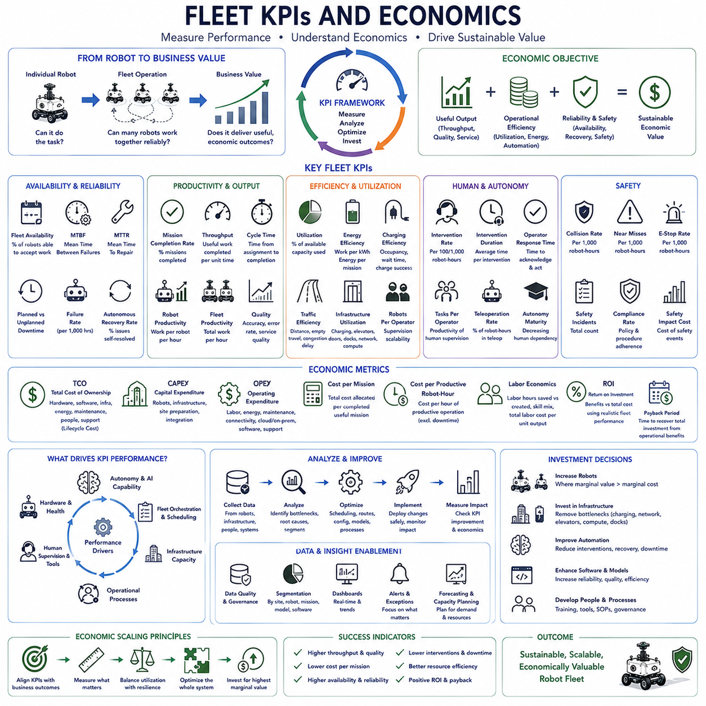{width="7.268055555555556in" height="7.268055555555556in"}

Fleet KPIs and economics provide the quantitative framework for determining whether a robot fleet creates sustainable operational value rather than merely demonstrating technical capability. A successful prototype may prove that a robot can perform a task, but fleet deployment must show that many robots can perform useful work reliably, safely, and economically. Measurement therefore shifts from individual robot performance toward system-level productivity, availability, service quality, and total cost.

Fleet economics begins with understanding productive output. Robot count alone is not a meaningful measure of value because two fleets of equal size may complete very different amounts of useful work. Completed missions, transported units, inspected assets, serviced locations, productive operating hours, or equivalent domain-specific outputs should be measured against the resources required to produce them. Economic analysis connects physical activity to measurable operational outcomes.

Mission completion rate is one of the most fundamental fleet KPIs. It measures how often assigned missions are completed successfully without cancellation, unrecoverable failure, or excessive human assistance. A high completion rate indicates that autonomy, infrastructure, scheduling, and fleet coordination operate effectively together. Repeated mission failures may reveal weaknesses that individual robot component metrics cannot expose.

Fleet availability measures how much of the deployed population is actually capable of accepting useful work. A robot may be physically present but unavailable because of charging, maintenance, software updates, sensor faults, network problems, or operational restrictions. Availability should therefore distinguish planned downtime from unexpected downtime and identify whether lost capacity originates from robots, infrastructure, software, or operational processes.

Utilization measures how available robot capacity is being used, but maximum utilization should not automatically be treated as the goal. Excessively high utilization can produce congestion, charging conflicts, maintenance delays, and insufficient reserve capacity for demand peaks or failures. Healthy fleet economics balances productive utilization with strategic idle capacity so that throughput remains stable under changing operational conditions.

Throughput measures useful work completed over time and often represents the clearest connection between fleet operation and business value. Depending on the application, throughput may represent deliveries per hour, pallets moved, inspection points completed, kilometers serviced, or tasks executed. Throughput should be evaluated at robot, zone, site, and fleet levels because local improvements do not always increase total system output.

Cycle time measures how long a task requires from assignment to completion. It can include dispatch delay, travel time, waiting for shared resources, task execution, traffic congestion, and recovery from exceptions. Breaking cycle time into components helps identify whether performance is constrained by robot speed, scheduling, infrastructure, resource contention, or workflow design rather than simply blaming autonomous navigation.

Robot productivity should be distinguished from fleet productivity. A robot may individually complete tasks efficiently while the overall fleet experiences congestion or poor resource allocation. Conversely, individual robots may occasionally remain idle because the fleet scheduler is intentionally preserving system flow. Fleet-level optimization therefore evaluates total useful output rather than attempting to maximize the activity of every individual machine.

Human intervention rate is a critical indicator of autonomy economics. A system that requires frequent teleoperation, manual recovery, task correction, or operator approval may appear autonomous while carrying substantial hidden labor cost. Interventions per hundred or thousand robot-hours, average intervention duration, and operator response time help determine whether human workload grows slowly enough for the fleet to scale economically.

Robots per operator provides a simple but useful measure of supervision scalability. The ratio should be interpreted together with intervention frequency and operational complexity because assigning more robots to one person does not create value if unresolved incidents accumulate. Effective automation increases the number of robots that can be supervised while maintaining acceptable response time, safety, mission completion, and operator workload.

Mean time between failures(MTBF) and mean time to repair(MTTR) connect technical reliability to operational capacity. Higher MTBF reduces disruption, while lower MTTR returns unavailable robots to service more quickly. These metrics should include not only mechanical failures but also recurring software, sensor, network, localization, and AI-related faults when they remove a robot from productive operation.

Recovery rate measures how often the system resolves abnormal conditions without external assistance. Automatic replanning, task reassignment, localization recovery, communication recovery, graceful degradation, and safe restart can prevent minor problems from becoming costly service interruptions. A high autonomous recovery rate reduces labor demand and downtime, making resilience an economic capability rather than only a technical safety feature.

Energy efficiency affects both direct operating cost and fleet capacity. Useful work per kilowatt-hour, energy consumed per mission, charging frequency, charging occupancy, and battery degradation can reveal whether energy management is limiting productivity. Poor charging strategy may require additional robots simply to compensate for unavailable charging time, increasing capital expenditure without proportionally increasing useful output.

Infrastructure utilization should be measured alongside robot utilization. Charging stations, elevators, doors, docks, work cells, communication networks, compute servers, and maintenance facilities may determine the maximum practical fleet throughput. When these resources approach saturation, adding robots can increase waiting and congestion instead of output. Infrastructure KPIs reveal when investment should shift from additional robots toward supporting capacity.

Traffic efficiency is another fleet-level economic factor. Distance traveled, empty travel, waiting time, congestion delay, route conflicts, and unnecessary replanning consume energy and robot capacity without producing direct value. Better traffic orchestration can increase effective fleet capacity without purchasing additional robots. Reducing nonproductive motion is therefore both a technical optimization and a direct economic improvement.

Quality KPIs are necessary because throughput alone can reward undesirable behavior. Fast task completion has limited value if deliveries are incorrect, inspections miss defects, manipulation damages objects, or robots frequently violate operational constraints. Economic evaluation should combine quantity with accuracy, service quality, safety, and customer requirements so that productivity reflects acceptable completed work rather than raw activity.

Safety performance also has economic consequences. Collisions, near misses, emergency stops, unsafe interventions, damaged equipment, and operational shutdowns can generate direct cost and reduce trust in deployment. Safety KPIs should therefore be treated as constraints on economic optimization rather than independent reporting metrics. A fleet that increases throughput by increasing operational risk does not represent sustainable productivity.

Total cost of ownership(TCO) provides a broader economic measure than robot purchase price. TCO can include robot hardware, sensors, compute, integration, site preparation, networking, charging infrastructure, software, cloud or on-premise computing, maintenance, replacement parts, energy, operators, teleoperation, cybersecurity, updates, and support. Lifecycle cost is more meaningful than acquisition cost when comparing deployment strategies.

Capital expenditure(CAPEX) and operating expenditure(OPEX) should be separated because they respond differently to scale. Robots, charging infrastructure, site modifications, and initial integration may dominate CAPEX, while labor, energy, maintenance, connectivity, compute, software services, and support contribute to OPEX. Understanding this structure helps determine whether scaling produces economies of scale or merely multiplies recurring costs.

Cost per mission translates fleet economics into a directly comparable operational metric. It can be estimated by allocating depreciation, maintenance, energy, infrastructure, software, compute, and human labor across completed useful tasks. As fleet maturity improves, cost per mission should decline through better utilization, higher reliability, fewer interventions, improved scheduling, and shared infrastructure efficiency.

Cost per productive robot-hour provides another useful perspective when missions differ significantly in duration or complexity. Productive hours exclude time lost to failures, unnecessary waiting, maintenance, and other non-value-producing states. Comparing productive-hour cost across sites or robot generations can reveal whether newer hardware, improved autonomy, or infrastructure investments actually deliver measurable operational efficiency.

Labor economics should account for both displaced and newly required work. Automation may reduce repetitive manual transportation or inspection labor while creating requirements for fleet supervision, maintenance, remote assistance, AI operations, and infrastructure support. The relevant economic question is therefore not simply how many workers are removed, but how total labor hours and skill requirements change per unit of useful output.

Return on investment(ROI) compares the economic benefit created by deployment with the capital and operating resources required to achieve it. Benefits may include labor savings, increased throughput, extended operating hours, improved quality, reduced downtime, safer operations, or services that were previously impractical. ROI should use realistic fleet performance rather than theoretical robot capacity measured under ideal conditions.

Payback period provides a practical view of how long operational savings or additional value require to recover the initial investment. Deployment costs often extend beyond robot hardware to integration, mapping, infrastructure, software engineering, validation, and organizational change. Accurate payback analysis should therefore include the complete deployment cost and use observed or conservatively estimated productive performance.

Scaling economics should examine marginal value. The first robots may automate the easiest and most valuable workflows, while later robots enter increasingly congested or lower-value tasks. Alternatively, shared infrastructure and centralized operations may reduce average cost as fleet size increases. Measuring the incremental throughput, cost, and operational complexity associated with each expansion stage reveals where economic scaling remains favorable.

Fleet KPIs should also be segmented by site, robot type, mission class, software version, model version, and operating condition. Fleet-wide averages can hide weak populations or environments. A new model may improve overall performance while degrading one robot configuration, or one facility may generate disproportionate intervention costs. Segmentation converts KPIs from reporting statistics into diagnostic tools for engineering and operational improvement.

Economic metrics should feed directly into fleet optimization. Scheduling can consider not only mission urgency and robot availability but also energy cost, expected cycle time, degradation risk, infrastructure congestion, and intervention probability. Over time, fleet intelligence can learn which assignments produce the highest useful value under current constraints, connecting operational decision-making with business objectives.

A mature KPI framework combines technical reliability, autonomy quality, human workload, infrastructure efficiency, safety, productivity, and financial performance. No single metric is sufficient because optimizing one dimension can damage another. The goal is to understand how robot capability becomes dependable service and how dependable service becomes economic value across the complete lifecycle of the fleet.

Fleet KPIs and economics ultimately form a continuous measure-analyze-optimize-invest loop. Operational data measures real performance, analysis identifies technical and economic bottlenecks, optimization improves utilization and reliability, and investment expands the resources that create the greatest marginal value. This framework allows fleet-scale Physical AI to evolve from technically successful automation into a measurable, scalable, and economically sustainable operating system.

플릿 핵심성과지표 및 경제성(Fleet KPIs and Economics)은 로봇 플릿(Robot Fleet)이 단순히 기술적 역량(Technical Capability)을 시연하는 수준을 넘어 지속 가능한 운영 가치(Sustainable Operational Value)를 창출하는지를 판단하기 위한 정량적 프레임워크(Quantitative Framework)를 제공한다. 성공적인 프로토타입(Prototype)은 로봇이 특정 작업을 수행할 수 있음을 증명하지만, 플릿 배포(Fleet Deployment)는 다수의 로봇이 유용한 작업을 신뢰성 있고 안전하며 경제적으로 수행할 수 있음을 보여주어야 한다. 따라서 측정의 중심은 개별 로봇 성능에서 시스템 수준 생산성(System-Level Productivity), 가용성(Availability), 서비스 품질(Service Quality), 총비용(Total Cost)으로 이동한다.

플릿 경제성(Fleet Economics)은 생산적 산출물(Productive Output)을 이해하는 것에서 시작한다. 로봇 수 자체는 의미 있는 가치 지표가 아니며, 동일한 규모의 두 플릿도 실제로 완료하는 유용한 작업량은 크게 다를 수 있다. 완료된 임무(Completed Mission), 운송된 물품, 검사된 자산, 서비스된 위치, 생산적 운영시간(Productive Operating Hours) 또는 이에 상응하는 도메인별 산출물을 이를 생산하는 데 필요한 자원과 비교해야 한다. 경제성 분석은 물리적 활동을 측정 가능한 운영 결과(Operational Outcome)와 연결한다.

임무 완료율(Mission Completion Rate)은 가장 기본적인 플릿 핵심성과지표(KPI) 중 하나이다. 이는 할당된 임무가 취소, 복구 불가능한 장애(Unrecoverable Failure), 과도한 인간 지원 없이 얼마나 자주 성공적으로 완료되는지를 측정한다. 높은 완료율은 자율성, 인프라, 스케줄링(Scheduling), 플릿 조정(Fleet Coordination)이 효과적으로 함께 작동하고 있음을 의미한다. 반복적인 임무 실패는 개별 로봇 구성요소 지표만으로는 발견하기 어려운 시스템의 약점을 드러낼 수 있다.

플릿 가용성(Fleet Availability)은 배치된 로봇 중 실제로 유용한 작업을 수락할 수 있는 비율을 측정한다. 로봇이 물리적으로 존재하더라도 충전, 유지보수(Maintenance), 소프트웨어 업데이트, 센서 장애, 네트워크 문제 또는 운영 제한으로 인해 작업에 투입할 수 없을 수 있다. 따라서 가용성은 계획된 다운타임(Planned Downtime)과 예상하지 못한 다운타임(Unexpected Downtime)을 구분하고 손실된 용량이 로봇, 인프라, 소프트웨어 또는 운영 프로세스 중 어디에서 발생했는지를 식별해야 한다.

활용률(Utilization)은 사용 가능한 로봇 용량이 얼마나 활용되고 있는지를 측정하지만 최대 활용률(Maximum Utilization)을 자동적으로 목표로 간주해서는 안 된다. 지나치게 높은 활용률은 혼잡(Congestion), 충전 충돌(Charging Conflict), 유지보수 지연, 수요 급증이나 장애에 대응하기 위한 예비 용량(Reserve Capacity) 부족을 초래할 수 있다. 건전한 플릿 경제성은 생산적 활용과 전략적 유휴 용량(Strategic Idle Capacity)의 균형을 유지하여 운영 조건이 변화하더라도 처리량(Throughput)이 안정적으로 유지되도록 한다.

처리량(Throughput)은 일정 시간 동안 완료된 유용한 작업량을 측정하며 플릿 운영과 비즈니스 가치(Business Value)를 가장 직접적으로 연결하는 지표 중 하나이다. 적용 분야에 따라 시간당 배송 수, 이동된 팔레트(Pallet), 완료된 검사 지점, 서비스된 거리 또는 수행된 작업 수로 표현할 수 있다. 로컬 성능 개선이 항상 전체 시스템의 산출량 증가로 이어지는 것은 아니므로 처리량은 로봇, 구역(Zone), 사이트(Site), 전체 플릿 수준에서 평가해야 한다.

사이클 시간(Cycle Time)은 작업이 할당된 시점부터 완료될 때까지 필요한 시간을 측정한다. 여기에는 디스패치 지연(Dispatch Delay), 이동시간, 공유 자원 대기, 작업 실행, 교통 혼잡, 예외 상황 복구가 포함될 수 있다. 사이클 시간을 구성요소별로 분해하면 단순히 자율주행 성능을 원인으로 판단하는 대신 로봇 속도, 스케줄링, 인프라, 자원 경합(Resource Contention), 워크플로 설계(Workflow Design) 중 어디에서 성능 제약이 발생하는지를 파악할 수 있다.

로봇 생산성(Robot Productivity)은 플릿 생산성(Fleet Productivity)과 구분해야 한다. 개별 로봇이 효율적으로 작업을 완료하더라도 전체 플릿에서는 혼잡이나 잘못된 자원 할당으로 생산성이 저하될 수 있다. 반대로 플릿 스케줄러가 전체 시스템의 흐름을 유지하기 위해 의도적으로 일부 로봇을 유휴 상태로 둘 수도 있다. 따라서 플릿 수준 최적화(Fleet-Level Optimization)는 모든 개별 로봇의 활동을 최대화하는 대신 전체 유용한 산출물(Total Useful Output)을 평가해야 한다.

인간 개입률(Human Intervention Rate)은 자율성 경제성(Autonomy Economics)을 평가하는 핵심 지표이다. 빈번한 원격조작(Teleoperation), 수동 복구(Manual Recovery), 작업 수정 또는 운영자 승인이 필요한 시스템은 외형적으로는 자율적으로 보이더라도 상당한 숨은 인건비(Hidden Labor Cost)를 발생시킬 수 있다. 로봇 100시간 또는 1,000시간당 개입 횟수, 평균 개입시간(Average Intervention Duration), 운영자 응답시간(Operator Response Time)을 측정하면 인간의 작업 부하가 플릿의 경제적 확장이 가능한 수준으로 증가하는지를 판단할 수 있다.

운영자당 로봇 수(Robots per Operator)는 감독 확장성(Supervision Scalability)을 보여주는 단순하지만 유용한 지표이다. 그러나 해결되지 않은 사고가 누적된다면 한 사람에게 더 많은 로봇을 할당하는 것만으로 가치를 창출할 수 없으므로 이 비율은 개입 빈도와 운영 복잡성(Operational Complexity)을 함께 고려해야 한다. 효과적인 자동화는 허용 가능한 응답시간, 안전, 임무 완료율, 운영자 작업 부하를 유지하면서 한 명의 운영자가 감독할 수 있는 로봇 수를 증가시킨다.

평균 고장 간격(Mean Time Between Failures, MTBF)과 평균 수리 시간(Mean Time to Repair, MTTR)은 기술적 신뢰성(Technical Reliability)을 운영 용량(Operational Capacity)과 연결한다. 높은 MTBF는 운영 중단을 감소시키고 낮은 MTTR은 사용할 수 없는 로봇을 더 빠르게 서비스에 복귀시킨다. 이러한 지표에는 로봇을 생산적 운영에서 제외시키는 기계적 장애뿐만 아니라 반복적인 소프트웨어, 센서, 네트워크, 위치추정(Localization), AI 관련 장애도 포함해야 한다.

복구율(Recovery Rate)은 시스템이 외부 지원 없이 비정상적인 조건을 해결하는 빈도를 측정한다. 자동 재계획(Automatic Replanning), 작업 재할당(Task Reassignment), 위치추정 복구(Localization Recovery), 통신 복구, 점진적 성능 저하(Graceful Degradation), 안전 재시작(Safe Restart)은 작은 문제가 비용이 큰 서비스 중단으로 확대되는 것을 방지할 수 있다. 높은 자율 복구율(Autonomous Recovery Rate)은 노동 수요와 다운타임을 줄여 회복탄력성(Resilience)을 단순한 기술적 안전 기능이 아니라 경제적 역량으로 만든다.

에너지 효율(Energy Efficiency)은 직접적인 운영비용뿐만 아니라 플릿 용량에도 영향을 미친다. 킬로와트시당 유용한 작업(Useful Work per Kilowatt-Hour), 임무당 에너지 소비량, 충전 빈도(Charging Frequency), 충전 설비 점유율(Charging Occupancy), 배터리 열화(Battery Degradation)를 통해 에너지 관리가 생산성을 제한하는지 파악할 수 있다. 비효율적인 충전 전략은 충전으로 인한 비가동 시간을 보상하기 위해 추가 로봇을 필요로 하며, 유용한 산출량에 비례하지 않는 자본 지출 증가를 초래할 수 있다.

인프라 활용률(Infrastructure Utilization)은 로봇 활용률과 함께 측정해야 한다. 충전소, 엘리베이터, 출입문, 도킹 스테이션(Dock), 작업 셀(Work Cell), 통신 네트워크, 컴퓨팅 서버, 유지보수 시설이 플릿의 최대 실질 처리량을 결정할 수 있다. 이러한 자원이 포화 상태에 가까워지면 로봇을 추가하더라도 산출량보다 대기시간과 혼잡이 증가할 수 있다. 인프라 KPI는 투자를 추가 로봇이 아니라 지원 용량(Supporting Capacity) 확대에 집중해야 하는 시점을 보여준다.

교통 효율(Traffic Efficiency) 역시 플릿 수준의 경제적 요소이다. 이동 거리, 빈 이동(Empty Travel), 대기시간, 혼잡 지연(Congestion Delay), 경로 충돌(Route Conflict), 불필요한 재계획은 직접적인 가치를 생산하지 않으면서 에너지와 로봇 용량을 소비한다. 향상된 교통 오케스트레이션(Traffic Orchestration)은 추가 로봇을 구매하지 않고도 실질적인 플릿 용량을 증가시킬 수 있다. 따라서 비생산적 이동(Nonproductive Motion)의 감소는 기술적 최적화인 동시에 직접적인 경제성 개선이다.

처리량만으로는 바람직하지 않은 행동을 보상할 수 있으므로 품질 핵심성과지표(Quality KPI)가 필요하다. 배송이 잘못되거나, 검사에서 결함을 놓치거나, 조작 과정에서 물체가 손상되거나, 로봇이 운영 제약을 자주 위반한다면 빠른 작업 완료의 가치는 제한적이다. 경제성 평가는 생산량뿐만 아니라 정확도(Accuracy), 서비스 품질, 안전, 고객 요구사항(Customer Requirement)을 함께 고려하여 단순 활동량이 아니라 허용 가능한 수준으로 완료된 작업을 생산성으로 평가해야 한다.

안전 성능(Safety Performance) 역시 경제적 결과를 가진다. 충돌(Collision), 아차 사고(Near Miss), 비상 정지(Emergency Stop), 안전하지 않은 개입, 장비 손상, 운영 중단은 직접적인 비용을 발생시키고 배포에 대한 신뢰를 감소시킬 수 있다. 따라서 안전 KPI는 경제적 최적화와 별개의 보고 지표가 아니라 경제적 최적화의 제약조건(Constraint)으로 취급해야 한다. 운영 위험을 증가시켜 처리량을 높이는 플릿은 지속 가능한 생산성을 제공한다고 볼 수 없다.

총소유비용(Total Cost of Ownership, TCO)은 로봇 구매가격보다 광범위한 경제성 지표를 제공한다. TCO에는 로봇 하드웨어, 센서, 컴퓨팅, 통합(Integration), 사이트 준비(Site Preparation), 네트워크, 충전 인프라, 소프트웨어, 클라우드 또는 온프레미스 컴퓨팅(On-Premise Computing), 유지보수, 교체 부품, 에너지, 운영자, 원격조작, 사이버보안(Cybersecurity), 업데이트, 지원 비용이 포함될 수 있다. 배포 전략을 비교할 때에는 초기 구매비용보다 전체 수명주기 비용(Lifecycle Cost)이 더욱 의미가 있다.

자본적 지출(Capital Expenditure, CAPEX)과 운영비용(Operating Expenditure, OPEX)은 규모 증가에 서로 다르게 반응하므로 구분해야 한다. 로봇, 충전 인프라, 사이트 변경, 초기 통합은 CAPEX의 주요 부분이 될 수 있으며, 인건비, 에너지, 유지보수, 연결성(Connectivity), 컴퓨팅, 소프트웨어 서비스, 지원은 OPEX에 기여한다. 이러한 비용 구조를 이해하면 플릿 확장이 규모의 경제(Economies of Scale)를 창출하는지 아니면 단순히 반복 비용을 증가시키는지를 판단할 수 있다.

임무당 비용(Cost per Mission)은 플릿 경제성을 직접 비교할 수 있는 운영 지표로 변환한다. 감가상각(Depreciation), 유지보수, 에너지, 인프라, 소프트웨어, 컴퓨팅, 인간 노동 비용을 완료된 유용한 작업에 배분하여 산정할 수 있다. 플릿의 성숙도가 높아질수록 활용률 향상, 신뢰성 증가, 인간 개입 감소, 스케줄링 개선, 공유 인프라 효율 향상을 통해 임무당 비용이 감소해야 한다.

생산적 로봇 시간당 비용(Cost per Productive Robot-Hour)은 임무별 지속시간이나 복잡성이 크게 다른 경우 유용한 또 다른 관점을 제공한다. 생산적 시간(Productive Hours)은 장애, 불필요한 대기, 유지보수 및 기타 가치 비생산 상태(Non-Value-Producing State)로 손실된 시간을 제외한다. 사이트 또는 로봇 세대별 생산시간 비용을 비교하면 새로운 하드웨어, 향상된 자율성 또는 인프라 투자가 실제로 측정 가능한 운영 효율성을 제공하는지를 판단할 수 있다.

노동 경제성(Labor Economics)은 대체되는 업무와 새롭게 요구되는 업무를 모두 고려해야 한다. 자동화는 반복적인 수동 운송이나 검사 노동을 감소시킬 수 있지만 플릿 감독(Fleet Supervision), 유지보수, 원격 지원(Remote Assistance), AI 운영(AI Operations), 인프라 지원을 위한 새로운 인력을 필요로 할 수 있다. 따라서 중요한 경제적 질문은 단순히 몇 명의 작업자가 줄어드는가가 아니라 유용한 산출물 단위당 전체 노동시간(Total Labor Hours)과 요구되는 기술 수준(Skill Requirement)이 어떻게 변화하는가이다.

투자수익률(Return on Investment, ROI)은 배포를 통해 창출된 경제적 이익을 이를 달성하는 데 필요한 자본 및 운영 자원과 비교한다. 경제적 이익에는 인건비 절감(Labor Savings), 처리량 증가, 운영시간 확대, 품질 향상, 다운타임 감소, 안전성 향상 또는 기존에는 실현하기 어려웠던 새로운 서비스가 포함될 수 있다. ROI는 이상적인 조건에서 측정된 이론적인 로봇 용량이 아니라 실제 플릿 성능(Realistic Fleet Performance)을 기반으로 산정해야 한다.

투자 회수기간(Payback Period)은 운영비 절감이나 추가적인 가치 창출을 통해 초기 투자를 회수하는 데 필요한 시간을 보여준다. 배포 비용은 로봇 하드웨어뿐만 아니라 통합, 매핑(Mapping), 인프라, 소프트웨어 엔지니어링, 검증(Validation), 조직 변화(Organizational Change)까지 포함되는 경우가 많다. 따라서 정확한 투자 회수 분석은 전체 배포 비용을 포함하고 실제 관측된 성능이나 보수적으로 추정된 생산 성능을 사용해야 한다.

확장 경제성(Scaling Economics)은 한계 가치(Marginal Value)를 분석해야 한다. 초기 로봇들은 가장 쉽고 가치가 높은 워크플로를 자동화할 수 있지만 이후 추가되는 로봇들은 더 혼잡하거나 가치가 낮은 작업에 투입될 수 있다. 반대로 공유 인프라와 중앙화된 운영(Centralized Operations)을 통해 플릿 규모가 증가하면서 평균비용이 감소할 수도 있다. 각 확장 단계에서 추가되는 처리량, 비용, 운영 복잡성을 측정하면 경제적으로 유리한 확장이 어디까지 가능한지를 판단할 수 있다.

플릿 KPI는 사이트, 로봇 유형(Robot Type), 임무 클래스(Mission Class), 소프트웨어 버전, 모델 버전, 운영 조건별로 세분화(Segmentation)되어야 한다. 플릿 전체 평균은 성능이 낮은 특정 집단이나 환경을 숨길 수 있다. 새로운 모델이 전체 성능을 향상시키면서 특정 로봇 구성에서는 성능을 악화시킬 수도 있고, 하나의 시설에서 지나치게 많은 개입 비용이 발생할 수도 있다. 세분화를 통해 KPI를 단순한 보고 통계에서 엔지니어링 및 운영 개선을 위한 진단 도구(Diagnostic Tool)로 전환할 수 있다.

경제성 지표(Economic Metric)는 플릿 최적화(Fleet Optimization)에 직접 반영되어야 한다. 스케줄링은 임무 긴급도와 로봇 가용성뿐만 아니라 에너지 비용(Energy Cost), 예상 사이클 시간(Expected Cycle Time), 성능 저하 위험(Degradation Risk), 인프라 혼잡, 인간 개입 확률(Intervention Probability)을 함께 고려할 수 있다. 시간이 지나면서 플릿 지능(Fleet Intelligence)은 현재의 제약조건에서 어떤 작업 할당이 가장 높은 유용한 가치를 창출하는지 학습하여 운영 의사결정과 비즈니스 목표를 연결할 수 있다.

성숙한 KPI 프레임워크(Mature KPI Framework)는 기술적 신뢰성, 자율성 품질(Autonomy Quality), 인간 작업 부하, 인프라 효율, 안전, 생산성, 재무 성과(Financial Performance)를 결합한다. 하나의 지표만으로는 충분하지 않으며 특정 차원의 최적화가 다른 차원의 성능을 악화시킬 수 있다. 핵심 목표는 로봇 역량이 어떻게 신뢰할 수 있는 서비스(Dependable Service)로 전환되고, 다시 그 서비스가 플릿 전체 수명주기에 걸쳐 어떻게 경제적 가치(Economic Value)로 전환되는지를 이해하는 것이다.

궁극적으로 플릿 핵심성과지표 및 경제성(Fleet KPIs and Economics)은 지속적인 측정-분석-최적화-투자 루프(Measure-Analyze-Optimize-Invest Loop)를 형성한다. 운영 데이터(Operational Data)를 통해 실제 성능을 측정하고, 분석을 통해 기술적·경제적 병목을 식별하며, 최적화를 통해 활용률과 신뢰성을 향상시키고, 투자를 통해 가장 높은 한계 가치를 창출하는 자원을 확장한다. 이러한 프레임워크를 통해 플릿 규모 피지컬 AI(Fleet-Scale Physical AI)는 기술적으로 성공한 자동화에서 측정 가능하고 확장 가능하며 경제적으로 지속 가능한 운영 시스템(Economically Sustainable Operating System)으로 발전할 수 있다.

## 09.16. Fleet Scale Architecture Example [w/Code]

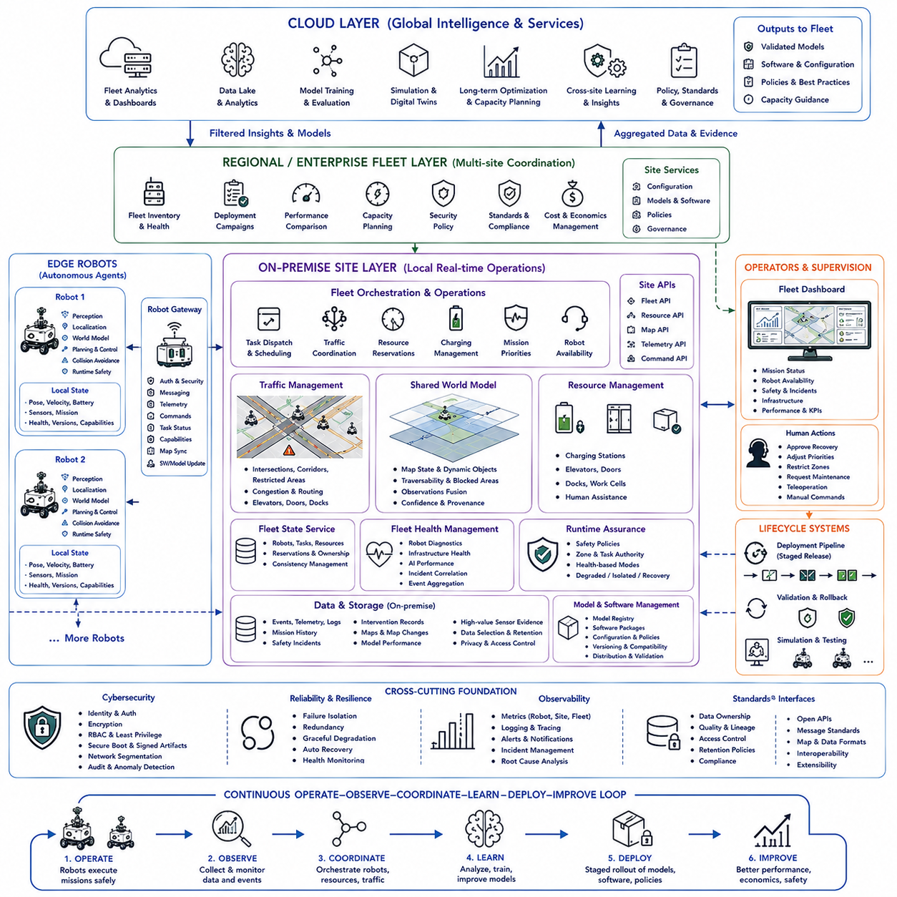{width="7.268055555555556in" height="7.268055555555556in"}

A fleet-scale architecture example should demonstrate how individual autonomous robots, site infrastructure, on-premise intelligence, cloud services, operators, and lifecycle systems work together as one operational platform. The architecture is not merely a communication network connecting many robots. It establishes clear boundaries for autonomy, coordination, data ownership, safety, learning, deployment, supervision, and business operations across the entire fleet.

At the lowest layer, each robot remains an independently safe physical agent. Local compute executes perception, localization, world modeling, motion planning, control, collision avoidance, and runtime safety functions. The robot should retain enough autonomy to continue safe operation or reach a controlled stop when higher-level services become unavailable. Immediate physical decisions therefore remain at the edge rather than depending on remote infrastructure.

Each robot maintains a local operational state containing pose, velocity, battery condition, sensor health, active mission, local environment information, software versions, model versions, and current capabilities. This state is continuously evaluated by onboard health management. Only information required by fleet coordination, monitoring, learning, or diagnostics needs to leave the robot, reducing communication overhead while preserving operational visibility.

A robot gateway provides the controlled interface between onboard autonomy and fleet infrastructure. It handles authentication, secure messaging, telemetry publication, command reception, task status, capability advertisement, map synchronization, and software or model distribution. The gateway prevents internal robot components from being directly exposed to the broader network and provides a stable fleet interface across heterogeneous robot hardware.

Within a facility, an on-premise fleet orchestration layer coordinates multiple robots as a local operational system. It manages task dispatching, scheduling, traffic coordination, resource reservations, charging, mission priorities, and robot availability. Because these decisions directly affect site operations and may require low latency, they should remain available even when external cloud connectivity is degraded or completely unavailable.

Site traffic management maintains shared awareness of corridors, intersections, restricted areas, congestion, elevators, doors, docks, and other spatial resources. Robots continue performing local collision avoidance, while the fleet layer coordinates interactions that cannot be efficiently resolved from an individual robot perspective. This separation allows local safety and fleet efficiency to coexist without requiring centralized control of every motion command.

A shared site world model provides operational knowledge beyond the sensing range of individual robots. It may contain map state, dynamic obstacles, blocked regions, traversability, resource availability, temporary restrictions, and relevant observations contributed by multiple robots. Information is fused according to timestamp, confidence, provenance, and spatial relevance rather than assuming that every observation from every robot is equally reliable.

Resource management represents physical infrastructure as schedulable fleet resources. Charging stations, elevators, doors, work cells, loading zones, inspection stations, and human assistance can be reserved and coordinated similarly to robot tasks. This prevents multiple robots from independently competing for the same constrained resource and enables scheduling decisions to account for infrastructure capacity as part of mission planning.

The fleet state service maintains the operational status of robots, tasks, resources, and relevant site conditions. State ownership and consistency requirements should depend on the information type. Exclusive reservations may require strongly coordinated updates, while telemetry and historical observations can tolerate asynchronous synchronization. This prevents unnecessary global locking while preserving correctness where conflicting actions would create operational risk.

Fleet health management aggregates robot diagnostics, infrastructure status, communication quality, AI performance, task failures, and resource conditions. Instead of exposing operators to thousands of independent signals, the system correlates related events into operational incidents. A common network failure, for example, should appear as a probable infrastructure problem rather than dozens of unrelated robot communication alarms.

Runtime assurance operates across both robot and fleet levels. Local safety supervisors enforce immediate motion constraints, while fleet-level policies restrict operating zones, task eligibility, resource access, degraded modes, and mission authority. When confidence or health deteriorates, robots can transition from normal operation to restricted, degraded, isolated, recovery, or unavailable states without requiring the entire fleet to stop.

Failure isolation prevents local faults from propagating through shared infrastructure. A robot publishing inconsistent localization, corrupted map updates, abnormal commands, or unreliable sensor information can have its authority reduced or its data quarantined. Fleet orchestration can then reassign tasks and preserve useful operations elsewhere. Site and service boundaries further limit the number of robots exposed to correlated failures.

Human supervision sits above routine autonomous execution rather than inside every control loop. Operators receive fleet-level dashboards showing mission status, robot availability, safety events, degraded capabilities, infrastructure conditions, intervention queues, and performance trends. Exception-driven supervision directs human attention toward situations that automation cannot confidently resolve instead of requiring continuous observation of every robot.

When intervention is necessary, operators can approve recovery actions, modify mission priorities, restrict operating zones, request maintenance, or initiate controlled teleoperation. Authority transfer between autonomy and humans must remain explicit. Even manually issued commands should continue to pass through appropriate safety constraints so that human intervention does not bypass collision limits, restricted zones, or emergency protection mechanisms.

The on-premise data layer records operational events, selected telemetry, task histories, safety incidents, intervention records, map changes, model performance, and high-value sensor evidence. Data selection policies determine what remains local, what is retained temporarily, and what is transferred to higher-level learning systems. Raw continuous sensor streams do not need to be uploaded when summarized or event-triggered evidence provides sufficient value.

Model and software management provides another major architectural service. Approved software packages, AI models, configurations, maps, and policies are maintained in controlled registries with version information, compatibility metadata, signatures, and deployment status. Robots receive only artifacts appropriate for their hardware, sensor configuration, operational role, and site environment, preventing uncontrolled configuration divergence across the fleet.

Deployment follows staged release rather than immediate fleet-wide replacement. New software or models can first reach simulation environments, test robots, canary groups, selected sites, and finally the broader fleet. Health, safety, mission completion, intervention frequency, and AI performance are monitored at every stage. Automatic rollback can restore a validated version when predefined deployment criteria are violated.

Above individual sites, a regional or enterprise fleet layer aggregates information from multiple facilities. It does not need to control every robot trajectory. Instead, it manages cross-site fleet inventory, configuration standards, deployment campaigns, capacity planning, performance comparison, security policy, and operational governance. Site autonomy remains intact while enterprise management maintains consistency across the broader organization.

Cloud-scale intelligence can support computationally intensive and delay-tolerant functions such as large-scale analytics, fleet-wide dataset construction, model training, simulation, digital twins, long-term optimization, and cross-site learning. These services improve the fleet over time but should not become mandatory dependencies for immediate robot safety or basic site operation. The architecture therefore separates learning-time scale from control-time scale.

Collective learning closes the loop between fleet operation and AI improvement. Difficult cases, failures, human interventions, rare environmental conditions, and model uncertainty can be selected from operational data and converted into curated learning datasets. New models are trained and evaluated against historical and simulated scenarios before entering the controlled deployment pipeline, allowing experience from many robots to improve future behavior.

Cybersecurity spans every architectural layer rather than existing as a separate external service. Robot identity, mutual authentication, encrypted communication, role-based authorization, secure boot, signed artifacts, credential rotation, network segmentation, audit logging, and anomaly detection establish trust among robots, operators, on-premise services, and cloud infrastructure. Trust can be reduced dynamically when device or behavioral evidence becomes suspicious.

Multi-site architecture should preserve standard interfaces while allowing local variation. Each site may have different maps, robot types, traffic rules, infrastructure, workflows, safety policies, and connectivity. Common identity, messaging, observability, model management, deployment, and governance mechanisms reduce engineering duplication, while site-specific configuration allows the platform to adapt without creating entirely separate fleet systems.

Scalability is achieved by partitioning responsibility rather than forcing every component to understand the entire fleet. Robots understand their immediate environment and mission, site services understand local robots and infrastructure, regional services understand groups of sites, and global services understand aggregated performance and learning. Information moves upward through filtering and aggregation and downward through policies, models, configurations, and operational objectives.

Observability follows the same hierarchy. Robot-level metrics explain component behavior, site-level metrics describe throughput and resource utilization, and enterprise metrics measure fleet availability, intervention rates, mission success, safety, deployment quality, and economics. Operators and engineers can move from aggregated anomalies toward increasingly detailed evidence without continuously processing the complete telemetry stream of every robot.

The architecture should support tens of robots without unnecessary complexity while naturally extending toward hundreds or thousands. Additional sites can introduce new orchestration partitions, replicated services, storage domains, and operator groups without redesigning the fundamental robot interface. Horizontal expansion therefore becomes an architectural property rather than a repeated system integration project.

Economic management can also be connected directly to the architecture. Mission completion, utilization, charging efficiency, human intervention, infrastructure contention, maintenance, compute consumption, and downtime are measured from operational services. These metrics allow fleet intelligence to optimize not only technical performance but also cost per mission, productive robot-hours, resource efficiency, and return on deployed capital.

The resulting system forms a hierarchy of Edge Robot Autonomy, On-Premise Fleet Intelligence, Regional or Enterprise Coordination, and Cloud-Scale Learning and Governance. Data and operational evidence move upward, while missions, policies, validated models, configurations, and improvements move downward. Human supervision and cybersecurity span the hierarchy, while safety remains enforceable close to the physical system.

A mature fleet-scale architecture therefore connects autonomy, orchestration, shared world knowledge, infrastructure management, observability, runtime assurance, human supervision, cybersecurity, data engineering, model lifecycle management, and collective learning into one operational loop. Each layer retains sufficient independence to tolerate failures while contributing information and capability to the larger system.

The complete architecture can be understood as a continuous operate-observe-coordinate-learn-deploy-improve cycle. Robots execute physical missions, site intelligence coordinates collective activity, operational evidence is aggregated, higher-level systems learn from fleet experience, validated improvements are progressively deployed, and resulting performance is measured again. This closed loop transforms a collection of autonomous robots into a scalable Physical AI fleet infrastructure.

플릿 규모 아키텍처 사례(Fleet-Scale Architecture Example)는 개별 자율 로봇(Autonomous Robot), 사이트 인프라(Site Infrastructure), 온프레미스 지능(On-Premise Intelligence), 클라우드 서비스(Cloud Service), 운영자(Operator), 수명주기 시스템(Lifecycle System)이 하나의 운영 플랫폼(Operational Platform)으로 어떻게 함께 작동하는지를 보여주어야 한다. 이 아키텍처는 단순히 많은 로봇을 연결하는 통신 네트워크가 아니다. 전체 플릿에 걸쳐 자율성, 조정, 데이터 소유권(Data Ownership), 안전, 학습, 배포, 감독, 비즈니스 운영의 명확한 경계를 설정한다.

가장 하위 계층에서 각 로봇은 독립적으로 안전한 물리적 에이전트(Physical Agent)로 유지된다. 로컬 컴퓨팅(Local Compute)은 인지(Perception), 위치추정(Localization), 월드 모델링(World Modeling), 모션 계획(Motion Planning), 제어(Control), 충돌 회피(Collision Avoidance), 런타임 안전(Runtime Safety) 기능을 실행한다. 상위 서비스가 사용할 수 없게 되더라도 로봇은 안전한 운영을 지속하거나 통제된 정지(Controlled Stop)에 도달할 수 있는 충분한 자율성을 유지해야 한다. 따라서 즉각적인 물리적 의사결정은 원격 인프라에 의존하지 않고 엣지(Edge)에 유지된다.

각 로봇은 자세(Pose), 속도, 배터리 상태, 센서 상태(Sensor Health), 활성 임무(Active Mission), 로컬 환경 정보, 소프트웨어 버전, 모델 버전, 현재 역량(Current Capabilities)을 포함하는 로컬 운영 상태(Local Operational State)를 유지한다. 이러한 상태는 온보드 상태 관리(Onboard Health Management)에 의해 지속적으로 평가된다. 플릿 조정, 모니터링, 학습 또는 진단에 필요한 정보만 로봇 외부로 전달함으로써 운영 가시성(Operational Visibility)을 유지하면서 통신 오버헤드(Communication Overhead)를 줄일 수 있다.

로봇 게이트웨이(Robot Gateway)는 온보드 자율성(Onboard Autonomy)과 플릿 인프라 사이의 통제된 인터페이스를 제공한다. 인증(Authentication), 보안 메시징(Secure Messaging), 텔레메트리 발행(Telemetry Publication), 명령 수신, 작업 상태, 역량 광고(Capability Advertisement), 지도 동기화(Map Synchronization), 소프트웨어 또는 모델 배포를 처리한다. 게이트웨이는 로봇 내부 구성요소가 광범위한 네트워크에 직접 노출되는 것을 방지하고 이기종 로봇 하드웨어(Heterogeneous Robot Hardware)에 대해 안정적인 플릿 인터페이스를 제공한다.

시설 내부에서는 온프레미스 플릿 오케스트레이션 계층(On-Premise Fleet Orchestration Layer)이 여러 로봇을 하나의 로컬 운영 시스템으로 조정한다. 작업 디스패칭(Task Dispatching), 스케줄링(Scheduling), 교통 조정(Traffic Coordination), 자원 예약(Resource Reservation), 충전, 임무 우선순위(Mission Priority), 로봇 가용성(Robot Availability)을 관리한다. 이러한 의사결정은 사이트 운영에 직접적인 영향을 주고 낮은 지연시간을 요구할 수 있으므로 외부 클라우드 연결이 저하되거나 완전히 중단되어도 계속 사용할 수 있어야 한다.

사이트 교통 관리(Site Traffic Management)는 복도, 교차로, 제한 구역(Restricted Area), 혼잡, 엘리베이터, 출입문, 도킹 스테이션(Dock) 및 기타 공간 자원(Spatial Resource)에 대한 공유 인식(Shared Awareness)을 유지한다. 로봇은 로컬 충돌 회피를 계속 수행하고, 플릿 계층은 개별 로봇 관점에서 효율적으로 해결하기 어려운 상호작용을 조정한다. 이러한 분리를 통해 모든 이동 명령을 중앙집중적으로 제어하지 않고도 로컬 안전(Local Safety)과 플릿 효율(Fleet Efficiency)을 동시에 유지할 수 있다.

공유 사이트 월드 모델(Shared Site World Model)은 개별 로봇의 센싱 범위를 넘어서는 운영 지식(Operational Knowledge)을 제공한다. 여기에는 지도 상태(Map State), 동적 장애물(Dynamic Obstacle), 차단 구역(Blocked Region), 주행가능성(Traversability), 자원 가용성(Resource Availability), 임시 제한(Temporary Restriction), 여러 로봇이 제공한 관련 관측 정보가 포함될 수 있다. 모든 로봇의 관측을 동일하게 신뢰하는 대신 타임스탬프(Timestamp), 신뢰도(Confidence), 출처(Provenance), 공간적 관련성(Spatial Relevance)에 따라 정보를 융합한다.

자원 관리(Resource Management)는 물리적 인프라를 스케줄링 가능한 플릿 자원(Schedulable Fleet Resource)으로 표현한다. 충전소(Charging Station), 엘리베이터, 출입문, 작업 셀(Work Cell), 적재 구역(Loading Zone), 검사 스테이션(Inspection Station), 인간 지원(Human Assistance)을 로봇 작업과 유사한 방식으로 예약하고 조정할 수 있다. 이를 통해 여러 로봇이 동일한 제한 자원을 독립적으로 경쟁하는 것을 방지하고 임무 계획(Mission Planning)에 인프라 용량을 함께 고려할 수 있다.

플릿 상태 서비스(Fleet State Service)는 로봇, 작업, 자원 및 관련 사이트 조건의 운영 상태를 유지한다. 상태 소유권(State Ownership)과 일관성 요구사항(Consistency Requirement)은 정보 유형에 따라 달라져야 한다. 독점적인 자원 예약에는 강하게 조정된 업데이트가 필요할 수 있지만 텔레메트리와 과거 관측 정보는 비동기 동기화(Asynchronous Synchronization)를 허용할 수 있다. 이를 통해 충돌하는 행동이 운영 위험을 발생시키는 영역에서는 정확성을 유지하면서 불필요한 전역 잠금(Global Locking)을 방지할 수 있다.

플릿 상태 관리(Fleet Health Management)는 로봇 진단(Robot Diagnostics), 인프라 상태, 통신 품질, AI 성능, 작업 실패, 자원 상태를 집계한다. 시스템은 운영자에게 수천 개의 독립적인 신호를 그대로 노출하는 대신 관련 이벤트를 서로 연계하여 운영 사고(Operational Incident)로 구성한다. 예를 들어 공통 네트워크 장애(Common Network Failure)는 수십 개의 독립적인 로봇 통신 경고가 아니라 인프라 문제일 가능성이 높은 하나의 사건으로 표현되어야 한다.

런타임 보증(Runtime Assurance)은 로봇 수준과 플릿 수준 모두에서 작동한다. 로컬 안전 감독기(Local Safety Supervisor)는 즉각적인 이동 제약(Motion Constraint)을 적용하고, 플릿 수준 정책은 운영 구역, 작업 적격성(Task Eligibility), 자원 접근, 성능 저하 모드(Degraded Mode), 임무 권한(Mission Authority)을 제한한다. 신뢰도나 상태가 저하되면 전체 플릿을 정지시키지 않고 로봇을 정상(Normal), 제한(Restricted), 성능 저하(Degraded), 격리(Isolated), 복구(Recovery), 사용 불가(Unavailable) 상태로 전환할 수 있다.

장애 격리(Failure Isolation)는 로컬 장애가 공유 인프라를 통해 전파되는 것을 방지한다. 일관되지 않은 위치추정, 손상된 지도 업데이트(Corrupted Map Update), 비정상 명령, 신뢰할 수 없는 센서 정보를 발행하는 로봇은 권한을 낮추거나 해당 데이터를 격리(Quarantine)할 수 있다. 이후 플릿 오케스트레이션은 작업을 재할당하여 다른 영역의 유용한 운영을 유지할 수 있다. 사이트와 서비스 경계(Service Boundary)는 상관 장애(Correlated Failure)에 노출되는 로봇 수를 추가로 제한한다.

인간 감독(Human Supervision)은 모든 제어 루프 내부가 아니라 일상적인 자율 실행(Routine Autonomous Execution)의 상위에 위치한다. 운영자는 임무 상태, 로봇 가용성, 안전 이벤트(Safety Event), 성능이 저하된 역량, 인프라 상태, 개입 대기열(Intervention Queue), 성능 추세(Performance Trend)를 보여주는 플릿 수준 대시보드(Fleet-Level Dashboard)를 사용한다. 예외 중심 감독(Exception-Driven Supervision)은 모든 로봇을 지속적으로 관찰하는 대신 자동화가 확신을 가지고 해결할 수 없는 상황에 인간의 주의를 집중시킨다.

개입이 필요한 경우 운영자는 복구 행동(Recovery Action)을 승인하거나, 임무 우선순위를 변경하거나, 운영 구역을 제한하거나, 유지보수를 요청하거나, 통제된 원격조작(Controlled Teleoperation)을 시작할 수 있다. 자율 시스템과 인간 사이의 권한 이전(Authority Transfer)은 명시적으로 이루어져야 한다. 인간이 직접 발행한 명령도 적절한 안전 제약(Safety Constraint)을 계속 통과해야 하며, 인간 개입이 충돌 제한, 제한 구역 또는 비상 보호 메커니즘(Emergency Protection Mechanism)을 우회해서는 안 된다.

온프레미스 데이터 계층(On-Premise Data Layer)은 운영 이벤트, 선택된 텔레메트리, 작업 이력(Task History), 안전 사고, 개입 기록(Intervention Record), 지도 변경, 모델 성능, 가치가 높은 센서 증거(High-Value Sensor Evidence)를 기록한다. 데이터 선택 정책(Data Selection Policy)은 어떤 데이터를 로컬에 유지하고, 어떤 데이터를 일시적으로 보존하며, 어떤 데이터를 상위 학습 시스템으로 전달할지를 결정한다. 요약 또는 이벤트 기반 증거(Event-Triggered Evidence)가 충분한 가치를 제공한다면 연속적인 원시 센서 스트림을 모두 업로드할 필요는 없다.

모델 및 소프트웨어 관리(Model and Software Management)는 또 하나의 주요 아키텍처 서비스를 제공한다. 승인된 소프트웨어 패키지, AI 모델, 구성(Configuration), 지도, 정책을 버전 정보, 호환성 메타데이터(Compatibility Metadata), 서명(Signature), 배포 상태와 함께 통제된 레지스트리(Controlled Registry)에서 관리한다. 로봇은 자신의 하드웨어, 센서 구성, 운영 역할, 사이트 환경에 적합한 아티팩트(Artifact)만 전달받아 플릿 전체에서 통제되지 않은 구성 분화(Configuration Divergence)가 발생하는 것을 방지한다.

배포(Deployment)는 플릿 전체를 즉시 교체하는 대신 단계적 릴리스(Staged Release)를 따른다. 새로운 소프트웨어나 모델은 먼저 시뮬레이션 환경, 시험 로봇(Test Robot), 카나리 그룹(Canary Group), 선택된 사이트에 적용된 후 전체 플릿으로 확대할 수 있다. 각 단계에서 상태, 안전, 임무 완료율, 개입 빈도(Intervention Frequency), AI 성능을 모니터링한다. 사전에 정의된 배포 기준이 위반되면 자동 롤백(Automatic Rollback)을 통해 검증된 버전으로 복원할 수 있다.

개별 사이트의 상위에는 지역 또는 엔터프라이즈 플릿 계층(Regional or Enterprise Fleet Layer)이 여러 시설의 정보를 집계한다. 이 계층은 모든 로봇의 궤적을 직접 제어할 필요가 없다. 대신 사이트 간 플릿 자산(Cross-Site Fleet Inventory), 구성 표준(Configuration Standard), 배포 캠페인(Deployment Campaign), 용량 계획(Capacity Planning), 성능 비교, 보안 정책(Security Policy), 운영 거버넌스(Operational Governance)를 관리한다. 사이트 자율성(Site Autonomy)을 유지하면서 엔터프라이즈 관리는 더 넓은 조직 범위에서 일관성을 유지한다.

클라우드 규모 지능(Cloud-Scale Intelligence)은 대규모 분석(Large-Scale Analytics), 플릿 전체 데이터셋 구축, 모델 학습(Model Training), 시뮬레이션(Simulation), 디지털 트윈(Digital Twin), 장기 최적화(Long-Term Optimization), 사이트 간 학습(Cross-Site Learning)과 같이 계산량이 크고 지연을 허용할 수 있는 기능을 지원할 수 있다. 이러한 서비스는 시간이 지나면서 플릿을 향상시키지만 즉각적인 로봇 안전이나 기본적인 사이트 운영을 위한 필수 의존성(Mandatory Dependency)이 되어서는 안 된다. 따라서 아키텍처는 학습 시간 척도(Learning-Time Scale)와 제어 시간 척도(Control-Time Scale)를 분리한다.

집단 학습(Collective Learning)은 플릿 운영과 AI 개선 사이의 루프를 완성한다. 어려운 사례(Difficult Case), 장애, 인간 개입, 희귀한 환경 조건(Rare Environmental Condition), 모델 불확실성(Model Uncertainty)을 운영 데이터에서 선택하여 큐레이션된 학습 데이터셋(Curated Learning Dataset)으로 변환할 수 있다. 새로운 모델은 통제된 배포 파이프라인(Controlled Deployment Pipeline)에 진입하기 전에 과거 및 시뮬레이션 시나리오를 대상으로 학습되고 평가되며, 이를 통해 다수 로봇의 경험이 미래 행동을 개선하도록 한다.

사이버보안(Cybersecurity)은 별도의 외부 서비스로 존재하는 것이 아니라 모든 아키텍처 계층에 걸쳐 적용된다. 로봇 신원(Robot Identity), 상호 인증(Mutual Authentication), 암호화 통신(Encrypted Communication), 역할 기반 권한 부여(Role-Based Authorization), 보안 부팅(Secure Boot), 서명된 아티팩트(Signed Artifact), 자격 증명 순환(Credential Rotation), 네트워크 분할(Network Segmentation), 감사 로깅(Audit Logging), 이상 탐지(Anomaly Detection)를 통해 로봇, 운영자, 온프레미스 서비스, 클라우드 인프라 사이의 신뢰를 구축한다. 장치 또는 행동 증거가 의심스러워지면 신뢰 수준(Trust Level)을 동적으로 낮출 수 있다.

다중 사이트 아키텍처(Multi-Site Architecture)는 로컬 변형(Local Variation)을 허용하면서 표준 인터페이스(Standard Interface)를 유지해야 한다. 각 사이트는 서로 다른 지도, 로봇 유형, 교통 규칙, 인프라, 워크플로(Workflow), 안전 정책, 연결 조건을 가질 수 있다. 공통 신원(Common Identity), 메시징(Messaging), 관측 가능성(Observability), 모델 관리, 배포, 거버넌스 메커니즘을 통해 엔지니어링 중복을 줄이면서 사이트별 구성(Site-Specific Configuration)을 이용해 완전히 별도의 플릿 시스템을 만들지 않고 플랫폼을 환경에 맞게 조정할 수 있다.

확장성(Scalability)은 모든 구성요소가 전체 플릿을 이해하도록 강제하는 것이 아니라 책임을 분할(Partitioning Responsibility)함으로써 달성된다. 로봇은 자신의 즉각적인 환경과 임무를 이해하고, 사이트 서비스는 로컬 로봇과 인프라를 이해하며, 지역 서비스(Regional Service)는 여러 사이트 그룹을 이해하고, 전역 서비스(Global Service)는 집계된 성능과 학습을 이해한다. 정보는 필터링과 집계(Filter and Aggregation)를 거쳐 상위로 이동하고 정책, 모델, 구성, 운영 목표(Operational Objective)는 하위로 전달된다.

관측 가능성(Observability)도 동일한 계층 구조를 따른다. 로봇 수준 지표(Robot-Level Metric)는 구성요소의 행동을 설명하고, 사이트 수준 지표(Site-Level Metric)는 처리량과 자원 활용률을 설명하며, 엔터프라이즈 지표(Enterprise Metric)는 플릿 가용성, 개입률, 임무 성공, 안전, 배포 품질(Deployment Quality), 경제성(Economics)을 측정한다. 운영자와 엔지니어는 모든 로봇의 전체 텔레메트리를 지속적으로 처리하지 않고도 집계된 이상 현상(Aggregated Anomaly)에서 점차 세부적인 증거로 이동할 수 있다.

아키텍처는 수십 대의 로봇에서는 불필요한 복잡성을 만들지 않으면서 수백 대 또는 수천 대까지 자연스럽게 확장할 수 있어야 한다. 새로운 사이트를 추가하면서 기본적인 로봇 인터페이스를 다시 설계하지 않고 새로운 오케스트레이션 파티션(Orchestration Partition), 복제 서비스(Replicated Service), 저장 도메인(Storage Domain), 운영자 그룹(Operator Group)을 추가할 수 있어야 한다. 따라서 수평 확장(Horizontal Expansion)은 반복적인 시스템 통합 프로젝트가 아니라 아키텍처 자체의 특성이 된다.

경제성 관리(Economic Management) 역시 아키텍처에 직접 연결할 수 있다. 임무 완료, 활용률(Utilization), 충전 효율(Charging Efficiency), 인간 개입, 인프라 경합(Infrastructure Contention), 유지보수, 컴퓨팅 소비량(Compute Consumption), 다운타임(Downtime)을 운영 서비스에서 측정한다. 이러한 지표를 통해 플릿 지능(Fleet Intelligence)은 기술적 성능뿐만 아니라 임무당 비용(Cost per Mission), 생산적 로봇 시간(Productive Robot-Hours), 자원 효율(Resource Efficiency), 투입 자본 수익률(Return on Deployed Capital)을 최적화할 수 있다.

결과적으로 시스템은 엣지 로봇 자율성(Edge Robot Autonomy), 온프레미스 플릿 지능(On-Premise Fleet Intelligence), 지역 또는 엔터프라이즈 조정(Regional or Enterprise Coordination), 클라우드 규모 학습 및 거버넌스(Cloud-Scale Learning and Governance)의 계층 구조를 형성한다. 데이터와 운영 증거(Operational Evidence)는 상위로 이동하고, 임무, 정책, 검증된 모델, 구성, 개선 사항은 하위로 전달된다. 인간 감독과 사이버보안은 전체 계층에 걸쳐 적용되며 안전은 물리적 시스템과 가까운 곳에서 항상 강제될 수 있어야 한다.

성숙한 플릿 규모 아키텍처(Mature Fleet-Scale Architecture)는 자율성, 오케스트레이션, 공유 월드 지식(Shared World Knowledge), 인프라 관리, 관측 가능성, 런타임 보증, 인간 감독, 사이버보안, 데이터 엔지니어링(Data Engineering), 모델 수명주기 관리(Model Lifecycle Management), 집단 학습을 하나의 운영 루프(Operational Loop)로 연결한다. 각 계층은 장애를 견딜 수 있는 충분한 독립성을 유지하면서 더 큰 시스템에 정보와 역량을 제공한다.

전체 아키텍처는 지속적인 운영-관찰-조정-학습-배포-개선 사이클(Operate-Observe-Coordinate-Learn-Deploy-Improve Cycle)로 이해할 수 있다. 로봇은 물리적 임무를 수행하고, 사이트 지능(Site Intelligence)은 집단 활동을 조정하며, 운영 증거가 집계되고, 상위 시스템은 플릿 경험으로부터 학습하며, 검증된 개선 사항은 점진적으로 배포되고, 그 결과의 성능이 다시 측정된다. 이러한 폐쇄 루프(Closed Loop)는 자율 로봇의 집합을 확장 가능한 피지컬 AI 플릿 인프라(Scalable Physical AI Fleet Infrastructure)로 전환한다.
