**Volume 09. Multi Robot and Swarm Physical AI**

# Chapter 10. Case Studies

## 10.01. Warehouse AMR Fleet

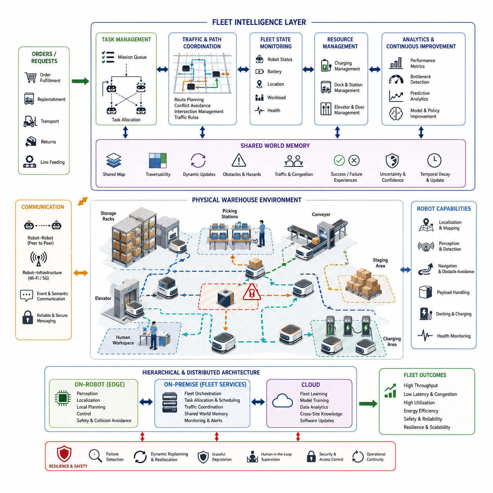{width="7.268055555555556in" height="7.268055555555556in"}

A warehouse AMR fleet is one of the clearest real-world examples of multi-robot Physical AI because many autonomous mobile robots must continuously share space, infrastructure, tasks, and operational goals. Unlike a single AMR following an isolated mission, the fleet behaves as a coordinated physical system in which individual navigation decisions influence traffic flow, task completion, congestion, safety, and overall warehouse productivity.

The operating environment typically contains storage racks, picking stations, conveyors, charging areas, elevators, doors, staging zones, and human workspaces. Each AMR maintains a local perception and localization state while the fleet maintains broader information about robot positions, active missions, traffic conditions, resource occupancy, and operational priorities. This combination of local autonomy and shared context allows the system to react rapidly without losing global coordination.

Warehouse missions may include pallet transport, tote movement, replenishment, order fulfillment, production-line feeding, empty-container return, and movement between automated equipment. A fleet task manager converts warehouse requests into executable robot missions and assigns them according to location, availability, battery state, payload capability, expected travel time, and mission priority. Allocation therefore becomes a continuous optimization process rather than a simple queue of commands.

Dynamic task allocation becomes particularly important when demand changes during operation. An AMR originally selected for a transport request may become delayed, encounter congestion, require charging, or report a fault. The fleet system can reassess the situation and transfer pending work to another robot. This capability illustrates dynamic reallocation and replanning, connecting warehouse operation directly with the task-allocation principles developed earlier in the multi-robot architecture.

Navigation at fleet scale requires more than independent shortest-path planning. If every robot selects its locally optimal route, multiple AMRs may converge on the same narrow corridor or intersection and create congestion. Fleet-aware planning therefore considers predicted robot trajectories, intersection occupancy, directional traffic policies, restricted zones, and temporal reservations. The objective shifts from minimizing one robot\'s travel distance toward improving the throughput and stability of the entire fleet.

Traffic coordination can combine centralized scheduling with decentralized collision avoidance. A fleet layer may reserve important corridors, intersections, docking points, or shared resources, while each AMR retains authority over immediate obstacle avoidance and emergency responses. This hybrid architecture prevents the fleet manager from becoming responsible for every low-level motion decision while still preserving system-wide coordination where conflicts between robots must be resolved.

Communication provides the information flow that makes this coordination possible. Robots periodically exchange localization, velocity, mission status, battery condition, health information, and relevant environmental observations with fleet infrastructure. Communication does not need to transmit every sensor measurement. Event-based and semantic communication can prioritize information that changes decisions, such as a blocked aisle, localization degradation, failed docking attempt, unexpected obstacle, or newly unavailable station.

Shared world memory extends fleet operation beyond instantaneous robot status. When one AMR discovers a blocked corridor, difficult surface, temporary construction area, or repeatedly congested location, that experience can be incorporated into shared spatial and semantic knowledge. Other robots can then modify their plans before encountering the same condition. This transforms individual experience into fleet-level operational knowledge and connects warehouse deployment with the concept of fleet world memory.

Shared traversability information can further represent how easily different regions can be crossed. Instead of describing warehouse space only as free or occupied, the fleet can associate locations with expected traversal time, congestion probability, localization confidence, floor condition, human activity, or historical failure frequency. Planning can then balance geometric distance against operational risk and predicted delay, allowing experience accumulated across many robots to improve future routing decisions.

Charging is another collective resource-management problem. Sending robots to chargers only after batteries become critically low can produce queues and reduce fleet capacity. A coordinated system predicts future energy demand from scheduled missions, robot locations, charger availability, and battery state. Charging can then be distributed across low-demand periods or assigned opportunistically, maintaining sufficient active capacity while preventing simultaneous withdrawal of too many robots from operation.

Collective learning provides a mechanism for improving the fleet over longer time scales. Experiences collected across robots can reveal recurring localization failures, inefficient routes, docking difficulties, abnormal wheel slip, unusual traffic patterns, or mission configurations associated with delays. Fleet data can be curated and used to improve perception models, planning policies, task-allocation strategies, or predictive maintenance models, creating a data flywheel in which operational experience gradually improves subsequent operation.

The resulting intelligence can be distributed across edge, on-premise, and cloud computing layers. Safety-critical perception, localization, obstacle avoidance, and immediate control remain close to each robot because they require low latency and continued operation during network degradation. On-premise systems can maintain fleet state, traffic coordination, shared memory, scheduling, and operational analytics, while cloud resources can support large-scale historical analysis, model training, and cross-site knowledge aggregation.

Reliability requires the warehouse to continue operating when individual components fail. If one AMR becomes unavailable, its unfinished missions should be isolated and reassigned without destabilizing the remaining fleet. If communication deteriorates, robots can transition to restricted local autonomy rather than immediately stopping the entire operation. Graceful degradation therefore converts failures from fleet-wide disruptions into bounded local events whenever operational and safety conditions permit.

Human supervision remains essential even in highly autonomous warehouses. Operators require visibility into mission queues, robot health, traffic bottlenecks, charging status, alarms, blocked areas, and AI confidence. Rather than manually controlling normal robot motion, humans increasingly supervise exceptions and operational policies. The interface should therefore explain why missions are delayed, why robots were reassigned, and where intervention is required, turning supervision into fleet-level decision support.

Performance should ultimately be evaluated at the system level. Important measures include completed missions per hour, average mission latency, robot utilization, empty travel, congestion time, charging efficiency, intervention frequency, failure recovery time, and availability. A locally efficient robot does not necessarily create an efficient warehouse; fleet intelligence is successful when coordinated decisions improve throughput, resilience, predictability, safety, and total operating economics.

The warehouse AMR fleet therefore demonstrates the transition from autonomous robots to collective Physical AI. Task allocation, communication, shared world memory, traffic coordination, distributed decision making, collective learning, runtime assurance, and fleet-scale orchestration operate as interconnected capabilities rather than independent modules. The warehouse becomes a continuously observed and coordinated physical environment in which many robots contribute experience while acting toward shared operational objectives.

At greater scale, the fleet can evolve from centralized robot management toward a layered intelligence architecture. Individual robots provide embodied perception and action, fleet services provide relational and operational coordination, and shared learning converts accumulated experience into improved policies and models. The important transition is not simply from ten robots to hundreds of robots, but from managing many autonomous machines to maintaining a distributed physical intelligence capable of adapting as a coherent system.

This case study consequently integrates the major themes of multi-robot and swarm Physical AI into a practical deployment scenario. The warehouse fleet illustrates how local autonomy can coexist with global objectives, how individual observations become shared knowledge, and how failures, uncertainty, traffic, energy, and changing workloads can be managed collectively. It provides a concrete foundation for understanding more complex heterogeneous fleets in factories, outdoor logistics, inspection, infrastructure, and large-scale autonomous operations.

창고 자율이동로봇 군집(Warehouse AMR Fleet)은 다수의 자율이동로봇(Autonomous Mobile Robot, AMR)이 공간, 인프라, 작업, 운영 목표를 지속적으로 공유해야 한다는 점에서 다중 로봇 피지컬 AI(Multi-Robot Physical AI)의 가장 명확한 실제 사례 중 하나이다. 단일 AMR이 독립적인 임무를 수행하는 것과 달리, 군집은 개별 로봇의 주행 결정이 교통 흐름, 작업 완료, 혼잡, 안전, 전체 창고 생산성에 영향을 미치는 하나의 조정된 물리 시스템(Coordinated Physical System)으로 동작한다.

운영 환경(Operating Environment)은 일반적으로 보관 랙(Storage Rack), 피킹 스테이션(Picking Station), 컨베이어(Conveyor), 충전 구역(Charging Area), 엘리베이터(Elevator), 출입문(Door), 스테이징 구역(Staging Zone), 작업자 공간(Human Workspace) 등으로 구성된다. 각 AMR은 로컬 인지(Local Perception)와 위치추정 상태(Localization State)를 유지하며, 군집은 로봇 위치, 활성 임무, 교통 상황, 자원 점유 상태, 운영 우선순위 등에 대한 보다 광범위한 정보를 유지한다. 이러한 로컬 자율성(Local Autonomy)과 공유 컨텍스트(Shared Context)의 결합을 통해 시스템은 전체적인 조정을 유지하면서도 신속하게 대응할 수 있다.

창고 임무(Warehouse Mission)에는 팔레트 운송(Pallet Transport), 토트 이동(Tote Movement), 재고 보충(Replenishment), 주문 처리(Order Fulfillment), 생산라인 자재 공급(Production-Line Feeding), 빈 용기 회수(Empty-Container Return), 자동화 설비 간 운송 등이 포함될 수 있다. 군집 작업 관리자(Fleet Task Manager)는 창고 요청을 실행 가능한 로봇 임무로 변환하고 위치, 가용성, 배터리 상태, 적재 능력, 예상 이동 시간, 임무 우선순위를 고려하여 할당한다. 따라서 작업 할당(Task Allocation)은 단순한 명령 대기열이 아니라 지속적인 최적화 과정(Continuous Optimization Process)이 된다.

운영 중 수요가 변화하면 동적 작업 할당(Dynamic Task Allocation)이 특히 중요해진다. 특정 운송 요청에 처음 배정된 AMR이 지연되거나, 혼잡을 만나거나, 충전이 필요하거나, 고장을 보고할 수 있다. 군집 시스템은 상황을 다시 평가하고 대기 중인 작업을 다른 로봇으로 이전할 수 있다. 이러한 기능은 동적 재할당 및 재계획(Dynamic Reallocation and Replanning)을 보여주며, 창고 운영을 다중 로봇 아키텍처(Multi-Robot Architecture)의 작업 할당 원칙과 직접 연결한다.

군집 규모의 내비게이션(Fleet-Scale Navigation)은 개별 로봇의 독립적인 최단경로 계획 이상의 기능을 요구한다. 모든 로봇이 로컬 관점에서 최적 경로를 선택하면 여러 AMR이 동일한 좁은 통로나 교차로로 집중되어 혼잡이 발생할 수 있다. 따라서 군집 인지형 경로계획(Fleet-Aware Planning)은 예측된 로봇 궤적, 교차로 점유, 방향별 교통 정책, 제한 구역, 시간 기반 예약(Temporal Reservation)을 고려한다. 목표는 개별 로봇의 이동거리 최소화에서 전체 군집의 처리량과 안정성 향상으로 확장된다.

교통 조정(Traffic Coordination)은 중앙집중형 스케줄링(Centralized Scheduling)과 분산형 충돌 회피(Decentralized Collision Avoidance)를 결합할 수 있다. 군집 계층(Fleet Layer)은 주요 통로, 교차로, 도킹 지점, 공유 자원을 예약하고, 각 AMR은 즉각적인 장애물 회피와 비상 대응에 대한 권한을 유지할 수 있다. 이러한 하이브리드 아키텍처(Hybrid Architecture)는 군집 관리자가 모든 저수준 모션 결정을 담당하지 않으면서도 로봇 간 충돌을 해결해야 하는 영역에서는 시스템 전체의 조정을 유지하도록 한다.

통신(Communication)은 이러한 조정을 가능하게 하는 정보 흐름을 제공한다. 로봇은 위치, 속도, 임무 상태, 배터리 상태, 건전성 정보(Health Information), 관련 환경 관측 정보를 군집 인프라와 주기적으로 교환한다. 모든 센서 측정값을 전송할 필요는 없다. 이벤트 기반 통신(Event-Based Communication)과 의미 기반 통신(Semantic Communication)은 차단된 통로, 위치추정 성능 저하, 도킹 실패, 예상하지 못한 장애물, 새롭게 사용할 수 없게 된 스테이션 등 의사결정을 변화시키는 정보를 우선적으로 전달할 수 있다.

공유 월드 메모리(Shared World Memory)는 군집 운영을 순간적인 로봇 상태 정보 이상으로 확장한다. 하나의 AMR이 차단된 통로, 주행하기 어려운 바닥, 임시 공사 구역, 반복적으로 혼잡이 발생하는 위치를 발견하면 해당 경험을 공유 공간 및 의미 지식(Shared Spatial and Semantic Knowledge)에 통합할 수 있다. 다른 로봇은 동일한 상황을 직접 경험하기 전에 경로를 수정할 수 있다. 이를 통해 개별 경험이 군집 수준의 운영 지식(Fleet-Level Operational Knowledge)으로 전환된다.

공유 주행가능성 정보(Shared Traversability Information)는 서로 다른 영역을 얼마나 쉽게 통과할 수 있는지를 더욱 세밀하게 표현할 수 있다. 창고 공간을 단순히 자유 공간과 점유 공간으로 구분하는 대신 예상 통과 시간, 혼잡 확률, 위치추정 신뢰도, 바닥 상태, 작업자 활동, 과거 실패 빈도 등을 위치와 연결할 수 있다. 경로계획은 기하학적 거리뿐 아니라 운영 위험과 예상 지연을 함께 고려하게 되며, 다수 로봇에서 축적된 경험을 활용하여 미래의 경로 선택을 개선할 수 있다.

충전(Charging) 역시 집단적 자원 관리(Collective Resource Management)의 문제이다. 배터리가 임계 수준까지 떨어진 이후에만 로봇을 충전기로 보내면 대기열이 발생하고 군집의 작업 용량이 감소할 수 있다. 조정된 시스템은 예정된 임무, 로봇 위치, 충전기 가용성, 배터리 상태를 기반으로 미래 에너지 수요를 예측한다. 이후 수요가 낮은 시간대에 충전을 분산하거나 기회 충전(Opportunity Charging)을 수행함으로써 충분한 활성 로봇 수를 유지하면서 너무 많은 로봇이 동시에 운영에서 이탈하는 것을 방지할 수 있다.

집단 학습(Collective Learning)은 장기적으로 군집을 개선하는 메커니즘을 제공한다. 여러 로봇에서 수집된 경험은 반복되는 위치추정 실패, 비효율적인 경로, 도킹 문제, 비정상적인 휠 슬립(Wheel Slip), 특이한 교통 패턴, 지연과 관련된 임무 구성을 식별하는 데 활용될 수 있다. 군집 데이터를 선별하고 활용하여 인지 모델, 경로계획 정책, 작업 할당 전략, 예측 유지보수 모델(Predictive Maintenance Model)을 개선함으로써 운영 경험이 이후의 운영 성능을 지속적으로 향상시키는 데이터 플라이휠(Data Flywheel)을 형성할 수 있다.

이러한 지능(Intelligence)은 엣지(Edge), 온프레미스(On-Premise), 클라우드(Cloud) 컴퓨팅 계층에 분산될 수 있다. 안전 필수 인지(Safety-Critical Perception), 위치추정, 장애물 회피, 즉각적인 제어는 낮은 지연시간과 네트워크 성능 저하 상황에서도 지속적인 동작이 필요하므로 각 로봇 가까이에 유지된다. 온프레미스 시스템은 군집 상태, 교통 조정, 공유 메모리, 스케줄링, 운영 분석을 담당할 수 있으며, 클라우드 자원은 대규모 이력 분석, 모델 학습, 사이트 간 지식 집계(Cross-Site Knowledge Aggregation)를 지원할 수 있다.

신뢰성(Reliability)을 확보하려면 개별 구성요소에 장애가 발생하더라도 창고 운영이 지속되어야 한다. 하나의 AMR을 사용할 수 없게 되면 완료되지 않은 임무를 격리하고 나머지 군집을 불안정하게 만들지 않으면서 다른 로봇에 재할당해야 한다. 통신 성능이 저하되는 경우에도 전체 운영을 즉시 중단하기보다는 로봇을 제한된 로컬 자율성(Restricted Local Autonomy)으로 전환할 수 있다. 따라서 점진적 성능 저하(Graceful Degradation)는 운영 및 안전 조건이 허용하는 범위에서 장애를 군집 전체의 중단이 아닌 제한된 로컬 이벤트로 전환한다.

고도로 자율화된 창고에서도 인간 감독(Human Supervision)은 여전히 필수적이다. 운영자는 임무 대기열, 로봇 건전성, 교통 병목, 충전 상태, 경보, 차단 구역, AI 신뢰도(AI Confidence)를 파악할 수 있어야 한다. 정상적인 로봇 움직임을 사람이 직접 제어하기보다는 점차 예외 상황과 운영 정책을 감독하는 방향으로 역할이 변화한다. 따라서 인터페이스는 임무가 지연되는 이유, 로봇이 재할당된 이유, 작업자의 개입이 필요한 위치를 설명하여 인간 감독을 군집 수준의 의사결정 지원(Fleet-Level Decision Support)으로 전환해야 한다.

성능(Performance)은 궁극적으로 시스템 수준에서 평가되어야 한다. 주요 지표에는 시간당 완료 임무 수, 평균 임무 지연시간, 로봇 활용률, 공차 이동(Empty Travel), 혼잡 시간, 충전 효율, 작업자 개입 빈도, 장애 복구 시간, 가용성(Availability) 등이 포함된다. 개별적으로 효율적인 로봇이 반드시 효율적인 창고를 만드는 것은 아니다. 군집 지능(Fleet Intelligence)의 성공은 조정된 의사결정을 통해 전체 처리량, 복원력, 예측 가능성, 안전성, 총 운영 경제성을 향상시키는 데 있다.

따라서 창고 AMR 군집(Warehouse AMR Fleet)은 자율 로봇(Autonomous Robot)에서 집단 피지컬 AI(Collective Physical AI)로 전환되는 과정을 보여준다. 작업 할당, 통신, 공유 월드 메모리, 교통 조정, 분산 의사결정(Distributed Decision Making), 집단 학습, 런타임 보증(Runtime Assurance), 군집 규모 오케스트레이션(Fleet-Scale Orchestration)은 독립적인 모듈이 아니라 서로 연결된 능력으로 동작한다. 창고는 다수의 로봇이 경험을 공유하면서 공동의 운영 목표를 향해 행동하는, 지속적으로 관측되고 조정되는 물리 환경으로 변화한다.

규모가 더욱 커지면 군집은 중앙집중형 로봇 관리(Centralized Robot Management)에서 계층형 지능 아키텍처(Layered Intelligence Architecture)로 발전할 수 있다. 개별 로봇은 체화된 인지와 행동(Embodied Perception and Action)을 제공하고, 군집 서비스는 관계적·운영적 조정(Relational and Operational Coordination)을 제공하며, 공유 학습(Shared Learning)은 축적된 경험을 개선된 정책과 모델로 전환한다. 중요한 변화는 단순히 로봇 10대를 수백 대로 늘리는 것이 아니라, 다수의 자율 기계를 관리하는 단계에서 하나의 일관된 시스템으로 적응할 수 있는 분산 물리 지능(Distributed Physical Intelligence)을 유지하는 단계로 전환하는 것이다.

결과적으로 이 사례 연구(Case Study)는 다중 로봇 및 군집 피지컬 AI(Multi-Robot and Swarm Physical AI)의 주요 주제를 하나의 실제 배치 시나리오에 통합한다. 창고 군집은 로컬 자율성과 글로벌 목표가 어떻게 공존할 수 있는지, 개별 관측이 어떻게 공유 지식으로 전환되는지, 장애·불확실성·교통·에너지·변화하는 작업량을 어떻게 집단적으로 관리할 수 있는지를 보여준다. 이는 공장, 야외 물류, 검사, 인프라, 대규모 자율 운영에서 더욱 복잡한 이기종 군집(Heterogeneous Fleet)을 이해하기 위한 구체적인 기반을 제공한다.

## 10.02. Outdoor AMR and Logistics Fleet

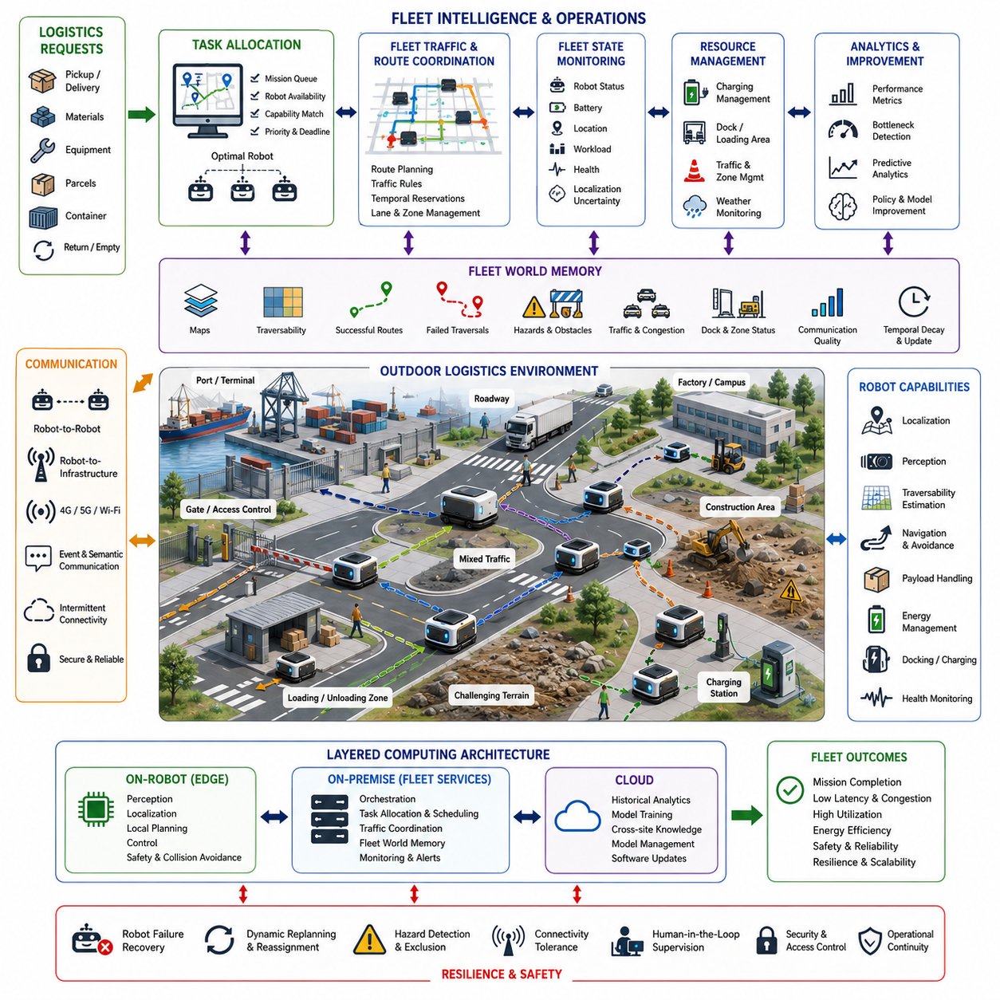{width="7.268055555555556in" height="7.268055555555556in"}

Outdoor AMR and logistics fleets extend multi-robot Physical AI beyond structured indoor warehouses into open, dynamic, and geographically distributed environments. Robots may transport pallets, containers, tools, materials, parcels, or equipment across factories, logistics yards, campuses, ports, construction areas, and industrial sites. Fleet intelligence must coordinate missions while accounting for terrain, weather, traffic, communication coverage, and changing operational conditions.

Compared with indoor warehouses, outdoor logistics environments contain substantially greater spatial and environmental uncertainty. Roads may include slopes, uneven pavement, gravel, mud, curbs, drainage structures, temporary barriers, and mixed pedestrian or vehicle traffic. Lighting and weather can change rapidly. Each robot therefore requires robust localization, perception, traversability estimation, and motion planning while the fleet maintains a broader representation of shared operational conditions.

Localization cannot depend exclusively on a single sensing technology. GNSS may provide global positioning in open areas but can degrade near buildings, containers, trees, or infrastructure. LiDAR, cameras, inertial sensors, wheel odometry, and map-based localization can provide complementary information. A robust outdoor AMR estimates not only its position but also localization uncertainty, allowing planning and fleet coordination to adapt when confidence deteriorates.

Outdoor perception must recognize both geometric obstacles and operationally meaningful entities. The system may encounter pedestrians, forklifts, trucks, parked vehicles, pallets, gates, construction equipment, debris, vegetation, and temporarily restricted areas. Environmental interpretation therefore extends beyond obstacle detection toward semantic understanding of which regions are accessible, risky, temporarily unavailable, or subject to specific operational rules.

Traversability becomes a central component of outdoor fleet intelligence. A geometrically open region is not necessarily safe or efficient for every robot. Surface roughness, slope, friction, water, mud, clearance, payload, wheel configuration, and robot mobility characteristics can determine whether a route is practical. Traversability maps can encode these factors and provide capability-aware costs that allow different robots to select routes appropriate to their physical embodiment.

Shared traversability allows one robot\'s physical experience to benefit the entire fleet. If an AMR detects wheel slip, excessive vibration, standing water, difficult terrain, or an unexpected obstruction, the observation can be associated with location, time, robot configuration, and confidence. Other robots can then avoid the region or reduce speed before reaching it. Fleet world memory consequently transforms isolated mobility experiences into reusable collective knowledge.

Logistics requests are converted into missions involving pickup points, delivery destinations, payload constraints, deadlines, priorities, and required resources. Fleet task allocation evaluates robot availability, location, payload capability, battery state, expected route cost, environmental conditions, and current workload. The best robot is therefore not necessarily the nearest robot; it is the platform expected to complete the mission safely and efficiently under current physical conditions.

Dynamic replanning is essential because outdoor conditions can change while a mission is being executed. A road may become blocked by a vehicle, a gate may close, weather may reduce traversability, or another robot may fail. The fleet can update shared state, recompute routes, adjust schedules, and reassign missions. This continuous adaptation connects physical perception directly with multi-robot task allocation and operational decision making.

Traffic coordination becomes more complex when AMRs share roads with conventional vehicles and humans. Fleet planning may define preferred routes, directional lanes, speed zones, intersections, waiting areas, and priority rules. Temporal reservations can coordinate narrow passages or shared loading areas. Local robot controllers still perform immediate collision avoidance, while fleet-level services reduce conflicts before robots encounter one another.

Communication must tolerate intermittent and degraded connectivity. Outdoor robots may move between Wi-Fi, private cellular, 5G, or other communication zones, and some areas may temporarily provide limited bandwidth. Robots therefore require sufficient local autonomy to continue safe operation without continuous fleet connectivity. Important state changes can be synchronized when communication returns, while safety-critical decisions remain executable locally.

Semantic and event-based communication can reduce unnecessary network traffic. Instead of continuously transmitting raw sensor streams, robots can report information that changes fleet decisions, such as "route blocked," "terrain degraded," "dock unavailable," "localization uncertain," or "mission delayed." This converts communication from continuous data replication into a coordination resource that prioritizes information according to its operational significance.

Energy management becomes especially important because outdoor missions may cover longer distances and experience greater variation in energy consumption. Payload mass, terrain, slope, temperature, speed, and route conditions can influence battery usage. Fleet scheduling can estimate mission-specific energy requirements and coordinate charging so that sufficient robots remain available while avoiding situations in which a vehicle cannot safely complete its assigned route.

Fleet world memory can maintain more than maps. It can store successful routes, failed traversals, recovery actions, congestion histories, docking performance, communication quality, localization confidence, and environmental observations. Because outdoor environments change over time, each memory element should include temporal context and uncertainty. Old observations can decay or be replaced as newer evidence indicates that physical conditions have changed.

Conflicting observations must also be resolved. One robot may classify a route as traversable while another reports difficulty because their payloads, dimensions, tires, sensors, or environmental conditions differ. Fleet memory should therefore preserve relevant context rather than forcing every observation into a single universal value. Capability-aware knowledge enables the same environment to be interpreted differently for different robot embodiments.

Collective learning can exploit operational data gathered across many vehicles. Repeated fleet experience may reveal terrain associated with wheel slip, routes associated with excessive energy consumption, locations where localization frequently degrades, or traffic patterns that produce delays. These observations can improve perception, traversability estimation, route planning, scheduling, predictive maintenance, and operational policies, forming a fleet data flywheel across repeated deployments.

A layered computing architecture separates immediate physical autonomy from broader collective intelligence. On-robot edge systems execute perception, localization, local planning, control, and safety functions. On-premise fleet services can perform orchestration, task allocation, traffic coordination, shared world memory, and operational monitoring. Cloud infrastructure can support historical analytics, large-scale training, model management, and knowledge aggregation across multiple sites.

Resilience requires the fleet to tolerate robot loss, network interruption, sensor degradation, and changing environmental conditions without turning every local failure into a system-wide shutdown. Missions from failed robots can be reassigned, hazardous regions can be temporarily excluded, and disconnected robots can enter restricted autonomous modes. Graceful degradation allows the logistics system to preserve useful operational capacity while maintaining defined safety constraints.

Human operators supervise the fleet primarily at the mission and exception level. They require visibility into robot locations, active missions, route restrictions, battery status, environmental hazards, communication quality, failures, and uncertain AI decisions. Effective supervision enables operators to modify priorities, approve exceptional actions, isolate unsafe regions, or intervene when autonomous recovery is insufficient without manually controlling normal robot movement.

Fleet performance must be measured through collective outcomes rather than individual robot speed alone. Relevant indicators include missions completed, delivery latency, distance traveled without payload, energy per mission, congestion delay, charging utilization, intervention rate, mission failure rate, recovery time, and fleet availability. Outdoor logistics intelligence succeeds when coordination improves throughput and reliability despite environmental uncertainty and distributed operation.

The outdoor AMR and logistics fleet therefore demonstrates how multi-robot Physical AI combines distributed perception, capability-aware task allocation, communication, shared traversability, fleet world memory, dynamic replanning, and collective learning. Individual robots remain physically autonomous, but their observations and experiences contribute to a larger operational intelligence that continuously improves how the fleet understands and acts within its environment.

At larger scale, this architecture can connect multiple logistics zones, facilities, and robot types into a shared intelligence system. Knowledge learned at one location can inform another when environmental and embodiment differences are properly represented. The resulting system progresses from fleet management toward collective physical intelligence, where many robots jointly accumulate experience, coordinate resources, adapt to changing conditions, and maintain resilient logistics operations across the physical world.

야외 자율이동로봇 및 물류 군집(Outdoor AMR and Logistics Fleet)은 다중 로봇 피지컬 AI(Multi-Robot Physical AI)를 구조화된 실내 창고에서 개방적이고 동적이며 지리적으로 분산된 환경으로 확장한다. 로봇은 공장, 물류 야드, 캠퍼스, 항만, 건설 현장, 산업 시설에서 팔레트, 컨테이너, 공구, 자재, 소포, 장비 등을 운송할 수 있다. 군집 지능(Fleet Intelligence)은 지형, 날씨, 교통, 통신 범위, 변화하는 운영 조건을 고려하면서 이러한 임무를 조정해야 한다.

실내 창고와 비교하면 야외 물류 환경(Outdoor Logistics Environment)은 공간적·환경적 불확실성이 훨씬 크다. 도로에는 경사면, 불규칙한 포장, 자갈, 진흙, 연석, 배수 시설, 임시 장애물뿐 아니라 보행자와 차량이 혼재할 수 있다. 조명과 기상 조건도 빠르게 변화한다. 따라서 각 로봇에는 강건한 위치추정(Localization), 인지(Perception), 주행가능성 추정(Traversability Estimation), 모션 계획(Motion Planning)이 필요하며, 군집은 공유된 운영 조건을 보다 광범위하게 표현해야 한다.

위치추정(Localization)은 단일 센싱 기술에만 의존할 수 없다. 위성항법시스템(GNSS)은 개방된 공간에서 전역 위치(Global Positioning)를 제공하지만 건물, 컨테이너, 나무, 기반시설 주변에서는 성능이 저하될 수 있다. 라이다(LiDAR), 카메라(Camera), 관성 센서(Inertial Sensor), 휠 오도메트리(Wheel Odometry), 지도 기반 위치추정(Map-Based Localization)은 상호 보완적인 정보를 제공할 수 있다. 강건한 야외 AMR은 자신의 위치뿐 아니라 위치추정 불확실성(Localization Uncertainty)도 추정하여 신뢰도가 낮아질 때 계획과 군집 조정을 적응시킬 수 있다.

야외 인지(Outdoor Perception)는 기하학적 장애물뿐 아니라 운영적으로 의미 있는 객체도 인식해야 한다. 시스템은 보행자, 지게차, 트럭, 주차 차량, 팔레트, 게이트, 건설 장비, 잔해, 식생, 일시적인 제한 구역 등을 마주할 수 있다. 따라서 환경 해석(Environmental Interpretation)은 단순한 장애물 검출을 넘어 접근 가능한 영역, 위험한 영역, 일시적으로 사용할 수 없는 영역, 특정 운영 규칙이 적용되는 영역을 의미적으로 이해하는 방향으로 확장된다.

주행가능성(Traversability)은 야외 군집 지능(Outdoor Fleet Intelligence)의 핵심 요소가 된다. 기하학적으로 개방된 영역이라고 해서 모든 로봇이 안전하고 효율적으로 주행할 수 있는 것은 아니다. 노면 거칠기, 경사, 마찰력, 물, 진흙, 지상고, 적재량, 휠 구성, 로봇의 이동 특성이 경로의 실질적인 주행 가능성을 결정한다. 주행가능성 지도(Traversability Map)는 이러한 요소를 표현하고 서로 다른 로봇이 자신의 물리적 체화 특성(Physical Embodiment)에 적합한 경로를 선택하도록 능력 인지형 비용(Capability-Aware Cost)을 제공할 수 있다.

공유 주행가능성(Shared Traversability)을 활용하면 하나의 로봇이 획득한 물리적 경험을 전체 군집이 활용할 수 있다. AMR이 휠 슬립(Wheel Slip), 과도한 진동, 고인 물, 험난한 지형, 예상하지 못한 장애물을 감지하면 해당 관측을 위치, 시간, 로봇 구성, 신뢰도와 연결할 수 있다. 다른 로봇은 해당 지역에 도달하기 전에 회피하거나 속도를 낮출 수 있다. 결과적으로 군집 월드 메모리(Fleet World Memory)는 개별적인 이동 경험을 재사용 가능한 집단 지식(Collective Knowledge)으로 전환한다.

물류 요청(Logistics Request)은 픽업 지점, 배송 목적지, 적재 제약, 마감시간, 우선순위, 필요한 자원을 포함하는 임무로 변환된다. 군집 작업 할당(Fleet Task Allocation)은 로봇 가용성, 위치, 적재 능력, 배터리 상태, 예상 경로 비용, 환경 조건, 현재 작업량을 평가한다. 따라서 최적의 로봇은 반드시 가장 가까운 로봇이 아니라 현재의 물리적 조건에서 해당 임무를 안전하고 효율적으로 완료할 가능성이 가장 높은 플랫폼이다.

동적 재계획(Dynamic Replanning)은 임무 수행 중에도 야외 조건이 변화할 수 있기 때문에 필수적이다. 차량으로 인해 도로가 차단되거나, 게이트가 닫히거나, 날씨로 인해 주행가능성이 저하되거나, 다른 로봇에 장애가 발생할 수 있다. 군집은 공유 상태(Shared State)를 갱신하고 경로를 다시 계산하며 스케줄을 조정하고 임무를 재할당할 수 있다. 이러한 지속적인 적응은 물리적 인지(Physical Perception)를 다중 로봇 작업 할당 및 운영 의사결정과 직접 연결한다.

AMR이 일반 차량 및 사람과 도로를 공유하면 교통 조정(Traffic Coordination)은 더욱 복잡해진다. 군집 계획(Fleet Planning)은 선호 경로, 방향별 차선, 속도 제한 구역, 교차로, 대기 구역, 우선순위 규칙을 정의할 수 있다. 시간 기반 예약(Temporal Reservation)을 통해 좁은 통로나 공유 적재 구역을 조정할 수도 있다. 로컬 로봇 제어기(Local Robot Controller)는 즉각적인 충돌 회피를 수행하고, 군집 수준 서비스는 로봇들이 실제로 마주치기 전에 충돌 가능성을 줄인다.

통신(Communication)은 간헐적 연결과 성능 저하를 견딜 수 있어야 한다. 야외 로봇은 와이파이(Wi-Fi), 사설 셀룰러(Private Cellular), 5G 또는 기타 통신 영역 사이를 이동할 수 있으며 일부 지역에서는 일시적으로 제한된 대역폭만 사용할 수 있다. 따라서 로봇은 군집과 지속적으로 연결되지 않더라도 안전한 운영을 계속할 수 있는 충분한 로컬 자율성(Local Autonomy)을 가져야 한다. 중요한 상태 변화는 통신이 복구될 때 동기화하고 안전 필수 결정(Safety-Critical Decision)은 로컬에서 실행할 수 있어야 한다.

의미 기반 및 이벤트 기반 통신(Semantic and Event-Based Communication)은 불필요한 네트워크 트래픽을 줄일 수 있다. 로봇은 원시 센서 스트림을 지속적으로 전송하는 대신 "경로 차단(Route Blocked)", "지형 상태 저하(Terrain Degraded)", "도킹 지점 사용 불가(Dock Unavailable)", "위치추정 불확실(Localization Uncertain)", "임무 지연(Mission Delayed)"처럼 군집 의사결정을 변화시키는 정보를 보고할 수 있다. 이를 통해 통신은 지속적인 데이터 복제가 아니라 운영 중요도에 따라 정보를 우선화하는 조정 자원(Coordination Resource)으로 전환된다.

야외 임무는 더 긴 거리를 이동하고 에너지 소비 변동도 크기 때문에 에너지 관리(Energy Management)가 특히 중요하다. 적재 질량, 지형, 경사, 온도, 속도, 경로 조건은 배터리 소비량에 영향을 줄 수 있다. 군집 스케줄링(Fleet Scheduling)은 임무별 에너지 요구량을 추정하고 충전을 조정하여 충분한 수의 로봇을 운영 상태로 유지하면서 차량이 할당된 경로를 안전하게 완료하지 못하는 상황을 방지할 수 있다.

군집 월드 메모리(Fleet World Memory)는 지도 이상의 정보를 유지할 수 있다. 성공한 경로, 실패한 주행, 복구 행동, 혼잡 이력, 도킹 성능, 통신 품질, 위치추정 신뢰도, 환경 관측 정보를 저장할 수 있다. 야외 환경은 시간에 따라 변화하므로 각각의 메모리 요소에는 시간적 컨텍스트(Temporal Context)와 불확실성(Uncertainty)이 포함되어야 한다. 오래된 관측 정보는 시간이 지나면서 감쇠하거나 새로운 증거가 물리적 조건의 변화를 나타내면 최신 정보로 대체될 수 있다.

상충하는 관측(Conflicting Observations) 역시 해결해야 한다. 하나의 로봇은 특정 경로를 주행 가능하다고 판단하지만 다른 로봇은 적재량, 크기, 타이어, 센서, 환경 조건이 다르기 때문에 주행에 어려움이 있다고 보고할 수 있다. 따라서 군집 메모리는 모든 관측을 하나의 보편적인 값으로 강제 통합하기보다 관련 컨텍스트를 보존해야 한다. 능력 인지형 지식(Capability-Aware Knowledge)을 통해 동일한 환경도 서로 다른 로봇 체화(Embodiment)에 따라 다르게 해석할 수 있다.

집단 학습(Collective Learning)은 다수의 차량에서 수집된 운영 데이터를 활용할 수 있다. 반복적인 군집 경험을 통해 휠 슬립과 관련된 지형, 과도한 에너지 소비가 발생하는 경로, 위치추정 성능이 자주 저하되는 장소, 지연을 발생시키는 교통 패턴을 발견할 수 있다. 이러한 관측은 인지, 주행가능성 추정, 경로계획, 스케줄링, 예측 유지보수(Predictive Maintenance), 운영 정책을 개선하여 반복적인 배치를 통해 군집 데이터 플라이휠(Fleet Data Flywheel)을 형성한다.

계층형 컴퓨팅 아키텍처(Layered Computing Architecture)는 즉각적인 물리적 자율성(Physical Autonomy)과 보다 광범위한 집단 지능(Collective Intelligence)을 분리한다. 로봇 엣지(On-Robot Edge) 시스템은 인지, 위치추정, 로컬 계획, 제어, 안전 기능을 실행한다. 온프레미스 군집 서비스(On-Premise Fleet Services)는 오케스트레이션, 작업 할당, 교통 조정, 공유 월드 메모리, 운영 모니터링을 수행할 수 있다. 클라우드 인프라(Cloud Infrastructure)는 이력 분석, 대규모 학습, 모델 관리, 여러 사이트의 지식 집계를 지원할 수 있다.

복원력(Resilience)을 확보하려면 모든 로컬 장애가 시스템 전체의 중단으로 이어지지 않도록 로봇 손실, 네트워크 중단, 센서 성능 저하, 변화하는 환경 조건을 군집이 견딜 수 있어야 한다. 장애가 발생한 로봇의 임무를 재할당하고 위험 지역을 일시적으로 제외하며 연결이 끊긴 로봇을 제한된 자율 모드(Restricted Autonomous Mode)로 전환할 수 있다. 점진적 성능 저하(Graceful Degradation)는 정의된 안전 제약을 유지하면서 물류 시스템이 유용한 운영 능력을 보존하도록 한다.

인간 운영자(Human Operator)는 주로 임무 및 예외 상황 수준에서 군집을 감독한다. 운영자는 로봇 위치, 활성 임무, 경로 제한, 배터리 상태, 환경 위험, 통신 품질, 장애, 불확실한 AI 의사결정을 파악할 수 있어야 한다. 효과적인 감독을 통해 정상적인 로봇 움직임을 직접 제어하지 않으면서 우선순위를 변경하고, 예외 행동을 승인하고, 위험 지역을 격리하거나, 자율 복구가 충분하지 않은 경우 개입할 수 있다.

군집 성능(Fleet Performance)은 개별 로봇의 속도만이 아니라 집단적 결과(Collective Outcomes)를 통해 평가해야 한다. 관련 지표에는 완료된 임무 수, 배송 지연시간, 무적재 이동거리, 임무당 에너지 소비량, 혼잡 지연, 충전기 활용률, 작업자 개입률, 임무 실패율, 복구 시간, 군집 가용성(Fleet Availability) 등이 포함된다. 야외 물류 지능은 환경적 불확실성과 분산 운영에도 불구하고 조정을 통해 처리량과 신뢰성을 향상시킬 때 성공적이라고 평가할 수 있다.

따라서 야외 AMR 및 물류 군집(Outdoor AMR and Logistics Fleet)은 다중 로봇 피지컬 AI(Multi-Robot Physical AI)가 분산 인지(Distributed Perception), 능력 인지형 작업 할당(Capability-Aware Task Allocation), 통신, 공유 주행가능성, 군집 월드 메모리, 동적 재계획, 집단 학습을 어떻게 결합하는지를 보여준다. 개별 로봇은 물리적으로 자율성을 유지하지만 각 로봇의 관측과 경험은 군집이 환경을 이해하고 행동하는 방식을 지속적으로 개선하는 더 큰 운영 지능(Operational Intelligence)에 기여한다.

더 큰 규모에서는 이러한 아키텍처가 여러 물류 구역, 시설, 로봇 유형을 하나의 공유 지능 시스템(Shared Intelligence System)으로 연결할 수 있다. 환경과 체화의 차이를 적절하게 표현한다면 한 장소에서 학습한 지식을 다른 장소에서도 활용할 수 있다. 결과적으로 시스템은 단순한 군집 관리(Fleet Management)를 넘어 다수의 로봇이 공동으로 경험을 축적하고 자원을 조정하며 변화하는 조건에 적응하고 물리 세계 전반에서 복원력 있는 물류 운영을 유지하는 집단 물리 지능(Collective Physical Intelligence)으로 발전한다.

## 10.03. Multi Robot Inspection System

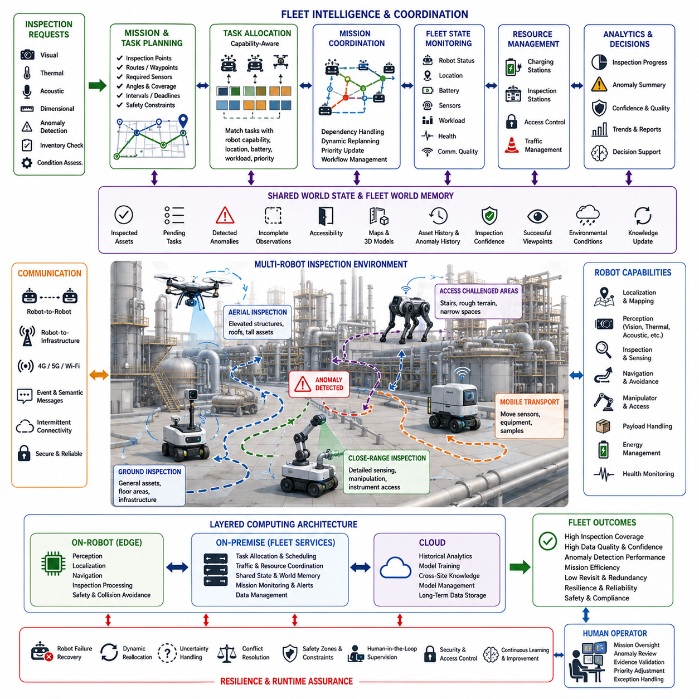{width="7.268055555555556in" height="7.268055555555556in"}

A multi-robot inspection system applies the principles of Multi-Robot Physical AI to environments where large areas, complex assets, or distributed infrastructure must be examined repeatedly and reliably. Instead of assigning the entire inspection mission to one robot, multiple robots divide the environment according to location, sensing capability, mobility, workload, and inspection priority while maintaining a shared understanding of mission progress.

Inspection fleets can operate in factories, warehouses, power plants, refineries, construction sites, transportation facilities, utility infrastructure, and other industrial environments. Missions may include visual inspection, thermal monitoring, acoustic sensing, dimensional measurement, anomaly detection, inventory verification, and equipment condition assessment. The physical diversity of these tasks makes coordination as important as the sensing capability of any individual robot.

Each inspection request must first be represented as a set of spatially and temporally constrained tasks. Inspection points, routes, required sensors, observation angles, revisit intervals, deadlines, and safety restrictions can be incorporated into the mission representation. Multi-robot task allocation then assigns inspection work according to robot position, sensor availability, mobility capability, battery state, expected mission duration, and current operational conditions.

Spatial decomposition allows a large inspection environment to be divided among several robots, but simple geographic partitioning is not always sufficient. Some assets may require specialized cameras, thermal sensors, manipulators, or mobility capabilities. Capability-aware task matching therefore ensures that each inspection point is assigned to a robot capable of producing the required observation rather than merely to the robot located closest to the target.

Mission coordination must also account for dependencies between inspection tasks. One robot may perform an initial survey and identify a suspicious condition that requires a second robot with higher-resolution sensing or manipulation capability. Inspection consequently becomes a dynamic workflow in which observations can generate new tasks, change priorities, or trigger additional measurements. Task allocation and perception are therefore connected through continuous mission replanning.

Shared world state provides the fleet with a common representation of inspection progress. Robots can report which assets have been inspected, which observations remain incomplete, where anomalies were detected, and which regions are temporarily inaccessible. This prevents duplicated work while allowing another robot to continue an unfinished mission if the originally assigned platform becomes unavailable or cannot complete the required observation.

Fleet world memory extends this shared state across repeated inspection cycles. The system can associate locations and assets with previous observations, anomaly histories, inspection confidence, accessibility conditions, and successful sensing configurations. A robot approaching an asset can therefore use knowledge accumulated by previous robots rather than treating every inspection as an entirely new problem. This creates persistent operational memory across the fleet.

Inspection data must include spatial and temporal context if observations from different robots are to be compared meaningfully. Images, thermal measurements, point clouds, acoustic signals, or other sensor outputs can be linked with robot pose, asset identity, timestamp, sensor configuration, and confidence. Consistent contextualization allows the system to distinguish actual physical changes from differences caused by viewpoint, sensor configuration, localization uncertainty, or environmental conditions.

Communication becomes a coordination resource rather than merely a channel for uploading sensor data. Robots exchange mission status, location, intent, detected anomalies, accessibility information, and requests for assistance. Large raw inspection datasets can be transferred selectively, while compact semantic messages communicate urgent information such as "inspection failed," "anomaly detected," "additional viewpoint required," or "area inaccessible," reducing unnecessary bandwidth consumption.

Multi-robot path planning must coordinate both inspection coverage and robot movement. Robots may share narrow corridors, elevators, doors, inspection stations, or restricted operating zones. Fleet-level planning can schedule access to these resources and reduce traffic conflicts, while local navigation remains responsible for immediate obstacle avoidance. This hybrid structure combines global mission efficiency with the responsiveness required for safe physical operation.

Uncertainty is particularly important because an inspection result is not automatically equivalent to reliable knowledge. Poor illumination, occlusion, sensor contamination, vibration, unfavorable viewing geometry, or localization error may reduce observation quality. The fleet can preserve confidence together with inspection results and request additional observations when uncertainty exceeds acceptable limits, allowing another robot or sensor modality to provide independent evidence.

Conflicting observations can occur when different robots inspect the same asset from different viewpoints or under different conditions. Rather than immediately selecting one result, the fleet can preserve observation provenance and confidence while collecting additional evidence. Shared memory can then fuse compatible observations or identify unresolved disagreement, enabling inspection decisions to reflect the quality and context of the available physical evidence.

Dynamic reallocation provides resilience when robots fail or inspection conditions change. If a robot experiences low battery, sensor degradation, localization problems, blocked access, or hardware failure, incomplete inspection tasks can be returned to the fleet scheduler. Another capable robot can continue the mission, while the affected platform is isolated, recovered, or assigned a reduced role. Robot loss therefore does not necessarily imply mission failure.

Heterogeneous fleets can significantly expand inspection coverage. An AMR may provide stable ground transportation and carry heavy sensors, a mobile manipulator may position instruments close to equipment, a quadruped may access stairs or uneven terrain, and a UAV may observe elevated structures. Common task, map, communication, and knowledge representations allow these different embodiments to contribute complementary capabilities to one coordinated inspection mission.

Collective learning allows inspection performance to improve from experience gathered across the fleet. Repeated missions can reveal viewpoints that produce reliable measurements, areas where localization frequently degrades, inspection sequences that reduce mission time, or environmental conditions associated with false detections. These experiences can improve perception models, planning policies, inspection procedures, anomaly detection, and capability-aware task allocation over time.

A fleet data flywheel emerges when operational experience is systematically captured, evaluated, and reused. Difficult inspection examples and uncertain observations can be collected for model improvement, while successful recovery strategies and efficient mission plans become reusable operational knowledge. Updated models and policies can then be redistributed to robots, allowing improvements derived from one subset of the fleet to benefit future missions performed by many robots.

The computing architecture can distribute intelligence across robot, on-premise, and cloud layers. On-robot edge systems execute perception, localization, navigation, immediate inspection processing, and safety functions. On-premise fleet services coordinate tasks, traffic, shared state, world memory, and operational monitoring. Cloud resources can support historical analytics, large-scale model training, cross-site knowledge aggregation, and long-term inspection data management.

Safety and runtime assurance remain fundamental because inspection robots frequently operate around industrial equipment and human workers. Robots must respect restricted zones, speed constraints, safe distances, access permissions, and emergency conditions independently of mission optimization. Fleet-level coordination should complement rather than replace local safety mechanisms, ensuring that collective behavior cannot override essential physical safety constraints.

Human supervision is especially important when inspection results affect maintenance or operational decisions. Operators need visibility into mission progress, detected anomalies, observation confidence, robot health, incomplete tasks, and conflicting evidence. Instead of manually directing every robot, humans can supervise exceptions, validate important findings, modify mission priorities, and request additional inspection when autonomous evidence is insufficient.

System performance should be evaluated through both inspection quality and fleet efficiency. Relevant measures include inspection coverage, mission completion time, anomaly detection performance, revisit consistency, observation confidence, robot utilization, intervention frequency, energy consumption, failure recovery time, and redundant inspection effort. Effective coordination should increase inspection coverage and reliability without creating unnecessary robot movement or duplicated sensing.

The multi-robot inspection system therefore integrates task allocation, communication, shared world state, fleet world memory, heterogeneous embodiment, dynamic replanning, collective learning, and runtime assurance into a unified Physical AI application. Individual robots provide local perception and physical action, while fleet intelligence combines their observations and capabilities into a coordinated inspection process that is more scalable and resilient than isolated robotic operation.

As the system matures, inspection can evolve from periodic execution toward persistent collective intelligence. Multiple robots continuously accumulate evidence about assets and environments, compare new observations with historical memory, redistribute work as conditions change, and improve their models from fleet experience. The result is not simply several robots performing inspections, but a distributed physical intelligence that collectively observes, remembers, reasons about, and monitors the evolving state of the physical world.

다중 로봇 검사 시스템(Multi-Robot Inspection System)은 넓은 영역, 복잡한 자산 또는 분산된 인프라를 반복적이고 신뢰성 있게 검사해야 하는 환경에 다중 로봇 피지컬 AI(Multi-Robot Physical AI)의 원리를 적용한다. 하나의 로봇에 전체 검사 임무를 할당하는 대신, 여러 로봇이 위치, 센싱 능력, 이동성, 작업량, 검사 우선순위에 따라 환경을 분담하면서 전체 임무 진행 상황에 대한 공유된 이해(Shared Understanding)를 유지한다.

검사 로봇 군집(Inspection Fleet)은 공장, 창고, 발전소, 정유시설, 건설 현장, 교통 시설, 유틸리티 인프라 및 기타 산업 환경에서 운영될 수 있다. 임무에는 비전 검사(Visual Inspection), 열화상 모니터링(Thermal Monitoring), 음향 센싱(Acoustic Sensing), 치수 측정(Dimensional Measurement), 이상 탐지(Anomaly Detection), 재고 확인(Inventory Verification), 설비 상태 평가(Equipment Condition Assessment) 등이 포함될 수 있다. 이러한 작업의 물리적 다양성으로 인해 개별 로봇의 센싱 능력만큼 로봇 간 조정이 중요해진다.

각 검사 요청(Inspection Request)은 먼저 공간적·시간적 제약을 가진 일련의 작업으로 표현되어야 한다. 검사 지점, 경로, 필요한 센서, 관측 각도, 재검사 주기, 마감시간, 안전 제한 등을 임무 표현(Mission Representation)에 포함할 수 있다. 이후 다중 로봇 작업 할당(Multi-Robot Task Allocation)은 로봇 위치, 센서 가용성, 이동 능력, 배터리 상태, 예상 임무 시간, 현재 운영 조건에 따라 검사 작업을 할당한다.

공간 분할(Spatial Decomposition)을 사용하면 넓은 검사 환경을 여러 로봇이 분담할 수 있지만 단순한 지리적 분할만으로는 항상 충분하지 않다. 일부 자산은 특수 카메라, 열화상 센서, 매니퓰레이터(Manipulator) 또는 특정 이동 능력을 요구할 수 있다. 따라서 능력 인지형 작업 매칭(Capability-Aware Task Matching)은 단순히 대상에 가장 가까운 로봇이 아니라 필요한 관측 결과를 생성할 수 있는 로봇에 각 검사 지점을 할당하도록 한다.

임무 조정(Mission Coordination)은 검사 작업 사이의 의존성도 고려해야 한다. 한 로봇이 초기 탐색을 수행하여 의심스러운 상태를 발견하면 더 높은 해상도의 센싱 또는 조작 능력을 갖춘 두 번째 로봇이 필요할 수 있다. 따라서 검사는 관측 결과에 따라 새로운 작업을 생성하거나 우선순위를 변경하고 추가 측정을 요구하는 동적 워크플로(Dynamic Workflow)가 된다. 작업 할당과 인지는 지속적인 임무 재계획(Continuous Mission Replanning)을 통해 연결된다.

공유 월드 상태(Shared World State)는 군집에 검사 진행 상황에 대한 공통 표현을 제공한다. 로봇은 어떤 자산의 검사가 완료되었는지, 어떤 관측이 미완료 상태인지, 어디에서 이상이 탐지되었는지, 어떤 영역에 일시적으로 접근할 수 없는지를 보고할 수 있다. 이를 통해 중복 작업을 방지하면서 최초 할당된 로봇이 사용할 수 없거나 필요한 관측을 완료하지 못하는 경우 다른 로봇이 미완료 임무를 이어받을 수 있다.

군집 월드 메모리(Fleet World Memory)는 이러한 공유 상태를 반복적인 검사 주기에 걸쳐 확장한다. 시스템은 위치와 자산을 이전 관측, 이상 이력, 검사 신뢰도, 접근 조건, 성공적인 센싱 구성과 연결할 수 있다. 따라서 자산에 접근하는 로봇은 모든 검사를 완전히 새로운 문제로 처리하는 대신 이전 로봇들이 축적한 지식을 활용할 수 있다. 이를 통해 군집 전체에 지속적인 운영 메모리(Persistent Operational Memory)가 형성된다.

서로 다른 로봇의 관측을 의미 있게 비교하려면 검사 데이터(Inspection Data)에 공간적·시간적 컨텍스트가 포함되어야 한다. 이미지, 열 측정, 포인트 클라우드(Point Cloud), 음향 신호 또는 기타 센서 출력은 로봇 자세(Robot Pose), 자산 식별 정보, 타임스탬프(Timestamp), 센서 구성, 신뢰도와 연결할 수 있다. 일관된 컨텍스트화(Contextualization)를 통해 실제 물리적 변화와 시점, 센서 구성, 위치추정 불확실성 또는 환경 조건의 차이로 발생한 변화를 구분할 수 있다.

통신(Communication)은 단순히 센서 데이터를 업로드하는 채널이 아니라 조정 자원(Coordination Resource)이 된다. 로봇은 임무 상태, 위치, 의도(Intent), 탐지된 이상, 접근 가능성 정보, 지원 요청 등을 교환한다. 대용량 원시 검사 데이터는 선택적으로 전송할 수 있으며, "검사 실패(Inspection Failed)", "이상 탐지(Anomaly Detected)", "추가 관측 각도 필요(Additional Viewpoint Required)", "영역 접근 불가(Area Inaccessible)"와 같은 긴급 정보는 간결한 의미 기반 메시지(Semantic Message)로 전달하여 불필요한 대역폭 사용을 줄일 수 있다.

다중 로봇 경로계획(Multi-Robot Path Planning)은 검사 커버리지와 로봇 이동을 동시에 조정해야 한다. 로봇들은 좁은 통로, 엘리베이터, 출입문, 검사 스테이션 또는 제한된 운영 구역을 공유할 수 있다. 군집 수준 계획(Fleet-Level Planning)은 이러한 자원에 대한 접근을 스케줄링하고 교통 충돌을 줄이며, 로컬 내비게이션(Local Navigation)은 즉각적인 장애물 회피를 담당한다. 이러한 하이브리드 구조(Hybrid Structure)는 전체적인 임무 효율성과 안전한 물리적 운영에 필요한 즉각적인 대응성을 결합한다.

검사 결과가 자동으로 신뢰할 수 있는 지식이 되는 것은 아니므로 불확실성(Uncertainty)은 특히 중요하다. 불충분한 조명, 가림(Occlusion), 센서 오염, 진동, 불리한 관측 기하 구조, 위치추정 오류는 관측 품질을 저하시킬 수 있다. 군집은 검사 결과와 함께 신뢰도(Confidence)를 보존하고 불확실성이 허용 수준을 초과하면 추가 관측을 요청하여 다른 로봇이나 센서 모달리티(Sensor Modality)가 독립적인 증거를 제공하도록 할 수 있다.

서로 다른 로봇이 동일한 자산을 다른 시점이나 조건에서 검사하면 상충하는 관측(Conflicting Observations)이 발생할 수 있다. 군집은 하나의 결과를 즉시 선택하기보다 관측 출처(Observation Provenance)와 신뢰도를 보존하면서 추가 증거를 수집할 수 있다. 이후 공유 메모리는 호환 가능한 관측을 융합하거나 해결되지 않은 불일치를 식별하여 사용 가능한 물리적 증거의 품질과 컨텍스트가 검사 의사결정에 반영되도록 한다.

동적 재할당(Dynamic Reallocation)은 로봇에 장애가 발생하거나 검사 조건이 변화할 때 복원력(Resilience)을 제공한다. 로봇의 배터리가 부족하거나 센서 성능 저하, 위치추정 문제, 접근 차단 또는 하드웨어 장애가 발생하면 미완료 검사 작업을 군집 스케줄러(Fleet Scheduler)로 반환할 수 있다. 다른 적합한 로봇이 임무를 계속 수행하고 문제가 발생한 플랫폼은 격리, 복구 또는 제한된 역할로 전환할 수 있으므로 개별 로봇의 손실이 반드시 전체 임무 실패로 이어지는 것은 아니다.

이기종 로봇 군집(Heterogeneous Fleet)은 검사 범위를 크게 확장할 수 있다. 자율이동로봇(AMR)은 안정적인 지상 운송과 무거운 센서 운반을 담당하고, 모바일 매니퓰레이터(Mobile Manipulator)는 장비 가까이에 계측기를 위치시키며, 4족 보행 로봇(Quadruped)은 계단이나 불규칙한 지형에 접근하고, 무인항공기(UAV)는 높은 구조물을 관측할 수 있다. 공통 작업, 지도, 통신, 지식 표현을 통해 서로 다른 체화(Embodiment)가 하나의 조정된 검사 임무에 상호 보완적인 능력을 제공할 수 있다.

집단 학습(Collective Learning)을 활용하면 군집 전체에서 수집된 경험을 통해 검사 성능을 향상시킬 수 있다. 반복적인 임무는 신뢰할 수 있는 측정이 가능한 관측 위치, 위치추정 성능이 자주 저하되는 영역, 임무 시간을 줄이는 검사 순서, 오탐(False Detection)과 관련된 환경 조건 등을 발견할 수 있다. 이러한 경험은 시간이 지남에 따라 인지 모델, 계획 정책, 검사 절차, 이상 탐지, 능력 인지형 작업 할당을 개선할 수 있다.

운영 경험을 체계적으로 수집하고 평가하여 재사용하면 군집 데이터 플라이휠(Fleet Data Flywheel)이 형성된다. 어려운 검사 사례와 불확실한 관측을 모델 개선을 위해 수집하고, 성공적인 복구 전략과 효율적인 임무 계획을 재사용 가능한 운영 지식으로 축적할 수 있다. 이후 개선된 모델과 정책을 다시 로봇에 배포하여 군집 일부에서 얻은 개선 결과가 다수 로봇이 수행하는 미래 임무에 활용되도록 할 수 있다.

컴퓨팅 아키텍처(Computing Architecture)는 로봇, 온프레미스(On-Premise), 클라우드(Cloud) 계층에 지능을 분산할 수 있다. 로봇 엣지(On-Robot Edge) 시스템은 인지, 위치추정, 내비게이션, 즉각적인 검사 처리, 안전 기능을 실행한다. 온프레미스 군집 서비스(On-Premise Fleet Services)는 작업, 교통, 공유 상태, 월드 메모리, 운영 모니터링을 조정한다. 클라우드 자원은 이력 분석, 대규모 모델 학습, 사이트 간 지식 집계(Cross-Site Knowledge Aggregation), 장기 검사 데이터 관리를 지원할 수 있다.

검사 로봇은 산업 장비와 작업자 주변에서 자주 운영되므로 안전 및 런타임 보증(Safety and Runtime Assurance)은 기본적인 요구사항이다. 로봇은 임무 최적화와 독립적으로 제한 구역, 속도 제약, 안전거리, 접근 권한, 비상 조건을 준수해야 한다. 군집 수준의 조정은 로컬 안전 메커니즘(Local Safety Mechanism)을 대체하는 것이 아니라 보완해야 하며, 집단 행동이 필수적인 물리적 안전 제약을 무시할 수 없도록 해야 한다.

검사 결과가 유지보수 또는 운영 의사결정에 영향을 미치는 경우 인간 감독(Human Supervision)은 특히 중요하다. 운영자는 임무 진행 상황, 탐지된 이상, 관측 신뢰도, 로봇 건전성, 미완료 작업, 상충하는 증거를 확인할 수 있어야 한다. 모든 로봇을 수동으로 지시하는 대신 인간은 예외 상황을 감독하고, 중요한 결과를 검증하며, 임무 우선순위를 변경하고, 자율적으로 수집된 증거가 충분하지 않을 경우 추가 검사를 요청할 수 있다.

시스템 성능(System Performance)은 검사 품질과 군집 효율성을 함께 평가해야 한다. 관련 지표에는 검사 커버리지(Inspection Coverage), 임무 완료 시간, 이상 탐지 성능, 반복 검사 일관성, 관측 신뢰도, 로봇 활용률, 작업자 개입 빈도, 에너지 소비량, 장애 복구 시간, 중복 검사량 등이 포함된다. 효과적인 조정은 불필요한 로봇 이동이나 중복 센싱을 증가시키지 않으면서 검사 범위와 신뢰성을 향상시켜야 한다.

따라서 다중 로봇 검사 시스템(Multi-Robot Inspection System)은 작업 할당, 통신, 공유 월드 상태, 군집 월드 메모리, 이기종 체화(Heterogeneous Embodiment), 동적 재계획, 집단 학습, 런타임 보증을 하나의 통합된 피지컬 AI(Physical AI) 응용으로 결합한다. 개별 로봇은 로컬 인지와 물리적 행동을 제공하고, 군집 지능(Fleet Intelligence)은 이들의 관측과 능력을 통합하여 개별 로봇 운영보다 확장성과 복원력이 뛰어난 조정된 검사 프로세스를 형성한다.

시스템이 성숙하면 검사는 주기적인 실행 방식에서 지속적인 집단 지능(Persistent Collective Intelligence)으로 발전할 수 있다. 여러 로봇이 자산과 환경에 대한 증거를 지속적으로 축적하고, 새로운 관측을 과거 메모리와 비교하며, 조건 변화에 따라 작업을 재분배하고, 군집 경험을 이용해 모델을 개선한다. 결과적으로 이는 단순히 여러 로봇이 검사를 수행하는 시스템이 아니라 물리 세계의 변화하는 상태를 집단적으로 관측하고, 기억하고, 추론하고, 모니터링하는 분산 물리 지능(Distributed Physical Intelligence)이 된다.

## 10.04. Quadruped Inspection Team

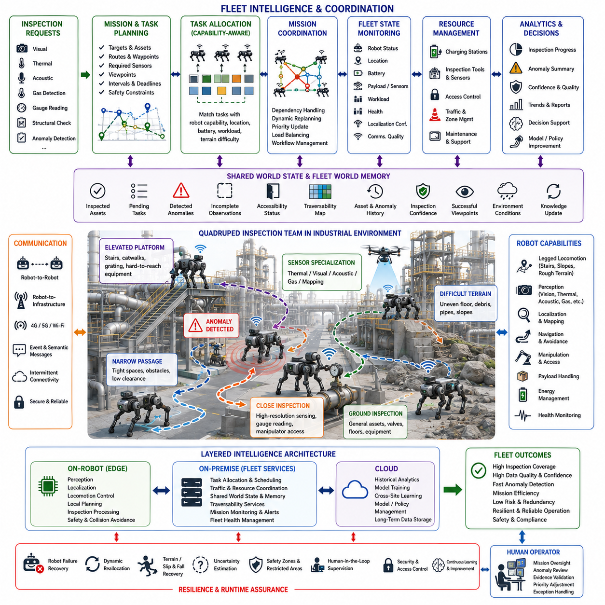{width="7.268055555555556in" height="7.268055555555556in"}

Quadruped inspection teams extend Multi-Robot Physical AI into environments where conventional wheeled robots cannot reliably reach critical assets. Multiple legged robots can traverse stairs, grating, uneven floors, narrow passages, industrial platforms, debris, and partially structured terrain while carrying inspection sensors. Their value comes not only from individual mobility but from coordinating perception, missions, experience, and risk across the entire team.

Typical deployment environments include power plants, refineries, chemical facilities, factories, construction sites, tunnels, utility installations, and hazardous industrial zones. Inspection missions may involve visual observation, thermal imaging, acoustic monitoring, gas detection, gauge reading, structural assessment, and anomaly detection. The quadruped morphology provides access to difficult locations while fleet intelligence organizes these capabilities into persistent inspection operations.

Each robot maintains local autonomy for perception, localization, terrain assessment, locomotion, obstacle avoidance, and immediate safety decisions. Unlike an AMR moving primarily across planar surfaces, a quadruped must continuously reason about footholds, body clearance, slope, stability, and terrain geometry. The resulting navigation state therefore contains information about physical feasibility and locomotion risk in addition to conventional position and obstacle information.

Inspection tasks can be represented by target assets, required sensing modalities, observation viewpoints, deadlines, inspection frequency, accessibility requirements, and safety constraints. A fleet scheduler distributes these tasks according to robot location, sensor payload, battery condition, mobility capability, workload, and expected terrain difficulty. Capability-aware allocation prevents missions from being assigned solely according to geometric proximity when physical accessibility differs significantly.

Team coordination becomes important when several quadrupeds inspect different portions of a large facility simultaneously. The system maintains shared information about completed inspections, pending targets, robot positions, restricted areas, and mission progress. When one robot completes a region earlier than expected, it can receive additional work. When another robot becomes delayed by difficult terrain, remaining tasks can be redistributed to preserve overall mission efficiency.

Shared traversability is particularly valuable for legged inspection robots because physical terrain experience is expensive to acquire repeatedly. A robot can report stairs, slippery surfaces, unstable debris, narrow passages, steep slopes, difficult footholds, or locations requiring reduced speed. Other quadrupeds can use this information before entering the same area, converting individual locomotion experience into collective mobility knowledge stored within fleet world memory.

Traversability information should preserve robot and mission context rather than assuming that every quadruped has identical mobility. Robot dimensions, payload mass, leg configuration, sensor mast height, battery condition, and control policy can affect whether a route is practical. Capability-aware shared memory can therefore represent not only whether terrain was successfully crossed, but which robot configuration crossed it and under what operational conditions.

Fleet world memory also stores inspection experience. Previous viewpoints, successful sensor configurations, detected anomalies, inaccessible assets, localization difficulties, recovery events, and inspection confidence can remain associated with physical locations and equipment. During later missions, robots retrieve this accumulated knowledge to anticipate difficult areas and reproduce reliable inspection procedures instead of rediscovering the same operational knowledge independently.

Dynamic environments require continuous memory updates. Temporary scaffolding, open doors, maintenance equipment, water, debris, moving workers, or newly restricted zones can invalidate previously successful routes. Shared observations therefore require timestamps and confidence values, while older information may gradually decay. Multiple observations from different robots can be fused to distinguish persistent environmental properties from temporary conditions that should not permanently alter fleet knowledge.

Communication enables the team to exchange location, mission status, intended routes, terrain observations, inspection findings, robot health, and assistance requests. Because industrial facilities may contain communication shadows or degraded wireless coverage, quadrupeds should retain enough local autonomy to operate safely during temporary disconnection. Important events can be synchronized when connectivity returns without making continuous network access a prerequisite for basic locomotion safety.

Event-based and semantic communication can prioritize operationally important information. Rather than transmitting every sensor frame continuously, a robot may report "route blocked," "stairs traversable," "gas anomaly detected," "inspection incomplete," "localization confidence low," or "assistance required." High-bandwidth inspection data can then be transferred selectively, while concise semantic information supports rapid coordination among robots and fleet services.

Multi-robot planning must consider shared passages, stairways, doors, inspection platforms, and other constrained resources. Two robots approaching a narrow staircase from opposite directions may create unnecessary conflict even though both individually have valid paths. Fleet-level coordination can schedule access or establish directional priorities, while each quadruped retains local responsibility for collision avoidance, foothold selection, balance, and immediate locomotion control.

Failures require rapid mission reallocation because quadruped inspection often occurs in locations that are expensive or unsafe for humans to access. A robot experiencing low battery, sensor failure, locomotion degradation, communication loss, or localization problems can return unfinished tasks to the team. Another capable robot may continue the mission, while the affected platform enters recovery, safe return, or restricted operating mode.

Recovery experience itself becomes useful shared knowledge. If a quadruped slips, encounters unstable terrain, becomes trapped, or successfully executes an alternative route, the event can be recorded with terrain context and robot state. Subsequent robots can avoid repeating unsuccessful behavior or use previously successful recovery strategies. Fleet memory therefore includes not only successful traversal but also failure and recovery knowledge.

Collective learning can improve locomotion and inspection performance from experience accumulated across many robots. Repeated missions may identify terrain associated with instability, viewpoints producing reliable measurements, routes causing excessive energy consumption, or conditions that degrade perception. These observations can improve traversability estimation, inspection policies, task allocation, route planning, anomaly detection, and operational procedures over successive deployments.

The team can also support specialization. One quadruped may carry thermal and visual sensors, another acoustic or gas sensors, while another may be optimized for mapping or difficult terrain reconnaissance. When an initial inspection identifies an uncertain condition, the fleet can dispatch the robot with the most appropriate sensing capability. Specialized individuals therefore contribute complementary functions without sacrificing collective mission coordination.

A layered intelligence architecture separates immediate embodied control from broader fleet intelligence. On-robot edge computing handles locomotion, perception, localization, local planning, inspection processing, and safety. On-premise services coordinate missions, maintain shared world memory, manage traffic and resources, and monitor fleet health. Cloud resources can support historical analysis, model training, cross-site learning, and long-term aggregation of inspection experience.

Safety and runtime assurance must remain independent of productivity optimization. Each quadruped needs local constraints for safe locomotion, restricted-zone enforcement, collision avoidance, stability protection, and emergency behavior. Fleet-level intelligence can modify routes and assignments but should not override essential safety mechanisms. This separation allows collective optimization while maintaining predictable physical boundaries for each autonomous robot.

Human operators supervise mission objectives, anomalies, uncertain observations, robot health, inaccessible regions, and exceptional recovery situations. Operators do not need to teleoperate every routine movement. Instead, they can validate significant findings, modify priorities, approve entry into sensitive areas, or intervene when autonomous recovery is insufficient. Human supervision therefore becomes exception-oriented oversight of a distributed inspection team.

Performance evaluation should consider both inspection effectiveness and physical mobility. Relevant measures include inspection coverage, anomaly detection quality, mission duration, successful traversal rate, localization confidence, energy consumption, intervention frequency, recovery success, robot utilization, and task reassignment frequency. Team performance is strongest when difficult environments can be inspected reliably without excessive redundancy or human exposure.

The quadruped inspection team consequently demonstrates how heterogeneous sensing, legged mobility, shared traversability, fleet world memory, task allocation, communication, collective learning, and runtime assurance can operate as an integrated Multi-Robot Physical AI system. Each robot remains an autonomous embodied agent, but its observations, successes, failures, and mobility experience become resources that improve the decisions of the entire team.

As experience accumulates, the team can evolve from several independently capable quadrupeds into a persistent collective inspection intelligence. Robots progressively learn which areas are accessible, which routes are risky, which sensing strategies are effective, and how environmental conditions change over time. The resulting system collectively observes, remembers, adapts, reallocates work, and improves its understanding of both industrial assets and the physical terrain connecting them.

4족 보행 로봇 검사 팀(Quadruped Inspection Team)은 기존의 바퀴형 로봇이 핵심 자산에 안정적으로 접근하기 어려운 환경으로 다중 로봇 피지컬 AI(Multi-Robot Physical AI)를 확장한다. 여러 대의 4족 보행 로봇(Legged Robot)은 검사 센서를 탑재하고 계단, 격자 바닥, 불규칙한 바닥, 좁은 통로, 산업용 플랫폼, 잔해, 부분적으로 구조화된 지형을 이동할 수 있다. 그 가치는 개별 이동성뿐 아니라 팀 전체가 인지, 임무, 경험, 위험을 공동으로 조정하는 데 있다.

대표적인 배치 환경(Deployment Environment)에는 발전소, 정유시설, 화학 시설, 공장, 건설 현장, 터널, 유틸리티 설비, 위험 산업 구역 등이 포함된다. 검사 임무에는 시각 관측(Visual Observation), 열화상 촬영(Thermal Imaging), 음향 모니터링(Acoustic Monitoring), 가스 감지(Gas Detection), 계기 판독(Gauge Reading), 구조 상태 평가(Structural Assessment), 이상 탐지(Anomaly Detection) 등이 포함될 수 있다. 4족 보행 형태(Quadruped Morphology)는 접근이 어려운 장소로의 이동을 가능하게 하며, 군집 지능(Fleet Intelligence)은 이러한 능력을 지속적인 검사 운영으로 조직한다.

각 로봇은 인지(Perception), 위치추정(Localization), 지형 평가(Terrain Assessment), 보행(Locomotion), 장애물 회피, 즉각적인 안전 의사결정을 위한 로컬 자율성(Local Autonomy)을 유지한다. 주로 평면을 이동하는 AMR과 달리 4족 보행 로봇은 발 디딤 위치(Foothold), 몸체 여유 공간, 경사도, 안정성, 지형 형상을 지속적으로 판단해야 한다. 따라서 내비게이션 상태에는 일반적인 위치 및 장애물 정보뿐 아니라 물리적 실행 가능성과 보행 위험 정보가 포함된다.

검사 작업(Inspection Task)은 대상 자산, 필요한 센싱 모달리티(Sensing Modality), 관측 시점(Viewpoint), 마감시간, 검사 주기, 접근성 요구조건, 안전 제약으로 표현할 수 있다. 군집 스케줄러(Fleet Scheduler)는 로봇 위치, 센서 페이로드, 배터리 상태, 이동 능력, 작업량, 예상 지형 난이도에 따라 이러한 작업을 분배한다. 능력 인지형 할당(Capability-Aware Allocation)은 물리적 접근성이 크게 다른 상황에서 단순한 기하학적 거리만을 기준으로 임무가 할당되는 것을 방지한다.

여러 대의 4족 보행 로봇이 대규모 시설의 서로 다른 영역을 동시에 검사할 때 팀 조정(Team Coordination)이 중요해진다. 시스템은 완료된 검사, 대기 중인 대상, 로봇 위치, 제한 구역, 임무 진행 상황에 대한 공유 정보를 유지한다. 한 로봇이 예상보다 일찍 특정 구역의 검사를 완료하면 추가 작업을 할당받을 수 있으며, 다른 로봇이 어려운 지형으로 지연되면 남은 작업을 재분배하여 전체 임무 효율성을 유지할 수 있다.

공유 주행가능성(Shared Traversability)은 보행형 검사 로봇에서 특히 중요하다. 물리적 지형 경험을 반복적으로 획득하는 데 상당한 비용과 위험이 따르기 때문이다. 로봇은 계단, 미끄러운 표면, 불안정한 잔해, 좁은 통로, 급경사, 어려운 발 디딤 구간, 감속이 필요한 위치를 보고할 수 있다. 다른 4족 보행 로봇은 동일한 영역에 진입하기 전에 이러한 정보를 활용하여 개별 보행 경험을 군집 월드 메모리(Fleet World Memory)에 저장된 집단 이동 지식(Collective Mobility Knowledge)으로 전환할 수 있다.

모든 4족 보행 로봇이 동일한 이동 능력을 가진다고 가정해서는 안 되므로 주행가능성 정보(Traversability Information)는 로봇 및 임무 컨텍스트를 함께 보존해야 한다. 로봇 크기, 페이로드 질량, 다리 구성, 센서 마스트 높이, 배터리 상태, 제어 정책(Control Policy)은 특정 경로의 실질적인 이동 가능성에 영향을 줄 수 있다. 따라서 능력 인지형 공유 메모리(Capability-Aware Shared Memory)는 단순한 지형 통과 성공 여부뿐 아니라 어떤 로봇 구성이 어떠한 운영 조건에서 해당 지형을 통과했는지까지 표현할 수 있다.

군집 월드 메모리(Fleet World Memory)는 검사 경험도 저장한다. 이전의 관측 위치, 성공적인 센서 구성, 탐지된 이상, 접근할 수 없었던 자산, 위치추정 문제, 복구 이벤트, 검사 신뢰도 등을 물리적 위치 및 설비와 연결하여 유지할 수 있다. 이후 임무에서 로봇은 이러한 축적 지식을 검색하여 어려운 영역을 미리 예측하고, 동일한 운영 지식을 독립적으로 다시 발견하는 대신 이전에 검증된 검사 절차를 재현할 수 있다.

동적 환경(Dynamic Environment)에서는 지속적인 메모리 갱신이 필요하다. 임시 비계, 열린 출입문, 유지보수 장비, 물, 잔해, 이동하는 작업자, 새롭게 지정된 제한 구역 등은 이전에 성공했던 경로를 무효화할 수 있다. 따라서 공유 관측에는 타임스탬프(Timestamp)와 신뢰도 값(Confidence Value)이 필요하며 오래된 정보는 점차 감쇠될 수 있다. 여러 로봇의 관측을 융합하여 지속적인 환경 특성과 군집 지식에 영구적으로 반영해서는 안 되는 일시적인 조건을 구분할 수 있다.

통신(Communication)은 팀이 위치, 임무 상태, 예정 경로, 지형 관측, 검사 결과, 로봇 건전성, 지원 요청을 교환하도록 한다. 산업 시설에는 통신 음영 지역이나 무선 통신 성능이 저하되는 구역이 존재할 수 있으므로 4족 보행 로봇은 일시적으로 연결이 끊겨도 안전하게 동작할 수 있는 충분한 로컬 자율성을 유지해야 한다. 기본적인 보행 안전을 지속적인 네트워크 연결에 의존하지 않으면서 중요한 이벤트는 연결이 복구될 때 동기화할 수 있다.

이벤트 기반 및 의미 기반 통신(Event-Based and Semantic Communication)은 운영상 중요한 정보를 우선적으로 전달할 수 있다. 모든 센서 프레임을 지속적으로 전송하는 대신 로봇은 "경로 차단(Route Blocked)", "계단 주행 가능(Stairs Traversable)", "가스 이상 탐지(Gas Anomaly Detected)", "검사 미완료(Inspection Incomplete)", "위치추정 신뢰도 저하(Localization Confidence Low)", "지원 필요(Assistance Required)" 등을 보고할 수 있다. 고대역폭 검사 데이터는 선택적으로 전송하고 간결한 의미 정보는 로봇과 군집 서비스 사이의 신속한 조정을 지원한다.

다중 로봇 계획(Multi-Robot Planning)은 공유 통로, 계단, 출입문, 검사 플랫폼 및 기타 제한된 자원을 고려해야 한다. 두 로봇이 좁은 계단의 반대편에서 동시에 접근하면 각각 유효한 경로를 가지고 있더라도 불필요한 충돌 상황이 발생할 수 있다. 군집 수준 조정(Fleet-Level Coordination)은 접근 시간을 스케줄링하거나 이동 방향의 우선순위를 설정하고, 각 4족 보행 로봇은 충돌 회피, 발 디딤 위치 선택, 균형 유지, 즉각적인 보행 제어를 로컬에서 담당한다.

4족 보행 검사는 사람이 접근하기 어렵거나 위험한 장소에서 수행되는 경우가 많으므로 장애 발생 시 신속한 임무 재할당(Mission Reallocation)이 필요하다. 로봇에 배터리 부족, 센서 장애, 보행 성능 저하, 통신 단절, 위치추정 문제가 발생하면 미완료 작업을 팀에 반환할 수 있다. 다른 적합한 로봇이 임무를 계속 수행하고 문제가 발생한 플랫폼은 복구, 안전 복귀(Safe Return) 또는 제한된 운영 모드(Restricted Operating Mode)로 전환할 수 있다.

복구 경험(Recovery Experience) 자체도 유용한 공유 지식이 된다. 4족 보행 로봇이 미끄러지거나 불안정한 지형을 만나거나 이동 불능 상태에 빠지거나 대체 경로를 통해 성공적으로 복구한 경우 해당 이벤트를 지형 컨텍스트와 로봇 상태와 함께 기록할 수 있다. 이후의 로봇은 실패한 행동의 반복을 피하거나 이전에 성공했던 복구 전략을 활용할 수 있다. 따라서 군집 메모리는 성공적인 주행뿐 아니라 실패 및 복구 지식(Failure and Recovery Knowledge)도 포함한다.

집단 학습(Collective Learning)은 여러 로봇에서 축적된 경험을 활용하여 보행 및 검사 성능을 개선할 수 있다. 반복적인 임무를 통해 불안정성과 관련된 지형, 신뢰성 높은 측정이 가능한 관측 위치, 과도한 에너지 소비를 유발하는 경로, 인지 성능을 저하시키는 조건을 식별할 수 있다. 이러한 관측은 지속적인 배치를 통해 주행가능성 추정, 검사 정책, 작업 할당, 경로계획, 이상 탐지, 운영 절차를 개선하는 데 활용될 수 있다.

팀은 역할 전문화(Specialization)도 지원할 수 있다. 한 4족 보행 로봇은 열화상 및 비전 센서를 탑재하고, 다른 로봇은 음향 또는 가스 센서를 탑재하며, 또 다른 로봇은 매핑이나 험난한 지형 정찰에 최적화될 수 있다. 초기 검사에서 불확실한 상태가 발견되면 군집은 가장 적절한 센싱 능력을 갖춘 로봇을 파견할 수 있다. 이를 통해 전문화된 개별 로봇은 집단적인 임무 조정을 유지하면서 상호 보완적인 기능을 제공한다.

계층형 지능 아키텍처(Layered Intelligence Architecture)는 즉각적인 체화 제어(Embodied Control)와 보다 광범위한 군집 지능을 분리한다. 로봇 엣지 컴퓨팅(On-Robot Edge Computing)은 보행, 인지, 위치추정, 로컬 계획, 검사 처리, 안전을 담당한다. 온프레미스 서비스(On-Premise Services)는 임무를 조정하고 공유 월드 메모리를 유지하며 교통 및 자원을 관리하고 군집 건전성을 모니터링한다. 클라우드 자원(Cloud Resources)은 이력 분석, 모델 학습, 사이트 간 학습, 장기적인 검사 경험 집계를 지원할 수 있다.

안전 및 런타임 보증(Safety and Runtime Assurance)은 생산성 최적화와 독립적으로 유지되어야 한다. 각 4족 보행 로봇에는 안전한 보행, 제한 구역 준수, 충돌 회피, 안정성 보호, 비상 행동을 위한 로컬 제약(Local Constraint)이 필요하다. 군집 수준 지능은 경로와 작업 할당을 변경할 수 있지만 필수적인 안전 메커니즘을 무시해서는 안 된다. 이러한 분리를 통해 개별 자율 로봇의 예측 가능한 물리적 안전 경계를 유지하면서 집단 최적화를 수행할 수 있다.

인간 운영자(Human Operator)는 임무 목표, 이상 상황, 불확실한 관측, 로봇 건전성, 접근 불가능 영역, 예외적인 복구 상황을 감독한다. 운영자가 모든 일상적인 움직임을 원격조종(Teleoperation)할 필요는 없다. 대신 중요한 검사 결과를 검증하고, 우선순위를 변경하며, 민감한 영역으로의 진입을 승인하거나, 자율 복구가 충분하지 않을 때 개입할 수 있다. 따라서 인간 감독(Human Supervision)은 분산 검사 팀에 대한 예외 중심 감독(Exception-Oriented Oversight)으로 발전한다.

성능 평가(Performance Evaluation)는 검사 효과와 물리적 이동 능력을 모두 고려해야 한다. 주요 지표에는 검사 커버리지, 이상 탐지 품질, 임무 수행 시간, 성공적인 지형 통과율, 위치추정 신뢰도, 에너지 소비량, 작업자 개입 빈도, 복구 성공률, 로봇 활용률, 작업 재할당 빈도 등이 포함된다. 어려운 환경을 과도한 중복 작업이나 사람의 위험 노출 없이 신뢰성 있게 검사할 수 있을 때 팀 성능이 가장 높은 수준에 도달한다.

결과적으로 4족 보행 로봇 검사 팀(Quadruped Inspection Team)은 이기종 센싱(Heterogeneous Sensing), 보행 이동성(Legged Mobility), 공유 주행가능성, 군집 월드 메모리, 작업 할당, 통신, 집단 학습, 런타임 보증이 하나의 통합된 다중 로봇 피지컬 AI(Multi-Robot Physical AI) 시스템으로 동작하는 방식을 보여준다. 각 로봇은 자율적인 체화 에이전트(Embodied Agent)로 유지되지만, 로봇의 관측, 성공, 실패, 이동 경험은 전체 팀의 의사결정을 향상시키는 공동 자원이 된다.

경험이 축적되면 팀은 독립적으로 뛰어난 여러 대의 4족 보행 로봇에서 지속적인 집단 검사 지능(Persistent Collective Inspection Intelligence)으로 발전할 수 있다. 로봇들은 어떤 영역에 접근할 수 있는지, 어떤 경로가 위험한지, 어떤 센싱 전략이 효과적인지, 환경 조건이 시간에 따라 어떻게 변화하는지를 점진적으로 학습한다. 결과적으로 시스템은 산업 자산과 이를 연결하는 물리적 지형을 집단적으로 관측하고, 기억하고, 적응하며, 작업을 재할당하고, 지속적으로 이해를 개선하는 분산 물리 지능(Distributed Physical Intelligence)으로 발전한다.

## 10.05. Humanoid and AMR Collaboration

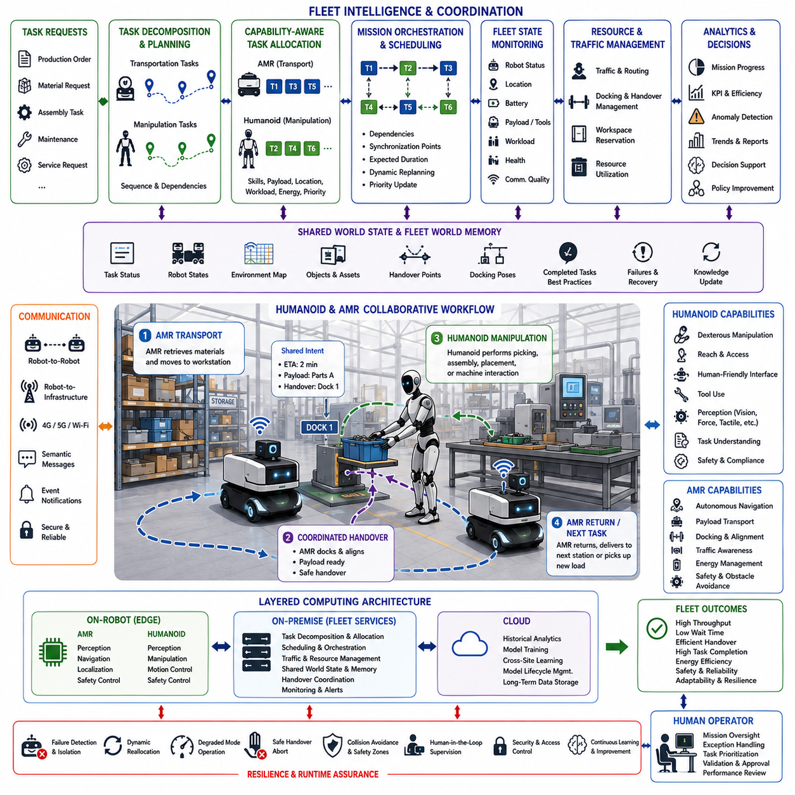{width="7.268055555555556in" height="7.268055555555556in"}

Humanoid and AMR collaboration combines two complementary forms of embodiment within a heterogeneous Physical AI fleet. Autonomous Mobile Robots provide efficient, stable, and energy-conscious transportation across structured floors, while humanoid robots contribute manipulation, reach, dexterity, and compatibility with environments designed for people. Coordinating these capabilities allows the fleet to separate mobility-intensive transport from manipulation-intensive work.

A typical collaborative workflow begins when a production, warehouse, or service request is decomposed into transportation and manipulation subtasks. An AMR may retrieve materials and move them rapidly to a workstation, while a humanoid receives the delivery, identifies the required objects, and performs picking, placement, assembly, loading, or machine interaction. The overall mission is therefore executed as a coordinated sequence rather than as isolated robot activities.

Task representation must describe more than destination and priority because the two embodiments possess fundamentally different capabilities. Tasks can include required payload, manipulation complexity, workspace height, reachability, mobility requirements, sensing needs, deadlines, and safety constraints. Capability-aware task allocation then assigns transport-oriented work to AMRs and manipulation-oriented work to humanoids while considering situations in which either platform can perform alternative roles.

The AMR can also function as a mobile logistics buffer for the humanoid. Instead of requiring the humanoid to walk repeatedly between storage and work areas, AMRs can deliver tools, components, containers, or partially completed products directly to its workspace. This reduces unnecessary humanoid locomotion, preserves energy for manipulation, and enables multiple AMRs to continuously supply one or more humanoids according to changing production demand.

Coordination requires explicit representation of task dependencies. A humanoid cannot begin an assembly operation until the necessary components arrive, while an AMR may not remove a container until manipulation is complete. Fleet orchestration therefore represents precedence constraints, synchronization points, expected durations, and completion events. Dynamic scheduling adjusts these relationships when transportation delays, manipulation failures, congestion, or changing priorities alter the original workflow.

Shared intent and team context allow each robot to understand how its current action contributes to the larger mission. An AMR approaching a humanoid workstation can communicate arrival time, payload identity, docking intent, and expected handover state. The humanoid can report readiness, manipulation progress, completion, or requests for additional materials. Semantic communication makes these exchanges meaningful without requiring either robot to access every internal state of the other.

Physical handover is a critical interaction point because transportation and manipulation meet in a shared workspace. The system must coordinate AMR pose, humanoid reachability, payload orientation, docking accuracy, and handover timing. Standardized transfer locations or containers can simplify this process, while perception-based alignment allows greater flexibility. Successful collaboration depends on representing the handover as a jointly constrained physical action rather than two independent tasks.

Shared spatial and semantic maps provide a common environmental reference for both embodiments. AMRs primarily require navigable floor geometry, traffic lanes, docking locations, and obstacle information, while humanoids additionally require manipulation surfaces, object locations, reachable regions, doors, controls, and human-oriented semantic features. A common world representation can preserve shared structure while providing embodiment-specific information needed for different forms of physical interaction.

Fleet world memory extends this representation with operational experience. The system can remember successful docking poses, reliable handover configurations, congested routes, difficult manipulation stations, object placement preferences, failure conditions, and recovery strategies. Future missions can reuse these experiences, allowing knowledge generated by one robot to influence planning for another even when their bodies and control policies are substantially different.

Cross-embodiment communication requires common abstractions that do not depend on robot-specific control commands. Concepts such as task identity, object, destination, capability, completion state, uncertainty, assistance request, and safety condition can form a shared semantic layer. The AMR does not need to understand humanoid joint trajectories, and the humanoid does not need access to wheel control; both instead coordinate through meaningful operational concepts.

Dynamic reallocation becomes valuable when one member of the heterogeneous fleet becomes unavailable. If an AMR fails, another transport robot can collect its pending deliveries. If a humanoid encounters a manipulation failure, the task may be reassigned to another capable humanoid or redirected for human assistance. Fleet intelligence preserves mission continuity by separating the operational objective from the identity of the robot originally assigned to execute it.

Collaboration can also become opportunistic rather than completely predetermined. A nearby AMR with available capacity may collect an item required by a humanoid during another mission, or an idle humanoid may perform a simple manipulation task at a station along its route. Such decisions require fleet-level awareness of location, capabilities, workload, energy, and task dependencies so that local opportunities improve rather than disrupt global performance.

Collective learning enables improvements to propagate across the heterogeneous fleet. Successful handovers can identify preferred docking poses and object orientations, while failures can reveal reachability problems, perception ambiguities, unstable payload configurations, or timing errors. Experience accumulated across AMRs and humanoids can improve task allocation, docking, manipulation preparation, workflow scheduling, and semantic communication, forming a shared data flywheel.

Cross-embodiment learning is more difficult than learning between identical robots because observations and actions have different physical meanings. Useful knowledge should therefore be transferred at appropriate abstraction levels. Task success, object semantics, spatial relationships, risk, workflow structure, and environmental context may be broadly shareable, while locomotion and manipulation policies remain embodiment-specific. This separation supports collective learning without assuming physical equivalence.

The computing architecture can distribute responsibilities across edge, on-premise, and cloud layers. Each AMR and humanoid retains local perception, control, navigation or manipulation, and safety functions. On-premise fleet intelligence manages task decomposition, scheduling, traffic, shared world state, handover coordination, and operational monitoring. Cloud systems can support historical analytics, large-scale training, cross-site learning, and model lifecycle management.

Safety is especially important when humanoids, AMRs, and people share the same operational environment. Local safety mechanisms enforce collision avoidance, speed limits, stability constraints, emergency behavior, and safe manipulation. Fleet coordination additionally prevents unsafe task interactions, such as an AMR departing during a handover or another robot entering a constrained workspace. Collective optimization must therefore operate within independently enforced physical safety boundaries.

Human workers may participate directly in the collaborative workflow. A person can provide exceptions, confirm uncertain object states, perform difficult manipulations, or temporarily replace an unavailable robot. Human-robot and robot-robot teaming can therefore share the same mission framework when roles, capabilities, permissions, and task states are explicitly represented. The fleet becomes an orchestration system for mixed physical agents rather than robots alone.

Operational resilience depends on detecting failures and degrading gracefully. A humanoid with reduced manipulation capability may continue simpler tasks, while an AMR with limited battery can be restricted to short missions. The scheduler can modify assignments according to remaining capability instead of treating every degradation as complete failure. This capability-aware recovery preserves useful fleet capacity while preventing robots from executing tasks beyond their current safe operating envelope.

Performance should be measured at the workflow level rather than by evaluating AMR transportation and humanoid manipulation independently. Relevant indicators include completed workflows, transport waiting time, humanoid idle time, handover success, manipulation completion, robot utilization, energy consumption, intervention frequency, failure recovery, and total cycle time. Effective collaboration minimizes waiting and redundant movement while keeping each embodiment focused on tasks that exploit its strengths.

Humanoid and AMR collaboration therefore illustrates the importance of heterogeneous fleet orchestration within Multi-Robot Physical AI. Mobility, manipulation, task allocation, shared intent, semantic communication, world memory, collective learning, and runtime assurance become interconnected capabilities. The system gains value not because humanoids and AMRs perform identical tasks, but because their different physical abilities can be composed into coordinated end-to-end workflows.

As collaboration matures, the fleet can progress from predefined handoffs toward adaptive collective intelligence. Robots learn which combinations of transport, staging, manipulation, and assistance produce reliable outcomes under changing conditions. AMRs and humanoids remain embodiment-specific autonomous agents, yet shared knowledge and fleet-level reasoning allow them to operate as components of a larger distributed physical intelligence capable of reorganizing work around available capabilities.

휴머노이드와 자율이동로봇 협업(Humanoid and AMR Collaboration)은 이기종 피지컬 AI 군집(Heterogeneous Physical AI Fleet) 내에서 서로 상호 보완적인 두 가지 체화 형태(Embodiment)를 결합한다. 자율이동로봇(Autonomous Mobile Robot, AMR)은 구조화된 평면에서 효율적이고 안정적이며 에너지 효율적인 운송을 담당하고, 휴머노이드 로봇(Humanoid Robot)은 조작, 도달 능력, 정교한 작업 능력, 인간 중심 환경과의 호환성을 제공한다. 이러한 능력을 조정하면 이동 중심의 운송과 조작 중심의 작업을 효과적으로 분리할 수 있다.

일반적인 협업 워크플로(Collaborative Workflow)는 생산, 창고 또는 서비스 요청을 운송과 조작의 하위 작업으로 분해하면서 시작된다. AMR은 자재를 가져와 작업 스테이션까지 신속하게 운송하고, 휴머노이드는 전달된 자재를 받아 필요한 물체를 식별한 후 피킹, 배치, 조립, 적재 또는 기계 조작을 수행할 수 있다. 따라서 전체 임무는 서로 독립된 로봇 활동이 아니라 조정된 일련의 작업으로 실행된다.

두 체화 형태는 근본적으로 서로 다른 능력을 가지므로 작업 표현(Task Representation)은 목적지와 우선순위 이상의 정보를 기술해야 한다. 작업에는 필요한 적재량, 조작 복잡도, 작업공간 높이, 도달 가능성, 이동 요구사항, 센싱 요구사항, 마감시간, 안전 제약 등이 포함될 수 있다. 능력 인지형 작업 할당(Capability-Aware Task Allocation)은 운송 중심 작업을 AMR에, 조작 중심 작업을 휴머노이드에 배정하면서 각 플랫폼이 대체 역할을 수행할 수 있는 상황도 함께 고려한다.

AMR은 휴머노이드를 위한 이동형 물류 버퍼(Mobile Logistics Buffer) 역할도 수행할 수 있다. 휴머노이드가 보관 장소와 작업 영역 사이를 반복적으로 보행하도록 하는 대신 AMR이 공구, 부품, 컨테이너 또는 부분적으로 완성된 제품을 작업공간까지 직접 전달할 수 있다. 이를 통해 불필요한 휴머노이드 이동을 줄이고 조작 작업에 사용할 에너지를 보존하면서 변화하는 생산 수요에 따라 여러 AMR이 하나 이상의 휴머노이드에 지속적으로 물품을 공급할 수 있다.

조정(Coordination)을 위해서는 작업 의존성(Task Dependency)을 명시적으로 표현해야 한다. 필요한 부품이 도착하기 전에는 휴머노이드가 조립 작업을 시작할 수 없으며, 조작 작업이 완료되기 전에는 AMR이 컨테이너를 회수할 수 없다. 따라서 군집 오케스트레이션(Fleet Orchestration)은 선행 관계 제약, 동기화 지점, 예상 작업시간, 완료 이벤트를 표현해야 한다. 운송 지연, 조작 실패, 혼잡 또는 우선순위 변경으로 기존 워크플로가 달라지면 동적 스케줄링(Dynamic Scheduling)을 통해 이러한 관계를 조정한다.

공유 의도 및 팀 컨텍스트(Shared Intent and Team Context)를 통해 각 로봇은 현재 행동이 전체 임무에 어떻게 기여하는지 이해할 수 있다. 휴머노이드 작업 스테이션에 접근하는 AMR은 도착 예정 시간, 페이로드 식별 정보, 도킹 의도, 예상 인계 상태를 전달할 수 있다. 휴머노이드는 준비 상태, 조작 진행 상황, 완료 여부 또는 추가 자재 요청을 보고할 수 있다. 의미 기반 통신(Semantic Communication)은 각 로봇이 상대방의 모든 내부 상태에 접근하지 않고도 의미 있는 정보를 교환하도록 한다.

물리적 인계(Physical Handover)는 운송과 조작이 공유 작업공간에서 만나는 핵심 상호작용 지점이다. 시스템은 AMR 자세, 휴머노이드의 도달 가능성, 페이로드 방향, 도킹 정확도, 인계 시점을 조정해야 한다. 표준화된 전달 위치나 컨테이너를 사용하면 이 과정을 단순화할 수 있으며, 인지 기반 정렬(Perception-Based Alignment)을 적용하면 더 높은 유연성을 확보할 수 있다. 성공적인 협업을 위해서는 인계를 서로 독립된 두 작업이 아니라 공동으로 제약되는 물리적 행동(Jointly Constrained Physical Action)으로 표현해야 한다.

공유 공간 및 의미 지도(Shared Spatial and Semantic Maps)는 두 체화 형태에 공통된 환경 기준을 제공한다. AMR에는 주행 가능한 바닥 형상, 교통 차선, 도킹 위치, 장애물 정보가 주로 필요하지만, 휴머노이드에는 조작 표면, 물체 위치, 도달 가능한 영역, 출입문, 제어 장치, 인간 중심의 의미적 특성이 추가로 필요하다. 공통 월드 표현(Common World Representation)은 공유 구조를 유지하면서 서로 다른 물리적 상호작용에 필요한 체화 특화 정보(Embodiment-Specific Information)를 제공할 수 있다.

군집 월드 메모리(Fleet World Memory)는 이러한 표현을 운영 경험으로 확장한다. 시스템은 성공적인 도킹 자세, 신뢰할 수 있는 인계 구성, 혼잡한 경로, 조작이 어려운 스테이션, 선호되는 물체 배치, 실패 조건, 복구 전략 등을 기억할 수 있다. 미래 임무는 이러한 경험을 재사용할 수 있으며, 로봇의 신체 구조와 제어 정책이 크게 다르더라도 한 로봇이 생성한 지식이 다른 로봇의 계획에 영향을 줄 수 있다.

교차 체화 통신(Cross-Embodiment Communication)에는 로봇별 제어 명령에 의존하지 않는 공통 추상화(Common Abstraction)가 필요하다. 작업 식별자, 물체, 목적지, 능력, 완료 상태, 불확실성, 지원 요청, 안전 상태와 같은 개념이 공유 의미 계층(Shared Semantic Layer)을 구성할 수 있다. AMR은 휴머노이드의 관절 궤적을 이해할 필요가 없으며, 휴머노이드 역시 휠 제어 정보에 접근할 필요가 없다. 두 로봇은 대신 운영적으로 의미 있는 개념을 통해 조정한다.

이기종 군집의 구성원 중 하나를 사용할 수 없게 되면 동적 재할당(Dynamic Reallocation)이 중요해진다. AMR에 장애가 발생하면 다른 운송 로봇이 대기 중인 배송 임무를 이어받을 수 있다. 휴머노이드에서 조작 실패가 발생하면 해당 작업을 다른 능력 있는 휴머노이드에 재할당하거나 사람의 지원이 필요한 작업으로 전환할 수 있다. 군집 지능(Fleet Intelligence)은 운영 목표와 최초에 작업을 할당받은 로봇의 정체성을 분리하여 임무 연속성을 유지한다.

협업은 완전히 사전 정의된 방식뿐 아니라 기회 기반(Opportunistic)으로 이루어질 수도 있다. 여유 적재 공간을 가진 인근 AMR이 다른 임무를 수행하는 동안 휴머노이드가 필요로 하는 물품을 함께 운반하거나, 유휴 상태의 휴머노이드가 이동 경로상의 스테이션에서 간단한 조작 작업을 수행할 수 있다. 이러한 의사결정을 위해서는 위치, 능력, 작업량, 에너지, 작업 의존성에 대한 군집 수준의 인식이 필요하며, 이를 통해 로컬 기회가 전체 성능을 방해하는 것이 아니라 향상시키도록 해야 한다.

집단 학습(Collective Learning)을 통해 개선된 결과를 이기종 군집 전체에 확산할 수 있다. 성공적인 인계 경험을 통해 선호되는 도킹 자세와 물체 방향을 파악할 수 있으며, 실패 경험을 통해 도달 가능성 문제, 인지 모호성, 불안정한 페이로드 구성, 타이밍 오류 등을 발견할 수 있다. AMR과 휴머노이드에서 축적된 경험은 작업 할당, 도킹, 조작 준비, 워크플로 스케줄링, 의미 기반 통신을 개선하여 공유 데이터 플라이휠(Shared Data Flywheel)을 형성할 수 있다.

교차 체화 학습(Cross-Embodiment Learning)은 관측과 행동이 서로 다른 물리적 의미를 가지기 때문에 동일한 로봇 간 학습보다 어렵다. 따라서 유용한 지식은 적절한 추상화 수준에서 전달되어야 한다. 작업 성공 여부, 물체 의미, 공간 관계, 위험, 워크플로 구조, 환경 컨텍스트는 광범위하게 공유할 수 있지만 보행이나 주행 및 조작 정책은 체화 특화(Embodiment-Specific) 상태로 유지될 수 있다. 이러한 분리는 물리적 동등성을 가정하지 않으면서 집단 학습을 지원한다.

컴퓨팅 아키텍처(Computing Architecture)는 엣지(Edge), 온프레미스(On-Premise), 클라우드(Cloud) 계층에 역할을 분산할 수 있다. 각 AMR과 휴머노이드는 로컬 인지, 제어, 내비게이션 또는 조작, 안전 기능을 유지한다. 온프레미스 군집 지능(On-Premise Fleet Intelligence)은 작업 분해, 스케줄링, 교통, 공유 월드 상태, 인계 조정, 운영 모니터링을 관리한다. 클라우드 시스템은 이력 분석, 대규모 학습, 사이트 간 학습, 모델 수명주기 관리(Model Lifecycle Management)를 지원할 수 있다.

휴머노이드, AMR, 사람이 동일한 운영 환경을 공유할 때 안전(Safety)은 특히 중요하다. 로컬 안전 메커니즘(Local Safety Mechanism)은 충돌 회피, 속도 제한, 안정성 제약, 비상 행동, 안전한 조작을 보장한다. 군집 조정은 AMR이 인계 도중 출발하거나 다른 로봇이 제한된 작업공간으로 진입하는 것과 같은 위험한 작업 상호작용도 방지해야 한다. 따라서 집단 최적화(Collective Optimization)는 독립적으로 강제되는 물리적 안전 경계 내에서 수행되어야 한다.

인간 작업자(Human Worker)는 협업 워크플로에 직접 참여할 수도 있다. 사람은 예외 상황을 처리하고, 불확실한 물체 상태를 확인하며, 어려운 조작을 수행하거나, 일시적으로 사용할 수 없는 로봇의 역할을 대신할 수 있다. 따라서 역할, 능력, 권한, 작업 상태를 명시적으로 표현하면 인간-로봇 및 로봇-로봇 팀 구성(Human-Robot and Robot-Robot Teaming)을 동일한 임무 프레임워크에서 관리할 수 있다. 군집은 단순한 로봇이 아니라 혼합 물리 에이전트(Mixed Physical Agent)를 위한 오케스트레이션 시스템으로 발전한다.

운영 복원력(Operational Resilience)은 장애를 감지하고 점진적으로 성능을 저하시키는 능력에 의존한다. 조작 능력이 저하된 휴머노이드는 더 단순한 작업을 계속 수행할 수 있으며, 배터리가 부족한 AMR은 짧은 임무로 제한할 수 있다. 스케줄러는 모든 성능 저하를 완전한 장애로 처리하지 않고 남아 있는 능력에 따라 작업을 변경할 수 있다. 이러한 능력 인지형 복구(Capability-Aware Recovery)는 로봇이 현재의 안전 운영 범위를 벗어난 작업을 수행하지 않도록 하면서 유용한 군집 능력을 보존한다.

성능(Performance)은 AMR 운송과 휴머노이드 조작을 독립적으로 평가하기보다 전체 워크플로 수준에서 측정해야 한다. 관련 지표에는 완료된 워크플로 수, 운송 대기시간, 휴머노이드 유휴시간, 인계 성공률, 조작 완료율, 로봇 활용률, 에너지 소비량, 작업자 개입 빈도, 장애 복구, 전체 사이클 타임(Total Cycle Time) 등이 포함된다. 효과적인 협업은 대기와 불필요한 이동을 최소화하면서 각 체화 형태가 자신의 강점을 활용하는 작업에 집중하도록 한다.

따라서 휴머노이드와 AMR 협업(Humanoid and AMR Collaboration)은 다중 로봇 피지컬 AI(Multi-Robot Physical AI)에서 이기종 군집 오케스트레이션(Heterogeneous Fleet Orchestration)의 중요성을 보여준다. 이동성, 조작, 작업 할당, 공유 의도, 의미 기반 통신, 월드 메모리, 집단 학습, 런타임 보증(Runtime Assurance)은 서로 연결된 능력으로 작동한다. 시스템의 가치는 휴머노이드와 AMR이 동일한 작업을 수행하는 것이 아니라 서로 다른 물리적 능력을 조합하여 조정된 엔드투엔드 워크플로(End-to-End Workflow)를 형성하는 데 있다.

협업이 성숙하면 군집은 사전에 정의된 인계 방식에서 적응형 집단 지능(Adaptive Collective Intelligence)으로 발전할 수 있다. 로봇은 변화하는 조건에서 어떤 운송, 스테이징(Staging), 조작, 지원의 조합이 신뢰성 높은 결과를 만드는지 학습한다. AMR과 휴머노이드는 각각 체화 특화 자율 에이전트(Embodiment-Specific Autonomous Agent)로 유지되지만, 공유 지식과 군집 수준 추론(Fleet-Level Reasoning)을 통해 사용 가능한 능력을 중심으로 작업을 재구성할 수 있는 더 큰 분산 물리 지능(Distributed Physical Intelligence)의 구성요소로 동작하게 된다.

## 10.06. AMR and Mobile Manipulator Collaboration

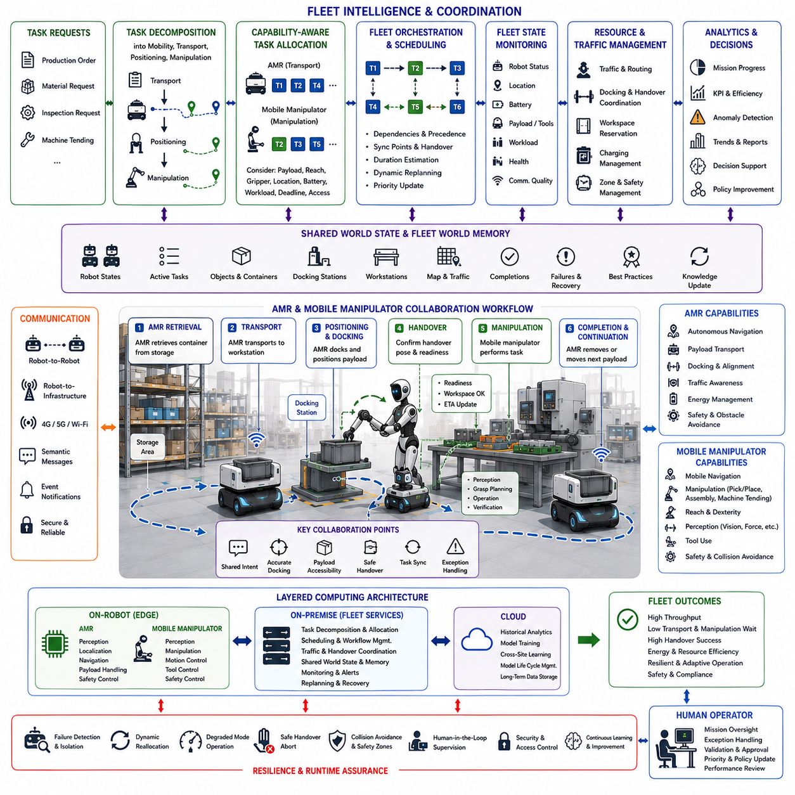{width="7.268055555555556in" height="7.268055555555556in"}

An AMR and mobile manipulator collaboration system combines high-efficiency material transportation with flexible robotic manipulation inside a coordinated Multi-Robot Physical AI architecture. AMRs move payloads between storage, production, inspection, and staging areas, while mobile manipulators perform picking, placement, loading, unloading, machine tending, and tool interaction. Their complementary capabilities enable complete logistics-to-manipulation workflows rather than isolated robotic functions.

The collaboration begins by decomposing operational requests into mobility, transport, positioning, and manipulation tasks. A production order may require an AMR to retrieve a container, transport it to a workstation, and position it for access before a mobile manipulator performs object handling. After manipulation is completed, the AMR can move the processed material onward, creating an integrated sequence of physical actions across multiple robots.

Task allocation must reflect differences in robot embodiment and capability. AMRs are generally optimized for reliable navigation and payload transportation, whereas mobile manipulators combine navigation with articulated manipulation and may have lower transport efficiency. Fleet intelligence therefore considers payload, reach, gripper type, manipulation complexity, location, battery state, workload, deadline, and accessibility when selecting the most appropriate robot for each part of a mission.

Mobile manipulators can operate independently for tasks requiring both movement and manipulation, but collaboration with dedicated AMRs can improve overall efficiency. Instead of carrying materials over long distances themselves, manipulators can remain near work-intensive areas while AMRs continuously deliver and remove payloads. This specialization reduces unnecessary manipulator travel and allows expensive manipulation resources to spend more time performing value-added physical interaction.

Shared task representations are necessary to coordinate the transition between transportation and manipulation. The system must represent object identity, container state, destination, required pose, manipulation procedure, completion criteria, and dependency relationships. An AMR delivery is not considered operationally complete merely because it reaches a location; the payload must be positioned so that the mobile manipulator can perceive, reach, and safely interact with it.

Docking and handover therefore become critical collaborative behaviors. The AMR must approach a transfer zone with sufficient positioning accuracy, while the mobile manipulator must determine whether the payload lies within its reachable workspace. Perception can refine relative alignment between the robots, container, and objects. Standardized docking interfaces simplify coordination, while perception-based adaptation allows the system to tolerate realistic positioning uncertainty.

Shared intent improves synchronization during physical interaction. Before docking, an AMR can communicate its destination, payload, estimated arrival time, and intended transfer pose. The mobile manipulator can report readiness, workspace availability, expected manipulation duration, or temporary delay. These semantic messages allow both robots and the fleet coordinator to reason about mission progress without exchanging detailed low-level control states.

Fleet orchestration represents dependencies between transport and manipulation tasks as a coordinated workflow. A manipulation task may remain blocked until a required AMR arrives, while an AMR may wait for a container to be released after processing. Scheduling should minimize these waiting periods by predicting travel and manipulation durations. Dynamic replanning can adjust arrival sequences when congestion, manipulation uncertainty, equipment delays, or priority changes occur.

Shared world state provides a common operational representation across both robot classes. It can include robot positions, active tasks, object and container locations, docking stations, workstation availability, restricted zones, traffic conditions, and mission status. Each robot accesses the information relevant to its role while contributing observations back to the shared state, allowing distributed physical actions to remain synchronized across the facility.

Fleet world memory extends the shared state with historical experience. The system can remember successful docking poses, manipulation configurations, container orientations, difficult workstations, congestion patterns, recurring failures, and recovery strategies. When similar missions occur later, previous experience can influence planning and execution, transforming repeated robot operations into persistent collective knowledge rather than independent task repetitions.

The shared map must support embodiment-specific interpretation. An AMR primarily evaluates whether a route provides sufficient floor clearance and traffic access, while a mobile manipulator must additionally consider arm reachability, manipulation clearance, object visibility, base placement, and collision-free arm motion. A common environment model can therefore maintain shared geometry and semantics while exposing different feasibility criteria for transportation and manipulation.

Communication should prioritize information that changes collaborative decisions. Robots can exchange task state, location, intent, readiness, completion, uncertainty, failure, and assistance requests through compact semantic messages. High-bandwidth perception data can be transmitted only when required for shared interpretation or remote analysis. This reduces communication overhead while preserving the information necessary for coordinated multi-robot behavior.

Dynamic task reallocation provides resilience when individual robots become unavailable. If an AMR fails during transportation, another AMR can receive the unfinished delivery. If a mobile manipulator experiences a gripper or perception problem, the task can be transferred to another compatible manipulator or escalated for human intervention. The operational objective remains persistent even when the robot originally assigned to the task changes.

Capability degradation can also be handled without treating every fault as complete robot failure. An AMR with reduced battery capacity may continue short transport missions, while a mobile manipulator with limited gripper capability may perform tasks involving compatible objects. Capability-aware scheduling evaluates the remaining functional envelope of each robot and assigns work accordingly, improving fleet utilization while maintaining defined safety constraints.

Collective learning enables experience from transportation and manipulation to improve future collaborative workflows. Repeated operations can reveal docking poses associated with reliable handovers, object arrangements that simplify grasping, routes that create delays, or workstations where perception frequently fails. These observations can improve scheduling, docking, grasp preparation, base placement, task allocation, and recovery strategies across the fleet.

A fleet data flywheel emerges when difficult cases, failures, and successful executions are systematically collected. Manipulation failures can become training examples, while efficient transport-to-manipulation sequences become reusable workflow patterns. Updated perception models, policies, and operational parameters can then be redistributed, allowing knowledge obtained from one robot or workstation to improve future behavior across many collaborative agents.

Multi-robot traffic management remains important because AMRs and mobile manipulators may share corridors, intersections, charging areas, transfer stations, and production zones. Fleet-level planning can reserve constrained resources and coordinate arrival times, while each robot retains local collision avoidance. Manipulators may require larger temporary safety zones during arm operation, so traffic management must account for changing workspace footprints as well as mobile base positions.

Energy management should coordinate transportation demand with manipulation workload. AMRs typically consume energy primarily through mobility, whereas mobile manipulators must support both base motion and arm operation. Fleet scheduling can estimate mission-specific energy requirements and coordinate charging so that critical manipulation resources are not removed from service during peak demand and transport capacity remains sufficient to feed active workstations.

The computing architecture can distribute intelligence across robot, on-premise, and cloud layers. On-robot edge systems execute perception, localization, navigation, manipulation control, and immediate safety functions. On-premise fleet services manage task decomposition, scheduling, traffic, handovers, shared world state, and operational monitoring. Cloud resources can support historical analytics, model training, cross-site learning, and long-term knowledge management.

Runtime assurance is essential wherever multiple robots physically interact. Local controllers enforce collision avoidance, speed limits, manipulator workspace constraints, payload stability, and emergency behavior. Fleet coordination adds protection against unsafe workflow states, such as an AMR departing while a manipulator is interacting with its payload. Collaborative optimization must always remain subordinate to independently enforced physical safety constraints.

Human operators supervise exceptions, uncertain manipulation outcomes, failed handovers, robot health, and changing production priorities. Routine transport and manipulation can remain autonomous, while humans validate ambiguous states or authorize recovery when required. This exception-oriented supervision reduces continuous teleoperation and allows one operator to oversee a larger heterogeneous fleet while retaining authority over safety-critical or operationally significant decisions.

Performance should be evaluated across the complete collaborative workflow. Important measures include completed tasks, transport latency, manipulator utilization, AMR waiting time, manipulation waiting time, docking success, handover reliability, energy consumption, intervention frequency, recovery time, and total mission cycle time. Optimization should reduce idle periods and redundant movement while keeping each robot focused on work appropriate to its embodiment.

AMR and mobile manipulator collaboration therefore demonstrates how transportation, manipulation, capability-aware task allocation, shared world state, semantic communication, fleet memory, dynamic replanning, collective learning, and runtime assurance can operate as one Multi-Robot Physical AI system. The robots remain individually autonomous, but fleet intelligence composes their different physical capabilities into coordinated end-to-end operations.

As the system accumulates experience, collaboration can evolve from predefined transport-and-manipulation sequences toward adaptive collective physical intelligence. The fleet learns how to position resources, synchronize robots, select appropriate capabilities, recover from failures, and reorganize workflows as conditions change. AMRs and mobile manipulators then function not as separate automation islands, but as complementary embodied agents within a shared, learning, and continuously adapting physical intelligence.

AMR과 모바일 매니퓰레이터 협업 시스템(AMR and Mobile Manipulator Collaboration System)은 고효율 자재 운송과 유연한 로봇 조작을 조정된 다중 로봇 피지컬 AI(Multi-Robot Physical AI) 아키텍처 안에서 결합한다. AMR은 보관, 생산, 검사, 스테이징 영역 사이에서 페이로드를 운송하고, 모바일 매니퓰레이터(Mobile Manipulator)는 피킹, 배치, 적재, 하역, 머신 텐딩(Machine Tending), 공구 조작을 수행한다. 이러한 상호 보완적 능력은 개별 로봇 기능을 넘어 물류에서 조작까지 연결되는 완전한 워크플로를 가능하게 한다.

협업은 운영 요청을 이동, 운송, 위치 결정, 조작 작업으로 분해하면서 시작된다. 생산 주문의 경우 AMR이 컨테이너를 가져와 작업 스테이션까지 운송하고 접근 가능한 위치에 배치한 다음, 모바일 매니퓰레이터가 물체를 취급하도록 구성할 수 있다. 조작 작업이 완료되면 AMR은 처리된 자재를 다음 위치로 운송하여 여러 로봇에 걸친 물리적 행동을 하나의 통합된 작업 순서로 구성한다.

작업 할당(Task Allocation)은 로봇의 체화(Embodiment)와 능력 차이를 반영해야 한다. AMR은 일반적으로 안정적인 내비게이션과 페이로드 운송에 최적화되는 반면, 모바일 매니퓰레이터는 이동과 관절형 조작을 결합하므로 운송 효율이 상대적으로 낮을 수 있다. 따라서 군집 지능(Fleet Intelligence)은 각 임무에 가장 적합한 로봇을 선택할 때 페이로드, 도달 범위, 그리퍼 유형, 조작 복잡도, 위치, 배터리 상태, 작업량, 마감시간, 접근성을 고려한다.

모바일 매니퓰레이터는 이동과 조작이 모두 필요한 작업을 독립적으로 수행할 수 있지만, 전용 AMR과 협업하면 전체 효율을 향상시킬 수 있다. 매니퓰레이터가 장거리 자재 운송까지 직접 수행하는 대신 작업 집약적인 영역 가까이에 머무르고, AMR이 지속적으로 페이로드를 공급하고 회수할 수 있다. 이러한 전문화(Specialization)는 불필요한 매니퓰레이터 이동을 줄이고 고가의 조작 자원이 부가가치를 창출하는 물리적 상호작용에 더 많은 시간을 사용하도록 한다.

운송에서 조작으로 전환되는 과정을 조정하려면 공유 작업 표현(Shared Task Representation)이 필요하다. 시스템은 물체 식별 정보, 컨테이너 상태, 목적지, 요구 자세, 조작 절차, 완료 기준, 작업 의존 관계를 표현해야 한다. AMR이 특정 위치에 도착했다고 해서 운영적으로 배송이 완료된 것은 아니며, 모바일 매니퓰레이터가 해당 페이로드를 인지하고 도달하며 안전하게 상호작용할 수 있도록 적절한 자세로 배치되어야 한다.

따라서 도킹 및 인계(Docking and Handover)는 핵심적인 협업 행동이 된다. AMR은 충분한 위치 정확도로 전달 구역에 접근해야 하고, 모바일 매니퓰레이터는 페이로드가 자신의 도달 가능한 작업공간 안에 있는지를 판단해야 한다. 인지(Perception)를 통해 로봇, 컨테이너, 물체 사이의 상대 정렬을 정밀하게 보정할 수 있다. 표준화된 도킹 인터페이스는 조정을 단순화하며, 인지 기반 적응(Perception-Based Adaptation)은 현실적인 위치 오차를 허용할 수 있도록 한다.

공유 의도(Shared Intent)는 물리적 상호작용 과정의 동기화를 향상시킨다. 도킹 전에 AMR은 목적지, 페이로드, 예상 도착 시간, 예정된 전달 자세를 전달할 수 있다. 모바일 매니퓰레이터는 준비 상태, 작업공간 가용성, 예상 조작 시간 또는 일시적인 지연을 보고할 수 있다. 이러한 의미 기반 메시지(Semantic Message)를 통해 두 로봇과 군집 조정기는 세부적인 저수준 제어 상태를 교환하지 않고도 임무 진행 상황을 추론할 수 있다.

군집 오케스트레이션(Fleet Orchestration)은 운송 작업과 조작 작업 사이의 의존성을 하나의 조정된 워크플로로 표현한다. 필요한 AMR이 도착하기 전까지 조작 작업은 대기 상태가 될 수 있으며, AMR은 처리 후 컨테이너가 해제될 때까지 기다릴 수 있다. 스케줄링은 이동 및 조작 시간을 예측하여 이러한 대기시간을 최소화해야 한다. 혼잡, 조작 불확실성, 장비 지연 또는 우선순위 변경이 발생하면 동적 재계획(Dynamic Replanning)을 통해 도착 순서를 조정할 수 있다.

공유 월드 상태(Shared World State)는 두 로봇 유형에 걸쳐 공통된 운영 표현을 제공한다. 여기에는 로봇 위치, 활성 작업, 물체 및 컨테이너 위치, 도킹 스테이션, 작업 스테이션 가용성, 제한 구역, 교통 상황, 임무 상태 등이 포함될 수 있다. 각 로봇은 자신의 역할에 필요한 정보에 접근하는 동시에 관측 결과를 다시 공유 상태에 반영함으로써 시설 전체에 분산된 물리적 행동을 동기화한다.

군집 월드 메모리(Fleet World Memory)는 공유 상태를 과거의 운영 경험으로 확장한다. 시스템은 성공적인 도킹 자세, 조작 구성, 컨테이너 방향, 작업이 어려운 스테이션, 혼잡 패턴, 반복적인 실패, 복구 전략 등을 기억할 수 있다. 이후 유사한 임무가 발생하면 이전 경험이 계획과 실행에 영향을 주어 반복적인 로봇 작업을 독립적인 작업 수행이 아닌 지속적인 집단 지식(Persistent Collective Knowledge)으로 전환한다.

공유 지도(Shared Map)는 체화 특화 해석(Embodiment-Specific Interpretation)을 지원해야 한다. AMR은 주로 경로에 충분한 바닥 여유 공간과 교통 접근성이 있는지를 평가하는 반면, 모바일 매니퓰레이터는 팔의 도달 가능성, 조작 여유 공간, 물체 가시성, 베이스 배치, 충돌 없는 팔 움직임까지 추가로 고려해야 한다. 따라서 공통 환경 모델(Common Environment Model)은 공유되는 기하학적 구조와 의미 정보를 유지하면서 운송과 조작에 서로 다른 실행 가능성 기준을 제공할 수 있다.

통신(Communication)은 협업 의사결정을 변화시키는 정보를 우선적으로 전달해야 한다. 로봇은 간결한 의미 기반 메시지를 통해 작업 상태, 위치, 의도, 준비 상태, 완료 여부, 불확실성, 장애, 지원 요청 등을 교환할 수 있다. 고대역폭 인지 데이터는 공유 해석이나 원격 분석이 필요한 경우에만 전송할 수 있다. 이를 통해 조정된 다중 로봇 행동에 필요한 정보를 유지하면서 통신 오버헤드를 줄일 수 있다.

개별 로봇을 사용할 수 없게 되면 동적 작업 재할당(Dynamic Task Reallocation)이 복원력(Resilience)을 제공한다. 운송 중 AMR에 장애가 발생하면 다른 AMR이 미완료 배송을 이어받을 수 있다. 모바일 매니퓰레이터에서 그리퍼 또는 인지 문제가 발생하면 해당 작업을 호환 가능한 다른 매니퓰레이터로 이전하거나 인간의 개입이 필요한 작업으로 전환할 수 있다. 최초에 할당된 로봇이 변경되더라도 운영 목표 자체는 지속적으로 유지된다.

모든 고장을 완전한 로봇 장애로 처리하지 않고 능력 저하(Capability Degradation)를 관리할 수도 있다. 배터리 용량이 감소한 AMR은 짧은 운송 임무를 계속 수행하고, 그리퍼 기능이 제한된 모바일 매니퓰레이터는 호환 가능한 물체를 대상으로 작업할 수 있다. 능력 인지형 스케줄링(Capability-Aware Scheduling)은 각 로봇에 남아 있는 기능적 운영 범위를 평가하여 안전 제약을 유지하면서 적절한 작업을 할당하고 군집 활용률을 향상시킨다.

집단 학습(Collective Learning)을 통해 운송과 조작 과정에서 축적된 경험을 미래의 협업 워크플로 개선에 활용할 수 있다. 반복적인 운영을 통해 안정적인 인계와 관련된 도킹 자세, 파지를 쉽게 만드는 물체 배치, 지연을 발생시키는 경로, 인지 실패가 빈번한 작업 스테이션 등을 발견할 수 있다. 이러한 관측은 군집 전체의 스케줄링, 도킹, 파지 준비, 베이스 배치, 작업 할당, 복구 전략을 개선하는 데 활용될 수 있다.

어려운 사례, 실패, 성공적인 실행을 체계적으로 수집하면 군집 데이터 플라이휠(Fleet Data Flywheel)이 형성된다. 조작 실패는 새로운 학습 사례가 될 수 있으며, 효율적인 운송-조작 순서는 재사용 가능한 워크플로 패턴으로 축적될 수 있다. 이후 개선된 인지 모델, 정책, 운영 파라미터를 다시 배포하여 하나의 로봇이나 작업 스테이션에서 획득한 지식이 다수의 협업 에이전트의 미래 행동을 개선하도록 할 수 있다.

AMR과 모바일 매니퓰레이터가 통로, 교차로, 충전 구역, 전달 스테이션, 생산 구역을 공유할 수 있으므로 다중 로봇 교통 관리(Multi-Robot Traffic Management)도 중요하다. 군집 수준 계획은 제한된 자원을 예약하고 도착 시간을 조정하며, 각 로봇은 로컬 충돌 회피를 유지한다. 모바일 매니퓰레이터는 팔을 동작하는 동안 더 넓은 임시 안전 영역이 필요할 수 있으므로 교통 관리는 이동 베이스 위치뿐 아니라 변화하는 작업공간 점유 영역까지 고려해야 한다.

에너지 관리(Energy Management)는 운송 수요와 조작 작업량을 함께 조정해야 한다. AMR은 주로 이동을 통해 에너지를 소비하지만 모바일 매니퓰레이터는 베이스 이동과 로봇 팔 동작 모두에 에너지를 사용해야 한다. 군집 스케줄링(Fleet Scheduling)은 임무별 에너지 요구량을 추정하고 충전을 조정하여 수요가 높은 시간에 핵심 조작 자원이 운영에서 이탈하지 않도록 하면서 활성 작업 스테이션에 충분한 운송 능력을 제공할 수 있다.

컴퓨팅 아키텍처(Computing Architecture)는 로봇, 온프레미스(On-Premise), 클라우드(Cloud) 계층에 지능을 분산할 수 있다. 로봇 엣지(On-Robot Edge) 시스템은 인지, 위치추정, 내비게이션, 조작 제어, 즉각적인 안전 기능을 실행한다. 온프레미스 군집 서비스(On-Premise Fleet Services)는 작업 분해, 스케줄링, 교통, 인계, 공유 월드 상태, 운영 모니터링을 관리한다. 클라우드 자원은 이력 분석, 모델 학습, 사이트 간 학습(Cross-Site Learning), 장기적인 지식 관리를 지원할 수 있다.

여러 로봇이 물리적으로 상호작용하는 환경에서는 런타임 보증(Runtime Assurance)이 필수적이다. 로컬 제어기는 충돌 회피, 속도 제한, 매니퓰레이터 작업공간 제약, 페이로드 안정성, 비상 행동을 보장한다. 군집 조정은 매니퓰레이터가 AMR의 페이로드와 상호작용하는 동안 AMR이 출발하는 것과 같은 위험한 워크플로 상태도 방지한다. 협업 최적화는 항상 독립적으로 강제되는 물리적 안전 제약보다 하위에 위치해야 한다.

인간 운영자(Human Operator)는 예외 상황, 불확실한 조작 결과, 실패한 인계, 로봇 건전성, 변화하는 생산 우선순위를 감독한다. 일상적인 운송과 조작은 자율적으로 수행하고, 인간은 모호한 상태를 검증하거나 필요한 경우 복구를 승인할 수 있다. 이러한 예외 중심 감독(Exception-Oriented Supervision)은 지속적인 원격조종을 줄이고 한 명의 운영자가 더 큰 이기종 군집(Heterogeneous Fleet)을 감독하면서 안전 필수 및 운영상 중요한 의사결정에 대한 권한을 유지하도록 한다.

성능(Performance)은 전체 협업 워크플로를 기준으로 평가해야 한다. 중요한 지표에는 완료 작업 수, 운송 지연시간, 매니퓰레이터 활용률, AMR 대기시간, 조작 대기시간, 도킹 성공률, 인계 신뢰성, 에너지 소비량, 작업자 개입 빈도, 복구 시간, 전체 임무 사이클 타임(Total Mission Cycle Time) 등이 포함된다. 최적화는 각 로봇이 자신의 체화 특성에 적합한 작업에 집중하도록 하면서 유휴시간과 불필요한 이동을 줄여야 한다.

따라서 AMR과 모바일 매니퓰레이터 협업(AMR and Mobile Manipulator Collaboration)은 운송, 조작, 능력 인지형 작업 할당(Capability-Aware Task Allocation), 공유 월드 상태, 의미 기반 통신, 군집 메모리, 동적 재계획, 집단 학습, 런타임 보증이 하나의 다중 로봇 피지컬 AI 시스템으로 동작하는 방식을 보여준다. 각 로봇은 개별적인 자율성을 유지하지만 군집 지능은 서로 다른 물리적 능력을 조합하여 조정된 엔드투엔드 운영(End-to-End Operation)을 형성한다.

시스템에 경험이 축적되면 협업은 사전에 정의된 운송-조작 순서에서 적응형 집단 물리 지능(Adaptive Collective Physical Intelligence)으로 발전할 수 있다. 군집은 자원을 어떻게 배치하고, 로봇을 동기화하고, 적절한 능력을 선택하고, 장애에서 복구하며, 조건 변화에 따라 워크플로를 재구성해야 하는지를 학습한다. AMR과 모바일 매니퓰레이터는 더 이상 분리된 자동화 영역이 아니라 공유되고 학습하며 지속적으로 적응하는 물리 지능 안에서 상호 보완적으로 동작하는 체화 에이전트(Embodied Agent)가 된다.

## 10.07. Ground Robot and UAV Collaboration

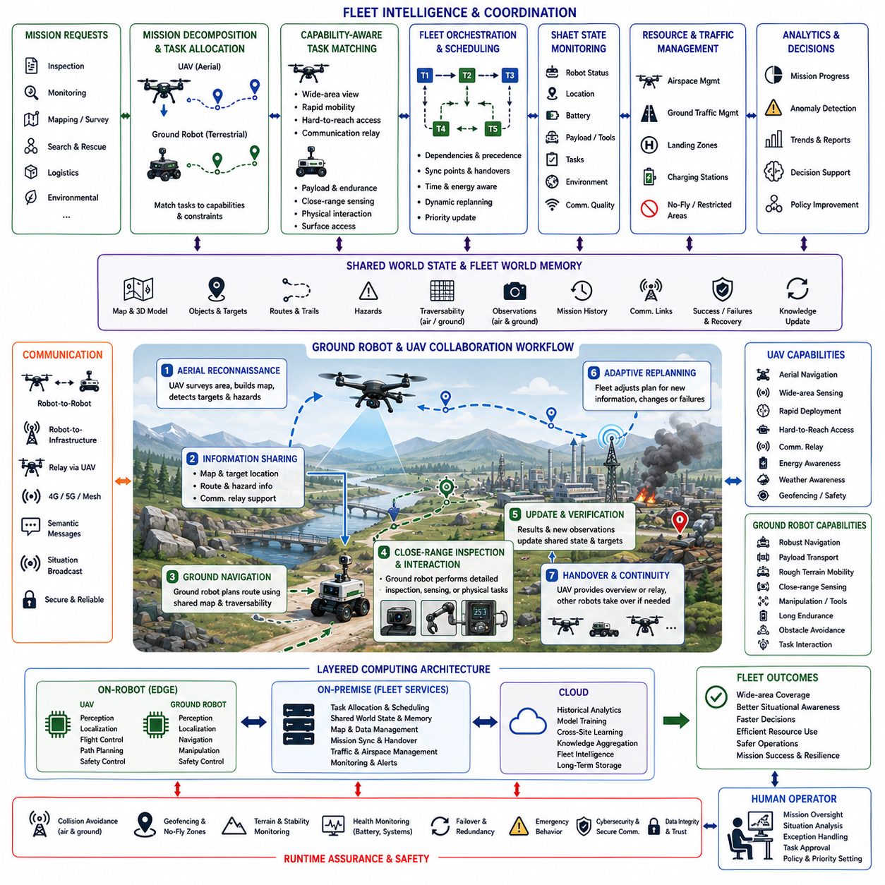{width="7.268055555555556in" height="7.268055555555556in"}

Ground robot and UAV collaboration combines complementary terrestrial and aerial capabilities within a heterogeneous Multi-Robot Physical AI system. Ground robots provide endurance, payload capacity, stable sensing, and physical access at surface level, while UAVs provide rapid mobility, elevated viewpoints, and access across obstacles. Coordinating these embodiments allows the team to observe and act over environments that neither platform can efficiently cover alone.

Typical missions include infrastructure inspection, industrial monitoring, construction surveying, logistics, environmental observation, agriculture, disaster assessment, and search operations. UAVs can rapidly survey large regions and identify targets, hazards, blocked routes, or areas requiring detailed examination. Ground robots can then approach selected locations to perform persistent sensing, transport equipment, collect close-range observations, or execute physical tasks.

Mission decomposition separates objectives according to mobility, sensing, endurance, payload, and accessibility requirements. A broad reconnaissance task may be assigned to a UAV, while detailed inspection or physical intervention is allocated to a ground robot. Capability-aware task matching prevents the system from treating heterogeneous robots as interchangeable agents and instead selects the embodiment whose physical characteristics best satisfy each mission requirement.

Aerial reconnaissance can significantly improve ground navigation. UAV imagery and mapping observations can reveal obstacles, road conditions, terrain boundaries, congestion, hazards, and potential routes beyond the sensing horizon of a ground robot. This information can update the shared environment representation before the ground platform reaches the region, allowing route planning to incorporate observations that would otherwise become available only after local exploration.

Ground robots provide complementary information that aerial platforms may not observe reliably. Surface roughness, wheel slip, local clearance, vegetation density, small obstacles, structural details, and close-range sensor measurements can be difficult to estimate from altitude. Combining aerial and terrestrial observations therefore produces a richer world representation in which global visibility from above is reinforced by detailed physical evidence collected at ground level.

Shared spatial and semantic representation provides the common reference needed for collaboration. Locations, objects, targets, hazards, routes, assets, and restricted areas can be expressed in a shared coordinate and semantic framework. Each robot then interprets this common representation according to its embodiment. A region inaccessible to a wheeled robot may remain traversable by a UAV, while an aerially visible target may still require ground access for detailed interaction.

Fleet world memory extends the shared map with time-stamped operational experience. The system can preserve aerial observations, ground traversability, hazards, successful routes, inaccessible areas, mission outcomes, communication quality, and failure events. New observations update this memory rather than disappearing after a mission, allowing later robots to benefit from previous reconnaissance and physical experience accumulated across both aerial and terrestrial platforms.

Shared traversability must distinguish between aerial and ground mobility. A wall may completely block a ground robot while having little relevance to a UAV, whereas strong wind or restricted airspace may affect the UAV without affecting the ground platform. Capability-aware world memory therefore represents accessibility relative to robot type instead of assigning a single universal traversability value to every region.

Communication links the aerial and ground components into a coordinated team. Robots can exchange position, task status, intent, observations, target locations, hazards, route information, battery condition, and assistance requests. Semantic communication reduces unnecessary traffic by prioritizing mission-relevant messages such as "target detected," "ground route blocked," "landing zone available," or "additional inspection required" rather than continuously transmitting all raw sensor data.

UAVs may also provide temporary communication support when terrain or infrastructure limits direct connectivity. Their elevated position can improve line-of-sight communication or help relay selected information between ground robots and fleet infrastructure. Communication-aware planning can therefore consider not only where a UAV should observe but also where its position improves information flow, especially during operations across large or partially connected environments.

Task dependencies become important when aerial and ground actions form a sequence. A UAV may first locate an asset, verify a route, or identify a hazard before a ground robot is dispatched. The ground robot may then report that closer inspection is required from another aerial viewpoint. Fleet orchestration represents these dependencies and dynamically creates, cancels, or reprioritizes tasks as new observations change the team\'s understanding of the mission.

Cooperative planning must account for different motion spaces and time scales. Ground robots navigate surfaces with terrain and obstacle constraints, whereas UAVs move through three-dimensional airspace and can often reach locations much faster. The scheduler must synchronize these different mobility characteristics so that one platform does not wait unnecessarily for another and aerial endurance is not wasted while ground operations remain incomplete.

Energy constraints further differentiate the two embodiments. Ground robots often provide substantially longer mission endurance, while UAV flight time may be limited by continuous propulsion requirements. Fleet scheduling should therefore use aerial resources selectively for reconnaissance, rapid observation, communication support, or inaccessible locations. Ground robots can assume persistent tasks when appropriate, preserving UAV energy for activities where aerial mobility provides the greatest operational value.

Dynamic replanning becomes necessary when conditions change. A UAV may discover a blocked road, moving hazard, damaged structure, or inaccessible target, causing the ground route and task schedule to change. Conversely, a ground robot may discover terrain conditions that contradict aerial interpretation. The shared world state is updated, uncertainty is revised, and the fleet generates new plans based on the combined evidence rather than relying on the original mission assumptions.

Observation uncertainty should remain associated with its source and context. Aerial imagery may provide broad coverage but limited detail, while ground sensing provides local precision with a restricted field of view. The fleet should preserve sensor modality, viewpoint, timestamp, localization confidence, and observation quality when combining information. Conflicting evidence can then trigger additional sensing instead of being prematurely reduced to a single interpretation.

Cross-embodiment collaboration is especially useful for target localization. A UAV can detect an object or anomaly from above and estimate its position in a shared map. The ground robot can navigate toward that location and refine the estimate using local perception. The resulting ground observation can then update the shared target state, creating a closed information loop in which aerial detection guides terrestrial action and terrestrial verification improves collective knowledge.

Failure handling should preserve mission continuity whenever possible. If a UAV loses sensing capability or must return because of low battery, another aerial platform can continue reconnaissance while ground robots maintain local operations. If a ground robot becomes immobilized, a UAV can observe the surrounding area, provide situational information, or help identify recovery access. Dynamic reallocation separates mission objectives from the availability of any individual robot.

Collective learning allows repeated missions to improve coordination between the two embodiments. Experience can reveal which aerial viewpoints best predict ground traversability, which terrain types produce navigation failures, which flight patterns provide useful inspection coverage, and which communication configurations remain reliable. These observations can improve perception, task allocation, route planning, reconnaissance policies, and cross-embodiment information fusion over time.

Knowledge transfer should occur at suitable abstraction levels because ground and aerial robots possess fundamentally different action spaces. Semantic targets, hazards, spatial relationships, mission outcomes, environmental context, and confidence can be broadly shared, while locomotion and flight-control policies remain embodiment-specific. This allows collective learning to exploit common experience without incorrectly assuming that physical skills transfer directly between platforms.

A layered computing architecture can distribute intelligence across robot, on-premise, and cloud resources. Onboard edge systems execute flight or ground control, perception, localization, local planning, and immediate safety functions. On-premise fleet intelligence manages task allocation, shared world state, mission synchronization, communication, and monitoring, while cloud systems can support historical analysis, model training, and knowledge aggregation across deployments.

Safety and runtime assurance remain local requirements even when missions are globally coordinated. Ground robots enforce collision avoidance, terrain and stability constraints, while UAVs maintain flight stability, separation, altitude, geofencing, and emergency behavior. Fleet-level intelligence can modify mission objectives and routes but should not override essential platform-specific safety mechanisms. Collective optimization therefore operates within hard physical safety boundaries.

Human operators supervise mission objectives, uncertain detections, hazards, robot health, restricted areas, and exceptional recovery situations. A common fleet interface can present aerial and terrestrial observations within one operational picture, allowing humans to understand why tasks were allocated or replanned. Human intervention can then focus on ambiguous or high-consequence decisions rather than routine navigation and sensing.

Performance should be evaluated through collective mission outcomes rather than individual platform capability alone. Relevant measures include area coverage, target detection and verification, mission completion time, ground travel reduction, UAV flight utilization, energy consumption, communication availability, intervention frequency, recovery success, and task completion. Effective collaboration should demonstrate measurable benefits from combining aerial visibility with persistent ground capability.

Ground robot and UAV collaboration therefore illustrates a central principle of heterogeneous Physical AI: different embodiments should contribute complementary capabilities through shared representations, communication, capability-aware task allocation, fleet world memory, and dynamic coordination. The goal is not to make ground and aerial robots behave identically, but to compose their distinct strengths into a unified operational intelligence.

As experience accumulates, the system can evolve from predefined aerial reconnaissance and ground follow-up toward adaptive collective physical intelligence. UAVs and ground robots progressively learn when to observe, where to move, what information to share, and how to reorganize missions as conditions change. The resulting team acts as a distributed sensing and action system that jointly observes, remembers, reasons about, and responds to the physical environment.

지상 로봇과 무인항공기 협업(Ground Robot and UAV Collaboration)은 이기종 다중 로봇 피지컬 AI(Heterogeneous Multi-Robot Physical AI) 시스템 내에서 상호 보완적인 지상 및 공중 능력을 결합한다. 지상 로봇(Ground Robot)은 긴 운용시간, 높은 적재 능력, 안정적인 센싱, 지표면 수준의 물리적 접근성을 제공하고, 무인항공기(Unmanned Aerial Vehicle, UAV)는 빠른 이동성, 높은 위치에서의 관측 시점, 장애물을 넘어서는 접근성을 제공한다. 이러한 서로 다른 체화를 조정하면 어느 한 플랫폼만으로는 효율적으로 대응하기 어려운 환경을 팀 전체가 관측하고 행동할 수 있다.

대표적인 임무에는 인프라 검사(Infrastructure Inspection), 산업 모니터링(Industrial Monitoring), 건설 현장 조사, 물류, 환경 관측, 농업, 재난 평가, 탐색 작업 등이 포함된다. UAV는 넓은 지역을 신속하게 조사하여 표적, 위험 요소, 차단된 경로 또는 정밀 검사가 필요한 영역을 식별할 수 있다. 이후 지상 로봇은 선택된 위치로 접근하여 지속적인 센싱, 장비 운반, 근거리 관측 또는 물리적 작업을 수행할 수 있다.

임무 분해(Mission Decomposition)는 이동성, 센싱, 운용시간, 적재 능력, 접근성 요구사항에 따라 목표를 구분한다. 광범위한 정찰 작업은 UAV에 할당하고, 상세 검사나 물리적 개입은 지상 로봇에 할당할 수 있다. 능력 인지형 작업 매칭(Capability-Aware Task Matching)은 이기종 로봇을 서로 교환 가능한 에이전트로 취급하지 않고 각 임무 요구사항에 가장 적합한 물리적 특성을 가진 체화를 선택하도록 한다.

공중 정찰(Aerial Reconnaissance)은 지상 내비게이션(Ground Navigation)을 크게 향상시킬 수 있다. UAV 영상과 매핑 관측은 지상 로봇의 센싱 범위를 넘어 존재하는 장애물, 도로 상태, 지형 경계, 혼잡, 위험 요소, 잠재적 경로를 파악할 수 있다. 이러한 정보는 지상 플랫폼이 해당 영역에 도달하기 전에 공유 환경 표현(Shared Environment Representation)을 갱신하여 로컬 탐색 이후에야 얻을 수 있었던 정보를 사전에 경로계획에 반영하도록 한다.

지상 로봇은 공중 플랫폼이 안정적으로 관측하기 어려운 상호 보완적 정보를 제공한다. 표면 거칠기, 휠 슬립(Wheel Slip), 로컬 여유 공간, 식생 밀도, 작은 장애물, 구조물 세부 정보, 근거리 센서 측정값 등은 높은 위치에서 정확하게 추정하기 어려울 수 있다. 따라서 공중 및 지상 관측을 결합하면 상공에서 확보한 전역적 가시성(Global Visibility)과 지상에서 수집한 상세한 물리적 증거가 결합된 더욱 풍부한 월드 표현(World Representation)을 구성할 수 있다.

공유 공간 및 의미 표현(Shared Spatial and Semantic Representation)은 협업에 필요한 공통 기준을 제공한다. 위치, 물체, 표적, 위험 요소, 경로, 자산, 제한 구역 등을 공유 좌표 및 의미 체계로 표현할 수 있다. 이후 각 로봇은 자신의 체화에 따라 이러한 공통 표현을 해석한다. 바퀴형 로봇이 접근할 수 없는 영역도 UAV는 이동할 수 있으며, 공중에서 식별된 표적이라도 상세한 상호작용을 위해서는 지상 접근이 필요할 수 있다.

군집 월드 메모리(Fleet World Memory)는 공유 지도를 시간 정보가 포함된 운영 경험으로 확장한다. 시스템은 공중 관측, 지상 주행가능성, 위험 요소, 성공한 경로, 접근 불가능 영역, 임무 결과, 통신 품질, 장애 이벤트를 보존할 수 있다. 새로운 관측은 임무 종료 후 사라지는 것이 아니라 이러한 메모리를 갱신하며, 이후의 로봇은 공중 및 지상 플랫폼 전체에서 축적된 이전 정찰과 물리적 경험을 활용할 수 있다.

공유 주행가능성(Shared Traversability)은 공중과 지상의 이동 특성을 구분해야 한다. 벽은 지상 로봇의 이동을 완전히 차단할 수 있지만 UAV에는 큰 문제가 되지 않을 수 있으며, 반대로 강풍이나 비행 제한 공역(Restricted Airspace)은 지상 플랫폼에는 영향을 주지 않으면서 UAV의 이동을 제한할 수 있다. 따라서 능력 인지형 월드 메모리(Capability-Aware World Memory)는 모든 영역에 하나의 보편적인 주행가능성 값을 부여하지 않고 로봇 유형에 따라 접근 가능성을 표현한다.

통신(Communication)은 공중 및 지상 구성요소를 하나의 조정된 팀으로 연결한다. 로봇은 위치, 작업 상태, 의도, 관측 결과, 표적 위치, 위험 요소, 경로 정보, 배터리 상태, 지원 요청을 교환할 수 있다. 의미 기반 통신(Semantic Communication)은 모든 원시 센서 데이터를 지속적으로 전송하는 대신 "표적 탐지(Target Detected)", "지상 경로 차단(Ground Route Blocked)", "착륙 구역 사용 가능(Landing Zone Available)", "추가 검사 필요(Additional Inspection Required)"와 같은 임무 관련 메시지를 우선하여 불필요한 통신량을 줄인다.

UAV는 지형이나 기반시설로 인해 직접적인 연결이 제한되는 경우 임시 통신 지원(Temporary Communication Support)을 제공할 수도 있다. 높은 위치를 활용하여 가시선 통신(Line-of-Sight Communication)을 개선하거나 지상 로봇과 군집 인프라 사이에서 필요한 정보를 중계할 수 있다. 따라서 통신 인지형 계획(Communication-Aware Planning)은 UAV가 어디를 관측해야 하는지뿐 아니라 어느 위치에서 정보 흐름을 향상시킬 수 있는지도 고려할 수 있으며, 이는 넓거나 부분적으로 연결이 제한된 환경에서 특히 중요하다.

공중과 지상 행동이 하나의 순차적인 작업을 형성하면 작업 의존성(Task Dependency)이 중요해진다. UAV가 먼저 자산의 위치를 찾거나 경로를 검증하거나 위험 요소를 식별한 이후 지상 로봇을 투입할 수 있다. 이후 지상 로봇이 다른 공중 관측 시점에서 추가 검사가 필요하다고 보고할 수도 있다. 군집 오케스트레이션(Fleet Orchestration)은 이러한 의존성을 표현하고 새로운 관측이 팀의 임무 이해를 변화시키면 작업을 동적으로 생성, 취소 또는 재우선순위화한다.

협력 계획(Cooperative Planning)은 서로 다른 이동 공간과 시간 규모를 고려해야 한다. 지상 로봇은 지형과 장애물의 제약을 받으면서 지표면을 이동하지만 UAV는 3차원 공역을 이동하고 일반적으로 훨씬 빠르게 특정 위치에 도달할 수 있다. 스케줄러는 이러한 서로 다른 이동 특성을 동기화하여 한 플랫폼이 다른 플랫폼을 불필요하게 기다리지 않도록 하고, 지상 작업이 완료되지 않은 상태에서 UAV의 제한된 운용시간이 낭비되지 않도록 해야 한다.

에너지 제약(Energy Constraint)은 두 체화 형태를 더욱 명확하게 구분한다. 지상 로봇은 일반적으로 더 긴 임무 지속시간을 제공하지만 UAV는 지속적인 추진력이 필요하므로 비행시간이 제한될 수 있다. 따라서 군집 스케줄링(Fleet Scheduling)은 정찰, 신속한 관측, 통신 지원, 접근 불가능 지역과 같이 공중 이동성이 가장 큰 운영 가치를 제공하는 작업에 UAV 자원을 선택적으로 활용해야 한다. 적절한 경우 지속적인 작업은 지상 로봇이 담당하여 UAV의 에너지를 보존할 수 있다.

조건이 변화하면 동적 재계획(Dynamic Replanning)이 필요하다. UAV가 차단된 도로, 이동하는 위험 요소, 손상된 구조물 또는 접근할 수 없는 표적을 발견하면 지상 경로와 작업 일정이 변경될 수 있다. 반대로 지상 로봇은 공중에서 해석한 결과와 다른 실제 지형 조건을 발견할 수 있다. 이때 공유 월드 상태(Shared World State)를 갱신하고 불확실성을 다시 평가하여 초기 임무 가정이 아니라 공중과 지상에서 결합된 증거를 기반으로 새로운 계획을 생성한다.

관측 불확실성(Observation Uncertainty)은 그 출처와 컨텍스트와 함께 유지되어야 한다. 공중 영상은 넓은 범위를 제공하지만 세부 정보가 제한될 수 있고, 지상 센싱은 제한된 시야를 가지지만 로컬 영역에서 높은 정밀도를 제공한다. 군집은 정보를 결합할 때 센서 모달리티(Sensor Modality), 관측 시점, 타임스탬프, 위치추정 신뢰도, 관측 품질을 보존해야 한다. 이를 통해 상충하는 증거가 발생하면 하나의 해석으로 성급하게 통합하지 않고 추가 센싱을 수행할 수 있다.

교차 체화 협업(Cross-Embodiment Collaboration)은 특히 표적 위치추정(Target Localization)에 효과적이다. UAV는 상공에서 물체나 이상을 탐지하고 공유 지도에서 위치를 추정할 수 있다. 지상 로봇은 해당 위치로 이동하여 로컬 인지를 이용해 위치를 더욱 정밀하게 추정한다. 이후 지상 관측 결과를 공유 표적 상태에 반영함으로써 공중 탐지가 지상 행동을 유도하고 지상 검증이 집단 지식을 향상시키는 폐쇄형 정보 루프(Closed Information Loop)를 형성할 수 있다.

장애 처리(Failure Handling)는 가능한 경우 임무 연속성을 유지해야 한다. UAV의 센싱 기능이 상실되거나 배터리 부족으로 복귀해야 하는 경우 다른 공중 플랫폼이 정찰을 계속하고 지상 로봇은 로컬 작업을 유지할 수 있다. 지상 로봇이 이동 불능 상태가 되면 UAV가 주변 환경을 관측하고 상황 정보를 제공하거나 복구 접근 경로를 식별하는 데 도움을 줄 수 있다. 동적 재할당(Dynamic Reallocation)은 임무 목표를 개별 로봇의 가용성과 분리한다.

집단 학습(Collective Learning)을 통해 반복적인 임무에서 두 체화 형태 사이의 조정을 개선할 수 있다. 경험을 통해 어떤 공중 관측 시점이 지상 주행가능성을 가장 잘 예측하는지, 어떤 지형에서 내비게이션 실패가 발생하는지, 어떤 비행 패턴이 유용한 검사 커버리지를 제공하는지, 어떤 통신 구성이 안정적인지를 파악할 수 있다. 이러한 관측은 시간이 지남에 따라 인지, 작업 할당, 경로계획, 정찰 정책, 교차 체화 정보 융합(Cross-Embodiment Information Fusion)을 개선할 수 있다.

지상 로봇과 공중 로봇은 근본적으로 서로 다른 행동 공간(Action Space)을 가지므로 지식 전달(Knowledge Transfer)은 적절한 추상화 수준에서 이루어져야 한다. 의미적 표적, 위험 요소, 공간 관계, 임무 결과, 환경 컨텍스트, 신뢰도는 광범위하게 공유할 수 있지만 지상 이동 정책과 비행 제어 정책은 체화 특화(Embodiment-Specific) 형태로 유지된다. 이를 통해 물리적 기술이 플랫폼 사이에서 직접 이전될 수 있다고 잘못 가정하지 않으면서 집단 학습을 활용할 수 있다.

계층형 컴퓨팅 아키텍처(Layered Computing Architecture)는 로봇, 온프레미스(On-Premise), 클라우드(Cloud) 자원에 지능을 분산할 수 있다. 온보드 엣지 시스템(Onboard Edge System)은 비행 또는 지상 제어, 인지, 위치추정, 로컬 계획, 즉각적인 안전 기능을 실행한다. 온프레미스 군집 지능(On-Premise Fleet Intelligence)은 작업 할당, 공유 월드 상태, 임무 동기화, 통신, 모니터링을 관리하고, 클라우드 시스템은 이력 분석, 모델 학습, 여러 배치 환경에서의 지식 집계를 지원할 수 있다.

임무가 전체적으로 조정되더라도 안전 및 런타임 보증(Safety and Runtime Assurance)은 로컬 요구사항으로 유지되어야 한다. 지상 로봇은 충돌 회피, 지형 및 안정성 제약을 적용하고, UAV는 비행 안정성, 분리 거리, 고도, 지오펜싱(Geofencing), 비상 행동을 유지한다. 군집 수준 지능은 임무 목표와 경로를 변경할 수 있지만 플랫폼별 핵심 안전 메커니즘을 무시해서는 안 된다. 따라서 집단 최적화는 강제된 물리적 안전 경계 안에서 수행된다.

인간 운영자(Human Operator)는 임무 목표, 불확실한 탐지 결과, 위험 요소, 로봇 건전성, 제한 구역, 예외적인 복구 상황을 감독한다. 공통 군집 인터페이스(Common Fleet Interface)는 공중 및 지상 관측을 하나의 운영 상황도(Operational Picture)에 표시하여 작업이 할당되거나 재계획된 이유를 사람이 이해할 수 있도록 한다. 이를 통해 인간 개입은 일상적인 내비게이션과 센싱보다 모호하거나 높은 결과 위험을 가진 의사결정에 집중할 수 있다.

성능(Performance)은 개별 플랫폼의 능력만이 아니라 집단적인 임무 결과(Collective Mission Outcome)를 통해 평가해야 한다. 주요 지표에는 영역 커버리지, 표적 탐지 및 검증, 임무 완료 시간, 지상 이동거리 감소, UAV 비행 활용률, 에너지 소비량, 통신 가용성, 작업자 개입 빈도, 복구 성공률, 작업 완료율 등이 포함된다. 효과적인 협업은 공중의 광범위한 가시성과 지상의 지속적인 수행 능력을 결합함으로써 측정 가능한 성능 향상을 보여주어야 한다.

따라서 지상 로봇과 UAV 협업(Ground Robot and UAV Collaboration)은 이기종 피지컬 AI(Heterogeneous Physical AI)의 핵심 원리를 보여준다. 서로 다른 체화는 공유 표현(Shared Representation), 통신, 능력 인지형 작업 할당(Capability-Aware Task Allocation), 군집 월드 메모리, 동적 조정을 통해 상호 보완적인 능력을 제공해야 한다. 목표는 지상 로봇과 공중 로봇이 동일하게 행동하도록 만드는 것이 아니라 각 플랫폼의 고유한 강점을 하나의 통합된 운영 지능(Unified Operational Intelligence)으로 결합하는 것이다.

경험이 축적되면 시스템은 사전에 정의된 공중 정찰과 지상 후속 작업 방식에서 적응형 집단 물리 지능(Adaptive Collective Physical Intelligence)으로 발전할 수 있다. UAV와 지상 로봇은 변화하는 조건에 따라 언제 관측하고, 어디로 이동하며, 어떤 정보를 공유하고, 임무를 어떻게 재구성해야 하는지를 점진적으로 학습한다. 결과적으로 팀은 물리 환경을 공동으로 관측하고, 기억하고, 추론하며, 변화에 대응하는 분산 센싱 및 행동 시스템(Distributed Sensing and Action System)으로 발전한다.

## 10.08. Heterogeneous Physical AI Fleet

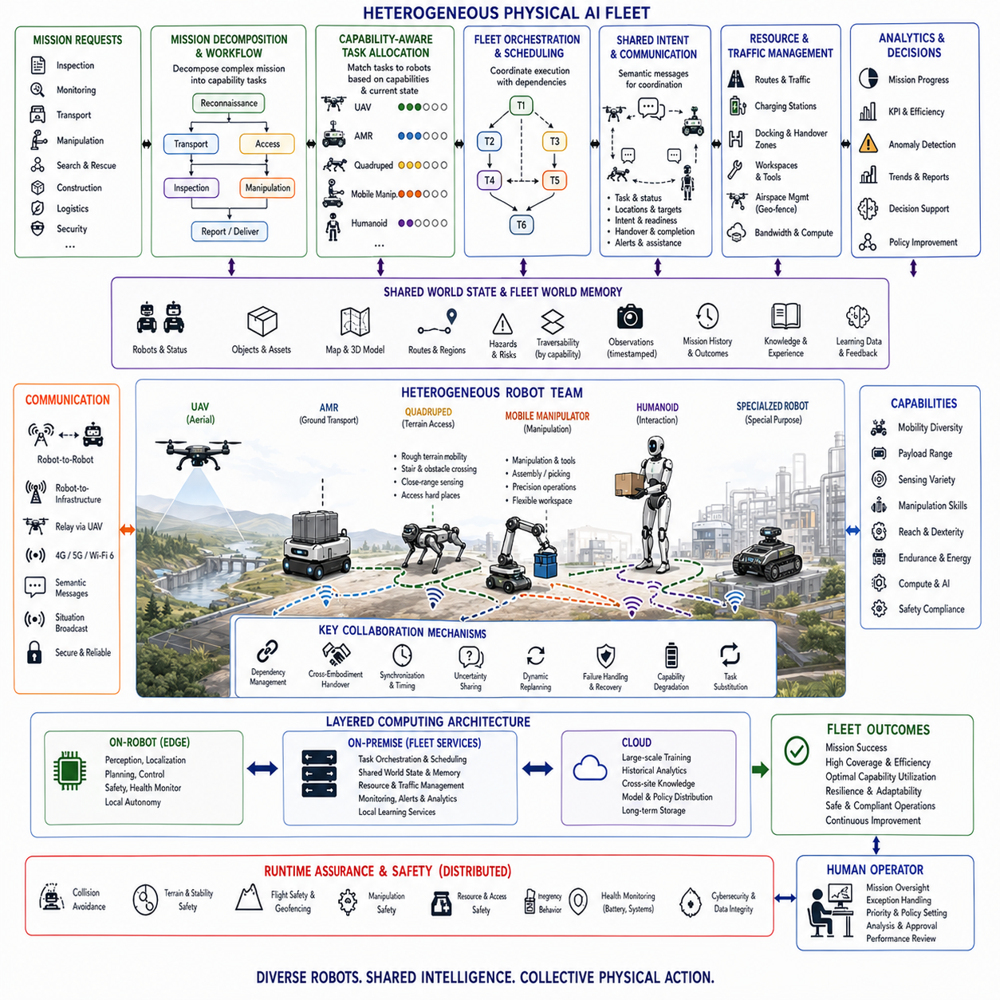{width="7.268055555555556in" height="7.268055555555556in"}

A heterogeneous Physical AI fleet combines robots with fundamentally different embodiments, sensing systems, mobility mechanisms, manipulation capabilities, payload capacities, and operational roles into a coordinated physical intelligence. Rather than requiring every robot to perform the same functions, the fleet treats diversity as an operational resource. AMRs, quadrupeds, mobile manipulators, humanoids, UAVs, and specialized platforms contribute complementary capabilities toward shared mission objectives.

The central challenge is therefore not simply multi-robot coordination, but capability-aware orchestration across different physical embodiments. A task that is trivial for one robot may be impossible for another because of terrain, reach, payload, sensing, endurance, or safety constraints. Fleet intelligence must understand these differences explicitly and match each mission requirement with robots whose current physical and computational capabilities are appropriate for successful execution.

A common capability model provides the foundation for heterogeneous task allocation. Each robot can describe mobility type, payload capacity, sensor modalities, manipulation functions, reachable workspace, energy state, communication capability, compute resources, safety certification, and operational restrictions. These descriptions allow the fleet to reason about what each robot can currently accomplish rather than relying only on fixed robot categories or predefined assignments.

Mission requests are decomposed into tasks with physical, spatial, temporal, and semantic requirements. A complex inspection mission may require aerial reconnaissance, ground transportation, difficult-terrain access, close-range sensing, and physical manipulation. Instead of assigning the complete mission to one platform, fleet orchestration constructs a workflow in which different robots execute the portions that best correspond to their embodiment while preserving dependencies between tasks.

Capability-aware task allocation must also consider combinations of robots. Some objectives cannot be completed by any single platform but become feasible through collaboration. A UAV may locate an asset, an AMR may transport equipment near it, a quadruped may cross difficult terrain, and a mobile manipulator may perform physical interaction. Fleet intelligence therefore reasons about capability composition, creating temporary teams whose combined abilities satisfy complex mission requirements.

Shared intent connects these independently autonomous robots to a common operational objective. Each platform needs to understand its assigned task, relevant dependencies, expected outputs, completion conditions, and interactions with other agents. Shared intent does not require identical internal control architectures. Instead, it provides a semantic coordination layer through which different robots can participate in the same mission while retaining embodiment-specific perception, planning, and control.

A shared world state provides the operational context required for coordination. Robot positions, tasks, objects, assets, routes, hazards, restricted areas, docking locations, workstations, communication conditions, and resource availability can be represented in a common framework. Individual robots interpret this information according to their embodiment, ensuring that the same environment can support different concepts of accessibility, reachability, visibility, and interaction feasibility.

Embodiment-aware traversability is particularly important. A staircase may be inaccessible to an AMR, traversable by a quadruped or humanoid, and irrelevant to a UAV. Narrow passages, rough terrain, overhead obstacles, slopes, doorways, payload restrictions, and airspace constraints similarly affect different platforms in different ways. The fleet therefore requires capability-conditioned accessibility rather than a single universal representation of whether an area is traversable.

Fleet world memory extends current state into persistent collective experience. The system can retain successful routes, difficult terrain, reliable docking poses, manipulation configurations, inspection viewpoints, communication shadows, congestion patterns, failures, recovery actions, and mission outcomes. Historical knowledge remains associated with environmental context and robot capabilities so that future agents can determine whether previous experience is applicable to their own embodiment and current operating condition.

Semantic communication enables heterogeneous robots to exchange meaningful information without sharing incompatible low-level control representations. Messages can describe targets, objects, hazards, routes, task status, readiness, uncertainty, assistance requests, failures, and completion events. A UAV does not need to understand wheel commands, and an AMR does not need to interpret humanoid joint trajectories. Coordination occurs through concepts that remain meaningful across embodiments.

Fleet orchestration manages dependencies among these semantic tasks. Transportation may need to finish before manipulation begins, aerial reconnaissance may precede ground deployment, and inspection results may dynamically generate additional tasks for specialized robots. Scheduling therefore considers precedence, synchronization, robot availability, travel time, execution duration, energy, and resource conflicts while continuously adapting the workflow as new information becomes available.

Dynamic task reallocation is essential because robot availability and capability change during operation. Battery depletion, sensor degradation, actuator faults, communication problems, environmental changes, or unexpected workload can alter which robot is best suited for a task. Fleet intelligence can reassign unfinished work, substitute another embodiment when feasible, or restructure the mission when direct replacement is impossible, preserving objectives rather than fixed robot assignments.

Capability degradation should be represented continuously rather than as a binary healthy-or-failed state. A mobile manipulator with a failed gripper may remain useful for navigation and sensing, while an AMR with reduced battery capacity may perform short transport missions. A UAV with degraded imaging may still provide communication relay. Tracking remaining capability allows the fleet to exploit useful resources without assigning tasks outside safe operational limits.

Resource coordination extends beyond individual robots. Charging stations, docking areas, elevators, corridors, airspace, transfer zones, communication bandwidth, compute resources, tools, and workstations may all become shared constraints. Fleet-level planning schedules access to these resources and prevents conflicts between heterogeneous agents whose physical footprints, operating speeds, safety zones, and resource requirements can differ substantially.

Cross-embodiment handovers allow capabilities to be composed across physical agents. An AMR can deliver a container to a mobile manipulator, a UAV can provide coordinates to a ground robot, or a humanoid can retrieve an object transported by another platform. Successful handover requires agreement about object identity, location, pose, timing, readiness, ownership, and completion state, making handover a semantic and physical synchronization problem.

Uncertainty must remain visible throughout collaborative reasoning. Different platforms observe the environment from different viewpoints and with different sensor characteristics. Aerial imagery may provide broad coverage, while ground sensors provide close-range detail and manipulators provide interaction-based evidence. Fleet intelligence should preserve observation source, confidence, timestamp, and context so that contradictory information can trigger verification rather than premature consensus.

Collective learning transforms heterogeneous fleet experience into improved future behavior. Repeated operations reveal which robot capabilities work best under particular environmental conditions, which task combinations reduce delays, which handover configurations are reliable, and which routes or behaviors frequently fail. These observations can improve capability models, task allocation, scheduling, perception, planning, recovery, and operational policies across successive deployments.

Cross-embodiment learning requires careful abstraction because physical skills are not directly interchangeable. A navigation policy for an AMR cannot simply become a flight policy for a UAV, nor can humanoid manipulation trajectories directly control a mobile manipulator. However, object semantics, spatial relationships, mission outcomes, hazards, task dependencies, confidence, and successful workflow patterns can be shared, allowing knowledge transfer above the embodiment-specific control layer.

A fleet data flywheel emerges when observations, failures, interventions, recoveries, and successful missions are systematically collected and evaluated. Valuable experiences become training or validation data, improved models and policies are produced, and validated updates are redistributed to appropriate robot classes. Knowledge generated by one subset of the fleet can therefore improve other agents without requiring every robot to encounter the same situations independently.

The computing architecture naturally separates local embodied intelligence from collective intelligence. Robot edge systems execute perception, localization, locomotion, manipulation, immediate planning, and safety-critical control. On-premise fleet intelligence maintains shared world state, task orchestration, resource management, fleet memory, monitoring, and local learning services. Cloud systems can support large-scale training, historical analytics, cross-site aggregation, and foundation-level knowledge management.

Runtime assurance must remain distributed because heterogeneous robots possess different physical risks. AMRs require collision and traffic safety, quadrupeds require locomotion stability, UAVs require flight envelopes and geofencing, and manipulators require workspace and contact constraints. Fleet intelligence coordinates their activities but cannot replace platform-specific safety mechanisms. Global optimization therefore operates within independently enforced local safety envelopes.

Human operators supervise the collective system through mission-level rather than robot-by-robot control. They can review fleet state, anomalies, uncertain observations, capability degradation, resource conflicts, and recovery events. Humans may modify priorities, approve sensitive actions, or resolve exceptions while routine coordination remains autonomous. This allows a relatively small number of operators to supervise increasingly large and diverse fleets without continuously teleoperating individual platforms.

Fleet performance must be measured by collective mission effectiveness rather than by averaging individual robot metrics. Relevant indicators include mission completion, coverage, cycle time, robot utilization, task waiting time, handover success, energy efficiency, intervention frequency, recovery performance, resource congestion, and resilience to robot loss. A successful heterogeneous fleet should outperform isolated specialized robots by composing capabilities while minimizing coordination overhead.

The heterogeneous Physical AI fleet consequently represents a transition from fleets of similar autonomous machines toward distributed systems of complementary embodied intelligence. AMRs, quadrupeds, UAVs, humanoids, mobile manipulators, and specialized robots remain individually autonomous, but shared world state, semantic communication, fleet memory, capability-aware orchestration, collective learning, and runtime assurance connect them into a coherent operational system.

As the architecture matures, fleet intelligence can evolve from predefined coordination rules toward adaptive Collective Physical Intelligence. The system learns which embodiments, capability combinations, workflows, and resource arrangements are most effective under changing conditions and reorganizes missions accordingly. Physical diversity then becomes a source of intelligence: different robots perceive, move, manipulate, and experience the world differently, while the fleet integrates those differences into shared knowledge and coordinated action.

이기종 피지컬 AI 군집(Heterogeneous Physical AI Fleet)은 근본적으로 서로 다른 체화(Embodiment), 센싱 시스템(Sensing System), 이동 메커니즘(Mobility Mechanism), 조작 능력(Manipulation Capability), 페이로드 용량(Payload Capacity), 운영 역할을 가진 로봇들을 하나의 조정된 물리 지능(Coordinated Physical Intelligence)으로 결합한다. 모든 로봇에 동일한 기능을 요구하는 대신 군집은 다양성 자체를 운영 자원으로 활용한다. AMR, 4족 보행 로봇(Quadruped), 모바일 매니퓰레이터(Mobile Manipulator), 휴머노이드(Humanoid), UAV 및 특수 로봇 플랫폼(Specialized Platform)은 공유된 임무 목표를 위해 상호 보완적인 능력을 제공한다.

따라서 핵심 과제는 단순한 다중 로봇 조정(Multi-Robot Coordination)이 아니라 서로 다른 물리적 체화 사이에서 수행되는 능력 인지형 오케스트레이션(Capability-Aware Orchestration)이다. 하나의 로봇에는 간단한 작업이 다른 로봇에는 지형, 도달 범위, 페이로드, 센싱, 운용시간 또는 안전 제약으로 인해 수행 불가능할 수 있다. 군집 지능(Fleet Intelligence)은 이러한 차이를 명시적으로 이해하고 각각의 임무 요구사항을 성공적인 수행에 적합한 현재의 물리적·계산적 능력을 가진 로봇과 연결해야 한다.

공통 능력 모델(Common Capability Model)은 이기종 작업 할당(Heterogeneous Task Allocation)의 기반을 제공한다. 각 로봇은 이동 유형, 페이로드 용량, 센서 모달리티(Sensor Modality), 조작 기능, 도달 가능한 작업공간, 에너지 상태, 통신 능력, 컴퓨팅 자원, 안전 인증, 운영 제한조건을 기술할 수 있다. 이러한 정보는 고정된 로봇 분류나 사전에 정의된 작업 할당에만 의존하지 않고 각 로봇이 현재 실제로 수행할 수 있는 작업을 군집이 추론하도록 한다.

임무 요청(Mission Request)은 물리적, 공간적, 시간적, 의미적 요구사항을 가진 작업으로 분해된다. 복잡한 검사 임무에는 공중 정찰(Aerial Reconnaissance), 지상 운송, 험지 접근, 근거리 센싱, 물리적 조작 등이 필요할 수 있다. 전체 임무를 하나의 플랫폼에 할당하는 대신 군집 오케스트레이션(Fleet Orchestration)은 서로 다른 로봇이 자신의 체화에 가장 적합한 부분을 실행하면서 작업 간 의존성을 유지하는 워크플로를 구성한다.

능력 인지형 작업 할당(Capability-Aware Task Allocation)은 로봇들의 조합도 고려해야 한다. 일부 목표는 어떠한 단일 플랫폼으로도 완료할 수 없지만 여러 로봇의 협업을 통해 수행 가능해질 수 있다. UAV가 자산의 위치를 파악하고, AMR이 장비를 인근까지 운반하며, 4족 보행 로봇이 험지를 통과하고, 모바일 매니퓰레이터가 물리적 상호작용을 수행할 수 있다. 따라서 군집 지능은 능력 조합(Capability Composition)을 추론하여 복잡한 임무 요구사항을 충족하는 임시 팀을 구성한다.

공유 의도(Shared Intent)는 독립적으로 자율적인 로봇들을 하나의 공통 운영 목표에 연결한다. 각 플랫폼은 할당된 작업, 관련 의존성, 예상 결과, 완료 조건, 다른 에이전트와의 상호작용을 이해해야 한다. 공유 의도가 동일한 내부 제어 아키텍처를 요구하는 것은 아니다. 대신 서로 다른 로봇이 체화 특화 인지, 계획, 제어를 유지하면서 동일한 임무에 참여할 수 있도록 의미 기반 조정 계층(Semantic Coordination Layer)을 제공한다.

공유 월드 상태(Shared World State)는 조정에 필요한 운영 컨텍스트를 제공한다. 로봇 위치, 작업, 물체, 자산, 경로, 위험 요소, 제한 구역, 도킹 위치, 작업 스테이션, 통신 상태, 자원 가용성 등을 공통 프레임워크 안에서 표현할 수 있다. 개별 로봇은 자신의 체화에 따라 이러한 정보를 해석함으로써 동일한 환경에서 서로 다른 접근 가능성, 도달 가능성, 가시성, 상호작용 실행 가능성을 판단할 수 있다.

체화 인지형 주행가능성(Embodiment-Aware Traversability)은 특히 중요하다. 계단은 AMR에는 접근 불가능할 수 있지만 4족 보행 로봇이나 휴머노이드는 이동할 수 있으며 UAV에는 큰 제약이 아닐 수 있다. 좁은 통로, 험지, 상부 장애물, 경사, 출입문, 페이로드 제한, 공역 제약 역시 플랫폼별로 서로 다른 영향을 미친다. 따라서 군집에는 특정 영역의 이동 가능 여부를 하나의 보편적인 값으로 표현하는 대신 능력 조건부 접근성(Capability-Conditioned Accessibility)이 필요하다.

군집 월드 메모리(Fleet World Memory)는 현재 상태를 지속적인 집단 경험(Persistent Collective Experience)으로 확장한다. 시스템은 성공한 경로, 어려운 지형, 신뢰할 수 있는 도킹 자세, 조작 구성, 검사 관측 위치, 통신 음영 지역, 혼잡 패턴, 실패, 복구 행동, 임무 결과 등을 보존할 수 있다. 과거의 지식은 환경 컨텍스트 및 로봇 능력과 연결되어 유지되므로 미래의 에이전트는 이전 경험이 자신의 체화와 현재 운영 조건에 적용 가능한지를 판단할 수 있다.

의미 기반 통신(Semantic Communication)을 사용하면 이기종 로봇들이 서로 호환되지 않는 저수준 제어 표현을 공유하지 않고도 의미 있는 정보를 교환할 수 있다. 메시지는 표적, 물체, 위험 요소, 경로, 작업 상태, 준비 상태, 불확실성, 지원 요청, 장애, 완료 이벤트 등을 표현할 수 있다. UAV가 휠 제어 명령을 이해할 필요가 없고 AMR이 휴머노이드 관절 궤적을 해석할 필요도 없다. 조정은 서로 다른 체화에서도 의미를 유지하는 운영 개념을 통해 이루어진다.

군집 오케스트레이션(Fleet Orchestration)은 이러한 의미 기반 작업 사이의 의존성을 관리한다. 조작을 시작하기 전에 운송이 완료되어야 할 수 있고, 지상 로봇 투입 전에 공중 정찰이 수행되어야 할 수 있으며, 검사 결과에 따라 특수 로봇을 위한 추가 작업이 동적으로 생성될 수 있다. 따라서 스케줄링은 선행 관계, 동기화, 로봇 가용성, 이동시간, 작업시간, 에너지, 자원 충돌을 고려하면서 새로운 정보가 발생할 때 워크플로를 지속적으로 조정한다.

로봇의 가용성과 능력은 운영 중 변화하므로 동적 작업 재할당(Dynamic Task Reallocation)이 필수적이다. 배터리 감소, 센서 성능 저하, 액추에이터 장애, 통신 문제, 환경 변화 또는 예상하지 못한 작업량은 특정 작업에 가장 적합한 로봇을 변화시킬 수 있다. 군집 지능은 미완료 작업을 재할당하고 가능한 경우 다른 체화로 대체하거나 직접적인 대체가 불가능하면 임무 구조 자체를 변경하여 고정된 로봇 할당보다 임무 목표를 유지한다.

능력 저하(Capability Degradation)는 단순한 정상 또는 장애의 이진 상태가 아니라 연속적인 상태로 표현해야 한다. 그리퍼에 장애가 발생한 모바일 매니퓰레이터도 내비게이션과 센싱에는 활용할 수 있으며, 배터리 용량이 감소한 AMR도 짧은 운송 임무를 수행할 수 있다. 영상 센싱 성능이 저하된 UAV도 통신 중계에는 활용될 수 있다. 잔존 능력(Remaining Capability)을 추적하면 안전한 운영 범위를 벗어난 작업을 할당하지 않으면서 사용 가능한 자원을 계속 활용할 수 있다.

자원 조정(Resource Coordination)은 개별 로봇을 넘어 확장된다. 충전 스테이션, 도킹 구역, 엘리베이터, 통로, 공역, 전달 구역, 통신 대역폭, 컴퓨팅 자원, 공구, 작업 스테이션 등이 모두 공유 제약이 될 수 있다. 군집 수준 계획(Fleet-Level Planning)은 이러한 자원에 대한 접근을 스케줄링하고 물리적 점유 영역, 운영 속도, 안전 영역, 자원 요구사항이 크게 다른 이기종 에이전트 사이의 충돌을 방지한다.

교차 체화 인계(Cross-Embodiment Handover)는 여러 물리 에이전트의 능력을 하나로 결합하도록 한다. AMR은 컨테이너를 모바일 매니퓰레이터에 전달할 수 있고, UAV는 지상 로봇에 좌표를 제공할 수 있으며, 휴머노이드는 다른 플랫폼이 운송한 물체를 가져갈 수 있다. 성공적인 인계를 위해서는 물체 식별, 위치, 자세, 시점, 준비 상태, 소유권, 완료 상태에 대한 합의가 필요하므로 인계는 의미적·물리적 동기화 문제(Semantic and Physical Synchronization Problem)가 된다.

불확실성(Uncertainty)은 협업 추론 전반에서 명시적으로 유지되어야 한다. 서로 다른 플랫폼은 서로 다른 관측 위치와 센서 특성을 통해 환경을 인지한다. 공중 영상은 넓은 영역을 제공하고, 지상 센서는 근거리의 세부 정보를 제공하며, 매니퓰레이터는 물리적 상호작용을 통한 증거를 제공할 수 있다. 군집 지능은 관측 출처, 신뢰도, 타임스탬프, 컨텍스트를 보존하여 상충하는 정보가 발생할 경우 성급한 합의 대신 추가 검증을 수행할 수 있도록 해야 한다.

집단 학습(Collective Learning)은 이기종 군집의 경험을 미래 행동 개선으로 전환한다. 반복적인 운영을 통해 특정 환경 조건에서 어떤 로봇 능력이 가장 효과적인지, 어떤 작업 조합이 지연을 감소시키는지, 어떤 인계 구성이 신뢰성이 높은지, 어떤 경로나 행동이 반복적으로 실패하는지를 발견할 수 있다. 이러한 관측은 지속적인 배치를 통해 능력 모델, 작업 할당, 스케줄링, 인지, 계획, 복구, 운영 정책을 개선할 수 있다.

교차 체화 학습(Cross-Embodiment Learning)은 물리적 기술을 직접 교환할 수 없기 때문에 신중한 추상화가 필요하다. AMR의 내비게이션 정책을 UAV의 비행 정책으로 그대로 사용할 수 없으며, 휴머노이드의 조작 궤적을 모바일 매니퓰레이터에 직접 적용할 수도 없다. 그러나 물체 의미, 공간 관계, 임무 결과, 위험 요소, 작업 의존성, 신뢰도, 성공적인 워크플로 패턴은 공유할 수 있으므로 체화 특화 제어 계층보다 상위 수준에서 지식을 전달할 수 있다.

관측, 실패, 인간 개입, 복구, 성공적인 임무를 체계적으로 수집하고 평가하면 군집 데이터 플라이휠(Fleet Data Flywheel)이 형성된다. 가치 있는 경험은 학습 또는 검증 데이터가 되고, 개선된 모델과 정책이 생성되며, 검증된 업데이트는 적절한 로봇 유형에 다시 배포된다. 따라서 군집의 일부에서 생성된 지식이 모든 로봇이 동일한 상황을 직접 경험하지 않더라도 다른 에이전트의 성능을 개선할 수 있다.

컴퓨팅 아키텍처(Computing Architecture)는 자연스럽게 로컬 체화 지능(Local Embodied Intelligence)과 집단 지능(Collective Intelligence)을 분리한다. 로봇 엣지 시스템(Robot Edge System)은 인지, 위치추정, 이동, 조작, 즉각적인 계획, 안전 필수 제어를 실행한다. 온프레미스 군집 지능(On-Premise Fleet Intelligence)은 공유 월드 상태, 작업 오케스트레이션, 자원 관리, 군집 메모리, 모니터링, 로컬 학습 서비스를 담당한다. 클라우드 시스템(Cloud System)은 대규모 학습, 이력 분석, 사이트 간 집계, 파운데이션 수준 지식 관리(Foundation-Level Knowledge Management)를 지원할 수 있다.

이기종 로봇은 서로 다른 물리적 위험을 가지므로 런타임 보증(Runtime Assurance)은 분산된 형태로 유지되어야 한다. AMR에는 충돌 및 교통 안전이 필요하고, 4족 보행 로봇에는 보행 안정성이 필요하며, UAV에는 비행 영역 및 지오펜싱(Geofencing)이 필요하고, 매니퓰레이터에는 작업공간 및 접촉 제약이 필요하다. 군집 지능은 이들의 활동을 조정하지만 플랫폼별 안전 메커니즘을 대체할 수 없다. 따라서 전역 최적화(Global Optimization)는 독립적으로 강제되는 로컬 안전 범위(Local Safety Envelope) 안에서 수행된다.

인간 운영자(Human Operator)는 로봇별 직접 제어가 아니라 임무 수준(Mission-Level)에서 집단 시스템을 감독한다. 운영자는 군집 상태, 이상 상황, 불확실한 관측, 능력 저하, 자원 충돌, 복구 이벤트를 검토할 수 있다. 인간은 우선순위를 변경하고 민감한 행동을 승인하거나 예외 상황을 해결하며, 일상적인 조정은 자율적으로 수행된다. 이를 통해 상대적으로 적은 수의 운영자가 개별 플랫폼을 지속적으로 원격조종하지 않고도 점점 더 크고 다양한 군집을 감독할 수 있다.

군집 성능(Fleet Performance)은 개별 로봇의 성능 지표를 평균하는 것이 아니라 집단적인 임무 효과(Collective Mission Effectiveness)를 기준으로 측정해야 한다. 주요 지표에는 임무 완료율, 커버리지, 사이클 타임(Cycle Time), 로봇 활용률, 작업 대기시간, 인계 성공률, 에너지 효율, 인간 개입 빈도, 복구 성능, 자원 혼잡, 로봇 손실에 대한 복원력 등이 포함된다. 성공적인 이기종 군집은 조정 오버헤드를 최소화하면서 서로 다른 능력을 조합하여 독립적인 특수 로봇보다 높은 전체 성능을 제공해야 한다.

결과적으로 이기종 피지컬 AI 군집(Heterogeneous Physical AI Fleet)은 유사한 자율 기계들의 군집에서 상호 보완적인 체화 지능(Embodied Intelligence)의 분산 시스템으로 전환되는 과정을 나타낸다. AMR, 4족 보행 로봇, UAV, 휴머노이드, 모바일 매니퓰레이터, 특수 로봇은 각각 개별적인 자율성을 유지하지만 공유 월드 상태, 의미 기반 통신, 군집 메모리, 능력 인지형 오케스트레이션, 집단 학습, 런타임 보증을 통해 하나의 일관된 운영 시스템으로 연결된다.

아키텍처가 성숙하면 군집 지능은 사전에 정의된 조정 규칙에서 적응형 집단 물리 지능(Adaptive Collective Physical Intelligence)으로 발전할 수 있다. 시스템은 변화하는 조건에서 어떤 체화, 능력 조합, 워크플로, 자원 배치가 가장 효과적인지를 학습하고 이에 따라 임무를 재구성한다. 이 단계에서는 물리적 다양성 자체가 지능의 원천이 된다. 서로 다른 로봇은 각기 다른 방식으로 물리 세계를 인지하고, 이동하고, 조작하고, 경험하며, 군집은 이러한 차이를 공유 지식(Shared Knowledge)과 조정된 행동(Coordinated Action)으로 통합한다.

## 10.09. Swarm Exploration Case Study

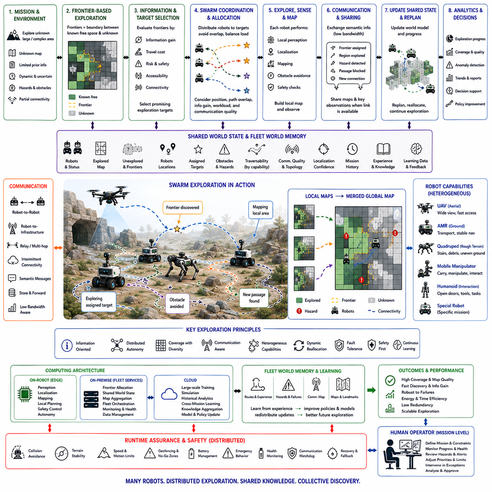{width="7.268055555555556in" height="7.268055555555556in"}

Swarm exploration applies Multi-Robot Physical AI to environments that are unknown, partially mapped, dynamic, or too large for a single robot to explore efficiently. Instead of following centrally predefined routes, multiple robots distribute themselves across unexplored space, gather observations, and continuously update a shared representation of the environment. Collective exploration converts many local sensing actions into coordinated global discovery.

A representative mission begins with a team entering an environment for which only limited prior information is available. The area may contain corridors, rooms, outdoor terrain, obstacles, hazardous regions, or inaccessible passages. Each robot observes only a local portion of the world, so exploration performance depends on deciding where individual robots should move while preventing unnecessary duplication of areas already examined by other members.

Frontier-based exploration provides a practical mechanism for distributing exploration targets. Frontiers represent boundaries between known free space and regions that have not yet been observed. Robots identify candidate frontiers and estimate their potential information value, travel cost, risk, and accessibility. The swarm then distributes robots among promising targets so that several regions can be explored simultaneously rather than sequentially.

Simple nearest-frontier assignment can create inefficient behavior when multiple robots repeatedly select the same target. Swarm coordination therefore incorporates robot positions, assigned destinations, expected information gain, path overlap, and current workload. By penalizing redundant exploration and rewarding spatial dispersion, the system encourages robots to cover complementary regions while preserving the ability to regroup when collaboration or communication becomes necessary.

Exploration is fundamentally an information acquisition problem rather than merely a navigation problem. A robot should not always choose the closest unexplored location if another target is expected to reveal substantially more useful information. Information gain can represent newly observable area, reduction of map uncertainty, discovery of connectivity between regions, or acquisition of mission-relevant semantic information. Exploration planning balances this value against movement cost and risk.

Distributed mapping allows observations collected by individual robots to contribute to a larger environmental model. Each robot performs local perception, localization, and map construction using available sensors such as LiDAR, cameras, depth sensors, or inertial measurements. Local map segments and important observations can then be exchanged and aligned, allowing the swarm to progressively construct a representation that extends beyond the sensing range of any individual platform.

Map merging requires reliable spatial relationships between robots and their observations. Relative localization, shared landmarks, loop closures, GNSS where available, or common reference frames can support alignment. Incorrect map associations can contaminate the shared world model, so uncertainty and confidence should accompany transformations and observations. Collective mapping must therefore manage both spatial information and the reliability of the relationships used to combine it.

Shared world state allows each robot to reason about exploration progress beyond its local field of view. The state can include explored and unexplored regions, robot positions, assigned frontiers, obstacles, hazards, communication conditions, localization confidence, and temporary route restrictions. Robots do not need identical copies of every raw observation, but they require enough shared information to avoid unnecessary duplication and coordinate their future actions.

Communication constraints strongly influence swarm exploration. Robots may move beyond direct wireless range, enter communication shadows, or operate with limited bandwidth. The exploration strategy should therefore avoid assuming continuous high-bandwidth connectivity. Robots can retain local autonomy during disconnection, store observations, and synchronize important map or mission updates when communication becomes available again, allowing useful exploration to continue under degraded networking conditions.

Connectivity-aware exploration introduces communication quality directly into planning. A robot may choose a slightly less informative frontier if moving toward the highest-value target would completely isolate it from the team. Other robots can position themselves as communication relays or maintain intermediate connectivity. The swarm therefore balances spatial coverage with information flow, especially when mission safety or rapid sharing of discoveries requires periodic network connectivity.

Semantic communication further reduces network requirements. Instead of transmitting continuous raw sensor streams, robots can exchange compact events such as "frontier assigned," "region explored," "passage blocked," "hazard detected," "localization uncertain," or "new connection discovered." High-volume sensor data can be transferred selectively when needed for map merging or detailed analysis, while semantic updates maintain collective awareness with substantially lower communication overhead.

Exploration becomes more challenging when robots have heterogeneous mobility or sensing capabilities. An AMR may efficiently explore smooth corridors, a quadruped may traverse stairs or debris, and a UAV may inspect elevated or physically disconnected regions. Frontier assignment must therefore consider capability-aware accessibility. A frontier is valuable only if the assigned robot can safely reach it and collect observations that meaningfully reduce uncertainty.

Shared traversability allows physical experience to influence subsequent exploration decisions. When one robot discovers slippery terrain, steep slopes, unstable surfaces, narrow passages, or unexpected obstacles, the observation can be added to fleet world memory. Other robots then incorporate this knowledge before approaching the same region. Exploration consequently builds not only a geometric map but also a growing representation of how different embodiments can physically move through the environment.

Dynamic task reallocation maintains progress when exploration conditions change. A robot may discover that its assigned frontier is unreachable, encounter a hardware problem, lose localization confidence, or experience low battery. The target can be released and assigned to another suitable robot, while the affected platform returns, recovers, or accepts a lower-risk task. Exploration objectives remain persistent even though the robots responsible for them may change.

Failure tolerance is a defining advantage of swarm exploration. Losing one robot should reduce available capacity rather than terminate the mission. Remaining robots can redistribute unexplored regions, adjust communication topology, and continue mapping. If the failed robot transmitted its observations before becoming unavailable, its accumulated knowledge remains useful to the swarm. Collective memory therefore separates the value of acquired information from the continued availability of the robot that collected it.

Fleet world memory preserves exploration experience beyond the immediate mission state. The system can retain discovered routes, difficult terrain, localization failures, communication shadows, hazards, successful recovery actions, and areas associated with high information gain. When similar environments or repeated missions are encountered, this history can influence exploration priorities and reduce the need to rediscover operational knowledge through repeated trial and error.

Collective learning can improve exploration policies from accumulated missions. Experience may reveal which frontier characteristics predict useful discoveries, which terrain frequently causes failures, where communication is likely to degrade, or how robot density affects coverage efficiency. These observations can improve target selection, information-gain estimation, traversability prediction, communication-aware planning, and task allocation across future deployments.

A fleet data flywheel emerges when difficult exploration episodes are systematically captured and reused. Mapping failures, localization uncertainty, blocked passages, communication losses, and successful recovery behaviors become valuable learning examples. Updated models and policies can then be redistributed to appropriate robots, allowing lessons obtained from a small number of agents to improve the exploration behavior of the broader swarm.

The computing architecture can combine distributed edge autonomy with higher-level collective services. Each robot executes perception, localization, mapping, local planning, obstacle avoidance, and immediate safety functions onboard. On-premise services can maintain shared world memory, coordinate frontier allocation, monitor fleet state, and aggregate maps. Cloud resources can support large-scale training, historical analysis, simulation, and cross-mission knowledge aggregation.

Runtime assurance remains necessary because exploration deliberately sends robots toward uncertain regions. Local safety mechanisms constrain collision risk, terrain stability, speed, geofencing, battery reserve, and emergency behavior regardless of exploration reward. A frontier with high expected information gain should never override essential safety limits. Collective optimization therefore operates inside independently enforced safety envelopes for each physical platform.

Human operators supervise the exploration objective rather than directing every movement. They can define mission boundaries, restricted regions, priorities, minimum connectivity requirements, or risk limits while monitoring discovered hazards and robot health. Intervention is reserved for ambiguous or high-consequence situations. This mission-level supervision allows increasingly large swarms to explore autonomously without requiring proportional growth in human teleoperation effort.

Performance should be measured through collective exploration outcomes. Important indicators include area coverage, map completeness, map consistency, information gained per unit time, redundant exploration, distance traveled, energy consumption, communication availability, robot utilization, intervention frequency, and resilience to robot loss. Effective swarm behavior increases useful coverage rapidly while minimizing duplicated movement and maintaining acceptable safety and connectivity.

Swarm exploration therefore demonstrates how distributed perception, frontier allocation, information gain, shared mapping, communication, fleet world memory, capability-aware traversability, dynamic reallocation, and collective learning can operate as one Multi-Robot Physical AI process. Individual robots make local decisions, but their observations and actions are coordinated so that the team progressively reduces uncertainty about a shared physical environment.

As the swarm accumulates experience, exploration can evolve from reactive frontier selection toward adaptive Collective Physical Intelligence. Robots learn where information is likely to be found, which agents should investigate particular regions, how communication should be maintained, and when tasks should be redistributed. The swarm becomes a distributed intelligence that collectively explores, maps, remembers, learns from uncertainty, and reorganizes itself as knowledge of the physical world expands.

군집 탐색(Swarm Exploration)은 알려지지 않았거나 부분적으로만 매핑되어 있거나, 동적으로 변화하거나, 하나의 로봇이 효율적으로 탐색하기에는 너무 넓은 환경에 다중 로봇 피지컬 AI(Multi-Robot Physical AI)를 적용한다. 여러 로봇은 중앙에서 사전에 정의된 경로만 따르는 대신 미탐색 공간에 분산되어 관측 정보를 수집하고 환경에 대한 공유 표현(Shared Representation)을 지속적으로 갱신한다. 집단 탐색은 다수의 로컬 센싱 행동을 조정된 전역적 발견(Global Discovery)으로 전환한다.

대표적인 임무는 사전 정보가 제한된 환경에 로봇 팀이 진입하면서 시작된다. 해당 영역에는 복도, 방, 야외 지형, 장애물, 위험 구역 또는 접근할 수 없는 통로가 존재할 수 있다. 각 로봇은 물리 세계의 일부 영역만 로컬에서 관측할 수 있으므로 탐색 성능은 개별 로봇이 어디로 이동해야 하는지를 결정하면서 다른 구성원이 이미 조사한 영역의 불필요한 중복 탐색을 방지하는 능력에 좌우된다.

프론티어 기반 탐색(Frontier-Based Exploration)은 탐색 목표를 분산하기 위한 실용적인 메커니즘을 제공한다. 프론티어(Frontier)는 이미 알려진 자유 공간과 아직 관측되지 않은 영역 사이의 경계를 의미한다. 로봇은 후보 프론티어를 식별하고 잠재적인 정보 가치, 이동 비용, 위험도, 접근 가능성을 추정한다. 이후 군집은 유망한 목표에 로봇을 분산 배치하여 여러 영역을 순차적이 아니라 동시에 탐색하도록 한다.

단순한 최근접 프론티어 할당(Nearest-Frontier Assignment)은 여러 로봇이 반복적으로 동일한 목표를 선택하면서 비효율적인 행동을 만들 수 있다. 따라서 군집 조정(Swarm Coordination)은 로봇 위치, 할당된 목적지, 예상 정보 이득(Expected Information Gain), 경로 중복, 현재 작업량을 고려한다. 중복 탐색에는 비용을 부여하고 공간적 분산에는 가치를 부여하여 로봇이 상호 보완적인 영역을 탐색하도록 하면서 협업이나 통신이 필요한 경우 다시 집결할 수 있도록 한다.

탐색(Exploration)은 단순한 내비게이션 문제가 아니라 본질적으로 정보 획득 문제(Information Acquisition Problem)이다. 다른 목표가 훨씬 더 유용한 정보를 제공할 것으로 예상된다면 로봇이 항상 가장 가까운 미탐색 위치를 선택할 필요는 없다. 정보 이득(Information Gain)은 새롭게 관측 가능한 영역, 지도 불확실성 감소, 영역 간 연결성 발견 또는 임무와 관련된 의미 정보의 획득을 나타낼 수 있다. 탐색 계획은 이러한 정보 가치와 이동 비용 및 위험 사이의 균형을 고려한다.

분산 매핑(Distributed Mapping)은 개별 로봇이 수집한 관측 결과가 더 큰 환경 모델에 기여하도록 한다. 각 로봇은 라이다(LiDAR), 카메라(Camera), 깊이 센서(Depth Sensor), 관성 측정(Inertial Measurement) 등의 센서를 활용하여 로컬 인지, 위치추정, 지도 생성을 수행한다. 이후 로컬 지도 구간과 중요한 관측 정보를 교환하고 정렬하여 개별 플랫폼의 센싱 범위를 넘어서는 환경 표현을 군집이 점진적으로 구축할 수 있다.

지도 병합(Map Merging)을 위해서는 로봇과 로봇의 관측 사이에 신뢰성 있는 공간 관계가 필요하다. 상대 위치추정(Relative Localization), 공유 랜드마크, 루프 클로저(Loop Closure), 사용 가능한 경우 GNSS 또는 공통 기준 좌표계를 활용하여 정렬을 지원할 수 있다. 잘못된 지도 연관은 공유 월드 모델을 오염시킬 수 있으므로 변환 및 관측에는 불확실성과 신뢰도가 함께 포함되어야 한다. 따라서 집단 매핑은 공간 정보뿐 아니라 정보를 결합하는 데 사용되는 관계의 신뢰성까지 관리해야 한다.

공유 월드 상태(Shared World State)를 통해 각 로봇은 자신의 로컬 시야를 넘어 전체 탐색 진행 상황을 추론할 수 있다. 여기에는 탐색 및 미탐색 영역, 로봇 위치, 할당된 프론티어, 장애물, 위험 요소, 통신 상태, 위치추정 신뢰도, 일시적인 경로 제한 등이 포함될 수 있다. 모든 로봇이 모든 원시 관측의 동일한 복사본을 가질 필요는 없지만 불필요한 중복을 방지하고 미래 행동을 조정할 수 있을 정도의 공유 정보는 필요하다.

통신 제약(Communication Constraint)은 군집 탐색에 큰 영향을 미친다. 로봇은 직접적인 무선 통신 범위를 벗어나거나 통신 음영 지역에 진입하거나 제한된 대역폭에서 동작할 수 있다. 따라서 탐색 전략은 지속적인 고대역폭 연결을 전제로 해서는 안 된다. 로봇은 연결이 끊어진 동안에도 로컬 자율성(Local Autonomy)을 유지하고 관측을 저장하며, 통신이 다시 가능해지면 중요한 지도 및 임무 정보를 동기화하여 통신 성능이 저하된 상황에서도 유용한 탐색을 계속할 수 있다.

연결성 인지형 탐색(Connectivity-Aware Exploration)은 통신 품질을 계획 과정에 직접 포함한다. 가장 높은 가치의 목표로 이동하면 팀과 완전히 단절되는 경우 로봇은 정보 가치가 조금 낮은 프론티어를 선택할 수 있다. 다른 로봇은 통신 중계기(Communication Relay) 역할을 수행하거나 중간 연결성을 유지하도록 위치할 수 있다. 따라서 군집은 특히 임무 안전이나 발견 정보의 신속한 공유를 위해 주기적인 네트워크 연결이 필요한 상황에서 공간적 커버리지와 정보 흐름 사이의 균형을 조정한다.

의미 기반 통신(Semantic Communication)은 네트워크 요구량을 더욱 감소시킨다. 로봇은 모든 원시 센서 스트림을 지속적으로 전송하는 대신 "프론티어 할당(Frontier Assigned)", "영역 탐색 완료(Region Explored)", "통로 차단(Passage Blocked)", "위험 탐지(Hazard Detected)", "위치추정 불확실(Localization Uncertain)", "새로운 연결 발견(New Connection Discovered)"과 같은 간결한 이벤트를 교환할 수 있다. 대용량 센서 데이터는 지도 병합이나 상세 분석에 필요한 경우 선택적으로 전송하고, 의미 기반 갱신을 통해 훨씬 적은 통신량으로 집단 상황 인식을 유지한다.

서로 다른 이동성이나 센싱 능력을 가진 로봇으로 구성된 경우 탐색은 더욱 복잡해진다. AMR은 평탄한 복도를 효율적으로 탐색할 수 있고, 4족 보행 로봇(Quadruped)은 계단이나 잔해를 통과할 수 있으며, UAV는 높은 위치나 물리적으로 분리된 영역을 조사할 수 있다. 따라서 프론티어 할당은 능력 인지형 접근성(Capability-Aware Accessibility)을 고려해야 한다. 프론티어는 할당된 로봇이 안전하게 도달하고 불확실성을 의미 있게 감소시키는 관측을 수행할 수 있을 때에만 가치가 있다.

공유 주행가능성(Shared Traversability)은 물리적 경험이 이후의 탐색 의사결정에 영향을 미치도록 한다. 하나의 로봇이 미끄러운 지형, 급경사, 불안정한 표면, 좁은 통로 또는 예상하지 못한 장애물을 발견하면 해당 관측을 군집 월드 메모리(Fleet World Memory)에 추가할 수 있다. 다른 로봇은 동일한 영역에 접근하기 전에 이러한 지식을 반영한다. 따라서 탐색은 단순한 기하학적 지도뿐 아니라 서로 다른 체화(Embodiment)가 환경을 어떻게 물리적으로 이동할 수 있는지에 대한 표현까지 구축한다.

동적 작업 재할당(Dynamic Task Reallocation)은 탐색 조건이 변화하더라도 진행 상황을 유지하도록 한다. 로봇은 할당된 프론티어에 접근할 수 없다는 사실을 발견하거나 하드웨어 문제, 위치추정 신뢰도 저하, 배터리 부족을 경험할 수 있다. 이 경우 목표를 해제하여 다른 적합한 로봇에 할당하고 문제가 발생한 플랫폼은 복귀, 복구 또는 더 낮은 위험의 작업을 수행할 수 있다. 탐색 목표는 지속적으로 유지되지만 해당 목표를 담당하는 로봇은 변경될 수 있다.

장애 허용성(Failure Tolerance)은 군집 탐색의 중요한 장점이다. 하나의 로봇을 잃더라도 전체 임무가 종료되는 것이 아니라 사용 가능한 탐색 능력이 감소하는 수준에 머물러야 한다. 남은 로봇은 미탐색 영역을 재분배하고 통신 토폴로지(Communication Topology)를 조정하면서 매핑을 계속할 수 있다. 장애 발생 전에 해당 로봇이 관측 정보를 전송했다면 축적된 지식은 군집에서 계속 활용할 수 있다. 따라서 집단 메모리는 획득한 정보의 가치를 해당 정보를 수집한 로봇의 지속적인 가용성과 분리한다.

군집 월드 메모리(Fleet World Memory)는 현재 임무 상태를 넘어 탐색 경험을 보존한다. 시스템은 발견된 경로, 어려운 지형, 위치추정 실패, 통신 음영 지역, 위험 요소, 성공적인 복구 행동, 높은 정보 이득과 관련된 영역을 유지할 수 있다. 유사한 환경이나 반복 임무를 수행할 때 이러한 과거 경험은 탐색 우선순위에 영향을 주고 반복적인 시행착오를 통해 동일한 운영 지식을 다시 발견해야 하는 필요성을 감소시킨다.

집단 학습(Collective Learning)은 축적된 임무 경험을 활용하여 탐색 정책을 개선할 수 있다. 어떤 프론티어 특성이 유용한 발견으로 이어지는지, 어떤 지형에서 장애가 빈번하게 발생하는지, 어디에서 통신 성능이 저하될 가능성이 높은지, 로봇 밀도가 커버리지 효율에 어떤 영향을 미치는지를 경험을 통해 발견할 수 있다. 이러한 관측은 미래 배치에서 목표 선택, 정보 이득 추정, 주행가능성 예측, 통신 인지형 계획, 작업 할당을 개선할 수 있다.

어려운 탐색 상황을 체계적으로 수집하고 재사용하면 군집 데이터 플라이휠(Fleet Data Flywheel)이 형성된다. 매핑 실패, 위치추정 불확실성, 차단된 통로, 통신 단절, 성공적인 복구 행동은 가치 있는 학습 사례가 된다. 이후 개선된 모델과 정책을 적절한 로봇에 다시 배포함으로써 소수의 에이전트가 획득한 교훈이 더 넓은 군집의 탐색 행동을 향상시키도록 할 수 있다.

컴퓨팅 아키텍처(Computing Architecture)는 분산 엣지 자율성(Distributed Edge Autonomy)과 상위 수준의 집단 서비스를 결합할 수 있다. 각 로봇은 온보드에서 인지, 위치추정, 매핑, 로컬 계획, 장애물 회피, 즉각적인 안전 기능을 실행한다. 온프레미스 서비스(On-Premise Service)는 공유 월드 메모리를 유지하고 프론티어 할당을 조정하며 군집 상태를 모니터링하고 지도를 집계할 수 있다. 클라우드 자원(Cloud Resource)은 대규모 학습, 이력 분석, 시뮬레이션, 임무 간 지식 집계를 지원할 수 있다.

탐색은 의도적으로 로봇을 불확실한 영역으로 이동시키므로 런타임 보증(Runtime Assurance)은 필수적이다. 로컬 안전 메커니즘(Local Safety Mechanism)은 탐색 보상과 관계없이 충돌 위험, 지형 안정성, 속도, 지오펜싱(Geofencing), 배터리 예비량, 비상 행동을 제한한다. 예상 정보 이득이 높은 프론티어라고 하더라도 핵심적인 안전 한계를 무시해서는 안 된다. 따라서 집단 최적화는 각 물리적 플랫폼에서 독립적으로 강제되는 안전 범위(Safety Envelope) 안에서 수행된다.

인간 운영자(Human Operator)는 모든 로봇의 움직임을 직접 지시하는 대신 탐색 목표를 감독한다. 운영자는 임무 경계, 제한 영역, 우선순위, 최소 연결성 요구사항, 위험 한계를 정의하면서 발견된 위험 요소와 로봇 건전성을 모니터링할 수 있다. 인간 개입은 모호하거나 결과의 영향이 큰 상황에 한정된다. 이러한 임무 수준 감독(Mission-Level Supervision)은 인간 원격조종 인력을 비례적으로 증가시키지 않고도 점점 더 큰 군집이 자율적으로 탐색하도록 한다.

성능(Performance)은 집단 탐색 결과(Collective Exploration Outcome)를 기준으로 측정해야 한다. 주요 지표에는 영역 커버리지, 지도 완성도, 지도 일관성, 단위 시간당 정보 이득, 중복 탐색, 이동거리, 에너지 소비량, 통신 가용성, 로봇 활용률, 인간 개입 빈도, 로봇 손실에 대한 복원력 등이 포함된다. 효과적인 군집 행동은 중복 이동을 최소화하고 허용 가능한 안전성과 연결성을 유지하면서 유용한 커버리지를 빠르게 증가시켜야 한다.

따라서 군집 탐색(Swarm Exploration)은 분산 인지(Distributed Perception), 프론티어 할당(Frontier Allocation), 정보 이득, 공유 매핑, 통신, 군집 월드 메모리, 능력 인지형 주행가능성(Capability-Aware Traversability), 동적 재할당, 집단 학습이 하나의 다중 로봇 피지컬 AI 프로세스로 동작하는 방식을 보여준다. 개별 로봇은 로컬 의사결정을 수행하지만 팀 전체가 공유 물리 환경의 불확실성을 점진적으로 감소시키도록 각 로봇의 관측과 행동이 조정된다.

군집에 경험이 축적되면 탐색은 반응적인 프론티어 선택(Reactive Frontier Selection)에서 적응형 집단 물리 지능(Adaptive Collective Physical Intelligence)으로 발전할 수 있다. 로봇은 어디에서 유용한 정보를 발견할 가능성이 높은지, 어떤 에이전트가 특정 영역을 조사해야 하는지, 통신을 어떻게 유지해야 하는지, 언제 작업을 재분배해야 하는지를 학습한다. 결과적으로 군집은 물리 세계에 대한 지식이 확장됨에 따라 집단적으로 탐색하고, 매핑하고, 기억하며, 불확실성으로부터 학습하고, 스스로를 재구성하는 분산 지능(Distributed Intelligence)으로 발전한다.

## 10.10. Collective Learning Case Study

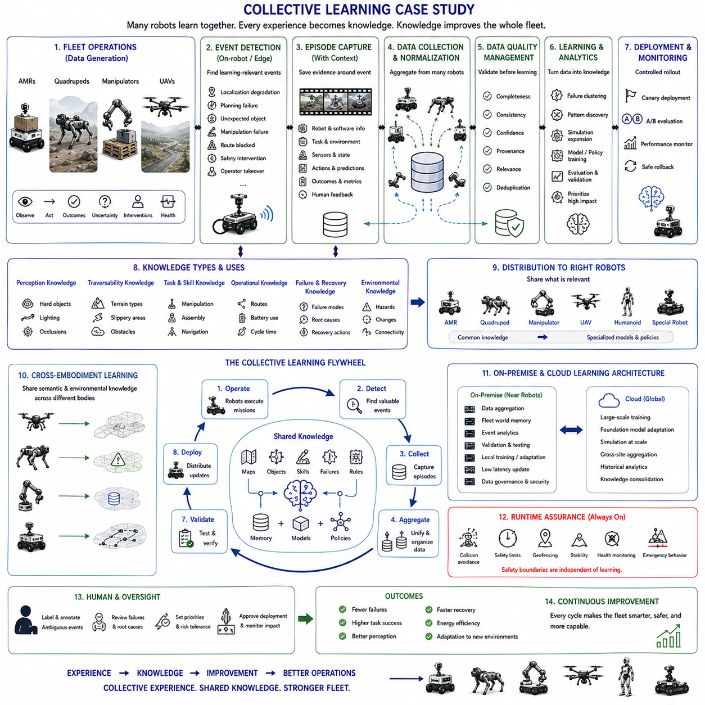{width="7.268055555555556in" height="7.268055555555556in"}

Collective learning enables a robot fleet to improve from the combined experience of many deployed agents rather than requiring every robot to learn independently. Each robot encounters different environments, objects, failures, human interactions, and operating conditions. When these experiences are systematically collected and transformed into reusable knowledge, individual episodes become fleet-level learning assets that can improve future perception, planning, control, and decision making.

A representative case begins with multiple robots performing normal operational missions across a facility or several deployment sites. AMRs may transport materials, quadrupeds may inspect difficult terrain, manipulators may interact with objects, and UAVs may observe large areas. Each robot generates observations, actions, outcomes, uncertainty estimates, intervention records, and system-health information while executing its assigned physical tasks.

Not every operational episode has equal learning value. Routine successful behavior may confirm existing capabilities, while unusual failures, near misses, uncertain perception, unexpected obstacles, difficult terrain, inefficient routes, and human interventions often provide more informative examples. The fleet therefore requires mechanisms for identifying learning-relevant events rather than transferring every raw sensor stream indiscriminately into the learning infrastructure.

Local event detection can operate directly on the robot. The edge system can identify conditions such as localization degradation, repeated planning failure, unexpected object detection, abnormal energy consumption, manipulation failure, route blockage, safety intervention, or operator takeover. Relevant sensor windows and contextual state can then be preserved around the event, producing compact learning episodes that retain the evidence necessary for later analysis.

Each learning episode should include sufficient context to explain what happened. Useful information may include robot type, software and model versions, sensor configuration, task identity, environmental state, localization confidence, actions, predicted outcomes, actual outcomes, safety events, and human corrections. Without this context, apparently similar failures may have fundamentally different causes and should not automatically be treated as equivalent training examples.

Fleet data collection converts distributed robot experience into a structured learning repository. Episodes arriving from different robots can be normalized, indexed, validated, and associated with shared semantic concepts such as object classes, terrain types, task categories, failure modes, locations, and operating conditions. This allows the learning system to search across many deployments for recurring patterns instead of analyzing individual robot logs in isolation.

Data quality management is essential because collective learning can amplify both useful knowledge and systematic errors. Sensor faults, incorrect labels, localization errors, duplicated episodes, corrupted recordings, or misleading operator annotations can contaminate the shared dataset. Validation therefore evaluates completeness, consistency, confidence, provenance, and relevance before an episode becomes trusted learning data used for model or policy improvement.

Fleet world memory and the learning repository serve related but different functions. World memory preserves operational knowledge needed for immediate or future mission reasoning, such as hazards, traversability, successful routes, and known asset conditions. The learning repository preserves examples suitable for improving models and policies. Selected information can move between them, allowing operational experience to support both short-term decisions and long-term learning.

Failure clustering can reveal patterns that are difficult to identify from individual robots. Several AMRs may independently experience localization degradation in visually repetitive corridors, or multiple manipulators may fail on objects with similar reflective surfaces. Aggregating these episodes can expose common environmental or system conditions, allowing engineers or automated analytics to distinguish isolated incidents from fleet-wide weaknesses requiring systematic improvement.

Learning priorities should be based on operational impact rather than data volume alone. Rare events involving safety, mission failure, expensive human intervention, or severe performance degradation may deserve greater attention than thousands of routine successful episodes. Active data selection can prioritize examples with high uncertainty, novelty, disagreement, or consequence, concentrating computational and annotation resources where improvements are likely to provide the greatest fleet benefit.

Model improvement may occur at several levels. Perception models can learn difficult objects and environmental conditions, traversability models can incorporate new terrain experience, prediction models can better estimate task duration or energy demand, and planning policies can learn improved responses to recurring situations. The appropriate learning target depends on whether the observed weakness originates in sensing, representation, prediction, decision making, or physical execution.

Simulation can expand valuable real-world episodes into broader training scenarios. A difficult encounter recorded by one robot can be reconstructed or approximated in simulation, where variations in lighting, obstacle placement, terrain, payload, robot state, or task configuration can be generated. This transforms a limited physical event into a larger family of controlled experiences while reducing the cost and risk of repeatedly reproducing difficult situations in the real world.

Before updated models are deployed, validation must determine whether improvement on selected cases creates regressions elsewhere. Candidate models can be evaluated using historical datasets, simulation, shadow execution, benchmark missions, and controlled physical tests. Performance should be compared not only on average metrics but also on critical failure categories, ensuring that solving one weakness does not introduce unacceptable behavior under other operating conditions.

Deployment should be treated as a controlled fleet process rather than an immediate global update. New models or policies can first be distributed to a small subset of robots or designated test environments. Their performance is monitored against the existing baseline, and deployment can gradually expand after evidence confirms acceptable behavior. Rollback mechanisms remain available if unexpected regressions or operational problems appear.

Model versioning and provenance are therefore fundamental to collective learning. The fleet must know which robot executed which model, what training data contributed to that model, which validation criteria were satisfied, and when the update was deployed. When a new failure occurs, this lineage allows engineers and automated systems to determine whether the event represents an existing limitation, a newly introduced regression, or an environmental condition not previously represented.

A fleet data flywheel emerges when deployment continuously produces experience that feeds the next improvement cycle. Robots operate, relevant events are detected, valuable episodes are collected, datasets are refined, models are trained, validation is performed, and approved updates return to the fleet. The improved fleet then generates new operational experience, creating a repeated loop in which physical deployment itself becomes a continuing source of learning.

Collective learning does not require every robot to receive the same model update. Heterogeneous fleets may contain AMRs, quadrupeds, UAVs, humanoids, and manipulators with different sensors and action spaces. Shared knowledge can be transferred at semantic, environmental, or task levels, while embodiment-specific models remain specialized. Updates should therefore be distributed according to robot capability, hardware compatibility, operational role, and validated applicability.

Cross-embodiment learning is especially valuable when experience contains knowledge that is independent of the original robot body. A UAV may discover environmental changes relevant to ground navigation, while a quadruped may identify a hazardous region that AMRs should avoid. Manipulation experience may reveal object properties useful to other platforms. The fleet can share these semantic and environmental lessons without attempting to transfer incompatible low-level motor policies.

On-premise intelligence can play a central role in the collective learning loop. It is close enough to deployed robots to aggregate operational data, maintain fleet world memory, perform event analytics, coordinate validation, and redistribute approved updates with low latency and strong data governance. Local compute can also support incremental training or adaptation when operational data should remain within the facility for privacy, security, or availability reasons.

Cloud infrastructure can complement on-premise learning when larger computational resources or cross-site aggregation are required. Large-scale model training, foundation model adaptation, simulation campaigns, historical analytics, and knowledge consolidation across multiple facilities can occur centrally. Validated knowledge can then return to individual sites, where on-premise systems determine how it should be integrated with local operating conditions and fleet configurations.

Learning must remain separated from immediate safety authority. A newly trained model should not automatically redefine safety constraints simply because it appears to improve average performance. Runtime assurance, certified limits, collision protection, geofencing, stability constraints, and emergency behavior remain independently enforced. Learned policies operate inside these boundaries until sufficient verification justifies any formally controlled change to the safety architecture.

Human expertise remains important throughout the learning process. Operators can label ambiguous events, explain interventions, identify operational priorities, and distinguish acceptable adaptation from undesirable behavior. Engineers can investigate clustered failures and define validation requirements. Human feedback therefore becomes another structured learning signal, complementing autonomous observations while preserving oversight for cases where operational meaning cannot be reliably inferred from sensor data alone.

Collective learning performance should be evaluated by improvement across successive fleet generations rather than training metrics alone. Relevant indicators include reduction in repeated failures, lower intervention frequency, improved task completion, better perception accuracy, shorter recovery time, increased energy efficiency, reduced uncertainty, faster adaptation to new environments, and the speed with which lessons learned by one robot become useful to others.

The case study therefore demonstrates a complete cycle connecting physical operation to fleet-wide intelligence improvement. Distributed robots generate diverse experience, edge systems identify valuable events, fleet infrastructure aggregates and validates data, learning systems improve models and policies, and controlled deployment returns verified improvements to appropriate robots. Experience is transformed from transient operational history into persistent and reusable collective knowledge.

As this cycle matures, collective learning becomes more than periodic model retraining. The fleet develops an increasingly structured memory of what succeeds, what fails, under which conditions, and which adaptations produce measurable improvement. Individual robots remain autonomous embodied agents, but their experiences contribute to a shared learning process through which the entire fleet progressively becomes safer, more capable, more efficient, and better adapted to the physical world.

집단 학습(Collective Learning)은 각각의 로봇이 독립적으로 학습하도록 하는 대신 다수의 배치된 에이전트(Deployed Agent)가 축적한 경험을 결합하여 로봇 군집 전체가 개선될 수 있도록 한다. 각 로봇은 서로 다른 환경, 물체, 장애, 인간과의 상호작용, 운영 조건을 경험한다. 이러한 경험을 체계적으로 수집하여 재사용 가능한 지식으로 변환하면 개별적인 경험 에피소드가 향후 인지, 계획, 제어, 의사결정을 개선하는 군집 수준 학습 자산(Fleet-Level Learning Asset)으로 발전한다.

대표적인 사례는 여러 로봇이 하나의 시설 또는 여러 배치 사이트에서 정상적인 운영 임무를 수행하는 과정에서 시작된다. AMR은 자재를 운송하고, 4족 보행 로봇(Quadruped)은 험난한 지형을 검사하며, 매니퓰레이터(Manipulator)는 물체와 상호작용하고, UAV는 넓은 영역을 관측할 수 있다. 각 로봇은 할당된 물리적 작업을 수행하면서 관측, 행동, 결과, 불확실성 추정, 인간 개입 기록, 시스템 건전성 정보를 생성한다.

모든 운영 경험이 동일한 학습 가치를 가지는 것은 아니다. 일상적인 성공 행동은 기존 능력을 확인하는 데 유용하지만 비정상적인 장애, 니어 미스(Near Miss), 불확실한 인지, 예상하지 못한 장애물, 어려운 지형, 비효율적인 경로, 인간 개입은 더욱 중요한 학습 사례를 제공하는 경우가 많다. 따라서 군집에는 모든 원시 센서 스트림을 무분별하게 학습 인프라로 전송하는 대신 학습 가치가 높은 이벤트(Learning-Relevant Event)를 식별하는 메커니즘이 필요하다.

로컬 이벤트 탐지(Local Event Detection)는 로봇에서 직접 수행될 수 있다. 엣지 시스템(Edge System)은 위치추정 성능 저하, 반복적인 계획 실패, 예상하지 못한 물체 탐지, 비정상적인 에너지 소비, 조작 실패, 경로 차단, 안전 개입, 운영자 인계(Operator Takeover) 등의 상태를 식별할 수 있다. 이후 해당 이벤트 전후의 관련 센서 구간과 컨텍스트 상태를 보존하여 사후 분석에 필요한 증거를 유지하면서도 간결한 학습 에피소드(Learning Episode)를 생성할 수 있다.

각 학습 에피소드에는 발생한 상황을 설명할 수 있는 충분한 컨텍스트(Context)가 포함되어야 한다. 유용한 정보에는 로봇 유형, 소프트웨어 및 모델 버전, 센서 구성, 작업 식별 정보, 환경 상태, 위치추정 신뢰도, 수행 행동, 예측 결과, 실제 결과, 안전 이벤트, 인간의 수정 사항 등이 포함될 수 있다. 이러한 컨텍스트가 없다면 외형적으로 유사한 장애라도 근본적인 원인이 다를 수 있으며 동일한 학습 사례로 자동 처리해서는 안 된다.

군집 데이터 수집(Fleet Data Collection)은 분산된 로봇 경험을 구조화된 학습 저장소(Learning Repository)로 변환한다. 서로 다른 로봇에서 수집된 에피소드는 정규화, 인덱싱, 검증 과정을 거쳐 물체 클래스, 지형 유형, 작업 범주, 장애 모드, 위치, 운영 조건과 같은 공유 의미 개념(Shared Semantic Concept)에 연결될 수 있다. 이를 통해 학습 시스템은 개별 로봇 로그를 독립적으로 분석하는 대신 여러 배치 환경에서 반복적으로 발생하는 패턴을 검색할 수 있다.

집단 학습은 유용한 지식뿐 아니라 체계적인 오류도 증폭시킬 수 있기 때문에 데이터 품질 관리(Data Quality Management)가 필수적이다. 센서 장애, 잘못된 라벨, 위치추정 오류, 중복 에피소드, 손상된 기록 또는 잘못된 운영자 주석은 공유 데이터셋을 오염시킬 수 있다. 따라서 에피소드가 모델이나 정책 개선에 사용되는 신뢰할 수 있는 학습 데이터가 되기 전에 완전성, 일관성, 신뢰도, 출처 추적성(Provenance), 관련성을 검증해야 한다.

군집 월드 메모리(Fleet World Memory)와 학습 저장소(Learning Repository)는 서로 관련되어 있지만 다른 기능을 수행한다. 월드 메모리는 위험 요소, 주행가능성, 성공적인 경로, 알려진 자산 상태처럼 현재 또는 미래의 임무 추론에 필요한 운영 지식을 보존한다. 학습 저장소는 모델과 정책을 개선하는 데 적합한 사례를 보존한다. 선택된 정보는 두 시스템 사이에서 이동할 수 있으므로 운영 경험을 단기적인 의사결정과 장기적인 학습 모두에 활용할 수 있다.

장애 군집화(Failure Clustering)는 개별 로봇만 관찰해서는 발견하기 어려운 패턴을 드러낼 수 있다. 여러 AMR이 시각적으로 반복되는 복도에서 독립적으로 위치추정 성능 저하를 경험하거나, 여러 매니퓰레이터가 유사한 반사 표면을 가진 물체에서 실패할 수 있다. 이러한 에피소드를 집계하면 공통된 환경 또는 시스템 조건을 발견하여 고립된 개별 사고와 체계적인 개선이 필요한 군집 전체의 취약점(Fleet-Wide Weakness)을 구분할 수 있다.

학습 우선순위(Learning Priority)는 단순한 데이터 양이 아니라 운영 영향도(Operational Impact)를 기준으로 결정해야 한다. 안전, 임무 실패, 비용이 큰 인간 개입 또는 심각한 성능 저하와 관련된 희귀 이벤트는 수천 개의 일상적인 성공 사례보다 더 높은 우선순위를 가질 수 있다. 능동적 데이터 선택(Active Data Selection)은 높은 불확실성, 신규성, 불일치 또는 결과의 중요성을 가진 사례를 우선하여 개선 효과가 가장 큰 영역에 계산 및 주석 자원을 집중할 수 있다.

모델 개선(Model Improvement)은 여러 수준에서 이루어질 수 있다. 인지 모델(Perception Model)은 어려운 물체와 환경 조건을 학습할 수 있고, 주행가능성 모델(Traversability Model)은 새로운 지형 경험을 반영할 수 있으며, 예측 모델(Prediction Model)은 작업시간이나 에너지 수요를 더욱 정확하게 추정할 수 있다. 또한 계획 정책(Planning Policy)은 반복되는 상황에 대한 더 나은 대응을 학습할 수 있다. 적절한 학습 대상은 관측된 취약점이 센싱, 표현, 예측, 의사결정 또는 물리적 실행 중 어디에서 발생했는지에 따라 달라진다.

시뮬레이션(Simulation)은 가치 있는 실제 환경의 경험을 더 광범위한 학습 시나리오로 확장할 수 있다. 하나의 로봇에서 기록된 어려운 상황을 시뮬레이션에서 재구성하거나 근사하고, 조명, 장애물 배치, 지형, 페이로드, 로봇 상태 또는 작업 구성을 다양하게 변경할 수 있다. 이를 통해 제한된 하나의 물리적 이벤트를 더 큰 범위의 통제된 경험으로 확장하면서 현실에서 어려운 상황을 반복적으로 재현하는 비용과 위험을 줄일 수 있다.

업데이트된 모델을 배포하기 전에 선택된 사례의 개선이 다른 영역에서 성능 저하(Regression)를 발생시키지 않는지 검증해야 한다. 후보 모델은 과거 데이터셋, 시뮬레이션, 섀도 실행(Shadow Execution), 벤치마크 임무, 통제된 물리 테스트를 통해 평가할 수 있다. 평균적인 성능 지표뿐 아니라 주요 장애 범주에 대해서도 비교함으로써 하나의 취약점을 해결하는 과정에서 다른 운영 조건에 허용할 수 없는 행동이 새롭게 발생하지 않도록 해야 한다.

배포(Deployment)는 즉각적인 전체 군집 업데이트가 아니라 통제된 군집 프로세스(Controlled Fleet Process)로 관리해야 한다. 새로운 모델이나 정책은 먼저 소수의 로봇 또는 지정된 테스트 환경에 배포할 수 있다. 기존 기준선(Baseline)과 비교하여 성능을 모니터링하고 충분한 증거를 통해 허용 가능한 행동이 확인되면 배포 범위를 점진적으로 확대할 수 있다. 예상하지 못한 성능 저하나 운영 문제가 발견되면 이전 버전으로 복귀할 수 있는 롤백 메커니즘(Rollback Mechanism)을 유지해야 한다.

따라서 모델 버전 관리(Model Versioning)와 출처 추적성(Provenance)은 집단 학습의 핵심 요소이다. 군집은 어떤 로봇이 어떤 모델을 실행했는지, 어떤 학습 데이터가 해당 모델 생성에 사용되었는지, 어떠한 검증 기준을 충족했는지, 업데이트가 언제 배포되었는지를 파악할 수 있어야 한다. 새로운 장애가 발생하면 이러한 계보(Lineage)를 통해 기존 한계인지, 새롭게 발생한 회귀 문제인지, 기존 데이터에 포함되지 않았던 환경 조건인지 판단할 수 있다.

배치가 지속적으로 다음 개선 사이클을 위한 경험을 생성하면 군집 데이터 플라이휠(Fleet Data Flywheel)이 형성된다. 로봇이 운영되고, 관련 이벤트가 탐지되며, 가치 있는 에피소드가 수집되고, 데이터셋이 정제되고, 모델이 학습되며, 검증을 거친 승인된 업데이트가 다시 군집으로 전달된다. 개선된 군집은 다시 새로운 운영 경험을 생성함으로써 물리적 배치 자체가 지속적인 학습의 원천이 되는 반복적인 폐쇄 루프(Closed Loop)를 형성한다.

집단 학습이 모든 로봇에 동일한 모델 업데이트를 적용해야 한다는 의미는 아니다. 이기종 군집(Heterogeneous Fleet)에는 서로 다른 센서와 행동 공간을 가진 AMR, 4족 보행 로봇, UAV, 휴머노이드, 매니퓰레이터가 포함될 수 있다. 공유 지식은 의미적, 환경적 또는 작업 수준에서 전달할 수 있지만 체화 특화 모델(Embodiment-Specific Model)은 전문화된 상태로 유지된다. 따라서 업데이트는 로봇 능력, 하드웨어 호환성, 운영 역할, 검증된 적용 가능성에 따라 배포되어야 한다.

교차 체화 학습(Cross-Embodiment Learning)은 경험에 원래의 로봇 신체와 독립적인 지식이 포함되어 있을 때 특히 유용하다. UAV가 지상 내비게이션에 영향을 미치는 환경 변화를 발견하거나 4족 보행 로봇이 AMR이 회피해야 하는 위험 구역을 발견할 수 있다. 조작 경험을 통해 다른 플랫폼에도 유용한 물체 특성을 파악할 수도 있다. 군집은 서로 호환되지 않는 저수준 운동 정책을 직접 전달하지 않고 이러한 의미적·환경적 교훈을 공유할 수 있다.

온프레미스 지능(On-Premise Intelligence)은 집단 학습 루프에서 중심적인 역할을 수행할 수 있다. 배치된 로봇과 가까운 위치에서 운영 데이터를 집계하고, 군집 월드 메모리를 유지하며, 이벤트 분석, 검증 조정, 승인된 업데이트 재배포를 낮은 지연시간과 강력한 데이터 거버넌스(Data Governance) 아래 수행할 수 있다. 개인정보 보호, 보안 또는 가용성을 위해 운영 데이터를 시설 내부에 유지해야 하는 경우 로컬 컴퓨팅을 활용한 증분 학습(Incremental Training)이나 적응도 지원할 수 있다.

클라우드 인프라(Cloud Infrastructure)는 더 큰 계산 자원이나 사이트 간 집계(Cross-Site Aggregation)가 필요한 경우 온프레미스 학습을 보완할 수 있다. 대규모 모델 학습, 파운데이션 모델 적응(Foundation Model Adaptation), 시뮬레이션 캠페인, 이력 분석, 여러 시설에 걸친 지식 통합을 중앙에서 수행할 수 있다. 이후 검증된 지식은 개별 사이트로 다시 전달되고, 온프레미스 시스템은 이를 로컬 운영 조건과 군집 구성에 어떻게 통합할 것인지 결정할 수 있다.

학습(Learning)은 즉각적인 안전 권한(Immediate Safety Authority)과 분리되어야 한다. 새롭게 학습된 모델이 평균 성능을 개선하는 것으로 나타났다는 이유만으로 안전 제약을 자동으로 다시 정의해서는 안 된다. 런타임 보증(Runtime Assurance), 인증된 한계, 충돌 보호, 지오펜싱(Geofencing), 안정성 제약, 비상 행동은 독립적으로 강제되어야 한다. 학습된 정책은 충분한 검증을 통해 안전 아키텍처의 공식적인 변경이 정당화될 때까지 이러한 안전 경계 내부에서 동작해야 한다.

인간 전문성(Human Expertise)은 학습 프로세스 전반에서 여전히 중요하다. 운영자는 모호한 이벤트에 라벨을 부여하고, 개입 이유를 설명하며, 운영 우선순위를 식별하고, 허용 가능한 적응과 바람직하지 않은 행동을 구분할 수 있다. 엔지니어는 군집화된 장애를 분석하고 검증 요구사항을 정의할 수 있다. 따라서 인간 피드백(Human Feedback)은 자율 관측을 보완하는 또 하나의 구조화된 학습 신호가 되며, 센서 데이터만으로 운영적 의미를 신뢰성 있게 추론하기 어려운 상황에 대한 감독을 유지한다.

집단 학습 성능(Collective Learning Performance)은 단순한 학습 지표가 아니라 연속적인 군집 세대(Fleet Generation)에 걸쳐 실제 성능이 얼마나 개선되는지를 기준으로 평가해야 한다. 관련 지표에는 반복 장애 감소, 인간 개입 빈도 감소, 작업 완료율 향상, 인지 정확도 개선, 복구 시간 단축, 에너지 효율 증가, 불확실성 감소, 새로운 환경에 대한 적응 속도, 하나의 로봇이 학습한 교훈이 다른 로봇에 유용하게 전달되는 속도 등이 포함된다.

따라서 이 사례 연구(Case Study)는 물리적 운영을 군집 전체의 지능 개선과 연결하는 완전한 사이클을 보여준다. 분산된 로봇은 다양한 경험을 생성하고, 엣지 시스템은 가치 있는 이벤트를 식별하며, 군집 인프라는 데이터를 집계하고 검증한다. 이후 학습 시스템이 모델과 정책을 개선하고 통제된 배포를 통해 검증된 개선 사항을 적절한 로봇에 다시 전달한다. 이를 통해 경험은 일시적인 운영 기록에서 지속적이고 재사용 가능한 집단 지식(Persistent and Reusable Collective Knowledge)으로 전환된다.

이러한 사이클이 성숙하면 집단 학습(Collective Learning)은 단순한 주기적 모델 재학습을 넘어선다. 군집은 무엇이 성공하고 무엇이 실패하는지, 어떠한 조건에서 그러한 결과가 발생하는지, 어떤 적응이 측정 가능한 개선을 만들어내는지에 대한 점점 더 구조화된 메모리를 형성한다. 개별 로봇은 자율적인 체화 에이전트(Autonomous Embodied Agent)로 유지되지만 각 로봇의 경험은 공유 학습 프로세스에 기여하며, 이를 통해 전체 군집은 물리 세계에 대해 점진적으로 더 안전하고, 더 높은 능력을 가지며, 더 효율적이고, 더 잘 적응하는 집단 물리 지능(Collective Physical Intelligence)으로 발전한다.

## 10.11. Fleet World Memory Case Study

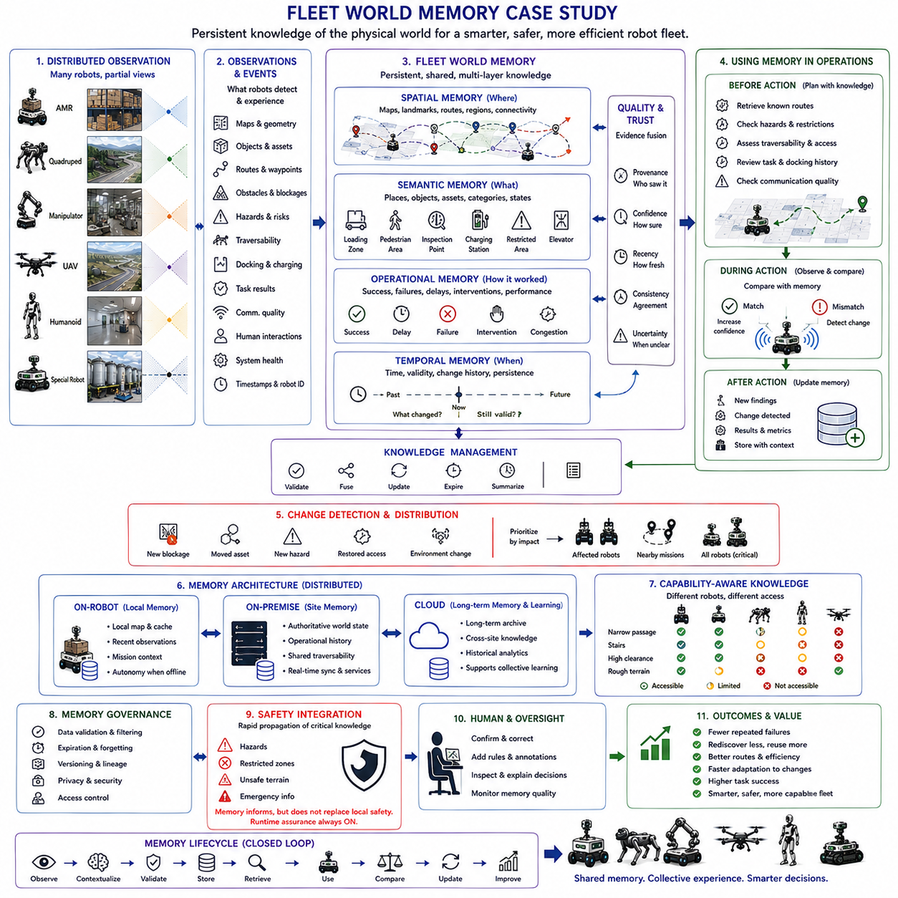{width="7.268055555555556in" height="7.268055555555556in"}

Fleet world memory gives a robot fleet persistent knowledge of the physical environment beyond the observations available to any individual robot at the present moment. Instead of treating every mission as a new encounter, the fleet preserves relevant spatial, semantic, operational, and temporal experience. Routes, obstacles, hazards, traversability, assets, task outcomes, and environmental changes become reusable knowledge for future robots and missions.

A representative case begins with multiple robots operating repeatedly within a warehouse, factory, campus, logistics yard, inspection site, or mixed indoor-outdoor environment. Each robot observes only part of the world during its mission, but collectively the fleet experiences a much larger operational space. Fleet world memory integrates these distributed observations into a persistent representation that evolves as new evidence becomes available.

The memory differs fundamentally from a conventional static map. A geometric map primarily describes spatial structure, whereas fleet world memory also records what objects exist, how areas can be used, what events occurred, which routes succeeded, and how conditions changed over time. Geometry provides the physical foundation, while semantic, operational, and temporal layers transform that foundation into knowledge useful for intelligent fleet decision making.

Spatial memory can preserve maps, landmarks, routes, intersections, docking locations, charging stations, work areas, restricted zones, and connectivity between regions. Robots use this information for localization and planning, but the fleet also records confidence and freshness. A route observed yesterday may remain geometrically valid while becoming operationally unavailable today because of construction, stored materials, temporary barriers, or changed traffic rules.

Semantic memory associates physical locations with meaningful entities and properties. A region can be identified as a loading zone, pedestrian area, inspection point, hazardous location, elevator entrance, or transfer station. Objects and assets can similarly retain identity, category, expected location, state, and relationships. This semantic layer allows robots to reason about what an environment means rather than merely where occupied and free space exists.

Operational memory captures what happened when robots acted in particular situations. It can record successful docking poses, repeated navigation delays, difficult turns, manipulation configurations, charging behavior, congestion, localization problems, or human interventions. These experiences provide practical evidence about how the environment behaves during real operations, allowing future planning to use historical performance rather than relying entirely on nominal geometry.

Temporal memory is necessary because the physical world changes. Observations therefore require timestamps, validity intervals, update histories, and potentially expected persistence. A permanent wall should be treated differently from a temporarily parked pallet, and a recurring congestion pattern should be distinguished from a one-time obstruction. Temporal reasoning helps the fleet determine whether remembered information remains relevant to the current mission.

Each observation should retain provenance and confidence. The memory can record which robot observed an event, which sensor or model generated the interpretation, when it occurred, and how reliable the estimate was. Information from a calibrated LiDAR, uncertain visual detector, operator confirmation, or repeated observations should not necessarily have equal authority. Provenance enables later reasoning about conflicting or outdated evidence.

Memory updates therefore require evidence fusion rather than simple overwriting. If one robot reports a blocked passage while another recently traversed it successfully, the fleet should consider timestamps, confidence, robot dimensions, direction of travel, and environmental context. The resulting memory may represent uncertainty or embodiment-dependent accessibility rather than forcing all observations into a single binary conclusion.

Shared traversability is one of the most valuable forms of fleet experience. Robots can record terrain roughness, slope, clearance, surface condition, wheel slip, narrow passages, stairs, debris, or other factors affecting physical movement. Future robots can use these observations before entering the region, reducing unnecessary trial and error and allowing planning to incorporate physical experience accumulated by previous fleet members.

Traversability must remain capability-aware in heterogeneous fleets. A passage that is blocked for a large AMR may remain accessible to a smaller robot, while stairs may be impossible for wheeled platforms but traversable by a quadruped or humanoid. UAVs operate under entirely different accessibility constraints. Fleet world memory therefore relates environmental conditions to robot embodiment and capability rather than storing one universal accessibility label.

Memory can also preserve communication experience. Wireless dead zones, weak connectivity, reliable relay positions, bandwidth limitations, and recurring network interruptions can become part of the operational world model. Future missions can then incorporate communication quality into planning, avoiding unnecessary disconnection or positioning selected robots where they can maintain information flow between isolated agents and fleet infrastructure.

Fleet world memory supports predictive planning when historical patterns become sufficiently consistent. Repeated congestion near a loading area, recurring obstacles during particular shifts, charging-station demand, or predictable environmental changes can influence future scheduling. The system moves from remembering what happened toward estimating what is likely to happen, allowing fleet coordination to prepare for expected conditions before they directly affect robot operations.

Task execution can query memory before physical action begins. A robot assigned to a destination can retrieve known routes, recent hazards, accessibility constraints, docking experience, communication conditions, and relevant task history. The planner then begins with accumulated fleet knowledge rather than an empty assumption about the environment. Local sensing remains essential, but prior experience provides a more informed starting point for decision making.

During execution, local perception continuously compares the current world against remembered expectations. When observations agree, confidence in persistent knowledge can increase. When significant differences appear, the robot can generate a memory-update event. This creates a closed loop between memory and perception: memory guides where and how robots act, while new physical observations continuously verify, correct, or extend the stored representation.

Change detection is consequently a central function. The fleet should identify newly blocked routes, moved assets, altered workspaces, changed terrain, damaged infrastructure, new hazards, or restored accessibility. Significant changes can be distributed rapidly to robots whose missions are affected. Less urgent information can be synchronized later, allowing communication resources to prioritize updates according to operational consequence.

Not every observation should become permanent memory. Temporary noise, false detections, localization errors, and transient events can accumulate into misleading knowledge if stored without filtering. Memory management therefore requires validation, confidence thresholds, repeated confirmation, expiration policies, and forgetting mechanisms. Persistent collective intelligence depends not only on remembering useful information but also on removing information that is no longer trustworthy or relevant.

Memory can be organized hierarchically to balance detail and scalability. Robots require high-resolution local information for immediate navigation and interaction, while fleet coordination often needs more abstract representations of routes, regions, hazards, resources, and task states. Older observations may also be summarized while important exceptions remain detailed. Hierarchical memory prevents unlimited raw-data accumulation from overwhelming operational reasoning.

Fleet world memory and collective learning reinforce each other but serve different time scales. Memory provides knowledge that can immediately influence missions without retraining a model. Collective learning analyzes accumulated experiences to improve perception, prediction, planning, or policies over longer cycles. Repeated memory events such as recurring route failures can become learning data, while improved models can produce better interpretations for future memory updates.

The architecture can distribute memory across robot, on-premise, and cloud layers. Robots maintain local working memory and cached knowledge required for immediate autonomy. On-premise infrastructure can maintain authoritative site-level world state, operational history, shared traversability, and fleet synchronization. Cloud systems can preserve long-term archives, aggregate knowledge across sites, perform historical analytics, and support broader model learning.

Synchronization must tolerate intermittent connectivity. A robot operating offline should continue using its cached world knowledge while recording new observations locally. When communication returns, updates can be reconciled with changes produced by other robots during the disconnection. Versioning, timestamps, confidence, and conflict-resolution mechanisms help merge distributed histories without assuming that every robot always possesses an identical real-time memory state.

Safety-critical knowledge requires special treatment. Confirmed hazards, restricted areas, structural risks, unsafe terrain, or emergency constraints may need rapid propagation and stronger persistence than ordinary operational observations. However, remembered information should never replace immediate safety perception. Local runtime assurance continues to enforce collision avoidance and physical limits even when shared memory indicates that a route was previously safe.

Human operators can contribute directly to fleet memory by confirming hazards, defining restricted areas, correcting semantic labels, or specifying operational rules. They can also inspect why a robot avoided a route or selected an unusual plan by examining the remembered evidence behind the decision. This makes memory not only a machine coordination mechanism but also a foundation for explainable fleet operations and human oversight.

Memory quality can be evaluated through operational outcomes. Useful measures include reduction in repeated navigation failures, fewer rediscovered hazards, improved route efficiency, lower intervention frequency, faster adaptation to environmental changes, increased task success, and reduced exploration redundancy. Another important measure is knowledge reuse: information acquired by one robot should demonstrably improve decisions made later by other robots.

The case study therefore shows how distributed observations can become persistent collective operational knowledge. Robots observe the physical world, contextualize and validate important events, update shared memory, retrieve relevant experience during planning, detect changes during execution, and continuously refine the stored representation. Knowledge survives individual missions and individual robots, allowing the fleet to accumulate experience as a long-lived intelligent system.

As fleet world memory matures, the system progresses from shared mapping toward a persistent Collective Physical Intelligence. The fleet remembers not only where things are, but what they mean, how they change, which robots can access them, what previously succeeded or failed, and how reliable that knowledge remains. Every robot can contribute experience and benefit from the experience of others, turning distributed physical operation into continuously evolving shared understanding.

군집 월드 메모리(Fleet World Memory)는 현재 시점에서 개별 로봇이 관측할 수 있는 범위를 넘어 물리적 환경에 대한 지속적인 지식(Persistent Knowledge)을 로봇 군집에 제공한다. 모든 임무를 새로운 상황으로 취급하는 대신 군집은 관련된 공간적, 의미적, 운영적, 시간적 경험을 보존한다. 경로, 장애물, 위험 요소, 주행가능성, 자산, 작업 결과, 환경 변화는 미래의 로봇과 임무에서 재사용할 수 있는 지식으로 전환된다.

대표적인 사례는 여러 로봇이 창고, 공장, 캠퍼스, 물류 야드, 검사 현장 또는 실내외 혼합 환경에서 반복적으로 운영되는 상황에서 시작된다. 각 로봇은 임무를 수행하면서 물리 세계의 일부만 관측하지만 군집 전체는 훨씬 더 넓은 운영 공간을 경험한다. 군집 월드 메모리는 이러한 분산 관측(Distributed Observation)을 지속적인 표현(Persistent Representation)으로 통합하며 새로운 증거가 확보될 때마다 지속적으로 발전한다.

이러한 메모리는 기존의 정적 지도(Static Map)와 근본적으로 다르다. 기하학적 지도(Geometric Map)는 주로 공간 구조를 표현하지만 군집 월드 메모리는 어떤 물체가 존재하는지, 영역을 어떻게 사용할 수 있는지, 어떤 사건이 발생했는지, 어떤 경로가 성공했는지, 조건이 시간에 따라 어떻게 변화했는지도 기록한다. 기하학은 물리적 기반을 제공하고 의미적, 운영적, 시간적 계층은 이를 지능적인 군집 의사결정에 활용할 수 있는 지식으로 변환한다.

공간 메모리(Spatial Memory)는 지도, 랜드마크, 경로, 교차로, 도킹 위치, 충전 스테이션, 작업 영역, 제한 구역, 영역 간 연결 관계를 보존할 수 있다. 로봇은 이러한 정보를 위치추정과 계획에 활용하지만 군집은 정보의 신뢰도(Confidence)와 최신성(Freshness)도 함께 기록한다. 어제 관측된 경로가 기하학적으로는 유효하더라도 오늘은 공사, 적재된 자재, 임시 장벽 또는 변경된 교통 규칙으로 인해 운영상 사용할 수 없을 수 있다.

의미 메모리(Semantic Memory)는 물리적 위치를 의미 있는 개체와 속성에 연결한다. 특정 영역을 적재 구역, 보행자 구역, 검사 지점, 위험 위치, 엘리베이터 입구 또는 전달 스테이션으로 식별할 수 있다. 물체와 자산도 마찬가지로 식별 정보, 범주, 예상 위치, 상태, 관계를 유지할 수 있다. 이러한 의미 계층(Semantic Layer)을 통해 로봇은 단순히 점유 공간과 자유 공간이 어디에 있는지를 넘어 환경이 무엇을 의미하는지 추론할 수 있다.

운영 메모리(Operational Memory)는 특정 상황에서 로봇이 행동했을 때 실제로 어떤 일이 발생했는지를 기록한다. 성공적인 도킹 자세, 반복적인 내비게이션 지연, 어려운 회전 구간, 조작 구성, 충전 행동, 혼잡, 위치추정 문제, 인간 개입 등을 저장할 수 있다. 이러한 경험은 실제 운영 중 환경이 어떻게 작용하는지에 대한 실질적인 증거를 제공하며 미래 계획이 명목상의 기하학적 정보에만 의존하지 않고 과거의 실제 성능을 활용하도록 한다.

물리 세계는 변화하기 때문에 시간 메모리(Temporal Memory)가 필요하다. 따라서 관측 정보에는 타임스탬프(Timestamp), 유효 기간, 업데이트 이력, 필요한 경우 예상 지속성이 포함되어야 한다. 영구적인 벽은 일시적으로 주차된 팔레트와 다르게 처리해야 하며, 반복적으로 발생하는 혼잡 패턴은 일회성 장애물과 구분해야 한다. 시간적 추론(Temporal Reasoning)은 기억된 정보가 현재 임무에도 여전히 유효한지를 군집이 판단하도록 한다.

각 관측에는 출처 추적성(Provenance)과 신뢰도(Confidence)가 유지되어야 한다. 메모리는 어떤 로봇이 이벤트를 관측했는지, 어떤 센서 또는 모델이 해당 해석을 생성했는지, 언제 발생했는지, 추정 결과가 얼마나 신뢰할 수 있는지를 기록할 수 있다. 보정된 라이다(LiDAR), 불확실한 시각 탐지기, 운영자의 확인 또는 반복적인 관측에서 얻은 정보가 반드시 동일한 권한을 가질 필요는 없다. 출처 추적성을 통해 이후 상충하거나 오래된 증거를 합리적으로 판단할 수 있다.

따라서 메모리 업데이트(Memory Update)는 단순한 덮어쓰기가 아니라 증거 융합(Evidence Fusion)을 필요로 한다. 하나의 로봇이 통로가 차단되었다고 보고했지만 다른 로봇이 최근 해당 통로를 성공적으로 통과했다면 군집은 타임스탬프, 신뢰도, 로봇 크기, 이동 방향, 환경 컨텍스트를 고려해야 한다. 결과적으로 모든 관측을 하나의 이진 결론으로 강제하는 대신 불확실성 또는 체화 의존적 접근성(Embodiment-Dependent Accessibility)을 표현할 수 있다.

공유 주행가능성(Shared Traversability)은 가장 가치 있는 군집 경험 중 하나이다. 로봇은 지형 거칠기, 경사, 여유 공간, 표면 상태, 휠 슬립(Wheel Slip), 좁은 통로, 계단, 잔해 또는 물리적 이동에 영향을 주는 다른 요소들을 기록할 수 있다. 미래의 로봇은 해당 영역에 진입하기 전에 이러한 관측을 활용하여 불필요한 시행착오를 줄이고 이전 군집 구성원이 축적한 물리적 경험을 계획에 반영할 수 있다.

이기종 군집(Heterogeneous Fleet)에서는 주행가능성이 능력 인지형(Capability-Aware)으로 유지되어야 한다. 대형 AMR이 통과할 수 없는 통로도 소형 로봇은 접근할 수 있으며, 계단은 바퀴형 플랫폼에는 불가능하지만 4족 보행 로봇(Quadruped)이나 휴머노이드(Humanoid)는 통과할 수 있다. UAV는 완전히 다른 접근성 제약 아래에서 동작한다. 따라서 군집 월드 메모리는 하나의 보편적인 접근성 라벨 대신 환경 조건을 로봇의 체화와 능력에 연결한다.

메모리는 통신 경험(Communication Experience)도 보존할 수 있다. 무선 통신 음영 지역, 약한 연결성, 안정적인 중계 위치, 대역폭 제한, 반복적인 네트워크 단절 등이 운영 월드 모델(Operational World Model)의 일부가 될 수 있다. 이후의 임무에서는 통신 품질을 계획에 반영하여 불필요한 연결 단절을 피하거나 특정 로봇을 적절한 위치에 배치하여 고립된 에이전트와 군집 인프라 사이의 정보 흐름을 유지할 수 있다.

과거의 패턴이 충분히 일관되면 군집 월드 메모리는 예측 계획(Predictive Planning)을 지원할 수 있다. 적재 구역 주변에서 반복되는 혼잡, 특정 교대 시간에 발생하는 장애물, 충전 스테이션 수요 또는 예측 가능한 환경 변화는 미래 스케줄링에 영향을 줄 수 있다. 시스템은 단순히 과거에 무엇이 발생했는지를 기억하는 단계에서 앞으로 무엇이 발생할 가능성이 높은지를 추정하는 단계로 발전하여 예상 조건이 실제 로봇 운영에 영향을 주기 전에 군집 조정을 준비할 수 있다.

작업 실행 전에 메모리를 조회할 수 있다. 목적지를 할당받은 로봇은 알려진 경로, 최근의 위험 요소, 접근성 제약, 도킹 경험, 통신 상태, 관련 작업 이력을 검색할 수 있다. 이후 플래너(Planner)는 환경에 대해 아무런 정보가 없는 상태가 아니라 축적된 군집 지식을 기반으로 계획을 시작한다. 로컬 센싱(Local Sensing)은 여전히 필수적이지만 이전 경험은 더욱 정보화된 의사결정의 출발점을 제공한다.

작업 실행 중에는 로컬 인지(Local Perception)가 현재의 물리 세계와 기억된 예상 상태를 지속적으로 비교한다. 관측 결과가 기존 메모리와 일치하면 지속적인 지식에 대한 신뢰도가 증가할 수 있다. 반대로 중요한 차이가 발견되면 로봇은 메모리 업데이트 이벤트(Memory-Update Event)를 생성할 수 있다. 이를 통해 메모리가 로봇의 행동 위치와 방식을 안내하고 새로운 물리적 관측이 저장된 표현을 지속적으로 검증, 수정, 확장하는 폐쇄 루프(Closed Loop)가 형성된다.

따라서 변화 탐지(Change Detection)는 핵심 기능이다. 군집은 새롭게 차단된 경로, 이동된 자산, 변경된 작업공간, 변화된 지형, 손상된 인프라, 새로운 위험 요소 또는 다시 접근 가능해진 영역을 식별해야 한다. 중요한 변화는 영향을 받는 임무를 수행하는 로봇에 신속하게 전달할 수 있다. 긴급성이 낮은 정보는 이후에 동기화하여 운영 영향도에 따라 통신 자원을 우선적으로 사용할 수 있다.

모든 관측이 영구적인 메모리가 되어서는 안 된다. 일시적인 노이즈, 오탐지(False Detection), 위치추정 오류, 순간적인 이벤트를 필터링 없이 저장하면 잘못된 지식이 누적될 수 있다. 따라서 메모리 관리(Memory Management)에는 검증, 신뢰도 임계값, 반복 확인, 만료 정책(Expiration Policy), 망각 메커니즘(Forgetting Mechanism)이 필요하다. 지속적인 집단 지능은 유용한 정보를 기억하는 것뿐 아니라 더 이상 신뢰할 수 없거나 관련성이 없는 정보를 제거하는 능력에도 의존한다.

메모리는 세부 정보와 확장성(Scalability)의 균형을 위해 계층적으로 구성할 수 있다. 로봇은 즉각적인 내비게이션과 상호작용을 위해 고해상도 로컬 정보가 필요하지만 군집 조정에는 경로, 영역, 위험 요소, 자원, 작업 상태 등에 대한 더욱 추상적인 표현이 필요한 경우가 많다. 오래된 관측은 요약하면서 중요한 예외 사항은 상세하게 유지할 수도 있다. 계층형 메모리(Hierarchical Memory)는 무제한적인 원시 데이터 축적으로 인해 운영 추론이 과부하되는 것을 방지한다.

군집 월드 메모리와 집단 학습(Collective Learning)은 서로를 강화하지만 서로 다른 시간 규모(Time Scale)에서 동작한다. 메모리는 모델을 다시 학습하지 않고도 즉시 임무에 영향을 줄 수 있는 지식을 제공한다. 집단 학습은 축적된 경험을 분석하여 더 긴 주기에서 인지, 예측, 계획 또는 정책을 개선한다. 반복적인 경로 실패와 같은 메모리 이벤트는 학습 데이터가 될 수 있으며, 개선된 모델은 이후의 메모리 업데이트를 위한 더욱 정확한 해석을 생성할 수 있다.

아키텍처는 로봇, 온프레미스(On-Premise), 클라우드(Cloud) 계층에 메모리를 분산할 수 있다. 로봇은 즉각적인 자율성에 필요한 로컬 작업 메모리(Local Working Memory)와 캐시된 지식을 유지한다. 온프레미스 인프라는 권위 있는 사이트 수준 월드 상태(Authoritative Site-Level World State), 운영 이력, 공유 주행가능성, 군집 동기화를 관리할 수 있다. 클라우드 시스템은 장기 아카이브, 사이트 간 지식 집계, 이력 분석, 보다 광범위한 모델 학습을 지원할 수 있다.

동기화(Synchronization)는 간헐적인 연결성(Intermittent Connectivity)을 허용해야 한다. 오프라인으로 동작하는 로봇은 캐시된 월드 지식을 계속 사용하면서 새로운 관측을 로컬에 기록해야 한다. 통신이 복구되면 연결이 끊어진 동안 다른 로봇이 생성한 변경사항과 업데이트를 조정할 수 있다. 버전 관리, 타임스탬프, 신뢰도, 충돌 해결 메커니즘(Conflict-Resolution Mechanism)은 모든 로봇이 항상 동일한 실시간 메모리 상태를 가지고 있다고 가정하지 않고 분산된 이력을 병합하도록 지원한다.

안전 필수 지식(Safety-Critical Knowledge)은 특별하게 관리해야 한다. 확인된 위험 요소, 제한 구역, 구조적 위험, 안전하지 않은 지형 또는 비상 제약은 일반적인 운영 관측보다 더 빠르게 전파되고 더 강하게 유지되어야 할 수 있다. 그러나 기억된 정보가 즉각적인 안전 인지(Immediate Safety Perception)를 대체해서는 안 된다. 공유 메모리가 특정 경로가 이전에 안전했다고 나타내더라도 로컬 런타임 보증(Local Runtime Assurance)은 계속해서 충돌 회피와 물리적 한계를 강제해야 한다.

인간 운영자(Human Operator)는 위험 요소를 확인하고, 제한 구역을 정의하고, 의미 라벨(Semantic Label)을 수정하거나 운영 규칙을 지정함으로써 군집 메모리에 직접 기여할 수 있다. 또한 로봇이 특정 경로를 회피하거나 비정상적인 계획을 선택한 이유를 해당 의사결정의 기반이 된 기억된 증거를 통해 확인할 수 있다. 따라서 메모리는 기계 간 조정 메커니즘일 뿐 아니라 설명 가능한 군집 운영(Explainable Fleet Operation)과 인간 감독(Human Oversight)의 기반이 된다.

메모리 품질(Memory Quality)은 실제 운영 결과를 통해 평가할 수 있다. 유용한 지표에는 반복적인 내비게이션 장애 감소, 동일한 위험 요소의 재발견 감소, 경로 효율 향상, 인간 개입 빈도 감소, 환경 변화에 대한 적응 속도 향상, 작업 성공률 증가, 중복 탐색 감소 등이 포함된다. 또 다른 중요한 지표는 지식 재사용(Knowledge Reuse)으로, 하나의 로봇이 획득한 정보가 이후 다른 로봇의 의사결정을 실제로 개선할 수 있어야 한다.

따라서 이 사례 연구(Case Study)는 분산된 관측이 지속적인 집단 운영 지식(Persistent Collective Operational Knowledge)으로 전환되는 과정을 보여준다. 로봇은 물리 세계를 관측하고 중요한 이벤트에 컨텍스트를 부여하여 검증하며 공유 메모리를 갱신한다. 계획 과정에서는 관련 경험을 검색하고 실행 중에는 변화를 탐지하며 저장된 표현을 지속적으로 개선한다. 지식은 개별 임무와 개별 로봇의 수명을 넘어 유지되며 군집이 장기간 경험을 축적하는 지능형 시스템으로 발전하도록 한다.

군집 월드 메모리가 성숙하면 시스템은 공유 매핑(Shared Mapping)에서 지속적인 집단 물리 지능(Persistent Collective Physical Intelligence)으로 발전한다. 군집은 단순히 사물이 어디에 있는지를 기억하는 것이 아니라 그것이 무엇을 의미하는지, 어떻게 변화하는지, 어떤 로봇이 접근할 수 있는지, 이전에 무엇이 성공하거나 실패했는지, 그리고 해당 지식이 현재 얼마나 신뢰할 수 있는지를 기억한다. 모든 로봇은 자신의 경험을 제공하면서 동시에 다른 로봇의 경험으로부터 혜택을 얻으며, 분산된 물리적 운영은 지속적으로 진화하는 공유 이해(Continuously Evolving Shared Understanding)로 전환된다.

## 10.12. End to End Multi Robot Physical AI [w/Code]

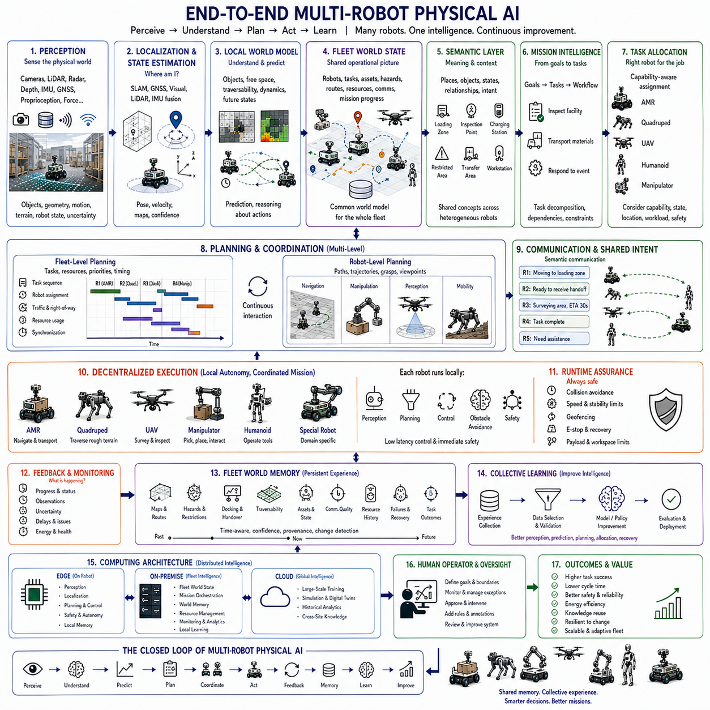{width="7.268055555555556in" height="7.268055555555556in"}

End-to-end Multi-Robot Physical AI integrates perception, world modeling, reasoning, planning, action, fleet coordination, memory, and learning into one continuous operational system. Individual robots remain autonomous physical agents, but their capabilities are connected through shared representations and collective intelligence. The objective is not simply to coordinate robots, but to transform distributed sensing and action into coherent fleet-level behavior.

The end-to-end process begins when robots perceive the physical environment through cameras, LiDAR, radar, depth sensors, proprioception, GNSS, IMU, force sensing, and other platform-specific modalities. Each robot converts raw observations into locally useful representations of objects, geometry, motion, terrain, robot state, and uncertainty. Local perception provides immediate awareness while also producing information that can contribute to the fleet's shared understanding.

Localization and state estimation establish where each robot is and how it is moving relative to the environment and other agents. Different robots may use SLAM, GNSS, visual localization, LiDAR localization, inertial estimation, or combinations of these methods. The resulting poses and confidence estimates provide the spatial foundation for navigation, manipulation, collaboration, map alignment, and the exchange of observations across multiple embodied platforms.

Local world models transform perception into representations suitable for prediction and decision making. Instead of reacting only to current sensor measurements, robots maintain estimates of objects, agents, free space, traversability, dynamics, and likely future states. These models allow robots to reason about what may happen after an action, supporting safer navigation, manipulation, inspection, and interaction with environments that change over time.

Fleet-level world state integrates relevant information from many robots into a common operational picture. Robot positions, tasks, assets, hazards, routes, workstations, restricted areas, communication conditions, resource availability, and mission progress can be represented together. The shared state does not replace local perception; it extends each robot's awareness with observations and operational knowledge obtained elsewhere by other members of the fleet.

Semantic representations connect physical observations to mission meaning. A location can be understood as a loading zone, inspection point, charging station, restricted region, or transfer area rather than merely coordinates on a map. Objects can carry identity, category, state, ownership, and task relationships. Semantic grounding allows heterogeneous robots to coordinate through concepts that remain meaningful despite differences in sensors, mobility, manipulation, and control architectures.

Mission intelligence translates human or system objectives into executable multi-robot workflows. A high-level request such as inspecting a facility, transporting materials, or responding to an abnormal condition can be decomposed into sensing, navigation, transportation, manipulation, verification, and reporting tasks. Dependencies between these tasks determine which actions can occur concurrently and which require completion or information from other robots first.

Capability-aware task allocation matches these tasks to suitable robots. The fleet considers mobility, payload, sensors, manipulation ability, reach, endurance, energy state, compute resources, location, workload, safety constraints, and current health. An AMR, quadruped, UAV, humanoid, or mobile manipulator is selected according to what the mission physically requires rather than according to a fixed assumption that all robots provide equivalent capabilities.

Some mission requirements demand capability composition rather than assignment to a single robot. A UAV may perform reconnaissance, an AMR may transport equipment, a quadruped may traverse difficult terrain, and a manipulator may physically interact with the target. Fleet orchestration connects these actions through shared task state, handover conditions, timing constraints, and semantic intent, creating an end-to-end workflow from observation to physical completion.

Planning occurs simultaneously at multiple levels. Fleet planning determines task sequences, robot assignments, shared resource usage, traffic priorities, and synchronization. Robot-level planning determines routes, trajectories, grasps, footholds, viewpoints, and immediate actions. These layers interact continuously: fleet decisions constrain local objectives, while local feasibility, uncertainty, delays, and failures can trigger changes to the higher-level mission plan.

Shared intent enables robots to communicate what they are trying to accomplish rather than exchanging only low-level states. Messages can represent destination, target, readiness, expected arrival, task completion, uncertainty, failure, or assistance requirements. Semantic communication reduces unnecessary bandwidth and provides a common coordination interface between heterogeneous embodiments whose internal controllers and action spaces may be fundamentally different.

Physical execution remains decentralized because real-world control requires low latency and platform-specific safety. Each robot executes locomotion, navigation, manipulation, stabilization, obstacle avoidance, and emergency responses locally. Fleet intelligence provides objectives and coordination constraints but does not directly replace high-frequency control. This separation preserves responsiveness while allowing local autonomous actions to contribute to globally coordinated missions.

Runtime assurance protects the system throughout execution. Collision avoidance, speed constraints, geofencing, stability limits, manipulation workspace constraints, payload safety, emergency stopping, and other platform-specific protections remain independently enforced. Collective optimization operates inside these safety envelopes. Even a high-priority fleet objective cannot justify violating hard physical constraints established for an individual robot or shared operational environment.

Execution continuously generates feedback. Robots report progress, observations, estimated completion time, energy consumption, uncertainty, unexpected obstacles, failures, and task outcomes. Fleet intelligence compares these signals with expected mission states. When execution differs significantly from the plan, the system can update its world state and determine whether local recovery, task reassignment, route modification, or complete mission replanning is required.

Dynamic replanning allows the end-to-end system to remain effective under changing conditions. A blocked route, unavailable workstation, failed sensor, low battery, communication loss, delayed manipulation, or newly discovered hazard may invalidate previous assumptions. Instead of terminating the complete workflow, the fleet modifies affected tasks and dependencies while preserving the original mission objective whenever safe and operationally feasible.

Fleet world memory gives this process continuity across time. Successful routes, hazards, docking configurations, manipulation outcomes, difficult terrain, communication shadows, resource usage, failures, and recovery actions can persist beyond the current mission. New robots can retrieve relevant experience before acting, while current observations verify or update remembered knowledge. The fleet therefore begins future missions with accumulated operational experience rather than from an empty state.

Collective learning extends persistent memory into model and policy improvement. Valuable events such as failures, uncertainty, human interventions, unusual environmental conditions, and successful recoveries are collected across robots. These episodes can improve perception, prediction, traversability estimation, task allocation, planning, and recovery behavior. Experience acquired by one robot can eventually improve many other agents after validation and controlled redistribution.

A fleet data flywheel connects physical operation to continuous intelligence improvement. Deployment generates experience, relevant episodes are selected, data is validated and structured, models or policies are improved, candidate updates are evaluated, and approved versions return to appropriate robots. Subsequent operation generates new evidence about those improvements, creating a closed learning cycle between the physical fleet and its evolving intelligence.

Heterogeneous fleets require learning and memory to remain capability-aware. Knowledge about hazards, objects, environmental changes, mission outcomes, and spatial relationships can often be shared broadly, while locomotion or manipulation policies remain embodiment-specific. The system therefore transfers knowledge at the highest useful abstraction level without assuming that physical skills can be directly exchanged between robots with incompatible bodies or action spaces.

The computing architecture distributes this intelligence across edge, on-premise, and cloud layers. Robot edge computing supports immediate perception, localization, planning, control, and safety. On-premise intelligence manages shared world state, fleet orchestration, world memory, resource coordination, monitoring, and local learning. Cloud infrastructure can support large-scale training, simulation, historical analytics, cross-site knowledge aggregation, and foundation-level intelligence.

This layered architecture also separates different time scales of intelligence. Millisecond-level control remains close to actuators, short-horizon perception and planning operate onboard, fleet coordination occurs over operational time scales, and collective learning may span hours, days, or many deployments. Information flows between these layers without requiring every decision to pass through a centralized system, preserving both responsiveness and global coordination.

Human operators remain part of the end-to-end intelligence loop. They establish mission objectives, operational boundaries, priorities, and safety policies while supervising exceptions and uncertain situations. Human corrections, approvals, and interventions can become structured information for fleet memory and collective learning. The objective is not continuous teleoperation, but mission-level oversight in which humans retain authority over consequential decisions while routine coordination becomes autonomous.

Observability and explainability are necessary for managing a system of this complexity. Operators and engineers should be able to determine which robot performed a task, why it was selected, what information influenced its plan, which model version was active, what failure occurred, and how the fleet responded. Traceable decisions, model provenance, task histories, and memory evidence support debugging, safety analysis, governance, and continuous system improvement.

Performance must be evaluated across the entire physical intelligence loop rather than through isolated model accuracy. Mission completion, cycle time, utilization, energy efficiency, coverage, handover success, task waiting time, intervention frequency, recovery performance, safety events, communication efficiency, knowledge reuse, and resilience to robot loss together indicate whether collective intelligence produces measurable operational value.

The complete architecture forms a closed loop of perception, understanding, prediction, planning, coordination, action, feedback, memory, and learning. Robots perceive and act locally while fleet intelligence coordinates shared objectives and resources. Operational experience updates world memory, and accumulated experience improves future models and policies. Each completed mission therefore becomes both a physical outcome and a source of knowledge for subsequent missions.

End-to-end Multi-Robot Physical AI consequently represents more than a fleet management system layered over autonomous robots. It is an integrated architecture in which embodied intelligence, fleet intelligence, persistent world memory, semantic communication, runtime assurance, and collective learning operate together. The system connects individual physical autonomy with shared operational reasoning while preserving the distinct capabilities and safety requirements of each robot.

As the architecture matures, the fleet can evolve from coordinated automation toward adaptive Collective Physical Intelligence. Robots collectively perceive the environment, maintain shared understanding, compose complementary capabilities, predict consequences, reorganize tasks, remember experience, and learn from outcomes. Intelligence is no longer confined to one robot or one model; it emerges from the continuous interaction between many embodied agents, shared memory, learning infrastructure, and the physical world.

엔드투엔드 다중 로봇 피지컬 AI(End-to-End Multi-Robot Physical AI)는 인지(Perception), 월드 모델링(World Modeling), 추론(Reasoning), 계획(Planning), 행동(Action), 군집 조정(Fleet Coordination), 메모리(Memory), 학습(Learning)을 하나의 연속적인 운영 시스템으로 통합한다. 개별 로봇은 자율적인 물리 에이전트(Autonomous Physical Agent)로 유지되지만 공유 표현(Shared Representation)과 집단 지능(Collective Intelligence)을 통해 서로의 능력이 연결된다. 목표는 단순히 여러 로봇을 조정하는 것이 아니라 분산된 센싱과 행동을 일관된 군집 수준 행동(Fleet-Level Behavior)으로 전환하는 것이다.

엔드투엔드 프로세스(End-to-End Process)는 로봇이 카메라, 라이다(LiDAR), 레이더(Radar), 깊이 센서(Depth Sensor), 고유수용감각(Proprioception), GNSS, IMU, 힘 센싱(Force Sensing) 및 기타 플랫폼 특화 모달리티를 통해 물리적 환경을 인지하면서 시작된다. 각 로봇은 원시 관측을 물체, 기하학, 움직임, 지형, 로봇 상태, 불확실성에 대한 로컬 표현으로 변환한다. 로컬 인지(Local Perception)는 즉각적인 상황 인식을 제공하면서 군집의 공유 이해(Shared Understanding)에 기여할 수 있는 정보를 생성한다.

위치추정 및 상태 추정(Localization and State Estimation)은 각 로봇이 환경 및 다른 에이전트에 대해 어디에 위치하고 어떻게 움직이는지를 결정한다. 서로 다른 로봇은 SLAM, GNSS, 시각 위치추정(Visual Localization), 라이다 위치추정(LiDAR Localization), 관성 추정(Inertial Estimation) 또는 이러한 방법의 조합을 사용할 수 있다. 결과적으로 생성되는 자세(Pose)와 신뢰도 추정은 내비게이션, 조작, 협업, 지도 정렬, 다수의 체화 플랫폼 사이의 관측 교환을 위한 공간적 기반을 제공한다.

로컬 월드 모델(Local World Model)은 인지 결과를 예측과 의사결정에 적합한 표현으로 변환한다. 로봇은 현재의 센서 측정값에만 반응하는 대신 물체, 에이전트, 자유 공간, 주행가능성(Traversability), 동역학(Dynamics), 예상되는 미래 상태에 대한 추정값을 유지한다. 이러한 모델을 통해 로봇은 행동 이후에 어떤 일이 발생할 수 있는지를 추론하여 시간에 따라 변화하는 환경에서 더욱 안전한 내비게이션, 조작, 검사, 상호작용을 수행할 수 있다.

군집 수준 월드 상태(Fleet-Level World State)는 여러 로봇의 관련 정보를 하나의 공통 운영 상황도(Common Operational Picture)로 통합한다. 로봇 위치, 작업, 자산, 위험 요소, 경로, 작업 스테이션, 제한 구역, 통신 상태, 자원 가용성, 임무 진행 상황 등을 함께 표현할 수 있다. 공유 상태(Shared State)는 로컬 인지를 대체하는 것이 아니라 다른 군집 구성원이 다른 위치에서 획득한 관측과 운영 지식을 통해 각 로봇의 상황 인식 범위를 확장한다.

의미 표현(Semantic Representation)은 물리적 관측을 임무의 의미와 연결한다. 특정 위치는 단순한 지도상의 좌표가 아니라 적재 구역, 검사 지점, 충전 스테이션, 제한 영역 또는 전달 구역으로 이해될 수 있다. 물체는 식별 정보, 범주, 상태, 소유권, 작업 관계를 가질 수 있다. 의미적 그라운딩(Semantic Grounding)은 센서, 이동성, 조작 방식, 제어 아키텍처가 서로 다른 이기종 로봇들이 공통적으로 이해할 수 있는 개념을 통해 협업하도록 한다.

임무 지능(Mission Intelligence)은 인간 또는 시스템이 정의한 목표를 실행 가능한 다중 로봇 워크플로(Multi-Robot Workflow)로 변환한다. 시설 검사, 자재 운송, 이상 상황 대응과 같은 상위 수준의 요청은 센싱, 내비게이션, 운송, 조작, 검증, 보고 등의 작업으로 분해할 수 있다. 이러한 작업 사이의 의존성(Task Dependency)에 따라 어떤 행동을 동시에 수행할 수 있는지, 어떤 행동이 다른 로봇의 작업 완료 또는 정보 확보 이후에 수행되어야 하는지가 결정된다.

능력 인지형 작업 할당(Capability-Aware Task Allocation)은 이러한 작업을 적절한 로봇과 연결한다. 군집은 이동성, 페이로드, 센서, 조작 능력, 도달 범위, 운용시간, 에너지 상태, 컴퓨팅 자원, 위치, 작업 부하, 안전 제약, 현재 건전성을 고려한다. AMR, 4족 보행 로봇(Quadruped), UAV, 휴머노이드(Humanoid), 모바일 매니퓰레이터(Mobile Manipulator)는 모든 로봇이 동등한 능력을 제공한다는 고정된 가정이 아니라 임무에서 물리적으로 요구하는 능력에 따라 선택된다.

일부 임무 요구사항은 하나의 로봇에 대한 작업 할당이 아니라 능력 조합(Capability Composition)을 요구한다. UAV가 정찰을 수행하고, AMR이 장비를 운송하며, 4족 보행 로봇이 험지를 통과하고, 매니퓰레이터가 표적과 물리적으로 상호작용할 수 있다. 군집 오케스트레이션(Fleet Orchestration)은 공유 작업 상태, 인계 조건, 시간 제약, 의미적 의도(Semantic Intent)를 통해 이러한 행동을 연결하여 관측에서 물리적 임무 완료까지 이어지는 엔드투엔드 워크플로를 구성한다.

계획(Planning)은 여러 수준에서 동시에 수행된다. 군집 계획(Fleet Planning)은 작업 순서, 로봇 할당, 공유 자원 사용, 교통 우선순위, 동기화를 결정한다. 로봇 수준 계획(Robot-Level Planning)은 경로, 궤적, 파지(Grasp), 발 디딤 위치(Foothold), 관측 위치, 즉각적인 행동을 결정한다. 이러한 계층들은 지속적으로 상호작용하며 군집 의사결정은 로컬 목표를 제약하고, 로컬 실행 가능성, 불확실성, 지연, 장애는 다시 상위 수준의 임무 계획 변경을 유발할 수 있다.

공유 의도(Shared Intent)를 통해 로봇은 저수준 상태만 교환하는 대신 자신이 무엇을 수행하려고 하는지를 전달할 수 있다. 메시지는 목적지, 표적, 준비 상태, 예상 도착시간, 작업 완료, 불확실성, 장애 또는 지원 요구사항을 표현할 수 있다. 의미 기반 통신(Semantic Communication)은 불필요한 대역폭 사용을 감소시키고 내부 제어기와 행동 공간이 근본적으로 다른 이기종 체화(Embodiment) 사이에 공통적인 조정 인터페이스를 제공한다.

현실 세계의 제어에는 낮은 지연시간과 플랫폼별 안전 기능이 필요하기 때문에 물리적 실행(Physical Execution)은 분산된 상태로 유지된다. 각 로봇은 이동, 내비게이션, 조작, 안정화, 장애물 회피, 비상 대응을 로컬에서 실행한다. 군집 지능은 목표와 조정 제약을 제공하지만 고주파 제어(High-Frequency Control)를 직접 대체하지 않는다. 이러한 분리를 통해 로컬 자율 행동이 전역적으로 조정된 임무에 기여하면서도 즉각적인 반응성을 유지할 수 있다.

런타임 보증(Runtime Assurance)은 실행 과정 전체에서 시스템을 보호한다. 충돌 회피, 속도 제약, 지오펜싱(Geofencing), 안정성 한계, 조작 작업공간 제약, 페이로드 안전, 비상 정지 및 기타 플랫폼 특화 보호 기능은 독립적으로 강제된다. 집단 최적화(Collective Optimization)는 이러한 안전 범위(Safety Envelope) 내부에서 수행된다. 우선순위가 높은 군집 목표라 하더라도 개별 로봇이나 공유 운영 환경에 설정된 엄격한 물리적 제약을 위반할 수 없다.

물리적 실행은 지속적으로 피드백(Feedback)을 생성한다. 로봇은 진행 상태, 관측 결과, 예상 완료시간, 에너지 소비, 불확실성, 예상하지 못한 장애물, 장애, 작업 결과를 보고한다. 군집 지능은 이러한 신호를 예상된 임무 상태와 비교한다. 실행 결과가 계획과 크게 다르면 시스템은 월드 상태를 갱신하고 로컬 복구(Local Recovery), 작업 재할당, 경로 수정 또는 전체 임무 재계획 중 무엇이 필요한지를 결정할 수 있다.

동적 재계획(Dynamic Replanning)은 변화하는 조건에서도 엔드투엔드 시스템이 효과적으로 동작하도록 한다. 차단된 경로, 사용할 수 없는 작업 스테이션, 센서 장애, 배터리 부족, 통신 단절, 지연된 조작 또는 새롭게 발견된 위험 요소는 기존의 가정을 무효화할 수 있다. 전체 워크플로를 종료하는 대신 군집은 영향을 받은 작업과 의존성을 수정하면서 안전하고 운영적으로 가능한 범위에서 원래의 임무 목표를 유지한다.

군집 월드 메모리(Fleet World Memory)는 이러한 프로세스에 시간적 연속성(Temporal Continuity)을 제공한다. 성공적인 경로, 위험 요소, 도킹 구성, 조작 결과, 어려운 지형, 통신 음영 지역, 자원 사용, 장애, 복구 행동을 현재 임무 이후에도 유지할 수 있다. 새로운 로봇은 행동하기 전에 관련 경험을 검색하고 현재 관측을 통해 기억된 지식을 검증하거나 갱신한다. 따라서 군집은 미래 임무를 빈 상태에서 시작하는 것이 아니라 축적된 운영 경험을 기반으로 시작한다.

집단 학습(Collective Learning)은 지속적인 메모리를 모델과 정책의 개선으로 확장한다. 장애, 불확실성, 인간 개입, 비정상적인 환경 조건, 성공적인 복구와 같은 가치 있는 이벤트를 여러 로봇에서 수집한다. 이러한 에피소드는 인지, 예측, 주행가능성 추정, 작업 할당, 계획, 복구 행동을 개선할 수 있다. 하나의 로봇이 획득한 경험은 검증과 통제된 재배포 과정을 거쳐 궁극적으로 다수의 다른 에이전트를 개선할 수 있다.

군집 데이터 플라이휠(Fleet Data Flywheel)은 물리적 운영을 지속적인 지능 개선과 연결한다. 실제 배치가 경험을 생성하고, 관련 에피소드를 선택하며, 데이터를 검증하고 구조화한 후 모델 또는 정책을 개선한다. 후보 업데이트를 평가하고 승인된 버전을 적절한 로봇에 다시 배포한다. 이후 운영은 이러한 개선의 효과에 대한 새로운 증거를 생성하여 물리적 군집과 지속적으로 발전하는 지능 사이에 폐쇄형 학습 사이클(Closed Learning Cycle)을 형성한다.

이기종 군집(Heterogeneous Fleet)에서는 학습과 메모리 역시 능력 인지형(Capability-Aware)으로 유지되어야 한다. 위험 요소, 물체, 환경 변화, 임무 결과, 공간 관계에 대한 지식은 광범위하게 공유할 수 있지만 이동 또는 조작 정책은 체화 특화(Embodiment-Specific) 형태로 유지된다. 따라서 시스템은 서로 호환되지 않는 신체나 행동 공간을 가진 로봇 사이에서 물리적 기술을 직접 교환할 수 있다고 가정하지 않고 가장 유용한 상위 추상화 수준에서 지식을 전달한다.

컴퓨팅 아키텍처(Computing Architecture)는 이러한 지능을 엣지(Edge), 온프레미스(On-Premise), 클라우드(Cloud) 계층에 분산한다. 로봇 엣지 컴퓨팅(Robot Edge Computing)은 즉각적인 인지, 위치추정, 계획, 제어, 안전을 지원한다. 온프레미스 지능(On-Premise Intelligence)은 공유 월드 상태, 군집 오케스트레이션, 월드 메모리, 자원 조정, 모니터링, 로컬 학습을 관리한다. 클라우드 인프라(Cloud Infrastructure)는 대규모 학습, 시뮬레이션, 이력 분석, 사이트 간 지식 집계, 파운데이션 수준 지능(Foundation-Level Intelligence)을 지원할 수 있다.

이러한 계층형 아키텍처(Layered Architecture)는 서로 다른 지능의 시간 규모(Time Scale)도 분리한다. 밀리초 수준의 제어는 액추에이터 가까이에서 유지되고, 단기적인 인지와 계획은 온보드에서 수행되며, 군집 조정은 운영 시간 규모에서 이루어진다. 집단 학습은 수 시간, 수일 또는 여러 배치에 걸쳐 진행될 수 있다. 모든 의사결정을 중앙 시스템을 거치게 하지 않고 계층 사이에서 정보를 교환함으로써 즉각적인 반응성과 전역적 조정을 동시에 유지한다.

인간 운영자(Human Operator)는 엔드투엔드 지능 루프(End-to-End Intelligence Loop)의 일부로 유지된다. 인간은 임무 목표, 운영 경계, 우선순위, 안전 정책을 설정하면서 예외 상황과 불확실한 상황을 감독한다. 인간의 수정, 승인, 개입은 군집 월드 메모리와 집단 학습을 위한 구조화된 정보가 될 수 있다. 목표는 지속적인 원격조종이 아니라 일상적인 조정은 자율화하면서 중요한 의사결정에 대한 인간의 권한을 유지하는 임무 수준 감독(Mission-Level Oversight)이다.

이러한 복잡한 시스템을 관리하려면 관측 가능성(Observability)과 설명 가능성(Explainability)이 필요하다. 운영자와 엔지니어는 어떤 로봇이 작업을 수행했는지, 왜 해당 로봇이 선택되었는지, 어떤 정보가 계획에 영향을 미쳤는지, 어떤 모델 버전이 활성화되어 있었는지, 어떤 장애가 발생했는지, 군집이 어떻게 대응했는지를 확인할 수 있어야 한다. 추적 가능한 의사결정, 모델 출처 추적성(Model Provenance), 작업 이력, 메모리 증거는 디버깅, 안전 분석, 거버넌스, 지속적인 시스템 개선을 지원한다.

성능(Performance)은 개별 모델의 정확도가 아니라 전체 물리 지능 루프(Physical Intelligence Loop)를 기준으로 평가해야 한다. 임무 완료율, 사이클 타임(Cycle Time), 활용률, 에너지 효율, 커버리지, 인계 성공률, 작업 대기시간, 인간 개입 빈도, 복구 성능, 안전 이벤트, 통신 효율, 지식 재사용(Knowledge Reuse), 로봇 손실에 대한 복원력을 종합적으로 평가해야 집단 지능이 측정 가능한 운영 가치를 만들어내는지를 판단할 수 있다.

전체 아키텍처는 인지, 이해, 예측, 계획, 조정, 행동, 피드백, 메모리, 학습으로 이어지는 폐쇄 루프(Closed Loop)를 형성한다. 로봇은 로컬에서 인지하고 행동하며 군집 지능은 공유 목표와 자원을 조정한다. 운영 경험은 월드 메모리를 갱신하고 축적된 경험은 미래의 모델과 정책을 개선한다. 따라서 완료된 각각의 임무는 하나의 물리적 결과인 동시에 이후의 임무를 위한 새로운 지식의 원천이 된다.

결과적으로 엔드투엔드 다중 로봇 피지컬 AI(End-to-End Multi-Robot Physical AI)는 자율 로봇 위에 단순한 군집 관리 시스템을 추가한 구조 이상의 의미를 가진다. 체화 지능(Embodied Intelligence), 군집 지능(Fleet Intelligence), 지속적인 월드 메모리(Persistent World Memory), 의미 기반 통신, 런타임 보증, 집단 학습이 함께 동작하는 통합 아키텍처이다. 시스템은 각 로봇의 고유한 능력과 안전 요구사항을 유지하면서 개별 물리 자율성을 공유 운영 추론(Shared Operational Reasoning)과 연결한다.

아키텍처가 성숙함에 따라 군집은 조정된 자동화(Coordinated Automation)에서 적응형 집단 물리 지능(Adaptive Collective Physical Intelligence)으로 발전할 수 있다. 로봇들은 환경을 집단적으로 인지하고, 공유된 이해를 유지하며, 상호 보완적인 능력을 조합하고, 행동의 결과를 예측하며, 작업을 재구성하고, 경험을 기억하며, 결과로부터 학습한다. 지능은 더 이상 하나의 로봇이나 하나의 모델에 국한되지 않고 다수의 체화 에이전트, 공유 메모리, 학습 인프라, 물리 세계 사이의 지속적인 상호작용을 통해 형성된다.
